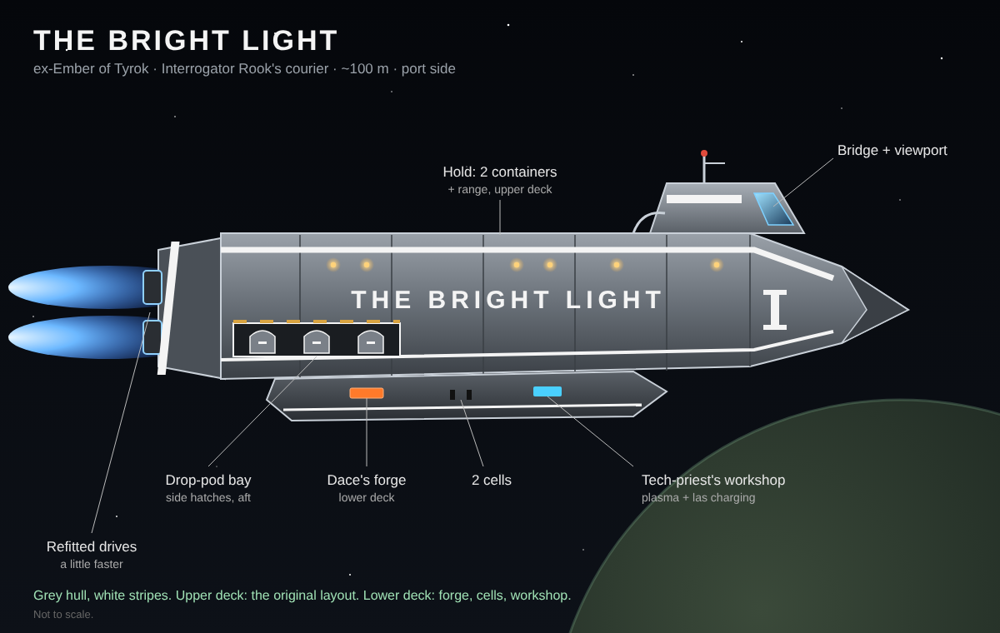
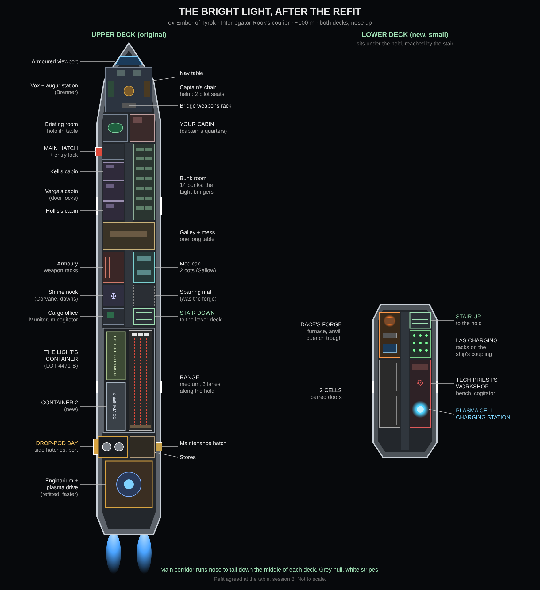

# Ash on Ostrava

### Season Two

*Title to be chosen at the table.*

*The story of Interrogator Tamsin Rook and the Light, as played at the table.*

---

Season One, *Seed of Nurgle*, is in [`book.md`](book.md), closed out in its
Chapter 19. Season Two begins here.

---

# Part One: The Spindle

## Chapter 1: The Bright Light

The pilgrim-bells were ringing somewhere up the spire when the last of the paint
dried.

She sat in her berth clamps on Saint Ivaine's Rest like something that had always
belonged to them: a hundred metres of Munitorum courier, grey from prow to drives,
with white stripes run down her flanks the way the Light wore white on its plate.
The *Ember of Tyrok* had carried Drachen's courier and Strahn in chains. Nobody
aboard called her that anymore. On her prow, in letters taller than a man, she
said what she was: THE BRIGHT LIGHT.

Her port hangar door stood open. Inside, nose to the gap, sat the Valkyrie the
Light had taken off the *Gate Unbroken*: mostly white now, grey underneath, grey
on the wings. Tamsin had stood in that hangar a long time the night they finished
painting her.

The berth smelled of fresh paint and promethium, and of incense blown down off
the shrine.

The Light were loading the last crates up the ramp when the boots came down the
gantry. Inquisitor Aurelia Kesh walked as she always walked, as if the deck had
been laid for her, with Sister Aldwyn a half-step behind her shoulder. Behind them
came three strangers with kit bags. And behind *them*, between two Ecclesiarchy
guards, came a woman in a grey prisoner's smock.

Tamsin had asked Kesh for a pilot. She had brought him three people.

The first was young and wiry, in a void-racer's flight jacket so covered in
patches it was hard to see the leather, and he was chewing something. The second
was older, maybe thirty-five, in a Navy flight suit with the insignia unpicked and
the thread-marks still showing where it had been. She stood with her arms folded.
The third was red robes and brass and a tangle of odd wiring, with half a face
that was not a face, and a green lens that whirred as it found him.

The woman between the guards was lean and somewhere in her thirties, with her head
shaved and smuggler's tattoos across her knuckles. A penitent collar sat at her
throat. Her wrists were chained. She looked at the ship, and then at Tamsin, the
way a trader looks at cargo.

"Interrogator," Kesh said. "One more for your collection."

She did not wait for him to ask.

"Nessa Vane. Smuggler. Black-marketeer. She ran guns past three sector picket
lines before the Arbites caught her. I was a smuggler's daughter. I know waste
when I see it." The cold eyes moved to Tamsin. "You seem to have a gift for
making these people useful."

She held out a brass rune-trigger on a chain. The collar's detonator.

Nessa Vane leaned past the guard beside her and spat on the deck plates by
Tamsin's boots.

"I'm not one of your soldiers, Interrogator," she said. "Remember that when you
sleep."

"She's yours," said Kesh.

Tamsin looked at the spit on the deck, and then at the woman.

"Dace," he said. "Take her down to cell one."

Dace came off the ramp and took Nessa by the arm, and she went with him without a
word. But her eyes did not stop moving. The hangar door's controls. The hatch
seals. The stair down. She was learning the ship before she had set foot in it.

When she was gone, Tamsin turned back to the Inquisitor.

"Yes, ma'am. I'll see what I can do."

Kesh dropped the detonator into his palm. It was warm from her hand.

"Good," she said. "The target list is loaded on your briefing-room hololith.
Worlds in my sector with heretic presence, confirmed or rumoured. Pick your
first. Send me your plan before you jump." She turned to go, and stopped. "And
Interrogator. Don't let her near the vox."

Sister Aldwyn gave him the smallest nod. Then they were gone up the berth, into
the bells.

That left the three with kit bags.

"So you're my new pilots," Tamsin said, "and my new tech-priest. You are now part
of the Light-bringers."

The young one shrugged. "Light-bringer. Sure, I'll take it." He went on chewing.
"Does that come with the paint? Because I'm not paying for the paint."

"I fly, Interrogator," said the woman with the unpicked insignia. Her name was
Mira Dhal. "I'm not a soldier. Point me at the cockpit and I'll get your people
there and back. The title you can keep for now."

The tech-priest's head tilted. The lens clicked twice.

"The Light. Photonic. Purposeful. Acceptable." The voice came out of a grille,
flat and patient. "I accept the designation. The Mechanicus did not want me. You
do. That is data I will remember."

Tamsin looked at the three of them: a racer who wouldn't pay for paint, a pilot
who wouldn't take the title, and a priest of the machine that Mars had thrown
away. He thought of Dace with a collar on, and Corvane with a cutlass at the Rest.

"Well, you're all part of the Light now," he said. "So welcome aboard. Come look
around."

He walked them up the ramp himself. The hangar first, where Teo Brack ran his hand
along the Valkyrie's wing like a man touching a racing hull, and Mira went
straight to the cockpit ladder and checked the canopy seals without being asked.
Then the hold, with the Light's container and the new one beside it, both chalked
PROPERTY OF THE LIGHT, and the snap of las from the range, where Isk and Varga
stopped firing to look. Varga lifted two fingers off Mercy's stock.

Down the stair to the lower deck, the tech-priest stopped in front of the old
plasma reclamator in the workshop as if someone had struck him.

"This is Mechanicus pattern," said Ferro-Ashe. "Old. Neglected." A mechadendrite
lifted, and stopped short of touching it. "Mine now."

Next door, Dace was coming out of the cells, wiping his hands. Through the bars of
cell one, Nessa Vane sat on the bunk with her back to the wall and watched them go
by.

Up again, forward. The galley, where Morcant was burning something that smelled of
grox. The bunk room: fourteen bunks, and seven of them taken. And the bridge,
where Teo dropped into the left helm seat and put his boots up on the console, and
Mira knocked them off without looking and sat down on the right.

Kell came up behind Tamsin with his slate.

"Everything's aboard, boss. Ship's loaded, Light's all present. Fourteen souls
and a prisoner." He nodded aft. "Kesh's list is on the hololith whenever you want
it."

"Alright," said Tamsin, and went to look.

## Chapter 2: The List

Green light climbed out of the briefing-room table when he laid his hand on it,
and Kesh's seal turned slowly over the top. Five worlds hung in the light, each
tagged in her hand.

A grain world where the barges came in rotten and three circles had been scratched
in a hold. Drachen's old anchorage at Ustrennos, where the hardliners were said to
have gone to ground in the docks and to talk of the gate opening again. A trade
asteroid, Torvane's Mart, where Chaos-marked weapons were said to move through the
warehouses. Confirmed, under the reactor district of Ostrava Primus: a Dark
Mechanicus cell, an eight-toothed cog, a heretek named Magos Vell-Orrin. And
confirmed, a mining moon called Sennet's Reach, its beacon silent a year and its
gates chained open from the inside, with Open Gate marks on the walls.

The eight-toothed cog was the same as the medallion on the traitor tech-priest
he had killed on Primus, back at the start of everything.

He read the mining moon first. A sand-dune moon, outposts scattered across it, the
cult confirmed. "Simple raid mission," he said. "Come on, take out the heretics,
get out." But it was not simple: a cult that had held a colony for a year, storms
that could ground the Valkyrie, and a rumour that the miners had dug into
something old in the deep shafts before the beacon died. And it was Nurgle's
work, by the look of it, and they had nothing aboard to fight plague.

"Problem is," he said, "we don't have any meds to counter the plague like we did
before."

So he looked at the second world instead. Ustrennos.

"Drachen's old anchorage. A supply place. Drachen was pretty well off, so all of
his goods might be there. Won't be easy, though. We'll have to fight whatever is
left of his team. Only rumours, so we'll have to do some scouting and some
questioning." He looked at the green dot of the anchorage. "Maybe there's a final
person in charge that was one of Drachen's loyal guard."

When the Light came in, packed fourteen deep into a room built for ten, he pointed
at it.

"This is what we're hitting. We'll have to get authorization to clear them out,
and once we do, I suspect a last Gate Guard is in charge. It will be CQC, which is
what we're good at. But it may be more hostiles than we expect. So we'll have to
scout and make a move off that."

Corvane knew the place. He had berthed there two years on the *Steadfast Ninth*.
"Drachen's private yard is the Spindle," he said. "An old dock ring out past the
main anchorage. Only his own ships used it. The garrison was commanded by Captain
Severin Holt. He never left the yard. If anyone is still holding out for Drachen,
it's Holt."

By the door, Mira Dhal had not moved.

"Hold on," she said. "Kesh told me heretics. Cultists. Things that need killing.
These are Guardsmen. Cadians. Men who stayed loyal to their general because that's
what they were trained to do. I didn't sign on to fly the Inquisition into a
Cadian civil war, Interrogator."

The room went quiet. Teo took his boots off the bench.

"That's true, they are Guardsmen," Tamsin said. "But they're also traitors. Me and
my team took traitor Lord Drachen down. We saw him leave his men to die, and then
take one of his own as a hostage. He sent men after men to do his bidding. And just
because they follow orders doesn't mean they aren't in the wrong. Everyone knows
Drachen is dead and is a traitor. Anyone that still follows him is no longer
confused. They're a traitor." He held her eyes. "Are you saying if your lord was a
traitor, you'd follow him?"

She was quiet a long time. Then her arms came uncrossed.

"No. I wouldn't. My academy instructor was a coward who got two cadets killed on a
training run and blamed them for it. I put him on the deck for it. They threw me
out." She looked at Dace, then back. "So no. I don't follow men like that. I'll fly
you in. One thing. Any of them who throws down his gun gets the chance to live.
Same as you gave him." She nodded at Corvane.

"Mira," Tamsin said, "I'd consider your opinion if this was up for discussion. Last
time I tried to save these types of men, I got thirty-odd prisoners, and only my
team got hurt for it. The prisoners walked away with barely a scratch. These men
have been told he was a traitor. He opened the gate on Cadia. They know, and
there's proof. So why would I give them a third chance to surrender? It's been out
a while."

Something in her face closed like a canopy sealing. "Understood, Interrogator.
Your call. I'll get you there and back."

Corvane said nothing. He had been given a third chance himself. He caught Tamsin's
eye for a moment and then looked back at the hololith.

"But because you asked nicely," Tamsin said, "I'll try for a non-lethal approach.
This time."

Mira blinked, and the canopy opened a crack. "...Thank you, Interrogator."

He sent Kesh the whole Light's wish list as a requisition: medicine, charges,
belts, an auspex, rockets for the Valkyrie, everything. Her reply came back in
twenty minutes, text only.

*Interrogator. You are an Ordo officer, not a quartermaster's wish list. Ammunition
and common kit are yours to earn, take, or buy. I have approved what a first
mission needs.*

"Well," said Kell. "She's in a mood."

She had sent a full case of antitoxin, blessed and sealed by Sister Aldwyn's order,
and a crate of plague-ward filters, and plasteel, and fuel for the Valkyrie, and
half of the rest. Nothing that went bang. Tavi looked at the cart as though someone
had stolen his birthday. Sallow hugged the antitoxin.

The mission plan she approved. *The authorization is yours to win; I will not hold
your hand with the remnant. Ustrennos is held for them now by Commodore Hale Varn,
flag on the Iron Litany. He declared for me third, not first. Remember that. Holt
alive if you can. Every slate from the Spindle comes to me.*

"Third, not first," said Kell. "So he waited to see who'd win."

When the crates were aboard, Tamsin walked onto the bridge.

"Bring her up," he said, "and on course."

## Chapter 3: Cargo

The *Bright Light* went into the warp hard. The deck shuddered; every light on the
bridge dimmed and came back; a whine rose through the hull plates and cut off.

"Geller field fluctuation on translation," said Ferro-Ashe over the speaker.
"Lower deck lost power for four seconds. Field is holding. This ship's Geller
generator is old, Interrogator. It holds. I do not like how it holds."

"Lower deck's the cells, boss," Brenner said quietly.

"Kell, Dace. On me."

Nessa Vane was sitting on the bottom step of the stair when they came down, chained
hands hanging between her knees. Behind her, cell one stood open a hand's width.

"Your locks are maglocks," she said. "Power goes, they let go. Whoever fitted them
should be shot. Relax, Interrogator. Where would I run? We're in the warp."

"Let's go back into the cell," Tamsin said. "Dace, forge me a lock and key, would
you?"

"Since you asked so nicely," said Nessa, and went back in and sat on the bunk. Kell
chained the door with cargo chain and a clip off his webbing. Dace ran his thumb
along the frame.

"A proper bolt lock, boss. Steel tumbler, no power in it. I'll make you two keys.
One for you, one for Kell."

"Make it a good one, smith," Nessa said. "I've picked Arbites locks."

Dace didn't look up. "Not mine."

Tamsin looked at her through the bars. "Nessa. You going to be trouble for me?"

She leaned her head back against the wall and took her time.

"Depends on you, Interrogator. Treat me like cargo and I'll act like cargo. Cargo
shifts in the hold. Cargo gets loose. Cargo breaks things. Give me something to do,
and maybe I'm worth the air." She lifted her chained hands a little. "I ran guns
nine years through dock rings like the one you're going to. Customs, back channels,
who takes bribes, where the cargo crawlways go. I know how docks breathe. Your
sergeant knows how to kick doors in. I know how to get past them without kicking."

"Well," said Tamsin, "you can ask Dace, and Corvane. Show me you can really fight,
and prove to us that you're not going to be a huge pain in my ass, and we'll let you
join."

Something under the pricing look showed for a second, and it was surprise.

"...You're serious. Him? The smith?"

"I held a door for a traitor on Cadia," Dace said. "I wore a collar. The boss took
it off. Corvane came after us with a cutlass. Now he goes through the door first."

"Fine," said Nessa. "Deal, Interrogator. And I'll start with the smith. I want to
know how a door-holder ends up wearing your colours."

"Stabbed a lieutenant while saving Inquisitor Kesh," said Tamsin. "Walked in front
of the team and did it without any fear. And then proved every day and night that
he really was a smith."

Dace's ears went red. "It was a disarm, boss. Mostly."

And Nessa laughed, short and surprised, the first real sound they'd heard out of
her.

"So I'll ask you the same questions I ask all my team members," Tamsin said. "Who
are you, what type of fighter are you, and what do you use?"

"Job interview. Fine." She counted it off on her fingers. "Void-born. Grew up on a
smuggler's hauler, the *Quiet Margin*. Never set foot on a planet till I was
twelve. Ran guns nine years. Who for? Whoever paid." She said that one too quickly.
"What kind of fighter? Not your kind. I don't stand in a corridor and trade shots. I
go through the crawlways and come out behind you. If you see me coming, I've done
it wrong. What I use: a needle pistol, toxin darts, silent, and a pair of balanced
throwing knives. The Arbites took all of it. Last I heard it went into your
Inquisitor's evidence locker."

"An assassin?" said Tamsin. "Hmm. I'll have to change my game plans around for
that."

"Smuggler, Interrogator. A needle pistol doesn't show on a customs auspex.
Assassins get paid more."

Going back up the stair, Tamsin asked Kell what he made of her.

"Not bad, boss. Careful," said Kell. "The angry ones you can read. She doesn't hate
you. She's working out what you're worth. And she answered every question but one.
'Whoever paid.' Too quick. She's sitting on a name. Give her her chance. Just don't
let her near the vox, like Kesh said. Or the detonator."

He found Corvane in the shrine nook, oiling the old stub revolver from the
container. The penitent's cord was gone from his wrist; a pale band of skin showed
where it had been.

"I'll have to get you new kit, Corvane," Tamsin said. "You and Dace need to start on
your carapace, belt and helm. And you're a pretty good shot with the revolver. Is
that what you want to keep?"

"I'll keep it. It's heavy and loud and doesn't care if it's dirty. It put a Gate
Guard down at the barricade. But six shots and a slow reload aren't enough for going
in first. A combat shotgun for the door. A cutlass for the close work. That's how I
boarded ships on the *Steadfast Ninth*."

"A quick-draw holster, a shotgun and a cutlass. I'll see what I can do. So now
you're part of the Light, how do you feel?"

Corvane set the revolver down and rubbed the pale band with his thumb.

"Honestly, boss? I don't know yet. This morning you said anyone who still follows
Drachen is a traitor. No third chance. I followed him. Holt's men at the Spindle,
some of them are men I drank with. Kasr Tyrok boys, like me." He picked the
revolver up again. "Like the only difference between me and them is that you caught
me first."

"Corvane. Listen to me," Tamsin said. "When you came after us at the Rest, all you
had was Drachen's word. Nobody had seen the proof. You followed your general because
that's what Cadians do. Holt's men have seen it. They watched Drachen tried and
shot. They know he opened the gate, and they're still holding the Spindle for him.
That's not following orders anymore. That's choosing. You got one chance and took
it. They've had four or five and keep saying no. The difference isn't that I caught
you first. The difference is you chose different."

Corvane sat very still with the rag in his hand.

"...I chose different," he said. "Yes. I did." He looked up. "If any of them are
Kasr Tyrok boys, let me call to them first, boss. One call."

"About that too," said Tamsin. "The stack will probably change, since the penitent
will be going in first."

"The penitent goes first. That was my rule." Then the boarding officer in him took
over. "But she's not a door-kicker, boss. She's a crawlway rat. Put her at the front
of a stack and she'll get shot doing a job she's bad at."

"But I can't use her like that until I can fully trust her," said Tamsin, "or she's
officially one of us. First she has to claw her way out of whatever is holding her
back."

"That's fair. You didn't send me anywhere alone either. And whatever she's holding
back, she'll tell you when she's more afraid of keeping it than telling it."

"We'll see," said Tamsin. "Now come with me real quick."

In the container he pulled the Gate Guard officer's power sword off the rack, and a
set of green carapace near Corvane's build, and a helm, and put them in his arms.
"Here. This is all yours. We'll see if you like the power sword more."

Corvane stood holding it a long moment: a man stripped of his rank and his blade not
long ago, holding an officer's weapon. He thumbed the field on. It snapped blue,
flickered, steadied. "Thank you, boss." He stood straighter than Tamsin had seen him
stand since Kasr Tyrok was a word he could say without flinching.

Tamsin took one of the long Gate Guard bayonets out of the crate. "Carry this for
me. It's what I'll give the penitent. So when it's time, this is what she has."

Then he went through the Void Exchange crate he had not forgotten about, and found
it perfect: a Lucius-pattern chain axe with a spare chain, a hunter's reflex sight,
a photon flash, and two krak grenades Mag Vashti had added for the late delivery.

In the bunk room he fist-bumped Kell over the axe. Tavi got the kraks and cradled
them like eggs. Hollis caught the flash one-handed. And when Varga asked from the
top bunk where hers was, Tamsin held up the sight.

"Oh, you mean this? I'm not sure you want this, you know. Unless you admit you paid
one of the guys to cheat for you in our match."

"I won that match by a hair, with your collarbone still knitting. Nobody had to
cheat." She held out her hand. "Rematch. You win, it stays on Vigil."

"We can still run it," he said. "But here. It's yours."

She looked at it a long time. "Mercy's last bearer always wanted one of these. Never
got it before Hesk." The dry look came back, mostly. "Rematch stays on. For pride.
And I'm still better than you."

On the fifth night, Dace's voice came tight on the bead. *Boss. Lower deck. Now.*
The intercom panel in cell one was pried off its screws, wires hanging out of it,
and Nessa sat by the wall with a bent bunk spring.

"Relax. I was testing your smith's work."

"I thought you said you weren't going to be trouble for me," said Tamsin, and reached
through the bars and cut the wires in one quick slice.

"Five days in a box, Interrogator. Nobody tells me anything. I wasn't calling
anyone; you can't vox out of the warp. I wanted to *listen*. Information's the only
currency I've got left."

"Alright, fair enough. Give me the box so Brenner can fix it later. And then I'll
tell you what's going on." She passed the panel out through the bars. "We're going
to a storage center where some of traitor Lord Drachen's men still reside. We get
in, take them out, and get their commander alive. Might be a firefight, could be
simple and easy. We don't know. Scout and info, and we'll see what we can do."

The smuggler in her woke. "Men holed up for weeks still eat. Air scrubbers, power
cells, water. Somebody at your anchorage is feeding them. Find the supply run and
you find the way in. Your man there declared third, not first. A man who waits to
see who wins keeps both doors open. Don't spook him. Catch the shipment in the act."

"I could do that and get a low-time smuggler," said Tamsin, "or I could stop a whole
operation and put someone big behind bars, and get the smuggler in one go."

"...Huh. Go big. All right."

"Too good," said Tamsin. "Now do you want me to tell you how I'll use you, or do you
want to figure that out another day?"

"Now. Obviously."

"Bait."

She stared, and then laughed loud enough to ring off the walls. "Of *course* I'm
bait."

"Just kidding. I was going to do what we normally do with prisoners: throw them in
the front and have them claw their way to freedom. But something Corvane said made
me think. I'll let you do the recon and scout. If you disappear, there's always a
big button I can press to erase you."

"I know about the button. Nobody runs from a collar on a dock ring." She came close
to the bars. "Coveralls, a crew chit, something to cut with, a bead."

"A knife and a vox bead. You'll have to play to the shadows, assassin. You've got a
big metal bomb on your neck. You think some overalls are going to make you blend in?"

"Shadows it is. And stop calling me assassin. Someone will start believing it."

"It's what you are to me now. So there, are you happier? You're not going to destroy
my vox again?"

"I've got a job and a reason to get out of this box. That's more than I had at the
berth. And no." Quieter: "You told me the truth tonight. Nobody's done that since
the Arbites dragged me off the *Quiet Margin*. I'll remember it."

"Now tell me," he said, "what are you hiding from me, Nessa? You know I'm an
Interrogator, right? I might be a new one, but I had a hell of a teacher."

The silence held a long time.

"...You had a good teacher." She looked at her knuckles. "The last two years I ran
for one broker. Orlen Thask, on Torvane's Mart. Triple pay, no questions. Then I
started seeing a mark on the crate seals. A gate. Open. I knew what it meant by the
end, and kept running. My last run before the Arbites took me was lasguns and mining
charges. To a mining moon called Sennet's Reach."

"A cult gun-runner," said Tamsin. "Hmm. Probably the least worst out of the three of
us. But sure."

"...That's it? 'Sure'?" She looked at Dace. "Throne. What kind of unit is this?"

"What do you carry, Nessa?"

"Forty crates," she said, when the joke had gone out of her. "Forty crates of guns,
landed on Sennet's Reach eighteen months ago. Whatever's holding those gates open, I
put guns in its hands."

"So you carry it as well? Shame? Or regret?"

"Regret's for a bad deal. This is the other one. Shame is about who you were when
you chose." Her eyes went to the word painted on his sword. "But you'd know."

"Indeed," said Tamsin. "It seems now you carry it along with us."

She lay back and turned her face to the wall. "Get me that knife. I'll start paying
it off on your dock ring."

## Chapter 4: The Commodore

The *Bright Light* came out of the warp hard and wide of Ustrennos, and the stars
settled back into place around the old anchorage of Lord-General Drachen.

"Picket frigate hailing, boss," said Brenner.

The voice on the vox was clipped and Cadian. "*Bright Light*, *Kasr Feyd's Pride*.
Your codes are received. Interrogator Rook, you are cleared to the inner anchorage.
Commodore Hale Varn sends his compliments and requests the Interrogator's presence
aboard the *Iron Litany* on arrival."

The whole bridge turned to look at him.

"I need to speak with the man who runs this place," said Tamsin. "Kesh told me. Tell
him that."

Brenner passed it on, word for word. There was a short pause on the line.

"Understood, *Bright Light*. That is Commodore Varn. He holds the anchorage for the
remnant fleet. The Commodore will receive you aboard the *Iron Litany*. You are
assigned berth twelve on her flank. Six hours. *Kasr Feyd's Pride*, out."

Teo brought the ship around toward the inner anchorage. The remnant fleet slid past
the viewport: scarred Cadian hulls, patched armour, some still carrying the white
gate of Cadia on their prows and some with it painted over. Far out past all of
them, alone, hung a dark ring with no lights on it. The Spindle.

"Six hours to work out who's walking in there with you, boss," said Kell, low at
his shoulder. "And what the assassin is doing while you're shaking his hand."

Tamsin thought of Kesh's words, the ones she had sent with the mission. *The
authorization is yours to win. I will not hold your hand with the remnant. He
declared for me third, not first. Remember that.* And he thought of Nessa in her
cell, saying that a man who waits to see who wins keeps both doors open. He did not
know what Varn was. He did not intend to guess.

He keyed the ship. "Brief table, five minutes."

---

The Light came in from the range and the mat, sweaty, kit half on. Corvane wore his
new grey-and-white plate for the first time, the power sword on his hip. Varga had
Mercy slung with the new sight on top. Mira and Teo left the helm on station-keep,
and Ferro-Ashe came up with generator oil on his hands. The hololith showed the
anchorage: the *Iron Litany* marked in green, and far out, the black ring.

"All present, boss," said Kell. "Minus the assassin."

"Kell, grab Nessa for me."

He came back with her in front of him: chained hands, collar, grey smock, bare feet
on the cold deck. The room went quiet. Most of the Light had only seen her through
bars. Morcant looked her up and down. Isk shifted his rifle on his shoulder. Mira
folded her arms. Corvane watched her the way he would watch a doorway.

Nessa looked at fourteen armed people in grey and white, and then at Tamsin. "Oh,
good. A crowd."

Kell sat her at the end of the table beside Dace, and stood behind her.

"Alright, now that we're all here, this is the rundown," Tamsin said. "We're docking
in at this *Iron Litany*. This guy might be the one letting them do whatever they're
doing. He might not know. That's for me to find out. We'll come in to speak with
him, as our team, and we'll get our info. After that we can plan what happens next.
Either we take him with us, or he lets us take them down."

The questions came the way they always did with this crew.

"'As our team,'" said Kell. "All of us aboard his flagship? Fourteen armed
Light-bringers walking into a Commodore's office looks like an arrest. If you want
him talking, take four or five."

"Someone stays on the helm," said Mira. "If this goes bad in his berth, I want
engines warm."

"I can tap their dock traffic from here while you talk," said Brenner. "Freight
logs, berth movements. Nothing loud."

"And while the Commodore is busy shaking your hand," said Nessa, "nobody is watching
his dockmaster. That's where a supply run lives. Let me go down to the freight decks
while you're upstairs."

"If he's guilty and he sees it coming," said Corvane, "his armsmen will be between
you and the door. Whoever goes with you should be ready for that."

Dace said nothing. He was watching Nessa.

"Varga, Kell, Corvane, Nessa," said Tamsin. "That's all I need. Corvane and I will go
in to speak with him. Corvane, you've been around Drachen's men. If you see anything
that makes you think he's not one of us, don't hesitate. Say something. Varga and
Kell at back-mid. Nessa at mid. Me at front-mid. Corvane on point."

Corvane straightened in his new plate. "Understood, boss. I served under men like
Drachen for six years. I'll know the look."

Nessa raised an eyebrow at being put in the middle of the stack and not sent down to
the freight decks. She opened her mouth, looked at him, and shut it again. "Mid it
is. You'll want me out of this smock, then. A barefoot prisoner in chains walking
onto a Commodore's flagship says you brought a prisoner. Not a team."

"I walked onto Kesh's ship with Dace in shackles," said Tamsin. "It's not odd for me
to have one. And if someone asks, maybe I'm giving you away."

She stared at him. Then the trader's smile spread slowly across her face.

"Oh. That's good. A prisoner you might be handing over. Nobody guards their tongue
around a prisoner. Nobody watches where she's looking. She's just cargo." She held up
her chained wrists, almost proudly. "Chains stay on, then."

Dace glanced at Tamsin. He remembered those shackles.

---

The docking was ugly. Teo brought them in a hair too fast, the clamps banged home,
and the boarding tube took ten long minutes to seal while Mira swore at it under her
breath. Then the hatch cycled open on an old Cadian frigate, scarred grey steel and
faded unit banners, and a long bare lock with the white gate painted on the far
bulkhead.

A young lieutenant waited there in a sharp-creased Navy uniform with a slate under
his arm, and behind him stood eight armsmen in flak with combat shotguns at port
arms. Not aimed. Not slung either.

The lieutenant saluted. "Interrogator Rook. Lieutenant Daran Kole. Welcome aboard
the *Iron Litany*. The Commodore is expecting you." His eyes went to Nessa's chains,
to the sword on Corvane's hip, to the hellgun on Tamsin's shoulder. "Commodore's
standing orders: all weapons are surrendered at the lock and returned on departure.
No exceptions for any visiting party. If you'd be so kind."

"Can we leave them on our Valk?" said Tamsin. "You know we fought hard for this
stuff. Wouldn't want to see it go missing."

Kole almost smiled. Almost. "Your own ship is outside my jurisdiction, Interrogator.
Leave them aboard the *Bright Light* and the Commodore's orders are kept."

So Vigil, Shameholder and Last Word went back down the tube into Dace's arms, with
Corvane's sword and revolver, Kell's chain axe and Officer, and Varga's shovel and
Mercy. Varga handed Mercy over last and slowly, like it hurt. The knife in Tamsin's
boot stayed where it was, and nobody asked about it.

The armsmen fell in, four in front and four behind. The *Iron Litany* was old and
lived in: patched bulkheads, banners from a dozen dead regiments, Cadian ratings who
stopped talking when the grey and white went by. Nessa shuffled along with her head
down, and her eyes went everywhere.

The Commodore's stateroom was panelled in dark wood salvaged from somewhere better.
A long table was buried in charts, and a viewport looked out on the fleet and, far
off, on the black ring.

Commodore Hale Varn stood at the viewport with his back to them. He was in his
sixties, broad and grey-bearded, in a Navy greatcoat with Cadian campaign ribbons.
He turned.

"Interrogator Rook. The runner from Kasr Holn. I watched your Inquisitor's evidence
on that screen, and I watched Drachen hang for it. Sit. Tell me what the Ordo wants
with my anchorage." He looked at Nessa, then back. "And what you've brought me."

Tamsin took him in from head to foot, and the room around him. He saw what anyone
would see. A tired old officer, greatcoat worn at the cuffs, ribbons faded, boots
polished but cracked. Hands easy on the back of a chair, no weapon he could see. A
chart table that was a busy man's mess of fleet dispositions and ration slates.
Kole by the door. Two armsmen outside. If there was anything wrong in that room,
Tamsin did not catch it.

"It's a classified matter, sir," he said. "Only people with the required knowledge
and authority can hear it. Corvane here knows a lot. That's why he can stay."

Varn's eyebrow lifted a fraction. Then he nodded. "The Ordo and its secrets. Of
course. Lieutenant, wait outside, and take the Interrogator's people with you. See
they get a drink."

"Sir."

Kell caught Tamsin's eye and gave the smallest nod: *right outside*. He and Varga
walked Nessa out between them. On her way past the chart table she slowed half a
step, and her eyes swept the slates, and then she was through the door.

Varn sat heavily at the head of the table. "Corvane. Kasr Tyrok, yes? The *Steadfast
Ninth*. You were Drachen's man once." He gestured at the chairs. "So was I,
Lieutenant. So were most of us. That's not a crime anymore. Now. Classified. I'm
listening."

"Commodore," said Tamsin, "do you know of any of Drachen's men who are still present
here?"

Varn didn't bother to pretend. He turned in his chair and pointed through the
viewport at the black ring.

"There. The Spindle. Captain Severin Holt and what's left of the Gate Guard. Thirty
men, maybe forty. They locked the ring down the night your broadcast went out and
they haven't opened it since. Every man in this fleet knows they're there. It isn't
a secret, Interrogator. It's an embarrassment."

He rubbed his eyes.

"I've had captains asking me to storm it for weeks, and others begging me not to.
Half those Gate Guard have brothers and cousins on the ships around you. If I send
Cadians to kill Cadians on a dock ring, I lose this fleet. It splits down the
middle. So I cut them off. No supply, no traffic. Starve them out. It's slow, but
nobody's brother dies."

Corvane was very still beside him.

"If they are cut off, sir," said Tamsin, "then why are they still eating? Why do I
have reports that they're getting shipments and stock loads of supplies?"

The room went quiet. Varn's hand, resting on a stack of supply slates, went still.
His eyes flicked once toward the door where Kole waited, and came back.

"...What reports?"

Tamsin had no reports. He had a smuggler's guess. He held the old man's eyes and did
not blink, and it was Varn who looked away first. He sagged in the chair, and for a
moment he looked every one of his sixty years.

"...Throne. My dockmaster. Master Tull Orsk. He signs out a salvage tender every few
days, the *Grey Widow*. 'Wreck recovery on the outer ring.' The logs say so. The
tender comes back light." He pressed his palms flat on the table. "I've suspected
for weeks. I looked at those logs and I put them back in the pile. Because if I
arrest Orsk, the Spindle starves for real, and Holt comes out shooting or I have to
send men in. Either way Cadian kills Cadian in front of the whole fleet, and this
remnant tears itself in half. So I let a traitor's garrison eat, and told myself it
kept the peace." He looked up. "The *Grey Widow* goes out again in about twelve
hours. Ten hundred tomorrow."

Corvane let out a long, slow breath.

"So you helped out traitors?" said Tamsin. "Willingly?"

Varn flinched as if he had been struck. Then the old officer came back into his
spine, and he sat up straight.

"Willingly? No. I never signed a manifest. I never sent a crate. But I knew, and I
let it happen. You can call that what you like, Interrogator. The Ordo will." He met
Tamsin's eyes. "I've held this fleet together with spit and old loyalties since the
day your broadcast went out. Sixty-one captains, half of them still grieving a man
they called father. One wrong order and it's civil war in the void. I chose the
quiet road. It was the coward's road. I know that."

He tapped the chart over the Spindle.

"You came here for Holt. Take him. You have my authorization, in writing, under my
seal. Orsk too, if you want him. All I ask is that it's done by the Ordo and not by
my fleet. Let the captains blame the Inquisition, not each other."

"My team will take care of it, then," said Tamsin. "Don't let your armsmen catch heat
for this either. But remember: Drachen was a traitor, and has been for a while.
Those are no longer brothers and cousins. Those men out there are people who made a
choice. A choice they will have to regret soon." He paused. "I understand how you
feel. Three of my men were traitors, and now they're on my ship, working for me. So
I know what it's like to feel bad. Tell me, do you know who the Light is? What we
did?"

Varn glanced at Corvane, who did not look away, and something shifted in the old
man's face.

"The Light." He said it like a name he had heard a great deal. "Every gunnery deck
in this fleet knows it, Interrogator. Grey plate, white trim. Eleven of them boarded
the *Gate Unbroken* with the shields still smoking and walked up the bridge tower
through Drachen's own Gate Guard. The runner from Kasr Holn shot the bolt pistol out
of the Lord-General's hand and dropped four of his bodyguards bleeding through his
own chest. A boy with a shield made Drachen look him in the face. And not one of the
Light died. My ratings tell it in the mess like a saint's tale. Half of them don't
believe it." He studied Tamsin. "I believe it now."

He pulled a blank order slate toward him, wrote for a long moment, and pressed his
signet into the wax at the foot of it. "Authorization. The Ordo's operation against
the Spindle, under my seal. My armsmen stay out of it, as you asked. What do you
want from me before ten hundred, Interrogator?"

"I need exact info. What they're armed with, where Orsk stays, what he delivers to
them, the layout if you can. And then I have an ask of you." Tamsin leaned in. "The
place is a storage yard. Drachen owned it, and his own men took it. When we finish,
the crates, the containers, everything left there is property of the Light. You
wouldn't want your people even more upset that you raided their former lord's
facility, would you?"

Varn counted off the first part on his fingers. "Gate Guard kit. Carapace, hellguns,
the best this fleet had, and the Spindle had its own armoury. Heavy stubbers at
least. Maybe worse. Orsk keeps the dockmaster's office on Ustrennos Station, ring
three, and sleeps in the quarters behind it. Never misses a shift. What he delivers
I can't swear to. The logs say salvage gear. If I were feeding a garrison I'd send
food, water, scrubber cartridges and power cells. Ammunition, if I were bold. The
fleet archive has the construction plans. Drachen built the place twelve years ago.
They'll be old and he'll have changed things. Kole can pull them tonight."

Then the ask landed, and his jaw tightened. He had held this fleet together on short
rations and patched hulls, and Drachen's stores were the richest thing at Ustrennos.
He looked at Tamsin a long moment. Then a short, tired laugh came out of him.

"You're right, damn you. If my captains see my crews hauling Drachen's crates out of
his own yard, half of them call it looting a dead man and the other half want a
cut. I'd spend a year settling it. If the Ordo takes it, nobody argues with the
Ordo." He took the slate back and added a line under his seal. "Everything in the
Spindle is the Light's, by right of the Ordo's operation. Crates, containers,
stores, the lot. I never saw it. Your Inquisitor will want the slates, I imagine.
That's between you and her."

"And one more thing," said Tamsin. "Can we board the next shipment that goes out to
them? Me and my team. And I'll need a report from you. Kesh's order. It will be
sealed and private, so no one but me and her sees it."

Varn rubbed his beard over the first part. "It's Orsk's boat and Orsk's crew. Six or
seven hands, all his. If your people try to slip into the cargo under his nose,
he'll smell it. But Holt is expecting that tender at its usual hour with Orsk's
codes on the vox. If the *Widow* turns up on time saying the right words, the
Spindle opens its doors for her. If Orsk and his crew were... unavailable before ten
hundred, and your people were aboard instead, with his codes..."

He left it there.

The report landed harder. He looked down at the order slate under his own hand for
a long moment.

"A report to the Inquisitor. Everything I knew, and when I knew it. That's my
command, Interrogator. Maybe my neck." He breathed out. "You'll have it. Sealed, by
morning. I'd rather she heard it from me than from you."

"Kesh let three traitors turn themselves around and stay with me," said Tamsin. "She
let her own people at Saint's Rest throw rocks at her and call her names. Those were
mad people, frustrated people. She'll understand why you did the same."

Some of the weight went out of Varn's shoulders. Not all of it.

"Stones at an Inquisitor. And she let them live. I'd heard she was cold. Maybe cold
isn't the same as cruel." He looked at Corvane one more time, then held out his
hand across the table. His grip was dry and hard. "Thank you, Interrogator. I'll
write it straight. All of it. And if the Light ever needs a berth, a ship, or a
friend at Ustrennos, you ask for me."

He opened the door. Kole straightened outside, and beyond him stood Kell, Varga and
Nessa with untouched drinks in their hands.

"Lieutenant. Pull the Spindle's construction plans from the archive and take them
to the *Bright Light* tonight. Then you've never heard of them."

"Sir."

In the boarding tube Nessa fell in half a step closer. "I got nothing off his table.
Fleet dispositions and ration counts. If he's hiding anything, it isn't lying on
top."

"Same outside," said Kell. "Kole's lot wouldn't say a word."

Dace was waiting at the lock with every weapon racked on a cargo trolley. Varga took
Mercy back first and checked the sight before she did anything else.

"New game plan, you said, boss," said Kell. "Brief table?"

"Yep. Brief table. Everyone in five."

---

The plans had not come yet, so Tamsin ran them through it without them.

"So here's the deal. Orsk is the one keeping them alive a little longer. So we pay
him a visit a little before his next shipment. Then we board the shipment that's
going to the Spindle, and once we feel we've docked, that's when shit gets real.
And I have a plan for that too."

"The *Widow* has her own crew," said Mira. "If we're on her, someone has to fly her.
That's me or Teo."

"Me," said Teo. "I've flown tenders. Ugly boats."

"And the Spindle will expect the right voice saying the right words on approach,"
said Nessa. "A run like this always has a handshake. Get the words out of Orsk
before you take his boat, or it's a very short trip."

Tavi was already grinning. "And when we've docked and shit gets real..."

"Let him finish," said Kell.

"Orsk comes alive, and Brenner gets a voice recording of whatever he says," said
Tamsin. "They probably have a passkey or a code. Or we just take him with us. Once
we're clear, they open their new shipment that's supposedly supplies. And it's us."

A slow grin went round the table.

"We're the supplies," said Morcant. "I love it."

"I can record him," said Brenner. "Voice, passphrase, the lot. Give me ten minutes
with his voice and a vox-caster and I can play him back. It won't fool anyone who
knows him well, but over a crackly approach channel it'll pass."

"Taking Orsk along is safer," said Corvane. "If they ask something the recording
can't answer, he answers it, with your knife at his back."

"How many of us fit in a tender's hold, though?" asked Sallow.

"Thirty, forty metres of boat," said Mira. "A dozen crates if they're big. Fourteen
of us in kit is tight."

"We use the recording first," said Tamsin. "If they ask something, Orsk says it
himself. And yes, getting all of us over there will be a pain, but I've already
thought about it. A small team of six in the hold. After we've made contact, the
Valk comes down to drop the rest out in the courtyard."

Mira leaned forward. "One problem, Interrogator. The Spindle is a dock ring in
vacuum. There's no courtyard. There's no air outside. I can't drop people onto it.
I need an open bay to fly into, or a hull lock to clamp onto and breach."

"If the *Widow* goes in through a cargo bay," said Teo, "the bay doors are open while
she docks. Close behind her and the Valk can be through before they shut."

"Or they shut them on us," said Mira.

"Then the first six have one mission," said Tamsin. "Get the bay doors open, so we
have our backup."

That made sense to them.

"Bay doors run off a control station," said Brenner. "A booth up on the gantry, or a
panel by the inner lock. If it's slaved to their command deck, I can cut it over by
hand. Takes a few minutes."

"And if he can't," said Tavi, "I blow the motor housing and they're stuck open."

"Stuck open works for me," said Mira. "I'll hold the Valk off their sensors a few
thousand metres out. Give me the word and the doors, and I'm in within two minutes."

"So six of us hold a cargo bay full of angry Gate Guard for a few minutes while
someone works the doors," said Kell. "Which six, boss?"

"In the crates: me, Hollis, Brenner, Morcant, Tavi, Varga. The rest are the backup."

Morcant cracked his knuckles. Tavi looked like he might burst. Hollis only nodded.
Varga patted Mercy. Brenner was already writing on his slate.

"No shield in the crates, boss?" said Dace quietly.

"Backup's mine, then," said Kell. "Dace, Corvane, Isk, Sallow. And the assassin."

Nessa raised her chained hands an inch. "The assassin would like her knife and her
bead before she rides into a gunfight."

"You'll get them, before we drop." Tamsin looked at Corvane, who still had the Gate
Guard bayonet set aside for her, tucked at the back of his belt. "We'll have to wait
for the layout before we proceed. For now this is the draft team. It might change
depending on the plans. Get some rest or train. Be back here when I call you.
Brenner, set a timer for three hours."

"You heard him," said Kell. "Rest or train."

Morcant and Tavi went off to the range, arguing about crate sizes. Kell walked Nessa
back down to her cell. Corvane paused in the doorway, nodded to Tamsin, and went.

## Chapter 5: Ring Three

At 0240 his bead clicked him awake.

"Timer's up, boss," said Brenner. "And the plans aren't here. Kole's on the vox for
you. He doesn't sound happy."

Kole's voice came through tight and quiet. "Interrogator. I have the Spindle plans.
I'll bring them myself in twenty minutes. But there was a night clerk in the
archive. He watched me pull them. When I came back out of the stacks his post was
empty, and he hasn't come back. Nobody's seen him." A pause. "The archive is on
Ustrennos Station, ring three. Same ring as the dockmaster's office."

If that clerk was Orsk's man, Orsk could already know.

"Alright," said Tamsin, and switched to the Light's channel. "Plans changed, people.
We're going to take Orsk. Get kitted up."

The ship woke around him. Boots hit the deck, lockers banged, and Morcant swore as he
dragged his stubber belts over his head. In four minutes the Light stood at the lock
in grey and white with beads in, and Kell brought Nessa up from her cell in her
chains.

"Ustrennos Station is forty minutes by tube-train," said Mira over the speaker. "Ten
by the Valk. Ring three is the dock ring. Busy, even at night."

"All fourteen of us walking onto a busy dock ring at three in the morning will be
noticed, boss," said Kell. "Who's going for Orsk?"

"By the Valk. And you're right, Kell. Me, Kell, Corvane, Brenner, Nessa, Isk." He
turned. "The rest of you be ready. When the map comes through on the ship, Varga,
you let everyone know, and you come up with the plan. Once we're down at the dock
we're stuck there until it's time to go, so make damn good two teams, Varga. Once
we've taken care of Orsk, the plan should be through. The Valk goes back as soon as
it drops us, you wait for the plans, and then you tell them who's going to the
shipment and who comes back to the ship with me. Simple and easy."

Varga nodded once. "Two teams. Good ones. Leave it with me, boss."

---

The Valk dropped out of the side hangar with Mira at the stick, and ten minutes
across the anchorage Ustrennos Station grew in the canopy: a fat grey wheel of rings
and gantries, ring three lit up and busy even now. Mira set them down in an open
cargo bay, and the vox crackled at once.

"Unregistered gunship, bay three-nine. Identify. Now."

"Ordo business," said Mira. "Logged under seal. Back off."

The vox went quiet. Through the canopy a dozen dockhands had stopped mid-shift at
the bay edges to stare at the white gunship and the grey-and-white soldiers coming
down its ramp. Mira was already spooling up.

"I'll be at the *Bright Light* in ten. Call me."

"Corvane," said Tamsin. "Give her the stuff."

Corvane pulled the Gate Guard bayonet from the back of his belt and a spare vox-bead
from his pouch, one of the two Kesh had sent, and put both in Nessa's chained hands.
"Don't make me regret it."

"No promises." She tucked the bead into her ear and slid the blade into her sleeve.

Tamsin looked the bay over and took his time. The bay mouth stood open to the void
behind its shimmer of atmosphere field, and the Valk was a white streak going home.
A control booth sat up on a gantry with its window lit, and a man inside had a
handset at his ear and was watching them through the glass while he talked. Crates
stood at the edges, one stack stencilled SALVAGE; its seals were old and dusty, weeks
untouched, nothing to do with any tender. None of the dockhands was slipping away.
Two were already drifting back to work. Through the concourse door came foot traffic
and a vendor shouting, and the reflection of an armsman patrol walking slow.

And under the gantry, behind the left-hand crates, there was a maintenance crawlway
grate about waist high. Its bolts were bright and recently worked, and it ran
spinward, the same way as the sign over the door: DOCKMASTER, SPINWARD.

Nessa had followed his eyes to the grate. She said nothing. She raised an eyebrow.

"Concourse or crawlway, boss?" Kell asked.

"Nessa, into the vent," Tamsin said quietly. "Tell me what you see and where it
takes you. Don't make contact until I tell you to. Corvane, Brenner, take the man in
the control booth. Isk, Kell, we're going to the dockmaster."

Nessa dropped behind the crates, worked the grate free and slid in feet first. Even
in chains she made almost no sound.

Corvane and Brenner went up the gantry stair. The operator saw two grey-and-white
soldiers coming and put his handset down before they reached the door, and sat back
with his hands flat on the console.

"Booth's ours, boss," said Brenner on the bead. "He's being very cooperative."

Tamsin, Kell and Isk went out into the concourse, a long curving street of shuttered
shopfronts and ration stalls and dockhands coming off shift. The armsmen were fifty
metres ahead and did not look back. They followed the signs spinward for six
minutes.

"Utility spine," Nessa whispered in his ear. "Pipes and cable runs, warm, filthy. It
runs behind the shopfronts. ...I've got a grille over a corridor. There's a
shuttered office below me with a brass plate. DOCKMASTER. I can see the door but not
inside. I'm staying put."

The office had a heavy steel shutter half down over its glass front, a gap about
waist high beneath it. Behind it was a lit front desk and one night clerk, a thin
young man with a recaff cup and a slate. A door at the back with frosted glass, and
light behind it: the quarters. In the corridor ceiling above them was a grille, and
Tamsin could just see Nessa's eyes in the dark behind it.

"Clerk's awake," said Kell, low. "Orsk is behind that back door."

"Nessa," said Tamsin, "can you take the clerk quietly? Don't hurt him. Make him open
this door, and make sure he doesn't alert anyone while you do it."

She eased the grille aside and dropped.

The chains betrayed her. The links between her wrists caught the grille's edge and
rang out down the corridor like a dropped spanner. She landed light and rolled and
went under the shutter fast, but the clerk's head was already up. He saw a
shaven-headed woman in a prisoner's smock with a penitent's collar at her throat and
a long blade in her hand, coming at him. His cup hit the floor. He shoved back from
the desk and his hand slapped toward a red stud on its edge.

"*Master Or—*"

Tamsin dropped and slid under the shutter on one hip, and Last Word came out of the
thigh rig as he cleared it. He came up on one knee with the pistol already up, and
Venn's hair trigger broke at a whisper.

A thin red bolt took the clerk through the right shoulder. His arm jerked off the
desk an inch short of the stud, and the shout died in a gasp. Nessa was on him a
heartbeat later, chained hands clamped over his mouth from behind, the bayonet flat
against his throat.

"Shh. Shh. You want to keep breathing, you stay very quiet."

He nodded frantically, eyes huge, blood spreading through his shirt.

Kell ducked in behind with Officer up on the back door. Isk stayed crouched at the
shutter gap, covering the corridor both ways. The frosted door stayed shut. The
light behind it did not change. Orsk had not woken. Last Word's barrel was barely
warm; the old pistol had put the shot exactly where Tamsin wanted it.

He walked over to the clerk. "Kell, patch this kid up." And to the boy: "Sorry to
shoot you, son, but I need this to go quiet. My team will have you on a Valk with a
medic soon."

Kell packed the shoulder with quick, rough hands. "Through and through. Clean. Burnt
shut, mostly. You'll live, lad."

The clerk's eyes went to the rosette, to the grey and white, and some of the terror
went out of them. "...Ordo. You're the Ordo. I just do the night logs, sir. Berth
times. I don't know anything." His eyes went without meaning to toward the frosted
door, and then to a brass key on a hook by the desk. "He sleeps heavy. He drinks
before bed."

"Corridor's clear, boss," said Isk. "Patrol's gone the other way."

"Nessa, keep him quiet."

Tamsin lifted the key off its hook and signed: *Kell, left of the door. Isk, right.
Me, centre.* Isk came in soft with his long hellgun shouldered short and his
laspistol in his free hand. Kell put his back to the wall on the left. Tamsin stood
in the middle with the key in one hand and Last Word in the other, and gave the
fist. *Hold.*

From the other side came snoring, slow and heavy, and under it the tick of a chrono.

He gave the flat palm: *hold here*. He holstered Last Word and drew the Kasr Holn
knife from his boot. The key turned with a soft click. The door swung in on oiled
hinges, and he left it open, because closing it would make noise.

The room was small and warm and smelled of amasec and sweat. A lamp turned low on a
side table beside an empty bottle and the ticking chrono. A wardrobe. A desk heaped
with slates. A narrow bunk, and on it, sprawled on his back, a heavy bald man in his
fifties, snoring with his mouth open, alone, no weapon in reach.

Tamsin crossed the room heel to toe and the man never stirred. Then one hand clamped
over his mouth, the other hauled him off the bunk, and Orsk hit the deck on his back
with Tamsin on top of him and the edge of the knife at his throat.

His eyes snapped open, bloodshot and drunk. He thrashed once, weakly, and his hands
pawed at Tamsin's arm and then went still as he felt the steel and saw the plate and
the rosette over him. Under the palm he made a high, terrified sound.

"Enough, Orsk. You're done for. One loud sound and your neck is tasting blade."

It took a while. The thrashing stopped first, then the whimpering. His breath
whistled through his nose and slowed and finally settled, and his hands fell flat to
the deck either side of him, palms up. He nodded, small and careful.

On the desk, a slate glowed with a berth schedule, one line lit: *GREY WIDOW. 1000.
BAY 3-14.*

"Kell, Isk, on me. Kell, bind him. Isk, help me search the room."

Kell rolled Orsk onto his face and tied his wrists and ankles with cord from his
webbing and gagged him with his own bedsheet, quick and practised. Tamsin and Isk
took the room apart. A cheap clean autopistol with two magazines in the desk drawer.
A purse of thrones. Two full bottles of amasec in the wardrobe. Orsk's dockmaster's
seal and master ID, which would open most doors on the ring. The berth schedule.

"Boss," said Isk. "Look at this."

A slate in Orsk's own hand, written out so he would not forget it drunk:

> On approach the *Widow* sends: *"Widow, outer ring, salvage for the gate."*
> The Spindle answers: *"The gate stands,"* and opens Bay Two.
> The *Widow* replies: *"It stands."*

And under it a ledger. Six weeks of runs, every one logged, and every one paid out
of Drachen's stores: officer goods, a crate of hot-shot packs, gold, and *one relic
laspistol, Drachen's own*.

Kell read it over his shoulder. "That's him hung, boss. And that's our way in."

"Is it a good haul?" called Nessa from the front office. "Tell me it's a good haul."

Everything went into Tamsin's satchel. He keyed his bead. "Brenner, Corv. Tie your
man up and come to us. It's all clear in here."

"Copy. On our way."

Kell pulled the gag down to Orsk's chin. Orsk licked his lips. He was sweating
amasec.

"Orsk," said Tamsin. "What are you supplying them?"

"Food. Ration crates. Water. Scrubber cartridges, they'd be choking without them.
Power cells. Medicae. Once, las packs. Just once. Today's load's already staged in
Bay 3-14. Twelve crates. I fly it out and unload in their Bay Two. I've never been
past Bay Two. They don't let me. Forty-odd of them, from what I hear on the vox."
He hesitated. "And lately, odd things. Black candles. Chalk, boxes of it. And a
sealed crate passed to me by a broker off Torvane's Mart. Name of Thask."

In the front office Nessa went completely silent.

"You know you're helping a traitor, right?"

Orsk swallowed against the knife. "Holt's a soldier. A Cadian. His men are starving
out there. I told myself I was feeding Cadians. That's all." He knew how it sounded.
"And the pay was good. Throne help me, the pay was very good. Drachen's own gold, out
of his own vault. Who was going to miss it? He was dead." His eyes went wet. "The
candles. The chalk. I didn't ask. I didn't want to know. Is that what they are out
there? Not just traitors?"

Footsteps behind: Corvane and Brenner ducking in under the shutter.

"So then you know you're a dead man after this," said Tamsin.

Orsk's face went grey. "No. No, no, please, Interrogator, I've got a sister on the
*Mercy of Holn*, I'll give you everything, I'll sign anything, I never meant—"

"Shhhhh. Sh. Sh."

He stopped dead, mouth still open.

"You don't wanna die, right?"

Orsk shook his head, tiny and frantic, careful of the knife. "No. No, sir."

"Then you're not delivering anything. You're giving us what we need, and you're
going to help us out. And maybe, just maybe, I'll see what I can do."

Orsk almost sobbed. "Yes. Yes. Anything." It poured out of him. "I'll do the voice
on approach myself. They know my voice. They'd know a recording if they asked
anything odd. My crew, five hands, report to Bay 3-14 at oh-nine-hundred to load
and fly. They don't know what's in the crates. They think it's salvage. At the
Spindle, Bay Two, six or eight Gate Guard come down to unload. A sergeant, Brann,
checks my manifest. He always opens two or three crates at random, to make sure.
The rest go into a store-room off the bay. The bay doors close behind us while we
unload. The control booth's by the inner lock."

"Two or three crates opened at random, boss," said Kell quietly. "That's a problem
if you're in one of them."

"Here's the thing, Orsk," said Tamsin. "My team doesn't operate as a sneaky trick
club. We come in and we blow shit down. So when they open that gate, they're getting
shots at them, not crates."

Orsk stared up at him. "...I'm going to be on that boat."

Kell almost smiled. "Suits us better than hiding in a ration crate, boss. Bay doors
close behind the *Widow*, so they'll be bunched up on the deck in front of us with
nowhere to go."

"Then I need that control booth by the inner lock fast," said Brenner, "to get the
doors back open for the Valk."

Corvane spoke quietly from the doorway. "You told Mira you'd try non-lethal, boss.
'This time.' And you said I could call to them first. One call. I'm not asking you
to change the plan. Just tell me if that still stands."

Tamsin turned his head. "Corvane... at least let me keep my intimidation. I'm an
Interrogator. I'm supposed to be scary. You can ask me that on the ship. I know we're
going non-lethal. I was already planning for it."

Corvane realised it a beat too late. He glanced at Orsk on the floor, who had just
heard the word *non-lethal*, and his jaw tightened. "...Understood, boss. My mistake.
It won't happen again." He stepped back into the front office, and Kell gave him the
long flat sergeant's look as he went: *we'll talk later*.

On the floor, Orsk's shoulders had loosened slightly. His eyes went from Tamsin to
Kell and back, and he was working something out.

"Doesn't matter anyway," said Tamsin. "If I don't get the approach I want, I'll have
no use for a man like you. So either you make this easier for you and me, or you die
by my Inquisitor's hands."

Whatever Orsk had been working out went out of his face, and the colour went with
it. "Easier. Easier, Interrogator. I'll make it easy. Whatever approach you want.
I'll say every word."

Kell hauled him up onto the edge of the bunk by his bound arms and sat him there
like a sack.

Tamsin keyed his bead. "Varga. You got my teams ready?"

"Ready, boss. Kole's plans came in an hour ago, and they're good." She gave it to
him short. Bay Two on the outer rim, with a store-room off it and the door-control
booth by the inner lock. A spoke corridor from Bay Two to the hub. Barracks, galley
and armoury in the hub, and the command deck on top, likely Holt's post. Drachen's
vault, a sealed strongroom under the command deck. Bays One and Three sealed off in
the last revision. "The *Widow* team: you, me, Morcant, Hollis, Tavi, Brenner. Teo at
the *Widow's* helm with Orsk on the vox beside him. The Valk team: Kell leading, with
Dace, Corvane, Isk, Sallow and Nessa, Mira flying. Ferro-Ashe holds the ship. The
Valk comes for Orsk, the clerk and Kell's lot now. Me and the rest fly to 3-14 by
oh-eight-thirty and take Orsk's crew when they turn up. Your call, boss."

"Valk comes for Kell's lot. Orsk stays. He has to be on that boat when we arrive, or
this doesn't play out well." He handed his satchel to Isk. "Deposit this, and bring
it back to me when you get here."

"I'll have it back on you when we come in, boss."

At 0425 the Valk dropped into Bay 3-9 again, and this time the dockhands scattered.
Kell led his file down the concourse: Corvane, Isk, Nessa in her chains, and the
clerk walking between them with his shoulder strapped. The armsman patrol watched
from the far end of the concourse and did not come closer.

"Wheels up," said Mira. "Clerk's with Sallow. Back at the ship in ten."

Then it was three of them in Orsk's quarters: Tamsin, Brenner, and Orsk bound on the
edge of his bunk.

"Brenner. You still have Kesh's announcement about Drachen?"

Brenner patted the vox-caster on his back. "Always, boss. Kept a copy after the
*Gate Unbroken*. Her full broadcast: her voice, the evidence, Strahn's vox record,
and the pict of Drachen going through the gate-room door. It's on a data-spike in my
kit. I can play it through any vox node, speaker or screen I can get my hands on."
He looked at Tamsin with interest. "Thinking of giving the Spindle a show?"

"Once we're out loud, that's what we play for them."

Brenner grinned and tapped the pouch. "Out loud, Kesh's voice. Copy that."

The hours passed quietly. Orsk dozed against the wall. Brenner checked his kit
twice. Nobody came to the office.

---

At 0830 they walked Orsk down the concourse with his coat over his bound wrists.

Bay 3-14 was a smaller bay with a scuffed deck and a single field over its mouth,
and in the middle of it sat the *Grey Widow*: an ugly stubby salvage boat thirty-five
metres long, rust-streaked grey, with a grapple arm folded on her nose and a wide
cargo ramp at her stern. Twelve crates stood stacked by the ramp, stencilled
SALVAGE. Varga's team was already behind them: Varga with Mercy, Morcant with the
heavy stubber, Hollis, Tavi, and Teo leaning on the ramp in a borrowed dockhand's
coat.

"All here, boss," said Varga. "Orsk's crew in thirty minutes."

## Chapter 6: The Grey Widow

"Once they arrive, we surround them and take them by surprise," said Tamsin. "If
they're as innocent as he says, they'll surrender easily. If they're bad, they go
down. We all converge on them at once. Circle formation, like with Kesh before,
except this time it's attacking. If they resist, they get the end of your stock."

"Circle, like the Rest," said Varga. "Crates give us cover on three sides. They walk
in toward the ramp, we close behind them."

"Stubber's too loud for an arrest," said Morcant. "I'll leave it slung and use my
hands, unless someone pulls a gun."

Hollis held up the photon flash. "If they bolt, this stops them without breaking
anything. Your call when."

"Who takes the ones nearest the ramp?" said Tavi. "If one gets inside the *Widow*
and seals her, we're cutting our own boat open."

"Please don't shoot my boat," said Teo. "She's ugly, but I need her."

"And him, boss?" Brenner nodded at Orsk. "Does he walk out to meet them first, so
they come in easy, or do we keep him back with us?"

"If we encircle them, they can go anywhere," said Tamsin. "We close with guns up to
threaten them. They'll get down. Not you, Hollis. We need the flash for later. Once
we have them we restrain them and leave them here, and then we take Orsk and us to
the place. And no. We only need Orsk to get us in. He can cower in a corner for all I
care."

"Close with guns up, no flash," said Varga. "Got it."

Hollis tucked the flash away with a shrug. Brenner sat Orsk down behind the last
crate stack in the corner, gagged, and wedged his bound feet under a crate strap.

"Cower, then."

They went to ground behind the crates. Teo hid in the shadow of the ramp.

At 0900 there were voices from the concourse door, then footsteps, and five
dockhands walked into Bay 3-14 laughing about something, with recaff cups and tool
bags, straight across the open middle of the deck toward the ramp. Two had stub
pistols on their belts. One big man had a pump shotgun slung across his back. None
of them had seen anything.

"Where's the old man?" said the one in front, looking around. "He's never late."

Tamsin counted it down on his fingers. Three. Two. One.

The Light came up out of cover all around the bay at once: Varga behind Mercy,
Morcant with the stubber shouldered after all, Hollis and Tavi with lasguns, Brenner
with his laspistol. Five barrels on five men standing in the open.

"ON THE GROUND! INQUISITION ORDER! GUNS ON THE GROUND!"

It was not even close. Grey-and-white plate and the word *Inquisition* in a closed
bay. The big man's hand jerked away from the shotgun strap as if it had burned him.
Recaff cups hit the deck and splashed. All five went flat, fast. The pistols and the
shotgun were shoved away across the plates, and their hands went behind their heads
without being told.

"We didn't— we just fly salvage, sir! We just fly salvage!"

Varga kicked the shotgun further off. Morcant planted a boot between the big man's
shoulder blades, not hard, just there. Hollis and Tavi bound wrists with Kell's cord.
Not a shot fired. In the corner, Orsk watched his crew go down and closed his eyes.

"Bind them," said Tamsin. "Grab their guns and load them onto the ship with the
shipment. Once this is over, we confiscate the shipment too."

The five were sat in a row against the bay wall. The big one kept staring at the
grey and white like a mess-hall ghost story had walked in on him. Tavi drove the bay
loader, and the Light heaved the twelve SALVAGE crates up the ramp. It was sweaty
work in carapace.

"Ration bricks," said Morcant, lifting the last. "I can smell them. That's a lot of
good food going to traitors."

"Not anymore it isn't," said Varga.

By 0945 the hold was full: twelve crates, three confiscated guns, and room for six
Light-bringers to crouch behind the cargo. Teo was running pre-flight in the
cockpit. "She'll fly, boss. Fifteen minutes to the usual launch."

"Grab Orsk. Everyone have everything?"

Morcant hauled Orsk up the ramp by the collar and sat him on a crate. The team
checked themselves out loud, fast, the way they drilled it.

"Mercy, three packs, two of them hot-shot, two frags. Shovel. Good," said Varga.

"Stubber, four belts, shotgun. Good," said Morcant.

"Frags, the flash, the hand flamer, one canister. Good," said Hollis.

"Three kraks, two frags, cutting charge. Good," said Tavi.

"Vox-caster, data-spike, laspistol, splicer kit. Good," said Brenner.

"Boat's warm," said Teo from the cockpit. "Good."

They looked at him. Vigil, Shameholder, Last Word, the Kasr Holn knife, his
grenades.

"Everyone's got everything, boss," said Varga. "What's the plan for the Spindle?"

"Once we dock, they'll come up and open the doors. Once they do, Hollis, your
photon goes out and blinds the ones behind the first ones. We come out giving them
one chance. We take the first two by knocking them out or them giving up. Then we
rotate to the door and open it, and Brenner should be able to spread the vox cast
around the place. After that, anyone who doesn't surrender gets one to the chest."

Hollis weighed the flash in his palm. "Over the front ones, into the ones behind.
Eyes down when I call *flash*, everyone."

"Orsk said the control booth's by the inner lock," said Brenner. "That's where I
want to be anyway, for the bay doors and the broadcast. Get me to that door and give
me two minutes."

"One stop, two jobs," said Varga.

"I'll take the left of the ramp with the stubber," said Morcant. "Anyone runs for the
inner lock, they don't make it."

"And if the booth's locked," said Tavi, "I've got a cutting charge."

"Launch window, boss," said Teo. "Bay control's asking for the departure call. Orsk
usually makes it."

They all looked at Orsk, gagged on his crate.

"Ungag him and let him do it. Remember, Orsk. You could walk out of here a living
man, if you cooperate."

Varga pulled the gag down. Orsk worked his jaw, swallowed, and nodded, quick and
grateful. Teo passed back the handset, and Orsk took it in bound hands.

"Bay control, *Grey Widow*. Salvage run, outer ring, as logged. Request departure."
Steady. Bored, even. A man who had made this call a hundred times.

"*Widow*, cleared. Fly safe, Tull."

At 1000 the *Grey Widow* lifted out of Bay 3-14 and turned for the outer dark.

"I see you, *Widow*," said Mira on the bead. "Holding back, cold, about five
thousand metres. Kell's lot are strapped in and ready."

Forty minutes of nothing. The anchorage lights fell behind. The hold smelled of
ration bricks and gun oil, and nobody talked much.

Then the Spindle swelled in the cockpit glass: a black iron wheel turning slowly,
no running lights, gun blisters on its rim. One bay on the outer rim glowed faintly.
Bay Two.

The vox crackled with a hard Cadian voice. "Unidentified tender. You are in the
Spindle's guns. Identify."

Orsk looked at Tamsin with the handset in his hands. Tamsin raised a hand to him,
palm open. *Go on.*

"*Widow*, outer ring. Salvage... for the gate." His voice cracked on the last word.

A long pause. In the hold Varga's thumb moved to Mercy's safety.

"...You sound like death, Orsk."

"Bad amasec. Old stock."

Another pause.

"The gate stands."

"...It stands."

Bay Two's outer doors ground open. Teo slid the *Widow* in smooth and set her down
with a thump, and behind them the outer doors closed and the air hissed back.

Through the cockpit glass: a long dim bay, rusted deck plates, one row of lumens
overhead. At the far end the inner lock, a heavy pressure door, with a small control
booth beside it, its window dark. A side door on the left, propped open, to the
store-room. And eight Gate Guard walking out toward the stern ramp in a loose group,
Cadian-green carapace, hellguns slung and not in hand, bored, expecting rations. In
front, a heavyset sergeant with a data-slate. Two of them were a few steps ahead of
the other six.

"Ramp's yours, boss," said Teo quietly. "Say when."

Tamsin brought Vigil up and settled it on the ramp seam. Its hum was low and steady,
the old spirit patient in his hands. Around him the Light came up off the crates in
silence. Varga on one knee with Mercy at her cheek. Morcant on the left with the
stubber braced. Tavi and Brenner on the right. Hollis crouched at the ramp's edge
with his thumb on the flash pin, where he would have a clear throw over the front
two.

"Team, let's get ready," said Tamsin lightly. "Sights on the door. Hollis, you
ready?"

"Ready, boss. On your word."

Boots rang on the deck outside and came closer. The sergeant's voice came through
the hull. "Drop the ramp, Orsk. Let's see what you brought us."

Orsk looked at him, pale, his hand hovering by the ramp control.

"Drop it."

Orsk slapped the control and the ramp banged down onto the plates.

"*FLASH!*"

The grenade sailed over the front two and burst among the six behind them, and a
white-hot crack of light filled the bay. Tamsin had his eyes down. When he looked
up, the Gate Guard were reeling. Four of the rear six were blind, staggering,
clawing at their eyes. Two had been turned half away and could still see, and one of
them was reaching for his slung hellgun. The sergeant backed off two steps with his
hand dropping to his laspistol and his mouth open on a shout. And the trooper beside
him, the sharpest of them, was already swinging his hellgun off his shoulder, fast,
the muzzle coming round toward the ramp.

"DOWN ON THE GROUND! INQUISITION ORDER!"

Vigil swung onto the fast one's shoulder as his muzzle came round, and cracked once.
The beam punched through his shoulder plate. He spun half round with a yell, his
hellgun clattered to the deck, and he went down on one knee clutching his arm, out
of the fight.

Then everyone moved at once.

The sergeant did not give up. His laspistol came out and snapped a bolt straight at
Tamsin, and it smacked into his chest plate and spattered off with a hard punch and
a smell of scorched paint. The plate held.

The dazzled trooper got his gun halfway up, and Varga put a beam through his thigh.
He went down screaming and stayed down. The other dazzled one threw his hellgun away
and dropped flat with his hands on his head. The four blind ones heard *Inquisition*
and went face down on the plates.

Morcant charged down the ramp at the sergeant and swung the stubber stock at his
head. The sergeant was quick for a big man. He got an arm up and turned the blow,
and the two of them locked up chest to chest with the laspistol trapped between
them. Tavi covered the six on the deck, yelling at them to stay down. Brenner held at
the foot of the ramp, waiting for his moment.

Seven down or out. Only the sergeant still fighting, ten metres away, wrestling
Morcant. No alarm yet.

Tamsin slung Vigil over his shoulder and came off the ramp at a dead run. The
sergeant never saw him. He hit the man from the side at full speed, shoulder into
the ribs below the arm, plate on plate with a crack like a dropped crate. Morcant let
go at the last instant, and the sergeant left his feet and went down hard with
Tamsin on top of him. The laspistol skittered off across the deck.

He was not out. His eyes were rolling, his helmet half off, and he was dragging air
back into his chest, arms grabbing weakly at nothing.

"*Throne*, boss," said Morcant, grinning.

Behind them Brenner took his moment. He sprinted thirty metres to the inner lock and
yanked the booth door, and it was unlocked, and he was in. "In the booth! Give me a
minute!"

Tamsin rested his hand on Last Word's grip like a gunfighter. "That's it, Sergeant.
Your fight is over."

The sergeant looked up at the hand on the carnodon-tusk grip, then at the plate,
then at the rosette. "...The runner." The fight went out of him, and he let his head
fall back against the plates. "It's over, then."

"LET'S MOVE! CAPTURE THE AREA! RESTRAIN THE SURRENDERED ONES!"

Morcant rolled the sergeant onto his face and bound him. His name, it turned out,
was Brann. Tavi and Hollis went down the row of six binding wrists, and Hollis
dragged the hellguns into a pile by the ramp. Varga checked the wounded, one through
the shoulder, one through the thigh, both breathing, and tied off the thigh with a
strip of the man's own sling. Then she took the store-room door with Mercy first.

"Store-room clear. Crates, boss. Lots of crates."

"Got it," said Brenner from the booth. "Bay door controls are local, not slaved to
the command deck. I can open the outer doors for Mira any time. And there's a
ring-wide vox node in here. The broadcast's ready to go."

"Brenner, open the doors and play the broadcast."

"Doors opening. Broadcast going out now."

Behind them, Bay Two's outer doors ground apart onto the black. Every speaker on the
Spindle crackled, and Kesh's cold voice filled the bay. *This is Inquisitor Aurelia
Kesh of the Holy Ordos. What follows is the truth of Kasr Holn.* Then Strahn's vox
record. Then the pict of Drachen going through the door.

And then it went wrong, fast.

A couple of voices stuttered on the open ring vox and went quiet. These men had
heard it all weeks ago and stayed anyway. Then a new voice cut over the ring vox,
calm and level.

"Gate Guard. You have heard the Inquisition's lie before. It has not changed. Bay Two
is taken. Seal the spoke behind the response team. The gate stands."

Holt.

"Rim gun!" Mira, over an alarm. "I'm hit, port engine! I'm breaking off! I can't get
to your bay under that gun, boss! Nobody's hurt back here, but I can't come in!"

Through the open bay doors the white Valk peeled away trailing grey smoke, out of
the gun blister's arc.

"Boss." Brenner's voice had gone tight. "Pict-screen. Spoke corridor. About twelve
coming for the inner lock, with a heavy stubber on a tripod cart. And boss... they've
got gates chalked on their plate. Open gates. They're *chanting*."

## Chapter 7: The Lock

Two minutes, and they would be at the inner lock.

"Where are those guns at?"

Brenner jabbed at the booth's schematic, talking fast. "Rim gun blister. About sixty
metres spinward along the outer rim from us. Kole's plans show a service hatch in
Bay Two's spinward wall, and a crawl-tube runs straight along the rim to the
blister's crew hatch. Crew would be two or three. I can't cut its power from here.
It's on its own circuit. Someone has to go and shut it up by hand."

Tamsin could see the hatch from where he stood: small and round in the far right
wall, stencilled RIM ACCESS, twenty metres from the inner lock. On the pict-screen
the chalk-marked men were halfway down the spoke, chanting.

He keyed the bead. "Mira, stay back from the area. We'll hold our ground and fight
until we can make it to the rim and disable the guns. We'll be on comm when we're
done."

"Copy. Holding off, out of its arc. Engine's smoking but she flies. Kell's lot are
swearing at me."

"WITH ME, LIGHT!"

They ran with him across the bay to the spinward wall, Morcant hauling the stubber,
and Brenner bailed out of the booth and sprinted over to meet them at the hatch.

"Brenner, it's up to you to get the hatch. We'll hold out here and fight for this
position."

Brenner did not argue. He spun the wheel, hauled the hatch open on a cramped dark
tube running off along the rim, and went in head first with his laspistol and his
splicer kit. "Sixty metres," he said, already echoing. "Going."

"Guns on the corridor," said Tamsin. "We'll hold this position."

There was a stack of three heavy cargo crates there, chest high, and a steel
stanchion. Morcant threw the stubber's bipod down on top of the crates, belt fed,
square on the inner lock. Varga knelt at the left edge with Mercy up and the amber
reticle glowing. Hollis got behind the stanchion with a frag in his hand and the
hand flamer on his hip. Tavi took the right edge with his lasgun and his kraks.
Tamsin stood in the middle with Vigil on the door. Twenty metres of open deck lay
between them and it.

The chanting stopped. The lock's warning lumen went from red to amber, and with a
deep hydraulic groan the pressure door began to grind open.

"Teo, raise the ramp," Tamsin said on the bead. "We won't let them get close."

"Ramp coming up!" Behind them the *Widow's* stern ramp whined shut, sealing her and
Orsk inside.

"Team, hold your cover. They'll be out in the open. We have the advantage."

The door ground a third of the way open. Through the gap: green carapace scrawled
with chalk, the snout of a heavy stubber on a tripod cart, eyes behind helmet
lenses. The chanting started again, low and wrong, one word Tamsin did not know,
over and over.

He stood up behind the crates and roared it.

"WE ARE THE LIGHT! AND WE HOLD THE LINE, SHINING THE WAY OF FAITH! WE WILL NOT
FALTER! WHAT ARE WE?!"

"**WE ARE THE LIGHT!**"

Varga, Morcant, Hollis and Tavi roared it back as one, loud enough to drown the
chanting. And over the bead, faint and furious, Kell's lot shouted it from the
circling Valk, and even Teo from inside the sealed *Widow*. Hands stopped shaking.
Breathing slowed. Sights settled. Beyond the door, the chanting faltered for a
heartbeat.

Tamsin thumbed the pin out of an impact frag, Ottrick's conversion, no fuse to
count, and lobbed it high at the gap.

It struck the edge of the opening door and burst on contact, and the blast filled
the gap. Two of them dropped and did not move. Two more went down screaming. The
stubber cart flipped onto its side with its barrel bent and its belt shredded.

The rest came through anyway. They were not careful soldiers anymore. They burst
out of the smoke chanting and firing from the hip, and their shots slammed into the
crates and sparked off the stanchion beside Hollis and smacked the bulkhead behind.
The cover held. Varga took the first one running, a beam through the chalked gate
on his chest, and he went down face first and slid. Morcant hosed the doorway, and
the three still in the gap ducked back behind the frame. Hollis's frag fell short
on the open deck and burst between them, and hurt nobody. Tavi fired twice and
missed twice.

Four were charging across the deck at the crates, twelve metres and closing,
hellguns blazing, one of them with a chainsword. Three were firing from behind the
door frame.

"Nearly at the blister," Brenner gasped on the bead. "Thirty seconds!"

Tamsin settled Vigil on the crate top. Half a breath, and hold it. The old spirit
hummed steady and patient in his hands.

*Crack.* The first folded in mid-stride, a beam through the gate on his chest.

Realign. *Crack.* The second spun and dropped.

Realign. *Crack.* The third went down on his face and skidded across the plates.

Realign. *Crack.* The fourth twisted aside at the last instant and the beam scorched
past his helmet. It was the one with the chainsword, and he did not slow. He came
up onto the crates with the teeth screaming and the chalk gate smeared across his
visor, and the chainsword came down at Tamsin's head.

In the same heartbeat a hellgun beam from the doorway took Morcant high in the
shoulder, through the plate, where he was up behind the stubber. He grunted and
sagged and kept hold of the gun. Tavi put a shot clean through the gap in the door
frame and killed one of the three. And Brenner's voice came down the tube: "*They
heard me!* They're opening the blister hatch on me! I'm—" and then las fire.

Tamsin let Vigil drop on its sling against his hip, and Shameholder came up out of
its clip snarling to life as it rose, and met the falling blade teeth to teeth.
Sparks and chips of metal sprayed between them. He turned the chainsword out wide,
and the man's weight carried him off balance across the crate top.

"LIGHT, GO THROUGH THE HATCH TO BRENNER! I'LL HOLD HERE! GO, GO, GO!"

They went. Tavi dived in first, then Hollis, then Morcant hauling himself one-armed
with the stubber dragging behind. Varga was last. She stopped for half a heartbeat
at the hatch rim and looked at him over Mercy.

"Don't you dare die, boss."

Then she was in, and two beams from the doorway spat past the rim behind her.

"Dropped one in the hatch!" Brenner shouted. "There's more inside! Hurry!"

It was only Tamsin at the crates now, with Shameholder screaming in his hand. The
fanatic was finding his feet on the crate top, chainsword still running. Two more
were in the doorway twenty metres away.

He lunged across the crate top and swung Shameholder flat and level with his whole
body behind it, to cut the man in two. Carapace is too thick for that. But he found
the seam at the waist between chest plate and belt, and the teeth chewed straight
through it. The man screamed and folded over the blade and went off the crates
backward onto the deck, and did not get up, and would not.

Tamsin came out of the swing still moving, and Last Word slid into his left hand,
the tusk grip warm.

But he was up on the crates now, in the open, and the doorway had him. A hellgun beam
punched into his left side under the arm where the plate was thinnest, and the heat
went through him like a hot wire and drove the breath out of him in a grunt. The
second beam screamed past his ear.

His side burned. His hands still worked.

"Reached Brenner!" Varga, down the tube. "Pushing the blister!"

Two left in the doorway, firing from behind the half-open door, their chanting gone
to shouting.

"IS THIS ALL YOU HAVE?!"

He brought Last Word up off the crate top left-handed with his side on fire.

*Snap.* The first jerked back from the frame with the bolt through the seam between
helmet and gorget, and dropped.

*Snap.* The second leaned out to answer him, and Venn's old pistol found the gap in
his visor before he could pull the trigger. He went down without a sound.

Silence in Bay Two, except for Shameholder idling and the hiss of the atmosphere
field over the open doors. Twelve had come through the inner lock, and none of them
were standing. Two wounded moaned in the smoke by the wrecked cart. Two clean kills,
left-handed, wounded, at twenty metres. Jory Venn would have been proud.

"Blister's ours, boss!" said Varga. "Brenner dropped one, we got one, the third gave
up. Gun's dead. Morcant's bleeding but swearing, so he's fine."

"Pulled the firing coupling," said Brenner. "Nothing on this rim is shooting at
anyone."

"I heard that," said Mira. "Engine's ugly but I can make your bay. Kell's lot are
climbing the walls back here. Say the word."

Tamsin lowered himself onto a crate. Shameholder wound down and went quiet across
his knees, and his side throbbed with every breath. He kept Last Word in his lap,
pointed loosely at the empty lock, and waited for his people to come back.

A couple of minutes passed. One of the wounded by the cart stopped moaning.

Then boots scraped in the tube, and they came out of the hatch one by one. Tavi
first, grinning, black with soot. Hollis dragging the blister gunner by his collar,
a pale young man with chalk smeared off his plate where he had tried to rub it away.
Morcant grey-faced with a field dressing in his shoulder and the stubber hanging
from his good arm. Brenner with his splicer kit and the blister's firing coupling in
his hand like a trophy. And Varga last. She took in the bodies at the lock, and him
on his crate, and the scorched hole in his plate under his left arm.

"...You absolute idiot. You held it alone."

She was already crouching to look at the wound.

"Boss?" said Mira. "Still waiting on that word."

"Bring it in, Mira. Tell Sallow I'm waiting."

"Coming in. Hang on to something."

The white Valk came through the atmosphere field trailing smoke from its port
engine. It did not land so much as arrive. It hit the plates hard and skidded five
metres sideways with a shriek of metal and stopped a short way from the *Widow*, and
the port engine coughed once and died.

"She's down," said Mira, climbing out. "She's not going back up until Ferro-Ashe sees
that engine. Nobody's hurt."

The troop ramp dropped, and Kell's team poured out in grey and white: Kell with the
chain axe on his back, Dace behind his shield, Corvane with the power sword, Isk
with the satchel over his shoulder, and Nessa in her chains with the bayonet in her
sleeve. Sallow was already running for Tamsin with her bag open.

She got his plate off at the side, packed and sealed the wound with something that
burned like fire, and slapped a stimm into his thigh. The pain dropped to a dull
ache. "Clean through the meat, missed the ribs. You're still hurt, boss, but you'll
fight like you're not." She turned. "Your turn, big man."

Kell looked around Bay Two: the wrecked cart, the dead with chalk gates on their
plate, the bound Gate Guard in their row, and Tamsin on his crate. "Throne, boss. You
six did all this?"

Isk held out the satchel.

They stripped the bay while Sallow worked. The response team gave up nine working
hellguns, eleven hot-shot packs, six frags, a chainsword with chipped teeth, five
sets of carapace with chalk on them that nobody would wear until they had been
checked, and the cult's things: black candles, chalk, and four crude iron amulets
in the shape of an open gate. Brann's eight gave up eight hellguns and eight sound
sets of plate, fourteen hot-shot packs, Brann's laspistol and Brann's data-slate.
The store-room held what was left of Orsk's deliveries, and three crates of
Drachen's goods not yet moved to the vault: dress uniforms, spire wine, a case of
hot-shot packs.

"That's a lot of hellguns, boss," said Tavi.

Mira had the port cowling open already. "Round went through the intake and burnt the
fuel feed line clean through. Engine's not wrecked, just starved and holed. Ferro can
fix it in three or four hours, a plasteel patch and a new feed line cut from one of
our ingots. But he needs to be *here* with his tools. Either Teo takes the *Widow*
back and fetches him, forty minutes each way, or the *Bright Light* comes to us.
With the rim gun dead she can dock right in Bay Two's mouth."

"And until then," said Kell, "the Valk isn't going anywhere, and neither are we
unless it's on the *Widow*."

"Bring the *Bright Light* here." Tamsin stood. "Light team one, good fight. Now load
the loot, and search the shipment. Everything. Don't leave these traitors with
anything. Take the shipment off the *Widow* and put the prisoners in there. Light
team two, on me. We're going to get the rest."

"Bringing her in," said Ferro-Ashe on the bead. "Twenty minutes. I will bring the
plasteel."

## Chapter 8: The Gardener

Team one went to work hauling crates down the *Widow's* ramp and walking bound Gate
Guard up it. Team two fell in on Tamsin: Kell, Dace with his shield up front,
Corvane, Isk, Sallow, and Nessa in her chains. He led them through the smoking inner
lock and up the spoke.

It was a long straight tube, a hundred and fifty metres of ribbed steel and
flickering lumens, climbing gently toward the hub. Fresh chalk gates were scrawled on
the walls every few metres. Nobody came at them.

Halfway up, Varga came on the bead, low. "Boss. Found something in the shipment. One
of the ration crates has a false bottom. There's a lead-lined box in it, stamped
with an open gate and a broker's mark. Nessa will know it. Six sealed vials inside.
Cloudy green stuff. And a letter: *For the Gate Captain.* I haven't opened anything.
I don't like the look of it."

Nessa had gone pale beside him. She had heard.

At the top of the spoke a sealed pressure bulkhead blocked the way into the hub,
heavy, dogged shut from the far side. There was a vox grille beside it, and above
it a pict-eye with its little red light on, watching them.

Tamsin keyed the bead. "Tavi. How much to bring down a pressure bulkhead?"

"Depends on the make," said Tavi, out of breath from the crates. "Usually two kraks
on the dogging side, where the bolts are, will buckle it enough to shove. Loud as the
Emperor's own wrath, though. Everyone in the hub hears it. Or my cutting charge on
the seam. Quieter, but it burns three minutes and you can see it glowing from the
other side. Either way I've got to be there, boss. I'm down in the bay with all the
bangs."

"They know we're here," said Kell, looking at the red light. "Quiet's already gone."

The grille crackled, as if someone on the far side were about to speak, and went
quiet.

Tamsin looked up into the pict-eye. "I know you hear me. Give up. It's already over."

A long silence. Then the grille crackled again, and it was the calm level voice from
the ring vox.

"The runner. Rook. You walked my sergeant's men into the ground and burned your way
through my lock. Twelve of mine dead in an hour." A pause. In the background were
raised voices, a shout cut off, a door slamming. When Holt spoke again he was
quieter. "Those twelve weren't mine anymore. Not really. You think you're the worst
thing on this ring, Interrogator? You're not even close."

The grille clicked off. Kell and Corvane looked at each other.

"'For the Gate Captain,'" said Nessa, very quietly. "Thask never wrote letters to
soldiers. Only to the faithful."

"Tavi, get up here. Bring the kraks." Tamsin turned. "Nessa, you swap places with
him. Tell me what that symbol and the information on that crate is."

She looked at him for half a second, then went back down the spoke at a run, chains
clinking, and Corvane watched her until she was out of sight. Tavi passed her
halfway and arrived a minute later with the kraks already in his hands, grinning.

Four minutes after that, Nessa came on the bead from Bay Two, and her voice was
tight and flat.

"It's Thask's broker seal. I carried a hundred crates with that stamp. Never vials.
Never anything this small. The letter. Here it is, word for word." She read it.

> *Gate Captain. Six seeds from the Gardener's hand. One for the lungs of the
> Spindle, so your doubters drink deep. Five ride home on the tender, into the
> station's lungs, and from there into every ship that ever called Drachen father.
> The gate stands open. — T.*

Silence on the bead.

"'Lungs,'" said Sallow. "That's the air scrubbers. They've been asking Orsk for
scrubber cartridges."

"One vial into this ring's air," said Kell. "Five back to Ustrennos Station on
Orsk's next run. Then the whole remnant fleet."

"And the Gate Captain isn't Holt, boss," said Nessa. "Thask would never write to a
captain. He writes to his priests."

"That will be a surprise to Kesh," said Tamsin. "Protect those vials. Once the ship
docks, they're the first thing that goes on. In the safe in the corner of my cabin.
Varga knows the code. Once it's in the safe, everyone rotate up to us. We'll be
breaching soon." Off the bead: "Tavi, rig it. Team, back up. We go in on me."

"Copy," said Varga. "Nobody touches the box."

Tavi pressed two kraks onto the dogging side where the heavy bolts sat behind the
steel, wired them together, and backed off with the detonator. "Rigged. Twenty
seconds' warning, and anyone standing behind that door is having a very bad day."

They stacked up ten metres back. Dace at the front, shield locked. Tamsin behind his
shoulder with Vigil up, hurt but steady. Corvane beside him with sword and revolver.
Kell with the chain axe and Officer. Isk at the back with a clean line down the
middle. Sallow at the rear with her bag. Behind the bulkhead there was faint
movement: boots, voices, something being dragged.

Tamsin stared up into the red light. "Last chance, Holt. You come quiet, or you go
down loud."

The grille crackled. He could hear Holt breathing, and behind him the angry voices
rising again, and someone chanting.

A long silence. Then Holt spoke low and fast, like a man who did not want to be
overheard on his own deck.

"I won't come quiet, Rook. Not to the Inquisition. Not yet. But listen. The ones you
killed at the lock weren't my order. Sergeant Malk Dresh sent them. He's been
preaching to the men for weeks. Gates and gardens and things I don't understand.
He's got about fifteen who'll follow him into the warp itself. He holds the barracks
and the passage to Drachen's vault. My men and I hold the command deck. We haven't
fired on each other. Yet." A pause. "Behind that door is the hub concourse. That's
Dresh's ground. My men won't fire on you while you deal with him. When it's done,
we'll talk terms. Not before."

The grille clicked off.

"Fifteen fanatics between us and the vault," said Kell. "And a captain who wants us
to do his dirty work."

"He's scared of them, boss," said Corvane. "Holt's scared."

"I don't give a shit," said Tamsin. "Tavi, blow it."

The kraks went off with a punch he felt in his teeth. The whole spoke shuddered, and
dust and paint rained from the ribs overhead, and the lumens flickered. When the
smoke cleared the bulkhead had not opened. It had buckled and jammed, its dogging
edge torn half off its frame and bent inward, leaving a ragged gap half a metre wide
down one side with yellow hub light glowing through it.

"Throne," said Tavi. "Thicker than it looked. It's bent, not open."

Through the gap: a wide round chamber with chalk gates over every wall and black
candles burning in rows along the floor. Two marked men down right behind the door
where the blast had caught them. Three more staggering back half-deaf, grabbing for
hellguns, shouting.

Dace braced his shield against the bent edge. "I could shove it, boss. Maybe. Or we
go through one at a time."

"Tavi. One more krak should do it."

Tavi dashed up to the gap, slapped his last krak onto the torn edge and twisted the
fuse short. He was turning away when a hellgun beam from inside punched through his
side. He spun and fell.

Kell put Officer through the gap and killed the man who had fired. Isk and Corvane
fired too and missed as the other two ducked. Dace threw himself forward, got a fist
in Tavi's webbing, and hauled him back behind the shield.

The krak went off. This time the whole dogging edge ripped out of the frame, and the
door swung inward with a shriek and slammed into the concourse wall.

"He's bad, boss!" Sallow was on her knees over Tavi. "Through the side, under the
ribs. I need two minutes with him, minimum!"

Tavi was white-faced and still gripping the detonator. "...Told you... it'd open."

Smoke rolled across the concourse, and the black candles lay knocked over and
burning. Two marked men crouched behind an overturned bench near the door, hellguns
up. At the far end were two archways, one marked BARRACKS and one leading down
toward the vault, and from somewhere down there came chanting. Many voices.

"PULL TAVI OUT OF HERE!"

Sallow grabbed Tavi's drag handle and hauled him back down the spoke. Tamsin stepped
up beside Dace's shield and put Vigil on the bench.

*Crack.* The first rose to fire over it and took the beam through the throat seal,
and fell back across the candles.

*Crack.* The second broke for the archway and the beam caught him mid-stride. He went
down and slid.

Kell, Corvane and Isk pushed in behind the shield and took the corners. Nobody else
came. From the archway that led down, the chanting went on, steady, and did not stop
and did not come closer.

"Boss, he's going!" Sallow, sharp on the bead. "Tavi's out cold and I can't stop the
bleed in here. It's deep under the ribs. He needs a real medicae table, the *Bright
Light's*, and he needs it *now*."

"*Bright Light's* about ten minutes from docking in Bay Two," said Varga.

"Sallow, get Tavi ready to leave," said Tamsin, "and get him the hell out of here."

"Going! Varga, meet me in the bay!"

Then he broke formation.

He walked past Dace's shield. Past Kell, whose mouth opened on *"Boss—"*. Past
Corvane and Isk. Shameholder came up in his right hand and snarled awake, and Last
Word slid into his left. The wound in his side burned, and he ignored it.

He walked. Then he jogged. Then he ran.

The team had not expected it. He heard Kell swear and their boots start behind him,
but he was already ten seconds ahead, through the archway and down a short ramp
toward the chanting, and he burst into the vault antechamber alone.

It was a long low chamber. At the far end Drachen's vault door stood wide open, a
massive round strongroom door on hinges as thick as a man's waist, with the glint of
racks and crates beyond it. Fifteen marked men knelt in rows on the deck between him
and the vault, chalk gates on their plate, hellguns laid beside them. And in front of
the vault stood a tall gaunt man in Gate Guard carapace daubed with green, his arms
raised.

At his feet, on a cargo pallet, was a cracked iron casket, and inside it something
pulsed: a fleshy green bulb the size of a man's head, slick and swollen. Thin roots
crawled from the casket across the deck plates. The air was thick and sweet and
rotten, like a field of dead flowers.

The chanting stopped. Fifteen faces turned toward him. So did the gaunt man's.

"*The runner,*" said Sergeant Malk Dresh, smiling. "He comes to the garden alone.
Grandfather is kind."

Tamsin holstered Last Word. His hand found the second impact frag, and he pulled the
pin with his teeth. Fifteen men packed in kneeling rows, only now reaching for their
guns.

The frag struck the deck dead in the middle of the rows and burst on contact. The
blast tore through them. Eight went down, thrown across the plates into the black
candles, and none of them got up.

Dresh flinched back and threw himself over the casket, shielding it with his body.
Three survivors snapped wild deafened shots, and all three scorched the wall beside
Tamsin. Then the team came off the ramp behind him: Kell dropped one with Officer,
Corvane's revolver boomed and another fell with a hole through his chalk gate, Isk
fired and missed, and Dace slammed in at Tamsin's shoulder with his shield up.

"YOU MOTHERFUCKERS, YOU'RE DEAD! DEAD! *DEAD!*"

Shameholder screamed as he revved it, and he charged into the smoke.

Four of them rose to meet him with bayonets fixed, one with a long cleaver, coming
together across the open deck. Tamsin's thumb found Ottrick's overdrive stud on
Shameholder's grip and slammed it down. The motor shrieked up past its limit, the
teeth blurred into a howling grey haze, and heat poured off the housing into his fist.
Thirty seconds, maybe, before it had to stop.

It was a different weapon. The first fanatic got a bayonet up to block, and the
howling teeth went straight through the bayonet, the rifle and the carapace behind
it. The second never got his guard up at all. Two down in one stroke.

The big one with the cleaver brought it down on him from the side, fast and hard,
too fast to stop. It rang off his shoulder plate like a bell and staggered him a
step, and the plate held. Before the man could swing again, Kell shot him through the
head. The fourth went for Tamsin's back, and Dace stepped into him behind the shield
and put Threshold under his arm. By the vault the last of them raised his hellgun,
and Isk dropped him from the ramp with one shot. Corvane fired at Dresh and missed.

All fifteen were down. Only Dresh was left.

He did not fight. He drew a knife across his own palm and pressed his bleeding hand
flat on the pulsing bulb.

"*Bloom.*"

The bulb split open like rotten fruit. A thick glittering green mist poured out of
the casket and rolled across the deck toward them, low and heavy, sweet as a corpse
garden, and the roots on the plates twitched.

Tamsin ripped Haldis's double-filtered rebreather off his chest and jammed it over
his face. The seals bit and the filters hissed, and the sweet rot was suddenly
muffled, though the mist was already curling around his legs and clinging to his
plate, glittering. He breathed filtered air, and his lungs stayed clean.

Then he went for Dresh with Shameholder howling. He reached him in two strides.
Dresh looked up at him from the casket, smiling, his bloody palm still on the bulb.

Shameholder came down in overdrive, and nothing on that ring could have stopped it.
The teeth went through Dresh's collarbone, through his carapace, and on down into the
split bulb beneath him. The seed burst under the chain and sprayed stinking green
pulp across the deck and the casket and Tamsin. The roots spasmed once and went limp.
Dresh slid off the casket and did not move.

The overdrive cut out with a clunk. The motor ticked and smoked, hot as a stove in
his hand.

The mist stopped pouring. What was already out hung in the air, glittering, slowly
sinking. Behind him the team had their masks on. Kell and Corvane were fine. Dace was
doubled over behind his shield, coughing hard into his rebreather where a seal had
slipped. On the ramp Isk was coughing too, wiping sweat from under his helmet.

"Dace. Isk. You're breathing it," said Kell. "*Get back up the ramp.*"

Tamsin keyed the bead. "Sallow, get Dace and Isk the antitoxin."

"Send them down to me, boss. I've got Kesh's blessed antitoxin right here." A
breath. "The *Bright Light* just docked. Tavi's on the table, and he's going to live.
It'll be weeks before he mends, but he'll live."

Kell sent the two of them back down the spoke, coughing.

Tamsin stepped over Dresh's body and walked into Drachen's vault.

It had been picked over. Six weeks of Holt paying Orsk out of it, and the cult
helping themselves, had left empty racks, pried-open strongboxes, and dust shapes on
the floor where crates had stood. But not everything was gone. A crate of hot-shot
packs. Two Gate Guard officers' bolt pistols with three magazines between them. Coin
and two small bars of Drachen's gold. A fleet medicae crate. Las packs and stubber
belts. A case of spire amasec. Drachen's private ledgers and data-slates, which Kesh
would want every one of. And in a long case, furled, the Gate Guard's regimental
standard: the white gate on Cadian green.

Corvane stopped in the vault doorway and looked at the standard for a long moment.

Then the bead clicked. Holt, on the command deck, careful.

"...Dresh is dead. I heard it go quiet. Interrogator. We should talk."

## Chapter 9: Mercy

"WHERE THE FUCK ARE YOU, HOLT? YOU COME TO ME, OR IF I FIND YOU... IT'LL BE YOUR
HEAD!"

His voice carried up the bead and, from the sound of it, through half the hub. The
line stayed quiet so long that Kell lifted Officer toward the barracks archway.

Then there were boots on the ramp. Slow ones.

Captain Severin Holt came down into the antechamber with his hands open at his sides
and no weapon on him. He was fifty-odd and iron-grey, his carapace scrubbed clean of
any chalk, a captain's cord on his shoulder. Behind him came two young Gate Guard
with their hands up, terrified. That was all of them. That was everyone left.

Holt looked at the room: the fifteen dead in their chalk gates, Dresh cut open across
the burst casket, the green slime on the deck, and the Interrogator standing in front
of the open vault with a smoking chainsword. He stopped three metres away and went
down on one knee, and the two behind him followed.

"Captain Severin Holt, Gate Guard, Lord-General Drachen's household. I surrender the
Spindle to the Ordo, Interrogator. Forty-six men held this ring with me six weeks
ago. These two are what's left." He looked up. "Do what you came to do."

Tamsin walked past him as if he were not there. He did not look at him, or at the
two boys behind him.

"Dace, Kell. Bind them, and haul them down."

"Dace is down with Sallow, boss," said Kell. "Corvane, with me."

Holt did not resist. He watched Tamsin's back go up the ramp.

Halfway down the spoke, team one came up at a jog: Varga, Hollis, Brenner, and
Morcant with his arm in a sling.

"Box is in your safe, boss," said Varga. "Code's only in my head. We were coming up
to you." She looked past him at the smoke. "...We missed it, didn't we."

The *Bright Light* lay docked across Bay Two's mouth, grey and white, her ramp down.
Tavi was aboard on the medicae table, asleep. Dace sat on the ramp with an empty
antitoxin vial in his hand, grey and shaky, the cough gone. Isk lay on a crate,
sweating; the fever was holding on, and Sallow had given him a second dose. Nessa sat
at the top of the *Widow's* ramp with the bayonet across her knees, guarding Brann and
his men and Orsk inside. Ferro-Ashe was half inside the Valk's port engine with Mira
handing him tools.

"More damage than the pilot saw, Interrogator," said Ferro-Ashe from inside the
engine. "The turbine spirit is wounded. Five hours. Perhaps six."

Teo was sitting on the loot pile with a bottle of Drachen's spire wine.

"Load everything onto the *Bright Light*," said Tamsin, in a voice like a parade
ground. "Then rip this place clean for anything of value or importance."

Nobody joked. Teo put the bottle down.

"You heard the Interrogator," said Kell. "Everything aboard. Then every room on this
ring, top to bottom. Armoury, barracks, command deck, galley, the dead. Anything of
value, anything with writing on it. Move."

Tamsin walked up the ramp onto his ship. Inside it was quiet and warm and clean, and
the smell of rot and burnt candles stayed outside. Down the corridor the medicae door
stood open. Tavi was asleep on the cot with his chest strapped, and Sallow sat beside
him writing on a slate.

She looked up when his shadow crossed the door, took one look at his face, and put the
slate down.

"He's all right, boss. Asleep. I got the bleed shut on the table. The beam went under
the ribs and missed everything that matters, by about a finger. Three weeks in that
cot. Another three before he's carrying charges again. But he'll carry them." She
watched him a moment longer. "And you're bleeding through my dressing. Sit down. Let me
look."

"They said there weren't a lot of people there," said Tamsin. "They didn't tell us
about the turret. The other people..." His voice dropped. "I didn't do enough. My
first mission. My own team. I said it would be easy. I said no one would get hurt.
But I lied. And I got my team hurt."

He slammed his fist into the bulkhead, and the instrument tray rattled. Tavi stirred
on the cot and did not wake.

"I failed myself and my team."

Sallow did not flinch. She let it hang a moment. Then she got up and put herself
between him and the wall.

"Seven years with Kell, boss. Seven years of officers who said 'easy' and meant it.
Every one of them was wrong. Nobody knows what's behind a door till it opens. You
want to hear what failing looks like? I've got a tin of tags back on the *Lantern*,
like Haldis does. Men I carried out in bags." She held his eyes. "Today I carried out
*nobody*. Tavi's going to live. Morcant will be swearing in a week. Dace and Isk are
breathing clean because Kesh's antitoxin was in my bag, and it was in my bag because
you asked for it."

She jerked her chin toward the deck, toward the safe in his cabin.

"Those vials were going into the air of every ship in that fleet. Forty thousand
Cadians, maybe more. We stopped it because you went in, and because you ran at that
thing when nobody else did. That isn't failing. That's the job. It just hurts."

On the cot, without opening his eyes, Tavi mumbled, "...Told you... it'd open, boss."

Sallow pulled out a stool with her boot. "Now sit down. You're still bleeding on my
floor."

He sat. She got his plate off at the side and peeled back the soaked dressing, and
worked without talking much: counterseptic that stung like fire, a few neat sutures
where the beam had cooked the meat open, a clean dressing, a strap around his ribs to
hold it.

"Missed the lung by a hand's width. You took a hellgun beam, a cleaver and a sprint
into a plague garden on one stimm, boss. Kell's going to have words." She taped the
last edge and patted it once, not gently. "A few days of light duty. No running at
anything that chants."

---

He went out into Bay Two and took one end of a crate. Kell gave him a look and did not
say a word, and the two of them carried it up the ramp together.

For three hours the Light stripped the Spindle to the bone. The hub armoury, picked
over, gave up a few lasguns, a working heavy stubber, two kraks and some frags. The
barracks gave up pins and lho and coin, vox-beads, and a Gate Guard marksman's
long-barrelled hellgun with a low-light scope, which was exactly what Isk had asked
for. From the command deck came Holt's power sabre, his laspistol, his campaign medals
and the ring's logs. The dead in the antechamber gave up a dozen hellguns, nine more
iron amulets, and Dresh's ritual knife and prayer-book, and the burst casket went into
a sealed crate.

And in the galley cold store, behind the ration sacks, Kell's people found a
lead-sealed Mechanicus crate that a Gate Guard cook had hidden there to sell. In it was
a pre-Fall defence-turret cogitator core from Kasr Holn.

At 1510 the hold was packed. Nobody had died.

"Dace, Isk, you stay in the medicae," said Tamsin. "Mira, are all the prisoners
aboard the *Widow*?"

Mira called across to Nessa and relayed it. Holt and his last two. Brann and his
seven, two of them wounded. The blister gunner. Orsk. And one marked man from the
inner lock, wounded, the chalk scrubbed off his plate; the other wounded one from the
lock had died an hour since. "Fourteen living. Nessa's watching the marked one like a
hawk. And boss, Orsk's five dockhands are still tied up in 3-14, and the night clerk's
in our medicae. Someone'll want to know about them."

"Let's go. Brenner, on me. The rest of you stay here until the Valk is fixed. Mira,
start up the *Widow* and take us back to Bay 3-14."

"Boss," said Mira at the top of the ramp, looking down at fourteen bound prisoners,
"if the rest stay, that's fourteen in the back with just you and Brenner, and you're
both hurt. Do Nessa and Morcant come?"

"Just Nessa."

Nessa followed him up the ramp without a word and took the hold with the bayonet
across her knees, eyes on the marked man. The forty minutes back were quiet. Holt sat
with his eyes closed. Orsk stared at the floor.

---

Bay 3-14 had changed. The five dockhands were gone from the wall, and cut cords lay on
the deck. Eight station armsmen stood in a line across the bay in flak and helmets
with shotguns at port arms, and in front of them stood a hard-faced woman in a watch
officer's coat. Behind them at the bay edge, about thirty dockhands had gathered,
angry and muttering. One of them had a wrench in his hand.

"Looks like somebody found Orsk's crew," said Brenner.

"*Grey Widow*," said the vox. "This is station security. Five of our dockhands were
found tied up in this bay this morning, and the dockmaster is missing. Lower your ramp
and come out. Slowly."

The ramp dropped with a bang. Tamsin walked down it slowly with his hands up and the
rosette held out in one of them. Brenner stayed at the top with his hands where they
could be seen.

"Inquisition business. I have a stamp of approval, and orders for all of this."

Eight shotguns tracked him down the ramp. The crowd went quiet at the rosette. The
woman walked forward alone, took a long look at it, and held out her hand.

"The orders."

He gave her Varn's slate. Her eyebrows went up at the seal, and she read it again.
"...The Commodore's own seal. 'The Ordo's operation against the Spindle.'" She turned
to her armsmen. "Stand down." Then, quieter: "Watch-Captain Ilsa Merrick. Your paper's
good, Interrogator. But those men behind me work for Tull Orsk. Some of them for twenty
years. They found five of their own trussed up like grox this morning, and now their
boss is missing. So where is he? And what do I tell them?"

The man with the wrench had not put it down.

Tamsin turned and called back up the ramp. "Nessa, haul Orsk out here."

She hauled him down by the collar of his coat, wrists bound, face grey. A shaven-headed
woman in a prisoner's smock and a penitent's collar, marching their dockmaster out
like cargo. The crowd saw it, and it went wrong.

"*That's Tull!* They've got Tull in chains!"

"Let him go!"

The thirty surged off the bay edge as one, shouting, the man with the wrench in front.
The armsmen stumbled back a step, and their shotguns came halfway up, not sure who to
point at.

"*Back! Get back!*" shouted Merrick. Nobody listened.

Nessa stopped on the ramp with Orsk in front of her, and her hand drifted toward her
sleeve. Brenner's hand went to his laspistol.

"...Throne," Orsk whispered. "They'll tear you apart."

Shameholder came off Tamsin's hip. He stepped back up onto the ramp, which gave him
height over them, and thumbed the stud. The motor coughed, still hot from the
overdrive, and caught, and snarled, black and red, *SHAME* down the spine.

"ENOUGH! BACK UP, NOW! YOU KNOW NOT OF WHAT YOU SPEAK! IF YOU BACK UP, I WILL EXPLAIN
IT!"

The snarl of the chainsword and the voice of a Cadian shock trooper on a ramp above
them did it. The front rank stopped dead. The ones behind bumped into them, and the
whole crowd jammed up and went still twelve metres off. The wrench drifted down to its
owner's side. A couple of them took a step back, and then the rest did.

"...Explain, then," said the man with the wrench. "*Interrogator.*"

On the ramp Orsk stood bound in front of Nessa, looking at his men, ashamed.

"Orsk here was supplying traitors and heretics, to keep them alive inside that storage
facility," said Tamsin. "There were Nurgle cultists on that ring, with plans to spread
vials of plague. They were going to unleash it into the air of this station. Now. Do
you still want to attack me, and be a heretic yourself?"

The word *plague* went through the crowd like cold water. Thirty faces turned from him
to Orsk.

"...Tull?" said the man with the wrench, his voice cracking. "Is it true?"

For a long moment Orsk could not speak.

"It's true, Rennet. I ran food out to Holt's men for six weeks. I took Drachen's gold
for it. I didn't ask what else was in the crates. The Interrogator found the vials in
*our* shipment. I'd have flown them back here myself. Into your lungs. Into my
sister's."

The wrench hit the deck with a clang.

Nobody said anything. Then one by one the dockhands turned away, some sick, some
furious, some only lost, and within a minute the bay edge was empty except for a few
who stood staring at Orsk until their mates pulled them off.

Merrick let out a long breath. "Throne on Terra. Plague. Interrogator, I'll need a
report for the Commodore, today. And I have to ask. Did any of it get loose? Do I need
to quarantine my station?"

"No. It's contained. The vials are sealed. But I cannot hand them over."

She studied his face and nodded slowly. "Sealed. Good. I don't want them. I don't want
to know where they are. Inquisition matter. I'll write it that way." She looked past
him into the *Widow's* hold. "And them? Fourteen prisoners. Do they stay with the
Ordo, or do you want them in my brig until the Commodore decides? I have cells. Good
locks. *Not* maglocks."

"The *Bright Light's* two cells won't hold fourteen, boss," said Brenner, low.

Tamsin looked at the prisoners. "You can have and do what you will with most of them.
But Holt, Brann, and this cultist are mine. And one more thing."

"Holt, Brann and the marked one stay with the Ordo," said Merrick. "The rest come to my
brig and wait on the Commodore's judgement. Orsk included." Four armsmen started for
the ramp. "And the one more thing, Interrogator?"

"Orsk helped us willingly, and gave us all the information we needed. If it wasn't
for him we wouldn't have had a shot at stopping the cultists. So I ask that you weigh
that on his sentence."

Merrick looked at Orsk for a long moment. "It goes in my report, in those words. The
sentence is the Commodore's, not mine. But Varn reads every line I write."

Orsk's knees nearly went. He stared at Tamsin as if he could not believe it.

"...You said maybe. Back in my quarters. You said *maybe* you'd see what you could do."
His voice was hoarse. "Thank you, Interrogator."

Merrick's armsmen led them off one by one: Holt's two boys, Brann's seven with the
wounded carried between them, the blister gunner, and Orsk last, walking on his own.

"Two cells and three guests, Interrogator," said Nessa from the ramp. "Who gets the
floor?"

"Holt and Brann share a cell. The cultist gets the other. Pat them down and make sure
they don't have anything. Nessa, you can sleep in the bunks."

Brenner and Nessa went down the line. Holt stood for it without a word, eyes on the
far bulkhead. Brann glared at Nessa the whole time. On the marked man, Nessa's fingers
found something stitched inside his collar, and she cut it out with the bayonet: a
tiny iron gate, warm from his skin. In his boot was a stub of chalk. He started to
mutter when she took them, and Brenner cuffed him quiet. She dropped both into a
sample pouch and handed it over without touching them more than she had to.

Then what he had said about the bunks caught up with her.

"...The bunks." She looked at him, really looked, the way she had when he gave her the
knife. "Out of the cells. With the rest of them." Quieter: "Don't make it a big thing,
Interrogator. I'll take the top bunk by the door."

He held out his hand. "Knife, Nessa." She looked at the open palm. "Good work out
there. You played a good role, and proved yourself a little more. Thanks, assassin."

She slid the bayonet out of her sleeve, flipped it in her fingers, and laid it in his
palm hilt first. "Figured." But she did not sound bitter, and at *assassin* the corner
of her mouth twitched. "A little more. I'll take a little. Next time, give me the
vents. I'd have found that box in half the time."

She went back down into the hold, chains clinking.

"Back to the Spindle, Mira."

---

Twenty minutes out there was a sound from the hold: a wet choking cough that did not
stop.

"Interrogator," said Nessa on the bead, sharp. "*Hold.* Now."

He came down the ladder. The marked man was convulsing on the deck plates with his back
arched against his bonds, coughing and coughing, and what came up was green, thick
glittering flecks of it, the colour of the mist from the seed. His eyes had rolled
back, and his skin under the chalk was grey and blotched. Nessa had backed to the far
bulkhead with her sleeve over her mouth. Holt and Brann had shoved themselves as far
from him as their bonds allowed.

"Throne, get him away from us!" Brann shouted. "*Get him away!*"

He had been in the antechamber when the seed split, wounded, lying in the mist with no
mask. There was no antitoxin on the *Widow*.

"Mira, full speed to the Spindle!"

"Hold on to something!" The engines roared, and the deck tilted as she burned hard.

"SALLOW, I NEED YOU WHEN WE LAND, WITH ANTITOXIN!"

"I'll be at the ramp! How long?"

"Twelve minutes!" said Mira.

Tamsin stepped forward into the hold with his rebreather on and drew Shameholder
without starting it. He held the blade out toward the convulsing man, hilt first, so
that Thane's purity seal on it faced him. And he began to chant. He did not have all
the words, only scraps of what he had heard Thane say over the chapel candles on the
*Lantern*, night after night.

"*From the plague and the rot, the Emperor protects... From the whisper in the dark...
by the light of the Throne... the Emperor protects...*"

The words came out rough and half-remembered, and he meant every one of them.

The seal answered.

The red wax on Shameholder's hilt grew hot, so hot he felt it through his glove. A thin
line of white smoke curled off it, and the hold filled with the smell of the *Lantern's*
chapel, candle-fat and old incense, cutting through the sweet rot. The marked man
screamed and wrenched away from the blade as if it had burned him. Then the scream
broke off. The convulsions stopped. He sagged against his bonds, gasping, and the green
stopped coming up. His breathing was ragged and wet, but it was breathing.

On the hilt, Thane's seal blackened and curled and crumbled into ash.

The man's eyes came back into focus, bloodshot and terrified, a young Cadian face under
the chalk.

"...It's in me. The Gardener's gift. Dresh said it would make us *strong*." A whisper.
"Make it stop. *Please.* Make it stop."

Holt was staring at Tamsin. Brann had gone very quiet. Nessa slowly lowered the sleeve
from her face.

"Eight minutes to the Spindle!" said Mira. "Sallow's on the ramp!"

One short hard blow with Shameholder's pommel to the side of his head, and the man went
limp, still breathing.

Mira brought the *Widow* screaming into Bay Two beside the *Bright Light*, and the ramp
was still lowering when Sallow came up it, masked, with her bag and two vials of Kesh's
blessed antitoxin. She had the first dose in his neck before anyone could speak, and
then the second, and she held his eyelid open and watched.

Nothing. The grey blotches did not fade. His breath still rattled wet in his chest.

"It's not taking, boss," she said quietly, sitting back on her heels. "Dace and Isk
breathed it for seconds, through masks. This one lay in it wounded with no mask, for
who knows how long. It's in his blood. Deep. He might last a day. Maybe less. And while
he's breathing, he's carrying it."

Across the bay Ferro-Ashe slammed the Valk's cowling shut. "Turbine spirit restored.
Thirty minutes of rites and she will fly."

"We can't keep him," said Tamsin. "He's a burden to our safety."

Nobody argued.

"You're right, boss," said Sallow. "Not on our ship. Not near Tavi, not near the cells,
not in our air. Whatever you decide, his body burns after. Everything he's touched
burns."

"Your Inquisitor would want to know what Dresh told them," said Nessa from the far
bulkhead. "What the Gardener promised. He's the only one left who heard it. Ask him
before you decide."

Holt said nothing. He was watching to see what kind of officer Tamsin was.

"Wake him up. Make him get up."

Sallow did not like it, but she cracked smelling salts under his nose. He jerked awake
choking, and Tamsin hauled him up by the front of his plate. His legs buckled once,
and he caught himself against the hold wall and stayed up, swaying, grey and sweating,
his breath bubbling. Up close he was younger than he had looked. Twenty, maybe.

"...You. The one with the seal. It burned." His eyes swam. "Am I dying?"

"Tell me what Dresh promised you, and what the garden is. If you do, we'll make sure
you don't die."

Hope flooded into his face so fast it was hard to watch.

"You'll... you can stop it? *Yes.* Yes, I'll tell you. Anything." It spilled out of him
between rattling breaths. "Edrik Halm. Kasr Tyrok. I followed Lord Drachen out of
Cadia. When the Inquisition's broadcast came, Dresh said it was lies, and then he
said... it didn't matter if it was true. He said the Emperor let Cadia fall. That
*Grandfather* wouldn't. That the Gardener takes the pain away. No more fear, no more
dying. You rot, but you never end. You're *made whole*." He coughed. "The seed was to
bloom here first. Then the station, on Orsk's runs. Then every ship. Dresh read us
letters from a man on Torvane's Mart. Thask. He said Thask speaks for the gardeners."

He coughed again, a long wet awful sound, and when he could speak his voice was
smaller.

"And Dresh said the seed wasn't the first. He said the Gardener's *first* garden grows
somewhere else. *Under the ice on Velk, where the choir sleeps.* That's what the letter
said. I remember because it sounded beautiful."

Velk. The Choir-Ice. Tamsin thought of Venn's vellum note in his locker. *Under the
Choir-Ice, past the dead chapel. It sleeps.*

Nessa had gone very still.

"I told you," said Edrik, shaking. "Now make it stop. You promised."

"And where is this Thask?"

"I don't know! The Mart. Torvane's Mart. That's all Dresh ever said. I never saw him, I
swear it!"

"I know where," said Nessa behind him, flat and quiet. "Low Quay, on the Mart. A
bonded-goods office three berths down from Mag Vashti's warehouses. The sign out front
says *Thask & Daughters, Bonded Carriers*. There are no daughters. I picked up crates
at his back door for two years. I could walk you there in the dark."

"I told you everything," said Edrik. "*Please.* You said you'd stop it."

"Boss," said Sallow very quietly. "There's nothing I can do for him."

"Did you know Velk?" Tamsin asked.

Edrik blinked through the fever. "Velk? No. Never been. I don't even know where it is.
It was only in the letter. Dresh read it to us twice because he liked it." He closed
his eyes, lips moving. "*The first garden grows under the ice on Velk, where the choir
sleeps. It waits for a gardener to wake it.* That's all. I swear on... on whatever's
left."

He opened his eyes and looked at Tamsin, and he knew. He could see it in Tamsin's face,
or in Sallow's.

"...You can't stop it," he whispered. "Can you."

"May the Emperor forgive you," said Tamsin.

Last Word was out of the thigh rig before the boy understood the words. *Snap.* One
clean bolt at point-blank range. Edrik Halm slid down the wall and was still, and his
face looked almost relieved.

The hold was silent except for the engines ticking as they cooled. Sallow closed his
eyes with two gloved fingers and said nothing. Nessa let out a breath she seemed to
have been holding a long time.

"...That was a mercy, Interrogator," said Holt quietly from the far end of the hold.
"More than Dresh gave any of them."

Brann stared at the floor.

Last Word sat warm in Tamsin's hand. Venn had never written down what it was like to
do this with it. But the hair trigger had broken clean and gentle, as if it
understood.

"I'll burn him, boss," said Sallow. "And the hold gets scrubbed before anyone sleeps in
it."

Across the bay the Valk's engine coughed, caught, and settled into a steady roar, with
Ferro-Ashe chanting over it.

"Get these two into a cell," said Tamsin, "and I'll go up with them."

Nessa and Brenner got Holt and Brann on their feet, and he walked behind them across
Bay Two and up onto the *Bright Light*, through the hold past the stacked loot, down the
stair to the lower deck where the forge was cold and the las packs glowed green on
their racks. Cell two: steel bars, two bunks, a bucket, and Dace's tumbler lock on the
door.

Brann went in first and dropped onto a bunk, glaring at the wall. Holt stopped at the
threshold and turned, and for the first time since he had knelt he looked at Tamsin
straight.

"Interrogator. I held that ring for a dead man for six weeks, and I let a madman grow a
plague in my own vault because I was too proud to open the door to you. Whatever your
Inquisitor decides, I won't beg her. But I wanted you to know. I know what I let
happen."

He stepped in and sat on the other bunk. The door swung shut, and the tumbler lock
turned over with a heavy clunk. Holt did not look up.

---

Tamsin's cabin had been the *Ember's* captain's quarters: a narrow bunk, a fold-down
desk, a locker, a small armoured viewport on the black and the distant lights of
Ustrennos. In the corner squatted the safe.

He spun the dial, and the door swung open with a soft clank of heavy bolts. The
lead-lined box sat inside where Varga had put it, cold to the touch, colder than the
room, with the open-gate stamp and Thask's mark on the lid. He lifted it onto the desk
and opened it.

All six vials were there, nested in grey wadding, each the length of a finger, thick
glass sealed with green wax pressed with a tiny open gate. None was cracked. The fluid
inside was cloudy, the colour of old pond water, and when he tilted the box it did not
slosh like water. It moved slowly, after a moment, like something deciding to follow.
The box smelled faintly sweet even with the lid barely open.

He closed it, locked the safe, and sat down at the desk with two blank data-slates.

The first was the mission. Varn, his seal, and what Varn had known. Orsk taken alive
and turned. The *Widow*, Bay Two, the lock, the rim gun, the hub. Dresh and his fifteen
dead, Holt surrendered with his last two. Of forty-six holdouts, all dead or captured.
None of the Light dead. Tavi badly wounded and recovering. Morcant and himself wounded.
Dace and Isk exposed and treated. Orsk's cooperation, and the request that it weigh on
his sentence.

The second was sealed, for her eyes only. The Open Gate. *Grandfather* and *the
Gardener*. The seed in the vault, and how it had died. The six vials, and Thask's letter
copied out word for word. *Thask & Daughters, Bonded Carriers*, on Low Quay. Edrik Halm,
and the Emperor's mercy, and the line about the ice on Velk where the choir sleeps. He
wrote that the address came from what he knew. He did not write where he had learned
it, or who had carried guns for Thask for two years. *I request permission to hunt
Thask.*

At the bottom of both he added one more line. *I return to Saint Ivaine's Rest with two
prisoners for you, Captain Severin Holt and Sergeant Brann, and the six vials, sealed,
for the Ordo to study as it sees fit.*

"There's no astropath aboard, boss," said Brenner when he came for them. "I'll vox
them over to the *Iron Litany* under Ordo seal. Their choir can send them on. Sealed,
the Commodore's people can't read them."

A few minutes later: "Both sent, boss. The *Litany's* astropath took them. An answer
will be hours. Maybe a day."

"Valk's flying, boss," said Mira. "Ferro did it. Ready when you are."

"Alright. Everyone and everything back onto the *Light*. We'll have to wait for Kesh's
answer."

"You heard him," said Kell. "Everyone aboard."

Mira flew the Valk the few metres across Bay Two into the side hangar with its white
wings folded, and Ferro-Ashe walked beside it chanting until the clamps locked. The
last of the Light came up the ramp: Morcant with his sling, Hollis and Varga, and
Corvane carrying the long case with the Gate Guard's standard in it. Sallow was the
last off the *Widow*, smelling of promethium. Edrik Halm was ash, and the *Widow's* hold
was scrubbed and vented, and she sat empty in Bay Two for Varn's people.

The ramp sealed at 1800. The *Bright Light* held at the Spindle, grey and white
against the dark ring, and waited.

## Chapter 10: Waiting on Kesh

The ship settled into evening. The galley smelled of Morcant's one-armed attempt at
stew, and somewhere aft Ferro-Ashe was chanting at the Geller generator. No word had
come from Kesh.

Tamsin broke the seals on the little grey Mechanicus case in the hold, frost still
beaded on it from the Spindle's cold store. Inside, packed in old oilcloth, lay a
cogitator core the size of a ration tin, brass and black ceramite, cog-and-skull on
one face and a Kasr Holn defence-turret serial along its edge. A tiny amber rune still
glowed on its side after all those years.

He carried it aft. Ferro-Ashe was half inside the generator housing with mechadendrites
in three access ports. His green lens swivelled to him, dropped to the core, and
stopped. So did the chanting.

"...Interrogator. That is a Kasr Holn defence-turret cogitator. Pre-Fall. Its spirit is
still awake. Where did you find it?" One mechadendrite reached out and stopped a hand's
width short of it.

Tamsin set Vigil on the bench and handed it over. "What can you bless with this?"

Ferro-Ashe took it in two hands of flesh and one of brass, as carefully as a newborn.
"It is old. It remembers targeting. Range, wind, the heat of a body behind a wall."
He rested a mechadendrite on Vigil's stock, and the lens whirred and clicked.
"Hellgun spirit: four bearers recorded. Agitation low. Loyalty high. It *wants*. Data is
unclear what. Something to do with the last bearer."

He named what the core could buy. Korren's breath, on Vigil: "The core and the spirit
speak the same tongue. Targeting to targeting. Hespa-Vor's records called it the
spirit's favourite." Or Debt-taker, on Shameholder: "The core would teach the chain to
remember who owes it blood. It will accept. It will not be grateful." One relic, one
blessing.

"Korren's breath on Vigil," said Tamsin. "But I'm going to negotiate with you. A wider
edge. And it gets more heat for each one."

Ferro-Ashe tilted his head, and the lens clicked three times. "Wider. The core can
push the coils that hard. But a hellgun spirit is a creature of heat, and this one
hates full-auto. It hates running hot. Acceptable, with a cost written in. Every true
strike adds heat. Three in one fight and it must vent. Fire it anyway, and you may
crack the coil, and the spirit will sulk." A pause. "The rite takes a night. The core,
two ingots of plasteel, and the Interrogator's presence at the end. A spirit should
know who it serves."

"Let's do it."

---

At 0500 his bead clicked. "Now."

The enginarium smelled of hot oil, ozone and incense. Vigil lay opened up on red
oilskin, the stock off and the coil housing bare. A lattice of bright plasteel strips
was wound into the coils, and nested beside the power cell, where Korren's old
coil-wire wrap ran, sat the core, its rune glowing steadily now. The whole gun was
warm. It hummed deeper than he had ever heard it, like breathing.

Ferro-Ashe's lens was bright with fatigue, his voice hoarse from a night of chanting.
"The rite held. Korren's breath is in the coils. One last thing. The spirit must hear
its bearer accept it. Hand on the stock. Then speak to it."

The wood was warm under his palm, almost as warm as skin.

"Korren would be proud of you," said Tamsin. "I appreciate you teaching me his ways,
how to shoot better. I won't let you overheat. You know that."

For a moment nothing happened. Then the hum dropped lower and settled, like a long
breath let out. The rune pulsed once, bright, and steadied. Under his hand the old
copper-gold wire that Dace had wound around the forestock felt warm.

Ferro-Ashe's lens whirred, clicked, and went very still. "...Agitation: zero. Loyalty:
maximum recorded. Interrogator, the *want* is gone. I read it now. It wanted to hear
the last bearer *named*. Remembered. By you." He lowered the mechadendrite slowly. "I
hear numbers where Hespa-Vor heard voices. But that one... that one I almost heard."

He closed the housing, fitted the stock, and handed it back. It was heavier somehow,
and it hummed as if it were glad to be in his hands.

"Thank you, Ferro. Now can you speak to Shame for me? I haven't spoken to it in a
while."

"Lay it down."

Black housing, *SHAME* in blood red down the spine, the bone grip, Venn's brass key on
the pommel ring. A bare patch on the hilt where Thane's seal had been, and green muck
still crusted between the teeth. Ferro-Ashe rested a mechadendrite on the motor and
read for a long time.

"Taint: none. The seed's matter is on the teeth, not in the spirit. It needs a full
clean before it bites again. Motor: stressed by the overdrive. Acceptable. Hunger:
high. Satisfaction: high. It is pleased with what it killed yesterday. Very pleased
with the last one." The lens clicked. "And a spike I did not expect. When it cut the
seed: *revulsion*. It hated that thing more than it has hated anything in its records."
He read deeper. "One more fragment. Old, buried. Before *SHAME* was painted on it, it
carried another name. Scratched off with the star. I cannot read the name. But I can
read this. It does not want it back."

"I'll leave it here if you want to clean it for me. When you're done, put it back on
the rack in container one."

"Clean, oil, re-seat the teeth. Then the rack. By midday." The chanting started again,
softer, before he reached the door.

---

The ship was waking. Kell came down the corridor with two mugs, as he did every
morning. Nessa lay on the top bunk by the bunk-room door, awake, watching the
corridor. Behind the medicae door Sallow's low voice was answered by Tavi's, weak but
awake.

"Everyone, briefing room," said Tamsin on the bead. "Now."

Five minutes later it was packed. Kell handed him a mug without a word. Varga and
Hollis were a little hungover from Drachen's spire wine. Morcant had his arm in its
sling. Corvane was in fresh plate. Dace was pale but steady. Isk sat wrapped in a
blanket, feverish, with Sallow standing right behind him. Brenner at the vox panel,
Mira and Teo, Ferro-Ashe with oil on his hands from Shameholder, and Nessa at the
back by the door. Tavi's bead clicked on from medicae. "I'm listening, boss. Can't
stand, but I'm listening."

"I won't lie to you guys," said Tamsin. "I'm a little disappointed. In myself, and in
my team as well."

The room went quiet. Nobody looked away. Varga set her jaw. Kell put his mug down,
slowly, and folded his arms. Over the bead Tavi said nothing. They waited for the rest
of it.

"Missing shots. Missing grenades. Not making cover properly. We don't move as a team
yet. We have lots of work to do. Knowing our roles and specialising in them is
something we need to work on. Tavi blew a door and had to add one more in the heat of
battle, and got badly hurt for it. With preparation before the battle, that wouldn't
have happened. I know it's partly equipment and time, but knowing your job should make
us work better as a team. So I ask that we all work on our specialties."

Nobody argued.

Hollis spoke first, rubbing the back of his neck. "My frag fell short at the lock.
Twice. That's on me, boss. I'll be on the range with dummies till I can drop one in a
bucket."

"Missed three shots I should've had," said Isk, hoarse. "The doorway, the bench. I'll
fix it."

From medicae, Tavi spoke quiet and careful. "...I didn't check what make that bulkhead
was, boss. I guessed two kraks. If I'd read the plans properly I'd have set three, or
the cutting charge. Then I wouldn't have had to go back up to it. I'll learn every door
there is. Promise."

"Fair," said Varga, dry, but she meant it. "We fought like six people yesterday, not
like one."

Kell unfolded his arms. "You heard the Interrogator. Every one of you has a job. From
today you train *that* job, every day, until you could do it asleep. I'll run the
drills. And we drill as a stack. Cover, angles, who moves when. Every morning."

"And I flew the Valk in under guns I hadn't scouted," said Mira, quieter. "That's on me
too. Next time I see the whole approach first."

"Good," said Tamsin. "We train while we wait for Kesh. I have plans for everyone." He
went round the table. "Kell, close-range shots, practice with the new axe, and more of
a leader's role. Varga, shooting. Hollis, grenade throws and arc trajectory, and a bit
of grenade tinkering. Morcant, strength training to hold up the stubber better, and
recoil control for more precise shots and better suppression. Brenner, tech. Take apart
and put back together the tech on this ship, and come up with upgrade ideas for the
crew's weapons. Isk, shooting. Close, medium, long. I want you working on that the most
out of anyone. Tavi, research and explosive tinkering. Sallow, medicine research and
speed. Corvane, close quarters and speed. Nessa, stealth, speed and acrobatics. Teo,
Mira, scouting research and evasive thinking."

The orders landed, and the room changed. Shoulders squared.

"The most of anyone," said Isk from his blanket. "Understood, boss." He looked almost
pleased, fever and all.

"Research from my cot," said Tavi. "Brenner, bring me every door schematic on this
ship."

"Upgrade ideas for everyone's kit," said Brenner. "I'll have a list by tonight."

"Arcs," said Hollis grimly. "Right."

Morcant flexed his good arm. "One-armed curls till Sallow lets me off this sling."

"Acrobatics. In chains," said Nessa from the doorway. "You're a funny man,
Interrogator." But she was already looking at the overhead pipes.

Mira and Teo looked at each other. "Evasion analysis," said Teo. "That's just me
showing her how it's done."

"Dace," said Tamsin. "Close quarters, and peeling for your team. Ferro's good until I
see somewhere that needs work."

Something settled in Dace's face. "Peeling. Getting the shield between whoever's hurt
and whoever's shooting. Like I did for Tavi on the spoke. I'll do it till it's not a
thought anymore, boss."

"Understood," said Ferro-Ashe. "Shameholder first. Then the generator. Then whatever you
find."

"You heard the Interrogator," said Kell, picking up his mug. "Range and hold, ten
minutes."

---

Tamsin went down to the hold and opened both containers. They were full now, with
crates stacked and lashed around them on the deck: thirty-eight hellguns in Gate Guard
green, stacks of sound carapace, bolt pistols, hot-shot packs by the crate, Holt's
power sabre, Kesh's blessed antitoxin, about nineteen TV in Drachen's gold and coin,
and in its long case the regimental standard. Corvane had stopped by that case and was
looking at it again.

Tamsin pulled two things out of the rack. The marksman's hellgun was long and heavy,
the barrel half again Vigil's length, with a finer lens and a low-light scope in a
padded brass mount, the stock worn smooth where someone's cheek had rested for years.
The other was a Cadian combat pump, scratched but clean, its action slick with oil. A
door-gun.

He carried them up to the range. Kell's drills were in full swing: Isk in lane one in
his blanket, coughing between shots; Varga in lane two putting tight groups into the
centre with the new sight; Hollis lobbing practice frags into a ration crate at fifteen
metres, most of them bouncing out; Corvane and Dace on the mat past the range with
practice swords.

Kell saw what was in his hands and raised an eyebrow. "Hold fire!"

The lanes went quiet. Isk lowered his rifle and looked round, and his eyes landed on
the long hellgun and stayed there.

Tamsin held it out to him. "Now, where's Morcant?"

Isk let the blanket slide off his shoulders and took it in both hands as if it might
break. He thumbed the scope cap open and looked down the lane, and for a moment the
fever seemed to leave his face. "Longer barrel. Finer lens. Low-light glass. This is
the one, boss. This is exactly the one." Quietly: "Thank you."

"Morcant?" Kell jerked his chin aft. "Back by the containers. He found a crate of
Drachen's dress uniforms and stacked it on a bar. He's doing one-armed curls with it
and telling everyone it's the heaviest thing on the ship."

Morcant sat on an ammo crate with a steel bar in his good hand and a crate of dress
uniforms lashed to each end, red in the face. "...Forty-one... *forty-two*... Throne,
these officers wore a lot of braid." He saw the shotgun and lowered the bar with a
clang. "Boss. Sallow says no stubber till the sling's off. Doesn't mean I can't do
*this*."

"This what you were looking for? Something for when you need to get close?"

Morcant took the pump in his good hand and worked the action one-handed against his
knee, *shuck-shuck*, and listened to it. "Combat pump. Cadian pattern. Smooth. Truth is,
boss, my old shotgun's older than Tavi and twice as tired. This one's a proper
door-gun. Stubber for the long hallways, this for when they're in my face." He looked a
bit sheepish. "Mind if the old one goes in the rack, for whoever needs a spare? The
penitent might want something with more bark than a bayonet, one day."

"Yeah. That's fine with me."

---

On the bridge Mira and Teo had the Valk's approach to the Spindle replayed over the
nav table: the flight track in white, the rim gun's arc in red, the moment the round
hit the port engine frozen in the air.

"There," Mira was saying. "If I'd come in under the ring's shadow, there, the blister
can't depress far enough to touch me."

"Or you go in fast and corkscrew," said Teo. "The gunner can't lead a spiral."

"And you smear us across the bay doors."

"*Stylishly.*"

"Where's the trader on this place?" said Tamsin. "A quartermaster or something like
it. I need to get in touch with them."

"Chandlers' row, ring four on the station," said Teo. "Free Traders, junk dealers, a
couple of gun-sellers who don't ask where anything came from."

"Or the fleet's Munitorum quartermaster," said Mira. "Ring two, fleet stores. Proper
military kit at proper prices. Varn's people run it. After yesterday they'll treat you
well."

"Patch me into the Munitorum quartermaster."

The voice that came on was gravelly and older, Cadian vowels worn flat by years in the
void. "Fleet stores, ring two. Master Voss. ...You're the Interrogator. The one who took
the Spindle yesterday. Half the station's talking about it, and the other half's
talking about Orsk. The Commodore's office sent word this morning that the Light is to
be *accommodated*. That's a word I don't hear often. What can fleet stores do for you?"

Voss read her day's stock off flat and quick, as if he had done it ten thousand times.
There was a hand auspex in it, a cogitator spike, shock mauls, and a pair of breaching
charges, and Tamsin knew who had been asking for each of them.

"Hand auspex, shock maul, cog spike, and a breaching charge. How much for all?"

A scratch of stylus on slate. "Six, seven, four, two. Nineteen." A pause. "The
Commodore said *accommodated*. Call it seventeen. I'll take it in kit, hellguns at three
each, carapace at five a set. Or in coin, if you'd rather keep your guns."

"I've got seventeen in gold and coin."

"Gold. Even better. The Munitorum is always happy to take a dead traitor's gold. A fleet
runner will bring it to the Spindle within two hours. Pleasure, Interrogator."

At 0800 a small fleet runner nudged up to the lock, and Varga counted Drachen's coin
into a Munitorum rating's hands.

"Brenner, Tavi, Morcant," said Tamsin on the bead. "I have stuff for you. Tavi, you able
to move yet?"

"Move?" Tavi, weak but cheerful. "Sallow says if I sit up she'll strap me down. Three
weeks, boss. You'll have to bring it to me."

"He's not moving," said Sallow behind him.

Brenner came jogging into the hold with a splicer kit still in his hand, Morcant behind
him with the pump across his back. Tamsin gave Brenner the cogitator spike and the
auspex. For a moment Brenner said nothing at all.

"...An auspex. And a spike. Boss, with these I could have cracked that door booth in
half the time, and seen the response team coming through the walls." He thumbed it on,
and its little green screen swept and picked up every heartbeat in the hold. "Thank
you. Really."

Morcant hefted the shock maul in his good hand and thumbed the stud, and the head
crackled blue and the air smelled of ozone. "*Now* we're talking. Stubber for the halls,
pump for the doors, and this for anyone who gets close enough to smell me."

Tamsin handed him the breaching charge. "Bring the charge to Tavi."

"For the little bomb-man. Got it."

A few minutes later Tavi came on the bead from medicae. "Boss! Morcant just put a
breaching charge on my chest like flowers. Best get-well present ever."

"*Not on the bed, Tavi!*"

"Next stop, team, we're going to Saint Ivaine's," Tamsin said on the Light's channel.
"They have a big trade hub there. Who hasn't had a gift yet, and wants something?"

They told him. Dace wanted a carapace fitting for his shield arm, and plasteel for a
real blade one day. Sallow wanted a drag harness and a lascarbine. Mira wanted rockets
for the Valk. Teo wanted a flight jacket that didn't smell of grox, and pilot
sunglasses. Ferro-Ashe wanted a spare Mechanicus coupling and a sealed, shielded
data-case for his own work. And Nessa, from the doorway, wanted her needle pistol and
her knives back out of Kesh's evidence locker.

"The generator still needs dock time before the next jump, Interrogator," said
Ferro-Ashe.

"And Kesh hasn't answered yet, boss," said Kell. "She may want us somewhere else."

"I know, Ferro. Kell, we'll sit here and wait. But we'll be going to Saint Ivaine's. I'm
not keeping these vials on this ship."

"Agreed," said Kell. "Those vials go into Ordo hands as fast as the warp allows."

"Ferro, how long for the generator to be back and fully recovered?"

Ferro-Ashe's lens clicked. "Full recovery needs a Mechanicus coupling and one ingot of
plasteel. Then two days of work, and rites, and nothing else asked of me." The lens
swivelled toward the hull, toward the dark ring outside. "But this ring has a power
plant. When we stripped the hub I saw its spirit-housings. Mechanicus pattern. Intact.
There is a coupling in there that will fit. I am certain of it. Strip the Spindle's
plant, give me one ingot and two days, and the generator will be whole. Not patched.
*Whole.*"

"Is the Valk up and running? Then let's go strip that Spindle. I'll take a small team.
Brenner, Nessa, Ferro, me."

"You don't need the Valk, boss," said Mira. "We're docked to it. It's a walk."

---

The four of them went down the ramp in rebreathers, Nessa in her chains and Ferro-Ashe
in red robes. Bay Two was as they had left it: scorch marks, the wrecked cart, the empty
*Widow*. Up the spoke, through the torn bulkhead. Brenner swept ahead with the new
auspex.

"Nothing, boss. No heartbeats anywhere on the ring. Just us."

The antechamber still smelled faintly sweet, and the mist had settled into a thin green
film on the deck. They stepped around it.

The power plant was a low hot chamber under the hub beside the vault, banks of old
Mechanicus machinery humming in the dark under amber runes. Ferro-Ashe went straight to
one housing, knelt, and began to chant with his mechadendrites reaching in. It was
fiddly. He chanted, swore in binary, and chanted again. Then with a long shriek of
metal the coupling came free, a heavy brass-and-ceramite cylinder, sound and whole.

The whole plant gave a deep dying groan. The amber runes went out one by one, the hum
stopped, and every lumen on the Spindle died. It was pitch dark but for their torches,
and the air began to go cold.

"...Its spirit did not like that," said Ferro-Ashe quietly, cradling the coupling. "It
has shut itself down. This ring is dead now. But I have what I need."

"Lovely," said Nessa in the dark. "Can we go now?"

"Can we salvage any scrap? Plasteel, anything else?"

"Yes," said Ferro-Ashe. "Now that its spirit sleeps, it will not object."

Three cold hours with Brenner's cutting torch and Ferro-Ashe's mechadendrites, while
Nessa held the lumen and complained about the cold and Tamsin hauled. Two servo-motors,
a small machine-core, a ceramite plate, power cells, a coil of good copper cable, and
one ingot's worth of plasteel. The rest of the ring's plasteel was load-bearing and
welded deep, and cutting it out might fold the ring.

They climbed back to the *Bright Light* with their arms full, and behind them the
Spindle lay dark and dead.

"Go ahead with the repair," said Tamsin, and Ferro-Ashe was gone into the enginarium
chanting before the door shut.

---

Kell was running a stack drill on the mat: Dace on point with the shield, Corvane and
Varga behind, moving through a doorway of lashed crates while he barked the count.
Hollis lobbed practice frags over the top into a crate, and most of them stayed in now.

"Again! Dace, you're crossing too early. Wait for the call." Kell saw Tamsin and lifted
a hand, and the stack froze. "Boss. Got the coupling?"

"Indeed. And I have a question for you."

"Water break. Five minutes." Kell walked him out of earshot and folded his arms. "Go on,
boss."

"We've got enough to bless a weapon. I'd like you to have the first one out of the
team. So what blessings did Hespa tell you about, for Officer?"

Kell blinked. For once he had no answer ready. "...Me first? Out of all of them?" He
rubbed the back of his neck. "Hespa looked at Officer once, on the *Lantern*, after
Ottrick straightened the bracket. Said it had a stubborn spirit. Proud. Didn't like being
bent, and liked being fixed. He said two would suit it. A steady spirit, that gives you
another try once a fight when a shot goes wrong. Or efficient coils, so it doesn't drink
hot-shot like it's thirsty." He thought. "Both wanted two plasteel. That was Hespa's
price. Ferro might ask different."

They had one ingot.

"When Ferro finishes, we'll commune with it and see if it's changed since then. And
since I'll be there, we can come up with some of our own."

Kell nodded slowly. "Commune first, see what it wants now. A lot's changed since Hespa
touched it. Officer's been on the *Gate Unbroken*, and down the spoke yesterday. And if
the two of us come up with something better than Hespa's list, that's what it gets." He
held out his fist. "Thanks, brother."

Then he turned back to the mat. "Water break's over! Dace, this time *wait for the
call!*"

---

Tamsin stepped into lane two and brought Vigil up. Korren's wire was warm under his
forward hand, and the core hummed against his cheek. He put shots downrange for an hour.

It was different now. The moment the sights settled, the gun seemed to lean into the
shot with him, and the old coils let go at exactly the right instant. Shot after shot
went into the centre ring, and some landed so cleanly that he could feel, in the warmth
of the housing, the Kasr Holn core taking its share of the work. The heat was there too.
After a long string the stock grew hot under his cheek and the hum turned sharp, and he
let it cool, the way he had promised.

In lane one Isk lowered his long hellgun to watch Tamsin's target for a moment.

"...That's not fair, boss," he said hoarsely, and went back to his own target,
grinning.

Dace was sitting on an upturned crate at the edge of the mat with his shield across his
knees, running a thumb over a new dent near the rim from hauling Tavi clear on the
spoke. "Boss. You were shooting like the Emperor himself was aiming for you over there.
Isk looked offended."

"Dace, I need to get better at dodging, to the point where it's a reaction. I need your
help. If I'd got into cover faster back there, I wouldn't have been hurt."

Dace turned the shield on his knees and thought about it seriously. "On the crates, at
the lock. You stood up to shoot, and they had you. You were right to shoot. You just
stayed up a heartbeat too long. That's my whole job now, boss. Getting between people
and the thing that's going to hit them. I can teach you the other half. Getting *out* of
the way before it does." He pointed at the crate doorway. "Malcade's men taught me this,
before I knew what they were. One stands with something to throw. The other works in
and out of cover. Every time you're up, you shoot, and you're down again before the
count of two. If you're still up at two, you get hit. Every day, until you drop without
thinking." He glanced at the dressing under Tamsin's arm. "Slow today, though. Sallow
will skin me if you tear that open. Half speed. Ration tins. No frags."

"Let's do it."

Dace fetched a sack of dented ration tins from the galley and planted himself ten
metres from the crates. "Up, shoot, down. I count. If you're up at two, you eat a tin."

*Up.* Tamsin sighted on the far bulkhead. *One.* "Bang." *Two.* A tin bounced off his
shoulder plate.

"Late. Again."

*Up. One.* Down. The tin sailed over his head and clanged off the bulkhead.

"Better."

Again and again. His side throbbed every time he dropped, so Dace kept it slow as he
had promised. By the end of the hour the tins were going over him more often than they
hit, and his body had begun to drop a hair before his head decided to.

Varga had been watching from the mat with her arms folded. "Still slower than me, boss."

"Same time tomorrow," said Dace, gathering tins. "Faster."

"I recall someone getting hit in the ribs," said Tamsin, grinning. "Let's see how well
you do with Dace." He held his hands out toward the drill.

Varga narrowed her eyes. "That was a hellgun at three metres on Ostrava, not a *ration
tin*." But she was already unslinging Mercy and walking to the crates. "Fine. Dace.
Full speed. I'm not hurt."

Dace hefted a tin and grinned, which he did not do often.

*Up.* She was fast, very fast. *One.* Down before two, and the tin whistled over her
head. *Up. One.* Down. Clang. *Up.* She held a heartbeat too long, lining up something
real. *Two.* A tin bounced off her helmet with a hollow *bonk* that rang through the
whole hold. Then another. And on the next round she ducked straight into one Dace had
thrown early, and caught it on the ribs.

"*Ow.* Throne. That one was early, Dace!"

"They don't wait in a real fight."

The hold laughed. Morcant laughed loudest, with a dress-uniform crate on his bar. Even
Kell had his arms folded and was grinning.

Varga stood up rubbing her ribs and pointed at him. "Not a word, boss."

"I'll let you get a little better," said Tamsin, "so when we have our duel it's more
fair for you, too."

The hold went *oooooh*. Morcant nearly dropped his bar.

Varga stared at him. Then a slow, dangerous smile spread across her face. "*Fair.* For
*me*. I beat you by a hair with your collarbone knitting, boss. Now you've got a hole in
your side, a blessed gun, and a big mouth. When that rematch comes, I'm putting you on
the mat in front of the whole Light. And then I'm putting you on it again." She
shouldered Mercy and walked back to the crates. "Dace. Again. Full speed. And throw them
early."

Dace picked up another tin, looking very happy.

"You did that on purpose," said Kell dryly as he walked past.

Outside the hull the Spindle lay dark and cold. In the enginarium Ferro-Ashe chanted
over the Geller generator. In the cell on the lower deck Holt and Brann sat with their
backs to the wall. In the safe in the corner of Tamsin's cabin, six vials waited in
their grey wadding. And somewhere out in the warp, Kesh's answer was coming.

**Where we stopped:** ~1445, warp day 8, the *Bright Light* docked at the dead Spindle,
waiting on Kesh's answer.

# Part Two: Ustrennos Station

## Chapter 11: Berth 2-9

The galley was the only warm place for kilometres. Past the viewport the Spindle hung
black against the stars, and frost was beginning to film its hull wherever the *Bright
Light's* lumens touched it. The evening rations steamed in the urn. Somehow Rusk's
grox stew recipe had made it aboard, and the whole galley smelled of it. Tamsin's tray
from 1500 still sat on the end of the table where he had left it.

Brenner stood in the doorway with a data-slate in one hand and the auspex still
clipped to his belt. He had spent the last three hours in the vox nook, holding a line
open to the *Iron Litany* for the astropath's relay, and his eyes were red from the
screen. He had just finished reading it out. Behind him in the corridor Kell had
stopped with a towel round his neck, fresh from the mat, in time to hear the last
half.

"That's all of it, boss," said Brenner. "Her seal's on it. No *Rest*. We hold here
till Sister Aldwyn comes for the vials and the two in cell 2. Six days, give or take
the warp. Then Thask is ours."

"Six days sitting next to a dead ring." Kell looked out at the frosted black hull.
"Gifts can wait. Nobody's going to cry about it."

"Varn's lieutenant asked if we want a berth back on the station while we wait," said
Brenner, "or to stay docked here. Says the commodore's offer stands."

He held out the slate.

"Let's move over to the station," said Tamsin.

Brenner nodded and was on the bead before he was out of the doorway. "*Iron Litany*,
*Bright Light*. We'll take the commodore's berth. Over."

The answer came back in under a minute. Lieutenant Kole gave them berth 2-9 on ring
two, a short walk from Master Voss's counters.

Mira was on the bridge when the call came. She had spent the evening at the chart
table running approach lanes around the anchorage on the hololith, for the training
plan. She did not ask questions. She just started warming the thrusters.

Ferro-Ashe came on the ship's vox from the enginarium, mid-chant. "Pilot. The
generator's spirit is half-woken. No hard burns. No jolts."

"Wasn't planning any," said Mira.

The docking clamps let go of the Spindle with a long groan through the hull. Mira
backed off slowly, and the dead ring slid past the viewport, black and frosted, and
was gone. Forty minutes of quiet thrust later Ustrennos Station filled the glass: a
lit wheel of rings and spokes crowded with the hulls of the remnant fleet, beacons
blinking all along the docks. Mira brought the *Bright Light* into berth 2-9 so
smoothly that the stew in the urn barely rippled. The clamps bit, and the boarding
tube extended and sealed with a hiss.

It was about 2000. Through the galley viewport, past the tube window, Tamsin could see
the ring-two concourse: dock lumens, a few fleet ratings coming off shift, and a pair
of station security in Watch-Captain Merrick's grey standing near the berth gate. One
of them was watching his ship.

Kell wiped his neck with the towel. "Docked. Station air, station water, and Voss down
the ring. Your orders, boss?"

"We'll get trained and ready," said Tamsin. "After this, I feel the universe is going
to get much harder on us."

Kell did not laugh it off. He hung the towel over the back of a bench and looked out
at the security pair by the gate for a moment.

"Same feeling, boss. The Spindle was the easy part. Thask's people knew we were coming
for Dresh. They'll know we're coming next time too." He turned back. "Six days is a
lot of reps. Your plan from this morning stands. I'll keep them on it. Isk back on
full drills, now that Sallow's cleared him. Tavi off his cot when she says, not
before."

Brenner leaned in from the corridor. "Station's got a proper live-fire range on ring
three, boss. Fleet marines use it. I saw it on Kole's plans when we pulled the Spindle
layouts. Longer lanes than ours."

"And Voss restocks every day," said Kell. "If we're getting ready, we've got two TV in
gold, and a hold full of Gate Guard kit we could trade." He picked his tray up off the
rack. "Lights out at 2200 for the ones who trained today. First rep at 0530. Anything
else tonight, boss?"

"So we train on the ring range," said Tamsin, "and see if I can still get gifts from
here too."

"Ring range it is."

Brenner was already tapping his bead. "I'll ask Kole for lanes at 0530. The fleet
marines will want them by mid-morning, so we go early."

Kell sat down with his tray and started on the stew. "Gifts here, then. Voss sells
Navy and fleet issue, and some of the list fits that. Teo's flight jacket. Sallow's
lascarbine and drag harness, maybe. Mira's rockets, if the fleet keeps Valkyrie stock.
Nessa's needle pistol and knives are in Kesh's evidence locker on the *Rest*, though.
Nobody here can get those back." He pointed his spoon at Tamsin. "Money's thin, boss.
Two TV in gold. Voss buys hellguns at three and sound carapace at five a set, and
we've got thirty-eight hellguns and fourteen good sets in the hold doing nothing."

A minute later Brenner lowered his hand from the bead. "Range is ours at 0530, three
lanes. And Kole says Voss's counter on ring two shuts at 2100. It's a ten-minute walk
from the berth gate."

The galley chrono read 2008.

"I'm going to sleep," said Tamsin. "See you guys at the range in the morning."

---

He slept hard. The station's hum through the hull was steadier than the warp's, and
for once no dreams came.

At ten past three a fist knocked twice on his cabin door, then once more. That was
Kell's knock.

Tamsin came awake. His side had stopped pulling. It was stiff when he sat up, but the
deep ache from the Spindle was gone. The wound had closed up well in the night.

Kell was in the corridor, dressed, with Officer slung. Brenner stood behind him in his
undershirt with a bead in his ear. He had been sleeping by the vox nook since the
move.

"Sorry, boss," said Kell. "This one couldn't wait till the range."

"Watch-Captain Merrick on the vox, five minutes ago," said Brenner. "Her night watch
did a cell check at 0300. Master Orsk is dead. In his cell, in her brig."

"She didn't say how," said Kell. "She asked for you by name. Wants the Interrogator to
see it before her people touch anything."

"She's holding the brig shut," said Brenner. "Ring one, the security block. Twenty
minutes' walk from here."

Down the corridor, the stair to the lower deck was dark. Cell 2 was quiet.

## Chapter 12: Black Fingertips

"Let me get kitted up," said Tamsin. "Then let's go."

He was ready in four minutes: carapace over the flak, Vigil slung with Korren's wire
under his hand, Last Word on his right thigh, and the knife. Shameholder stayed in the
rack, still smelling of Ferro-Ashe's fresh oil.

On the way out Kell banged once on the bunk-room hatch. "Hollis. Cell 2 till we're
back. Nobody in or out."

Hollis was up and lacing his boots before the hatch shut.

Ustrennos Station at 0320 was half-lit and nearly empty. They passed a cleaning
servitor dragging its brush along the ring-two deck, and a pair of drunk ratings who
flattened themselves against the wall when they saw the rosette, and took a long spoke
lift that rattled all the way down to ring one.

---

Watch-Captain Merrick's brig was in the security block on ring one. There was a
guardroom with a desk, a weapons cage, and a pict-screen showing grainy views of each
cell, and two night guards in grey, both pale. Past it ran the cell row, a narrow
corridor with twelve barred cells, six to a side. Eleven of the prisoners from the
Spindle were in them, and most of them were awake and pressed to their bars, watching.
A meal cart was parked against the guardroom wall, stacked with the tin trays from
last night's meal.

Orsk's cell was the last on the left. The door was shut, and a lumen was on inside.

Merrick was standing outside it with her arms folded. She looked as if she had not
slept. She straightened when she saw him.

"Interrogator. Nobody's opened it since my night watch found him. They checked him at
0300 and he wasn't breathing."

Through the bars Tamsin could see Master Orsk. He lay on the floor beside his bunk, on
his side, one arm under him. His face was grey and his lips were dark. A tin tray sat
on the bunk with the meal half-eaten, and a water flask lay on the floor by his hand.

"He was fine at the 2200 count," said Merrick. "Ate his meal. Talked to the guard.
Nothing else came through that door all night."

She held out the cell key.

"Open it," said Tamsin.

Merrick turned the key. The bolt drew back with a heavy clack, and the door swung in.
The cell was three metres by two: a steel bunk, a waste pit, a small grille high in
the back wall. The air was stale, with a faint sour smell under it. Orsk lay where he
had fallen.

Tamsin crouched and worked through it slowly, and nothing got past him.

There were no wounds on the body anywhere. No cuts, no bruises, no marks on the
throat. Orsk's lips were dark, almost purple, and so were his fingertips, all ten of
them, as if he had dipped them in ink. His eyes were open and the whites had gone
faintly yellow. He was cold. He had been dead a few hours, not minutes.

The water flask by his hand was a dented steel meal flask with a screw cap, lying
open. When Tamsin tilted it to the lumen there was a thin glossy film inside the lip,
faintly green, like old lacquer. The rest of the inside was clean. It smelled of
nothing.

A second flask, the cell's own, hung on the wall hook under the water tap. It was bone
dry and clean. Orsk had not drunk from that one.

On the tray lay grey ration paste and a heel of bread, half eaten. The tray and the
meal flask were both stamped on the bottom with the same mark: GALLEY 2-C.

Every other tray stacked on the meal cart outside was stamped GALLEY 1-A.

Behind him one of the night guards swallowed. Kell was in the cell doorway, looking at
Orsk's black fingertips, and said nothing. Merrick was watching Tamsin work.

He drew the Kasr Holn knife, tilted the flask to the lumen again, and worked the point
under the edge of the film.

It did not flake like paint. It lifted in one slow, rubbery curl, tacky, stretching a
little before it came away. He pinched the end between gloved thumb and finger and
held it up. It was about the size of a fingernail and thin as a leaf, greenish and
translucent, and it caught the light like the skin on old soup.

As it tore free, a smell came up from the lip of the flask, very faint and very close.
Something sweet, with rot underneath.

He knew that smell. It had been in the antechamber on the Spindle, in the green mist
around Dresh's seed.

He looked down at his glove. Where the film touched it, the grey leather had gone
dark, a stain spreading slowly out from his fingertip like ink into paper. It had not
reached the skin. Not yet.

"*Boss,*" said Kell. "Your glove."

Tamsin flicked his hand hard. The glove peeled off inside out and slapped onto the
cell floor beside Orsk, and the film went with it. He turned his hand under the lumen.
It was clean: no stain, no tingle, nothing on the skin. It had never got through.

On the floor, the dark stain kept spreading through the grey leather until the whole
fingertip was black.

"He was poisoned."

Merrick had gone very still. She looked at the glove, then at the tray on the bunk,
then out at the meal cart. "My brig eats from Galley 1-A. Always has. Down the
corridor, my own cooks." She stepped out and turned a tray over on the cart. 1-A.
"Then who brought him a 2-C tray?"

She rounded on the two night guards. "Who ran the 2200 meal?"

The younger guard's mouth worked. "The usual cart, Captain. Same as always. Except...
a galley hand pushed it, not Feyn. Said Feyn was sick and he was covering. Station
overalls. Had a pass. I didn't..." He stopped.

Kell was already backing out of the cell, keeping well clear of the glove. "Nobody
touches that flask with a bare hand. Or that glove."

Tamsin walked over to the night guard. The young man straightened as he came, and his
name tag said TEY.

"Who is the usual cart? Where can I find them? And this galley hand. Name, face?"

"Feyn, sir. He's a cook in Galley 1-A, sixty metres down this corridor, past the
armoury door. He's run our meal cart every night for two years. The cover said Feyn
was sick in his bunk. Feyn bunks behind the galley."

He swallowed and made himself think.

"The cover... I checked his pass. I did check it. First name was Joss. I didn't read
the second one. It was a ring-two galley pass, the blue stripe. I remember that
because it's not ours. Thin. Thirties. Shaved head. A pale scar right across the chin,
like an old cut. Kept his sleeves down the whole time, even though it's warm by the
cart. He didn't talk much. Handed the trays through, waited for the empties, and
wheeled it out about 2215."

Merrick was staring at him. "And you didn't think a ring-two hand covering a ring-one
galley was strange, Tey."

"...I do now, Captain."

"Watch-Captain," said Tamsin. "Get me the local PD and find me this Joss. When you do,
let me speak to him."

Merrick did not argue. She was the station's law, and she knew exactly who had just
walked a poisoner past her own guard. "You'll have him, Interrogator. Alive, if I can
manage it."

She was already on her bead, walking and talking. "All posts, Merrick. Wake the day
watch. I want every ring-two galley pass logged in the last month with the first name
Joss. Description to every post and every spoke lift: male, thirties, thin, shaved
head, pale scar across the chin, sleeves down. Hold him, don't spook him, don't touch
his hands. Sorel, Vant: Galley 2-C, now. Nobody leaves that galley. Lock the berth
gates on ring two till I say." She turned to Tey. "You. Nobody goes near cell twelve.
Seal it."

Then she looked back at Tamsin. "Pass records will take a quarter hour. The day watch,
half that. If he's still on the station, he's on a ring with locked gates now."

"And Captain," said Tamsin. "Someone burn that glove and decontaminate this cell."

"Done. But the flask is evidence, Interrogator. Your Inquisitor will want it."

She took heavy decontamination gauntlets from the guardroom cage and pulled them on to
the elbow. She lifted the flask with tongs, then the curl of film, and dropped each
into a steel evidence tin, screwed the lids down and sealed them with a station wax
stamp. She set the tins on Tey's desk, well apart from everything else. Then she
tonged up his glove and carried it at arm's length to the guardroom's waste
incinerator, dropped it in and slammed the hatch. There was a soft *whump*. A thin
thread of greasy smoke leaked from the hatch seal, and the sweet smell came up one
last time before the extractor took it.

"Tey. Call medicae for a body bag, sealed. Then get the promethium wash. Walls, floor,
bunk, the waste pit. And you wear gauntlets."

"Yes, Captain."

Down the cell row the other prisoners had gone quiet. They were watching the
incinerator hatch.

Kell caught Tamsin's eye and tipped his head toward the shut door of Galley 1-A.

---

Tamsin walked the sixty metres down the corridor. Kell fell in a step behind his left
shoulder without being asked, and Brenner trailed with the auspex. They passed the
armoury door, a heavy shutter with a keypad. It was locked.

The door to Galley 1-A was plain grey steel with a wire-glass panel at head height,
stencilled GALLEY 1-A — SECURITY BLOCK — CREW ONLY. It was shut but not locked, and
light came through the glass. Through the panel Tamsin could see a small galley: two
ovens, both cold, a long steel prep table with a sack of flour, a cleaver and a stack
of clean trays, ration crates along the wall, and a curtained doorway at the back.

Nobody was cooking. At 0405 the ovens should have been warming for the day watch's
breakfast.

From behind the curtain, muffled through the door, came the sound of someone coughing,
long and wet, and then retching. Then a groan.

Brenner looked at his auspex. "One heartbeat back there, boss. Fast."

Tamsin opened the door and followed the sound. The galley smelled of cold grease and
flour. He crossed past the prep table, with Kell covering the room behind him, and
pulled the curtain aside.

Behind it was a cook's bunk-nook, barely wider than the bunk: a footlocker, a stained
apron on a hook, a lumen turned low, and a bucket on the floor, half full and
sour-smelling. A heavy man in his fifties lay on the bunk in a sweat-soaked undershirt
with one arm hanging over the bucket. His face was grey-white and slick. As Tamsin
watched, he heaved over the side again, then sagged back, gasping.

Tamsin looked at him the way he had looked at Orsk. The man's lips were pale, not
dark. His fingertips were ordinary, cracked and floury, a cook's hands. His eyes were
bloodshot, but the whites were white.

The cook squinted up at the armour, the hellgun and the rosette, and tried to sit up,
and could not manage it. "Throne... who... is it the cart? I told Joss to tell the
Captain I was sick. Did he not run it?"

"Brenner, run to the captain for an antitoxin stimm. Now." Tamsin looked down at the
man on the bunk. "Sit tight, Feyn. You'll be fine in a second, and then we can talk."

Brenner was gone at a run before he finished the sentence. His boots pounded down the
corridor. Merrick's voice was raised, the guardroom cage banged open, and then the
boots came back. Brenner pressed a small steel injector into Tamsin's hand, station
medicae issue with a green band. "From the Captain's kit. She says take it."

Feyn flinched at the needle, but he was too weak to fight it. Tamsin put it into the
meat of his arm and pressed, and Feyn hissed.

For a minute nothing happened except more sweating. Then his breathing slowed. The
grey went out of his face a shade at a time, and he stopped reaching for the bucket.
He let his head drop back on the bunk and stared at the ceiling, wrung out.

"Oh... Throne. Thank you. Thank you." He wiped his mouth on his wrist. "Grox. It was
the grox. I've been throwing up since nine last night."

He looked up properly now: at the rosette, at Kell filling the curtained doorway, at
Brenner behind him. "...This isn't about me being sick, is it."

"Who is Joss," said Tamsin, "and where is he."

Feyn heard the tone, and his face changed. "Joss Dunmore. Cook's hand over at Galley
2-C, ring two. I've known him about a year, from the card nights. He's quiet. Keeps to
himself." He swallowed. "He came by yesterday afternoon, around 1600, with a grox cut
wrapped in paper. Said 2-C had a spare and he thought of me. I fried it for my supper.
By nine I was on the floor. Half past nine he puts his head round the curtain. Says
he's come to see how the grox sat. Sees me like this and says he'll run the brig cart,
so the Captain doesn't dock me. I thought he was being decent."

He went quiet for a second, working it through for himself.

"...He made me sick. Didn't he."

Then he answered the rest. "Where he is, I don't know. He bunks in the 2-C crew bay,
behind his galley. Off shift he drinks at the Slack Line, a dive on ring two by the
cargo spoke. These last couple of months he's had coin. Buying rounds, which he never
used to. Said he had a cousin on a hauler sending money." He hesitated. "One more
thing. He never rolls his sleeves up. Not even at the ovens, and it's hot as a furnace
in 2-C. Everyone ribs him about it."

Down the corridor Merrick's bead crackled, loud enough to hear through the galley.

"*...Captain, Sorel at 2-C. His bunk's empty. Locker's been cleared out.*"

---

Tamsin walked out with his team and down the corridor to Merrick. She was in the
guardroom doorway with the bead at her ear.

"Feyn's just over there dying. You might want to go help him." He did not lower his
voice. "Also, you might want to update your rules, or do a little more with the night
watch. I mean, he's literally a few feet away."

Her jaw set. She took it without a word. Then: "...Noted, Interrogator. Tey, medicae
to Galley 1-A. Now."

Tamsin did not wait for more. Kell and Brenner fell in, and the three of them left the
security block behind and went to find the Slack Line.

Up the spoke lift to ring two. The ring was waking: a shift horn somewhere, ratings
with tin mugs, a servitor hauling a fuel line. Brenner led by memory of Kole's plans,
past the berth gates, where Merrick's people were already standing with the shutters
down, and on toward the cargo spoke, where the deck got dirtier and the lumens got
fewer.

It was 0440 when they reached it. The front of the Slack Line was a hatch in a dented
bulkhead, propped half open with a crate, under a hand-painted sign of a frayed tether
rope coiled into the shape of a noose. Yellow light and low voices came through a
slatted grille beside it. Through the gap Tamsin could see a long low room with a bar
made of cargo pallets and a few tables, perhaps eight drinkers at this hour, mostly
dockhands off the night shift, and a barkeep wiping mugs. At the back of the room was
a second door, steel and shut, with a heavy curtain hung half across it. Beside the
dive a narrow service alley ran along the bulkhead toward the cargo spoke, dark, with
pipes overhead and a drip somewhere. Thirty metres on stood the cargo spoke itself:
big freight-lift doors, a loading bay, crates stacked under a dim lumen.

A drunk dockhand stumbled out of the hatch past them, saw the rosette, and walked a
lot straighter for the next ten metres.

## Chapter 13: The Slack Line

"He's got to be in the back," said Tamsin. "Let's go there."

He shouldered the crate aside and walked in, and Kell and Brenner followed.

The room went quiet table by table as the grey plate passed. Cards stopped. A dockhand
put his mug down very slowly. The barkeep, a bald woman with a burn-scarred forearm,
froze with a rag in a mug and her eyes on the rosette. She did not move, did not call
out, did not look at the back door. Nobody did.

Tamsin crossed the room and stopped at the steel door. Kell took the left of the frame
with Officer up, and Brenner stayed a pace behind Tamsin on the right.

The door was heavy steel with a slide-bolt handle and no window. The curtain hung half
across it, greasy and smelling of lho smoke. Under the door was a gap a finger wide,
with yellow light behind it, and through the steel came voices, low. Three, maybe
four. He could not make out the words. Someone laughed, short. A chair scraped, and
something heavy was set down on a table.

Brenner glanced at his auspex and held it where Tamsin could see it. Five heartbeats
behind the door.

Tamsin put a hand on Kell's chest plate and moved him off the frame, then waved
Brenner back, and the two of them flattened against the bulkhead on either side. He
stepped off the line of the door himself, half a metre left, shoulder to the wall,
with Vigil low and ready. Behind him the whole bar had stopped breathing.

When he spoke, his voice came out flat and hard, a voice built on parade grounds.

"The five of you in there, come out, or it's going to be a lot worse for you. I'll
have thirty PD out here in ten minutes."

The voices behind the steel stopped dead.

For one heartbeat there was silence. Then a voice behind the door shouted something
wet and joyful that was not Gothic.

The door banged open from inside. A cultist in a flak vest filled the frame with a
stolen flamer at his hip and let it rip straight out into the bar. A roaring tongue of
fire hosed across the nearest table, and a dockhand went over backwards screaming with
his coat alight. The bar erupted as the drinkers scrambled over pallets and each other
for the front hatch.

Right behind the flame, a glass bottle in a plastek cage came spinning out low through
the doorway and smashed on the deck a metre from Tamsin's boots. A thick yellow-green
cloud burst up and rolled over him and Kell and Brenner, and the sweet rotten smell of
the Spindle was suddenly everywhere.

Through the doorway an autogun opened up on a drum, a long ragged burst hammering out
into the empty middle of the bar. Bottles exploded behind the pallets. None of it came
their way. They were all off the line.

Kell swung round the frame through the smoke and put one bolt from Officer through the
flamer man's chest. He folded in the doorway and went down, and the flamer clattered
to the deck with its pilot flame still spitting blue.

Brenner already had his rebreather over his face, and he was bellowing into his bead.
"*Merrick, Brenner! Slack Line, ring two! Five hostiles, gas and flame, civilians
burning! Send everything!*"

Kell came back behind the frame, coughing hard into his elbow, his eyes streaming.

For a second, through the open door, Tamsin could see inside. It was a small back room
with a table on its side and no other door. A shaved-headed man was crouched behind
the table with his hands over his head. Beside him another cultist was holding a lit
fuse to a fat steel tube, and the fuse was fizzing.

Tamsin had caught a breath of the cloud as it rolled over him. He held the rest on
instinct, Cadian drill, and the little he had taken in, his lungs threw straight back
out. His eyes stung and his throat was raw, but there was no deep wet heaviness in his
chest. The rot did not take him.

The yellow-green cloud still hung thick around the doorway.

He swung in off the wall into the doorway, through the rot cloud, and Vigil leaned
into his shoulder as if it knew exactly what he wanted.

*Crack.* The man with the fizzing tube. The bolt took him clean through the throat,
and the gun's hum jumped sharper under Tamsin's cheek as the old coils kicked. He was
dead before he hit the floor, and the lit pipe-bomb rolled out of his hand across the
deck.

Realign. *Crack.* The autogunner, swinging his drum gun round toward the doorway. The
beam punched through his flak at the sternum, and he went down across his own gun.

Realign. *Crack.* The one who had thrown the bottle, reaching for his belt, maybe for
another. Through the shoulder and into the chest. Down.

Three seconds, three bodies. The back room was suddenly very quiet, except for one
sound.

The pipe-bomb lay on the deck a metre and a half inside the door, in the middle of the
room, a fat steel tube wired shut. Its fuse was a hand's width long and burning down,
fizzing and spitting sparks. Right beside it, behind the overturned table, Joss
Dunmore was curled into a ball with his arms wrapped over his head. He was not moving.

"*Fuse on the deck!*" shouted Kell.

Behind them in the bar Brenner had thrown a dockhand to the floor and was beating the
flames out of his coat with his own jacket. The man was screaming, but whole.

Vigil was warm against Tamsin's cheek. He threw himself back out of the doorway and
slammed flat against the bulkhead beside Kell. Dace's drill put his body there before
his head had finished deciding.

*BOOM.*

The blast came out of the doorway like a fist. Fire, smoke and a storm of steel shards
blew straight across the bar and chewed into the pallets on the far side. The bulkhead
jumped against his back. His ears went to a high whine, and the rot cloud was torn
apart and blown out across the room in rags.

Then there was only dust and ringing, and burning scraps of curtain drifting down.

He and Kell were untouched. The wall had taken all of it.

When Tamsin looked round the frame, the back room was wrecked. The three cultists on
the floor were dead, torn up by the blast, and the flamer man in the doorway with
them. The stolen flamer lay scorched against the wall, its tank dented but whole. The
overturned table had been blown half to splinters, but it still stood on its edge, and
behind it Joss Dunmore was alive. He lay on his side with blood running from his ears
and nose, his overalls shredded down one side and peppered with small cuts, dazed and
groping at the deck with one hand. He was hurt, but he was breathing.

His sleeves were torn open.

Kell coughed, spat, and brought Officer up on him. "One left, boss."

Tamsin filled the doorway with Vigil on the man's head.

"On your face."

Joss did not argue. He rolled onto his belly with a whimper and spread his hands flat
on the deck, shaking.

Kell moved up beside Tamsin to go in, then stopped on the threshold. Down by Joss's
hip a torn coat pocket was soaked dark, with glass glittering in it, and a thin green
haze was rising off it, low and sluggish, pooling around Joss and spreading across the
floor of the back room. The sweet smell came again.

"...His bottle's cracked, boss," said Kell. "It's leaking."

Joss lay in the middle of it, coughing.

"Pull him out of this room."

They went in together on one breath. Each of them took a fistful of Joss's overalls at
the shoulder, and they hauled him backwards across the deck, out of the haze and over
the threshold, and dumped him face down on the bar floor. Kell kicked the steel door
shut behind them. It slammed, and Tamsin threw the slide-bolt and trapped the haze
inside.

He let the breath out. His lungs stayed clear. The gas had not taken him.

Joss was coughing on the floor, but it was a dry cough, from smoke and blast. He
seemed clear of it too.

The bar was wrecked and empty except for the four of them, the burned dockhand
groaning by the pallets, and the barkeep, crouched behind her counter with both hands
over her mouth. Bottles dripped. Splinters of curtain still smouldered. Joss lay where
they had dropped him, hands spread flat, blood from his ears pooling on the deck, and
his torn sleeves had fallen open down both forearms. Down the corridor outside, boots
were pounding closer, a lot of them, and Merrick's voice was shouting orders.

Tamsin rolled him over with his boot, peeled the torn sleeves all the way back, and
went over him properly.

On the left forearm was a tattoo in old faded ink, wrist to elbow: a gate, two heavy
doors swung wide open. On the right forearm was a brand, not ink. Three small circles
were burned into the skin in a triangle, each the size of a thumbnail, the scar pink
and shiny. It was a few weeks healed.

There was an autopistol in his waistband at the back, and a hive shank, a sharpened
strip of scrap with a wrapped grip, in his right boot. A choke gas grenade was clipped
to his belt. In his left coat pocket was one more rot gas bottle in its plastek cage,
whole. The right pocket was the wet one, with the broken glass. He had a purse with
about forty Thrones in coin, and his Galley 2-C pass, blue stripe, JOSS DUNMORE. And
there was a folded berth chit, station-stamped: *hauler* Kestrel's Due, *berth 4-2,
undock 0600. One passenger. Paid.*

Tamsin took a fistful of his shirt and hauled him up onto his knees. Joss's head
lolled, then came up. His eyes were wide and wet and would not settle on Tamsin's
face.

"What the hell do you think you're doing? Killing a man, and having all this heretic
plague stuff on you?" Tamsin did not look away from him. "Kell, grab all this stuff."

Kell crouched and stripped him with gloved hands. He dropped the autopistol, the
shank, the grenade, the purse, the pass and the chit into a bar rag. He took the gas
bottle last, very slowly, wrapped it in a second rag, and held it away from his body.

Joss was shaking in Tamsin's fist. Whatever he had had in him was gone, blown out by
the bomb, and he talked fast, between coughs.

"I didn't kill him with my hands, I never touched him. I just painted the flask. She
said it wouldn't hurt. Said he'd just go to sleep." He coughed. "Wren. Her name's
Wren. Off the *Kestrel's Due*. She's been paying me two months, just for talk. Who's
docked, who's in the brig, what the fleet's saying. She says she speaks for her
father. Yesterday, around 1500, she came to my galley. Gave me the lacquer and the
bottles. She said Orsk would talk to the rosette, and the garden has to be kept. Then
I'd ship out with her at six. Them in there too." He jerked his chin at the bolted
door. "They were hers. Not mine. I'm just a cook."

His eyes dropped to the brand on his own arm.

"She gave me that. For the garden. She said it meant I was *kept*."

The front hatch banged back. Merrick came through it with eight station troopers in
grey behind her, shotguns up, and stopped dead at the sight of the bar.

"Where is she now," said Tamsin.

"On the ship. On the *Kestrel's Due*. Berth 4-2, ring four. She said she'd be aboard
all night, waiting for us. Undock at six."

Tamsin let go of his shirt and stood, and Joss sagged back onto his heels. Tamsin
turned to Merrick.

"Decontamination in that room. All that stuff is mine too. For evidence."

Merrick looked at the bolted steel door, at the dead flamer man's boots sticking out
from under it, at the burned dockhand, and at the rag of weapons in Kell's hands. She
nodded once.

"It's yours, Interrogator. Ostin, Rhee: gauntlets and masks, seal that door till the
wash team's here. Nobody opens it before them. Everything in there gets boxed and sent
to berth 2-9. Medicae for the burned man. And put that one in irons." She pointed at
Joss.

Two troopers hauled Joss up and cuffed him. He did not fight.

Merrick looked at the station chrono on her wrist. It read 0457. On ring four, at
berth 4-2, the *Kestrel's Due* was due to undock in a little over an hour.

## Chapter 14: Berth 4-2

Three minutes to five, and the *Kestrel's Due* undocked at six.

"Brenner, get the team up and kitted up, and have them meet us at berth 4-2. Tell them
not to look suspicious, and don't go to any of the other rings."

Brenner was already on the bead as they walked, low and quick on THE LIGHT channel: no
fuss, quiet, meet at 4-2. The fighters would come. Varga, Dace, Corvane, Isk, Morcant
and Sallow. Hollis would stay on the cells, Tavi on his cot, and the pilots,
Ferro-Ashe and Nessa would stay aboard.

Tamsin turned to Merrick. "Have your men gather this stuff and keep it for me for
later."

"I'll hold it all for you."

He waved Kell and Brenner after him and went.

Up the spoke to ring four. It was a working ring, freight berths and cargo cranes, and
it smelled of fuel and hot metal. A shift change was starting, and tired dockhands in
stained coveralls passed them going the other way and did not look twice.

Somewhere on the walk Kell's cough changed. It went deep and wet. By the time they
reached ring four he was grey around the mouth and sweating, and walking a little
slower than he had been. He said nothing about it.

Brenner checked his bead and grimaced. "Took them a while to wake up, boss. Bunk room
was dead asleep. Varga's group is twenty-five minutes out."

Berth 4-2 was a wide loading apron under hard white floodlights, with a big airlock
collar at the far end sealed to a hull. Through the apron's viewport the *Kestrel's
Due* sat in her clamps: a squat, rust-streaked freighter, perhaps sixty metres long,
her old cargo-company paint mostly scoured away. Her running lights were on. She was
warming up, and Tamsin could feel the thrum of her through the deck plates.

About a dozen crates stood stacked by the airlock, strapped for loading, with a
cargo-loader servitor idle beside them. Two crewmen in stained shipsuits leaned on the
crates and smoked, stub pistols on their hips. One of them kept checking his chrono.
Across the apron the dockmaster's booth was glass-fronted and dark and empty.

Nobody on the apron had noticed them yet.

Tamsin kept his voice low on the bead. "Sallow, you have your whole kit? Kell is sick,
and he's hurt now."

"*Full kit, boss. Big bag, stimms, antitoxin from our stock. I've got Kesh's blessed
ones.*" A pause, and boots on a lift. "*How long's he been coughing? Is it wet?*"

Kell glared at Tamsin's bead. "I'm fine." He coughed halfway through the word.

"*Heard that. Twenty minutes. Keep him sitting down.*"

Across the apron, the crewman by the airlock checked his chrono again and flicked his
lho-stick away.

"Sit down, Kell. Now."

Kell looked at him for a second as though he meant to argue. Then he sat down on a
crate against the corridor wall, out of sight of the apron, with Officer across his
knees, and breathed carefully.

"Brenner, what's the auspex showing?"

Brenner crouched at the corner and worked the hand auspex. He thumbed it through two
filters, frowned, then tilted it so Tamsin could see. The freighter's hull was old and
thin, and it read clean through.

"Eleven, boss. Two outside, the smokers by the airlock. Nine aboard." He touched the
screen. "Two forward, up top. That'll be the bridge. Three aft, low, round the engine
block. Three together midships, in the hold, not moving much. And one standing just
inside the airlock, right behind the door."

The thrum through the deck rose a notch. It was 0519.

"We need to make a move," said Tamsin. "They're hauling things back and forth, and
with eleven it's a hard fight, but..."

Kell looked up from the crate, still breathing carefully. "But what, boss?"

Brenner kept his eyes on the auspex and waited.

Tamsin took stock of what the three of them had. Vigil, with the pack in and two
spares. Last Word on his right thigh. The bayonet. Two of Ottrick's impact frags and a
smoke. Carapace over flak, the void-mask and the plague rebreather, the rosette, the
warrant, and one glove gone, so his left hand was bare. Kell had Officer and Tessaly's
plasma pistol with a spare cell, his Schola knife, and his own frags and a krak.
Brenner had his hellgun, the auspex and the spike, and a Navy cutting torch at half
charge.

"How long until the rest of the Light gets here?"

Brenner touched his bead. "Varga, where are you?"

"*Spoke lift down from ring two. It's crawling. Shift change, it's packed with
dockhands. Twenty minutes, maybe less.*"

"Twenty, boss. That puts them here around 0540."

The *Kestrel's Due* undocked at six.

"Push through," said Tamsin. "We'll be waiting. If you're not here by 0540, we
attack."

Brenner passed it on. Varga's answer was two clicks.

They waited in the corridor mouth. Kell sat still on his crate and breathed slowly and
said nothing at all.

At half past five the crewman with the chrono stamped out another lho-stick and banged
on the airlock collar. The outer and inner hatches ground open together. The loader
servitor whirred awake, lifted the first crate, and walked it slowly up the ramp into
the freighter. It came back empty and took the next one. Twelve crates, one at a time.
The two smokers stood by the open lock and watched it work, and the figure Brenner had
seen inside the door stepped back out of view.

At 0536 there were boots behind them, quick and quiet. The Light came round the corner
of the ring corridor in grey plate with white trim, kit slung, nobody talking. Varga
with Mercy and the trench shovel on her back. Dace with the breaching shield on his
arm and Threshold at his hip. Corvane at the front with his revolver and his knife.
Isk with the long-barrelled hellgun and his grey cloak over his shoulders. Morcant
with the pump and the shock maul. Sallow with the big bag.

Sallow went straight past Tamsin to Kell. She did not ask. She jabbed one of Kesh's
blessed antitoxins into his neck, then held two fingers on his pulse and watched his
face. After a minute the grey began to leave his lips.

"It's purged. He's still hurt. No running, no heroics."

"Heard."

On the apron the servitor walked the fourth crate up the ramp. Eight left.

The Light looked at Tamsin.

"On my move we push the ship," he said. "Dace pushes up the ramp with me, him and me
up front. Two of you get to the front and get guns on the pilot. If they put it in
gear, you shoot. Circle on me. Got it?"

They closed in around him, tight, with low voices. Dace settled the shield on his arm
and moved to Tamsin's shoulder without a word.

"Got it," said Varga.

"Got it," said Corvane.

Kell looked up from his crate. "Got it. Which two go for the pilot, boss?"

"Kell and Varga. Everyone else, make a perimeter and put guns in people's faces. I'll
get everyone on the ground." He stood. "On me."

---

He stepped out of the corridor mouth into the floodlights and walked. Not fast. Dace
was at his left shoulder with the shield up to his eyes and Threshold still sheathed.
Behind them the Light fanned out across the apron without a sound: Isk up onto a crate
stack at the edge, Morcant and Corvane wide on either side, Sallow back by the
corridor. Kell and Varga drifted in behind Tamsin and Dace.

Twenty metres of bare deck under hard white light. The loader servitor passed in front
of them with the fifth crate in its arms, took no notice of anyone, and clanked up the
ramp.

Halfway across, the smoker with the chrono looked up. He saw grey plate, five guns,
and the rosette on Tamsin's chest. The lho-stick dropped out of his mouth.

He nudged the other one. They both went very still. Then, slowly, without being told,
they raised their hands to shoulder height. Neither one reached for a hip. One was in
a stained deck coat with a stub revolver on his belt. The other had a pump shotgun
slung across his back and a fancy-looking pistol in his belt.

"...We just load cargo, sir," said the one in the deck coat, hoarse.

At the foot of the ramp Tamsin stopped. It ran up four metres into the airlock, and
both hatches stood wide open. Through the lock was a short, dim steel passage, and
then the cargo hold, lit yellow: strapped crates, a cargo net, the servitor setting
crate five down beside the others. Just inside the inner hatch, to the left, stood a
man with his back half to them, watching the servitor. He had a boarding shield
propped against his leg and a short blade on his belt, and he had not turned round.
Further in, across the hold, Tamsin could see the edge of a group by the far bulkhead,
a shoulder and a boot, and someone's voice saying something low, and laughter. A
ladder went up from the passage on the right side, toward the forward deck.

It was 0538.

"Ready, Dace," Tamsin breathed.

Behind the shield, the smallest nod.

He went up the ramp in three soft steps with Vigil on the man's back. At the inner
hatch he came round the edge with the muzzle a metre and a half from him. When the man
finally turned his head, Tamsin jabbed the barrel down at the deck twice. *Floor.*

The man saw the grey plate, the rosette, the hellgun.

His eyes flicked down to the shield against his leg, and his right hand dropped to the
short blade on his belt. The pommel lit with a faint blue crackle as his thumb found
the stud, and he began to sweep the shield up off his leg.

Across the hold, the laughing went on. Nobody had looked round.

The rifle was already on him. Vigil cracked once in the narrow passage, and the bolt
took him under the arm as he turned, before the shield came up. He spun into the
bulkhead and dropped, dead. The power knife skittered across the deck with its blue
field fizzling out.

The hold came alive.

The laughing group exploded off the far bulkhead. A woman came up behind a heavy
shield with a combat shotgun over the top of it, and fired straight at the hatch. Dace
was already moving. He slammed in front of Tamsin, and the blast hammered into his
shield like a fistful of gravel. He rocked back half a step and held, and nothing got
past him. A big man in carapace came over the crates at a dead run with a boarding
axe, roaring, straight for the hatch. A third, in a deck coat, flicked his arm, and a
wavy-bladed knife whirred past Tamsin's helmet and sparked off the hatch frame behind
him.

Up the ladder, forward, someone was yelling into a vox. "*Kestrel to anyone on four!
Boarders! Boarders at 4-2!*" The lock hatches shuddered and began to close, then
jammed with a grinding shriek and stopped.

Behind them on the apron the two smokers tried it after all. The one with the fancy
pistol got a shot off, and it sparked off Corvane's chest plate, and Corvane put him
down with the revolver. Morcant's shotgun boomed, and the other folded over a crate.
Both down.

On the ramp Kell had stumbled, and Varga was hauling him up by the harness. They were
not at the ladder yet. 0539.

Tamsin fired three times. Vigil was so close to his face that he felt every shot in
his teeth.

The first was for the axeman, three strides out and coming fast. The bolt went through
his carapace low on the chest, and his legs kept running for a step without him. He
crashed face first into the deck at the hatch lip, and the axe skidded past Tamsin's
boots.

The second was for the knife-thrower, reaching for another blade. He wore a deck coat
and no armour, and the bolt went clean through him.

The third was for the woman behind the shield, and it was the best of the three. The
coils sang and the Kasr Holn core kicked hot under his cheek. The bolt went over the
rim of her shield and into her shoulder through heavy plate. She staggered, snarling.

She answered at once. A grenade came over her shield in a perfect arc and landed
between Tamsin's boots in the lock passage.

Dace did not think. He dropped on it, smashed the edge of his shield down over the
grenade and leaned his whole weight on it.

*WHUMP.* The shield jumped under him and his whole body lifted off the deck. Shrapnel
shrieked out sideways into the bulkheads. Dace rolled off it gasping. The shield was
buckled, bowed in the middle like a dish. He was alive, and in one piece, and shaking.

Then a clang came from the ladder on the right. A man in flak dropped the last metre
off it and jammed a fat-barrelled las-scattergun into Tamsin's left side from two
metres away, and fired.

It was like being hit with a sheet of fire. The blast caught the gap above his chest
plate at the shoulder, where the flak was thin, and heat and pain tore through his
left shoulder. He stayed on his feet.

Through the open lock behind him a long *crack* came from the apron. Isk had found a
line from his crates through the hatch. The woman behind the shield jerked and went
down on one knee, badly hit.

At the far end of the hold an aft hatch stood open. A man crouched in it with a squat,
heavy charge in both hands, watching them. Behind Tamsin in the outer lock, Varga had
got Kell through the hatch. They were two metres behind him. And the scattergun man by
the ladder was working his slide for another shot.

Tamsin let Vigil drop on its sling, and his right hand went to his thigh.

Last Word came out of the holster as though it had been waiting for him. Venn's hair
trigger broke almost before he thought it. The brass beast-head muzzle flashed once, a
hand's width from the scattergun man's face as he racked his slide, and the man fell
back dead against the ladder, and the scattergun clattered to the deck.

In the hold the woman behind her shield fired again, low and blind round its edge.
Dace came up off the deck with the buckled shield and took it full on, and the pellets
rattled off the bent plasteel. He grinned through bloody teeth.

At the aft hatch the crouching man had twisted something on top of the heavy charge.
It gave off a rising whine, higher and higher, and a red rune blinked on its casing. A
second man pushed up beside him and snapped off a stub round that cracked off Tamsin's
chest plate and did nothing.

Varga went up the ladder past them two rungs at a time with Mercy slung, and Kell
followed her, slower, his teeth gritted. They were heading for the bridge. From the
apron, Isk's second shot spanged off the rim of the woman's shield.

Corvane came on the bead, clipped. "*Boots in the ring corridor, boss. Lots. Coming
this way.*"

Tamsin's left shoulder was burned and stiff. He slid in behind Dace's buckled shield,
leaned out past its edge with Last Word, and fired twice down the hold.

The first shot took the man with the charge high in the chest. He folded sideways out
of the aft hatch onto the hold deck, and the charge rolled out of his hands, whining,
its red rune blinking faster.

The second man ducked back behind the hatch frame, and the bolt scorched the steel
where his head had been. Then he leaned out, snatched up the whining charge by its
handle, and threw it. It went in a long, low, underarm skid across the hold deck,
spinning between the crates, and stopped three metres from the lock passage, right in
front of Tamsin and Dace. A squat cylinder on magnetic feet, its whine climbing to a
scream. Tamsin knew what it was. He had seen them on Cadia. A melta bomb, made to burn
through the hull of a tank.

In the same moment the woman fired past the edge of Dace's shield. Dace grunted, and
his left leg buckled where the pellets tore into his thigh. He stayed up on one knee
with the shield still raised.

Up on the bridge a plasma pistol shrieked, and something heavy fell.

"*Bridge is ours!*" said Kell. "*Varga's on the controls!*"

And behind them, out on the apron, the night exploded. A drum shotgun was roaring, and
a boltgun went off with the deep double *crack-boom* that Tamsin had only ever heard
from officers' guns.

"*Six of them!*" Corvane, on the bead. "*Carapace, boarding kit, they came in hot! I'm
hit, I'm hit, I'm behind the servitor!*"

Morcant's shotgun was booming steadily from behind the crates.

"*I'm cut off, boss,*" said Sallow. "*In a bay off the corridor. They went right past
me.*"

The melta bomb screamed on the deck.

Tamsin grabbed Dace by the harness and threw them both backwards, out of the lock and
off the side of the ramp. They dropped a metre and a half together to the apron deck.

As they hit, Last Word went off in his hand. It was Venn's hair trigger, jarred by the
fall, and the bolt went into Dace's hip at point-blank range. Dace screamed.

Then the melta bomb went.

There was no bang. There was a white-blue flash that turned the inside of the
*Kestrel's Due* into the surface of a sun, and a roar like a furnace door thrown open,
and heat slapped across the apron. The lock passage they had been standing in two
seconds before was glowing. The inner hatch had sagged into molten slag, the top edge
of the ramp was smoking, and the cargo inside was burning. Somewhere in the hold a
hole had been burned straight down through the deck.

They were clear. Tamsin lay on his back behind the base of the ramp with Dace across
his legs, and Dace was bleeding hard from the hip, the blood pumping out of him, the
buckled shield still on his arm.

On the apron it was chaos. A bolt round burst against the edge of the ramp above
Tamsin's head and showered him with metal. A pirate in a patched void-suit was
sprinting straight at the two of them across the open deck with an officer's sabre,
five metres out. Over by the loader servitor another was on Corvane with a crackling
power knife, and Corvane's revolver was gone, and he was fighting with his knife and
bleeding badly. A pirate with a grav-chute on his back slapped a charge onto the side
of the crate stack Morcant was firing from, and sprinted away from it. A drum shotgun
roared over Morcant's head and blew splinters off the crates. Isk was still up on his
crate stack, but he had no shot.

"*Killed their engines, boss!*" Varga, on the bead. "*She's not going anywhere!*"
Behind her, Kell was coughing hard.

The sabre-man was almost on them.

"KELL, VARGA, GET OUT HERE!"

Tamsin jammed Last Word into its holster, rolled Dace off his legs, came up on one
knee, and then stood, with Vigil in his hands. He could see six of them. The
sabre-man, almost on him. The power knife, on Corvane. The grav-chute man, running.
The drum shotgun. The boltgun. And a void-suited boarder with an axe in one hand and a
shotgun in the other.

He came up into the floodlights, and Vigil started talking.

One. The sabre-man, two metres out with the sword already swinging back. The bolt took
him through the face plate of his void-suit, and he was dead before he landed at
Tamsin's feet. The core kicked hot.

Two. The power-knife man on Corvane. It was a dead-centre shot. Then a shimmering
bubble flickered into being around the man, and the bolt splashed off it in a spray of
sparks. Some kind of field. He was untouched.

Three. The grav-chute man running from the crates, through his back plate. Down.

Four. The drum shotgun, rising out of cover. Centre mass, and the old coils sang
again. Dead.

Then Vigil shrieked. The hum went high and sharp and the housing was burning hot
against his cheek. The spirit was not asking. It was venting. Korren's breath had run
hot three times in this fight, and firing it now meant risking the coil, the one he
had promised to keep cool.

Corvane, bleeding, got inside the power-knife man's guard while the man was looking at
Tamsin, and put his knife up under his chin strap. Down.

And across the apron the boltgun went *crack-BOOM*. The round punched into Tamsin's
right side under the ribs, through the plate, and burst. The world went white for a
second. When it came back he was still standing, barely.

The void-suited boarder was running at him, eight metres out, with the axe. The charge
on Morcant's crates was blinking, and Morcant was scrambling out from behind them on
his belly. At Tamsin's feet Dace lay grey and still, and his hip was a pool of blood,
and he was fading.

"*Lock's slag, boss!*" said Varga. "*We can't get out that way! Looking for another!*"

"DACE, STAY ALIVE! PATCH YOURSELF UP, NOW!"

Dace heard him. His eyes opened, and his hand began fumbling at his belt kit.

Tamsin let Vigil drop on its sling, venting steam, and his right hand went to the
thigh again.

Last Word cleared the holster. The axe-boarder was three strides out with the axe
high. The hair trigger broke, and the bolt went through the faceplate of his void-suit
dead centre. He dropped like a cut cable and slid to a stop against Tamsin's boots,
and the axe rang on the deck.

The second shot went across the apron to the boltgunner by the crates. It took him in
the chest plate and he staggered, hurt, but he swung the boltgun back up and fired.
*Crack-BOOM.* The round went past Tamsin's ear and burst somewhere behind him.

Then a long *crack* came from Isk's crates, and the boltgunner spun and went down.

The charge on Morcant's crates went off with a flat, hard *BANG*. Crates and splinters
flew across the apron. Morcant was thrown out of the cloud, rolled, and stayed down,
clutching his side.

Then the apron went quiet, except for the fire crackling inside the *Kestrel's Due*,
and alarms whooping somewhere down the ring, and men groaning.

At Tamsin's feet Dace had his belt off and cinched hard round his thigh above the hip
wound, and a field dressing packed into the hole with his fist pressed down on it. He
was grey and sweating, but the blood had stopped pumping. Over by the servitor,
Corvane sat against its leg, binding his own forearm with his teeth and one hand.

A clang came from above. Varga dropped off the hull of the *Kestrel's Due* from a
dorsal hatch, landed on the ramp, and turned to help Kell down after her.

Of the six from the corridor, three were dead and three were down. Smoke poured out of
the slagged airlock, and inside, the hold was still burning. Tamsin stood in the
middle of it with Vigil venting on its sling and Last Word in his hand.

"Anyone else left?"

Brenner came out from behind the crates at the corridor mouth. He had been firing from
there the whole fight and did not have a scratch on him. He had the auspex up and his
hellgun hanging from its sling.

"Sweeping, boss."

He turned slowly toward the ship and stopped.

"Five aboard. One on the bridge, not moving, that's the one Kell dropped. One in the
hold, weak and slow." He swallowed. "That's right in the fire. And three aft, low down
in the engine space, together. Two of them are moving." He turned back to the apron.
"Out here, five of theirs still breathing. The two smokers, and three of the six. All
on the deck."

Down the ring corridor the alarms were still whooping, and running boots were coming
again. But this time a voice was shouting, "*Station security! Weapons down!*"

Merrick's people.

## Chapter 15: Up at Four

Tamsin keyed his bead. "Light, help each other out. If you're not hurt, do the most
you can before Sallow can tend to them."

Then he let himself down against the base of the ramp and dug in his satchel for
whatever was there. A field dressing. The tin of purification salve. He started
working his armour open at the right side.

Around him the Light moved. Varga was already on her knees beside Dace, tightening his
belt and pressing his hands back down onto the dressing. Brenner ran to Morcant. Isk
slid down off his crates and went to Corvane.

Tamsin got the plate open. The bolt round had torn a ragged, burned hole under his
right ribs, and blood was welling out of it, steady. He smeared the whole tin of salve
into it. It burned like acid, and his sight greyed out at the edges. Then he packed
the dressing in and bound it tight with the strap.

The bleeding slowed. It did not stop. Blood still seeped out round the edge of the
pad, and the salve tin was empty.

Dace was steady under Varga's hands, conscious, his jaw clenched, staring up at the
floodlights. Brenner was fighting with the dressing on Morcant's side. It kept soaking
through, and Brenner was swearing at it. Isk had a dressing on Corvane's arm, but it
was bleeding round the edges. Kell sat heavily on the ramp with Officer across his
knees, coughing hard.

Merrick came round the corner of the ring corridor at a run with a dozen troopers
behind her, shotguns up. She took in the apron at a glance: the bodies, the burning
ship, the Light on the deck.

"Secure every one of them! Fire crews to 4-2, now!"

Her troopers fanned out over the downed pirates. Back at the corridor mouth a trooper
was holding Sallow back with a hand on her chest, and she was shouting at him.

"MERRICK, we need medics, and I need my medic over here now."

Merrick spun round. "Let her through! That's theirs! Vant, medicae to 4-2, every team
they've got!"

The trooper dropped his hand. Sallow was past him before he had finished stepping
back, sprinting across the apron with the big bag banging on her hip. She slid to her
knees in the middle of the Light and took them all in with one fast sweep: Tamsin,
Dace, Morcant, Corvane, Kell.

"Morcant first. He's soaking through."

She shoved Brenner aside and went to work, tearing open sealed packs with her teeth.
She did not look up. "Boss, keep pressure on that. Hard. You're next. Station
medicae's a few minutes out."

Behind him the fire inside the *Kestrel's Due* roared a little louder. Down the ring
corridor a fire crew's horn was braying, still some way off.

Tamsin looked at the troopers.

"PUT OUT THAT FLAME, AND GET THE DOWNED ONES OUT OF THERE, AND GET THOSE CRATES AND
EVERYTHING ELSE OFF THE SHIP... NOW!"

The troopers looked at Merrick. She jerked her head once. *Do it.*

Varga pointed them up the hull to the dorsal hatch, and six of them went up the ship's
flank and in, with hand extinguishers from the berth's fire point. Tamsin heard them
hissing inside, and then troopers shouting. White foam poured out of the dorsal hatch,
but the extinguishers were not enough, and the hold kept burning.

Two troopers came down the hull with the vox man from the bridge slung between them,
unconscious but breathing, a scorched hole in his void-suit. One of them had a heavy
vox-caster slung on his back. From aft came a shout, and then the engine-space hatch
opened, and two pirates came out with their hands on their heads and their weapons
gone. Between them they dragged a third, the man Tamsin had shot at the aft hatch. A
trooper followed them with a demolition satchel held well away from his body, a
detonator box, and another squat melta bomb with its rune dark. Others dragged the
seven crates still on the apron away from the berth, all the way to the corridor, and
stacked them there. The other five were in the hold.

Then a trooper dropped back down the hull, his face black with soot, and went straight
to Merrick. Tamsin caught it from where he sat.

"There was a woman in the hold, Captain. We could see her. We couldn't get through the
flames to her." He shook his head. "She's gone."

The fire crew's horn was at the end of the corridor now.

Sallow tied off Morcant's dressing and turned to Tamsin, her hands red to the wrists.
"Your turn, boss. Let go of that."

He let go.

She peeled the blood-soaked pad away and looked into the wound, and her face went very
still. She probed it with gloved fingers, and he nearly blacked out. She tried again
with forceps from her bag, working by feel, and then a third time.

She sat back on her heels and held up the forceps. They were empty.

"There's a piece of the bolt casing in there, boss. Deep, under the ribs, up against
something that's bleeding on the inside. I can't get it out here. Not on a deck, not
without a table and light."

She packed a fresh dressing into the wound, hard, and strapped it tighter than before.
It hurt worse than the bolt had.

"That's the best I can do. You're still bleeding inside. If you get up and run, or
take another hit, you go down and you don't get back up. You need a surgeon. Now."

She looked over her shoulder. Two station medicae teams were coming round the corner
of the corridor at a trot with folding stretchers, behind the fire crew hauling hoses.

"Sallow," said Tamsin weakly. "Get my fucking loot, those crates, and those people for
interrogation, and get me on that stretcher."

Sallow did not argue. She snapped orders over her shoulder. "Varga, Brenner, every
weapon and every bag, to the *Bright Light*. Captain, those prisoners are the
Interrogator's. Nobody talks to them before he does."

"Nobody will," said Merrick.

Hands lifted him onto canvas. The floodlights slid past overhead. A spoke lift. A
ceiling of pipes. Someone saying *pressure, keep pressure.* Then a mask over his face,
and nothing.

---

He woke slowly in a narrow cot under a dim lumen, in station medicae on ring three. It
was around three in the afternoon on the ninth day.

His right side was a wall of bandage and deep, dull fire. There was a drip in his arm,
and the air smelled of counterseptic. The fragment was gone. He could feel the
difference: no more wet heaviness inside him. He was stitched and drained and weak as
a kitten, but he was mending.

Kell was in a chair beside the cot with his boots up on the frame and Officer across
his knees. He had been there most of the day. He had slept in the chair and eaten in
it, and had turned away two of Merrick's officers who wanted a statement. His colour
was back, and the cough was down to an occasional rasp.

He saw Tamsin's eyes open and dropped his boots. "There he is." He leaned forward.
"Everyone's alive, boss. Dace is two beds down. Surgeon says the hip'll hold, but
he'll be off his feet a good while. Morcant and Corvane are patched and back aboard.
Merrick's got seven prisoners and Joss in her brig, waiting for you. The gear's on the
*Light*. Seven crates too, still sealed. Varga won't let anyone open them till you're
there." He paused. "And Brenner has been sitting with that pirate vox-caster since
noon. Says there's something on it you'll want to hear."

"We almost died out there..."

Kell did not brush it off. He sat back and looked at Tamsin for a long moment.

"We did." He rubbed his thumb along Officer's stock. "Six of them came round that
corner in boarding plate. One had a bolter. That wasn't crew. That was a kill-team
somebody keeps on call. And a melta bomb in a cargo hold." He shook his head slowly.
"Ustrennos was the easy one. You said so yourself last night."

He was quiet for a moment.

"Nine years with the Ordos. I've seen squads that weren't as good as that come home in
bags. Nobody of ours died today. Dace bled for you, you bled for him, Corvane put a
man down with a knife and one arm. That's not luck, brother. That's the Light."

He leaned in.

"But I'll tell you straight. You stood up in the open with a bolter on the field.
You'd told Dace yourself: up, shoot, down before two. You were up at four."

He held out his fist.

"Next time, get down."

"I guess you're right," said Tamsin. "But I had to do something."

Kell nodded slowly. His fist stayed where it was. "You did. Four shots, four of them
off the deck, and the sabre was a step from your neck. If you'd stayed down, he'd have
been on you and Dace both." He shrugged one shoulder. "Doing something's the job. I
just want you doing it from behind a crate next time. That's all."

The drip ticked in Tamsin's arm. Two beds down, behind a curtain, Dace muttered
something in his sleep.

"So what's the info we got?"

"Brenner's got the details. I've only had it secondhand." Kell reached for his bead,
then stopped, and pulled a cable-linked handset out of his coat instead, a station
landline he had run off the wall socket. "Brenner says no beads. You'll see why."

He keyed it and held it to Tamsin's ear.

"Boss." Brenner, tinny on the line. "Good to hear you. Three things off the pirate's
vox-caster. One. When their man called *boarders at 4-2* at 0539, he got an answer
inside five seconds. Call-sign TALLY, from berth 4-9, same ring. One word: *Coming.*
That's the six that hit us.

"Two. At 0310 this morning, an unsigned burst came in from a ship's vox somewhere
outside the station. I'll read it exactly. *Garden kept? Confirm by six. The gardener
waits at the Mart.* At 0320 the *Kestrel's Due* sent one word back. *Kept.*"

His voice went flatter.

"Three. From 0540 on, the caster has a recording of our channel. THE LIGHT. Every word
we said in the fight. A spoof-tag cracked our encryption while we were on the apron.
Hespa-Vor's tuning is broken. Until I re-key every bead, anyone with the right kit can
listen to us. That's it, boss. The crates are still sealed in the hold. Merrick has
the prisoners whenever you want them."

"So we were tapped from the start..."

"Not from the start, boss. The recording starts at 0540, after the first shots.
Nothing of ours on it before that. Not the walk over, not the berth, not the briefing
on the apron." A pause on the line. "But the spoof-tag only needed a couple of minutes
to crack us. And there were five more of those tags on the TALLY crew."

"And the haul?"

"Varga's been counting since noon, boss. Hang on."

A slate being passed. Then Varga's dry voice.

"Here's what came home. Some of what was in that hold burned. The plasteel didn't."

She read it off. A Godwyn-pattern boltgun, an Astartes gun, huge, with half a magazine
left, off the TALLY crew's gunner. A captain's power sword, its field sound. The
refractor field, the bubble that had eaten his bolt, which flickered. Two sets of
Callidus throwing knives, the wavy plasteel ones, six to a set, one set scorched from
the hold but sound. Two power knives. A ripper drum shotgun, two pump shotguns, and a
boarding rig with an axe and a shotgun on one frame. A twin-barrelled boarding pistol.
The fancy captain's laspistol off the smoker, ornate, and it shot true. A shotlas, two
stub revolvers and an autopistol. Merrick was boxing up the Slack Line pile for them
besides: the flamer, a drum autogun, an officer's laspistol, a stub automatic, another
autopistol. A Navy cutlass, two officer's sabres, four weighted grapple-cutlasses,
three boarding axes and two chainswords. The melta bomb from the engine space, the
demolition satchel with its detonator, and a breaching charge. Three frags, a choke
gas grenade, and one sealed rot bottle, locked up for Kesh. Five sets of carapace. The
woman's heavy carapace and her shield, scorched, for Ferro to look at. Three patched
void-suits, two grav-chutes and a boarding shield. The vox-caster and the six
spoof-tags. Two tins of off-world spice, some amasec, and forty Thrones off the cook.

"And seven crates from the *Kestrel's Due*, still sealed, in our hold. Nobody's
touched the crates. I said you'd want to be there."

"Seems like it might've been half worth it," said Tamsin.

"Half," said Varga. "The other half is lying two beds down from you with a hole in his
hip." A pause. "He's asking for you, by the way. When he's awake. Dace. Keeps saying
sorry for the shield."

Kell took the handset back and held it against his chest for a moment, looking at him.

"She's not wrong. But that boltgun alone would buy half a ship's armoury. And the
crates, nobody knows yet."

"I tried to save him," said Tamsin, "but I shot him instead... He almost died.
Almost."

Kell went still. He had not known. Nobody on the bridge had seen it.

He set the handset down on the cot frame. "...You shot him."

He sat with it a moment. Then he leaned forward with his elbows on his knees and kept
his voice low, so that it would not carry past the curtain.

"You also dragged him off that ramp with a melta bomb three metres away. If you
hadn't, there'd be nothing left of either of you to bury. He's alive because of you,
boss. He's hurt because of you too. Both are true."

He looked toward the curtain two beds down.

"Dace doesn't blame people. You know that about him. He'll blame himself for the
shield. But he's owed hearing it from you. Not from me, and not from the gossip on the
*Light*." He picked the handset up again. "When you can stand, you tell him. That's
all."

"I will. I will."

---

He slept. Then he woke, and slept again, and the days blurred together into
counterseptic and broth and the drip being changed.

The world went on without him. Merrick's people went to TALLY's berth, 4-9, within the
hour, and found it empty. Their ship had undocked at about six that morning while the
fire crews were still at 4-2, and nobody had stopped it. Brenner re-keyed every bead
on the *Bright Light* with a new cipher, and by the eleventh day THE LIGHT was clean
again. Ferro-Ashe finished the Geller generator at noon on the tenth. Whole, not
patched. Morcant and Corvane healed and went back on duty. The Light trained every day
at half past five, as Tamsin had planned. And on the tenth day Dace took a wound
fever, and the station surgeons fought it for two days before it broke. Merrick still
held the prisoners and Joss. The seven crates still sat sealed in the hold. And Sister
Aldwyn was due tomorrow, give or take the warp.

On the morning of the thirteenth day, around eight, Tamsin swung his legs off the cot
and stood for the first time. His side pulled like a rope tied inside him, but it
held. He could walk.

Kell was not in the chair. There was a folded note on it in his blocky hand. *Range,
0530. Back by 0900. Don't go running.*

Two beds down the curtain was open. Dace lay propped up on pillows, thin and pale from
the fever, staring at the ceiling. He heard the cot creak and turned his head.

"...Boss. You're up."

Tamsin walked over to him. "Jumping on a grenade...? Really?"

Dace managed a crooked grin. "It's my whole job now, boss. Getting between people and
the thing that's going to hit them. I told you that on the mat."

The grin faded. He looked down at the blanket over his hip.

"I'm sorry about the shield. I bent it. All that plasteel. I'll beat it straight again
when I'm up, I swear, or make a new one. I just didn't have time to think about
anything else." He looked back up. "It held, though. Didn't it."

"Somehow it did."

Dace let out a long breath and sank back into the pillows, satisfied. "Good."

He was quiet a moment, watching the ceiling. "Varga says you got the woman. And the
bolter. And the man with the axe, right at your feet." A faint smile. "I didn't see
most of it. I was busy bleeding." He turned his head to look at Tamsin properly. "You
look bad, boss. Sit down before Sallow catches you standing."

"Can't sit around any more. The sisters will be here tomorrow, and I've got a lot to
do before they come."

Dace nodded slowly. "Then go, boss. I'm not going anywhere." He lifted one hand off
the blanket in a tired half-salute. "Bring me something to fix when you've got a
minute. I'm going mad lying here."

Tamsin did not go.

"I'm sorry, Dace..."

Dace frowned up at him, puzzled. "For what, boss?"

"I put us in that position alone. I knew a lot of people were up in that ship, but I
had us go up alone anyway. I figured we could take it quietly. And I'm sorry for
shooting you."

Dace was quiet for a long moment.

"I knew it was your gun, boss. I felt it go off against my leg when we hit the deck.
I've known since I woke up." He shook his head slowly on the pillow. "It was the fall.
Not you. You had me by the harness with a bomb screaming three metres away. You
could've just jumped. You didn't let go."

He looked at Tamsin steadily.

"And going up quiet... it almost worked. If that woman hadn't been behind the crates,
we'd have had the ship without a shot. You made a call. It went wrong. That's all." A
tired half-smile. "We're good, boss. Truly. Go do what you need to do."

"I promise you guys I'll do better."

Dace lifted his hand off the blanket again, and Tamsin went.

## Chapter 16: The Gold Tip

The walk was slow. Down the ward, out past the medicae desk, where an orderly looked
as though she wanted to stop him and decided not to. Up the spoke lift to ring two.
Every step pulled at his side.

At twenty to nine the boarding tube at berth 2-9 hissed open, and the *Bright Light*
smelled of home: oil, las-charge ozone, and Rusk's stew recipe from the galley.

In the hold the seven crates from the *Kestrel's Due* stood stacked by the containers,
still banded and sealed, with *DO NOT OPEN — V.* chalked across the top one in Varga's
hand. The haul was laid out on tarps beside them, sorted and tagged. The range lanes
were empty. The Light was on the ring-three range until nine.

Hollis was coming up the stair from the lower deck with a tray of empty bowls. He had
been running the prisoners' meals and the watch on the cells for four days. He stopped
dead when he saw Tamsin.

"Boss. Throne. Should you be up?"

From below came the sound of Ferro-Ashe chanting in binary in the workshop.

"At least someone is here," said Tamsin. "What are you doing right now? Are you busy?"

Hollis lifted the tray a little. "Just fed the cells, boss. Holt and Brann in two,
Nessa in one. Holt ate. Brann didn't. Nessa complained about the salt." He set the
tray on a crate. "Not busy. Watch on the cells till the others get back at nine,
that's all. What do you need?"

"I need you to open these crates for me."

Hollis fetched a pry bar from the container. He checked each crate's bands and seams
for wires first, the way Kell had taught him. Nothing was rigged. He went to work.

Crate one was straw, and under it rows of grey cylinders packed tight like loaves of
bread. Mining charges, twenty of them, with coils of det-cord. Each one was stencilled
with a mining company's mark Tamsin did not know, and under it, *SENNET'S REACH SURVEY
CONCERN.*

At crate two Hollis whistled. It was medicae: twelve antitoxin injectors, ten stimms,
and a stack of plague-ward filters, every seal stamped *USTRENNOS FLEET STORES.*

Crate three was cheap amasec in straw, two dozen bottles of rotgut. Hollis was about
to call it rubbish when the pry bar knocked something hard at the bottom. He dug out a
flat black plasteel case with no markings, heavy for its size. Inside, in a fitted
foam bed, lay a single round. It was long and slim, with an etched gold tip, and it
did not look like any calibre Tamsin had ever seen.

At crate four Hollis got the lid up a hand's width and stopped.

Jars. Rows of thick glass jars capped with wax, packed in wet sawdust, each one full
of a green, cloudy murk. In the murk something pale and fibrous was growing, clinging
to the glass in threads. Even through the wax a faint smell came out of the crate,
sweet, with rot underneath.

Hollis lowered the lid very slowly and took his hands off it. "...Boss."

"Hollis, get that out of here and burn it. Now."

Hollis did not argue. He pulled on his rebreather and heavy gloves, nailed the lid
back down, and walked the crate down the stair to Dace's forge on the lower deck one
slow step at a time. He banked the forge up white-hot and fed the crate in whole.
There was a roar, and a stink of burning sweetness, and then only heat. Every jar went
into the fire, and not one of them had cracked on the way.

In the workshop Ferro-Ashe's chanting stopped for a moment, then started again.

Tamsin prised open the last three crates himself, slowly, one-handed, with his side
complaining. Crate five was station stores: scrubber cartridges, plague-ward filters,
a dozen power cells, all stamped USTRENNOS FLEET STORES. Crate six was twenty more
mining charges with the same Sennet's Reach stencil and more det-cord. Crate seven was
heavy, and under a layer of sacking it was gold. Throne coin in rolled paper tubes and
a few small bars, about eight TV's worth.

Then he laid it all out on the tarps and went over everything, slowly, piece by piece:
the round, the crates, the whole haul. And he caught things.

Inside the lid of the round's case, under the edge of the foam, there had once been a
small stamped insignia. Someone had scratched it out with a blade, deep, until it was
nothing but gouges. He laid the round beside every gun on the tarps and every gun in
the rack. It fitted none of them. It was too long for a boltgun and too slim for a
stubber. It matched no Guard, Navy or Astartes calibre he had ever handled.

Tucked down the side of the gold in crate seven, folded small, was a printed carrier's
docket.

> *THASK & DAUGHTERS, BONDED CARRIERS.*
> *Consignment: Ustrennos to Torvane's Mart.*
> *Receive: W.*
> *Low Quay, berth 31.*

On the stock of the Astartes boltgun, almost scraped away, was a mark: a black chevron
on a bone-white field. Someone had tried hard to get it off and had not quite managed.

And of the six spoof-tags, five were blank. The sixth had letters scratched into its
casing with a knife point. *TALLY - ORNE.*

Down the stair the forge was still roaring. Hollis came back up, peeling off his
gloves. "It's gone, boss. All of it."

It was 0905. There were boots in the boarding tube. The Light was back from the range.

"Guys, come look at this."

They came through the tube sweaty and smelling of las-burn: Kell, Varga, Isk, Morcant,
Corvane, Sallow and Brenner. Sallow opened her mouth when she saw him standing. Then
she saw what he was holding, and shut it.

They gathered round. He held the round up to the hold lumen. It was long and slim, and
the etched gold tip caught the light.

"What calibre's that meant to be?" said Morcant.

Kell leaned in, frowning. "Nine years with the Ordos and I've never seen one like it."

Isk had gone very still. He did not reach for it. He only looked.

"...That's an Exitus round, boss," he said hoarsely.

Everyone looked at him.

"My marksman instructor on the Scion course had seen one. Once. He drew it for us on a
slate. It's a Vindicare round. The Temple. The Emperor's assassins. They make them for
one rifle and one pistol, the Exitus pattern, and nothing else in the Imperium will
fire them." He swallowed. "He said there are different kinds. One goes through
anything, armour, cover, anything. One's full of poison. One breaks shields and
fields. He didn't know how to tell them apart by looking. Neither do I."

He finally looked up at Tamsin.

"He also said one round's worth more than a squad's kit. And nobody outside the Temple
is meant to have one. Ever."

The hold was very quiet.

"Oh, shit."

Tamsin laid the round back in its foam, snapped the black case shut, and locked it. He
held it out. "Varga. My safe."

Varga took it in both hands as though it might go off. "Your safe."

She went, and they heard the cabin door, the safe's tumblers, and the heavy clunk of
it shutting. The round was locked in with the six vials. She came back without it.
"Done."

Nobody had moved. Morcant was still staring at the spot where the round had been.
"...What's an assassin's bullet doing in a cult cook's amasec?"

"Any thoughts, Isk?"

Isk rubbed the prayer token at his collar and thought about it.

"Only two ways I know for one of those to get loose, boss. Either somebody killed a
Vindicare and took his kit, which my instructor said nobody does. Or somebody inside
the Temple sold it." He shook his head. "Either way it isn't cook's money. It's not
even cult money. Somebody paid a fortune to have it carried somewhere quietly. With no
gun to go with it."

He glanced toward the closed cabin corridor.

"And a round with no rifle is no use to anyone. So somewhere there's a rifle. Or
somebody's expecting one."

"He did say he had a smuggler person?" said Tamsin. "Maybe we can find a lead on them
and track them down."

"Wren," said Kell. "Joss said she spoke for her father. And there's that docket."

"Brenner, can you take a look at the pirate vox, and the spoof-tags?"

"On it, boss."

Brenner hauled the pirate vox-caster onto a crate, laid the six spoof-tags out beside
it, and plugged his cogitator spike in. He worked through it muttering tech-cant under
his breath while Tamsin read the docket over again. It said what it had said. *Thask &
Daughters, Bonded Carriers. Consignment: Ustrennos to Torvane's Mart. Receive: W. Low
Quay, berth 31.*

After twenty minutes Brenner looked up.

"The five blank tags are wiped. The one with ORNE scratched on it isn't. It's holding
three stored ship identities, the false transponder names it puts out when you switch
it on." He read them off his slate. "*Sable Margin*, freighter. *Pilgrim's Due*,
freighter. *Hesk Tender*, a tender." He tapped the vox-caster. "This one's harder.
There's more in its memory than the three log entries, but it's locked behind a
cipher. Give me a few more hours."

Tamsin walked over to the Light's container, padlocked in the hold with *PROPERTY OF
THE LIGHT* chalked on its doors and his weapon rack inside. He dragged out the
evidence box marked *FOR KESH*. In it were the slates from Ustrennos: Orsk's ledger,
the handshake slate, Brann's slate, and the Spindle's logs. He sat down on a crate
with them, slowly, and began to read.

He read for two hours with his side aching. Most of it was noise: berth fees, fuel
tallies, Gate Guard watch rosters, ration counts. But in Orsk's ledger there was one
name that kept turning up.

The *Kestrel's Due*. She had docked at Ustrennos five times in the last eighteen
months, and every entry read the same.

> *Manifest: agricultural sundries. Destination: Torvane's Mart. Signed for: W. Thask.*

Every signature was in the same neat hand.

The first of the five runs, eighteen months back, had an extra line under the
destination.

> *Via Sennet's Reach.*

Nothing else in the slates mentioned her.

It was half past eleven. On the other side of the hold Brenner was still hunched over
the pirate vox-caster, swearing softly at its cipher. W. Thask, who had signed for the
*Kestrel's Due* five times in that neat hand, who had called herself Wren and said she
spoke for her father, had burned in the hold of her own ship four days ago. And
somewhere on Torvane's Mart, the gardener was waiting.

## Chapter 17: The Quiet Room

Thask would keep. Tamsin went to the prisoners from the last fight instead, and Kell
fell in beside him.

It was about noon when they reached Watch-Captain Merrick's cell row on ring one, and
it looked different from four days ago. Cell twelve, Orsk's, had been scrubbed raw and
stank of promethium wash. Tey was on days now, and he straightened up very fast when
he saw the rosette. There were two guards on the row instead of one, both in
gauntlets.

Merrick came out of the guardroom. She had spent the four days rebuilding her watch
rota, and it showed in the dark rings under her eyes.

"Interrogator. You're walking. Good." She nodded down the row. "Nobody's spoken to
them but medicae. As you asked."

He walked the row. In cell three Joss Dunmore sat cuffed on his bunk with his knees
drawn up and his ears still bandaged, and he looked at Tamsin and away. In cell four
were the two *Kestrel* crewmen who had surrendered aft, the pair who had come out with
their hands on their heads, sitting on the floor back to back. In cell five the vox
man off the bridge lay in a medicae wrap, awake, watching everything. Cell six held
the melta man Tamsin had shot at the aft hatch, flat on his back with his chest
bandaged, and the deck-coat smoker from the airlock, sitting up with a dressing on his
gut. And in cell seven, at the end, sat the two TALLY boarders, the boltgunner and the
power-knife man, both bandaged, both in carapace undersuits, both very still. One of
them was grey-haired, and he looked at Tamsin like a man pricing him up.

Merrick handed him the key ring. "Where do you want to start?"

"Pull out Joss and take him to the interrogation room."

Merrick nodded to Tey. The cell opened, and Joss was pulled out by the elbows and
walked down the row past the other prisoners' eyes to a steel door at the end.

They called it the quiet room. It was a bare grey box three metres square. A steel
chair was bolted to the floor in the middle, with restraint straps on its arms and
legs, and there was a drain in the floor under it and a hose coiled on a hook on the
wall. One hard lumen overhead. A second chair by the door. It smelled of old
counterseptic, and of something under the counterseptic.

Tey strapped Joss into the chair and left, and the door clanked shut.

Tamsin stepped back beside Kell and kept his voice down to a whisper. "Now Kell, I've
never done this, but you've gotta help me out."

Kell kept his eyes on Joss, and answered without moving his lips much. "I've seen it
done a hundred ways, boss. Here's the one thing that matters. Pain makes a man say
whatever stops it. Fear makes him tell the truth. Let him think the hose is coming.
Most of the time you never need it." He glanced at the hose on its hook, and back at
the chair. "And this one already sang once. He's scared, not hard. Your play."

Joss was breathing fast, staring at the drain under his feet.

Tamsin dragged the second chair across the floor with a long screech, slammed it down
facing him, and leaned in until their faces were a hand apart.

"Joss, how do you want to play this? You know what's going to happen if you don't
talk. So let's go ahead and get this over with."

Joss flinched back against the straps. He was shaking, and his eyes went to the hose
on the wall and stuck there.

"I told you! I told you everything at the bar! Wren, the flask, the bottles, the ship,
the six o'clock!" His voice cracked. "I'm a *cook!*"

He was crying now, his breath hitching.

"She paid me for talk. That's all. Who's docked, who's in the brig, who's new. I told
her about your ship when you came in. I told her Orsk was in the brig. That's *all.*"
Then his eyes dropped to the brand on his forearm, the three circles, and his voice
went to a whisper. "...You don't understand. She said the garden knows. When the kept
ones talk. She said it *knows.*"

Behind Tamsin, Kell said nothing. He was watching Joss's face.

Tamsin stayed in it. "So you have no idea what you were transporting?"

Joss shook his head hard, the tears running. "No! I never touched the crates! I never
even saw them loaded. I was going to be a *passenger.* Wren said they were 'sundries
for the garden' and not to ask. She said if I was good I'd get a cabin on the Mart and
a galley of my own." He gulped air. "I don't know what was in them. I swear on the
Throne. I swear on the garden. I don't *know.*"

Tamsin stood up. The chair went across the room and smashed into the far wall with a
crash that rang through the steel, and Joss screamed. Tamsin stepped back and jerked
his chin at Kell. *The hose.*

Kell did not hesitate. He took it off its hook, tipped the bolted chair back on its
hinge until Joss was staring at the ceiling, and laid a rag over his face. He waited a
long moment with the nozzle hanging where Joss could hear it drip.

Then he opened the valve.

It was ugly, and it went on long enough: choking, thrashing against the straps, water
roaring into the drain. Kell stopped, let him gasp, and started again.

Somewhere under the rag, between gasps, Joss began to pray. It was not to the Emperor.
It was a wet, gurgling, rhythmic mutter, the same few words over and over, and with
every round of water it grew steadier instead of weaker.

"...*kept... the garden keeps... Grandfather keeps... kept...*"

Kell shut the valve and pulled the rag off. Joss lay back coughing water, eyes
streaming, and he was smiling a little. It was a sick, faraway smile, as if he had
found somewhere to stand.

Kell stepped back beside Tamsin, dripping, and kept his voice low. "That's what I
meant, boss. We just gave him his god to hold onto."

The hose had bought nothing. But it had not made him any harder, either.

Tamsin crossed the room in two strides and backhanded him across the face, and his
head snapped sideways.

"Now do you wanna play games and lie to me or not? I saw what your team was running.
That was some high-end shit. And you expect me to believe you don't know what you're
carrying?"

The faraway smile was gone. Joss's face crumpled, and his mouth opened, and he dragged
in a breath to answer.

The breath caught. It turned into a deep, wet, rattling cough, then another, and water
and pink froth came up out of his mouth. His eyes rolled back. His whole body went
slack in the straps, and his head dropped onto his chest. His breathing was a thin
bubbling gurgle. The hose had left water in his lungs.

Kell was already at the chair, pulling the straps and tipping his head forward. "He's
drowning, boss. On the inside. He needs a medic now or we lose him."

"Kell, grab a medic."

Kell was out of the door at a run, bellowing down the cell row for Merrick and
medicae. Tamsin hauled Joss out of the straps and laid him on his side on the wet
floor. He thumped his back to clear the water, rolled him flat, and started
compressions the way the Guard had drilled it into him on Cadia.

Thirty compressions. Two breaths. Again. His side screamed at every push.

On the third round Joss convulsed. A gout of water came up out of him onto the floor,
and he dragged in a long, ragged, whooping breath, and then another. He did not wake.
But he was breathing on his own, rough and wet.

Boots pounded in the corridor. Kell came back through the door with two station
medicae and Merrick behind them, and the medicae dropped to their knees, got a mask on
Joss, and lifted him onto a stretcher.

"Lungs half full," said one of them. "He'll live, if he's lucky. Nobody touches him
for a day."

They carried him out. Merrick stood in the doorway and looked at the wet floor, and
the broken chair against the far wall, and the Interrogator on his knees breathing
hard.

"...Well. You've got six more in the cells, Interrogator."

It was ten past one.

"Get the next one in here."

---

Two minutes later Tey and another guard walked in a wiry man in his forties in a
stained shipsuit, cuffed. He had burn-scarred fingers, a shaved scalp with an old
shrapnel seam across it, and eyes that went straight to the wet floor, the broken
chair and the hose. He was the one who had come out of the engine space with his hands
on his head, carrying his wounded mate. His shipsuit had a demolitions crew patch on
it, half torn off.

The guards strapped him into the chair and left. He looked up at Tamsin, then at Kell
dripping by the wall, and swallowed.

"...Is the cook dead?"

"Do you wanna find out? Or do you want to tell us what you guys were carrying?"

He went pale, and his eyes flicked to the hose again. "All right. All right. Throne."
He wet his lips. "Harrack. Dov Harrack. I blow things for the *Kestrel*. Did."

He talked fast, like a man trading what was cheap.

"Cargo. Mining charges, two crates, picked up at Sennet's Reach months back and sat on
since. Station medicae and supplies, lifted off fleet stores by Wren's people on the
docks. Gold, for the Mart. And the jars." He shuddered. "The jars were hers. Wren's.
Came aboard the night before from a cold store on ring four, packed in ice. Nobody
touched them but her. She sang to them. I'm not joking."

Then he stopped. He looked at Tamsin and at Kell, and his jaw set a little.

"That's what we carried. Anything else, I want something for it. I want off this
station alive, and not in a penal legion. Then I'll tell you about the men who came
for us on the apron."

Tamsin laughed in his face. Then he let the silence hang.

"You think you're in a place to bargain? We are the fucking Inquisition. I'll have
your planet wiped off the map if I want to."

Harrack blinked. Then, very carefully, he almost smiled.

"What planet, sir? I was born on a hauler. My ma was born on a hauler. I've stood on
dirt maybe five times in my life." He shifted in the straps. "I know what you are. I
saw the rosette on the apron. And I know that whatever you do to me, the men who came
for us are worse, and they're still out there. They know my name." His voice dropped.
"I'm not asking for much. Not the legion, not the rope. That's all."

By the wall, Kell folded his arms and said nothing.

"If you don't cooperate, you're probably going to be here till you rot. That choice is
yours."

Harrack looked round the grey room, at the drain, the hose, the dent in the wall where
the chair had hit. Then he looked back, and he was calmer than he had been a minute
before.

"A cell's a cell, sir. I've slept in worse holds than this one." He shrugged inside
the straps. "Rotting here, I'm alive. Talking without a deal, I'm a dead man the day
you let me go. Or the day they find me in whatever legion you send me to." He met
Tamsin's eyes. "So yes. I'll rot. Unless you give me a reason not to."

"So either you care about leaving here safely, alive, with no penalty, or you don't
care and you rot. You wanna keep playing games with me?"

Tamsin watched it go out of him. His shoulders dropped, and he let out a long breath
that sounded as if he had been holding it since the apron.

"...Alive. No penalty. I'm holding you to that, Interrogator."

Then it all came out, steady and low, a man emptying his pockets.

"The men on the apron were TALLY. That's Captain Orne's crew. Ex-Navy boarders gone
private. Thask's hired guns. They ride escort when his cargo's worth it, and they do
his wet work when it isn't. Their ship's called the *Sable Margin*. Fast. Armed. She
lies about her name. Orne doesn't lose men. He'll have heard by now that he lost six.

"Berth 31, Low Quay, on Torvane's Mart. It isn't a berth, not really. It's Thask's
bonded warehouse. The cargo goes in there and Wren signs for it. Signed. Thask's
daughters run it.

"And the jars came out of a cold store on ring four here. Frozen-goods locker, number
4-17, past the fuel office. Wren had the key. I don't know who else has one." He
sagged back in the chair. "That's everything I know. On my mother's hauler."

"When do they come here next?"

Harrack thought about it properly. "Who, sir? The *Kestrel*? She came through
Ustrennos every three months, near enough. In, load out of the cold store, out. Five
days to the Mart. We should've been tying up at Low Quay around tomorrow." He shook
his head slowly. "She's not going to show. Thask keeps a tight book. Give it a week at
most, and he'll know something went wrong here. Orne's another thing. The *Sable
Margin* doesn't run to a timetable. She goes where Thask points her. Sometimes she
sits off a station for weeks. Sometimes she's gone for months."

He looked at Tamsin, curious and careful. "...Is she still out there? Orne's ship?
Nobody in here tells us anything."

"Now. Where did you get the cargo you were hauling from? And where were you to bring
it to?"

Harrack counted it off on his burned fingers, as far as the straps let him. "Charges
came off Sennet's Reach, on our first run eighteen months back. Sat in our hold since,
waiting for a buyer. The medicae and the station supplies, Wren's dock people lifted
off fleet stores here, a bit at a time. The gold was out of Wren's own strongbox. The
jars came out of the cold store, 4-17."

Then he stopped.

"Except the amasec. That one wasn't ours. Middle of the night, before you came. About
two. A TALLY man walked it up the ramp himself. Orne's quartermaster. Big lump of a
man with a Navy anchor tattooed on his neck. Wren met him at the lock and signed for
it with her own hand, which she never did for rotgut. She said it was *'for the
gardener's guest.'*" He shrugged. "All of it was going to the same place. Berth 31,
Low Quay, on the Mart. Thask's warehouse."

"What do you know about Thask?"

"Less than you'd want. I'm crew. Crew don't drink with the owner." He thought back.
"Saw him twice, at berth 31, when we were unloading. Old. Sixties, maybe. Heavy.
Wrapped up in coats even when it's hot in there, and it's always hot in there. And he
smells sweet. Like the jars. Quiet-spoken. Never raised his voice once. The crews call
him the Old Man. Or the gardener, when they think no one's listening. He lives over
the warehouse. Never leaves the Mart, not that I ever heard. The customs men there are
bought. Everybody knows it."

He counted again on his fingers. "Daughters. Wren ran the ships. Ilsabet keeps the
books at berth 31, a thin one, ledgers everywhere. And there's a youngest. I never saw
her. They keep her upstairs with him. The crews don't talk about her." He looked up.
"That's all of it. I swear."

"What do the rest of your fellow mates know? Anyone spoken to him, or know him?"

"Corwin. Corwin Sly, the vox man, cell five. He's Wren's. Was. He ran all her traffic,
sat in on her talks, carried her messages. If anyone on the *Kestrel* has spoken to
the Old Man's people direct, it's Sly. The two other *Kestrel* lads are deckhands,
like me. They lift and they shoot. They know less than I do."

He hesitated.

"The two in the end cell aren't ours. They're TALLY. The grey-haired one, I've seen
him on Low Quay, standing at Orne's shoulder. He's not just a gun. I don't know his
name. And the big one with the anchor on his neck, the quartermaster who brought the
amasec. I didn't see him on the apron. If he's not dead, he's with Orne."

"Good. Now for you. Why are you running with cultists and gun-running?"

Harrack looked down at his scarred hands for a long moment.

"I signed on the *Kestrel* at fifteen, when she was an honest tub hauling grain and
machine parts. Same captain twenty years. Then three years back the old captain died
owing money, and Thask bought the debt. Bought the ship. Bought us with it. Pay
tripled. Wren came aboard. The cargo changed."

He shrugged, but there was no ease in it.

"I'm no cultist. Look." He turned his forearms up as far as the straps allowed. They
were bare: no brand, no gate. "I don't pray to anything. I knew the jars were wrong.
Anyone with a nose knew. I kept my head down and blew what I was told to blow, and I
took the money. Where else does a hauler rat with a demo patch go?" He looked up.
"That's the truth of it. Not a pretty one."

"Hmm. Good for you to be cooperative."

Tamsin waved Kell out for the guards. As he turned away, Harrack said quietly behind
him, "...And the deal, Interrogator? Alive. No penalty."

Kell came back with Tey and a second guard, a broad older woman with a shotgun on a
sling and SEVRE stencilled on her plate. Kell held the door, and Tey went to Harrack's
straps. The older guard waited by the door, looking at Tamsin.

"Interrogator?"

"Take him back and bring me Sly."

"Interrogator."

They unstrapped Harrack and walked him out. He looked back over his shoulder all the
way to the door. He did not ask again, but he was waiting.

---

A few minutes later they brought in the vox man.

Corwin Sly was in his thirties, lean, with a narrow clever face and a neat beard gone
ragged after four days in a cell. He had a medicae wrap over the plasma burn in his
side, and he moved stiffly. He did not look at the hose or the drain. He looked at
Tamsin, and held it, the whole way to the chair.

They strapped him in, and the door clanked behind the guards. Sly's voice was quiet
and very steady.

"You're the one with the rosette. You were on the apron." A pause. "They tell me she
burned. In the hold. Is that true?"

"Why do you care?"

Sly did not answer straight away. His hands closed slowly on the arms of the chair,
under the straps.

"Six years I carried her voice. Every message, every word she sent across the void
went through my hands first." His voice stayed level. "I'd like to know if she died
quick or slow. That's all." He waited, eyes on Tamsin's. "You don't have to tell me.
But you'll get more from me if you do."

"Negotiations over something like that..." Tamsin let it sit. "She did burn."

Sly closed his eyes. He did not make a sound. For a long time he only sat in the
straps breathing through his nose, and a muscle jumped in his jaw. When he opened his
eyes they were wet, but his voice was still level.

"...Thank you for not lying." He took a breath. "So. A truth for a truth. That message
at ten past three, the one asking if the garden was kept? It didn't come from the
Mart. The Mart's five days away, too far for ship vox. It came from the *Sable
Margin*. Orne's ship. Sitting off the station, dark, relaying for the Old Man." He
looked at Tamsin steadily. "That's what she was worth to me. One answer. Anything
more, you'll have to earn."

"Tell me everything you know about Thask."

Sly almost smiled. "Everything? Orlen Thask runs Thask & Daughters, Bonded Carriers,
out of Low Quay on Torvane's Mart. Any customs clerk on the Mart could tell you that
much." He settled back as far as the straps allowed. "The rest, I carried for six
years for a woman you just told me burned to death in a cargo hold. You'll forgive me
if I'm not in a hurry to hand it to the man who lit the match."

"Me? Your bud blew it up, not me."

Sly stopped. The careful composure slipped. He had been on the bridge, flat on the
deck with Kell's plasma burn in his side. He had never seen the hold.

"...What?" His eyes searched Tamsin's face for the lie. "Our own? Who? Who threw it?"

"Ahh, how you care. So what do you know about Thask? I've talked to three of your
mates already. I'm just tying it all together. So just give me what I want."

Sly stared at him, and Tamsin could see him weighing it: the name against the Old Man.

"Three of them. Harrack, then. And the cook, I'd bet." He breathed out through his
teeth. "Fine. A piece. For the name."

He spoke slowly, as if each word cost him.

"Thask has been dying for twenty years. That's what Wren said. Dying, and never dies.
His flesh goes wrong and then it... holds. The sicker he gets, the stronger his hand
gets on everything round him. And the youngest daughter. The crews call her the Bloom.
Wren never said her real name, not once, not even to me. But every run, every jar,
every Throne, she said it was *for her.* For the Bloom."

He leaned forward against the straps. "That's a piece. Now give me the name. Who threw
it?"

"I will, I will. Let me get what I want and then you can have it. Now, what does he
roll with? An army? Or a team?"

Sly sat back, and his face closed up.

"No. I gave you a piece in good faith. You gave me 'I will, I will.' That's what
Wren's people used to say to the dock clerks before they cheated them." He shook his
head. "Name first. Then we talk about what the Old Man keeps around him."

He waited, jaw set.

"Bad choice, son."

The Kasr Holn knife, Vigil's bayonet, came out of its sheath. Tamsin laid the scorched
tip against the soft skin under Sly's eye and held it there, perfectly still.

Sly went rigid. He was breathing fast through his nose now, and the composure was
gone.

"All right. *All right.*" He talked fast, his eyes on the blade. "TALLY. Orne's crew.
Thirty, give or take, on the *Sable Margin*. Ex-Navy boarders, the kind you met.
They're his teeth. At berth 31 there's the gardeners. Twenty, maybe more. Cult.
Branded, like the cook. They hold the warehouse and the floors above it, where he
lives. Where the Bloom is. And the Mart's customs are his. If you come in under your
own name, he'll know before your ramp's down." He swallowed against the knife. "That's
what he rolls with."

Tamsin drew the knife back from his face, slowly.

"Who is the gardener's guest?"

Sly flinched at the words. He had not expected Tamsin to have them. Something in him
gave way, and when he spoke again it was flat and tired, the voice of a man who had
stopped holding anything back.

"A woman. Off-world. She came to the Mart a month ago on a passenger hull, alone.
Nobody knows her name. Not even Wren did, or if she did she never said it to me. She
carries a long case. Never puts it down. The Old Man gave her rooms above the
warehouse, up with him and the Bloom. Nobody gets that. *Nobody.*

"She asked for the round by name. Wren told me. She said, *'Tell your father I need a
shield-breaker, and I won't do it without one.'* Wren laughed about it after. Said
nobody could get one. Then Orne got one." He breathed out. "I don't know what she
means to do with it. I don't know who she's here for. That's the truth."

Then, quieter: "And Orne's codes, since you'll want them. The *Sable Margin* hails
Thask's people as 'Margin to Garden.' The challenge is 'Thorn.' The answer is
'Bloom.'"

He lifted his eyes. "That's all of me. Now the name. Who threw the bomb?"

"Your demo buddy." Tamsin did not give him time with it. "Now. Why are you running
with cultists and gun-runners?"

Sly went very still.

"...Harrack."

He said it quietly, as if he were filing it somewhere, and he said nothing else about
it. Then he answered the question, flat and honest, all the fight gone out of him.

"Because of her. Wren. I was a vox rating on a Navy picket that got cut loose,
nobody's man. She found me drunk in a Mart bar and offered me a ship. I'd have hauled
anything for her. I did." He looked down at his bare forearms. There was no brand. "I
never believed in the garden. I never prayed. I just carried her voice, and I loved
her, and I never told her." A short, bitter breath. "Now she's ash in a hold and I'm
in a chair. So there it is."

Tamsin looked at Kell and waved him out to do the same as before. Kell came back with
Tey and Sevre. Tey unstrapped Sly, and Sly stood without being pulled and walked out
between them. On his way down the row his head turned once toward cell four, where
Harrack was sitting. Then his own cell door shut on him.

Sevre came back alone and stopped inside the door with her shotgun slung.
"Interrogator. Who's next?"

It was ten to three.

"Grey-haired guy. And also sign those last two guys up for penal."

"Penal legion for Harrack and Sly. I'll have the Captain log it for your Inquisitor's
people." She did not comment, but she wrote it on her slate.

---

She and Tey brought the grey-haired TALLY man in a few minutes later.

He was in his fifties, with close-cropped grey hair and a lined, weathered face, and a
bandaged shoulder where Isk's bolt had taken him. He walked in between the guards as
if he were inspecting the room, not being dragged into it. He sat in the chair before
they could push him, and let them strap him in without a flicker. His forearm carried
an old faded Navy tattoo, a boarding cutlass crossed with an anchor.

The guards left. He looked round the room once: the drain, the hose, the dent in the
wall, the wet floor. Then he looked at Tamsin, and at Kell, and settled back.

"Interrogator. You've had a busy afternoon."

"Name, and who do you work for?"

"Fenn." He said it the way a Navy man gives name and rank to an enemy officer, clipped
and correct, and nothing else. "You already know who I work for, Interrogator, or you
wouldn't have pulled me out of that cell last of the lot." A thin half-smile. "So
let's not waste the afternoon."

"Where's the quartermaster?"

Fenn raised one eyebrow very slightly. "Not in this room, it seems. I've been in that
cell four days, Interrogator. Wherever anyone is, you'd know better than me."

"Yeah, I know that much, dickhead. Where did he probably run off to?"

Fenn did not rise to it. If anything he looked faintly amused. "With the ship, I'd
expect. That's where a quartermaster lives. And where the ship goes is the captain's
business. Not mine, and certainly not yours." He settled his shoulders against the
chair back. "I was a bosun in the Navy for twenty-two years, Interrogator. I've been
asked questions by better rooms than this one."

The knife came out. Tamsin reversed it and drove the heavy pommel down onto his
kneecap, and there was a dull crack of steel on bone.

"Now listen. You might think I won't get to you. But you're wrong."

Fenn hissed through his teeth, and his whole body locked against the straps. For a few
seconds he only breathed, eyes shut, sweat breaking on his lip. Then he opened them
again, and he was still there behind them.

"...I've had worse off a Navy provost with a cosh, Interrogator." He let out a slow
breath and unclenched his jaw. "You'll get to me. Maybe. Today or next week. But
you'll be a long while at it, and the captain knows exactly how long a man like me
holds." The thin smile came back, strained now. "He's already counting."

"Die, for all I care. Your last three buds all sang. So now that I think about it,
what other information could I even need out of you?"

For the first time Fenn looked away. Only for a second, at the door, toward the cells
where the others were.

"...Sang." He tested the word. "*Kestrel* crew and a galley cook." He looked back, and
the smile was harder to hold now. "They told you what they saw from the hold,
Interrogator. Cargo, jars, names on dockets. Deckhand's gossip." His knee was
trembling in its strap, and he was working not to show it. "None of them have ever
stood on the *Sable Margin's* deck. None of them know where she goes when she isn't
anywhere."

He stopped himself there, and his jaw shut.

"There you go. You'll sing too. So where's the *Sable* heading next?"

Fenn knew he had slipped. Tamsin watched him realise it. His face went grey round the
mouth, and for a long moment he did not speak at all. He was angry, and the anger was
at himself.

"...Home," he said at last, quietly. "She goes home first. Every ship does, after a
bad night. Lick the wounds, count the dead, wait for orders." He shut his eyes.
"That's all you get today, Interrogator. Hit the other knee if you like."

"And where's home?"

The knife came out again, and Tamsin flipped it in his hand, over and over, the
scorched tip catching the lumen on every turn. *Flick. Catch. Flick. Catch.*

Fenn's eyes followed the blade for three turns before he made himself stop looking at
it. A bead of sweat ran down past his ear. His breathing had gone short and careful.

"Home is wherever the captain says it is." His voice was thinner than it had been, but
he was holding. "You can keep spinning that, Interrogator. I've seen men better with a
blade than you."

"You obviously haven't seen me with a blade, then." Tamsin stopped flipping the knife
and laid the flat of it along his jaw. "Now. Where is home?"

Fenn started shaking. It was not fear, quite. It was everything he had been holding in
for the last half hour all at once: the knee, the slip, the blade. His mouth opened,
and nothing came out. He dragged in a breath and tried again.

Then his eyes rolled up, and his head dropped forward against the straps, and he was
gone. Out cold. Twenty-two years of Navy discipline had held him right up to the edge,
and then switched him off.

Kell stepped in, checked his pulse at the throat, and lifted an eyelid. "Passed out.
He's fine. He's done for today, though, boss. Push him any more and you'll lose him."
He looked at the slumped grey head. "He was right there. Tomorrow he'll be right there
again."

It was half past three.

"Fucking weirdos." Tamsin put the knife away. "Take him back to the cell, and let's
regroup with the team. We'll explain the play."

Tey and Sevre carried Fenn back to cell seven between them with his boots dragging.
Merrick watched from the guardroom door and said nothing. Tamsin and Kell walked back
round the ring to berth 2-9, and Tamsin's side had had enough of the day.

## Chapter 18: The Collar

At 1600 the Light filled the briefing room, sitting on the table edge, leaning on
walls, crammed round the dark hololith. Kell was by the door. Varga had her arms
folded. Hollis, Isk, Morcant, Corvane and Sallow had been training on Tamsin's plan
all day or resting. Brenner had not. He had the pirate vox-caster under his arm and
red eyes from a day on its cipher. Tavi was off his cot for the first time, leaning on
a crate and grinning. Mira and Teo were at the back, and Ferro-Ashe was in the corner
with his lens whirring. Dace was still in station medicae, and Nessa was in cell
one.

Before Tamsin could start, Brenner held up the vox-caster.

"Boss, one thing first. I got part of the cipher. There's a log in here of every time
the *Sable Margin* called 'Margin to Garden.' Most of it's still locked. But two of
the entries have a location tag."

He put it on the hololith. Two lines glowed in the dark.

> *MARGIN TO GARDEN. GALLOWMERE HIGH ORBIT.*

"Gallowmere. That's on Kesh's target list. The rotten grain, the sick crews, the three
circles in the hold."

The room went quiet, and everyone looked at Tamsin.

"Get everyone in here. Including Nessa."

Kell jerked his head at Corvane, and Corvane went down the stair. He came back a few
minutes later with Nessa Vane in front of him, in grey ship fatigues with the penitent
collar on her throat. She had spent four days in a cell doing push-ups and bothering
Hollis about the salt. She looked round the crowded room, at the hololith, at Tamsin,
and raised her eyebrows.

"Well. Am I in trouble, or am I invited?"

She leaned on the wall beside the door with her arms folded.

"Alright, listen up," said Tamsin. "This is what we've got."

He laid it out for them piece by piece. Orlen Thask, the cult boss, sick for twenty
years and never dying, living above his bonded warehouse at berth 31, Low Quay, on
Torvane's Mart. His daughters, who ran the business: Wren, who had run the ships and
was dead; Ilsabet, who kept the books; and the youngest, the one the crews called the
Bloom, kept upstairs, the one everything was for. The *Kestrel's Due*, Thask's hauler,
picking up plague jars from cold store 4-17 on ring four every three months, with
stolen fleet stores and Sennet's Reach mining charges, and carrying it all to the
Mart. TALLY, Captain Orne's thirty ex-Navy boarders, Thask's muscle, who flew the
*Sable Margin* and had fled with her. Orne's quartermaster, the big man with the
anchor on his neck, carrying the Exitus round aboard in the amasec crate for the
gardener's guest: an unnamed off-world woman with a long case, a month on the Mart,
living up with Thask and the Bloom, who had asked for a shield-breaker by name and
said she would not do it without one. TALLY would go home first after a bad night, and
nobody knew yet where home was, and Fenn had been on the edge of saying when he passed
out. And now Gallowmere, glowing on the hololith.

When he got to Thask's name and berth 31, Nessa pushed off the wall.

"Berth 31. Low Quay." Her face had gone tight. "I've been through that warehouse.
Twice, with crates. There's a front door for customs, and there's a back way in
through the tug dock that the customs men don't know about." She looked at him. "I
told you on the way to Ustrennos I'd walk you to his back door. I meant it."

The rest of the Light were looking at the glowing Gallowmere lines, and then at him.

"Here's the thing," said Tamsin. "We're all not at a hundred percent, and we can't
rush this. I'm going to have to turn this information in and let another team handle
it. But I did find something that might get us a lead on that round."

The room took it in. Nobody argued.

Kell nodded slowly from the door. "Right call. Half of us are stitched together.
Thask's had twenty years to dig in."

Nessa looked away and let out a short breath through her nose. She said nothing. Her
jaw was tight.

"Somebody else gets the Old Man, then," said Varga.

Then every head in the room turned back to Tamsin at the same moment.

"...What did you find, boss?" said Morcant.

"A while ago I had a conversation with Kesh, and she brought up a trade cult world. An
overrun hive world with cultists dug in everywhere. One of the many places around here
that cultists and Chaos get their supplies from. She's requested that we go in and
take out enemy outposts."

He reached into the hololith and swiped. The Gallowmere lines dissolved, and a world
swam up out of the green light and turned slowly over the table.

Vhal Korrin.

It was grey-brown and cloud-choked, with hardly any open ground. One continent was
crusted end to end with city, and the hive spires stuck up out of the smog like broken
teeth. There were three great spires, tagged on the hololith Spire Ondra, Spire Kell's
Mercy and Spire Vane, with huge stacks of habs and manufactoria and transit lines
running between them. A third of the hive grid showed dark, with no power and no
beacons. Kesh's red cult tags were scattered across it like a rash, thickest in the
underhive beneath Spire Vane and along the orbital lifter yards where the ships came
down, little red icons with notes beside them: *gun market*, *drug dens*, *slave
pens*, *relic trade*. In orbit hung a ring of old docks and a scrap-choked high
anchorage, half of it marked *hostile* and the rest *unknown*. And over it all, in
Kesh's own seal: *PRIORITY. CULT SUPPLY NODE. OUTPOSTS TO BE DESTROYED.*

The briefing room was quiet but for the hum of the projector. The Light leaned in.

"It's the only hub supplying this sector. We take out the outposts, and these cultists
like Thask have nothing to trade or recruit from anymore." Tamsin touched the third
spire. "Our mission will be to take out these ten compounds inside the hive, on Spire
Vane. The others are being attacked by others. Anyway, they're on all different
levels, and we have some intel on some, but none on others."

The ten lit up as he spoke. A depot in the orbital lifter yards, about thirty
cultists, two heavy stubbers, and a cargo lifter moving goods off-world. The Gun
Market, a black arms bazaar in a gutted chapel in the hab-block forties, crowded with
buyers. A drug works on the manufactorum level, cooking combat drugs, all fumes and
chem-doctors. Slave pens in a transit depot in the lower-mid hive, about two hundred
captives, with the guard rota known. A spire manse in the noble quarter tagged *relic
trade* and nothing else. A sump hold in the underhive, a power plant, and one compound
marked on a level nobody knew, all three with no intel at all. The Reliquary, an old
shrine in the underhive heights, relic trade and a cult psyker reported. And a dead
vox-hub in an old comms tower in the mid-upper hive, the cult's coordination point,
guarded. Two other teams would be hitting the other spires at the same time, and the
hive's own people were rising and fighting back, so the whole place would be awake and
burning from the first day. Only the dead vox-hub let Spire Vane's compounds call one
another for help.

Vhal Korrin was four days' warp from Ustrennos.

"So. Thoughts?"

Everyone started talking at once. Kell held up a hand, and the room settled, and then
they went one at a time.

"Good target," said Kell. "That's real damage, not a raid for loot. But we heal first.
Four days in the warp helps. I want Dace on his feet before we take a shield into a
hive."

Tavi grinned from his crate. "We've got forty mining charges, a demo satchel and a
melta bomb sitting in the hold, boss. *Forty.* Give me a compound and I'll give you a
hole where it was."

"I've sold in markets like that Gun Market," said Nessa. "They aren't forts, they're
crowds. Go in loud and the buyers run and the sellers vanish with the good stock. Go
in quiet and you find out who sells what to whom." She shrugged. "If you want to know
where a round like yours came from, that's where people talk."

"The Reliquary has a psyker," said Isk. "I'd want to know a lot more about that one
before anyone walks in."

"Two hundred captives in those pens," said Sallow. "If we open them, we're carrying
people out, not just fighting. And I'm one medic."

"The lifter yards are open sky, for a hive," said Mira. "That's where I can actually
bring the Valk down. Everywhere else is spires and cables and smog."

Ferro-Ashe's lens whirred. "The power plant and the dead vox-hub will have machine
spirits. Old ones. Plasteel. Cores. I would like to speak to them before anyone blows
them up, Tavi."

"Ten compounds," said Varga, dry. "Three of us are stitched. Pick an order, boss, and
we'll make it work."

Then they all looked at him.

"We'll hit the vox first. I don't want reinforcements on my watch. And some of these,
yes, we go in quiet, but most of these just need to be destroyed, so it's a battle
anyway. After the Sisters arrive we head there and heal up on the way. We'll drop on
one at a time and deal with them. We have time. They don't."

The room came together around it. He could feel it, the way a squad goes quiet when
the plan is good enough.

"Vox-hub first," said Kell. "Blind them, then take them one at a time. I like it."

"*Destroyed,*" said Tavi. "Music to my ears, boss."

Brenner was already pulling compound ten up on the hololith, enlarging the dead comms
tower and squinting at its levels. "I'll have everything Kesh's intel says about this
tower by the time we drop."

From the wall, Nessa caught Tamsin's eye and gave him a small nod. She was in.

Kell looked round the room, then back at him. "We have time. They don't." He knocked
his knuckles once on the table. "Right. You heard him."

The room began to break up, people drifting off toward the range, the galley, the
bunks. It was twenty to five, and Sister Aldwyn was due tomorrow. Corvane waited by
the door for Nessa, to walk her back down to her cell.

"Go ahead, Corvane. I have some words for Nessa."

Corvane nodded once and went.

---

The briefing room emptied until it was only the two of them and the slow-turning
hololith of Vhal Korrin. Nessa stayed against the wall with her arms folded and tilted
her head.

"Words. That's never good."

"I can't have a penitent with chains on who's supposed to be sneaky. So we're on full
cooperation."

Nessa went still. Her hand drifted up and touched the collar at her throat without her
seeming to notice, and for once she did not have a smart answer ready.

"...Full cooperation." She said it slowly, testing it. "Meaning what, exactly? You
take this off, and I do what? Walk where you point and don't run?" She watched him
very carefully. "People have promised me things before, Interrogator."

He read her face. She wanted this, and she was afraid of wanting it.

"I mean that you'll fight for something. A team. A family. And you won't leave them
behind."

Nessa did not move for a long moment. Her hand was still on the collar. Then she let
it fall.

"...Nine years I ran for whoever paid. Nobody ever came back for anybody. You got
caught, you got left. That's how it works out there." Her voice was rougher than he
had heard it. "Then four days ago you lot went into a burning ship's berth for each
other. Dace jumped on a grenade for you. You dragged him off a ramp. I heard it all
from the cell, on the walls, from Hollis."

She straightened off the wall and looked him dead in the eye.

"Yes. Family. I won't leave them behind. Any of them." A crooked, unsteady half-smile.
"Throne help me. I'm in."

"Alright, assassin. You're in?"

She snorted, and the smile steadied. "*Assassin.* I'm a smuggler with good knees,
Interrogator." She shook her head. "But yes. I'm in." She touched the collar once
more. "So. Does this come off before the hive, or am I sneaking about Vhal Korrin
wearing a bomb round my neck?"

Tamsin took the key off his chain, stepped in, and fitted it to the collar's lock. It
turned stiffly with a heavy *clack*, and the two halves fell open, and he lifted the
collar away from her throat. There was a pale band of skin underneath where the steel
had sat for weeks.

"Things will be different now. You've proven it to me and the team. I'm sure it won't
come as a surprise."

Nessa put her fingers to her bare neck as if she could not believe it was empty. Her
eyes were bright. She blinked hard, twice, and got it under control.

"...It's a bit of a surprise." She let out a shaky laugh and looked at the dead collar
in his hand. "Somebody'll need to show me how to paint plate grey with white trim. I'm
not wearing Corvane's leftovers." Then, quieter and meaning it: "Thank you, boss."

"About that. Yours will be a lighter version. Full dark grey, with a ski mask."

He sketched it for her in the air: a dark grey undersuit, a dark grey mask over the
face, a dark grey chest piece with a light line of white trim, and a dark grey belt
with the same thin white edge. The Light's colours, turned right down for the dark.

Nessa listened, and slowly began to grin. "Dark grey. A mask. And just enough white
that you lot know it's me before you shoot me." She nodded. "I like it. I *really*
like it." She glanced down at her old ship fatigues. "Light plate, though. Not
carapace. I can't climb a crawlway in a slab. Who's cutting it, with Dace flat on his
back?"

"Well, just a chest piece is what you'll carry. Only the chest. Your head will be
open, but that's the cost of it."

"Chest only. Head open." She rapped her knuckles on her own skull. "Fair trade. A
helmet's no good in a crawlway anyway. You can't hear anything and you bang it on
every pipe." She grinned. "I'll just have to not get shot in the face."

She looked at the empty collar still in his hand, then at the door. "Do I still sleep
in cell one, or do I get a bunk now?"

"You get a bunk with the rest of the Light, of course. And make your pick from the
container, and tell me what you want from it."

He dropped the dead collar on the desk in his cabin, next to the safe, and went down
to the hold.

Nessa was already at the Light's container, with the haul spread on the tarps beside
it. She did not grab. She walked it slowly with her hands behind her back, the way a
dealer walks a market stall, picking things up and weighing them and putting most of
them back. After a few minutes she had a small pile on an empty crate: the clean set
of six Callidus throwing knives, not the scorched ones from the hold, and she spun one
across her knuckles and caught it; a power knife, whose stud she thumbed, watching the
blue field crackle, and killed; a plain laspistol from the container's six, quiet and
easy to charge; two smoke grenades; and one of the two grav-chutes off the dead
pirates.

"That's it. Knives for quiet, the power knife for the ones in armour, a pistol for
when it all goes wrong, smoke to leave, and the chute," she tapped it, "for when the
only way out of a hive is *down*." She stepped back from the pile. "No boltgun, no
fancy pistol. I don't want anything I can't afford to drop." She looked at him. "Well,
boss?"

"No to the grav. I wanted to give it to Isk, so he can get better high ground and make
more space for shots. Plus, how will you carry it around with you?"

She put the chute back on the tarp without arguing. "Fair. Isk up a hab stack with a
long gun is worth more than me falling off one. And you're right, it's a brick on your
back. I'd snag it in the first crawlway." A glance at the tarp. "There's a second one
there, mind. Off the other dead boarder. In case anyone else wants to fly."

She gathered up the rest: the knives, the power knife, the laspistol, the two smokes.

"These, then. I'll strap them up tonight." She hesitated. "And boss. When we're at the
hive. Put me where I'm useful, not where I'm safe."

"Also, one thing. Make sure you kit your belt so none of your stuff goes flying out if
you fall on your ass. That won't help anyone. And I don't want your lasgun falling out
and shooting you."

She grinned. "Retention straps on everything. Knives in a closed sheath, pistol in a
flap holster, smoke clipped, not hooked." She patted her hip where the rig would go.
"I've seen a smuggler lose a whole bag of stimms down a lift shaft because he didn't
strap it. Never again." Then, drier: "And it's a laspistol, boss. If it goes off on
its own, I'll have Ferro exorcise it."

She headed for the bunk room with her arms full, and down the corridor he heard
Hollis's voice: "*Throne*, she's *loose?*" Then laughter.

---

"Isk, Varga. On me in the container."

They came down to the hold together. They had gone straight from the briefing to the
range lanes, and both still smelled of las-burn. Isk had his long hellgun slung and
his grey cloak over one shoulder, and Varga was wiping her hands on a rag.

"Boss."

"You called?"

They stopped at the container beside the tarps of loot, and waited.

"Alright, so. Varga, I owe you a gift, since you didn't get the chain axe. Not like
you'd do anything with it. And Isk, I have something that will provide an advantage
for our team."

He hauled the two grav-chutes off the tarp and handed one to each of them: squat
backpack frames with suspensor plates and shoulder harnesses, still scuffed from the
dead pirates.

"Now, both of you will wear them. Isk, you'll use it to get farther back and get to
higher ground. Varga, you'll be the angel with Mercy that you are, and rain fire from
above. You can train with them here, so get familiar with them."

Varga turned hers over in her hands and gave him a long look. "*Not like I'd do
anything with a chain axe.*" Dry as dust. "I'd have done plenty." Then the corner of
her mouth went up. "But an angel with Mercy. I'll take that."

Isk had already found the activation rune and the suspensor dial, and was reading the
faded stencil on the frame. "Boarders' grav-chute. These are for jumping down a breach
or off a hull, boss. Not up." He thought it through out loud. "So I climb a hab stack,
a pipe, whatever. Shoot from there. And when they start coming up after me, I just
step off and I'm somewhere else." He nodded slowly. "That's good. That's very good."

Varga hefted hers onto one shoulder. "Training on these, though. The *Light's* hold is
five metres high. Where do you want us jumping off, boss?"

"You're right. They can't make you go up. By themselves. But an enhanced pack, with an
elite power supply and the suspensor fields flipped, can do wonders. I've seen the
Kasrkin with them, and they look like flying gunships of their own. The charge lasts
maybe a minute of lift, used in bursts, and it can be charged again at a charging
station."

Varga stared at him. "...Flying. You want me *flying.*"

Isk was looking at the suspensor plates with new eyes, turning the frame over.
"Reverse the plates and push more power than they were built for." He blew out a
breath. "That's not a Guard field job, boss. That's tech-priest work. The kind they
burn people for on Mars."

Both of them looked toward the stair down to the lower deck, where Ferro-Ashe was
chanting in the workshop.

"Let's go talk to Ferro, you two."

He took them down past the forge, still warm from the jars, and into Ferro-Ashe's
workshop. It was small and hot and crammed with benches. Cables hung from the ceiling,
and incense smoke curled round a little brass cog-shrine in the corner. The Ryza
plasma reclamator hummed against the far wall with Kell's spare plasma cell in its
cradle and blue light pulsing slowly in its housing. On the main bench lay Wren's
scorched heavy carapace and shield in pieces, with a scanning lens on a jointed arm
hovering over them, and under the bench sat a heavy sealed case, shut and wrapped in
cable.

Ferro-Ashe turned from the bench. His mechadendrites folded away, and the lens
whirred and focused on the grav-chutes on Isk's and Varga's shoulders.

"Interrogator. The heavy carapace is sound beneath the scorching. The shield's spirit
is angry but intact." His head tilted. "You bring me boarders' grav-chutes. Why?"

"I want you to turn these into hop packs. Reverse the suspensor fields and better the
power supply."

Ferro-Ashe went very still. The lens clicked through three settings and back.

"Reverse the suspensor fields. Overdrive the core." A long pause. "On Mars, they would
take my hands for saying yes to you."

Then his vox-grille gave a low, crackling sound that might have been a laugh.

"Mars has already taken everything else. Yes. I will do it." A mechadendrite unfolded
and tapped the chute on Isk's shoulder. "But hear the cost. Each pack needs a
machine-core, a servo-motor and four power cells, besides the chute itself. Two days
of work each, and rites. We have one machine-core. So I can make one now. The second
must wait until you bring me another core." The lens turned from Isk to Varga and
back. "Which one do I begin with?"

"Let's see Varga fly."

Varga blinked. "...Throne."

She unslung the grav-chute and set it on Ferro-Ashe's bench, gently, as if it might
bite.

"Two days," said Ferro-Ashe. "Then she flies."

Mechadendrites unfolded from his back like a spider's legs. He took the chute's
housing apart in one smooth movement and laid the suspensor plates out side by side,
and Ferro began to chant: low, fast binary under the vox-grille. Then a different
chant, one Tamsin had never heard from Hespa-Vor, with a different rhythm. Isk watched
with his mouth slightly open.

"I'm second," he said under his breath. "I want it on record. I'm second."

Varga was still staring at the opened chute. "Angel with Mercy." She shook her head,
and she could not quite stop the grin. "If I fall out of the sky, boss, I'm haunting
you."

"Then don't, Varga. But now you need to get really good at shooting and moving with
it."

She snorted. "Shoot, move, don't fall. Got it, boss. I'll drill it the second Ferro
hands it over."

It was half past five. The pack would be ready in two days, somewhere in the warp.

## Chapter 19: First to Five

Ferro-Ashe was bent over Varga's opened chute with his mechadendrites deep in the
housing, chanting in that strange second rhythm, and the first of the suspensor plates
was already turned over on the bench. Varga leaned on the doorframe with her arms
folded, pretending not to watch and watching every move. Isk sat on an upturned crate
with his own chute across his knees, running a thumb over its frame. Up the stair the
galley urn hissed, and the evening meal was starting, and somebody, probably Tavi, was
laughing.

Tamsin's side ached. Sister Aldwyn was due tomorrow.

He climbed to the galley. Tavi was at the table with Hollis and a bowl of stew, still
laughing about Nessa being loose. He had been up and about since noon, his first day
off the cot, and he was making the most of it.

"Tav, on me."

He was on his feet before Tamsin had finished, the stew forgotten. "Boss!"

They walked the ring to the fleet stores, and Tavi talked about mining charges the
whole way.

The Ustrennos fleet stores on ring two were a long steel counter under bright lumens,
with shelving racks stretching back into the gloom behind it. Two ratings were
restacking crates. Behind the counter with a slate stood the Master of Stores, Hadra
Voss, a broad grey woman with reading lenses pushed up on her forehead, who by the
look of the crates had spent the day taking in a fuel shipment. She looked up, saw the
rosette, and put the slate down.

"Interrogator. Heard you had a lively few days." She glanced at the dressing showing
under his plate. "What can the fleet do for you?"

The day's stock was on the counter and the racks: two bio-scanners, two revolver-drum
grenade launchers, a Lucius-pattern lasgun that ran hot and ate packs, a set of flak,
frags, two Kantrael laspistols and a stub revolver, water purifiers, las packs, belt
side-pouches, and fitted melee sheaths. She bought as well as sold: hellguns at three,
sound carapace at five a set.

"Melee sheaths for me, Kell and Corvane. The three belts. And the revolver-drum
grenade launcher."

Voss tallied it on her slate without looking up. "Three sheaths, fitted to the blade.
Bring me the blades or the measures. Three belt pouches. And one drum launcher." She
glanced up. "Nine and a half, Interrogator."

He paid in gold: the last of the Light's own coin and most of the gold from crate
seven. Voss weighed it on a little brass scale, bit one piece, and nodded. That left
about half a measure of gold, and Joss's forty Thrones.

One of her ratings brought the launcher out from the back racks: a stubby, heavy
break-open frame with a six-round revolving drum, Munitorum grey, with a fresh
inspection tag on the trigger guard, and a box of six frag rounds to go with it.

Tavi took it in both hands with a look of pure love. "Six rounds, boss. Six. On a
*drum.*" He looked up, hopeful. "...Who's it for?"

"Either you or Hollis."

Tavi looked at the launcher, then at Tamsin, and the war went on all over his face.
"...Hollis throws better than me, boss. Everybody knows it. Arcs and all. It's his
job." He held the launcher a second longer, then sighed. "But I'd make it *sing*." A
hopeful grin. "Best of six on the range? Me and him, one drum each. Winner keeps it."

Behind the counter, Voss looked as if she was enjoying this.

"How about you both fight for it? Duel it out."

Tavi stared at him, then broke into a huge grin. "*Fight* him for it? Hollis?" He
rubbed his hands together. "I beat Morcant five-four with the practice swords. I can
take Hollis."

Tamsin scooped up the launcher, the frag rounds, the three sheaths and the three belt
pouches. Voss waved them off with her slate, and they walked back along ring two with
Tavi talking tactics the whole way.

---

Hollis was at the range lanes in the hold with a crate of practice frags, working his
arcs into the target crate as he did most evenings. He saw the drum launcher in
Tamsin's hands and stopped mid-throw.

"...Is that a drum launcher, boss?"

Tavi cracked his knuckles. "It's *mine*, is what it is. Unless you can stop me."

Hollis looked at Tavi, then at Tamsin, and slowly put the practice frag down.

"Grab the practice swords. First to five wins. And also grab me Corvane and Nessa."

Hollis went for the rack by the sparring mat, Dace's three plain blunt duelling blades
with grox-hide grips. Brenner put it on the bead, and the word went through the ship
in about ten seconds. Corvane came up from the lower deck still in his undershirt, a
cleaning rag in his hand from working on his stub revolver. Nessa came out of the bunk
room with half her new belt rig strapped on and the rest over her shoulder.

"You called, boss?"

Behind them, half the Light drifted into the hold to watch: Morcant, Isk, Brenner,
Mira. Sallow arrived last with her arms folded, and she was looking at Tavi.

"He's been off his cot for six hours."

Tavi took a practice sword from Hollis and gave it a flourish. "And I feel *great*."

Hollis took the other and stepped onto the mat. He was calm, the way he always was,
and he rolled his shoulders. The drum launcher sat on a crate at the edge of the mat.

Tamsin handed out the belt pouches first. "Corvane, can you bring your power sword,
Shame and Kell's chain axe to the quartermaster on the ring? And here's a side pouch
for meds or ammo or whatever, for you. Sallow, here's a pouch for extra meds and
stuff. And Nessa, here's a pouch for your knives and stuff."

Corvane turned his over, nodded once, and clipped it to his belt. Then he went to the
rack in the Light's container and came back with Shameholder in its oilcloth, Kell's
chain axe, and the Gate Guard officer's power sword, an armful of edges.

"Voss, ring two. For the fittings. Back before the shop shuts, boss."

He headed for the boarding tube.

Sallow was already working out what went in hers. "Stimms on the left, dressings on
the right. Thank you, boss."

Nessa looked at hers a second longer than the others had, as if she was not used to
being given things. "...Knives. Right." She clipped it on beside her new rig.
"Thanks."

"Hollis, Tavi, hold up. Let me state what this is for."

On the mat they both lowered their swords and turned to him. The hold went quiet.

Tamsin held the launcher up. "Alright, everyone. Who should get this drum grenade
launcher? Or should we let the two gunpowder fanatics go at it?"

The hold erupted.

"*Fight! Fight!*" yelled Morcant.

"It's Hollis's job, boss," said Isk from the edge of the mat. "He's the grenadier."

"Doesn't matter whose job it is!" said Brenner. "*Fight!*"

"Tavi has been off his cot six hours!" said Sallow.

"*Six glorious hours!*" said Tavi.

Nessa leaned on a crate with a grin. "Two men fighting over a bomb-thrower. Best thing
I've seen all week. Let them go."

Mira only shrugged and settled in to watch. Within seconds it was a chant, with fists
banging on the containers: *"Fight! Fight! Fight!"*

On the mat Hollis caught Tamsin's eye and raised an eyebrow, calm as ever, waiting on
his word. Tavi was bouncing on his toes.

"I'll have to agree with Isk here. I personally think the launcher should go to
Hollis. But Tavi seems to have other opinions, so let's see if you can back it up.
Fight."

The hold roared.

Tavi came off the line like a spring with a big overhead cut, fast and all enthusiasm.
But it was loose, and it telegraphed from a mile away. Hollis did not even step back.
He turned his blade, caught the cut on the flat and swept it aside, and Tavi was left
wide open. Hollis's counter was short and almost lazy, a straight thrust that thumped
into the middle of Tavi's chest before he could get his sword back.

One to Hollis. Tavi staggered back wheezing and rubbing his sternum. "*Ow.* Okay.
Okay, that one's fair."

Hollis reset to his mark without a word, sword low.

"*One-nil to the old man!*" roared Morcant.

"Let's go, Tavi! You want it, right? *Prove it!*"

Tavi heard him. His jaw set, and he bounced twice on his toes and went in hard.

Too hard. It was the same eager opener, a rising cut this time, aimed at Hollis's
sword hand, and Hollis read it like a book. A small, neat turn of the wrist, and
Tavi's blade slid off his, and Tavi was stumbling past him with his guard gone.
Hollis's blunt edge tapped him across the back of the ribs as he went by. Not hard.
Almost polite.

Two to Hollis. Tavi spun round, red-faced. "*How* are you doing that?"

"You tell me where you're going before you go, lad," said Hollis mildly. "Every time."

"He's right, Tav," said Isk from the edge. "You lead with your shoulders."

Tavi scowled and reset to his mark, breathing hard. Six hours off a cot was starting
to show.

"Seems like you don't want it enough, Tav."

That landed. Tavi went quiet. No bouncing this time. He planted his feet, held his
sword still, and waited.

For the first time, Hollis had to go first. He came in with a tidy, economical thrust
at the chest, and Tavi did not flinch. He caught it on his crossguard and wrenched it
wide with both hands, and suddenly he was inside Hollis's reach. Hollis tried to step
back, and his heel caught the edge of the mat, and Tavi's pommel thumped into his
chest plate. It was not pretty, but it was clean.

Two to one. The hold exploded. Morcant was on his feet banging a crate. "*Tav's
alive!*"

Hollis rubbed his chest and gave Tavi a slow nod of respect. "Better."

Tavi was grinning again, but carefully this time, and he reset without a word.

"There we go. Show me you can do something with it."

Tavi set himself to wait again, the same trick. But Hollis had seen it now. He did not
commit. He feinted a thrust, and Tavi's sword jerked up to meet it a beat too early,
and the blade was not there. Hollis had already dropped low under it, and his blunt
edge slapped across Tavi's thigh. Simple. Ugly. Effective.

Three to one. Tavi swore and hopped on one leg, rubbing it. "That's the same trick *I*
just did!"

"No," said Hollis. "You waited. I made you move first. That's the difference."

"Ooh," said Nessa from her crate. "He's teaching you while he beats you. That's cold."

Tavi was breathing hard now, sweat on his face, and he reset slower.

"You asked for this, Tav..."

It was the best exchange of the night, and the hold went silent for it. Hollis led
with a quick cut at the shoulder. Tavi got his blade up in time, *clack*, and turned
it, and for a heartbeat he had the line, and he went straight for the opening. But he
was tired. His riposte was half a second slow, and Hollis was already back behind his
sword. *Clack.* Hollis knocked it aside clean, stepped through, and laid his blade
flat across Tavi's collarbone.

Tavi just stood there for a second with the practice sword resting on his shoulder.

Four to one. "...I *had* that," he said, breathless.

"You did, for a moment," said Hollis. "That's further than you got in the first
round."

Sallow had her arms folded. "He's done, boss. Look at his legs."

Tavi's knees were shaking. He reset anyway, sword up, jaw set. Hollis needed one more.

"Tav, you took a shot and went down... fine. But don't let me down right here."

Tavi looked at him, and something in his face changed. The grin was gone, and so was
the shaking.

He did not wait this time, and he did not lead with his shoulders either. He just
went. It was one straight, fast, ugly lunge with everything he had left behind it, low
and committed, with no feint and nothing to read. Hollis saw it coming and got his
blade there, and it did not matter. Tavi's point drove straight through the parry,
*crack*, and into the middle of Hollis's chest plate, and it actually rocked him back
a step.

Four to two. The hold went absolutely mad. Morcant was roaring, Brenner was banging
the container wall, and even Isk was clapping. Hollis looked down at the spot on his
plate, then up at Tavi, and laughed out loud. It was the first time anyone had heard
him laugh in weeks.

"*There* he is."

Tavi was bent double with his hands on his knees, gasping and grinning like a madman.

He tried the lunge again. It had worked once.

It did not work twice. Hollis had been waiting for exactly that. He stepped off the
line and let the point go past his ribs, and with a sharp *crack* of blade on blade he
knocked Tavi's sword clean out of line. Then his own blade came round and rested, very
gently, against the side of Tavi's neck.

Silence.

Five to two.

Then the hold erupted again, cheering both of them. Hollis lowered his sword and held
out his hand. Tavi stared at it for a second, then took it, and Hollis hauled him
upright.

"You made me work for it, lad. That last lunge, the one that landed? That was a real
one."

"...Next time I'm taking it off you," Tavi wheezed.

"Next time, you might."

Everyone looked at Tamsin, and at the drum launcher on its crate at the edge of the
mat.

He picked it up and held it out to Hollis. "Make me not regret it."

Hollis took it in both hands. He broke it open, checked the empty drum, turned it once
with his thumb so that it clicked round all six chambers, and snapped it shut. He
sighted it down the range at the target crate, then lowered it.

"You won't, boss. Every round goes where you point."

He slung it, and the grenadier who had thrown everything by hand for nine years
finally had something that threw for him.

Behind him Tavi sat on the edge of the mat while Sallow checked his legs, grinning
anyway. "Best of five rematch, Hollis. After the hive."

The crowd began to drift back to the galley. It was a quarter to seven.

"Alright. Back to training, people."

The Light scattered: Hollis to lane three with his new launcher and a box of practice
rounds, Morcant to the stubber stance, Isk to lane one. Nessa went off to finish
strapping her rig. Sallow gave Tamsin one long look at the dressing under his plate,
and let it go.

He fetched Vigil and Last Word from the rack and took lane two.

Vigil first. He shot standing, because kneeling pulled at his side too hard. Slow,
aimed strings. Korren's wire was warm under his forward hand, and the gun leaned into
every shot with him the way it had since Ferro's blessing, and the coils let go clean.
He watched the heat this time. After every third string he lowered it and let it
breathe, and it hummed, steady and patient.

Then Last Word. He drew it slowly from the thigh holster the first time, and felt how
little it took. Venn's hair trigger broke at almost nothing, and four days ago it had
gone off into Dace's hip. He shot carefully, one-handed and then two, quick-draws at
half speed. It was as accurate as ever. But he was aware of it now in a way he had not
been before, and he kept his finger off the trigger until the muzzle was on the
target, every time.

An hour of it. His side throbbed by the end, but nothing tore.

---

He looked around. "Is Corvane back yet?"

He was. Corvane had come back through the boarding tube a few minutes before and was
waiting by the container with three bundles in his arms. He had not wanted to
interrupt the string.

"Back, boss. Voss's leatherman knew his trade."

Shameholder was in a stiff grox-hide scabbard with a steel throat, cut so the teeth
could not chew through it, riding on a cross-strap on the back with the bone grip over
the right shoulder, ready for a draw. Kell's chain axe hung on a heavy hip hanger, an
open steel loop with a strap over the head so it could not bounce out. And the Gate
Guard officer's power sword was already at Corvane's own hip, in fitted grox-hide with
a steel throat to match.

"Good work. Better than I expected for a fleet counter." Corvane held out Kell's axe
on its hanger. "Shall I take this to the sergeant, or will you?"

"Yeah, you can. And can you also put Shame away?"

Corvane nodded, took the axe under one arm and lifted Shameholder in its new scabbard
off Tamsin's hands. "Container rack, boss. Right away."

"Let me see your revolver. I think I can make it look less... crafted."

Corvane raised an eyebrow, but he drew the stub revolver and handed it over butt
first. It was an old six-shot frame, heavy and blunt, and more than one owner had
rebuilt it. The barrel was a slightly different steel from the frame. The grip was two
slabs of scrap plastek bound on with wire. Someone had filed the sights by hand, and
not quite straight, and the hammer spur was chipped. It worked, and Corvane had kept
it oiled and clean, but it looked like something dragged out of an underhive scrap
pit.

"It shoots straight, boss. Mostly." A faint, dry smile. "What did you have in mind?"

"I'll show you later."

Corvane shrugged and went off to the container with Shameholder and Kell's axe, and
Tamsin went to his cabin, since the stores would be shut by now.

---

It was small: a bunk, a desk under a single lumen, a locker, and the squat steel safe
bolted in the corner. Nessa's dead collar still lay open on the desk where he had left
it. Through the bulkhead he could hear the galley, and the muffled *thunk* of Hollis's
practice rounds on the range.

He set the stub revolver down under the lumen, laid a rag on the desk, and stripped it
the way the Guard had taught him, piece by piece, setting each part down in a row.

The frame was old, heavy and solid. Under the grime on its left side was a Munitorum
stamp, half ground off. Someone had taken the serial away a long time ago. The steel
itself was good. The barrel was not original. It was a newer, slightly lighter steel,
threaded into the frame a hair crooked, which was why the shots pulled a little left,
but the bore inside was clean, and Corvane had looked after it. Of the cylinder's six
chambers five were smooth, and one was pitted with old corrosion; it still fired, but
it would be the one that stuck first. The hammer spur was chipped, and the mainspring
was tired, weak enough that on a bad day it would mean a light strike and a dud. The
trigger was heavy and gritty, and it dragged. The sights had been filed down by hand,
and the front blade leaned. The grip was two cracked slabs of scrap plastek held on
with twisted wire, and under them the grip frame was bare metal with two empty screw
holes. It had been built for proper grip panels once.

There was nothing hidden in it. It was only an honest old gun that had been patched by
too many hands.

He kept the frame, the barrel and the cylinder, the bones worth keeping, and swept the
old hammer, the mainspring, the trigger, the sights and the cracked grip slabs to one
side of the rag. Everything else needed replacing. He pulled a sheet of
ration-requisition paper out of the desk drawer, turned it over to the blank side,
found a grease pencil, and began to draw.

He drew a heavy-hitting plasteel hammer and a new cylinder hand, to strike harder and
spin the cylinder faster, quicker ignition, more shots. A trigger with a blade safety
in its face and a clean pull behind it. Ghost-ring sights. Two high grip panels shaped
to the hand, painted grey, and the rest of the revolver painted white. He drew it in
profile with every new part labelled, and the colours marked *grey / white*. It would
take his last plasteel ingot, a spring set and trigger group, some paint, and two days
of a smith's work: Dace's, once he could sit up at a bench, or Ferro-Ashe's.

At the top he wrote a note in his blocky hand:

> *Keep: frame, barrel, cylinder. Clean them. Re-thread the barrel straight.*
> *Everything else new. See drawing.*

He pinned it to the parts on the rag.

Then he cleaned them properly. He scrubbed out every chamber, even the pitted one,
scoured the old oil off the frame, and ran a patch through the bore until it came out
white. The barrel still sat a hair crooked in its threads. That was a smith's job. He
laid the three clean pieces on the rag beside the sketch and ticked them off the note:

> ~~*Clean them.*~~

Then he fell into the bunk. His side ached, and sleep took him fast.

---

At 0310 there was a knock. It was not Kell's knock. It was quicker and lighter.

Brenner was in the corridor in his undershirt with red eyes, holding a handset on a
long cable that trailed back to the vox nook. He had been sleeping by the set since
the cipher work.

"Sorry, boss," he said, low. "We're being hailed. Not on the beads, those are clean.
On the open station band, by name. *Bright Light*, for the Interrogator."

He held the handset out with his hand over the mouthpiece.

"Says he's Captain Orne of the *Sable Margin*. Says he wants to talk about his men."

## Chapter 20: The Second Key

"Pass me the headset."

Brenner handed it over and stepped back against the bulkhead. There was a hiss of open
band and a faint warble of relay, as if the signal had come a long way to get there.
Then a man's voice, calm, cultured and unhurried, with the clipped vowels of a Navy
wardroom.

"Interrogator. Thank you for coming to the set at this hour. I'll be brief, since we
both have things to do." A pause. "Four days ago you killed three of my men on berth
4-2 and took three more. One of them is a grey-haired man named Fenn. He's been at my
right hand for eleven years. I would like him back. I am prepared to make that worth
your while."

The band hissed, and he waited.

"Why do you want him? And for what?"

Tamsin waved at Brenner while he said it. Brenner nodded, slipped back into the vox
nook, and a moment later a little red rune lit on the set.

"Why? Because he's mine, Interrogator," said Orne. "A captain who leaves his first
mate in an enemy cell doesn't stay a captain long. You were a soldier. You understand
that." The voice turned businesslike. "For what: thirty TV in gold, delivered wherever
you like. And something you'll value more. The name of the man on Ustrennos who holds
the second key to cold store 4-17, and the date the next jars go in. Fenn, and the
other boarder you took, if he's still breathing. I'm told you have three of mine. I'll
take whoever's left."

He let that sit.

"I'm not asking you to like me. I'm asking whether you'd rather have Fenn in a cell,
or a plague cell off your station."

"You think I'd believe you? You're going to have to do better than that. You're
negotiating with me." Tamsin let a moment go by. "So where are you?"

There was a soft sound on the line. It might have been a laugh.

"Where am I? Close enough to hear you, Interrogator. Far enough that you won't find me
before I'm gone again. But you're right. You've no reason to believe me. So here is
something for nothing, to show I'm dealing straight." His voice dropped, precise. "The
second key to 4-17 is held by a clerk called Mabry, in the fuel office on ring four.
He's been logging berths for Wren for a year, and he opens the cold store when the
jars come in. Go and look at him. You'll see I'm not lying. The date of the next
shipment stays with me until Fenn is standing on my deck."

A pause.

"Take a day to think about it. I'll call again at this hour tomorrow. Good night,
Interrogator."

*Click.* The band went back to empty hiss.

Brenner leaned out of the vox nook, eyes wide. "Got all of it, boss. Every word. I
tried a trace while he talked. He's bouncing off a station relay buoy. Could be
anywhere in the system."

"Put it on a slate. All of this goes to the Sisters when they get here, and we'll go
after them with the Sisters, if they'll come with us."

"On a slate, boss. The whole call, with the time and the relay trace." Brenner was
already pulling a blank data-slate off the shelf and jacking it into the set. The
recording copied across, and Orne's calm voice played faintly back in miniature as he
checked it. "It'll go in the *FOR KESH* box with the rest. Everything for the Sister
in one place." He hesitated. "Mabry. Fuel office, ring four. Do you want anyone
watching him before morning, or leave him be till Aldwyn lands?"

It was twenty past three. The Sister's courier was due around 0800.

"Hmm. Get me Nessa."

Brenner padded off down the corridor toward the bunk room, and a minute later Nessa
came back with him, barefoot, in fatigues, her hair everywhere. On her first night in
a real bunk she had been asleep in seconds, and she was awake in about the same time
now.

"Boss. It's three in the morning. Who are we stabbing?"

Then she saw his face and the slate in Brenner's hand, and she stopped joking.
"...What's happened?"

Tamsin took stock of himself before he answered. The bolt wound under his right ribs
had been opened and closed four days ago, the fragment out and the bleed inside
sealed, and it had not got any better overnight. He could walk on it, and shoot
standing, and fight if he was careful. Running, climbing, or one more hard hit would
tear it.

"Me, you and Bren are going out to get this Mabry, on ring four, at the fuel office.
Get dressed."

He kitted up in his cabin: carapace over flak, Vigil slung, Last Word on the thigh,
the knife. He was still missing his left glove, which had gone into Merrick's
incinerator. His side complained when he pulled the plate on, and he ignored it.

Nessa was back in four minutes in dark fatigues with her new belt rig strapped tight:
the throwing knives sheathed, the power knife, the laspistol in its flap holster, two
smokes clipped on. No armour, because her chest piece was not cut yet. She had pulled
a dark scarf up over her nose. Brenner had his hellgun, the auspex, and the cogitator
spike on his belt.

They went quietly out through the boarding tube, up the spoke lift and onto ring four.
At that hour it was dim and empty, work-lights only and the hum of the station's
pumps.

The fuel office was a glass-fronted booth with a counter and a slot window, set into
the corridor wall beside a big set of fuel-line valves. A single lumen burned inside.
There was one clerk, and she was not the man they had come for: a young woman in a
Munitorum smock, half asleep over a ledger, with a mug of recaff gone cold. Further
along the corridor past the office ran a row of insulated cold-store doors with
frost-rimed seals and stencilled numbers. *4-15. 4-16. 4-17.* The other way, a side
passage was signed *CREW BUNKS — RING 4 — FUEL & STORES.*

The clerk had not noticed them yet.

"Nessa, go up and scout," said Tamsin quietly. "Just tell me what you see, and if
there's any quiet way in."

She nodded once and went, low and quick, close along the wall.

Not quite quiet enough. As she slipped past the fuel office, the clerk's head came up
off her ledger. She watched a dark figure with a scarf over its face go by the glass,
and she stayed looking out at the corridor afterwards, wide awake. She did not reach
for anything. She just watched.

Five minutes later Nessa was crouched beside him again, breathing slow, barely above a
whisper. "Clerk saw me. Sorry. She's watching the corridor, but she hasn't called it
in. Cold store 4-17's got two locks. A keypad maglock, *and* an old mechanical key
lock under it. That's the key Mabry carries. But round the side passage there's a
cooling-unit maintenance panel in the wall behind it. Crawl-sized. Four screws. I
could be inside in two minutes." She glanced back at the booth. "And Mabry. There's a
roster board at the start of the bunk passage. *MABRY, D. FUEL. BUNK 4-B-9.* Corridor
B, door nine. Four-man room. I could hear snoring through the door. Your call, boss."

"Brenner, can you get us in the keypad?"

Brenner peered down the corridor at the cold-store doors and tapped the spike on his
belt. "The maglock, yes. Station-standard keypad. Spike it, find the code, maybe a
minute or two." He pulled a face. "But that's only half of it, boss. There's the key
lock under it. My spike can't turn a tumbler. That needs the key, or her picks." He
looked at the booth, where the clerk was still staring out into the corridor. "And to
reach that door, we walk right past her."

"Then the unit panel it is."

Nessa went again, lower and slower this time, timing it for when the clerk looked down
into her mug. She got past, but not clean. In the booth the clerk's head snapped up a
second too late. She stared down the corridor where something had moved, then lifted
the desk vox handset and spoke into it, low and quick. She was calling station
security.

From round the side passage came four careful squeaks of screws turning, then a soft
scrape of metal. On the bead Nessa whispered, "*I'm in.*" Her breath was fogging; they
could hear it in the way she talked. "*It's freezing. Racks of ice, straw packing,
mostly empty, like it's waiting for a load. But there's a cold-box on the floor, boss.
Four jars in it. Wax caps. Same as the crate.*" A pause. "*Same green. Same...
growing.*"

In the corridor the clerk had put the handset down and was standing at her counter,
looking straight at the shadow where Tamsin and Brenner crouched.

"Nessa, get back into the vent. I have a plan." He looked at Brenner. "Just follow me.
Look like you're a formal soldier."

"*Back in the panel. Waiting.*"

Tamsin stood up out of the shadow, straightened his plate, and walked down the
corridor toward the glass booth at an officer's pace, neither hurrying nor hiding.
Brenner fell in half a step behind his shoulder with his hellgun at port arms and his
chin up, every centimetre a Guard trooper on escort duty.

The clerk froze behind her counter. She saw grey plate and a hellgun, and then, as he
came into the light, the rosette on his chest, and her mouth came a little open. She
was barely twenty, with ink on her fingers. Her eyes went to the desk vox and back.

"...C-can I help you, sir?"

"You called for security... yes?"

"I... yes, sir. Yes. I saw someone go past the window, twice, with their face covered,
and the cold stores are..." She swallowed. "Station orders say to call it in. I'm
sorry, sir. I didn't know it was... Inquisition." She glanced at the rosette again.
"They said a patrol's on its way. Five minutes. Should I... call them back?"

"No need. We're on the same team, so it's fine. I have a question for you. Is a Mabry,
D. here?"

"Mabry? Davin Mabry, sir. He's the senior clerk. Day shift." She nodded toward the
side passage. "He's off since eight. He'll be asleep in the crew bunks. B corridor."
She hesitated, plainly wondering whether she was getting someone into trouble. "He
keeps the cold-store keys, sir. The old brass ones for the lower locks. Nobody else in
the office has them." A small, nervous pause. "Is he... in trouble?"

"Take me to him. I have orders to take him to a higher service. He's being promoted."

She looked at him, at the hellgun, at the clock on her wall reading 0350. She did not
believe a word of it, and it was all over her face. But she looked at the rosette
again and did not argue.

"...Yes, sir."

She came out of the booth and walked down the side passage toward the crew bunks with
her arms wrapped round herself, and they followed a few paces behind.

"Nessa," Tamsin said on the bead, low. "Out of the vent. We're in two. Go to the cold
store and let me know what you see."

A minute later: "*Back inside. Looking properly now.*" Then: "*The cold-box with the
four jars has a shipping tag tied to it. It says 'LQ-31 / KESTREL, NEXT RUN.' And
there's a clipboard hanging inside the door. A temperature log, twice a day, months of
it. Every single entry is initialled D.M.*"

Bunk passage B, door nine, was a plain steel door stencilled *4-B-9*, with snoring
behind it. The clerk stopped there, hesitated, and knocked three times. Then, before
Tamsin could say anything, she called through it, high and frightened.

"*Davin?* Davin, wake up. There's an *Inquisitor* here for you."

Inside, the snoring stopped dead.

"God damn you, clerk."

He kicked the door in. It was a hard kick for a man with a fresh bolt wound under his
ribs, his heel just beside the lock. But the door was not locked, and it burst open
and banged off the bunk frame behind it, and his side held. He and Brenner were
through it with their guns up.

It was a cramped steel box with two double bunks, lockers at the end and a single red
night-lumen, and it smelled of sweat and fuel. On the left lower bunk a heavy bald man
in his forties with a grey beard was already up on one elbow, and his right hand had
come out from under his pillow with a stub pistol in it, swinging toward the door.
That was Mabry. On the right top bunk a young deckhand had jerked awake, seen guns in
the doorway and thrown himself off the bunk, and he landed in a screaming heap on the
floor, right between them and Mabry. The other two were sitting bolt upright in their
bunks with their hands already up and their eyes huge.

"*Weapon!*" Brenner roared. "*DROP IT!*"

Tamsin was already aiming with Vigil, and he did not wait for the deckhand to get out
of the way. He shot over him.

Vigil cracked once in the tiny steel room, deafening. The bolt passed a hand's width
above the thrashing deckhand's head and took the stub pistol clean out of Mabry's
fist, and the gun spun away into the lockers in two smoking pieces. Mabry screamed and
clutched his hand to his chest. The fingers were burned red and blistered where the
beam had licked them, but they were all still there.

The deckhand curled into a ball with his arms over his head, sobbing. The two
bunkmates pressed themselves flat to the wall with their hands as high as they would
go.

"*Nobody moves!*" Brenner swung his hellgun across all three of them. "*Hands where I
see them!*"

Mabry lay curled on his bunk, hissing through his teeth. Round his neck, on a cord,
swung a ring of old brass keys. Down the corridor behind them, boots were coming.
Station security, right on time.

"Let's go! Out in the hallway, now! Hit the ground!"

The two bunkmates nearly tripped over each other getting out, and the deckhand crawled
after them on his hands and knees. All three went face down on the corridor deck with
their hands on their heads. Mabry came last, clutching his burned hand. As he got off
the bunk his good hand closed on the cord round his neck and ripped it off, and with a
quick low flick of the wrist the ring of brass keys skittered across the floor and
under the bunk. Then he shuffled out into the corridor and lowered himself onto his
belly beside the others, as if nothing had happened.

They had both seen it.

The boots arrived: four station troopers in Merrick's grey, shotguns up. Their
sergeant pulled up short at the sight of the rosette. "...Interrogator. We had a call
about an intruder at the cold stores?"

Behind them the night clerk hovered at the corner with her hands over her mouth.

"Sergeant, get these men in cuffs and in the cells. Heal the one with the hole in his
hand."

"Sir." He did not ask questions. Four sets of manacles clicked shut. The three
bunkmates were hauled up first, one still sniffling, then Mabry, groaning, with his
burned hand held out from his body. "Medicae for this one on the way to the brig. All
four to Watch-Captain Merrick's cells, ring one." The sergeant glanced at Tamsin.
"She'll want your word on what they're held for, sir."

Mabry was marched past with his eyes on the deck. He did not look back at the bunk
room door. The troopers took them away down the corridor, boots and manacles echoing,
until there was only Tamsin, Brenner, and the night clerk, who still had not moved
from her corner.

"*Boss?*" Nessa, on the bead. "*I heard a shot. Still in the cold store. What do you
want me to do?*"

It was five past four.

Tamsin got down on one knee in the bunk room. His side pulled, but it held. He fished
under the bunk until his fingers closed on the cord. Four old brass keys on a greasy
loop: three heavy ones, each with a stamped tag, *4-15*, *4-16*, *4-17*, and one small
unmarked key, short and fine-cut, the kind that opens a strongbox, not a door.

"Stay there. We're coming to you."

"*Freezing my arse off. Hurry.*"

They walked back down the side passage past the fuel office. The clerk had gone back
to her booth and was sitting very still.

The door of 4-17 was heavy and insulated, with frost on its seals. A keypad maglock
sat at eye height with a red rune lit, and below it an old brass key lock, the keyhole
worn shiny with use. Brenner pulled his spike off his belt. "Keypad's mine. The other
one's yours now."

Tamsin fitted the key tagged *4-17* into the lower lock. It turned stiffly, a full
rotation, and there was a heavy mechanical *clunk* inside the door. The door did not
move. The red rune was still lit, and the maglock still held it.

From the other side, muffled through the insulation, Nessa knocked twice. "*Heard
that. Nearly there?*"

"Brenner, do the keypad."

Brenner jacked the spike into the service port and started working, muttering cant
under his breath, while digits flickered across the little display. Then the keypad
gave a sharp, angry triple chirp, and the red rune began to blink.

"...Throne." He pulled the spike out and stared at the display. *LOCKOUT — 10:00 —
FAULT LOGGED.* "It had a tamper trap. Second-layer cipher. Not station standard after
all, someone's added to it." He looked embarrassed. "Ten minutes before it'll take
another try, boss. And it's sent a fault report to the station office."

Nessa knocked again. "*That didn't sound like 'open'.*"

"Nessa, is there a way to open it from your side?"

"*Hang on.*" They heard her moving about on the other side, boots on the ice-slick
floor. "*Here. Big red lever by the hinge side, under a frost cover. 'EMERGENCY
RELEASE: CREW SAFETY.' Must be so nobody gets shut in.*" A grunt of effort. "*Stand
back.*"

There was a heavy *clank* inside the door. The blinking rune went dark, the maglock
let go with a deep magnetic *thunk*, and the door swung outward on its hinges in a
rolling cloud of frozen air. Nessa stood just inside it, white-lipped with cold, her
scarf frosted, her arms wrapped round herself.

"Took you long enough."

The store was about four metres deep, its steel walls white with frost and ice racks
along both sides, mostly bare, with straw packing scattered on the floor. On the floor
sat the cold-box with its four wax-capped jars, tagged *LQ-31 / KESTREL, NEXT RUN*.
The clipboard hung inside the door. And at the back, under the lowest rack, frosted
over, sat a small steel strongbox with a keyhole.

"Nessa, pull out the box so we can get a better look at it. Brenner, grab the
clipboard."

Brenner lifted the clipboard off its hook and tucked it under his arm, and Tamsin went
for the strongbox. Nessa crouched, got her fingers under the cold-box's handles and
dragged it out from the rack. Its bottom was frozen to the floor. It stuck, then
jerked free, and the jars inside knocked together with a hard *chink*.

Everyone froze.

One of the four jars had a crack running down it from just under the wax cap, only a
hairline, but splitting. Green murk was beading through it and running down the glass,
and a thin, faint mist was rising from the crack into the cold air, barely visible,
curling slowly. The sweet rotten smell of the Spindle came up with it. The cold was
slowing it. But it was coming.

Nessa had frozen with her hands still on the box and her face a hand's width from the
jar. She had no rebreather. Tamsin and Brenner both had theirs on their belts.

"Brenner, Nessa! Back! Get ready at the door!"

Brenner was out of the doorway in two steps. Nessa scrambled backward on her heels,
but her face had been right over the crack when it split, and she was coughing by the
time she reached the door, a dry tickling cough, wiping her mouth on the back of her
hand.

Tamsin went the other way, past the leaking jar. He had not put his own rebreather on.
The faint green mist curled round his shins as he stepped over the cold-box, and he
held his breath and walked straight through it. The sweet smell was right there, and
his lungs wanted to cough, and he did not let them.

The strongbox was a squat steel cube the size of an ammo can, its bottom frozen solid
to the floor. He crouched, got both hands round it, set his feet, and heaved. The ice
cracked with a sound like a gunshot, and the box tore free and came up into his arms,
heavy, solid steel, with something sliding about inside it. His side flared, then
settled. It held.

He came back out past the jars and through the doorway into the corridor air. "Close
it!"

Brenner threw his weight on the heavy door. It swung shut with a deep *whump*, the
frost seals bit, and the sweet smell cut off.

The three of them stood in the dim corridor, breathing. Tamsin had the frosted
strongbox in his arms and Mabry's little key in his pocket. Brenner had the clipboard.
Nessa leaned on the wall, still coughing that small dry cough, and waved a hand at
them. "I'm fine. It's just the cold."

It was twenty past four.

"Brenner, call me down the medicae team now." Tamsin unclipped his rebreather and
pushed it into Nessa's hands. "Put it on and sit down."

Brenner was already on the station band. "Medicae to ring four, cold stores, 4-17.
Plague exposure, one casualty. *Now.*"

Nessa looked as though she wanted to argue. Then she coughed again, and did not. She
pulled the mask over her face and slid down the wall until she was sitting on the deck
with her knees up, breathing through the filters.

Eight minutes later two station medicae came at a run with a hazard-striped case. One
knelt by Nessa, listened to her chest through the mask, and put an antitoxin injector
into her neck without a word. The other looked at the frosted door of 4-17, and at the
warning in Tamsin's face, and went a little pale.

"Caught it early," said the first. "She'll be fine. It never got deep." He glanced at
the door. "...What's in there?"

Nessa pulled the mask down and took a clean breath, and did not cough.

"Send me a burn team with full gear. That room needs to be scrubbed and burned too. A
garden is starting to brew in there."

The pale medicae nodded fast and got on his own vox, talking rapidly. Ring four was
getting a hazard crew in full sealed suits with promethium torches.

Tamsin crouched over the strongbox, fitted Mabry's small key into the lock and turned
it. It stuck with frost, then gave, and the lid came up.

There was a fat roll of Thrones inside, about five TV's worth: Mabry's pay. There was
a brass token on a cord, three small circles in a triangle, the same as the brand on
Joss's arm. And there was a small cloth-bound book, damp at the edges, written in a
neat clerk's hand. It was a delivery log, and every entry followed the same pattern:

> *Load in. 4 jars. Signed: D.M. Delivered by:* Hesk Tender*. From G.*

It went back more than a year, a load every few weeks. The last entry was twelve days
ago. Under it, in the same hand:

> *Next load due: warp day 22.*

*Hesk Tender* was one of the three false names on the ORNE spoof-tag.

Down the corridor a hazard horn started braying.

Tamsin rolled the Thrones into the bottom of his satchel. That put the Light's coin
back at about five and a half TV, with Joss's forty Thrones besides. Then he held the
brass token up to the corridor work-light and turned it slowly. The three circles on
its face were raised in the brass and worn smooth at the edges, as if someone had
rubbed it with their thumb a great deal. The back was flat, stamped with a number,
*31*, and beside it, engraved very small and fine, a gate standing open. The cord was
braided grox-gut, greasy and dark with handling. It was cold from the store, and it
warmed in his hand like any metal, and did nothing else. It was brass and gut and
somebody's faith.

The horn grew louder, and four figures in sealed yellow hazard suits came round the
corner with heavy promethium torches on their backs. Their leader stopped in front of
him, faceplate fogged. "Interrogator. 4-17?"

Tamsin dropped the token on the deck at the man's boots. It landed with a small dull
*clink*.

"Burn that too."

The leader looked down at it and nodded inside his faceplate, and one of his crew
picked it up with tongs. Tamsin put the little cloth-bound book in his satchel next to
Mabry's Thrones.

"Clear the corridor, sir. Twenty metres. When the door opens, everything in that room
burns."

They backed off toward the fuel office. Behind them the hazard crew lined up at 4-17
in their yellow suits and cracked the door, and the torches went in and *roared*, a
long orange throat of promethium fire that turned the frost on the walls to steam in
an instant. Even at twenty metres the heat hit their faces. There was a high, thin,
wet crackle from inside as the jars went. Then the sweet smell, one last time. Then
only burning.

Nessa watched from beside him with the rebreather pushed up on her forehead and her
arms folded. "...Good riddance," she said quietly.

It was 0435. Aldwyn was due at eight.

"Back to the *Light*. We sleep for a bit."

They walked back along the ring, quiet now, and down to berth 2-9. Nessa peeled off to
the bunk room without a word, and Brenner to the vox nook. Tamsin put the strongbox,
the clipboard and the delivery book in the *FOR KESH* box with everything else, and
fell into his bunk in his fatigues.

Three hours of hard, dreamless sleep.

## Chapter 21: Not Much Trouble

Kell's knock came at twenty to eight. Twice, then once.

He was in the doorway in full kit, shaved, Officer slung, his cough nearly gone. He
had heard about the night from Brenner, and it was in his face. "Morning, boss. Went
out without me last night, I hear." He did not push it. He jerked his thumb toward the
hull. "Courier's on approach. Fast little Ordo hull, black and silver. Kole has her
docking next door, berth 2-10, about 0800. That'll be Sister Aldwyn."

Tamsin's side was stiff from the cold and the night.

"Sorry, brother. Didn't want to wake you for a boring job. Pull the Kesh box out for
me. I'll get the vials."

Kell snorted. "Boring. A burn team, a shot through a man's hand, and a plague jar.
Next time wake me for boring." He went to haul the *FOR KESH* box out of the
container.

Tamsin kitted up properly this time: carapace over flak, his right glove with the left
still missing, Vigil slung, Last Word on the thigh, the knife, and the rosette pinned
straight. Then he knelt at the safe in the corner and spun the dial. Inside lay the
six vials from the Spindle in their grey wadding, side by side in a steel case, thick
sealed glass with something dark and slow moving in each when the light caught it.
Beside them lay Thask's folded letter, which had come with them, and the black
plasteel case with the Exitus round, its insignia scratched out.

He took all of it. The steel vial case went into his satchel with both hands, padded
between the letter and the black case, heavy and solid, and he buckled the flap down.
The safe stood empty. From the corridor came the scrape of Kell dragging the box
toward the hold.

Then, through the hull, a deep resonant *clang*: docking clamps biting on the berth
next door, and the long hiss of a boarding tube sealing.

"*Boss,*" said Brenner on the bead. "*Courier's docked. Berth 2-10 is sending a
signal. 'Sister Aldwyn requests the Interrogator. Bring the vials.'*"

"Kell, bring the box. We go and meet Aldwyn."

Kell shouldered it, and the two of them walked out through the boarding tube and along
to berth 2-10.

The courier was small and fast, a needle of black hull with silver trim and an
Inquisitorial *I* on her flank, her engines still ticking as they cooled. Her ramp was
down, and at the foot of it stood two Sisters of Battle in black power armour trimmed
with silver and red.

Sister Aldwyn was tall and old, perhaps sixty, with cropped iron-grey hair and a face
like weathered stone. A long pale scar ran from her temple to her jaw. She carried a
boltgun across her chest as easily as a walking stick, there was a purity seal on
every plate, and she was completely still. Half a step behind her stood a younger
Sister in her thirties, dark-eyed, with her helmet under one arm and a heavy flamer
slung on her back, watching everything.

Aldwyn's eyes went to his face, to the rosette, to his satchel, to Kell and the box.
When she spoke her voice was low and dry, and she did not waste a word.

"Interrogator Rook. The Inquisitor sends her regards." A pause. "You have the vials."

"Yes, Sister. And much, much more. And I have information."

Something shifted very slightly in the stone face. It might have been interest. "Much
more."

She glanced at the younger Sister, who unslung a squat reliquary casket from beside
the ramp: blessed steel, wax-sealed at the corners, a purity seal across the lid and a
stasis rune glowing faintly on the latch. She held it out, open and empty.

"The vials first. Then you'll tell me all of it." Aldwyn turned her head toward the
open hatch. "Not on an open berth. Aboard. My hold is warded and sealed."

Tamsin took the steel case out of his satchel and laid it in the casket. The younger
Sister closed the lid, the stasis rune flared bright, and she pressed a fresh wax seal
over the latch with a small iron stamp. Then she carried it up the ramp ahead of them,
and Tamsin and Kell followed Aldwyn aboard.

The courier's hold was small and cold. Its walls were covered in hand-painted prayers
and wards, a little shrine burned low in one corner, and the deck was etched with a
circle of iron script. The hatch hissed shut behind them, and the noise of the station
cut out completely, as if they had stepped into a vault. The younger Sister racked the
casket into a locked cradle on the wall and took her place by the hatch. Aldwyn stood
in the middle of the warded circle with her boltgun lowered and looked at him.

"Now, Interrogator. All of it."

He told her all of it, start to finish, standing in the circle while the shrine-candle
guttered. Orsk poisoned. Joss. The Slack Line. The *Kestrel's Due* and Wren burning in
her hold. The TALLY crew. The prisoners, and what each of them had given up. Thask and
his daughters, the Bloom, the guest, Gallowmere. Orne's call, Mabry, cold store 4-17,
the burned jars, the delivery book. Kell set the *FOR KESH* box at her feet. Last of
all, Tamsin took the black plasteel case out of his satchel and opened it.

Aldwyn listened without moving. Only her eyes changed, here and there.

At Nessa: "The Inquisitor gave you her leash. Whether you cut it is yours to answer
for. I will tell her you did."

At Joss and the hose, her mouth thinned. "You nearly drowned a witness in a station
brig, Interrogator. That is crude. Fear would have done the work. I will tell her that
too."

At the round she went very still. She looked down at it in its foam for a long moment,
and did not touch it. "Shield-breaker or not, an Exitus round in a cult's hands means
someone is being hunted who wears a field." Her eyes came up to his. "An Inquisitor's
rosarius is a field."

She closed the lid herself, slowly. "This goes to the Inquisitor in my hand, not in a
box." Then she turned the stone face on him. "And this Orne calls again at ten past
three tomorrow. What do you intend to tell him?"

"I need to hand the case over to another. My team is hurt and not in tip-top shape.
And I wanted to know what you thought we should do about the trade."

Aldwyn nodded once. "Thask, Gallowmere and the guest go to the Inquisitor. She will
choose who hunts them. You've done your part, and you've bled for it." A glance at the
dressing under his plate. "A wounded team that rushes is a dead team."

Then she thought about the trade properly before she answered.

"Never give a prisoner for a promise. Fenn knows where TALLY sleeps. That is worth
more than thirty TV and a clerk's name. Orne gave you the clerk for nothing, so the
clerk was worth nothing to him. But a man who wants something will come to get it."
She looked at the bulkhead, toward berth 2-9 and his ship. "Tell him yes. Make him
come for Fenn himself, in person, to a place you choose. Then you take Orne, his ship
and his date together. I stay one more day for that. I'll stand at the exchange with
you, and so will Sister Ivra." She nodded at the younger Sister by the hatch, who
touched her heavy flamer. "Then I take Fenn *and* Orne to the Inquisitor." A pause.
"Or refuse him, and Fenn comes with me today. That's clean too. It's your call,
Interrogator. It's your prisoner."

"He won't come. I know it. He already knows we're injured, and that we took out his
team. He's a heretic. He won't play fair."

Aldwyn considered that, and did not argue. "A man who takes a heretic's gold is a
heretic. And you've read him longer than I have. Then don't play his game at all. Fenn
comes with me today, with Holt and Brann. When Orne calls at ten past three, he calls
an empty set, or he hears your refusal. Either way his first mate is in the
Inquisitor's cells, a long way out of his reach, telling us where TALLY sleeps." She
glanced at the younger Sister. "Ivra. Signal Watch-Captain Merrick. One more prisoner
for transfer." Then back to him. "Unless you want to keep him, Interrogator."

"I don't want him. But you should also take the other people we captured. I request
some of them go to a penal legion, the ones I put on their sheets. And the one who
almost drowned, you should take too."

"All of them, then." She counted in her head. "Fenn, the other TALLY man, the
*Kestrel* crew, the cook who nearly drowned, the clerk Mabry, Holt and Brann. Eleven.
My cells take twelve. It'll be close quarters. Harrack and Sly to a penal legion, as
you marked them. I'll see the order goes with them." She glanced at Ivra. "And Mabry's
three bunkmates?" She waited a moment, then answered herself. "They stay with Merrick.
She can clear them or charge them. I won't carry men who may only have been snoring in
the wrong room."

Ivra was already speaking low into her vox to Merrick's brig.

"By noon they'll be aboard," said Aldwyn. "Then I'm gone, and you're free of this
station." The stone face shifted very slightly. "Is there anything else,
Interrogator?"

There was, and he told her the rest of it. The plan Kesh had asked him to send before
he jumped: Vhal Korrin, and the ten compounds in Spire Vane. The pirate vox-caster
whose memory Brenner had only half cracked. The ORNE spoof-tag with its three false
ship names, *Sable Margin*, *Pilgrim's Due* and *Hesk Tender*. The boltgun with a
Chapter mark half scraped off it. And what he wanted from the Inquisitor.

She listened to each in turn.

"Vhal Korrin. Spire Vane. She'll have it before you jump. Good. She asked for that."
And: "Send the vox-caster and the tag, both. The Inquisitor's cryptographers will
break what your vox-man couldn't."

When he described the black chevron on bone-white, her eyes narrowed.

"The Bone Wardens. A small Chapter. Astartes." She said it carefully. "They lost a
strike cruiser in this sector eighteen months ago. Out past a dead sun. No wreck was
ever found." A pause. "If TALLY are carrying a Bone Warden's boltgun, someone found
that wreck. And a Chapter wants its dead's weapons back, Interrogator. Remember that
if you keep it."

For Nessa's needle pistol and knives, sitting in Kesh's evidence locker: "I'll ask.
She may say yes, now that the collar is off." Then she looked at him. "And the
requisition. What exactly do you want, Interrogator? Say it plainly. I'll carry it."

"Do I hand the bolter over to you?"

She shook her head slightly. "It's yours. You took it off the men who carried it. I
won't take it from you." She weighed it. "But understand what it is. Given to the
Inquisitor, it goes home to the Bone Wardens with her name on it, and a Chapter
remembers who returns its dead. Kept, it's the finest gun on your ship, and one day
someone in bone-white plate may come asking where you got it. Your choice,
Interrogator."

"Give it to Kesh. Send it home to the Bone Wardens."

Aldwyn inclined her head, and for the first time there was something like approval in
it. "Good. A Chapter remembers."

"And I want to request three plasteel. A drag harness. Two lascarbines. A Mechanicus
coupling. And a flight jacket."

She repeated it once, exactly, and he could see her filing it. "Three plasteel, a drag
harness, two lascarbines, a Mechanicus coupling, a flight jacket. And the smuggler's
needle pistol and knives. The Inquisitor decides. If she says yes, it reaches you at
Vhal Korrin, or wherever you are after." She glanced at Kell. "Sergeant. The boltgun,
from your hold, before noon."

"Sister."

Aldwyn turned back to Tamsin. "By noon your prisoners and your evidence are aboard and
I'm gone. Then you're free to leave Ustrennos." The scar on her face pulled slightly
as something that was almost a smile passed over it. "The Inquisitor will be pleased
with most of this, Interrogator. Not all of it. But most."

Tamsin laughed. "Not in trouble this time. Thank you, Sister."

Aldwyn did not laugh. But the corner of her scarred mouth moved a fraction. "Not
*much* trouble, Interrogator. The Emperor protects."

They went down the ramp. Behind them Ivra was already on the vox to Merrick's brig,
arranging the march of eleven prisoners. Out on the berth Kell let out a long breath.

"*Not much trouble.*" He shook his head. "From her, brother, that's practically a
medal."

He peeled off toward the container to fetch the Bone Warden boltgun.

---

The *Bright Light* was waking up: Rusk's stew recipe on the galley urn, voices in the
bunk room, the *thunk* of Hollis on the range with his launcher. Below, Ferro-Ashe was
still chanting over Varga's half-built lift pack. Dace was still in station medicae,
but last night he had been sitting up.

Tamsin went to see him. He walked the ring and rode the spoke lift to ring three, and
his side was stiff, but it was better than yesterday. On the way out he took the
sketch of Corvane's revolver off his desk.

Dace was sitting up in his cot for the first time, propped on two pillows with a
breakfast tray across his knees. There was colour back in his face and the fever was
gone. He had spent the morning, since the orderlies let him sit, sketching on the back
of a medicae chart with a borrowed stylus: a shield, drawn three different ways, with
notes crammed into the margins. He looked up as Tamsin came round the curtain, and his
whole face lit.

"Boss!" He shoved the tray aside. "Look. I'm *up*. Well, sitting. The surgeon says
another few days before I walk properly, but I can use my hands." He held up the
chart. "I've been thinking about the shield. The one I bent. I can do it better." He
looked at Tamsin, hopeful. "...You said you'd bring me something to fix."

"I have an idea I wanted to run by you first."

Tamsin handed him the sketch: the revolver in profile, every part labelled in grease
pencil, *grey / white* marked on it, and the note pinned to its corner. Dace took it
in both hands and went quiet. His eyes moved over it slowly, part by part, and his
lips moved as he read the labels.

"Corvane's old stub revolver." He tapped the drawing. "Keep the frame, barrel,
cylinder. Plasteel hammer. New hand and ratchet to spin the cylinder faster. A blade
safety in the trigger face. Ghost-ring sights. Ergo grips." He looked up, grinning.
"Boss, this is good. Proper work." Then he went smith-serious. "The trigger, the
sights and the grips, I can do from this bed with a file and a bench clamp. Bring me
the parts. The hammer and the hand need the forge, because plasteel needs real heat.
That's when I can stand, a few days." He tapped the barrel. "And that barrel's
threaded crooked, isn't it? I can see it in how you've drawn the sights. I'll recut it
straight while I'm at it."

He held the sketch against his chest. "Give it to me. Please. I'm going mad in here."

"If I bring it to you, what can you do with it on a cot?"

Dace counted it off on his fingers. "On a cot? Strip it and clean the action. Fit and
file the new trigger and the blade safety, if you get me a trigger group and a spring
set from Voss's counter. File and fit the ghost-ring sights. Carve and fit the grip
panels, if someone brings me something to cut them from. Good hardwood, or the grip
off a dead gun from the haul." He shook his head at the rest. "Not the hammer or the
cylinder hand. Those are plasteel and need the forge. Not the barrel, either.
Recutting threads needs a lathe, and that's Ferro's workshop. And not the paint. The
surgeon would kill me for the fumes." He grinned. "So, half the gun from this bed, and
the other half when I can stand at the anvil. Two days' bench work here, then a day at
the forge."

"Alright, I'll bring you the parts. And three gunsmith books I stole from Ottrick."

Dace stared at him. Then he burst out laughing so hard he had to clutch his hip. "You
*stole* from *Ottrick*?" He wiped his eyes. "He'll have your other leg. Throne, boss."
Then, eager: "Which ones? Armourer's manuals? Munitorum ones, with the diagrams?"

He was already clearing a space on the blanket beside him, as if they were arriving
now.

"Bring them with the parts. Trigger group and springs from Voss, and something to cut
the grips from. I'll have half that gun done before I'm even on my feet." He looked
down at his shield sketches, then back up. "And boss. Thank you. For the work. It
helps."

"I'll be right back."

He rode the spoke lift down to ring two, to the fleet stores counter. It was a new
day, and new stock, and Master of Stores Hadra Voss was behind the counter ticking a
fresh delivery off on her slate.

"Interrogator. Back again."

He asked for a stub revolver trigger group and a spring set. She went into the back
and came out shaking her head. "Nothing. Not for a stub revolver. My armourer's bin is
all lasgun parts this week. Revolvers are a hive-gang gun, Interrogator. The fleet
doesn't stock for them."

The racks that day held a pair of damaged conversion fields at a ruinous price, three
single-shot bolt-shotguns of the 'Breacher' pattern, an Ecclesiarchy cleansing flamer,
Navy void-suits, a Lucius lasgun that ran hot, two doses of combat drug, three light
Rashad combat axes, a makeshift shield of wood and scrap, flak vests and chronos.
Nothing for the revolver.

"Alright. Well, I appreciate it."

"Come back tomorrow. The bin changes."

He walked back along ring two to berth 2-9. The hold was busy. Kell was wrapping the
Bone Warden boltgun in oilcloth on top of the *FOR KESH* box, ready for Aldwyn's
people, and Hollis was cleaning his drum launcher on a crate. Through the open hold
door Merrick's troopers could be seen on the berth apron, starting to march a line of
cuffed prisoners toward the courier at 2-10.

On his cabin desk, where he had left them, lay the stub revolver's frame, barrel and
cylinder on their rag, with the old parts swept to one side. Ottrick's three manuals
were in his locker. He swept it all into his satchel: the frame, barrel and cylinder
wrapped in the rag, the old hammer, trigger, sights and grip slabs in a twist of cloth
beside them, and the three thick manuals on top. Their spines were stamped *ARMOURER'S
PRACTICE — VOL. II, IV, VII*, and Ottrick's name was inked inside each cover in his
blocky hand. The satchel was heavy now. He buckled it shut.

Out on the apron, the prisoners were passing the *Bright Light's* open hold. Fenn was
limping at the front of the line on his bad knee. He turned his grey head as he went
by and looked straight at Tamsin for a long moment. Then he was past.

Tamsin went down to the container and took stock of what the Light had. It was a great
deal. Thirty-eight hellguns and a rack of lasguns, his own old Kantrael among them, a
spare heavy stubber, a ripper drum shotgun and two pumps, a boarding rig, a shotlas.
Bolt pistols, laspistols, revolvers and autopistols. Holt's power sabre and the
captain's power sword, a flickering salvaged refractor field, the scorched set of
Callidus throwing knives. Wren's heavy carapace and boarding shield, scorched but
sound. Nineteen sound sets of carapace, flak coats and helmets by the score. Hot-shot
packs and las packs and shotgun shells, frags and kraks, a melta bomb, a demo satchel
with its detonator, a breaching charge, forty mining charges. Medicae crates,
antitoxin, stimms. One ingot of plasteel, one ceramite plate, a servo-motor and no
machine-cores at all. Spire amasec and spire wine, Holt's medals, the Gate Guard's
standard in its long case.

He dug a pad of Munitorum requisition forms out of the container's paperwork box and
turned one to its blank back. There was a stub of grease pencil in his coat pocket,
and on the shelf by the door a roll of olive-drab ordnance tape, the kind for sealing
ammo crates. He wrote it out in block capitals and slapped it on the container door
with four strips of tape.

> **FOR DACE & FERRO TO FIX:**
> Refractor field. Throwing knives (scorched set). Power sword.
> DACE: ceramite plate onto the front of my chest piece.
>
> **KIT CHANGES — TAKE FROM THE CONTAINER:**
> MORCANT: heavy carapace + ripper drum shotgun (swap for your old one)
> KELL: full carapace. Ask Dace to cut the boarding shield onto your arm.
> TAVI: 1 krak, 1 demo satchel w/ det, 1 breach charge
> SALLOW: as much meds as you need
> HOLLIS: full carapace
> CORVANE: shotlas
>
> — T.R.

Within twenty minutes the whole hold had read it. Morcant hauled out Wren's scorched
heavy carapace and the ripper drum shotgun, and racked his old pump gun with a fond
pat. "*Drum.* Finally." Tavi cradled the demo satchel like a baby. Sallow filled her
new pouch and bag with ten antitoxin, ten stimms, filters and the half-used medicae
crate. Hollis and Kell each dragged out a carapace set and started strapping. Corvane
turned the stubby shotlas over in his hands, then nodded. Ferro-Ashe read the note
from the stair, lens whirring, and silently took the refractor field and the captain's
power sword down to the workshop.

Kell tapped the note where it said *Ask Dace to cut the boarding shield onto your
arm*, and grinned. "Finally. My shield arm."

Tamsin rode back up to ring three with the heavy satchel. Dace saw it coming and
actually sat up straighter. Tamsin unloaded it onto his blanket: the frame, barrel and
cylinder in their rag, the old parts in their twist of cloth, and Ottrick's three
thick manuals. Dace picked up Volume IV first and flipped it open to a page of
exploded diagrams, and made a small happy noise like a man sitting down to a hot meal.
Then he laid the frame across his knees and sighted down the bore at the ceiling
lumen.

"Crooked, like I said. Ferro can recut it." He set it down. "Did Voss have the trigger
group and springs?"

"No. Voss didn't have any revolver parts today."

Dace shrugged, not bothered at all. "Then I start with what I've got. Strip it to the
screws, clean the action properly, and file the new sights out of scrap. That's today
and tomorrow." He tapped one of the manuals. "If no parts turn up, I can wind springs
and cut a trigger myself at the forge when I can stand. Volume IV has the patterns.
Slower, but it works." He looked at the cracked plastek grip slabs and wrinkled his
nose. "I'll still need something decent to cut grip panels from. Hardwood, horn, good
plastek. Not this rubbish."

He was already pulling the cloth bundle toward him and laying the parts out in a neat
row on the blanket. "Leave it with me, boss."

"Alright. Talk to me if you need anything. Get better, brother."

"Get better yourself, boss," said Dace, already bent over the frame.

At the curtain Tamsin stopped. "I need someone to jump on a grenade for me."

There was a moment of silence behind him. Then Dace laughed, and his voice followed
Tamsin down the ward. "*Give me two days and a new shield!*"

Across the ward an orderly glared at the noise.

---

The hold was full of people trying on kit when he got back. Morcant was wrestling
himself into Wren's heavy carapace with Brenner holding the straps. On the apron the
last of Merrick's prisoner line had gone up the ramp at 2-10. Aldwyn left at noon, and
it was quarter to eleven.

Tamsin went over it in his head, and not all of it had gone across. The vials and
Thask's letter, the round, the *FOR KESH* box and all eleven prisoners were with
Aldwyn. But the Bone Warden boltgun still lay on the box in its oilcloth where Kell
had left it when he got pulled into fitting his carapace. Brenner still had the pirate
vox-caster and the ORNE spoof-tag. Joss's sealed bottle of rot-gas was still locked
away in the hold, marked for Kesh. And Merrick still held the evidence tins from
Orsk's cell, the poisoned flask and the film, which she had sealed "for your
Inquisitor."

He took the oilcloth bundle off the box himself. The Bone Warden boltgun was so heavy
he had to sling it across his back like a second rifle. Brenner handed over the
vox-caster with the spoof-tag already taped to its side, and said nothing. From the
hold lock-up Tamsin took Joss's rot bottle, still wrapped in two rags inside a sealed
ammo tin. Then he walked to ring one carrying all of it, with his side aching the
whole way. Merrick handed the two wax-sealed evidence tins across her guardroom desk
without a word, and signed his slate.

At twenty to twelve Sister Ivra met him at the foot of the courier's ramp and took the
things off him one at a time, checking each against a list on her slate. Aldwyn came
down the ramp last of all. She took the boltgun herself, in both hands, and looked at
the half-scraped chevron for a long moment before she passed it up into the courier.

"That's everything, Interrogator?"

It was. He had emptied his ship of the Inquisitor's business.

She nodded once. "Then go with the Emperor. Vhal Korrin won't wait." The scar pulled
again, that ghost of a smile. "Try not to drown anyone else."

She turned and walked up the ramp. At noon exactly the courier's clamps let go, and
the black-and-silver needle slid away from the station and was gone.

## Chapter 22: Light Designed

Tamsin walked back to ring one. It was the third time that day, and his side was
letting him know about it.

The cell row was nearly empty now. Eleven prisoners had gone to the Inquisitor, and
only Mabry's three bunkmates were left, in cells eight and nine. Since the courier
left, Merrick had had them out one at a time in the quiet room, gently, checking their
stories against the duty rosters. She was at her desk with three slates spread in
front of her, and she looked up when he came in.

"Interrogator. Your Sisters have gone, then." She set down her stylus. "Two of Mabry's
bunkmates check out. Fuel hands, honest as the day, they've been on the roster for
years. The third..." She tapped a slate. "The third, I'm less sure about. But you
didn't come here for them. What can I do for you?"

"I appreciate your help, and your work to straighten up your defence here. You've done
good work."

Merrick was quiet for a moment. Then she sat back, and some of the stiffness went out
of her shoulders. "...Thank you, Interrogator. That means more than you'd think." A
wry twist of her mouth. "You were right, back at the Slack Line. A poisoner walked
past my night watch with a cart. I've rebuilt the whole rota since. Double guards on
the row, gauntlets on the meal runs, no covers without my say-so." She nodded at the
cell row. "It won't happen again on my watch."

"What are you going to do with the three locked in the cells?"

She picked up the slates one by one. "These two go free this afternoon, with an
apology and a day's pay for the bother. Fuel hands, ten years on the station between
them. They were asleep in the wrong room, that's all." She set the third slate down
apart from the others. "This one, Pask Hollow, I'm keeping. He came aboard five months
ago on a transfer chit from Torvane's Mart. His chit is clean. Too clean. And he says
he was asleep at four this morning, but the bunk log has him signing out at two and
back in at half past three." She looked at him. "I'll work him myself, carefully.
Unless you want him."

"Where is he?"

She nodded down the row. "Cell nine. On his own since this morning. I separated him
from the other two after I saw the bunk log."

On the guardroom pict-screen, cell nine showed in grainy grey. A wiry man of about
thirty, with close-cropped dark hair and a fuel hand's coveralls, sat very straight on
the edge of his bunk with his hands flat on his knees. He was not pacing, or sleeping.
He was just sitting, perfectly still, staring at the cell door.

"He's been like that for six hours," said Merrick. "Hasn't asked for water. Hasn't
asked why he's here."

Tamsin walked out and down the cell row, past the two cells where the honest fuel
hands waited to be let out, to the last cell on the right.

Pask Hollow sat exactly as he had on the screen, coveralls zipped to the throat. Up
close he had a narrow face and pale grey eyes. He turned his head as Tamsin stopped at
the bars, and looked at the rosette, and then at his face. There was no fear in it at
all. Just patient attention, like a man watching a clock.

"Interrogator." His voice was soft and polite. "They told me someone would come."

"What are you doing, kid?"

Hollow tilted his head slightly, as if the question interested him. "Waiting,
Interrogator." His hands did not move from his knees. "That's all any of us are doing.
Waiting for what grows." The faintest smile. "I'm a fuel hand. Five months on ring
four. I check the line pressures and I sign the log. You can ask Captain Merrick."

"Listen. I've been in this business a while. What's your story? Your real story."

Hollow was quiet for a long moment. Then his eyes went somewhere far away, and he
spoke softly, almost fondly.

"Low Quay. Torvane's Mart. That's where I was born. My mother hauled cargo on the
tugs. When I was twelve I caught the lung-rot that goes round the quays every winter.
It takes the children first." He breathed in slowly, as if remembering how it had felt
not to be able to. "I was dying. Everyone said so. The Ecclesiarchy's medicae turned
us away at the door, because we couldn't pay. And then a kind old man came down the
quay with a lamp, and he took me in, and he sat with me through the nights." He looked
back at Tamsin, calm and grateful. "I lived, Interrogator. I've lived every day since
because of him. That's my real story. I owe him everything."

He did not say the old man's name.

"What did the old man look like?"

Hollow smiled very slightly, and did not answer the question he had been asked. "He
was kind. That's what I remember. A kind voice in the dark when no one else came. He
was warm, even though the quay was freezing. And he smelled of something sweet. Like
flowers, left too long in a vase." His pale eyes rested on Tamsin's. "You want me to
describe him so you can find him. I understand. But you wouldn't describe your own
father to a man with a gun, Interrogator."

"I'm just curious. My team is leaving soon and we're waiting. I've got nothing better
to do."

Something unknotted in him. Hollow let out a breath, and for the first time he took
his hands off his knees and leaned back against the cell wall. For a moment he looked
younger, a kid in a cell talking to the only person who had asked about him.

"...He's big. Heavy. Always wrapped in coats, even in the warm. He'd sit by the quay
lamps in the evening and talk to the tug crews. He knew everyone's name. Everyone's
children's names." He smiled at the memory. "And the bunk log." He said it almost
lightly, as if it did not matter now. "Yes, I was out. Two till half past three. The
relay room on ring four. A friend needed his words passed along, and the station's
relay buoy is old, and I know how to make it listen." A small shrug. "That's all I
did. I passed some words along."

He looked at Tamsin, curious now, and not guarded at all.

"You heard them, didn't you? The words. At ten past three."

"I feel bad now, kid. I came over looking to see if you were bad or good. I was wrong
on both. You're just too far gone."

Hollow did not flinch. He only looked at him with those pale, patient eyes, and
something almost like pity came into them. "Gone?" He shook his head gently. "No,
Interrogator. I'm *kept*. There's a difference." He settled back against the wall and
folded his hands in his lap. "You'll go to your hive, and you'll burn your gardens,
and you'll come back with fewer of your people than you took. And one day you'll be
lying somewhere cold, coughing, with no one coming. And then you'll understand what
the old man gave me." A soft smile. "I'll pray for you, Interrogator. I mean it
kindly."

"You won't be able to, soon."

Tamsin turned away from the bars. Behind him Hollow said nothing else. When he glanced
at the pict-screen back in the guardroom, the man was sitting straight again with his
hands flat on his knees, watching the door.

Merrick had heard all of it. "*Kept.*" She shook her head slowly. "Five months he's
been on my station, signing the fuel log. And he ran their relay." She turned her
stylus over in her fingers. "Your Sisters are gone, Interrogator. He's yours to judge,
or mine. What do you want done with him?"

"Well, he's gone to Chaos. I was hoping to recruit him to my team. But he's gone."

"Recruit him." She almost laughed, though not unkindly. "You'd have had a fanatic on
your ship who prays for your death and means it kindly." She set the stylus down.
"Station law's plain, Interrogator. A heretic hangs, once Commodore Varn signs it. But
that man knows how to talk to the *Sable Margin* through my relay buoy. That's worth
something, alive. I can hold him for the next Ordo courier and keep working on him
quietly. Or I can send the order up to Varn today."

"Keep him." Then: "But I have a question. Do you have soldiers in here who've
mentioned wanting to do more than just defend a ring?"

"Held for the next Ordo courier. I'll work him slowly." She made a note, and then
thought about his question seriously before she answered. "Two. That I'd say aloud.
Sorel. You saw him. He was first through the door at Galley 2-C. Ten years in the
Guard, Valhallan, before he took a station posting to see out his time. Steady as a
bulkhead, and sharp. He's been asking for anything that isn't standing on a ring since
the Spindle. If you took him, I'd miss him."

She hesitated over the second.

"And Tey." A sigh. "Corran Tey, the boy who let the poisoner past my door. He's been
begging me for a chance to make it right ever since. He's willing, I'll give him that.
He's also green, and careless, and he'll get himself killed doing something brave and
stupid." She looked at him flatly. "I'm telling you because you asked, not because I
recommend him."

"Bring me Sorel. I want to talk to him."

"Sorel," said Merrick into her bead. "Guardroom."

Ten minutes later boots came down the cell row, steady and unhurried. Trooper Sorel
stopped in the guardroom doorway and came to attention without being told. He was in
his forties, tall and lean, with the pale skin and ice-blue eyes of a man born on a
frozen world, frostbite scarring on both ears and a neat grey moustache. He wore
station grey, but his lasgun was a Guard-pattern Lucius kept immaculate, with a tally
of tiny notches cut along its stock. He had been walking the ring-two patrol when
Merrick called him.

"Captain. Interrogator." His voice was quiet, with a Valhallan burr. "You wanted me,
sir."

"I hear that you're tired of defending a ring?"

Sorel glanced at Merrick, who gave him a short nod. *Speak freely.*

"Tired isn't the word, sir. I'm grateful for the posting. The Captain's been good to
me." He chose his words carefully. "But I did ten years with the Valhallan 49th. Ice
wars. Hive clearances. I came here to see out my time quietly, and then the Spindle
happened, and the poisoner, and a Nurgle cult running jars past my patrol for a year."
His jaw tightened slightly. "I don't want to stand on a ring and watch it happen, sir.
I want to go where it comes from and put a stop to it." He met Tamsin's eyes, steady.
"If that's what you're asking."

"And what makes you special? What's your specialty?"

Sorel considered the question honestly. He did not boast. "I hunt, sir. On Valhalla
you learn to read frost before you learn to read print. Tracks, breath on cold air, a
man's weight in the snow. I can find a man who doesn't want finding." He touched the
notches on his lasgun stock. "These are the ones I found. And the 49th did hive
clearance. Two years in the underhive on Tarsus Secundus. Room to room, stair to
stair, level by level. I know how a hive breathes. Where the stairs go when the maps
are wrong. Where men hide when they think they're clever." A small, dry pause. "I'm no
hero, Interrogator. But I don't get lost, and I don't panic, and I can find what's
hiding in a hive."

"And how do you feel about me and my team?"

He took a moment before answering, the way a man does when he is going to tell the
truth. "I've seen your work, sir. The Slack Line after you'd been through it. Berth
4-2, with six boarders in carapace on the deck and your people still standing. Half
the station's still talking about the Spindle. Your people look after each other. I
watched your medic run through a line of troopers to get to you. That's rare." Then,
just as plainly: "I also heard what happened in the quiet room. Tey talks." He did not
look away. "I've been in the Guard. I've seen interrogations. I've no complaint. But
I'd want to know the man I follow keeps a cool head when it counts." A slight nod at
the dressing. "Stitched up, by the look of it. And still walking the rings at four in
the morning." He straightened. "I'd be proud to serve with the Light, sir. If you'll
have me."

"Then pack your gear. We'll see what you're made of. If you can make the cut."

Something lit in those ice-blue eyes, though his face hardly moved. "Sir." A crisp
salute, and then to Merrick, quieter: "Captain. Thank you."

Merrick returned the salute and waved him off, and there was something rueful in her
face as he went down the cell row at a quick march. "You're taking my best man." She
sighed and keyed her bead. "Tey. Guardroom. *Now.*"

It took two minutes. They heard running boots, a stumble and a muffled curse, and then
Corran Tey skidded into the doorway, flushed, helmet askew, still buttoning his tunic.
He saw Tamsin and Merrick together and went white.

"Captain! Sir! Interrogator, sir!" He tried to salute and knocked his helmet further
crooked. "You... wanted me?"

"Tey, I hear that you want to be something more?"

Tey straightened so fast he nearly overbalanced. "Yes, sir! I mean, I do, sir." Then
the words rushed out of him. "It was me, sir. On the night. The cook with the cart. I
checked his pass and I didn't read the second name and I let him through, and Master
Orsk died because of it." He swallowed hard. "I can't stand on that row every night
and look at cell twelve, sir. I want to *do* something. I want to go after the ones
who did it."

He was earnest, and pale, and very young. Twenty, maybe.

"I'll do anything, sir. Carry crates. Cook. Clean guns. Anything. I just... I want to
make it right."

Behind him Merrick folded her arms and said nothing.

"You're saying you're not a fighter?"

Tey flushed red to the ears. "I... no, sir. I mean, I *want* to be. I passed station
basic. Lasgun, shotgun, cuffs, crowd lines." He hesitated, then told the truth. "I've
never been in a real fight, sir. Not one. The Spindle was the closest, and I was
guarding the dock gate while everyone else went in." He looked at the floor, then back
up, stubborn. "But I can learn. I'm fast. I don't get tired. And I'll never, *ever*
not read a pass again, sir."

"That much I believe," said Merrick, very dry.

"What do you bring to my team? What's your specialty, or do you not know yet? You seem
young to have experience in anything."

Tey opened his mouth, shut it, and then, to his credit, did not lie. "I don't know
yet, sir. I'm not anything yet." He swallowed. "I can run. I can carry. I'll stand a
watch all night and not sleep on it. I'll do whatever I'm told the first time I'm
told. And I'll learn whatever you put in front of me." His voice dropped a little.
"And I owe a debt. I'd rather pay it with you than standing on a cell row."

"He's not lying about the running," said Merrick quietly. "Or the watches. He's been
taking double shifts since Orsk. Every one I'd let him have."

"And why should I offer you a shot at being on my team? I mean, you know what we do,
and what we get into."

Tey straightened his helmet at last and looked him in the eye. "You shouldn't, sir.
Not on what I've done." He took a breath. "But you went out to the Slack Line at four
in the morning with two people, bleeding, after a man I let past my door. You didn't
have to. You could have let the Captain's people do it." He gestured awkwardly at the
dressing. "And you're still walking around with that." His voice firmed. "I know what
you get into, sir. Gas. Bombs. Boarders in carapace. I carried the bodies off berth
4-2 that morning. I know." He swallowed. "I want to be the kind of man who goes
*toward* that. Not the kind who signs a pass and goes back to his chair."

He stood there, scared and stubborn in equal measure.

"Give me the worst job on your ship, sir. If I can't hack it, send me back."

"Alright, Tey. Pack your gear. You're on a trial."

For a second Tey just stared. Then his whole face broke open. "*Sir!* Yes, sir! Thank
you, sir! I won't..."

"*Tey,*" said Merrick. "Go and pack before he changes his mind."

He saluted, crooked helmet and all, and bolted out of the guardroom. They heard him
trip over something on the cell row, swear, and keep running.

Merrick watched him go and shook her head slowly. "My best man and my worst one, both
in one afternoon." She looked at Tamsin, and there was real warmth in it now. "Bring
them both back, Interrogator. Even the boy." She held out her hand. "Ustrennos is in
your debt. If you ever need a berth or a friend on this station, you have one."

Tamsin shook it, and laughed. "They only come back if they don't make the cut. Thank
you, Captain. It was good working with you."

"Likewise, Interrogator. Go with the Emperor." The corner of her mouth twitched. "And
mind the boy round anything that explodes."

---

He walked the ring back to berth 2-9, for the last time that day, he hoped.

The hold had calmed down. Morcant was clanking about in Wren's heavy carapace,
admiring himself in the polished side of a container. Kell was on the sparring mat in
his new carapace, swinging the chain axe in slow arcs to get used to the weight. Tavi
sat cross-legged beside the demo satchel, reading its detonator manual.

Kell saw him and lowered the axe. "Boss. Courier's gone, and Aldwyn's people took
everything. Brenner says you've got two new faces coming?"

"Two men on trial. One's a good soldier. The other one needs some shaping to do. And
Kell, I'm moving you out of the bunks and into the spare room. You deserve it. You've
been here since day one."

Kell stopped with the axe halfway through a swing. "...A cabin?" He lowered it slowly,
and for once he had no quick answer. "Nine years in barracks bunks and troop holds,
brother." He held out his fist. "Thank you." Then, gruffer: "And I'll shape your boy.
Don't you worry about that."

They bumped fists, and Tamsin left him grinning at the axe.

He found Varga down on the lower deck, leaning in the doorway of Ferro-Ashe's workshop
with her arms folded. She had spent the whole morning there watching Ferro work on her
lift pack. On the bench behind her, the pack's suspensor plates had been reversed and
wired into a new, fatter power housing that glowed faintly blue.

"Boss. Ferro says tomorrow evening." She jerked her chin at the housing. "I've been
told not to touch it four times."

"Varga, pack your stuff and move it into the other spare cabin. Kell has the other
one. You deserve it as well."

She looked at him for a long second without saying anything. Then she pushed off the
doorframe. "A cabin. With a door." She shook her head slowly. "Isk is going to be
unbearable." Then the dry mask slipped, just slightly. "Thanks, boss. I mean it." She
glanced back at the glowing pack on the bench. "Cabin, flying pack, and Mercy. Best
week I've had since Hesk."

She went up the stair toward the bunk room to pack. A minute later Isk's voice carried
down: "*She's getting a WHAT?*"

Tamsin fetched a small tin of the Light's grey deck paint, a tin of white and a stiff
brush from the container, and walked out to the berth apron.

They arrived together, from opposite ends of the ring. Sorel came first, at an
unhurried march, with a single neat kitbag over one shoulder and his notched Lucius
slung. He had swapped his station greys for an old Valhallan greatcoat, grey-white and
fur-collared, patched at the elbows. He stopped two paces off and came to attention.
Tey came at a run, a bulging, badly packed kitbag bouncing on his back, his station
shotgun in one hand and a rolled bedroll in the other. A boot was tied to the outside
of the bag by its laces. He skidded to a halt beside Sorel, red-faced, and tried to
stand the same way.

"Reporting, sir," said Sorel.

"Reporting, sir!" A pause. "Sorry. Reporting."

Both of them were looking at the paint tins.

"You both have armour, yes?"

"Flak, sir. My own." Sorel opened the greatcoat to show an old Valhallan flak vest,
battered, with ice-camo still showing at its edges. "And a helmet in the bag. The
station kept its plate."

Tey looked down at himself. "Station flak vest, sir. The Captain said I could keep
it." It was a size too big and buckled crooked. "And a helmet." He patted his head,
realised he was not wearing it, and looked at his kitbag. "...It's in there.
Somewhere."

"Hold them out in your hands for me to see."

They shrugged out of their vests and held them out. Sorel's was old Valhallan pattern,
heavy quilted ballistic weave under grey-white camouflage faded almost to nothing,
patched in three places with neat stitching. The same tally of tiny notches was cut
into the leather of its left shoulder strap. It was worn, and cared for. Tey's was
station-issue Munitorum grey, almost new, the stiffness not yet worn out of it, with
*USTRENNOS SEC.* stencilled across the back and one buckle already bent from being
done up wrong. Tey found his helmet at the bottom of his kitbag, under his socks, and
held that out too.

Tamsin crouched on the apron with the vests laid side by side on a crate. He dipped
the brush in the white and drew one thick, straight stripe right across each chest
piece, side to side. Then, with a smaller brush and the grey, he painted a bold block
*L* in the middle of each stripe. The paint glistened wet under the berth lights. He
stood and handed the vests back.

"Now you are Light Designed. I'll explain the process once you're both ready."

Sorel looked down at the stripe for a long moment. He ran a thumb carefully along the
edge of the wet paint without touching it, then shrugged the vest back on under his
greatcoat. "Sir."

Tey held his at arm's length and stared at the *L* as if it might vanish. Then he put
it on so fast he got white paint on his chin. "Light Designed," he breathed. "Yes,
sir. Ready, sir."

Behind them, through the open hold door, half the Light had drifted over to look. Kell
leaned on the doorframe with his arms folded, watching the two new faces with a
sergeant's eye.

"Here are my rules. You fight as a team. You work with your specialty. And you make
sure you follow orders. I don't want you starting personal fights or battles with my
own team. Don't make me regret bringing you here. You will be faced with a hard time,
and if you don't meet expectations or standards, I will send you back here myself. You
will be thrown into the fire, and you will come out something better. You are no
longer guards. You are now Light Trainees. Your chain of command is me, Kell, Varga,
and then the others. For now, you are on the end of the chain. Do you understand?"

They stood side by side on the apron and took in every word of it. Sorel did not move
a muscle until he had finished.

"Understood, sir. Team, specialty, orders. No quarrels. Earn it or go home." A short
nod. "Interrogator, the sergeant, the rifle, then everyone. Me last."

Tey was standing so straight he was almost leaning backwards. "Understood, sir!
Completely, sir. I won't start anything with anyone, and I'll do what I'm told, and I
won't make you regret it." He swallowed. "And if I don't make it, I'll walk myself
back to the Captain. You won't have to."

In the hold doorway Kell unfolded his arms and walked over. He looked them both up and
down, slowly: the old Valhallan, then the boy with paint on his chin.

"Right. Trainees." A grim little smile. "Bunk room. Two free bunks at the back. Stow
your kit. You're on the range in twenty minutes, and I want to see how you shoot." He
jerked his head at the boarding tube. "*Move.*"

They went, Sorel at a steady march and Tey half running to keep up, his boot swinging
off the side of his kitbag. When they were through the tube and out of earshot, Kell
turned.

"The Valhallan's real. Eyes like that, he's done this before." He glanced at the tube.
"The boy..." He blew out a breath. "The boy's going to cost me a lot of sleep." He
folded his arms. "What's on your mind, brother?"

"Mould both of them. But I want to know if this boy is going to be of some use to us.
A new role, something we're lacking or don't have, would be great. But if not, and he
still passes, he's just another rifle. Train them hard, per usual. I'll meet you at
the range."

Kell nodded slowly. "Mould them both. Find out if the boy's got something we don't. If
he hasn't and he still passes, he's a rifle, and rifles are useful." A grim smile.
"Hard, as usual. Range, twenty minutes."

He headed for the boarding tube after the trainees, already shouting. "*Tey! That is
not how you stow a lasgun!*"

---

At twenty to three Kell had the two trainees on lanes one and two with fresh paper
targets at thirty metres. Isk was leaning on the lane-three divider to watch, and so
were Varga and half a dozen others.

"Three rounds," said Kell. "Aimed. In your own time."

Sorel settled into his Lucius like a man sitting into an old chair. He shot slowly,
breathing between each one. *Crack. Crack. Crack.* All three went into the inner ring,
close enough that a ration tin would have covered them. Isk raised his eyebrows.

Tey shouldered a borrowed Kantrael lasgun from the rack, and he was far too tense.
*Crack.* The first went wide, into the target frame. *Crack.* The second clipped the
outer edge of the paper. He let out a frustrated breath, and his shoulders dropped as
he gave up trying so hard. *Crack.* The third went dead centre, a perfect hole through
the middle of the bull.

Silence on the lane. Tey stared at it.

"Interesting," said Kell, dry. "Do that again, boy. But start with the third one." He
glanced over his shoulder. "Boss. Want a lane?"

"Tey, you're tense from the recoil. You need to shoot more, until it's no longer
stress you feel, just the shot."

Tey nodded hard, took a breath and tried again. It did not come all at once. The first
went low into the frame. The second, worse, kicked the paper at its bottom corner as
he flinched into the recoil again, and he swore under his breath. Then on the third
they watched him let his shoulders down the way he had been told, and just squeeze.
*Crack.* Into the inner ring. Not dead centre, but close.

He lowered the lasgun, breathing hard. "...It's the first two, sir. I brace for them
like they're going to bite."

"Then you shoot until they stop biting." Kell slapped a fresh las pack into his hand.
"Two hundred rounds a day. Every day. Until your shoulder's bored."

"It took me a winter on Valhalla, lad," said Sorel quietly from lane one. "You'll get
there faster in here. It's warmer."

Lane three was open beside them. Tamsin stepped into it and brought Vigil up, and
Korren's wire was warm under his forward hand. The lane went quiet. Even Tey stopped
fiddling with his pack to watch.

*Crack. Crack. Crack.* Three aimed shots a heartbeat apart, and all three went through
the same ragged hole in the centre of the bull. He could feel the old coils let go at
exactly the right instant, the way they had since Ferro's blessing. He changed the
target, stepped back to forty metres and did it again. Then a quick string from the
hip, then from behind the lane divider, up and down the way Dace had drilled him.
Every third string he stopped and let the hum soften, minding the heat. An hour of it.
His side ached when he leaned round the divider, but it held.

When he finally lowered the gun, Tey was staring at his target with his mouth open.
"...Sir. How long did *that* take?"

Sorel, beside him, said nothing. But he was nodding slowly.

"I'll tell you when you can do what I did."

Tey swallowed, then grinned and set his jaw. "Yes, sir. Then I'll be asking you, sir."
He turned back to his lane and slapped the fresh pack in. *Crack.* Frame. *Crack.*
Outer ring. *Crack.* Inner ring. He kept going.

Kell snorted softly. "*'I'll tell you when you can do what I did.'* You'll make a
sergeant yet, boss."

"He's going to be at this till midnight now," said Varga from the divider. "You know
that."

It was four o'clock. Tamsin did not shoot again. He leaned on the lane divider for two
hours instead and watched them, and talked.

He watched Tey most. He learned that the boy held his breath a full second too long
before every shot. He learned that Tey blinked when the man beside him fired, and that
when he was tired he stopped bracing, and that was when he shot best. Tamsin told him
each thing once, quietly, and watched whether he heard it. Mostly he did. Sometimes he
did not, and Tamsin told him again on the next string. By the end of it the first shot
of every string still flinched, but less.

He watched Sorel too. There was nothing to fix in the Valhallan's shooting, so he
watched how Sorel watched. Between strings the man looked round the hold, at the
exits, the stair down, the boarding tube. He checked where every one of the Light was
standing. A hunter's habit, and he never stopped doing it.

By the end of the afternoon Tamsin's eyes had learned more than his hands.

---

The galley was the busiest it had been in days. The urn was steaming and there was a
big pot of stew on the hotplate. Brenner had cooked that night, so it was Rusk's grox
recipe with too much pepper.

Kell sat at the head of the long table in his new carapace, eating one-handed while he
scribbled a training rota on a slate. Varga sat beside him with the key to her new
cabin on a cord round her neck, and Isk kept glancing at it. Morcant was still in
Wren's heavy carapace, because he would not take it off. Tavi and Hollis were arguing
cheerfully about drum launchers. Nessa ate fast at the end, like someone still not
sure the food would keep coming. Sallow, Corvane, Mira and Teo filled the middle. In
the far corner Sorel ate in silence with his back to the wall and the door in view,
and Tey sat beside him with three helpings, rubbing his bruised shoulder. Ferro-Ashe
was not there; he was still chanting below over Varga's pack.

There was a space on the bench beside Kell.

"Boss. Sit. Eat. That's an order from your sergeant."

Tamsin sat. Brenner put a bowl of stew in front of him without being asked, and Kell
slid the bread across. For a while he just ate. It was loud round the table: Tavi and
Hollis still at it about the launcher, Morcant telling anyone who would listen how
much his new carapace weighed, Teo teasing Mira about something Tamsin did not catch.

Kell turned the slate so he could see it. "Rota for the warp, if we go. Trainees on
the range mornings, the mat afternoons. Sorel on tracking drills with Nessa. She can
hide, he can find. Tey on everything, until something sticks." He tapped it. "Varga
starts flying the minute Ferro hands that pack over." He took a mouthful of stew and
chewed. "So. When do we jump for Vhal Korrin, brother? Tonight, tomorrow, or when Dace
walks?"

"When Dace and I can take another hit and not die from it. So make the most of it for
now."

Kell nodded slowly. "Good. Then we're not leaving with two of our best stitched
together." He tapped the slate. "We train while you heal. Every day counts."

"I'll have a new training sheet done and posted on the crate by the morning. My old
ones are outdated now. Look at it, complain, get it done."

Kell snorted into his stew. "*Look at it, complain, get it done.*" He raised his mug.
"Best motto this ship's had yet."

Down the table, Tavi had heard. "What sheet? Am I on it? Is it demolitions? Tell me
it's demolitions."

"It's a *training* sheet, lad," said Morcant. "It means running."

Laughter ran down the table. Even Sorel allowed himself a small smile into his bowl.

Tamsin looked down the table. "Now, Isk. Since I know it means *so* much to you, if
Varga lets you, I'll allow you to sleep on the floor in her cabin."

Isk choked on his stew. "*Boss!*"

The table erupted. Morcant banged his fist on the boards, Teo nearly fell off the
bench, and Tavi was crying with laughter. Varga did not even look up from her bowl.
She took a slow spoonful, chewed, and swallowed.

"The floor's cold, Isk."

Another slow spoonful.

"Bring your own blanket."

The table lost it completely. Isk went the colour of a hellgun coil and put his face
in his hands. Even Kell was wheezing. In the corner Tey was looking round at everyone,
delighted and not sure he was allowed to laugh, and Sorel quietly was.

"I've been on this ship *two days*," said Nessa from the end of the bench, "and this
is the best thing that's happened."

"Now, Nessa, you're not safe either. I've given you those knives, and I see no cuts on
your hands. Are you practising with them, or are they just for show now?"

Nessa raised an eyebrow. "Cuts on my hands are for *amateurs*, boss."

Without looking, she flicked her wrist. A wavy plasteel blade whipped the length of
the galley table, over Tavi's head and past Morcant's ear, and went *thunk* into the
heel of bread on the board in front of Kell. It quivered there, dead centre in the
loaf.

The whole table went silent. Kell looked down at the knife standing in his bread, then
very slowly up at Nessa.

"Pass the bread, Sergeant?" she said sweetly.

Then the table exploded again, louder than before. Tavi had both hands on his head.
Teo was applauding. Tey had frozen with his spoon in mid-air. Kell pulled the knife
out of the loaf, inspected it, and tossed it back down the table hilt first, and Nessa
caught it without looking.

"...Not at the food, Vane."

"Then give me a target, Sergeant."

"Okay, good. I underestimated your ability to throw sharp objects." Tamsin turned.
"Now, Kell, can you tell us all why you want a shield on your arm?"

Kell set the bread down and wiped his hands, taking his time. "Because I go through
doors first with two things in my hands. The axe in the right, the plasma in the
left." He held them up, empty. "No hand spare for a shield. Dace's kind of shield
needs a fist to hold it." He tapped his left forearm. "So you strap a cut-down plate
here, along the arm. You don't hold it, you wear it. Turn your arm and it's there,
between you and the first round through the doorway, and the pistol's still in your
hand."

He went quieter.

"Nine years. I've lost three men in doorways. Every one of them was a shot that came
in at the arm and the ribs while they were bringing their own gun up." A shrug. "I'd
like to stop the next one with steel instead of a man." He picked his spoon back up.
"And it'll look good in grey and white."

Round the table nobody was laughing now. Tey was listening with his whole face.

"That's a good reason, brother. Dace will hopefully not jump on any more grenades."

The table laughed again, softer this time, and warm.

"He will, though," said Kell. "First chance he gets." He shook his head, smiling. "Boy
thinks a shield is a lid for grenades."

"*Somebody* has to be the lid," said Hollis.

Morcant raised his mug. "To Dace. Who jumps on grenades."

The whole table raised theirs, even the trainees. "*To Dace.*"

The evening went on. Plates got scraped, and Brenner was told his pepper was a war
crime. One by one people drifted off to the range, the mat and the bunks.

Tamsin sat on at the empty galley table with the grease pencil and two requisition
forms turned blank side up, and wrote it out in his blocky capitals. Then he walked it
down to the hold and taped it to the Light's container, under his kit note.

> **THE LIGHT — DAILY TRAINING (FROM TOMORROW)**
> **Do it every day. Look at it. Complain. Get it done.**
>
> TAMSIN — coaching & orders, then range
> KELL — chain axe & shield arm
> VARGA — rifle, then FLYING when Ferro's done
> HOLLIS — drum launcher, arcs & ranges
> BRENNER — ciphers & tech
> ISK — long shots, high ground, grav-chute drops
> TAVI — demo satchel & breaching
> MORCANT — move & shoot in heavy carapace
> SALLOW — field surgery
> CORVANE — shotlas + sword together
> NESSA — stealth, move silent. *NOT AT THE FOOD.*
> MIRA — strafing runs, precise passes
> TEO — wingman passes, evasion
> DACE — read Ottrick's books in bed
> SOREL — tracking drills with Nessa
> TEY — range. Every day. Until it sticks.
> FERRO — build. We'll find you time later.
>
> **No training = a day wasted. Don't waste days.**
> — T.R.

He stepped back. Within five minutes someone had added under Nessa's line, in small
neat handwriting: *Bread is a target.* Within ten, someone else had crossed it out.

---

It was evening when he walked up to ring three again, and the medicae ward was dimmed
and quiet.

Dace was still awake, propped on his pillows under a single bunk lumen. Corvane's
revolver lay in pieces across a towel on his blanket, every part stripped, cleaned and
laid out in a precise row, and Ottrick's Volume IV lay open beside him, weighed down
with the frame. He had spent the whole day on it. The two halves of a new ghost-ring
rear sight, filed out of a scrap of steel he had talked an orderly into finding, were
clamped in a little bench vice screwed to the bed frame. There was grease on his
fingers and a smear on his nose.

He looked up and grinned. "Boss. Look." He held the half-finished sight up to the
lumen so Tamsin could see through the ring. "The orderly thinks I'm mad. The surgeon
threatened to take the vice." He set it down carefully. "The action's clean, the
sights are half done. Volume IV has a pattern for the trigger I can cut myself when I
can stand." He looked at Tamsin, curious. "You came all the way up here this late?"

"Just checking on you. Got to fill you in before Varga or Kell does."

Dace set the sight down and gave him his full attention, and Tamsin filled him in: the
Sisters gone at noon with the prisoners and the boltgun, the two trainees, Kell and
Varga in cabins, the training sheet on the container, Nessa's knife in Kell's bread,
Isk and the cabin floor. And the toast.

Dace laughed at the bread so hard he had to grab his hip again. At the cabins he only
nodded, pleased. "They've earned it." When Tamsin got to the toast he went quiet and
red. "...*To Dace. Who jumps on grenades.*" He shook his head, embarrassed and
smiling. "Morcant said that?"

Then he got practical. "Two new ones. A Valhallan, and the boy who let the cook past."
He thought about it. "If the boy needs a shield on him, send him to me when I'm up.
I'll make him one. Wouldn't hurt." He picked the sight back up and turned it in his
fingers. "And Kell's arm plate. I heard. Bring me the boarding shield too. I can mark
the cut lines from here."

"I think tomorrow, if you can walk just a little bit, you can come back onto the
*Light*, and I'll have Sallow scold you and look after you instead."

Dace's whole face lit up. "*Yes.* Please. Sallow scolding me is better than this lot."
He lowered his voice and nodded at the orderly's desk. "They wake me every two hours
to check if I'm still breathing." Then, more seriously: "The surgeon'll want me to
stand and walk across the ward first. If I can do that, he'll sign me out." He glanced
at his hip under the blanket. "I'll try first thing in the morning." He grinned again
and went back to filing the sight, very carefully, by lumen-light. "Go to bed, boss.
You look worse than me."

"Dace, let me ask you a question."

Dace put the file down at once and looked up. "Course, boss. Anything."

"Back in our trench, long ago, you told me you were tired of being bossed around, and
that you couldn't stand the Imperium. And now you're here, following orders from me?
What's different? And why?"

Dace went still. He set the half-finished sight down on the towel and looked at it for
a while before he answered.

"I remember. In the trench on Ostrava. You were 'Private Rook', and I was a private
with a false name, and I told you I was sick to death of men in braid giving orders
and never once keeping a promise." He rubbed his thumb over the pale scar on his palm,
the one from Threshold's first blood. "That was true. It still is. The Imperium
promised my family a place on the evacuation, and they weren't on it. Malcade promised
me they'd be safe if I held his door, and he was lying too. Everybody with a title
lied to me."

He looked up.

"You're the first one who didn't. You found out what I'd done, and you didn't shoot
me. You took the collar off in front of everyone and let me pour it into a shield. You
said 'family', and then you *meant* it. You went back into fire for people who'd never
do it for you."

His voice was steady.

"I'm not following the Imperium, boss. I'm following you. And them." He nodded vaguely
toward the ring, toward the ship. "That's what's different."

"Thank you, Dace."

Dace only nodded, and picked the file back up. When Tamsin glanced back from the end
of the ward, he was bent over the little vice again with the lumen on his face,
working.

Tamsin walked the ring back to berth 2-9 through the station's night shift, and it was
quiet.

The ship was settling. A last few shots cracked from the range, Tey still going, just
as Varga had said he would be, with Kell's voice coming now and then: "*Breathe.
Again.*" The lights were out in the bunk room. Brenner sat in the vox nook with his
feet up and a mug of recaff beside the set, waiting.

"Evening, boss. I'll be on the set at three, in case Orne calls." He tilted his head.
"You want waking for it?"

## Chapter 23: The Buoy

"No. I'll be up."

He slept for a few hours, and he was awake before his own alarm went. He dressed,
pinned the rosette on, and went down to the vox nook with a mug of Brenner's terrible
recaff going cold in his hand.

It was 0305. Brenner was hunched over the set with his trace rig running and his eyes
fixed on the band display.

"Watching the relay buoy, boss," he said, low. "If he calls, I'll try for a better
trace."

0309. Nothing.

0310. The band hissed, and then came the relay warble, the same as the night before.
Brenner's hands froze on the dials.

"...That's the buoy coming awake," he whispered. "Someone just opened the relay room
on ring four." He stared at the display. "Pask is in a cell, boss. Someone *else* is
putting this through."

Then that calm, cultured voice.

"Good morning, Interrogator. I trust you've slept on my offer."

"I thought about it, and..." Tamsin let it hang a moment. "Your offer sucks."

A pause on the band. Then Orne laughed, low and genuinely amused.

"Blunt. I'd heard Cadians were." The relay warbled. "Very well. I don't haggle with a
man who has my first mate in a cell. Name your price, Interrogator."

Beside him Brenner had both hands on the trace dials, working fast and silent, his
lips moving as he counted.

"Gold. Names. Ships. I have a long memory and a full hold." The voice cooled slightly.
"But my patience is shorter than either. What do you want for Fenn?"

Fenn had left with Sister Aldwyn at noon the day before. Tamsin did not have him to
sell.

"Forty TV in gold. You bring it, and we'll come and collect it with Fenn. You come
there in person, and so will I, with Fenn. No guns, no problem. I want to see the man
I'm working with."

The band was quiet for a long moment. He could almost hear Orne thinking.

"Forty. Face to face. No guns." Something like respect came into the voice. "You want
to see the man you're dealing with. I can respect that." The faint dry note came back.
"There's a dead ring in your anchorage. The Spindle. Its power plant's out, so nobody
goes there now. I believe you know it well. Bay Two. Noon, the day after tomorrow. You
bring Fenn. I bring the gold. We each bring two, unarmed. We shake hands like
civilised men, and we go our separate ways."

A pause.

"Agreed, Interrogator?"

Brenner pulled one earpiece away and shook his head at him, mouthing it: *Trace
failed. Still the buoy.* Then he pointed silently at a little rune on the display.

RELAY ROOM 4: DOOR OPEN.

Orne could only reach them through that buoy if someone on Ustrennos sat in the relay
room on ring four and patched the call through by hand. Last night it had been Pask
Hollow, and Pask Hollow was locked in a cell in Merrick's brig. Someone else was in
that room. Right now, while Orne talked.

"I've got a question, Orne."

"Ask, Interrogator."

The relay warbled. Brenner sat very still, watching the rune.

"Where are you talking to me from? And don't lie to me. We're in business... almost."

"From my bridge, Interrogator. Sitting in the dark with the lights off, close enough
to see your station turning." There was a smile in the voice. "Where exactly, I'll
keep, since we're *almost* in business." A pause. "You'll see my face soon enough. Bay
Two. Noon, the day after tomorrow." The voice cooled. "Agreed or not?"

Brenner tapped the rune again, urgently. It was still lit.

"Agreed."

"Then until noon, Interrogator."

*Click.* The band went back to hiss.

---

Tamsin pulled the headset off and was already moving. Down the corridor, and he
slammed the bunk-room hatch open.

"*LIGHT! Up, fast! We need to move now! Full kits!*"

The bunk room exploded into motion: boots, curses, lumens snapping on. Morcant fell
out of his bunk still in half his heavy carapace. Tey was on his feet before his eyes
were open. Sorel was already dressed, and nobody had seen him get up.

Tamsin ran back to his cabin. His side flared hot with every stride, then settled. He
pulled the plate on, slung Vigil, holstered Last Word on his thigh, and took the
knife.

By 0318 the Light stood in the hold in full kit, breathing hard: Kell, Varga, Hollis,
Isk, Tavi, Morcant, Sallow, Corvane, Nessa, and the two trainees. Brenner came running
from the vox nook last.

"Boss. The relay room door closed at fourteen past. Four minutes ago." He was
breathless. "Whoever it was, they're gone."

Every eye was on him.

"We can still catch them. If anything, we'll see a ship leave the ring." He turned for
the side hangar. "Valk! Mount up!"

They ran for it. Mira and Teo were already pulling their flight helmets on as they
sprinted up into the cockpit, and the rest of them piled into the troop bay, Kell,
Varga, Hollis, Isk, Tavi, Morcant, Sallow, Corvane, Nessa and Brenner, with the
trainees jammed in at the back. Grab-straps, and the clatter of guns and boots.

"*Ustrennos Control, Valkyrie off the* Bright Light*, request immediate launch.*"

Station control dithered for two long minutes. Then Brenner leaned forward and barked
the rosette's authority code into the vox, and the hangar door rolled open onto the
stars.

The Valkyrie dropped out of the hangar and swung away from berth 2-9 with her turbines
whining, and banked round toward ring four. At 0327 Teo held her in a slow arc a
kilometre off the ring, and Brenner pressed his auspex to the cockpit glass between
the pilots.

There lay the long curve of ring four: freight berths, cargo cranes, work-lights.
Berth 4-2 was still black and scorched. Berth 4-9, where TALLY had berthed, stood
empty. A few hulls were tied up, all of them dark and quiet.

Nothing moved. No ship was undocking. No running lights were leaving the ring.

"*Nothing, boss,*" said Mira. "*Nobody's leaving.*"

"Then whoever opened that relay room is still *on* the station," said Brenner.

"Let's move it, then. Down, now. Mira, Teo, scout around after we land and see if you
spot another ship. Let's go, Light."

Mira swung her in hard and low over the ring's hull and dropped her through the
atmosphere shield of ring four's cargo-spoke bay. The skids slammed down. The ramp
dropped before they had stopped rocking.

"*Light, out!*"

They poured down the ramp onto the bay deck. Behind them the turbines screamed again,
and the Valkyrie lifted straight back out through the shield and banked away.

"*Scouting the anchorage, boss,*" said Teo on the bead. "*Calling anything that
moves.*"

Brenner led them through the ring-four corridors by his auspex, past the shuttered
fuel office and the scorched, sealed door of cold store 4-17, and up a short service
stair.

At 0338 they reached the relay room. It was a narrow steel hatch with a
station-standard keypad, dark now, stencilled *RELAY 4 — AUTHORISED ONLY*. The service
passage outside was quiet and dim under the work-lumens, with pipes overhead and a
drip somewhere. One way ran back down the stair. The other ran on toward a junction
and the crew bunks. Nobody was there.

The Light spread out along the passage behind him with their guns up.

"Brenner, open the door. Sorel, see if you can find a track. Team, spread out from
this location."

Brenner jacked his spike into the dark keypad, and this time it went clean. Thirty
seconds, a soft chirp, and the hatch hissed open.

It was a cramped steel closet full of humming old equipment: a big brass-cased relay
console with a bank of dials and a handset on a hook, and a stool in front of it. The
console was still warm to the touch. Its little paper patch log had a fresh line
printed at the bottom: *0309 — BUOY 4 LINK OPEN. 0313 — LINK CLOSED.* A mug of recaff
sat on the console's edge, half drunk and still warm. On the wall hung a hook for a
tool belt, the kind station comms techs wore. It was empty.

Out in the passage Sorel crouched and studied the deck under the work-lumens. He
followed something a few metres toward the junction, scuffs in the grime, then stopped
at the junction itself and shook his head.

"Lost it, sir. Too many boots through here. Shift change."

The rest of the Light fanned out along the passage and into the junction. Then, from
the far side, low:

"*Boss.*"

Nessa was crouched by a small maintenance hatch set low in the junction wall, a
crawlway cover. It had been put back, but not quite shut. It sat a finger's width
proud of the frame, and there were fresh finger-marks in the dust on its edge.

"Somebody went in here," she said. "Not long ago."

"Follow it, Nessa. Rest of the team, converge on Nessa and spread out there. Brenner,
grab the patch log and let's go. We need the auspex."

Brenner tore the log off the console and stuffed it in his pocket. Nessa popped the
cover and slid head-first into the crawlway like an eel, and the rest crowded round
the junction, covering every passage. It was a low steel duct, barely shoulder-wide,
running with pipe and cable. Her voice came back on the bead, low and steady.

"*Dust's scuffed. Knees and hands. Someone small. Going toward the spoke.*" A pause,
then scraping. "*...Branch. Three ways. Trail's harder to read here.*"

Brenner had his auspex out and was sweeping it slowly along the wall. He stopped.

"Got one. Single heartbeat, about sixty metres that way." He pointed down the passage,
toward the spoke. "Inside the wall. Not moving." He looked at the readout again. "It's
right where the spoke maintenance lift shaft runs. They're sitting at the lift."

Kell was already looking down the passage.

"Let's go. We're not losing him. Brenner, keep eyes on him in the auspex. Team, we're
going to the spoke maintenance lift."

They went fast down the service passage, a dozen armoured boots on steel. Tamsin's
side burned with every stride, and he ignored it. Brenner jogged at his shoulder with
the auspex held out in front of him like a lantern.

"Still there," Brenner gasped. "Still not moving."

At 0343 they reached it: a narrow steel door in the passage wall, stencilled *MAINT.
LIFT — SPOKE 4 — CREW ONLY*, shut, with a hand-lever instead of a keypad. Behind it
was the grind of heavy machinery and the deep clank of chains. A lift cage was coming
up the shaft, and by the sound of it, it was perhaps a minute away. On the auspex the
heartbeat was three metres off, right behind the door, on the shaft landing. It was
fast now, like someone waiting to bolt. A few metres down the passage there was a soft
scrape inside the wall. Nessa was coming up the crawlway toward the shaft from the
other side.

The heartbeat had not heard them over the machinery.

"He's coming up to us?" Tamsin whispered.

Brenner shook his head and pointed at the readout. "No, boss. The *cage* is coming up
the shaft. It's empty. No heartbeat in it. *They* called it." He tapped the single dot
behind the door. "They're standing on the landing right behind this door, waiting for
it to arrive so they can ride it down the spoke." He looked at the door, then at
Tamsin. "When it gets here, they step in and they're gone. Maybe a minute."

"Pull the lever. He goes nowhere."

He hauled it down himself, and the door banged open onto the shaft landing.

It was a narrow steel platform with a safety rail, open on one side to the black lift
shaft dropping away into the spoke. Chains and cables ran past it. The cage's lights
were glowing up out of the dark below, rising.

And on the landing a woman spun round to face him. She was small and wiry, in her
forties, in station comms-tech overalls with a tool belt, her hair scraped back and
her face white. In her hand was a plasma cutter, a tech's tool, with a hissing
blue-white flame a hand's length long, and she was already swinging it up at the first
person in the doorway.

That was Tamsin.

Behind him the Light jammed up in the narrow passage, Kell at his shoulder. Somewhere
inside the wall beside the shaft, Nessa banged a crawlway hatch open.

The woman swung, desperate and clumsy, with a tech's arm and not a fighter's. He
dropped under it. The flame hissed past a hand's width over his helmet, and he felt
its heat on his neck. He came up inside her reach, caught her wrist and twisted hard.
The cutter jerked out of her fingers, bounced once off the landing rail, and dropped
away into the shaft, its flame shrinking to a spark as it fell.

He drove his shoulder into her and put her down flat on the steel. She hit it with a
gasp. His side screamed at the twist, but he was already drawing. Last Word came out
of the thigh holster, and the brass beast-head muzzle settled a hand's width from her
face.

She froze, staring up at it, her chest heaving.

The Light flooded onto the landing behind him. Kell put a boot on her ankle. Nessa
dropped out of a crawlway hatch in the shaft wall and landed in a crouch beside him.
Below them the empty lift cage ground to a stop level with the landing, and its gate
clanked open.

"...Don't," the woman breathed. "Please. Don't."

"Who the fuck are you?"

"*Marsk!* Ilen Marsk! Comms tech, station comms, ring four!" The words tumbled out of
her. "I fix the relays, I fix the vox, that's all I do!" She was shaking, staring past
the muzzle at his face. "I was doing a night repair on the buoy. It's old, it drops
out, someone has to..."

She stopped. Her eyes had gone to Brenner, who was holding the torn patch log up in
front of her face with the line *0309 — BUOY 4 LINK OPEN* plain to read.

She swallowed and did not finish the sentence.

"What the hell are you doing working for them..."

Something closed in Ilen Marsk's face. The panic stayed, but her mouth set.

"I don't work for anyone but the station." Her voice shook, but it held. "I opened a
link for a ship that asked. That's my job. Ships ask, I connect them. I don't listen
in, I don't know who they are." She turned her face away from the pistol and stared at
the shaft wall. "I want Watch-Captain Merrick. I'm station staff. I have rights."

Kell, with his boot still on her ankle, glanced at Tamsin and raised an eyebrow.

"You think I'm stupid? You pulled a weapon on an Interrogator of the Inquisition. Your
rights are over."

The word *Inquisition* went through her like a bolt. She started to cry, fast and
ugly, and the words came with it.

"All right! All *right!* I did it for money! A man pays coin, I open the buoy when he
calls, I close it after. That's all!" She gulped air. "It was Pask's. Pask Hollow. He
did the night relays. He told me months ago, if he was ever *taken*, I had to cover
for him. Open the buoy at the times on the card and keep my mouth shut. And he gave me
half his coin for it." She shook her head hard against the deck. "I'm not one of
*them*. I swear on the Throne I'm not. I just needed the money."

Behind him, Nessa was looking at Marsk's sleeves.

Tamsin grabbed her left arm and shoved the overall sleeve up to the elbow. A pale
forearm, a few old solder burns, nothing else. Then the right. The same.

Then his eye caught the leather cuff on her left wrist. Comms techs wore them to keep
cables off their pulse. He stripped it off with his thumb.

Underneath, on the soft inside of her wrist, where the cuff had always covered it,
three small circles in a triangle had been branded into the skin. It was pink and
healed.

Ilen Marsk went completely silent and stared at her own wrist as if she had never seen
it.

"Not one of them, she says," said Nessa softly.

Kell spat on the deck beside her. "*Kept.*"

The open lift cage hummed beside them with its gate wide, waiting for a passenger who
was not going anywhere.

"Lie to me again and you're going to find out."

She folded. The fight went out of her all at once, and she lay on the landing staring
up past him at the shaft lights, with tears running sideways into her hair.

"...My son. Eleven. The lung-rot, two winters back. The medicae wouldn't take him,
there were too many. Pask found me in the chapel after. He said there was someone who
*keeps* what the Emperor drops." Her voice cracked. "I was too late for my boy. But I
let them keep me."

She lifted the branded wrist a little, as if she were showing it to him.

"There's three of us here. Pask. Me. And Deacon Selk. Orrin Selk, at the station
chapel on ring one. He blesses the jars before they ship. Says the Emperor's words
over them, and then the other words." She nodded weakly at her own hip. "There's a
card in my belt. Times for the buoy, when the captain calls. I don't know where his
ship is, I swear. The buoy points out toward the debris field past the outer moons.
That's all I ever knew."

Brenner was already fishing the card out of her tool belt.

"Cuff her and take her to Merrick."

Kell hauled her up by the collar and snapped a pair of manacles from his belt onto her
wrists, the branded one and the other. She did not resist. She only hung her head.

"Morcant. Sorel," said Kell. "Ring one, Merrick's brig. Wake the night watch, and tell
the Captain the Interrogator will explain in the morning."

Morcant took one arm in his heavy gauntlet, and Sorel took the other, quiet and
careful. They walked her into the open cage, the gate clanked shut, and the cage began
to grind away down the spoke.

The landing went quiet, except for the chains in the shaft.

Brenner turned the buoy card over in the lumen-light. It was a small grubby square of
plastek with a column of numbers scratched into it.

"Call times, boss. A year of them." He looked up. "The next one's written as *day 16,
1000*. Two hours before Orne wants to meet you on the Spindle."

It was 0355, and the rest of the Light was looking at him.

## Chapter 24: The Little Garden

"Let's go get Deacon Selk at the chapel."

They rode the next cage down the spoke and walked ring one's quiet corridors past the
security block, where Merrick's night watch saluted them as they passed. At 0410 they
stopped in the open archway of the station chapel.

It was long and low, its steel ribs painted gold, with rows of worn wooden pews facing
a small altar and an aquila. Banks of votive candles flanked the altar, most of them
lit, and incense hung blue in the air. Behind the altar was a curtained doorway. Along
one side wall ran a row of small iron reliquary niches, each with a little votive in
it. Halfway down the aisle two night-shift dockhands, a man and a woman in stained
fuel coveralls, knelt with their heads bowed.

At the altar stood a man in grey Ecclesiarchy robes with a deacon's red stole, sixty
or so, stooped, with thin white hair. He was lighting candles one by one from a long
taper and murmuring a prayer, and he had not turned round.

It was peaceful, quiet and warm, and the Light was standing in the archway with guns.

Tamsin had never seen Orrin Selk's face. All Marsk had given him was the name, and
that he was the deacon of this chapel. The man at the altar wore the deacon's stole,
and he tended the candles as if he ran the place.

Tamsin walked up the aisle alone, past the two kneeling dockhands, and stopped just
behind him at the altar step. He tapped the old man lightly on the shoulder.

"Orrin?"

The deacon turned slowly with the lit taper still in his hand. Up close he had a kind,
lined face and watery blue eyes, and a faint sweet smell clung to his robes under the
incense. He saw the rosette, then the armour, then the Light filling the archway
behind Tamsin's shoulder with their guns. His face did not change much. A little
sadness, perhaps.

"Yes, my son. I'm Orrin." He blew out the taper gently. "You've come about Ilen. And
Pask." It was not a question. "I wondered when you would."

Behind them, the two dockhands had lifted their heads and were staring.

"Come with us, then. Quietly."

Selk nodded slowly, as if he had been expecting exactly that. "Of course. Only..." He
laid the taper down on the altar. "Let me put away the sacrament first, my son. It
isn't right to leave it out."

Before Tamsin had answered, he had turned and taken two shuffling steps to the row of
iron niches. He reached into the nearest one with a thin, spotted hand, past the
little votive candle, into the dark at the back. His hand was closing on something in
there. The two dockhands were halfway to their feet.

Tamsin was on him in two strides. He clamped a hand on the old man's wrist and yanked
the arm back out of the niche, empty, and turned him and took him down onto the chapel
floor, hard but careful of his old bones. A knee went into his back. The deacon's
cheek lay on the cold steel.

"I didn't say you could do anything."

Selk did not fight. He only breathed, slow and calm, under the knee.

At the far end of the aisle the dockhands panicked. They scrambled out of the pews and
ran for the archway, straight into the Light. Kell caught the man by the collar and
Corvane caught the woman, and both of them were sobbing and babbling with their hands
up. "*We didn't do anything! We just pray here! Night shift!*"

From where he knelt, Tamsin could see into the niche. Behind the little votive, where
the old man's hand had been reaching, sat a small glass jar the size of a fist,
wax-capped and full of green murk, with pale threads growing in it.

Selk spoke quietly into the floor. "It was only a blessing, my son. For whoever came
next to pray."

"I hate you people."

Selk said nothing to that. He only closed his eyes.

"Light, grab him. And get a hazard team to burn this jar."

Hollis and Tavi hauled the old man up between them, and Kell passed over a spare set
of manacles. Selk stood quietly with his head bowed, like a man at prayer. Brenner was
already on the station band. "Hazard team to the ring-one chapel. Plague culture in a
reliquary niche. Full suits, torches. Inquisition authority." Nobody went near the
niche. Sallow stood in front of it with her arms spread and a rebreather already over
her face, keeping everyone back.

The two dockhands sat on the floor by the archway, clinging to each other, with
Corvane and Tey standing over them. Tamsin went over to them.

"Do either of you know Selk?"

They looked up at him, white-faced. The man had a grey stubbled jaw and burn-scarred
hands. The woman was younger, with her hair in a fuel-hand's net.

"Know him? Course we know him, sir," said the man. "Everyone on four knows the Deacon.
Fifteen years he's had this chapel."

"He's *kind*, sir," said the woman, still shaking. "When my sister's baby was sick,
nobody else came. He sat with her all night." She wiped her face. "He holds the night
vigil for the shift crews. We come every week."

The man nodded, then hesitated. "He blesses us after. A touch of oil on the forehead.
It smells sweet." He touched his own forehead without thinking. "He always asks after
the sick ones. Whose children are coughing. Who's poorly in the bunks." He glanced
past Tamsin at Selk in his manacles, and his voice got smaller. "...We thought he was
just being kind, sir."

"Sallow, Corv, check them."

Sallow knelt in front of them with her medicae lamp, the rebreather still on. She
checked eyes, throats and pulses and listened at their chests one after the other,
while Corvane patted them both down and pushed up their sleeves to look at their
wrists and forearms.

"No fever. Lungs clear. Eyes clear." Sallow tilted the lamp at the man's forehead.
"There's a residue here. Oily, faint. On both of them." She sniffed at it through the
mask filter, frowning. "Sweet. I can't tell you what it is, boss. Not without proper
kit."

"No weapons," said Corvane. "No marks on the arms or wrists." He stepped back.
"They're clean as far as I can see."

The two of them looked from one to the other, terrified.

"...Are we sick?" said the woman. "Did he make us sick?"

Out in the corridor the hazard horn started braying. The burn team was on its way.

"Sallow, take them to medical for checking. Corv, on me. We're going to investigate
this Selk."

---

Sallow helped the dockhands to their feet and walked them out toward station medicae,
talking gently to them the whole way. Tamsin jerked his head at Corvane, and the two
of them pushed through the curtain behind the altar.

The vestry was small and warm and lit by a single oil lamp. It smelled of incense and
old paper, and of that sweetness again, stronger here. There was a narrow cot, neatly
made, with a threadbare blanket. There was a writing desk stacked with prayer-books
and loose papers, a quill and an inkpot, and a locked drawer. A wardrobe held deacon's
robes and spare red stoles. On a shelf stood a dozen small glass bottles, each
stoppered and labelled in a neat hand: *ANOINTING OIL — BLESSED*. A small wooden icon
of the Emperor hung on the wall above the cot with a little lamp burning in front of
it. And on the floor by the desk sat a heavy iron-bound chest with a padlock on it.

Corvane went to the curtain and covered the chapel with the shotlas in his hands and
the power sword on his hip.

"Your search, boss. I've got the door."

Tamsin went through the room slowly and properly, the way he had gone through Orsk's
cell, and he found more than the room wanted him to.

Under the cot mattress was a little ring of two keys. One was small and brass, and it
fitted the desk drawer. The other was heavier, iron, and it fitted the chest's
padlock.

He held the twelve bottles of anointing oil up to the lamp one by one. Eight were
clear gold. Four had a faint green tint in them, the same green as the jar.

Five of the prayer-books were ordinary Ecclesiarchy hymnals. The sixth was heavier
than it should have been, and when he opened it, its middle pages had been hollowed
out into a little empty box. Inked small and neat inside the front cover were three
circles in a triangle.

The icon sat slightly crooked on the wall. When he lifted it down, there was a cavity
behind it, cut into the bulkhead lining, and inside it lay a small cloth-bound
register, worn soft with handling.

"...Four green ones," said Corvane from the doorway. "Throne. He was putting that on
people's *foreheads*."

"Corv, masks on."

Corvane pulled his rebreather up without a word. Tamsin's own was still with Nessa
from the cold store, so he sealed his void-mask over his face instead, and the vestry
went muffled and close.

The small brass key turned easily in the drawer. Inside lay a roll of Thrones, about
three TV. There was a bundle of letters in the same neat hand as the delivery book,
each signed only *the Gardener*. He skimmed the top one. *Keep the vigil. Anoint the
sick-houses. Mark which children cough, and tell me their names.* And there was a
single sheet headed *THE SICK ON FOUR*, with fourteen names on it in Selk's hand, some
of them with ages beside them. Small ages.

The iron key turned, and the padlock dropped. Nothing sprang. He lifted the lid. Three
small sealed vials of thick dark liquid, nearly black, lay packed in wadding.
Concentrate. A drop of it would turn a bottle of oil green. Beside them was a brass
censer on a chain, its bowl crusted with old residue. And folded at the bottom were
robes, not Ecclesiarchy grey but a dull grey-green, with three circles in a triangle
stitched on the breast.

In the doorway, Corvane had gone very quiet behind his rebreather.

Tamsin put the roll of Thrones in his coat pocket. Then, with gloved hands only, he
packed the chest: the hollow prayer-book, the four green bottles wrapped in one of
Selk's spare stoles so they would not knock together, and the register, still
unopened. They went in on top of the dark vials, the censer and the grey-green robes,
and he dropped the lid and snapped the padlock shut.

Out in the chapel the hazard horn was right outside the archway. Boots, and the hiss
of sealed suits.

"Burn team's here, boss," said Corvane.

Tamsin swept the Gardener's letters and the list out of the drawer, unlocked the
chest, laid them on top, and locked it again. Then he took the register back out and
opened it.

It was a ledger. Fifteen years of it, page after page in Selk's neat, gentle hand.
Each line held a date, a name, a berth or a bunk, and a short note. *Anointed.
Anointed. Anointed.* Hundreds of names. Dockhands, ratings, fuel crews, families.

There was a last column. Beside most of the names it was empty. Beside some there was
a single word.

*Coughed.*

*Kept.*

*Passed.*

He found himself counting the *passed*. Twenty-three. Most of them had an age written
after the name. Six. Nine. Four. Eleven.

*Kept* appeared only three times in fifteen years: *Pask Hollow*, *Ilen Marsk*, and on
the first page, in older, browner ink, *Orrin Selk*.

On the very last page there was no list, only a small pressed flower, brown and dry
and crumbling, laid in the gutter of the book. Under it, in the same gentle hand:

> *For the Bloom.*

Corvane had come to stand at his shoulder and was reading it with him. Behind the
rebreather he said nothing at all. Outside the curtain, the burn team's torches roared
to life in the chapel.

Tamsin set the register in the chest.

"Corv, do we get those vials burned, or do they need to go to Kesh as well, you think?
I suppose this whole crate needs to go to her, but..."

Corvane thought about it, looking down at the chest.

"The papers go to her, boss. The register, the letters, that list, the book. That's
names and dates and the Gardener's own hand. That's what she hangs men with." He
nodded at the lid. "The vials and the oil, though..." He shook his head. "Remember her
answer at the Spindle? She wouldn't even let those six vials come to the Rest.
Wouldn't risk plague crossing the warp. She sent a Sister across the sector to fetch
them rather than have us carry them." He shrugged. "And Aldwyn's gone. I don't want
three vials of *that* riding in our hold for four days to a hive. My vote: the burn
team's right outside. Burn the vials and the green oil. Keep the paper. Bag the robes
and the censer for her too. They're evidence, and they won't grow." He looked at
Tamsin. "Your call."

Tamsin unlocked the chest one last time and lifted out everything that would not grow:
the register, the letters, the list, the hollow prayer-book, and the censer and the
robes rolled into a bundle. Corvane carried it all out through the curtain at arm's
length. Tamsin left the three dark vials in the open chest and set the green bottles
beside them on the cot.

"Alright. Have them come in here. I'll leave the vials and the oil out. Let them burn
this room too."

The burn team's leader, his faceplate fogged, looked past him into the vestry: the
cot, the shrine lamp, the icon on the floor where Tamsin had set it down, the open
chest with its three black vials. He nodded slowly.

"Clear the room, sir."

Tamsin stepped back through the curtain into the chapel. The niche on the side wall
was already a blackened, smoking hole where the jar had been.

They went in, and the torches roared. Through the curtain came a wall of orange light
and a rolling heat that made the votives on the altar gutter. The curtain caught and
went up in a single sheet. Glass burst inside with a sharp crackle. There was
something sweet on the air, and then nothing but the stink of burning.

Between Hollis and Tavi, Deacon Orrin Selk watched his vestry burn, and for the first
time that night his gentle face crumpled.

It was 0450.

---

"Take him to the interrogation room. You three, stay with me there."

Tamsin sent the rest of the Light back toward the ship with Kell and the chapel
evidence. Hollis, Tavi and Corvane walked Selk down the ring-one corridor to the
security block with him. Merrick's night watch looked up in astonishment at a deacon
in manacles. Then they saw the rosette and opened the doors.

The quiet room had been scrubbed since Joss. There was a fresh coat of grey paint on
the wall where the chair had hit, and a new hose coiled on its hook. Hollis and Tavi
strapped the old man into the bolted chair, and Corvane took the wall by the door.

Selk sat very straight in the straps, his thin white hair still singed at the edges
from the vestry fire. He looked round the bare grey room, at the hose and the drain,
and then at Tamsin, and he was calm again. The crumpled look had gone. He had found
his footing.

"You've burned my little garden, my son," he said softly. "And now you'll ask me about
the big one."

"Tell me about Gallowmere and the Bloom."

The old man was quiet for a long moment. When he spoke, it was in a low, rolling
cadence, the voice of a man who had given sermons for fifteen years, though it was a
different scripture now.

"Gallowmere is the garden-world, my son. Endless fields of grain under a grey sky. And
in the great silos, where the grain sleeps through the winter..." His eyes half
closed. "...the harvest grows. Slowly. Lovingly. The jars come from there. The *Hesk
Tender* carries them out to the faithful."

His voice softened further.

"And the Bloom. The Gardener's youngest. His heart. She was born kept. Never sick a
day in her life, though the rot lives in her like breath. The Grandfather's own
flower." He opened his eyes and looked straight at Tamsin, serene. "When she comes of
age, she will open the garden. And everything that coughs will be kept. Everything."

By the wall Tavi had gone pale. Hollis shifted his grip on his launcher.

"And where is this garden?"

Selk almost smiled. "On Gallowmere, my son. I told you. In the silos." He tilted his
head. "Which silos? There are ten thousand of them on Gallowmere, from pole to pole.
I'm a deacon on a station, not a farmer. I never walked those fields." His voice was
gentle, almost apologetic. "The jars came to me. I didn't go to them." He settled back
in the straps. "And if I knew the very silo, I wouldn't give it to you. You'd only
burn it, like my little room."

"Then I'll just burn the whole place."

For a moment something flickered behind the old man's serenity: the thought of fire
across ten thousand silos, all of it at once. His thin hands tightened on the chair
arms. Then he breathed out, and the calm came back, thinner than before.

"You may," he said quietly. "Men have burned gardens before. The Emperor's own men
have burned whole worlds." He shook his head slowly. "And the Grandfather plants
again, in the ash. That's the thing you never understand, my son. Ash is the best soil
there is." He looked at Tamsin with something like pity. "Burn Gallowmere. The Bloom
will still bloom."

By the door, Corvane said nothing. But his hand had moved to the hilt of his power
sword.

"I know I can never fully put a stop to a garden. But I take out your Bloom, and
everything will stop."

For the first time all night, the deacon's composure broke. He jerked forward against
the straps, his thin face suddenly tight and blotched.

"*You will not touch her.*"

It came out as a hiss. Then he caught himself, and Tamsin watched him force the calm
back down over it like a lid on a pot. He was breathing hard.

"...She is kept closer than you will ever reach, Interrogator. The Gardener has seen
to that." His voice shook, just slightly. "Closer than any of you."

He sat back. But his hands were trembling on the chair arms, and he could not make
them stop.

"...That got him," said Tavi, very quietly.

"You had lists and lists in your room. A lot of information. Are you sure you didn't
already tell me where she is?"

The colour drained out of the old man's face. His eyes went to the door, toward the
chapel and the burned vestry and the papers that had been carried out of it, and
Tamsin could see him trying to remember every word he had ever written down.

"No. *No.* The letters never said, I never wrote it, she isn't on Gallowmere..."

It came out before he could stop it.

"...She's with her *father*. Over the warehouse at Low Quay. Upstairs, in the room
with no windows and one door." His voice was cracking. "And the Gardener sleeps across
that door every night of his life. You'd have to walk over him to reach her."

Then he heard what he had said. He shut his mouth so hard his teeth clicked, and
stared at the floor, shaking. Across the room, Hollis and Corvane exchanged a look.

"Gotcha."

Selk did not look up. He sat bowed in the straps with his lips moving silently. He was
praying, though Tamsin could not have said to which god.

"That matches what Harrack said, boss," said Corvane quietly from the door. "The
youngest, kept upstairs with him."

Tavi let out a long breath. "*Gotcha* is right."

Hollis looked from the old man to Tamsin. "What do you want done with him, boss?"

"Old man. Did you mess with those two other people in the chapel, with your green
oil?"

Selk lifted his head slowly. "Hessa and Dun?" He said their names fondly. "No. Not
them. They had the gold oil. The plain blessing." He looked at Tamsin tiredly. "The
green is for the sick-houses. For the ones who are already coughing, who the Gardener
might choose. Hessa and Dun aren't sick. They're only lonely, and frightened, and they
come to pray." A faint, sad smile. "I would never waste the green on the healthy, my
son." He lowered his head again. "They'll be well. Your medic will tell you so."

"And how many have you used it on, in here?"

He answered without hesitating. There was no shame in it at all. If anything, there
was pride.

"This month? Six." He nodded toward the door, toward the papers. "They're on my list.
The sick on four. Each of the six has a little dot beside the name, in the margin. I
mark them so the Gardener's people know which have been blessed." His voice was gentle
again. "All in the crew bunks on ring four. Coughing already, poor souls. I only
helped the Grandfather find them a little sooner." He looked up at Tamsin, calm and
kind. "If you're quick, your medic might even keep some of them *your* way."

Tavi swore under his breath. Hollis was already reaching for his bead.

"Hollis, call Sallow. Get those six to medical, now."

"Sallow," said Hollis. "Ring-four crew bunks, six names, sick. The deacon dosed them
with plague oil. The list's in the evidence with Kell. Get station medicae and get
them out *now*."

Sallow's voice came back hard and fast. "*Moving.*"

Tamsin turned back to the old man in the chair.

"I never understood why you people played god so much. You've tampered with the lives
of the innocent. That much can't be forgiven."

Selk looked up at him for a long moment. There was no anger in his face, only a
terrible, gentle certainty.

"Played god? No, my son. Your Emperor sits on his golden chair and lets children cough
to death on the quays because their parents cannot pay. *He* plays god. I only sat
with them in the dark." He lowered his eyes. "I don't ask your forgiveness. I never
have. Only his."

He went back to his silent prayer.

Corvane pushed off the wall by the door. "...Boss. What do we do with him?"

Tamsin took the old man by his robe and hauled him half out of the chair, the straps
creaking, until their faces were a hand's width apart.

"You said some of them might live, some of them might die. You've played with their
lives. We all do our part. What have *you* done?"

The old man's breath went ragged. For a moment, up close, he looked exactly what he
was: a frightened, sick old man in a burned robe.

"...I sat with them," he said hoarsely. "When no one else would. Twenty-three of them
I held while they went." His eyes were wet. "And three I kept. Three, in fifteen
years." His voice cracked. "Do you know what it is to watch twenty-three children die
and only be able to keep three?" He could not hold Tamsin's gaze, and he looked away
at the grey wall. "That's what I've done, Interrogator."

Sallow's voice crackled on the bead, breathless, with the hiss of medicae equipment
behind her. "*Boss. I've got all six.*"

"No. You've turned away from the light of mankind and led people into a plague that
makes them feel nothing. They can't love anymore. They're nothing. Just rot. That's
what you've done."

Something in the old man gave way. He did not argue. He began to weep, quietly and
terribly, the way only very old men weep, with his face screwed up and his shoulders
shaking in the straps.

"...I loved them," he whispered. "I loved every one of them. And I don't feel it
anymore. I haven't for years. I only remember that I used to."

He gasped the rest of it out, all of it now.

"Her naming-day. The Bloom's. Her twelfth. At the turn of the season on the Mart, the
Harvest Lamps, the quay festival. Forty days. Perhaps less." He sobbed. "That's when
the garden opens. That's what the jars were for. All of it. For her day."

Tamsin set him back down in the chair. He sagged there, emptied out.

"Good. Now take him to a cell. Kesh's couriers can take him."

Hollis and Tavi unstrapped him and lifted him between them. He could barely stand.

Sallow was still on the bead, breathing hard over the medicae equipment. "*Boss. Five
of the six are purging clean. The antitoxin took.*" A pause. "*The sixth is a little
girl. Nine. She's bad. She's deep. I'm doing what I can.*"

"Thank you, Sallow. Do what you must, and what you can."

"*I will, boss.*"

Before the bead clicked off he heard her voice go soft, talking to someone very small.
"*Stay with me, sweetheart. Stay with me...*"

Hollis and Tavi walked Deacon Orrin Selk out of the quiet room and down the cell row,
and Merrick's night watch opened cell ten for him. The old man did not look back. He
sat down on the bunk and put his face in his hands.

Corvane stayed by the door with Tamsin, in the grey room with the scrubbed wall.

"Forty days, boss," he said quietly. "Her naming-day."

"I can never understand these cultists. Never understood why they thought there was
only one way to help someone." Tamsin turned for the door. "Come, Corv. I need Brenner
to relay a message to Kesh."

Corvane fell in beside him as they walked out of the security block.

"They found one way that answered back, boss. When the Emperor didn't." He shook his
head. "Doesn't make it right. Just makes it easier to see how they get them."

They walked the rings back to berth 2-9 in silence.

---

At 0600 Brenner was back at the set in the vox nook with a fresh mug of recaff,
running the buoy card's numbers on his cogitator. He looked up.

"Boss. A message for the Inquisitor?" He reached for his slate. "The *Iron Litany's*
astropath can send. Same as last time. What do you want to tell her?"

"Tell her the Bloom's location and the forty days, all confirmed. And about the silos,
where they grow the jars. And say: if it was up to me, blow the asteroid up. Don't
even risk it."

Brenner wrote it down as he spoke, word for word. At the last line his stylus stopped
for a heartbeat. Torvane's Mart had thousands of people on it. Then he wrote that down
too, exactly as it had been said.

> *TO THE INQUISITOR, FROM INTERROGATOR ROOK, USTRENNOS.*
> *CONFIRMED: THE BLOOM, THASK'S YOUNGEST, IS UPSTAIRS OVER BERTH 31, LOW QUAY,
> TORVANE'S MART. ONE ROOM, NO WINDOWS, ONE DOOR. THASK SLEEPS ACROSS IT.*
> *CONFIRMED: SHE COMES OF AGE IN ~40 DAYS, HER TWELFTH NAMING-DAY, AT THE MART'S
> HARVEST LAMPS FESTIVAL. THE CULT CALLS IT 'THE GARDEN OPENING'. EVERY JAR WAS FOR
> THAT DAY.*
> *THE JARS ARE GROWN IN GRAIN SILOS ON GALLOWMERE, CARRIED BY THE TENDER 'HESK
> TENDER'.*
> *IF IT WERE UP TO ME: BLOW THE ASTEROID UP. DON'T EVEN RISK IT.*
> *— T. ROOK.*

He read it back once. Then he keyed the band to the *Iron Litany* and sent it across
to the flagship's astropath. A few minutes later the flagship's vox officer answered.

"*Message taken, Interrogator. Astropath's sending now. It's gone clean.*"

Brenner leaned back. "Sent, boss. An answer from Kesh could take hours. Maybe by this
evening."

It was 0620. Orne expected him on the Spindle at noon the next day.

## Chapter 25: The Word

"Brenner, have you told anyone else about tonight?"

Brenner shook his head. "No, boss. Nobody's heard the call but me and you. The Light
knows you woke them for the relay room, and they know we caught Marsk and Selk. That's
all." He lowered his voice. "Kell asked me what Orne wanted, on the way down to the
Valk. I told him you'd brief everyone yourself. I didn't tell him about the meeting at
the Spindle, or that Fenn's already gone with the Sisters." He looked at Tamsin
carefully. "Do you want it kept that way?"

"Alright. Let's get everyone in. Except Sallow, she's busy."

He keyed the bead on the Light's channel.

"Anyone not doing anything important, come to the ship. Dace, can you walk?"

The answers came in one by one. Then Dace, breathless and annoyed. "*Tried it, boss.
Just now. Got halfway across the ward before the hip went out and an orderly caught
me.*" A frustrated grunt. "*Surgeon says tomorrow. I'm sorry.*"

By 0645 they had filed into the briefing room, tired and grey from no sleep: Kell,
Varga, Hollis, Isk, Tavi, Corvane, Nessa and Brenner, and Mira and Teo back from the
Valkyrie's patrol. Morcant and Sorel came in last from Merrick's brig, and Tey
squeezed in behind them. Ferro-Ashe came up from the workshop with grease on his
robes. Sallow was still in station medicae with the girl, and Dace was still in his
cot.

"Nothing out there, boss," said Teo. "No ships moving. Whatever the *Sable Margin* is,
she's lying dark somewhere we can't see her."

"We know where his ship is. It's out in the asteroid field. But that's not why I
wanted everyone here."

The room went quiet. Teo and Mira exchanged a look.

"The debris field past the outer moons?" Mira nodded slowly. "That's where I'd hide a
ship. Rocks everywhere, ice, dead hulls. Augurs can't see a thing in there."

Kell leaned forward on the table with his arms folded. "But that's not why we're
here."

They waited for him to go on.

"Orne wants a meeting at the Spindle, noon tomorrow. He's going to bring money in
return for his man. I'm not bringing him shit. So here's my idea, and I'd like to hear
yours. We go to the Spindle now, and scout, and set up traps and places my team can
hide, so when he shows himself, we take him down. Before the meeting we come early and
set up there. And we take a man there with us. Probably the old priest. We put him in
prisoner's clothes, with a gag and a cover on his face, so Orne can't tell it's not
Fenn, or whatever his name was. Me and him make the 'transaction'. And then we jump on
him."

The room took it in. Then everyone started thinking at once, the way they did when a
plan was good.

"I like it," said Kell. "Go now, while he thinks we're asleep. But I'll say what we're
all thinking, boss. He won't come with two. A man who keeps a kill-team on call
doesn't walk into a dead ring with two friends and a bag of gold."

"If anyone's been on that ring before us, sir, I'll find it," said Sorel quietly from
the back. "Boots in dust. Breath on cold metal. A dead ring holds tracks for weeks."

"I can learn the crawlways," said Nessa. "A ring that size will have ducts everywhere.
Somewhere to hide, and somewhere to come up behind them."

"Bay Two has the gantry above the cart rails," said Isk. "High ground over the whole
bay. I'll want to be up there with the grav-chute, so I can step off if it goes bad."

Tavi grinned. "And I've got forty mining charges, boss. If he brings friends, they can
stand on a few of them."

"Teo and I can sit the Valkyrie dark in the shadow of the dead ring," said Mira.
"Engines cold. One word, and we come round the hull guns first."

"The Spindle's power plant sleeps, but it is not dead," said Ferro-Ashe. "I could wake
one bank of lumens, or the bay doors, at the moment you choose."

"And Selk under a hood is a good touch," said Brenner. "Fenn's grey-haired and Selk's
white-haired. In a hood and manacles, at a distance, Orne won't know until he's
close."

They all looked back at him.

"Let's go, and then we can get some rest for a bit after this."

---

At 0700 the Light was crammed into the Valkyrie's hold in full kit: Kell, Varga,
Hollis, Isk, Tavi, Corvane, Nessa, Brenner, Morcant, Sorel, Tey and Ferro-Ashe, with
Tavi's forty mining charges strapped in by his boots. Mira and Teo took her out of the
berth, and nobody on station control asked where they were going.

Twenty minutes out, the Spindle filled the glass: a black iron wheel that did not turn
any more. No lights. Frost on the gun blisters.

"Bay Two's doors are shut," said Mira, "and there's no power to open them."

"There is a manual release," said Ferro-Ashe. "Hold her steady."

He went out on a tether in a void suit and cranked the release by hand, and the
doors ground open a little at a time. By 0725 the Valkyrie was down inside.

The bay still held air, but it was stale and close to freezing, and Tamsin's breath
fogged inside his void-mask. Every lumen was dead, so all they could see was what
their stab-lights touched: rusted deck plates, with cart rails running from the outer
doors to the inner lock; crates still stacked along the left wall; the heavy inner
pressure door into the spoke at the far end, with the gantry stair beside it and the
control booth's window black above; the store-room door on the left, hanging open; and
under the gantry, behind the left-hand crates, the mouth of the maintenance crawlway.

Sorel crouched with his light low across the deck.

"Only our prints, sir, and the drag marks from the bodies. If anyone's been in here
since, I can't read it."

"Your call, boss," said Kell. "Where do you want the charges and the shooters?"

"Spread out. Let's find an open space we can do the trade at."

The Light fanned out with their stab-lights, and boots rang on the cold deck. It was a
good, careful sweep.

"Over here, sir," Brenner called. "Middle of the bay."

It was a cart turntable, a round iron plate about six metres across where the rails
crossed, with thirty metres of open deck around it and nothing to hide behind. It
could be seen clearly from three places: the gantry booth by the inner lock, up high;
the crate stack along the left wall; and the store-room door, also on the left.

Varga rapped a boot on something by the inner lock. "Boss. A flatbed rail cart. It
still rolls."

Isk stood on the turntable and looked back at the outer doors. "With those doors open,
anything sitting outside sees straight down the bay to here."

"So that's the floor," said Kell. "Where do you want everyone?"

"Alright, we set up here. Tavi, Hollis and Sorel, go together and set up tripwire
traps everywhere people would step. Nessa, Isk and Varga, find vantage points up
above, and places to hide. Everyone else, find ground spots to hide in. Kell will
approve if it's good or not."

From 0745 until past nine they worked in the cold. Sorel walked the bay and pointed
out the places where boots would naturally go, and Tavi and Hollis wired a charge at
each one. Twelve mining charges went down on tripwires: in the spoke corridor past the
inner lock, on the gantry stair, in the store-room doorway, at the crawlway mouth, and
at the walk-ins at both ends of the bay.

"Safe lane's the chalk dots on the rails, sir," said Tavi. "Step off them and you're
meat. In the dark nobody sees the wires. Shine a lamp right on them and a careful man
might."

That left twenty-eight charges.

Nessa climbed into the roof ribbing right over the turntable and disappeared. From the
deck, Tamsin could not see her at all. Isk took the gantry control booth, with a long
line down the whole bay. Varga lay flat on top of the left crate stack behind a crate
lid. On the ground, Corvane took the store-room. Brenner and Morcant went behind the
left crates, and Tey crawled under the flatbed cart.

Kell walked the whole thing with his stab-light and stopped at the cart.

"Tey. Out. If this cart rolls, you're paste. Get behind the crates with Brenner."

"Yes, sir."

"Rest of it passes, boss. Traps are live."

He clicked his light off, and the bay went black and cold.

"So. We sit here till tomorrow noon, or we go home and come back?"

"We'll come back before the meeting, and everyone will be silent until I say a
keyword. Then we strike."

The Light came out of their hides one by one and walked the chalk dots back to the
Valkyrie. Nessa dropped out of the roof last, without a sound.

"Back before noon, everyone in their spot, mouths shut. Got it." Kell turned to
Tamsin. "What's the word, boss? Everyone needs to hear it now, so nobody jumps early."

"Seal the deal."

Kell said it again, loud enough for the whole bay. "'Seal the deal.' You hear that
from the boss, you go. Not before. Not if he coughs, not if he swears, not if somebody
shoots. Only those words."

Thirteen voices answered him, low. "Yes, sir."

---

At 0935 the Valkyrie settled back on her clamps aboard the *Bright Light*, and the
Light peeled off their void gear in the hold, red-faced from the cold.

"That's everything for today, boss," said Kell. "Nothing until tomorrow morning.
You're still hurt. Go lie down."

Tamsin went to his cabin. Boots off, Vigil on the rack, and he was out before his head
was all the way down. Through the bulkhead the Light drilled all afternoon: the crack
of Corvane's shotlas, Kell's chain axe on the practice post, the thump of Hollis's
dummy rounds.

At 1700 someone knocked.

"Sir," said Brenner. "Kesh's answer came in on the *Iron Litany*. You'll want it now."

He handed over a slate. Behind him in the passage stood Sallow, grey with tiredness,
still in her medicae smock.

> *Interrogator. Torvane's Mart is a tithe port with forty thousand souls on it. I
> will not burn it to reach one child, and neither will you. Vhal Korrin stands as
> ordered. When it is done, go to the Mart and take the girl and her father. Alive.
> I want them in my hold, not in ash. You have your forty days. Spend them well.*

"And sir," said Sallow. "The little girl from ring four. Anni. She pulled through.
She's weak, but she'll live."

"Brenner, message Kesh. With the forty-day deadline, I request we take the Mart first,
then we go to Vhal Korrin, since two other hive emplacements are already being
attacked, so the world is under siege by other members. Therefore, can it wait?"

Brenner wrote it down word for word on his slate and read it back once. "'With the
forty-day deadline, request we take the Mart first, then Vhal Korrin. Two other spires
are already under attack by our people, so the world is under siege. Can it wait?'
Sending now, sir."

He went to the vox-caster in the passage and patched through to the *Iron Litany's*
astropath. A minute later he called back. "It went clean. No telling how long she'll
take to answer."

Sallow leaned on the doorframe. "Anni asked who the men in grey were. I told her they
were the ones who found her."

"Good."

Tamsin sat down on the edge of his bunk, and his side pulled when he did it. Brenner
tapped the doorframe once and went back to the vox-caster to wait for Kesh. Sallow
watched him lower himself down, and frowned.

"You sat down like an old man. Shirt up, sir. I want to look at that side before I go
to sleep."

"I'm not even that old." He lifted his shirt.

"Mm-hm. Old men say that too."

She peeled back the dressing under his ribs and pressed around the surgery scar with
two cold fingers.

"Closing clean. No heat in it, no smell, no weeping. Whoever stitched you at station
medicae knew what they were doing." She put a fresh dressing on and taped it flat.
"Sleep tonight, a real night, and you should be close to right by morning. You're
walking into Orne's trade tomorrow, so don't you dare pull it open before then."

"I got it, I got it. Fine."

He was asleep in a minute.

---

Through the night the ship stayed quiet. Ferro-Ashe's hammer rang in the workshop
until late, and then there was nothing.

At 0600 on the sixteenth day Tamsin woke, and for the first time in a week, nothing
hurt when he sat up.

A slate lay on his desk with a note in Brenner's block letters: *Came 1805. Didn't
wake you. Sallow's orders. B.*

> *Interrogator. Granted, on terms. Torvane's Mart is a tithe port and its governor
> is not ours. I want a quiet taking, not a war in its streets. Send word before you
> move. Vhal Korrin straight after. Don't make me regret it.*

From down the passage came the hiss of a grav-chute firing, and Varga swearing
happily. Her lift pack was done.

Orne's buoy call was at 1000. The trade was at noon.

## Chapter 26: Seal the Deal

At 0615 on warp day 16, Tamsin kitted up in his cabin.

Flak first, then the carapace plate buckled over it. Void-mask on his belt, vox-bead in
his ear, satchel across his back. Then the weapons, and only three of them. Vigil came
off the rack cold and quiet on its sling. Last Word went into the thigh rig. His knife
went into its sheath. Shameholder stayed on its pegs, and the frags and the smoke stayed
in the locker. Nothing hurt when he moved. For the first time in a week, nothing hurt at
all.

Kell was already in the passage, kitted and leaning on the bulkhead.

"Light's up and eating, boss. Valk's warm. Selk's hooded in cell nine, waiting to play
Fenn. When do we leave?"

"Go ahead and get down there, then have the pilots come back. Once he calls me, Brenner
and the pilots will come down."

At 0640 the Valkyrie left with the Light aboard, Mira and Teo at the controls. Brenner
stayed behind with Tamsin. At 0720 Kell came on the bead, very quietly.

"In. Doors shut, Ferro's on the crank. Going quiet now."

After that he did not say another word.

By 0745 the Valkyrie was back on her clamps at berth 2-9. Selk sat in her hold, hooded
and cuffed, saying nothing.

---

At 1002 the station band crackled on the bridge.

"Interrogator." It was Orne, captain of the *Sable Margin*. "Noon, Bay Two, like we
said. You and my man. Nobody else. I'll have your gold on the deck. You walk him to the
middle, I walk the gold to the middle, and we both go home happy. Anything else and the
deal's dead. Are we still agreed?"

Tamsin let his voice go low and easy, the voice of a man with something to hide. "Sounds
good to me. Make sure nobody else hears of this, or I'll have to come back to find you.
You know what they do to traitors."

A pause, and then Orne laughed, and he sounded easier for it. "Ha. So the Ordo doesn't
know its Interrogator is doing a little business. Don't worry. Your secret's worth more
to me than you are. Noon. Don't be late."

*Click.*

Brenner was frowning at his set before the line was even dead. "Sir. That carrier was
strong and short-range. He isn't far out in the dark. He's inside the anchorage, out by
the dead stations."

"Hmm. That might be bad." Tamsin straightened. "So then we're changing the plan. We're
eliminating him and extracting."

Brenner keyed the bead and whispered. "Kell. Change. On the word, the boss takes Orne
down, then we pull out fast."

Two soft clicks came back. *Heard.*

Mira turned round in her seat. "If we're pulling out fast, sir, where do you want the
Valkyrie while you're on the deck? It's the only way out of that bay."

"Just stay where you dropped us off. He thinks it's a quick transaction, so why not
leave it running?"

---

At 1130 the Valkyrie lifted off from berth 2-9 with Mira and Teo up front, Brenner and
Tamsin in the hold, and Selk cuffed to the hold rail with the sack over his head.

At 1148 the black wheel of the Spindle was growing in the glass when Mira leaned forward
and killed the cockpit lights.

"Sir. Two o'clock, low, about two kilometres off the rim. There's a ship out there,
running completely dark. No lights, no transponder."

She tipped the Valkyrie so he could see it. A long, lean hull, black on black. He would
never have noticed it, except that it blotted out the stars behind it.

"And it's sitting right in line with Bay Two's doors."

Tamsin looked at it for a long moment. "Can we park the Valk on the other side of the
Spindle, and walk in?" He turned to Brenner. "Brenner, lag far behind me, use the
auspex, and talk to me. Tell me what you see. I'm walking there alone with Selk." He
unslung Vigil and held it out, and Last Word after it. "Here. Take Vigil and my pistol."

Brenner slung the rifle and tucked the pistol into his belt. Tamsin slid his knife out
of its sheath and down into his boot, where nobody would see it.

Mira found an old cargo lock on the far rim and clamped on clean, and Teo cranked the
hatch open by hand.

---

At 1157 Tamsin walked Selk across the hub by the arm. The old man was hooded, cuffed and
silent, and his breath fogged under the sack. The route ran down the far spoke, across
the dead hub concourse with frost on the benches, and up to the head of Bay Two's spoke.
Brenner kept thirty metres behind, out of sight.

The bead stayed quiet. Then boots came up behind them, fast and soft, and Brenner was at
his shoulder with his mask pressed to Tamsin's ear.

"Sir. Don't say anything on the bead. There's a second carrier riding our channel.
Someone's listening."

He tilted the auspex so Tamsin could see it. Down the spoke, between them and Bay Two's
inner lock, were about twenty heartbeats in two groups. Past them, in the bay, were the
Light's twelve.

"They're all looking the other way, toward the bay. It's 1158, sir."

Tamsin whispered back. "Once I say the word, you pop out and take the shots, and I'll
try to get him with my knife. I'll run back to you to get my kit." A breath. "Ready?"

Brenner checked Vigil's charge by feel in the dark and settled it against his shoulder.
"Ready, sir. I'll hold right here at the top of the spoke. Say the word and I'm on
them."

Below them the spoke sloped away into the dark: a long corridor of dead lumens, with a
cold draught coming up it. Somewhere down there were twenty heartbeats, all facing the
wrong way. Selk shifted under his hood. It was 1159.

Tamsin walked out into the open with his stab-light on, one hand on Selk's arm and the
other raised, palm open. His boots rang on the deck plates.

Twenty-five metres down, his light caught about eight men spinning round. Rebreathers,
chem-inhalers clipped to their collars, stolen Guard gear patched with void-suit cloth,
and a tripod stubber half turned on the deck. Every gun came up onto him, and not one of
them fired. Further down, near the inner lock, more shapes were moving.

One man stepped forward. He was lean and older, in carapace, with a fancy las pistol in
one hand and a sabre on his hip, and his rebreather was pulled down off a grey stubbled
face. It was the voice from the vox.

"You came in the back door, Interrogator," said Orne, sharp and suspicious. "That wasn't
the deal." He pointed the las pistol at Selk. "Take the hood off. I want to see Fenn's
face before anyone moves another step."

"You've got a whole team here?"

Orne did not even blink. "Me? You've got twelve of yours lying on the cold floor of that
bay, Interrogator. My man's auspex has been counting them all morning." He tapped the
side of his head with the pistol barrel. "So we're both liars. Fine. That's business."

The pistol came back down onto Selk.

"Hood off. Now. Three."

The men behind him shifted. Somebody's chem-inhaler hissed.

"Two."

Tamsin shoved Selk hard down the slope. "Do it yourself."

Selk stumbled four, five steps with his cuffed hands out in front of him, and somehow
stayed on his feet. Orne swore under his breath and came up the spoke himself, and a big
man followed two steps behind him: the bosun, with a chainsword on his back and a
long-barrelled revolver in his fist. Orne grabbed Selk by the collar and yanked the hood
off.

Tamsin's light fell on a thin old face, wet-eyed and blinking. The deacon.

Orne stared at it for a whole second. He was four metres away.

"...That's not Fenn."

Tamsin's hand dropped to his boot, and the knife came out in the same motion as his
first stride. His other hand keyed the bead, and the shout tore out of his throat and
down the channel.

"LET'S SEAL THE DEAL, FUCKER!"

In Bay Two, twelve people came up out of their hides.

Orne was still staring at Selk's face. He had not turned. Tamsin covered the four metres
in two strides and drove the knife in. It skidded off the carapace and bit deep into the
gap at the shoulder, and Orne gasped. Before he could turn, Tamsin hooked his pistol arm
up behind his back and pulled him in tight, with the blade cold under his jaw.

"SHOOT ME AND YOUR CAPTAIN DIES!"

Seven guns were on him, and not one of them fired. Nobody wanted to be the one who hit
Orne. The bosun, two steps away, had the long revolver up, and could not find a clean
shot past his captain.

Then a hellgun cracked from the head of the spoke, and a red beam went past Tamsin's
ear. Brenner had opened up with Vigil. The beam took the bosun in the chest and dropped
him to one knee.

At the back of the near group, one man was backing away down the spoke with a hand
pressed to his throat-mic. Further down, near the inner lock, lights were swinging up
toward them. The far group was coming up the spoke.

Tamsin dragged Orne backwards up the slope toward Brenner. Selk was left standing alone
in the middle of the corridor in his cuffs.

"You've killed yourself, Interrogator," said Orne through his teeth.

Tamsin kept backing up the slope with Orne held in front of him, and the laugh came up
out of him a little wild.

"I CAN'T DIE!"

The chem-dogs wavered. Eyes flicked toward the exits. But they held.

"HESSLER!" Orne shouted. "HIS LEG!"

A man in the near group with a scoped autogun dropped to one knee and fired. The round
smacked into Tamsin's shin guard and whined away, and his leg jolted under him, but he
kept his feet. Up top Vigil cracked again, and Brenner's beam took the autogunner in the
side.

Then the bosun, still on one knee, swung the long revolver past Tamsin up the spoke, and
put a round into Brenner as clean as any shot Tamsin had ever seen. Brenner spun against
the bulkhead. He stayed on his feet, and he still had Vigil.

A roar went off overhead. One of the chem-dogs had fired a lift pack and was flying up
the spoke just under the ceiling, right over Tamsin's head, with a shotgun in his hands.

Down near the inner lock, half the far group had turned round to face the door, and
their heavy stubber was on its tripod, pointed straight at the inner lock.

Then Kell's voice on the bead: "*Moving!*"

The inner lock's wheel spun, and the door began to grind open, straight into that
stubber's line.

Behind Tamsin, Selk scrambled up the slope after him, still cuffed. "*Don't leave me!*"

Twenty-five metres to Brenner. Tamsin kept backing, and matched Orne step for step, his
feet moving with Orne's feet like a shadow, so that from below there was no clean line
on any part of him.

"STAY IN COVER, BRENNER!"

Brenner dropped behind the bulkhead lip at the head of the spoke.

"I TOLD YOU I CAN'T DIE! TRY THAT AGAIN AND YOU'LL SHOOT YOUR CAPTAIN!"

That broke them. In the near group guns came down, and men edged back into the wall
alcoves. Nobody wanted the next shot. Orne tried to shout an order, and it choked off
against the blade.

The jumper overhead fired his shotgun down at Tamsin's back. Pellets sparked off the
deck at his heels, and some of them caught Selk as he crawled along behind. The bosun
slumped against the wall and was out of the fight. The autogunner fired at Brenner, and
the round hit the bulkhead in front of him.

Down at the inner lock, the Light came through the door.

The chem-dogs' heavy stubber jammed. Corvane came through first and took a volley, and
was cut up by it, and kept coming. Kell was right behind him, and a burst from Officer
killed the stubber gunner where he crouched. Tavi reached out of the doorway, found one
of his own tripwire lines and yanked it, and a mining charge went off beside the tripod.
The loader died, and two more went down and stayed down. The whole spoke shuddered, and
dead lumen glass rained down from the ceiling. Tamsin kept his feet.

Hollis dropped a frag into the rest, and one man fell and two more reeled away bleeding.
Morcant hosed the corridor and pinned them, and hit another. Varga fired from the crates
and dropped one. Sorel and Tey put a shot into another between them. Isk missed. Nessa
was already gone into the crawlway under the gantry, heading up into the spoke.

Of the far group, only two men were still unhurt.

Twenty metres to Brenner. Tamsin walked backwards, with his captive up against his
chest.

"SEE? YOU'RE KILLING YOUR OWN LEADER! LAY YOUR ARMS DOWN AND I WON'T KILL HIM! NEXT
PERSON TO SHOOT SEES HIS CAPTAIN DIE!"

It landed. One by one the near group's guns clattered onto the deck plates: the scoped
autogun, the vox man's lascarbine, a cutlass. Hands went up. Further down the spoke, the
last two unhurt chem-dogs threw theirs down as well.

All except one. Up top there was a roar of jets, and the jumper dropped onto the deck at
the head of the spoke right beside Brenner, with his shotgun pressed against Brenner's
helmet.

"Let the captain go, or your man's—"

*WHAM.*

The whole Spindle rang like a bell. Somewhere below them the *Sable Margin* had fired on
Bay Two's outer doors, and the doors had given way.

Then came the sound. It was a deep, rising howl. The air was going. It poured out of the
hub and down the spoke past him, through the open inner lock and out into space. Grit
and glass and loose las packs went tumbling past his boots. Orne was dead weight
dragging at his arm, and his void-mask was still clipped to his belt.

Tamsin's hand slammed onto a wall stanchion and held. He got the mask over his face and
sealed, and the howl dropped to a roar inside it.

He drew the knife across Orne's throat.

He let go, and the gale took the captain of the *Sable Margin*. Orne tumbled away down
the spoke, past his own men, toward the bay and out through the hole in the doors.

Then Tamsin went up the spoke hand over hand along the wall, straight into the wind.
Fourteen metres. Six left to Brenner.

The jumper kept his feet in the gale. He had seen his captain go. He swung the shotgun
off Brenner and onto Tamsin, and Brenner grabbed the barrel just as it fired. Half the
spread went into the bulkhead. The other half hit Tamsin across the carapace and the
shoulder, and it hurt.

Behind him, the chem-dogs who had surrendered had watched him kill Orne. Their guns had
blown away down the spoke, but a couple of them were clinging to the wall with knives
out.

Down in the bay, the gale had Hollis and was dragging him across the deck toward the
breach. Ferro-Ashe shot out a mechadendrite and caught him, and mag-locked himself to
the deck, and held him there.

Selk was hanging on to a stanchion with his cuffed hands. Six metres up, the jumper and
Brenner were wrestling over the shotgun.

Tamsin let go of the wall and threw himself up the last six metres, and his shoulder
burned under the plate. The jumper was twisted sideways with Brenner hanging off his
barrel, and his neck seal was right there. He saw Tamsin coming too late. The knife went
in under his jaw, straight through the neck seal of his void-suit. Air screamed out of
the hole. He dropped the shotgun and clawed at his throat and went down.

Tamsin turned on the spoke behind him with the bloody knife in his fist.

"THIS IS THE END FOR ALL OF YOU, UNLESS YOU SURRENDER!"

Three of the chem-dogs let go of their knives, and the wind took the blades away. Two
others and the vox man started pulling themselves back down the wall, away from him.

He keyed the bead. "LIGHT, LET'S GO, WE'RE EXTRACTING!"

"*Can't climb into this, boss!*" Kell, over the roar. "*We're all hanging off the inner
lock. When the wind drops, we're coming!*"

Brenner ripped the shotgun away from the dying jumper and shoved Vigil and Last Word at
Tamsin, grip first.

Then Mira on the bead: "*Sir, the far lock's inner hatch jammed open in the gale. The
Valk's hold is venting into the hub! Teo's on it. Cockpit's sealed, so we can still fly.
But come in masked.*"

Selk was crawling up the wall toward him on his cuffed hands. The gale was starting to
ease.

Vigil went back on its sling, cold and ready, and Last Word went into the thigh rig.

Down the spoke a flash and a thump came up through the deck. One of the wounded
chem-dogs had crawled into one of the Light's tripwires by the inner lock, and he was
gone.

"*Trap went off at the door!*" said Kell. "*Frame took most of it. Varga caught a face
full. She's down hard. Corvane's still up. Rest of us are good.*"

Halfway down the spoke, two of the chem-dogs and the vox man pried open a maintenance
hatch and vanished into it. The three who had surrendered stayed flat with their hands
on their heads. The jumper lay on the deck with a hand pressed over the hole in his neck
seal.

"*Hatch is shut!*" Teo, on the bead. "*Hold's sealed!*"

Out in the dark, the *Sable Margin* had gone silent. The roar of the wind faded to a
hiss.

Brenner was slumped against the bulkhead lip. A dark wet patch was spreading under his
left arm, where the bosun's round had gone in through the flak, and his breathing was
loud and ragged inside his mask.

"Sallow, get to Varga, quick!" said Tamsin on the bead. "I'm tending to Brenner!"

"*On her!*"

He got Brenner's flak open. The air was so thin and cold now that his fingers went numb
in seconds. The round had gone in under the left arm and stopped somewhere by the ribs.
He packed the wound and bound it tight.

"Don't fucking die now."

The bleeding slowed, but it did not stop. Brenner's eyes rolled back, and his head
dropped against Tamsin's arm. He was out cold, and he needed Sallow soon.

"*Varga's bleeding's stopped,*" said Sallow on the bead. "*She can walk if someone holds
her up. She's done fighting.*"

Down the spoke, lights were bobbing upward. The Light was climbing toward him, slowly,
carrying Varga and herding the prisoners. Selk had curled up at his feet. The jumper lay
still, his hand gone loose over his neck.

Then Mira, sharp: "*Sir! The ship's moving. It's coming round the rim toward us, toward
the Valk!*"

Tamsin knelt by the jumper. The man was still breathing, barely, with frost forming
around the hole in his neck seal. Tamsin stripped him fast. A lift pack, a boarders'
grav-chute rebuilt along the same lines as Varga's, its charge rune showing about four
hops left. One frag grenade. A chem-inhaler, a few Thrones, and a cheap stolen signet
ring. The carapace was still on him, and it would take minutes to get off. His combat
shotgun lay on the deck beside Brenner.

Brenner's chest was still moving, but shallower now.

"*Sir, the docking clamps froze solid in the venting,*" said Mira, strained. "*I can't
break us off the lock! Teo's going out to free them by hand.*" A pause. "*That ship's
about three minutes out.*"

Tamsin buckled the lift pack's straps across his chest. The frag, the inhaler, the
Thrones and the ring went into his satchel, and the jumper's shotgun went over his
shoulder. Then he knelt by Brenner again and leaned his weight on the wound. The blood
still seeped up through his fingers.

It was 1211 when the Light came up out of the dark around him.

Sallow dropped beside him and pushed his hands aside. "Let me." Clamp, wadding, a stimm
into the neck. Brenner's eyes snapped open behind his mask, and he coughed.

"Bleeding's stopped. He'll live if we get him home. He can't walk on his own."

Kell was breathing hard. "Three of them cuffed, boss. The rest are dead or down in the
spoke. Varga's on Morcant's back. Corvane's cut up but walking. Everyone's here."

"*One clamp's free!*" Teo, grunting, on the bead. "*The other's still frozen. Working on
it!*"

"*Two minutes, sir,*" said Mira. "*It's still coming.*"

Tamsin looked down at Brenner.

"THAT'S MY FUCKING BOY! PULL THROUGH!"

Behind his mask, Brenner managed a weak grin. Tamsin hauled him up with an arm across
his shoulders and looked round at the team.

"Let's go. Extract, and get the fuck out of here."

---

It was slow going across the hub concourse. Morcant had Varga on his back, and Tamsin
had Brenner, and Kell and Corvane pushed the three cuffed chem-dogs along ahead of them.
Frost crunched under their boots among the dead benches. The far cargo lock was still
five minutes away.

"*Second clamp won't budge!*" said Teo.

"*Sir,*" said Mira, quietly. "*It's here. It's sitting right off the lock. I can see
their boat bay lighting up.*"

Then the station band crackled in every bead. It was a new voice: older, tired, and
Navy-flat. It belonged to Brask, the ship's quartermaster, and the *Sable Margin* was
his now.

"*Interrogator. My vox man tells me you cut Orne's throat after his lads laid down their
guns. I've got a boarding boat warming up and your little gunship stuck on a lock. So
you're going to talk to me.*"

Tamsin set Brenner down slowly against a bench, and Sallow took over his side. Then
Tamsin ran. He crossed the concourse and went down the far spoke, with the lift pack
bouncing on his back.

"*Silence is an answer too, Interrogator,*" said Brask in his ear. "*You've got one
minute.*"

At 1216 he reached the far lock. Inside the lock collar, the frost had turned the
Valkyrie's second clamp into one white lump. Teo was hanging off its release wheel with
a pry-bar jammed in the spokes, red-faced behind his mask.

"Sir! Grab the other side!"

Tamsin grabbed the far side of the wheel and heaved, and Teo threw his whole weight on
the bar. The ice cracked like a gunshot, and the clamp tore free. The wheel spun loose
in his hands.

"*We're loose!*" said Mira. "*I can lift whenever you say!*"

Tamsin keyed the station band.

"Board an Inquisition ship. I fucking dare you. I'll kill you too."

There was a pause. Brask was not impressed.

"*You've got one gunship, a hold full of bleeding men, and my guns are already on your
lock. I'm not Orne, Interrogator. I don't want a fight. I want my lads.*" Another pause.
"*Here's the deal. You leave the ones you've got cuffed on the deck by that lock, and
you fly away, and nobody shoots anybody. You try to leave with them aboard, and I put a
broadside into that gunship the second it clears the lock.*"

Behind him, the Light's lights came bobbing down the spoke, about a minute out, with the
three cuffed chem-dogs in the middle of them.

"And I should believe you why?"

"*You shouldn't. So watch.*"

"*Sir,*" said Mira, surprised. "*They're turning. The broadside is swinging off the
lock. Their guns are pointing out into the dark.*"

"*Orne's war died with Orne,*" said Brask. "*I've got sixty mouths aboard and nobody
paying us now. Fighting the Ordo is bad business, and I'm a quartermaster, not a fool.
Leave my three lads on the deck, go home, and you'll never see the* Sable Margin
*again.*"

The Light reached the bottom of the spoke behind him. Kell pushed the three cuffed
chem-dogs forward and looked at him.

"Boss?"

"Fine," said Tamsin on the band. "They can stay here."

He took his finger off the bead.

"Let's go, Light."

Kell sat the three of them down on the deck by the lock. Everyone else piled into the
Valkyrie's freezing hold: Varga and Brenner strapped down flat, Selk cuffed to the rail
again, Nessa the last one in. Mira pulled them off the lock with a scrape of metal. Out
in the dark, the *Sable Margin* turned its long black hull away and slid off between the
dead stations until they could not see it any more.

---

At 1240 the Valkyrie set down at berth 2-9, and station medicae met the ramp with
stretchers.

The surgeons got the round out of Brenner. He would mend, but he would be in bed for
some days. Varga had shrapnel in her face, and her left eye was badly hurt, and the
surgeon would not say yet whether she would keep it. Corvane was cut up. Tamsin had a
shoulder full of pellet bruises.

Orne was dead, and his ship was gone, and everyone in the Light had come home.

Kell sat down heavily on the ramp and pulled his mask off.

"Hell of a deal, boss."

## Chapter 27: What It Costs

The hold of the *Bright Light* was full of people coming down off a fight. Sallow went
with the stretchers. Corvane sat on a crate waiting his turn for stitches. Hollis was
quiet and pale after nearly going out through the breach, and Morcant was rubbing his
back from carrying Varga. Tey was still shivering from the cold. Mira and Teo were going
over the Valkyrie's flank where the lock had scraped her, and Ferro-Ashe was looking at
the clamp that had frozen. Selk sat cuffed against the hold rail with pellets in his
back.

Tamsin took him back himself.

At 1300 he walked Selk off the tram onto ring one with a hand on his collar.
Watch-Captain Merrick was waiting at the cell block door with her arms folded, and she
looked almost amused.

"Interrogator. Put him back in his box."

Her trooper took Selk, and her medic started picking the pellets out of his back. They
were shallow.

"You'll want to know," said Merrick. "Station control watched a ship fire its guns out
by the dead stations this afternoon. So did the Commodore's pickets. Varn's been on my
vox twice already." She raised an eyebrow at the lift pack on his back, and then at his
shoulder. "So. What do I tell him?"

"Tell him pirates tried to ambush us. Orne's dead."

"Pirates tried to ambush you, and Orne's dead. Short and true. The Commodore likes
short." She was already keying her vox as he left.

---

At station medicae an orderly sat him down and picked the pellets out of his shoulder
one at a time. It was sore, but nothing was broken, and it would mend with rest.

Past the curtain, Brenner was out of surgery, propped up and groggy. He lifted two
fingers off the sheet at Tamsin.

Varga was asleep under sedation with a thick dressing over her left eye.

"Tomorrow," said the surgeon. "I'll know tomorrow."

If the eye went, Tamsin decided, he would buy her a cybernetic one. One that would be
better than a real eye anyway.

Then there was a slow *tap... tap...* behind him.

Dace was coming across the ward on a cane. He was sweating with every step, but he was
on his feet, and he was walking.

"Heard you went and had a fight without me, boss."

"It was bad," said Tamsin. "As you can see, it went sideways. If you would've been
there, maybe none of this would have happened. Nobody would have gotten hurt."

Dace lowered himself onto the end of Brenner's cot, slowly, with the cane across his
knees. He looked over at Varga's bandaged eye for a long moment.

"Maybe. Or maybe I'd be in the bed next to hers." He tapped his hip with the cane. "I
got shot standing in front of you last time, remember? Doesn't stop things going
sideways. It just means it's me in the bed instead of someone else." He looked back at
Tamsin. "Everyone came home, boss. Orne didn't. That's not bad. That's just what it
costs."

On the cot behind him Brenner croaked, without opening his eyes. "...Listen to the big
man."

Tamsin stood. "Come, Dace. It's time for them to rest."

---

At 1340 they were at Voss's fleet stores on ring two. Dace made the walk with him,
slowly, *tap... tap...*, and grinned the whole way.

Master of Stores Voss looked up from her ledger at the pair of them. "You two look like
you lost an argument with a bulkhead. What can I do for the Ordo today?"

Her shelves held the day's stock: promethium canisters, a pair of pistol holsters,
Kantrael laspistols, a Headhunter marksman's autogun, a melee sheath, boxes of shotgun
shells, three plasteel ingots, a Ryza hellgun, two Rashad combat axes, stubber drums and
a pair of drum-fed ripper guns.

"Both holsters, and the three ingots."

Voss added it up on her slate. "Two holsters, half a TV. Three ingots, six. Six and a
half altogether."

Tamsin counted coin onto the counter, and she counted it again, grunted, and set the
holsters and the ingots in front of him. The ingots were dull grey and heavy. He had
twenty-three Thrones left, and four ingots of plasteel to his name.

Dace leaned on his cane and eyed them. "That's a lot of plasteel, boss. What're you
building?"

"Not me. You."

Dace stared at him, then at the ingots, then back at him.

"...Me?" A slow grin spread under his beard. "You're not kidding. Is this for the blade?
The one I keep going on about?" He picked up an ingot and weighed it in his big hand,
and the cane slid forgotten against the counter. "Or is it for Corvane's revolver?"

"I give you two for the blade, and one for Corvane's revolver. If you have any left, use
it on yourself."

Dace stood very still with the ingots in his arms.

"Two for the blade." His voice caught, and he coughed to cover it. "And half a bar left
over for me, once the revolver's had its share. Boss, I know exactly where that half's
going. It's a proper plate for my shield arm, the one that never fit right."

He tucked the three ingots under his good arm like a newborn.

"I can do the trigger work from a chair. The forge work waits till I can stand at it.
Give me a few days."

"Alright. Let's go to the ship."

---

At 1405 they walked up the ramp of the *Bright Light* together, slowly, *tap... tap...*.
Dace had refused to stay in medicae. "I can sit in a chair on the ship just as well."

The hold smelled of cold metal and burnt det-cord. Ferro-Ashe was under the Valkyrie's
belly with a lamp, muttering a rite over the scarred clamp. Mira and Teo were rewiring
the hold's air seals. Tavi and Hollis were counting what was left of the charges:
twenty-eight aboard.

Up in the galley Kell had a pot of recaf going. Morcant, Isk, Nessa, Sorel and Tey were
slumped round the table, and nobody was saying much. Kell looked up as Tamsin came in
and pushed a mug across the table at him.

"Sit down, boss. You look like hell."

Tamsin sat down. "I forgot other people could have auspex. And I walked out with no gun
into a whole team."

Kell blew on his recaf. "Yeah. You did." He did not soften it. "And you still walked out
with their captain's throat in your hand. Bad plan, good ending. Next time we get the
good ending with a better plan."

"If they had an auspex," said Isk from the end of the table, "they knew we were in that
bay all along. We were never really hidden."

Morcant rolled a stiff shoulder. "Then we kill the auspex man first next time."

"Or we send me in ahead," said Nessa quietly, turning her mug. "I'd have found him."

Kell tapped the table once. "Lesson learned. Nobody died. Drink your recaf."

"But next time, what? My own plan backfires onto us."

Kell set his mug down. "Then it backfires, and we fix it in the middle, like we did
today. Every plan goes wrong, boss. The Scions told us that on the first day: the plan
is just where you start."

"You changed it three times today," said Dace from the doorway, leaning on his cane.
"Walked in the back door, took a hostage, stopped a broadside with your mouth. That's
not a plan backfiring. That's you making it up fast enough to stay alive."

"And ours went wrong too," said Isk. "The trap at the door got Varga, not them."

"So we all sit with it tonight, and tomorrow we drill it." Kell pushed the recaf pot
Tamsin's way. "Same as always."

Tamsin drank his recaf.

Down in the hold Ferro-Ashe chanted over the clamp. In station medicae Brenner slept off
his surgery, and Varga slept under her dressing, and the surgeon's answer would come
tomorrow. On ring one Selk sat in his box in Merrick's cells. Dace had three ingots of
plasteel and a few days' work ahead of him. And somewhere out between the dead stations,
the *Sable Margin* was going away with sixty mouths aboard and a quartermaster in Orne's
chair.

## Chapter 28: For the Light

The recaf was bitter and too hot. The galley was small: one long steel table bolted to
the deck, a hot-plate, a row of lockers, and a vox-grille over the door hissing on low.
The Light's empty mugs stood in a crooked line down the table.

Morcant had his heavy carapace off, and the chest plate lay face-down on the bench
beside him. Every time he moved, he worked his stiff shoulder. Isk turned his prayer
token over and over between two fingers. Nessa was the only one not slumped. She sat
sideways on the bench with her back to the bulkhead, where she could see the door. Sorel
and Tey sat close together at the far end. Tey had a blanket round his shoulders and
both hands round his mug, and he was still shaking a little from the cold out at the
Spindle.

Dace lowered himself onto the end of the bench with a grunt and laid the cane across his
knees. He set the three plasteel ingots on the table in front of him, as if they might
get up and leave.

Down through the deck plates, faint, came the sound of Ferro-Ashe chanting binary over
the Valkyrie's clamp.

Kell finished his recaf and did not pour another. "Drill's at 0600 tomorrow. Unless
you've got something else for us first, boss."

Tamsin was not a speaker, and the words came out rough.

"I wanna say that we've come a long way, and only now is it starting to get harder. So
let's push through and work super hard to make sure we're ahead of the heretics. Because
we are the Emperor's Light, and I want to shine on the battlefield when we walk."

He raised his mug.

"So say it with me. For the Light!"

Nobody in the room cared that it was rough. Tey looked up from his mug first. Morcant
snorted and shook his head, and then picked up his mug anyway, wincing at the shoulder.

"Harder, he says. Like today was the warm-up."

Kell got to his feet slowly. He looked round the table until every one of them was
looking back at him, and raised his empty mug.

"On your feet. The boss is talking."

Benches scraped. Isk stood with the prayer token still in his fist. Sorel pulled Tey up
by the blanket. Nessa was last up. She did not roll her eyes. She lifted her mug a
little higher than she needed to. Dace could not stand fast. He grabbed the table edge
and pushed himself up on the cane with his jaw clenched, and got there anyway.

"FOR THE LIGHT!"

It was loud in a room that small. Down in the hold, Ferro-Ashe's chanting stopped for a
second, and then started again.

Tey drank his recaf in one go and coughed. He had stopped shaking.

Kell sat back down and finally poured himself another cup. "Ahead of the heretics means
we need the Mart's layout before they learn our faces. Nessa's walked it. I want her
briefing the whole Light, tonight or after drill. Your call."

"I can draw berth 31 from memory," said Nessa. "Every door I ever used, anyway."

"Good. Tomorrow we brief and train. When everyone is good and back on their feet, we
head out to the asteroid with the heretics on it."

"Brief and train. Good." Kell tapped the table once, thinking. "On your feet could take
a while. The surgeon had Brenner bedbound for days. Varga's eye is tomorrow's news. Dace
is walking, but you saw him get up just now."

"I got up, didn't I?" said Dace.

"Slower than my grandmother." Kell turned back to Tamsin. "The Harvest Lamps are a good
way off, so we've got room to heal. I just don't want us sitting here so long that the
Mart hears we're coming."

Isk slipped the prayer token back under his collar. "Gives me time to zero the long gun
again. It got knocked around in the gale."

Morcant was already half asleep against the bulkhead with his arms folded.

"Well, we got the info in an interrogation room, so no one knows except us. We have the
advantage."

Nessa laughed once, short and humourless. "Nobody knows what Selk told us. That part's
true. But Thask isn't stupid, boss." She ticked it off on her fingers. "His daughter
Wren burned at berth 4-2. Joss went dark. The cold store went up. His deacon stopped
answering. Orne's dead. Every one of his lines into this station has been cut in two
weeks. He won't know what we know. He'll know *someone's* coming."

She shrugged and looked into her mug.

"We've still got an edge. It's just smaller than you think. He'll have the doors
watched, but he won't know which door."

Kell did not argue with her. He only nodded slowly.

"Good point. But to them it's unconfirmed whether we know the place or not. They'll just
be careful anyway." Tamsin turned his mug on the steel. "But Kesh asked me not to make
it a firefight on the whole asteroid."

"No war in the streets," said Kell, and set his mug down. "Then it's not the Light
kicking in the front door with the Valkyrie overhead. It's a small team that gets in
quiet and takes the two of them alive. The rest of us stay close enough to pull them out
if it goes loud."

"The Mart's customs are bought," said Nessa, "so you don't walk in wearing grey plate
with white trim. The dockhands will have sold you before you're off the ramp." She
tilted her head. "You walk in looking like what the Mart already is. Traders. Haulers.
Buyers."

Isk frowned. "And the Old Man sleeps across his daughter's door. There's no quiet way
through him."

Nobody at the table had an answer to that yet.

"But I'd have to disagree with Kesh," said Tamsin. "There's no point taking two plagued
high-value targets alive. This is an elimination take. We take out the two high-value
targets and halt their progress for a while. We make a big dent. Taking them alive might
be worth it, maybe Thask. But the girl has a hit on her, for sure."

The table went still.

Kell did not answer right away. He turned his mug a full circle on the steel before he
spoke.

"Nine years I've worked for the Ordos, boss. I've seen Interrogators tell an Inquisitor
no. The ones who said it to her face mostly kept their rosettes. The ones who just went
and did it their own way didn't." He looked up. "She wants them breathing for a reason.
The jars come from somewhere. Gallowmere, the tender, whatever opening the garden means.
Dead men don't answer questions. If you think she's wrong, tell her before we move. Then
do whatever she says back."

Isk spoke quietly, with his eyes on the table. "She's twelve, sir."

Dace had gone very still on the end of the bench. He had been nineteen when a cult used
him, and younger when it started. He said nothing, but he did not look at Tamsin.

Nessa was the only one who shrugged. "Twelve, and never sick a day, in a house that
grows plague. I'm not saying kill her. I'm saying nobody at this table knows what she
is." She drank. "Kesh might."

Sorel and Tey looked from face to face and kept their mouths shut.

"You're right," said Tamsin. "Or she could be a twelve-year-old monster. Does age matter
then? A mutant, and they just call her a girl? You know these cultists call a plague god
their grandfather. So I'm just saying." He let out a breath. "But I'll re-evaluate with
Kesh and see what she says. I know not to disobey her. She's scary up close." A grin
crept in. "Not so much with a gun, though. Am I right, Dace? Kell?"

That broke it.

Dace snorted, then winced and grabbed his hip, and laughed anyway. "Not scary with a
gun? Boss, she carries a plasma pistol with silver on it. Nobody carries a pretty gun
like that unless they've used it."

Kell actually grinned, for the first time all afternoon. "I've seen her shoot. I'd
rather stand in front of you."

Morcant opened one eye against the bulkhead. "I'd rather stand behind Dace."

"Everybody would," said Dace. "That's what the shield's for."

Isk let out a breath and nodded at Tamsin, just once. Taking it to Kesh first had
settled him.

"And you're not wrong about the cultists, boss," said Kell. "They call rot a blessing.
If the girl's something else, we'll know it when we see it." He stood and stretched
until his back cracked. "You'll want Kesh's answer before we leave anyway. A message
from here to her takes time."

"Then it's settled. We'll ask Kesh, then go from there."

---

The table broke up. Morcant headed for the bunk room with his carapace under one arm.
Sorel walked Tey down to the hold to sit by the las chargers, the warmest spot on the
ship. Isk went to the range to look over his long gun. Nessa took a stack of ration
cards and a stylus from the galley locker and started drawing on the backs at the end of
the table, without being asked. Dace gathered up his three ingots and worked his way to
the stair down to the forge, one step at a time. *Tap... tap...*

Kell rinsed his mug and stopped in the doorway. "I'll run the drill rota for tomorrow.
Shout if you need me."

Then it was just Tamsin, the recaf pot, and the scratch of Nessa's stylus.

"Nessa."

She did not look up. The stylus kept moving. "Boss."

Upside down from where he sat, he could see what she was drawing: a long dock front with
numbered berths, and a squat block at one end marked *31*. Small arrows ran along the
back of it, and one of them went through what looked like a drain.

"How long were you on the Mart? Who did you know there?"

"On and off for six years. Living there, the last two, while I ran for Thask. I had a
bunk over a chandler's on Low Quay, four berths down from his." She kept drawing. "Who I
knew. Ilsabet paid me. Thask's daughter, the bookkeeper. Cold, careful, counts every
Throne twice. Never once smiled at me in two years. Wren gave me my runs. She was the
only one of them I liked." The stylus paused. "I didn't know she was dead until you told
me."

It moved again.

"Dannick, the crane boss on Low Quay. Old and greedy. He sold me the gate times, and
which customs shift was paid that week. Hobb, who keeps the bar at the Lamp-Black, where
everyone does their deals. He hears everything and sells half of it. And Mag Vashti's
people keep warehouses on the high side of the Mart. I never worked for her, but you see
her crews everywhere."

She finally looked up.

"The Old Man I saw maybe five times. You don't go up to him. He comes down, and the
whole floor gets quiet. And the girl, never. Nobody I knew had ever seen her. Just the
door."

"Seems like it was kind of your family? The people you knew closely." Then, dry: "So
when we get there, you're not going to pull a gun on me?"

Nessa snorted and went back to her drawing. "Family. No. Family doesn't pay you by the
crate." The stylus slowed. "Wren, maybe. Close as it got. She pulled me off a customs
hook once and never asked for it back."

She drew one more line and set the stylus down.

"As for the gun. You took the collar off me, boss. Nobody's ever taken anything off me
before. They only ever put things on." She looked at him straight, with no smirk now.
"If I wanted to shoot you, I'd have done it in the Spindle when nobody was looking. And
I'd have been better at it than Orne's lot."

The smirk came back.

"Just don't ask me to shoot Dannick. He owes me money."

She turned the ration card round so it faced him: Low Quay, berth 31, the block and its
back side, the drain arrow. "That's what I know of the outside. The inside, I only ever
saw the ground floor."

"So were we the first family you've ever had?"

Nessa opened her mouth for a smart answer, and it did not come. She picked the stylus
back up, just to have something in her hand.

"I was born on a hauler. My father ran it. He sold my mother's berth when she died to
pay off a fuel debt, and he'd have sold mine if anyone had bid." She shrugged, too
casually. "After that it was whoever paid. Crews change every run. You learn not to
learn names."

She looked across the empty galley: the row of mugs, Morcant's dent in the bench, the
mark of Dace's cane on the deck.

"Sixteen people who'd come back for me in a breach." Her voice was quieter. "...Yeah.
Don't make it a thing, boss."

She bent back over the drawing, a little too fast.

"Ahh, just say it. We're your family. I'd do the same for you as I did for Brenner.
You'll get shot soon, but you'll know who will save you." He stood up. "Just tell me
you'd do the same."

Nessa groaned and dropped her forehead onto the table, right on top of berth 31.
"'You'll get shot soon.' That's your idea of comfort?"

She stayed there a second. Then she sat up, pushed her hair out of her face, and looked
at him properly.

"Fine. I'd come back for you. For any of them. Even Morcant, and he snores."

A beat.

"Family. There. I said it. If you tell Dace I said it, I'll put a knife in your bunk."

She almost smiled, and hid it by pushing the map across the table at him. "Now let me
finish this. I'm not briefing the Light off a drawing with my face print on it."

Tamsin laughed and started down the hall. "I'll let him know you called him brother!"

Behind him, a stylus hit the galley doorframe. It missed his head by a hand's width and
clattered away down the hall.

"I SAID FAMILY. NOT BROTHER. ROOK!"

From the stair down to the forge, Dace's voice floated up. "...Did somebody say
brother?"

"NO."

---

It was around 1500. The hall ran aft past the bunk room, where Morcant was already
snoring, toward Tamsin's cabin, the armoury and the stair down. Through the deck he
could still hear Ferro-Ashe chanting over the clamp, and he went down the stair and aft
into the side hangar.

It was cold down there. The big port door was shut, frost was melting off its seals, and
the hangar smelled of burnt det-cord and sacred oil. The Valkyrie sat on her skids,
white with a grey belly, with a long silver scrape down her flank where the lock had
caught her. Mira and Teo had the hold's air-seal panel open on the far wall and were
arguing quietly over a bundle of wires.

Ferro-Ashe lay flat on a creeper under the Valkyrie's belly. A lamp hung from the frozen
docking clamp, and he was reciting binary in a flat drone. Three incense sticks
smoked on an upturned crate beside him.

The chant stopped. Ferro-Ashe rolled out and sat up, wiping oil off his hands onto
his robe.

"Interrogator. The clamp's spirit is offended. It was frozen open in vacuum and forced
by hand. It took that as an insult."

He pointed at the clamp's jaw. A hairline crack ran through the steel, catching the
lamplight.

"It will hold the Valkyrie. It will not release on command. Until I re-machine the jaw,
it opens only by the manual lever, here in the hangar, by hand. That's two days on my
lathe. Or a new jaw from the forge-shrine on ring three, if they have one and will sell
to me."

He tilted his head and waited.

"Tell the Valk I'm sorry. I had to make a tough call."

Ferro-Ashe looked at him for a long moment. Then he put one bare hand flat on the
Valkyrie's belly plate and closed his eyes. A data-cable slid out of his sleeve and
clicked into a port beside the clamp. The hangar went quiet except for the hum of the
hull.

"It received the words."

His eyes opened, and he read it out the way he read everything, flat and exact.

"Anger: lower, not gone. It does not hold the hit against you. It holds the *scrape*. It
was flown into a lock it could not see, and it was hurt in front of an enemy ship. It
wants the scar mended and its jaw made whole. Until then it will fly, but it will sulk."
He unplugged the cable. "In plain terms, Interrogator, an apology is a start. Repairs
are what it wants."

Across the hangar, Teo had stopped arguing with the wires to listen. "She'll forgive you
faster if somebody buys her new paint for that flank. Just saying."

Mira elbowed him without looking up.

"Don't we have paint left, or no? And what does it need to be repaired?"

Mira answered before Ferro-Ashe could. She had been keeping track. "There's about twelve
litres of the grey and white deck paint left in Container 2, from the armour sets. It's
deck paint, not hull paint, so it'll chip in the void. But it'll cover a scrape."

Ferro-Ashe counted the rest off on oily fingers. "Three things. One, the jaw. The crack
goes through. I re-machine it on my lathe, two days, or a new jaw from the forge-shrine
if they stock one. Faster, but it costs. Two, the flank. The scrape is mostly skin. One
panel is dented in by about a finger's depth. It can be beaten back out cold, no
plasteel needed, but it takes a strong arm and an afternoon. Then it needs void-sealant
along the seam, or the panel will frost and crack on the next long flight. I have none.
The chandlers on ring four or the forge-shrine would sell it. Three, paint and the rite.
Paint last, then a rite of mending over the whole flank, so the spirit knows it was done
properly. That's me, one night."

He looked up at the dented panel.

"Without the jaw she can still fly a mission, but someone has to pull the lever by hand
to release her. Without the sealant, I would not take her on a long flight."

"OK. If you can do the jaw, I'll have Dace do the dent, if you'll show him. And I'll buy
the paint."

Ferro-Ashe inclined his head. "The jaw I can do. It goes on the lathe tonight. The
refractor field and the captain's sword wait until it's off." He glanced toward the
stair down to the forge. "Dace, though. Beating out a panel is done standing, with a
hammer, over your head, for hours. His hip won't take that yet. I'll show him the method
now. He does it when he can stand at it without the cane."

"So the paint's covered, we've got the deck stuff," said Mira. "What you're buying is
the void-sealant. Ring four chandlers or the forge-shrine."

"Or real hull paint too," said Teo, "if you're feeling rich."

Tamsin had twenty-three Thrones on him. Ferro-Ashe unclamped the lamp from the Valkyrie
and started packing tools onto the creeper.

"Ferro, thanks for saving my team."

Ferro-Ashe stopped packing, with one wrench still in hand. For a moment he just looked
at him. His face did not do much. It rarely did.

"The clamp was frozen. I unfroze it. That is the work."

He set the wrench down on the creeper very carefully, as if it mattered exactly where
it went.

"The Mechanicus called my methods heresy and put me out. No one on Mars ever said thank
you for the work. Only whether it was done by the rites." A pause. "Kesh took me because
no one else would. You let me stay because the work was good."

He picked up the lamp again.

"...It was done well, though. I will log that you said so."

Across the hangar, Teo mouthed *log it?* at Mira. She shushed him.

Ferro-Ashe rolled the creeper toward the stair down to the workshop.

"Not that. In the last fight, you used a device to save one of the guys. You're a part
of the family too, whether you like it or not."

Ferro-Ashe stopped the creeper.

Something moved under his robe, and a thin segmented mechadendrite unfolded over his
shoulder. It was the same one. Its claw tip was still scuffed raw from the deck plating
at the Spindle. It flexed once, slowly, as if he was checking that it still worked.

"Hollis. The gale had him. My mag-locks held, and his weight didn't tear the arm out of
its socket. It was close. The servo in the shoulder is still complaining." He looked
at the scuffed claw for a long moment. "I didn't decide to do it. It was already out
before I thought."

The mechadendrite folded back under the robe.

"Family." He said the word slowly, as if he was turning an unfamiliar part over in
his hands. "The Mechanicus has a binary term for a forge's crew. It does not translate
well. It means something like *the ones whose hands are in the same machine*."

A pause.

"...That will do. I accept the designation."

Hollis was coming down the stair just then with a crate of counted charges. He caught
the last of it, stopped, and nodded at Ferro-Ashe without a word.

"Alright, then. Go tell Dace about the fix."

---

Ferro-Ashe rolled the creeper ahead, and Tamsin followed him down to the forge.

It was small and hot: a squat furnace banked low and glowing orange, an anvil, a quench
tank, and hammers hung by size on the bulkhead. Dace sat in a chair dragged up to the
workbench, with his bad leg out straight and the cane hooked over the back. Corvane's
revolver lay stripped on a cloth in front of him, frame, cylinder and springs laid out
in rows. One of Ottrick's three manuals was propped open against a vice, and the three
plasteel ingots were stacked beside him where he could see them.

He looked up and grinned. "Boss. Nessa threw something at you. I heard it from down
here."

Ferro-Ashe explained the Valkyrie's panel in flat, exact terms: dented a finger deep, to
be beaten out cold from behind, working from the edge to the centre, with a hammer over
his head for hours. He sketched the hammer pattern on the back of a rag in chalk.

Dace listened and nodded along. Then he looked down at his hip.

"Over my head, standing, for hours." He snorted. "Not this week, boss. Next, maybe. But
I'll have the pattern down cold by then." He folded the chalk rag and tucked it into the
manual like a bookmark. "Trigger and sights on Corvane's revolver, I can do from this
chair. Started already."

He tapped the stripped frame.

"Safe-action blade's cut. Ghost rings tomorrow, if Voss has a trigger group and a spring
set."

"Let me check to buy anything before you start. I wouldn't want to waste precious
plasteel if one of the stores has some. I'll go tomorrow early and let you know."

Dace nodded and laid down the little file he had been holding. "Fair. The hammer and the
cylinder hand need the plasteel no matter what. Store parts won't take that kind of
wear. But the trigger group and springs, sure, buy those if anyone has them. I'll hold
off on anything that eats metal until you're back."

He thought for a second.

"Voss didn't have a trigger group today. I looked while you were paying. Her shelves
won't turn over till the day after tomorrow. Try the forge-shrine on ring three, or the
chandlers on four."

He went back to the frame, slowly filing the blade safety smooth. Next door in the
workshop, the lathe spun up for the Valkyrie's jaw.

It was about 1530.

## Chapter 29: To Save a Life

Ustrennos was a fleet anchorage and ran on watch shifts, so its shops stayed open well
into the evening. Tamsin did not wait for morning. He would take them one by one: the
chandlers on ring four first, then the forge-shrine, then the chapel.

He rode the tram down the spine to ring four. It was the low ring, all crew bunks, the
fuel office and the cold stores, and it smelled of promethium and boiled grox. The
chandlers was a long tunnel of a shop cut into the dock wall, lit by hanging
lumen-strips, with racks running back into the dark and a counter of scarred plasteel at
the front.

Behind the counter sat Old Marrow, a thin, bald man with a rebreather hanging loose
round his neck and a ledger chained to the counter. He saw the rosette, then the face,
and put his pen down.

"The Spindle man. Merrick says you're good for it. What're you after, Interrogator?"

His racks held a Kasr Frontier lever-action stub rifle, boxes of shotgun shells, a melee
sheath, a noble-house duelling laspistol, two crates of scrap metal, a Rattler scrap
SMG, flak helmets, three Lucius lasguns, a Cadian machete, a ganger's chain-fed
autopistol, three krak grenades, two doses of morphia, a Hammerfall stub-barrel
auto-revolver, and a map-slate.

Void-sealant he did not have. Marrow shook his head. "Fleet yards bought me dry after
the Spindle. Try the forge-shrine."

But a trigger group and a spring set he did have. He dug a loose revolver trigger group
and a set of springs out of a parts bin, still in their oilpaper. Twenty Thrones for
both.

"I'll get the trigger and spring, the melee sheath fitted for a machete, the Cadian
machete, and the two morphia." Tamsin looked at the twenty-three Thrones in his hand.
"You take gold? Hellguns? Carapace?"

Marrow added it up in his ledger with his lips moving. "Trigger and springs, twenty
Thrones. Sheath fitted to the machete, a quarter. The machete, a half. Two morphia, one
each. That's..." He tapped the page. "Two TV and ninety-five. Call it three."

He looked at the coins in Tamsin's hand and did not laugh, to his credit.

"Gold, yes, by weight. Hellguns and carapace, yes, if they're sound and the serials
aren't a problem. Same as Voss pays, more or less. A hellgun's three TV to me. A sound
carapace set, five." He shrugged. "I won't ask where an Inquisition man got Guard issue.
Not my business."

He took the machete off the rack and started fitting the sheath to it.

"None of it's on you, though. Pay the twenty for the trigger now and walk out with it,
and I hold the rest till you send it down. Or I send my boy up to berth 2-9 with you,
and he carries the lot back."

"Alright. I'll have one of my boys bring it down in a little. Thanks."

He paid the twenty Thrones and took the trigger group and springs. That left him three.
Marrow held the machete, the sheath and the morphia for the hellgun to come.

---

He rode the tram up to ring three, the fleet yards. Through the long viewports ships sat
in their cradles, with welding sparks drifting off their hulls. The forge-shrine was set
into the yard wall behind a heavy brass cog-door: a red-lit chamber thick with incense
and machine oil, a cog-and-skull altar at the back, and racks and parts bins down both
sides.

The keeper was Lexmechanic Doradne. She was small, in red robes, and half her face was a
brass plate with three lenses that clicked as they focused on him. A servo-skull hung at
her shoulder, holding her stylus.

"Interrogator. The Omnissiah's stores are open to the Ordo. State your requirement."

Her racks held scrap metal, three plasteel ingots, crates of inferno shells, extended
las packs, respirator implants, adamantium shards, a pair of Kasr Furnace plasma
repeaters at thirty TV apiece, a Mechanicus augmetic arm, a station power cell and three
ceramite plates. And there were three Accatran hellguns: compact, from a forge world
known for short, light las weapons. They had hot-shot power that went through carapace
the way Vigil did, in a gun short enough to swing round a corner or through a hatch.
Tavi had asked for exactly that, a short carbine that fired hot-shot.

She had void-sealant, a sealed tin, blessed, for half a TV. And she had a Valkyrie clamp
jaw, new, still in its rite-wax from the yard's own stores, for three.

"This would save your adept two days at the lathe," she said, "assuming your adept's
work is sanctioned."

"Hold these for me. I'll take the sealant, the jaw, two Accatran hellguns, two of the
plasteel, and one ceramite."

Doradne dictated to the servo-skull, and it scratched the order onto a wax tablet.
"Void-sealant, one tin, half a TV. Clamp jaw, Valkyrie pattern, three. Accatran
hellguns, two, eleven. Plasteel ingots, two, four. Ceramite plate, one, three."

The lenses clicked.

"Twenty-one TV and a half. Held under the Ordo's name until the end of tomorrow's last
shift. After that, the yards may claim it. The Omnissiah's stores do not wait."

The servo-skull tore the wax order free and held it out to him.

"Payment in coin, or in goods of equal worth. Guard-issue arms and armour are accepted
at fleet rates. Sacred metals and sound salvage too." She paused. "Not promises."

---

He rode the tram up to ring one: security, the brig and the chapel. Merrick's watchmen
walked the corridor in pairs and nodded at the rosette as he passed.

The chapel was old and narrow, with smoke-blackened pillars and a tall aquila over the
altar. The vestry door at the side was boarded over, and the scorch marks from Selk's
burned vials were still on the frame. Three stalls stood against the back wall under the
votive candles.

Behind them stood the new priest, Brother Ansel Kade, a young man in plain grey robes
whose hands kept straightening things on the table. He had clearly been told who Tamsin
was.

"Interrogator. The Emperor's house is open to you." He glanced at the boarded vestry and
away again. "What does the Ordo need?"

The stalls held a sack of recaf, two cases of amasec, two aquila rosaries strung on
chains, three Ryza-pattern flamers, and a priest's cleansing flamer engraved with
litanies.

"Hmm. I'm good. But I have a question."

Brother Kade folded his hands. "Ask, Interrogator."

"Can you redo my seals, or add in my seals? I have two weapons deserving of a seal."

The priest glanced at the boarded vestry again, at the scorch marks Selk's vials had
left.

"You burned the rot out of this chapel, Interrogator. A deacon of this house was
choosing children for the plague, and I was sent here because you found him." He
straightened. "If you're not worthy of a seal, nobody on this station is."

He took a wax tin, a seal-stamp and a strip of blessed vellum from under the stall.

"One working seal to a weapon. It takes the blow for you once, against plague,
possession or madness, and then it burns. More than one is only an honour. It does
nothing more." He looked at Tamsin's gear. "Which two? I'll need the weapons in front of
me for the rite."

Vigil and Last Word still carried their seals. Shameholder's had burned away on the
*Widow*, and the chainsword was back on the ship with Ferro-Ashe for cleaning.

"My combat knife has done me well, and my chainsword needs another. If you could wrap
the seal around my knife and print it, that would be great."

Brother Kade held out both hands, and Tamsin laid the knife across them.

The priest turned it in the candlelight. It was a Kasr Holn blade with the tip scorched
black and a faint cog-and-eye rune burned into the steel. There was still a dark line in
the fuller from the jumper at the Spindle.

"This has been close to a lot of men."

He warmed the red wax over a votive candle and murmured the Litany of Warding under his
breath. Then he wrapped the strip of blessed vellum twice around the grip, just above
the guard, and sealed the end with a fat drop of wax. He pressed the stamp in hard, and
a small aquila came away crisp in the red.

He uncapped a fine stylus and held it over the blank tail of vellum that trailed from
the wax.

"A seal carries words. A litany, or the deed it's earned for. What should this one say?"
He glanced up. "And the chainsword, bring it by any time before I close tonight, or
tomorrow. I won't seal a blade I can't hold."

"I learned a long time ago, sometimes in order to save a life... you must take one."

Brother Kade was quiet for a moment, with the stylus still. Then he wrote it out in a
careful, narrow hand along the trailing vellum:

*To save a life, sometimes you must take one.*

Underneath, smaller, he added the date and *Ustrennos, ring one*. He blew on the ink,
let the wax set, and handed the knife back hilt first.

"The Emperor's Guard know that better than any priest. I'll pray it's the right life
each time."

The knife sat a little heavier in its sheath now, the red seal bright against the dull
grip. Behind the candles, the chapel bell marked the hour. It was 1700.

---

At about 1715 he was walking up the ramp of the *Bright Light*, and he keyed his bead.

"Anyone not doing anything, who can run an errand for me?"

Two answers came back almost on top of each other.

"*Me, boss!*" said Tavi. "*Charges are counted, twenty-eight, all dry. I'm bored out of
my skull.*"

"*Range is done, sir,*" said Isk. "*Long gun's zeroed. I can go.*"

Footsteps clattered on the stair. Tavi reached the hold first, of course, half running,
with Isk a few steps behind, wiping gun oil off his hands with a rag.

"Where to?"

Tamsin unlocked the Light's container and counted it out on the deck plates. Marrow was
owed for the machete, the sheath and the morphia, and one hellgun would cover that, with
twenty-five Thrones coming back in change. Doradne was owed twenty-one and a half, which
came to seven hellguns and fifty Thrones from the coin box: Joss's forty, and ten more.
Eight Cadian hellguns came off the rack in their Gate Guard green, and that left thirty.

Tavi slung four of them over his shoulders like firewood and grinned. Isk took the other
four and the coin pouch, and tucked Doradne's wax order inside his glove.

Then Tamsin told them where it all went. The trigger group and the springs were for
Dace, for Corvane's revolver. The jaw and the sealant were for Ferro-Ashe. The plasteel
and the ceramite went into stores. One of the Accatrans was Tavi's.

"Bring me the other Accatran, and the sheath and the machete. I have something to do
with them. And give Sallow both the meds."

"Chandlers first, then the shrine," said Isk. "Back inside two hours, sir."

---

At about 1910 they came back up the ramp, loaded down with oilcloth bundles.

Isk dropped Marrow's twenty-five Thrones of change into Tamsin's hand, and then handed
over the rest one piece at a time. The second Accatran hellgun was short and stubby,
with its compact power pack clipped under the stock, and it still smelled of rite-wax.
The Cadian machete was a broad, heavy blade, plain steel with a wooden grip. Its fitted
sheath was worn brown leather that Marrow had cut down to size.

Tavi was already holding his own Accatran at shoulder height, turning in a slow circle
in the hold and sighting down it at nothing.

"Boss. *Boss.* It's tiny. It's a hellgun and it's *tiny*. I'm sleeping with it."

"Two morphia went to Sallow," said Isk. "The jaw and sealant are with Ferro. Plasteel
and the ceramite went in stores. Dace has his trigger parts, and he said thanks, you're
spoiling him." He paused. "The tech-priestess at the shrine asked who'd be fitting the
jaw. I said our enginseer. She wrote that down."

"You gave Dace the trigger and the spring, right?"

"Yes, sir. Into his hands at the bench. Trigger group and spring set, still in the
oilpaper. He had the frame apart before I got back up the stair."

From somewhere below came the faint tick of a tiny hammer on a pin.

---

At about 1925 he walked into station medicae on ring two. The ward was dim for the
evening, with the lumen-strips turned low and a medicae servitor clicking down the row
checking drips.

Brenner had slept off most of the surgery. He was awake now, propped up on two pillows
with his left arm strapped tight across his chest, and the dressing under it was fat and
yellow-stained. He had his hand auspex on the blanket and kept tapping at it one-handed,
which the orderly had clearly already told him to stop doing.

Past the curtain, Varga was still asleep under sedation. The dressing over her left eye
had not been changed. Her chest rose and fell slowly.

Brenner looked up and tried to sit straighter. It cost him, and he stopped halfway.

"Sir." His voice was still rough from the tube. "Tell me you brought something to do.
They took my vox-bead. Said I'd agitate."

"I brought you a new gun, and a melee, so no one can get close to you anymore. You'll be
able to fight back against a jumper on you now."

He laid the bundle across the foot of the cot and unwrapped it: the stubby Accatran, and
the Cadian machete.

Brenner stared at them for a while. "That's a hellgun."

He reached with his good hand and pulled the Accatran up the blanket. He tested the
weight one-handed, and his eyebrows went up when it did not drag his arm down.

"I asked for a lascarbine. This is better. Short enough I can still work the auspex with
it slung." He turned it, checking the pack seat and the sling points with his thumb.
"And it'll go through carapace. Like that jumper's suit."

Then he looked at the machete, and his face changed.

"He was right on top of me, sir. Six metres up in that gale with his barrel in my face,
and all I had was my hands." He swallowed. "If I'd had this on my hip..."

He did not finish. He set the machete on the blanket beside his good hand, where he
could reach it, and left it there.

"Thank you, boss. Really." A beat, and a crooked grin. "Now I just need them to let me
out of this bed so I can use them."

Past the curtain, very faintly, Varga shifted in her sleep.

"Oh, I almost forgot. The sheath too." Tamsin set it down beside the machete. Brenner
slid the blade into it one-handed. It went in on the second try, and he gave it a
satisfied little pat.

"So what do you think? You should be a lot stronger now."

"Stronger." Brenner thought about it honestly, the way he thought about a vox fault.
"Better armed, for sure. A jumper on me now gets a hellgun round in his belly, and a
blade if he gets past that."

He looked down at the arm strapped to his chest.

"But I'm the vox man, sir. I've never swung anything heavier than a wrench in a real
fight. A machete in my hand right now is just a sharp stick." His jaw set. "So when I'm
up, I want time on the mat. Kell or Dace, or you. Teach me enough that I'm not a free
kill when someone gets close."

He leaned back into the pillows, wincing.

"And I want my bead back. If I can't fight, I can at least listen."

"Where'd it go?"

Brenner jerked his chin down the ward toward a small desk by the door. A heavyset
orderly in a stained white smock was writing in a ledger there, under a single lamp.

"Him. Orderly Fesk. It's in the effects locker behind his desk, with my carapace and my
boots. He said it'd go back when the surgeon signs me out." He lowered his voice. "He's
not a bad sort. Just takes his rules seriously."

At the desk, Fesk glanced up at the sound of his name, saw the rosette, and went back to
his ledger a little too carefully.

Tamsin walked over to him. "Can I grab the bead and nothing else? And also, when Varga
is a little better and she's at least complaining, can you give her her bead back too?"

Fesk put his pen down and looked at the rosette, then at Brenner's cot, then back at
Tamsin.

"Surgeon's orders were no vox. He kept trying to call his sergeant at two in the
morning."

He sighed, got up, and unlocked the effects locker. Inside were Brenner's grey plate
with the white trim, his boots, a belt of pouches, and a small vox-bead in a twist of
gauze. Fesk took out only the bead and shut the locker again.

"He keeps it quiet. Listening only. If I hear him talking into it after lights-down, it
comes back to the locker, Inquisition or not."

He handed it over, then turned his ledger and wrote in the margin: *VARGA, bead back
when awake and complaining.* He underlined *complaining*.

"That one'll complain the minute she wakes up, Interrogator. I've had her under before."

Tamsin gave Brenner his bead back. "Here. But you heard him. No talking after
lights-out, just listening. If you'd like, you can tune in to me. You'll hear a lot
more. Or Isk or Tavi, if you want something to take up your day."

Brenner took the bead as if it were a holy relic, and had it in his ear before Tamsin's
hand was back at his side. His shoulders dropped for the first time since the surgery.

"Listening only. Understood."

Then he laughed, and immediately regretted it, clutching at his strapped arm.

"Tavi? Sir, Tavi's going to narrate everything he does with that new gun. He'll be on
the range at midnight going *pew* into the bead." He settled back, grinning through the
wince. "I'll take you. You're the one people shoot at. Better stories."

He tapped the bead once to check the carrier, and his eyes went far off for a second as
the Light's channel came in: low chatter from the ship, and someone laughing in the
hold.

"...Feels like home already."

The lumen-strips on the ward dimmed another notch. Lights-down was coming, and Fesk was
looking pointedly at the chrono over his desk. It was about 1945.

"One thing, Brenner. When you're better, I'm putting you through Dace's cover and firing
drills, since you got destroyed out there."

Brenner winced, and not from the arm. "'Destroyed.' Thanks, boss." Then he nodded,
serious now. "Fair, though. I came up the spoke with the auspex in one hand and no cover
in front of me. That's how I ended up under a jumper."

He rubbed his thumb along the Accatran's stock on the blanket.

"Dace's drills. Cover, fire, move, and the mat for the blade. I'll do them." A tired
half-grin. "He'll enjoy it way too much. He's been waiting for somebody to yell at since
you started beating him on the mat."

His eyes were already getting heavy. The surgery was catching up with him.

"Go on, sir. Fesk's about to throw you out. I'll be listening."

Past the curtain, Varga slept on under her dressing.

"Real quick, before I leave," Tamsin said to Fesk. "Any word on Varga?"

Fesk ran a finger down his ledger. "Varga. Shrapnel, left orbit. Three fragments out,
and one sitting close to the eye that the surgeon didn't want to chase yet." He looked
up. "No change since this afternoon. Sedated, stable. No fever, which is good. The
surgeon takes the dressing off first thing in the morning and looks. That's when you'll
know about the eye."

He closed the ledger.

"Come by around 0800 if you want to be here for it. She'll want someone she knows in the
room when she wakes up."

"I'll be here at 0800."

## Chapter 30: The Next Shot

He was back up the ramp of the *Bright Light* at about 2000.

The ship had settled into evening, and the hold lumens were on night-red. Down on the
range, Tavi was dry-firing his new Accatran at lane three, very quietly going *pew*
under his breath, exactly as Brenner had predicted. Sorel stood beside him, pretending
not to be impressed. Tey was asleep on a crate by the las chargers, blanket and all.

From the lower deck came the whine of Ferro-Ashe's lathe, and the light *tick-tick* of
Dace's tiny hammer on Corvane's trigger pins. The galley light was still on. Through the
doorway he could see Nessa bent over a whole spread of ration cards now, more than a
dozen of them laid edge to edge. Kell's cabin door was shut, with a strip of light under
it.

Tamsin walked into the range with Vigil.

The range ran along the starboard side of the hold: three lanes about forty metres long,
with plasteel target plates hung on chains at the far end and a sandbagged firing line.
Tavi had lane three. Lanes one and two were empty.

He unslung Vigil. The hellgun's familiar weight settled into his shoulder, with Korren's
copper-gold coil wire warm under his palm. The pellet bruises along his shoulder flared
as the stock bedded in. It was sore, but it would not stop him.

Tavi looked over and lowered the Accatran. "Boss is on the line. Sorel, watch this.
Watch how he does it."

Sorel shifted behind lane two to get a better view, with his arms folded.

Tamsin planted his feet on the sandbags and worked the line from left to right.

Lane one, three plates: *crack, crack, crack.* Each one rang and swung on its chain.
Lane two, three more. Then he swung onto Tavi's lane, and Tavi ducked without being
asked. Three more. Nine plates, all still swinging. Vigil hummed low and steady in his
hands, the way it liked, one shot at a time.

Then he moved.

He sidestepped left along the firing line, firing on the move, and then cut back right.
The plates were still rocking from the first string, so every shot had to catch a moving
target. Left: *crack, crack, crack.* Back right: *crack, crack.* One shot clipped the
edge of a plate and spun it on its chain instead of hitting it square. He caught it on
the swing back with the next shot.

Ozone and hot metal filled the hold. Every plate down the range was swinging and ringing
like a set of chapel bells. The bruises along his shoulder throbbed with each shot, but
he kept going.

"...Throne," said Tavi.

Sorel unfolded his arms. "How do you keep the shots tight on the move? Mine go
everywhere as soon as my feet start."

On the crate by the chargers, Tey had woken up at the noise and was sitting up in his
blanket, watching.

"Practice, and getting into fights I have to win." Tamsin lowered the rifle. "So how do
you guys feel? You've been on your first mission with the Light."

Sorel answered first, slow and honest, the way he did everything.

"Cold. Loud. Faster than any hive clearance I ever did." He looked down the range at the
swinging plates. "I walked that bay for traps and found where they'd been. That part I'm
good at. When the shooting started, Tey and I put one down together." A small shrug. "I
don't know whose shot it was. Don't care. He stayed down."

Tey pulled the blanket tighter around his shoulders. He was seventeen at most, and when
he talked it came out in a rush.

"I hid under the cart, sir. Right at the start. You yelled at me to get out, and you
were right. If it'd rolled..." He swallowed. "Then the doors blew and the air went, and
I thought that was it. I couldn't feel my hands. I still can't really, not all the way."

He looked up at Tamsin.

"But I didn't run. I kept shooting. I don't think I hit anything but that one, but I
kept shooting." Quieter: "Is that... is that what it's supposed to feel like? Every
time?"

Tavi stopped fiddling with his Accatran and waited for the answer too.

"Not really, kid. How about this. From now on, you're on my side. You come with me
everywhere, and you can get into the action I do. Maybe you'll get shot and end up in a
bed too." He shrugged. "Hopefully you'll put someone else in a bed."

Tey stared at him. The blanket slipped off one shoulder, and he did not notice.

"...With you? Everywhere?"

Tavi whistled low. "Kid. That's the worst job on the ship. Everybody shoots at him
first."

"I know." Tey was already on his feet, and the blanket was on the floor. "I know. I'll
do it, sir. I won't hide under anything again. I'll put somebody in a bed."

Sorel gave Tey a long look, and then a slow nod, as if he had expected it. "Then you'd
better learn to shoot on the move like that." He pointed his chin at the swinging
plates. "Starting now."

Tey looked at the empty lane two, and then at Tamsin, waiting to see if he was allowed.

"Alright. Step up. I'll coach you now."

Tey stepped up to lane two so fast he nearly tripped on the sandbags. He brought up his
lasgun, a plain Kantrael from the rack, and planted his feet much too wide, like a man
bracing for a hurricane. Tavi and Sorel re-hung the plates on lane two so they hung
still. Three targets.

Tey fired.

The first shot pinged the top corner of a plate. On the second, his shoulders jumped
half a second before the trigger broke, and the round went into the back wall a metre
high. The third rang the second plate, low and left.

He lowered the gun, red to the ears. "I know. I know. It's the kick. I keep waiting for
it."

It was a lasgun. There was barely any kick at all. Every man on the range knew that, and
so did he. Tavi bit his lip and very wisely said nothing.

"First, your stance is terrible. Do it more like this."

Tamsin planted himself beside Tey in a proper stance: feet shoulder-width apart, weight
forward, knees soft. Tey copied it and got it wrong, with both feet pointing straight at
the target and his hips square, like a man waiting for a tram.

"No. Like this."

Tamsin kicked his back foot out a quarter-turn and pushed his shoulders forward with a
flat hand.

"Oh," said Tey. "*Oh.* That's... yeah. That feels different."

"And you're still pre-recoil adapting. I told you to train that out. But maybe..."
Tamsin looked at the lasgun in the boy's hands. "Maybe you're not a rifle guy."

He drew Last Word.

"Give me your lasgun, and try this out."

He took the lasgun off him and put Last Word in his hand: Venn's duelling laspistol,
with the carnodon-tusk grip, the brass beast-head muzzle and *Ultima Verba* along the
barrel. Tey held it as if it might bite him.

"Sir, this is... this is *yours*. Everyone knows this one."

He raised it one-handed, the way he had seen Tamsin do it. Three plates, forty metres,
with a pistol. It was a hard shot for anyone.

The hair trigger broke before he had time to flinch. *Ping*, dead on the first plate.
The second went off the instant he touched it, far too early, and he yelped. On the
third he was so careful that he flinched again waiting for it, and it went into the
floor two metres short.

He lowered the pistol slowly, staring at the first plate, which was still swinging on
its chain.

"The first one. Sir, the first one I didn't even *feel*. It just went." He turned the
pistol over, careful to keep his finger off the trigger now. "This trigger is crazy
light. If I'm not ready, it goes."

"Venn set that trigger," said Tavi quietly to Sorel. "Nobody else can shoot it right."

"Mine is, ehh, a hard one," said Tamsin. "But that proves my point a little bit. You
shot, and didn't have time for your flinch. The other two, the gun scared you." He
nodded at the plates. "Take five more. Now you know it shoots fast. Brace for it."

Tey took a breath, reset his feet the way Tamsin had shown him, and raised Last Word
again. This time he knew it was coming.

*Ping.* The first plate. The second shot took the second plate dead centre and rang so
loud that Sorel flinched. The third rang the third plate. Three for three. By the fourth
his arm was shaking from holding a pistol out at full stretch, and the shot drifted
wide. On the fifth he was chasing the plate with a tired wrist, and it went into the
wall.

He lowered the pistol, breathing hard, and looked at his own hand as if it belonged to
someone else.

"Three. Sir, I hit *three in a row*. I never hit three in a row with anything."

"Then your arm gave out," said Sorel. "One-handed, at forty metres. You need a stronger
wrist."

"Or a pistol that's not a hair trigger," said Tavi. "Maybe he's a pistol guy, boss. Just
not on *that* pistol."

Tey turned Last Word round carefully and held it out grip first, though he clearly did
not want to let go of it.

"Looks like we found your weapon. Just not that one yet. I'm sure we have a pistol
around here. Go find one, and show me what you can do with a normal one."

Tamsin held out his hand for Last Word.

Tey laid it in his palm like a man handing back a baby. Then he was gone across the hold
at a jog, toward the Light's container. Something clanked inside, and a drawer slid out.

"Not the bolt pistols!" Tavi called after him. "Those cost a TV a round!"

Tey came back with a plain Munitorum laspistol, Gate Guard issue with a scratched green
grip, one of the six in the rack. He was slotting a fresh pack into it as he walked.

"Took a las one. No kick at all, right? Nothing for me to flinch at."

He stepped back up to lane two and set his feet the way he had been shown, back foot
turned and weight forward. Sorel re-hung the plates. Tey glanced back.

"How many, sir?"

"First, look at your stance, and extend your arm all the way out. Each time you take a
shot, line it up again like you can't trust yourself." A beat. "Because you can't. Then
give me five again."

Tey squared up and pushed his arm all the way out until the elbow locked, and lined up
the sights. He breathed once.

The first shot was slow and deliberate, and it rang the first plate. He brought the
sights back down and lined up again, just as he had been told, and rang the second. But
this trigger had a long, heavy pull. Halfway through the third, his shoulder twitched
with the old flinch, and the shot went low. On the fourth he was thinking about the
flinch, and he squeezed too slowly, and the shot clipped the chain above the plate. The
fifth went wide.

Two of five.

Tey lowered the laspistol and frowned at it. It was not embarrassment this time. He was
working it out.

"The first two were good. I took my time like you said. Then on the third it was that
long pull. I had time to think, and as soon as I think..." He mimed his shoulder
jumping. "It's not the kick, sir. There's no kick on this thing. It's the *waiting*."

Sorel nodded slowly from behind the line. "Venn's pistol didn't give him time to wait."

Tavi was leaning on the sandbags, grinning. "So he needs a hair trigger. Or something
that goes off as soon as you touch it."

"Or he needs to work more. Keep shooting until all you feel is the recoil, and all you
think about is the next shot, not the last one. Got it?"

Tey straightened up. "Got it, sir. The next shot, not the last one."

He reset his feet, locked his arm out, and fired again, and again. Sorel re-hung the
plates every ten shots without being asked. It was slow and stubborn work. On some
strings he hit two, on some three, and once he hit four in a row and then swore at
himself when the fifth went wide. He did not stop.

Tavi watched for a while. Then he drifted back to lane three and started the same drill
with his Accatran, quieter now, with no more *pew*.

The range smelled of ozone. Up the hold, the lathe had stopped. It was about 2100.

"So how do you feel now, kid? What are you leaning towards?"

Tey lowered the laspistol and thought about it properly. His arm was shaking, and his
shoulder was sore from holding it out.

"Pistols, sir. I didn't feel right with the rifle. Ever. It's long, it sits on my
shoulder, and I just *wait* for it. The pistol's in my hand, and it's... it's part of my
arm, kind of."

He looked down at the scratched laspistol.

"Those first three with Venn's gun, I've never felt anything like that. It was like the
gun knew before I did." He grinned, embarrassed. "I know I can't have that one. But
something quick. Something that shoots when I mean it to. Two of them, maybe, one day,
if I get good."

He glanced at Tamsin's thigh rig, where Last Word sat.

"I'll do the work, though. Every night. Until it's just the next shot."

"What you're telling me is a gunslinger. I knew one once, on Cadia, a long time ago. He
was a show-off and an ego head. Heard he went down trying to challenge a Chaos leader to
a duel." Tamsin nodded at the lane. "Well, good. Keep at it. By the time we leave, I
want to see you hitting more than two or three, or I'll have to leave you here while we
go to the hive."

Tey laughed, and then stopped when he saw that Tamsin was not joking about the second
part.

"No duels with Chaos leaders. Got it." He swallowed. "And more than two or three. Before
we leave."

He turned back to lane two and lifted the laspistol again. He did not wait for Sorel to
finish re-hanging the plates.

"Gunslinger," said Tavi from lane three. "Throne help us. He's going to want a hat."

Sorel hung the last plate and stepped back out of the lane, shaking his head with the
faintest smile.

The shooting started again. *Crack... crack... crack.* Slower now, and steadier. It was
about 2115.

---

Kell's cabin was up the hall past the bunk room. Morcant's snoring carried through the
wall. Tamsin knocked.

"It's open."

It was one of the two spare cabins, barely wider than the bunk. There was a fold-down
desk, a locker, and the Officer hellgun racked on the wall above the pillow. Tessaly's
plasma pistol sat on the desk with its cell out, next to a cleaning rag. Kell was
sitting on the bunk in his undershirt with a data-slate on his knee. On its screen was a
grid of names and hours, tomorrow's drill rota. He had crossed out Brenner, Varga and
Dace, and pencilled *Corvane, light* next to Corvane's name. He had been at it since the
galley.

"Boss." He set the slate aside. "I heard the range. The kid any good?"

"He'll get there. So, I know you were paying more attention than me. How are the two?
What do you think of them so far? You think they meet the criteria and standards?"

Kell leaned back against the bulkhead and thought about it the way he thought about
everything, properly, before he opened his mouth.

"Sorel, yes. He's older, quiet, done real work before. Hive clearance shows. He walked
that bay at the Spindle and found every place they'd been. He doesn't talk unless he's
got something, and he doesn't panic. He'd have made the Scions' second cut, maybe not
the third." A small nod. "He meets the standard. I'd put him on point with Corvane."

He picked up the plasma pistol's cell and turned it over in his fingers.

"Tey's a kid. He hid under a cart in his first fight. The cold nearly broke him." He
paused. "But he came out when you told him, and he kept shooting after the doors went,
with his hands frozen, when grown men would have curled up. That's not nothing. That's
the bit you can't teach."

He set the cell down.

"Does he meet the standard? Not yet. Not even close. He's soft, he flinches, and he
hasn't killed anyone he can be sure of. But putting him at your side was the right call.
Either he grows up fast next to you..." He shrugged. "Or he finds out he can't, and we
send him home to Merrick before it kills him. Give him to the Mart. If he's still
standing after that, he's one of us."

"Hopefully they'll do something big that will make me want to have them here. Something
heroic on the team, that shows me more than shooting or fighting. Something that shows
the drive and spirit that we all have."

Kell was quiet for a moment.

"Heroic usually means someone's bleeding, boss." He did not say it unkindly. "But I know
what you mean. The moment where it's harder to stay than to run, and they stay anyway.
You can't drill for it. You only find out when it comes."

He looked up at the Officer on the wall.

"Mine was on Velk. Long before you. My first sergeant went down in the snow with a round
in his leg, and the whole squad was pulling back. I was nineteen, scared out of my
skull. I went back for him anyway. Didn't think about it. I just went." A short breath
through his nose. "He made me corporal the week after. He said he didn't care if I could
shoot. He cared that I came back."

He picked up the drill slate again.

"They'll get their moment. Everyone in the Light had one, or they wouldn't be in it." He
glanced at Tamsin. "Even you. *Especially* you."

"And also, did you get any battle data, anything you saw from the last fight? I'll get
you something so you can record it all and actually do something with it. But anything
you caught that I didn't?"

Kell put the slate down again and held up his fingers, one at a time.

"Four things I saw from the inner lock that you couldn't have from where you were.

"One. They split in the spoke. Two groups, about twenty heartbeats, and both were facing
the bay, not up the spoke. They weren't guarding against someone coming in behind them.
They were waiting for us to come out of the bay into their fire. That's a planned kill
zone, not a guard post.

"Two. The chem-dogs. I put a hellgun round into one, centre mass. He took it, sat down,
then got back up and kept shooting. Whatever they huff, it keeps them up past where a
man should drop. Two shots each from now on, or one in the head.

"Three. Our own trap. We set the tripwires right at the inner lock door, on *our* line.
When the gale hit and we got pushed back, Varga fell back into our own charge." His jaw
tightened. "That's on me as much as anyone. Next time, traps go out in front of us,
where they come, not where we'll end up retreating.

"Four. Their ship opened fire at exactly the moment we were committed to the trade. Not
before, not after. Somebody on that station was calling the timing to that ship. They
weren't just pirates who got lucky. They were coordinated."

He dropped his hand.

"And a recorder would help. Helm pict-capture, or even an audio log. The Scions ran
every fight back afterwards, frame by frame. We'd catch twice as much."

"Maybe we can get helm pict-capture for the whole team, so you can analyse all the
fights and give out training. We'll be growing more in numbers than ever, and I'll have
to make a second team."

Kell sat up a little. It was the most interested he had looked all day.

"Helm pict-capture for everyone. Throne, boss. That's how the Scions trained. Every drop
recorded, every mistake on a screen the next morning." He was already turning it over.
"Navy boarding teams use them too: a little brass lens on the helm rim and a data-spool
on the belt. Your Mechanicus clerk might have them, or the fleet stores. Or put it on
Kesh's next requisition. It's Ordo work. She'll understand it."

Then he heard the second part, and looked at Tamsin straight.

"A second team." He nodded slowly. "You promised Hollis that, back on the way to the
Rest. When we were big enough." He counted on his fingers, half to himself. "Seventeen
with the pilots and Ferro. Two fire teams of six or seven, plus you, the pilots and the
tech-priest on the ship. We're nearly there."

He picked the slate back up and drew a line down the middle of the rota.

"Hollis would lead it well. He's calm, he thinks, and the men trust him. But that's your
call." He glanced up. "When you want, I'll draw up who goes where. Strengths and gaps on
both sides."

"We'd need a bigger ship for two teams. Maybe a bigger one for three or four."

Kell snorted. "Two teams fits here. Tight, but it fits. Sixteen bunks, and five still
empty. Two cabins. The Valkyrie carries one team at a time either way." He waved a hand
at the walls. "Three or four teams, you're talking forty, fifty bodies. That's not a
courier any more. That's a frigate, or a fat armed freighter with a proper hangar and a
real armoury."

He leaned back.

"Ships like that cost more than everything in both containers twice over. Or you take
one." He gave a thin smile. "Pirates have ships. Cults have ships. The *Sable Margin*
had sixty mouths aboard and nobody's paying her crew any more." He shrugged. "But that's
a long way off. First let's get two teams that don't fall back into their own
tripwires."

"True. I'm hitting the bed. I'll see you in the morning for the start of training. I'll
be up at about 0740."

## Chapter 31: Better Than New

At 0740 on warp day 17, Tamsin woke to the dull thump of boots on the sparring mat
through the bulkhead, and Kell's voice counting. Drill had been running since 0600.

His shoulder was stiff, and the pellet bruises had gone purple-black overnight. They
still hurt, but less sharply than the day before. Faint through the deck came the crack
of a laspistol on the range, slow and steady, one shot at a time. Tey had never really
stopped.

It was twenty minutes until the surgeon took Varga's dressing off.

He pulled on his fatigues, his carapace and his boots, with Vigil on its sling, Last
Word on his thigh and the sealed knife at his belt. As he crossed the hold, the
laspistol on the range stopped mid-string. Tey jogged up, holstering it, with his eyes
red from too little sleep.

"Everywhere, you said, sir."

---

At 0758 they walked into station medicae on ring two. The ward lumens were on
day-bright. Brenner was awake with his bead in his ear, and he gave Tamsin a small nod
from his cot. Orderly Fesk had the curtain round Varga's bed half drawn.

The surgeon was a tired grey woman in a stained smock, and she was already at Varga's
side with scissors in hand. Varga was awake, groggy, and propped up.

"...Boss. You came to watch. Great. Very comforting."

The surgeon cut the dressing away, layer by layer. Underneath, the whole left side of
Varga's face was bruised black around a line of fresh stitches. The surgeon lifted the
lid gently with her thumb and shone a pen-light in.

She moved the light across, slowly, and back again. Varga did not track it.

"Anything? Light, shape, anything at all?"

There was a long silence.

"...No."

The surgeon set the pen-light down. "The fragment cut the nerve. It's gone. I'm sorry.
I'll need to take it out before it festers. Today."

Varga stared at the ceiling with her good right eye. Her jaw worked.

"It's my *left*." Her voice was flat. "I'm left-handed, boss. I shoot off my left eye.
Fifteen years, I shoot off my left eye."

Behind Tamsin, Tey had gone very still. Across the ward, Brenner had closed his eyes.

"It's alright, Varga. You'll be fine." Tamsin's voice came out lower than he meant it
to. "I'm so glad you're not dead."

Varga did not look at him for a while. Her good eye stayed on the ceiling.

"Yeah." It came out rough. "Yeah, me too."

She breathed out slowly through her nose. Her left hand, her shooting hand, opened and
closed on the blanket.

"It was our own charge, wasn't it. At the lock. I heard Kell say it when they carried
me." She laughed once, without any humour. "Fifteen years. Hesk, Velk, the Rest, the
*Gate Unbroken*. And it's our own tripwire that takes my eye."

She finally turned her head and looked at him with the one eye. Under the bruise and the
stitches, she was still Varga.

"Don't go soft on me, boss. You'll make me cry, and then I'll have to kill you, and I
can't aim right now."

The surgeon was quietly laying out instruments on a tray. "I'd like to do it this
morning, Interrogator. Within the hour, if you've anything to say to her first."

"Varga, you'll be back, and better. I promise you that."

Varga held his eye a second longer. "Better. Sure." But something in her face loosened.
"Hold you to it."

As he turned away, she was already turning on the surgeon. "And you. If I wake up and
you've taken the wrong one, I'm coming for you left-handed and blind..."

Fesk heard that, sighed, unlocked the effects locker without a word, and laid Varga's
vox-bead on her pillow.

"Complaining. That's the deal."

---

Out in the ring-two corridor, the station hummed on around them: dockers, fleet ratings,
a Munitorum cart rattling past. Tey walked half a step behind Tamsin and for once kept
his mouth shut. It was about 0815, and Varga would go into surgery within the hour.

"Damn. I was praying she didn't lose it, but..." Tamsin let out a breath. "I wonder how
she'll feel about a cyborg eye."

Tey glanced back at the medicae doors. "My uncle had one, sir. Down in the Pask Hollow
bunks, before I joined Merrick's watch. A cheap one. Just a red lens, saw in grey. He
used to say it was better in the dark than his real one ever was." He hesitated. "He
hated it at first. Wouldn't look in a mirror for a month. Then he said he forgot it
wasn't his."

He shrugged, awkwardly.

"Sergeant Varga's not like my uncle, though. She'll either hate it forever, or tell
everyone it's better than theirs."

They walked on toward the ring's firing range.

"I'd never buy her a cheap one. I'd only buy her a shooting one, or better. She flies,
so the better her shots, the more dangerous she is." A grin came up. "Just don't let her
know she's dangerous, or she won't let it go."

Tey actually laughed, the first real laugh all morning. "Sir, she already knows. She
told Isk she's the best rifle on the ship, twice, on the way back from the Spindle. In
the gale."

They took the tram up to ring one, and Tey led the way. He knew the place from his days
on Merrick's watch: the watch range, behind the cell block. It was a long, low bay with
six lanes fifty metres deep, pop-up target frames on rails at the far end, and a
sandbagged firing line. It was mostly empty this early. Two of Merrick's watchmen were
zeroing autoguns on lane six, and they straightened up when they saw the rosette.

"They'll let us use it," said Tey. "Merrick lets her people practise here any shift." He
looked along the lanes. "The frames move on the rails. Not like the ship's plates. They
come at you."

"Then let's go. It's your time to shine. Show me what you've got. We'll be here a while,
so get comfortable."

---

They were on the watch range for three hours.

Tamsin worked him hard. Feet, arm out, re-aim every shot. Then the frames on the rails:
they slid in at angles, stopped, jerked sideways, and popped up from behind sandbag
cut-outs. Tey missed a lot in the first hour. By the second he was swearing at himself
less. By the third he had started moving his feet with the frames instead of chasing
them with his wrist, and for long stretches he hit more than he missed. The two watchmen
on lane six had stopped zeroing and were just watching.

Near 1115, Tamsin called a test: five shots, frames on random, no warm-up.

Tey knew it was a test, and he rushed the first, and missed. On the second he was
thinking about the first, and missed. On the third the flinch came back hard, and he
missed again. Then he stopped, and breathed, and let go of the three he had missed. The
fourth frame jumped on its rail. The fifth took a frame dead in the centre as it slid
from right to left. Clean.

Two of five, but the last two were the best shots he had taken all day.

Tey lowered the pistol, chest heaving. "I choked. When you said *test*, sir, I choked."
He shook his head, angry at himself. "But the last two... I just stopped caring about
the three I missed. Next shot. Like you said. And it *worked*."

One of the watchmen on lane six called over. "Oi, Tey. You couldn't hit a cell wall when
you worked here."

"Good. Now just perfect those last two." Tamsin looked over at the two watchmen. "Soon
he'll be shooting better than most of you. And I'll bet on that."

The two watchmen looked at each other. The bigger one, Harl, grinned and leaned on the
lane divider.

"Better than *us*? Tey?" He jerked a thumb at the smaller man beside him, who was still
holding his autogun. "Osk here took the watch's shooting medal two years running,
Interrogator."

Osk shrugged, unbothered. "I'll take that bet. Before your ship leaves. Tey and me,
pistols, ten frames on random. Loser buys the winner's crew a round at the ring-two
galley." He looked at Tey, not unkindly. "No offence, kid."

Tey had gone pale, then red, then pale again. He looked at Tamsin. "...Sir?"

"A shooting medal? You can shoot, then?" Tamsin looked Osk up and down. "I'll do you one
better. If you best Tey, I'll have you on my ship as a trainee."

Osk lowered his autogun. For the first time he really looked at Tamsin: the rosette, the
hellgun, the grey plate with the white trim.

"On your ship." He glanced at Harl, and back. "With the Ordo. The lot that took the
Spindle."

He was interested. Anyone could see it. But he was careful.

"I'd have to clear it with the Watch-Captain. She just rebuilt this watch after Orsk.
She won't love losing a shooter." A pause. "But if I beat him, and she says yes... I'd
hear you out, Interrogator."

Harl whistled low. "Throne. Now the kid's shooting for *two* jobs."

Tey looked as if he might be sick. Then his jaw set, and he holstered the laspistol very
deliberately. "When, sir?"

"When I feel like you're ready. Now let's go check back up on Varga."

Osk nodded once. "I'm on this range most mornings. Send word when he's ready."

---

At about 1135 they were back in station medicae.

Varga was out of surgery and back in her cot, propped up. A clean white pad was taped
over the left socket, and the bruising had gone yellow-green at the edges. She was pale
and groggy from the anaesthetic, and her bead was in her ear. She was talking into it,
low and slurred.

"...and Isk, if you so much as *touch* Mercy while I'm in here, I will know, I will find
out..."

"She's been on the channel since she woke up, sir," said Brenner from his cot, two beds
down. "Twenty minutes. Kell told her to stop twice."

The surgeon was washing her hands at a basin, and she caught Tamsin's eye. "Clean. No
infection, no fragments left. The socket will heal in a week or two. After that she can
be fitted, if you're thinking of fitting her."

Varga's good eye swivelled to Tamsin, and she stopped mid-threat. "Boss. Tell Isk he's
not allowed to touch my gun."

Tamsin keyed his bead. "Isk, Varga says she's scared you're better than her now. So
don't touch her gun any more. You're already a better shooter, by her words."

For a second the channel was dead silent. Then Isk came on.

"*...Understood, sir. I'll leave the* second-best *rifle on the ship alone.*"

Varga sat bolt upright in bed, which she should not have done, and the surgeon turned
round.

"*SECOND?* I have *one eye*, and I will still outshoot you, Isk, you long-barrelled,
prayer-kissing..."

"*Ohhhh,*" said Tavi on the channel.

"*Rematch,*" said Morcant. "*Range. I'll hold the money.*"

"*Varga,*" said Kell. "*Lie down.*"

Varga dropped back onto her pillow, glaring at the ceiling with her one good eye. Then
the corner of her mouth twitched.

"...You're a bastard, boss." Quieter, almost fondly: "Thanks."

Two beds down, Brenner was shaking with silent laughter and clutching his strapped arm.

"Interrogator," said the surgeon. "If you've finished agitating my patients."

"Sorry, sorry. Is she cleared to sit in my medicae, or no? We have our own doctor, and
it's only a heal, so she should be fine. Brenner, on the other hand. What's he looking
like?"

The surgeon dried her hands and thought about it.

"Varga, yes. Not before this evening, once the anaesthetic is out of her and I'm sure
she's not bleeding. After that it's a clean dressing twice a day. No exertion, no
flying, no shooting for a week. Your medic can do that." She gave Varga a look. "If your
medic can keep her lying down. I doubt anyone can."

"I'll be good," said Varga.

Nobody in the ward believed her.

The surgeon turned to Brenner's cot. "Him, no. The round went in under the arm and
clipped the top of the lung before I got it out. He's breathing well, better than I
expected, but if that opens up again on your ship, I'm not there to close it. Three more
days here, minimum. Then I'll look again."

"Three days." Brenner sagged into his pillow. "I'll go mad."

"You'll go mad lying still. That's the idea."

"I'll get you some books from the ring library, so at least you can do something." Then
Tamsin looked at Varga with a slight smile. "So, Varga. I have a question." He let his
voice go persuasive. "What's your take on prosthetic eyes?"

"Books," said Brenner. "Thank you, sir. Anything on vox ciphers, or cogitators. Or
anything. I'll read the station's plumbing manual at this point."

Varga narrowed her one good eye at Tamsin's smile. "That's your selling voice. I know
that voice. You used it on Voss."

She was quiet for a moment, picking at the blanket with her left hand.

"I've seen them. Old Guard vets with a red lens screwed into their face, half of them
seeing in grey, half of them with headaches every time the thing glitches." She
swallowed. "I used to think I'd rather be half-blind than have Mechanicus junk bolted
into my skull."

Then she looked down at her left hand, her shooting hand.

"But I can't shoot off my right eye, boss. I've tried, years ago, on Hesk. It's like
writing with the wrong hand. If I'm blind on the left, I'm not a rifle any more. I'm
just a woman with a jump pack."

Her eye came back to his, harder now.

"So my take is this. If it lets me shoot, I'll take it. If it's cheap junk that glitches
in a fight, keep it." A pause. "What are you thinking?"

"I'd never buy you a cheap one, you know that. I was thinking more of a shooting eye, or
better. Something with at least a HUD, that can help you aim a bit better."

Varga went quiet.

"A HUD." She said it slowly, as if she were tasting it. "Range in my eye. Crosshairs."
Her left hand closed into a fist on the blanket. "Boss, those cost more than my whole
kit. More than Mercy. I've seen a Scion captain with one. He said it was worth more than
his rank."

She looked away at the curtain for a second. When she looked back, her good eye was wet,
and she was furious about it.

"Don't. Don't do that face. You'll make me cry in front of Brenner."

"I'm not looking," said Brenner. "I'm asleep."

"...If you find one, I'll take it," said Varga roughly. "And I'll outshoot Isk with it,
and every man in the Light, and I'll never let any of you forget it."

"You'll be blind in one eye till one pops up." Tamsin started to laugh. "Literally pops
up. But then I'll have it fitted, and you'll be better than new, like I said."

Varga groaned and pulled the blanket up over her face. "*Pops up.*" It came out muffled.
"One eye, two hours out of surgery, and he does eye jokes."

"That was a good one, sir," said Brenner, who was not asleep.

"*You're* asleep."

She pulled the blanket back down. Her good eye was red, but she was grinning now,
crooked under the bruising.

"Better than new. Fine. I'm holding you to it." She settled back into the pillow and let
her eye close. "Now go away. I'm tired, and you're agitating the patients."

Tey had been standing silently at the foot of the bed the whole time. He looked at
Tamsin and mouthed: *Library?*

Tamsin gave him a thumbs up. It was about 1150.

---

They rode the tram up to ring one, and on the way Tamsin started firing questions at
Tey: shooting, gun mechanics, basic maintenance, managing his ammunition.

Why did a string of shots fall apart after a miss? Tey thought it was bad luck. He went
red when Tamsin explained that it was in the head, chasing the last shot, which was
exactly what he had done on the range that morning.

How did a laspistol's pack feed the focusing chamber? He knew where the pack went, and
that was about it. "Pull the trigger, red comes out, sir?"

When did you clean a gun, and why? That one he knew. Merrick's watch had drilled it into
him. "Every fight, or every three days of carry. A dirty gun jams on you at the worst
time. A las gun forgives you more than a stubber does, but not forever." He looked proud
of that one.

How many packs did you carry, and when did you swap? Tey just looked at him blankly, and
Tamsin answered that one himself.

The Ustrennos Fleet Archive sat behind the chapel on ring one. It was a long, dusty room
of iron shelves, with data-slates in racks and old paper manuals chained to the reading
desks. A half-blind archivist servitor droned at the door. The place smelled of old
paper and lumen dust.

For Brenner they found an old Navy vox-operator's handbook, water-stained but complete,
with frequencies, relay work and field repair. Beside it was a cogitator primer: basic
rites, data-ports, the logic of machine spirits. There were no texts on ciphers. Those,
the servitor droned, were restricted to fleet signals officers.

It was about 1235.

"Now, any shooting books for the team, smith books for Dace, and some interrogation
books for me. Let's get to looking. We'll return them once we're leaving."

The two of them split up down the iron shelves. Even the servitor shuffled after Tey,
droning about the care of the bindings.

The shooting shelves were a good find. There was a Navy boarding drill manual, *Tactica
Armsmen: Pistol and Carbine at Close Quarters*, all pistol stances, shooting on the
move, and firing through hatches and down corridors. Tey read the first page standing up
and then refused to put it down. And there was *The Munitorum Marksman's Primer*: wind,
range, breathing, the long shot. Isk and Varga would both get use out of it.

For Dace the shelves were thin. There was nothing on blade-smithing, only one old Navy
yard manual, *Hull Plate Repair: Cold-Beating and Sealant Rites*. It would not help with
his masterpiece blade, but it was exactly the job on the Valkyrie's dented panel.

For Tamsin there was one, half hidden behind a row of provost records: a Navy
provost-marshal's manual, *Questioning of Mutineers and Prisoners*. It was dry, cold and
practical. How men break, how they lie, when to push and when to wait.

All six signed out under the Ordo's name, and the servitor stamped each one *RETURN
BEFORE DEPARTURE*. Tamsin put them in his bag, all but one. Tey would not give up the
pistol manual. He was already reading it as they walked out. It was about 1310.

---

At about 1325 they were back in station medicae.

Varga was asleep now, breathing slowly, with her bead still in her ear. Brenner was
awake and staring at the ceiling, like a man counting the rivets for the third time.

Tamsin set the vox-operator's handbook and the cogitator primer on his blanket. Brenner
lit up as if it were a feast day.

"Relay work. Field repair." He was already flipping pages one-handed. "No ciphers?"

"Restricted," said Tey. "The servitor nearly bit me."

"Figures." Brenner did not look up from the handbook. "This'll do. This'll do fine, sir.
Three days, I'll know it cover to cover."

At his desk, Orderly Fesk glanced over, saw books instead of vox gear, and nodded his
approval.

## Chapter 32: In Your Hands

At about 1340 they were back aboard the *Bright Light*. It was midday on Kell's rota,
and the whole ship was at work.

On the mat, Kell had Morcant, Hollis and Sorel doing close-quarters drills: shield-arm
blocks, then the chain axe on the post. Corvane was on "light," as pencilled, slowly
working sword forms on the edge of the mat with his stitched arm held stiff. On the
range, Isk was doing long shots on lane one, and Tavi was putting his Accatran through
its paces properly on lane three. In the hangar, Ferro-Ashe was up on a step under the
Valkyrie with the new clamp jaw half fitted, while Mira held the lamp and Teo read the
rite off a slate, badly. Down at the forge, Dace had the new trigger group seated in
Corvane's revolver and was filing the sights. Sallow was in the ship's medicae, clearing
a cot and laying out dressings, because Kell had told her Varga was coming back tonight.

In the galley, Nessa had her ration-card map taped together on the wall. It was huge
now: the whole of Low Quay and berth 31, with arrows, notes and question marks in her
small, cramped hand. She was leaning against the counter with a recaf, waiting.

"It's ready, boss. Whenever you want the Light in here."

"Holy shit, Nessa. You remember all of this?"

Nessa shrugged, but she could not quite hide how pleased she was.

"Two years walking it every night, boss. In my line of work you remember every door,
every drain, every guard who takes a bribe. Or you end up in a cell." She rapped the map
with her knuckles. "The parts I'm sure of are in ink. The question marks are guesses.
Some of it's six months old. Things change on the Mart."

She tapped the squat block at the end of the quay, *31*, circled three times.

"Ground floor, I know. Above it, I've only got what Selk said and what I heard in the
Lamp-Black." She sipped her recaf. "That's where the question marks are thickest."

"Good. Study it hard, and form a plan for us. You know the way, so I put the plans in
your hands."

Nessa stopped with the mug halfway to her mouth.

"...Me. The plan." She looked at the map, then back at him. For once there was no smart
answer. "Alright. Alright, boss. I'll have something worth hearing by tomorrow."

As he left, she was already pulling a fresh ration card off the stack.

---

Down in the hold, the range smelled of ozone. Isk was prone on lane one with his
long-barrelled hellgun, putting slow, careful shots into the far plate. Each one rang,
and he waited for the swing to settle before the next. Tavi was on lane three, running
his Accatran through fast pairs, swapping packs and running it again. Tey drifted toward
lane two with the pistol manual still open in one hand.

Isk did not look up from his scope. "Sir. Heard about Varga's eye on the channel." A
shot, and a ring. "I'm sorry. Truly." A pause. "I still won't touch her gun."

"She'll be fine." Tamsin pulled the marksman's primer out of his bag. "Anyway, look at
this. You want this one?"

Isk rolled off his scope and sat up. He took the book in both hands, as if it were a
relic.

"*The Munitorum Marksman's Primer.*" He opened it, read a page, turned it, read another.
"Wind tables. Breath counts. Bullet drop at range for solid shot, and..." His thumb
stopped on a page. "Las bloom past two hundred metres. Nobody ever taught me that. I
just worked it out by missing."

He closed it carefully and tucked it inside his jacket, against his chest, where he kept
his prayer token.

"Yes, sir. Thank you." Then, almost shyly: "When Varga's back on her feet, I'll lend it
to her. She'll need to relearn the long shot with her new eye anyway." A beat. "Don't
tell her I said that."

On lane three, Tavi lowered his Accatran and called over. "Boss, did you bring *me* a
book?"

Tamsin reached over and took the primer back out of Isk's jacket. "Ah, ah, ah. Show me
you've been practising and improving. Five shots downrange, and three or more good ones,
and it's yours. If not, shoot until you can show me you've got it."

Isk blinked as the book left his jacket. Then the corner of his mouth went up, and he
lay back down behind his scope without a word.

Forty metres, still plates, prone. The first shot took the first plate in the centre.
The second was dead centre, and the plate swung so hard it banged the chain. He waited
for the swing to settle, and the third rang true, and so did the fourth. On the fifth he
breathed wrong, and it clipped the plate's edge and whined off into the backstop.

Four of five.

Isk sat up, unbothered by the last one. "The fifth one I rushed. That's what the book's
for." He held out his hand, very politely.

On lane three, Tavi was staring. "Four? Prone, show-off. Boss, give me a test too.
Anything. I'll blow something up."

"Good. Now I know the reader will actually understand the book." Tamsin gave Tavi a
long, flat stare, and then looked back at Isk. "Read it until you've got it down."

He handed the primer back. Isk tucked it inside his jacket again, against the prayer
token.

"Cover to cover, sir. Twice."

He went straight back to his scope.

On lane three, Tavi met the flat stare, held it for one second, and wilted. "...Right.
Shooting. Not blowing things up." He turned back to his lane and muttered to the
Accatran. "We'll show him."

Tey had set up on lane two with the laspistol in one hand and the pistol manual propped
open on the sandbags. He read a line, and shot, and read another, and shot again.

It was about 1400.

---

Down at the forge the furnace was banked low and warm. Dace sat in his chair at the
bench with his bad leg up on a crate and the cane hooked over the vice. Corvane's
revolver was almost a gun again. The frame was cleaned and the new trigger group seated,
and he was filing a tiny notch into a ghost-ring sight under a magnifier.

He did not look up until he had finished the stroke.

"Boss. Heard about Varga on the channel." He set the file down. "Sorry. She'll be
unbearable with a new eye, though. Worth it."

He nodded at the revolver.

"Trigger's in. Safe-action blade works. Drop it from a metre, it doesn't go off. Tested
it six times." A grin. "Sights by tonight. Then it just needs the forge work for the
hammer and hand, once I can stand."

Tamsin put the hull-plate manual on the bench. "Was hoping for a Salamander book on
smithing. That would be a good find, I tell you. But this will have to do."

Dace picked it up and flipped through it. He stopped on a diagram of hammer patterns.

"Salamanders." He said it the way other men said *saints*. "The Astartes forge-lords.
Ottrick said they temper blades in volcano fire and pray over every strike. A book of
theirs..." He shook his head. "I'd trade my good leg for one page."

He tapped the diagram.

"This one's still useful. It's Ferro's cold-beating method for the Valk panel, but
proper, with all the steps written down. I'll have it cold by the time I can stand."

"Corvane doesn't know about this, right? Has he seen you working on it?"

Dace grinned and lifted a greasy rag from the corner of the bench. Underneath was the
sketch of the finished revolver in Tamsin's hand, grey grips and a white frame, and a
list of parts.

"Not a clue. He came down yesterday asking where his revolver went. I told him Ferro had
it in for a bless and clean after the Spindle." He lowered the rag back over the sketch.
"He grumbled and went off with the shotlas. He thinks he's getting the same old wreck
back. He comes down here sometimes to talk. I keep it under the rag."

"Good. Once it's done, we'll bring it to him as a surprise. Let me know when it's done."

"You'll hear it from me first. Nobody else." Dace picked the file back up. "Go on, boss.
Some of us are working."

---

Tamsin's cabin had been the *Ember's* captain's quarters, refitted: a bunk, a fold-down
desk, a locker, and a small viewport onto the dull grey wall of berth 2-9. Corvane's
revolver parts and his sketch were gone from the desk now, down at Dace's bench. Venn's
vellum note lay folded inside the locker. He dropped his satchel on the bunk, and the
provost's manual slid halfway out of it: a grey cloth cover with *Questioning of
Mutineers and Prisoners* stamped on it in faded gold.

Through the deck plates came the faint crack of the range and the thump of the mat.
Somewhere in the hangar, Teo was still reading Ferro-Ashe's rite out loud, badly. It was
about 1415.

He sat at the fold-down desk with a stylus and a stack of scrap vellum, and read for two
hours.

The provost's manual was dry and cold, written by a man who had questioned mutineers for
thirty years and never once written down how he felt about it. Tamsin worked through it
slowly. He wrote notes, and argued back in his head, and tried each idea out with a
rebuttal, and then thought on it. He ran it against the men he had actually broken:
Joss, Harrack, Sly, Fenn, Selk.

Three lines he underlined hard:

*"A man lies most fluently about what he fears. Watch where his story gets smooth."*

*"Silence is a question he must answer. Do not fill it for him."*

*"Never threaten what you will not do. He will test it, and if you fail him once, he
owns the room."*

By the time he looked up, his notes ran to four pages in his cramped hand, and the
manual was a third read. It was about 1615. Through the deck the range had gone quiet,
and the galley vox was playing something tinny.

He looked at the chrono and thought about Varga. The surgeon had not given a time. She
had said not before this evening, once the anaesthetic was out of her and there was no
bleeding. On a fleet station that usually meant after the day-shift change, about 1800.

---

He went to Sallow and had her look at his bruising.

The ship's medicae was a narrow white room off the upper corridor: two cots, a locked
drug cabinet, and a bright surgical lumen on an arm. One cot was made up fresh for
Varga, with clean dressings laid out in a neat row on the tray beside it.

Sallow looked up from rolling bandages. "Boss. Sit. Shirt off."

She swung the lumen over and pressed her fingers along the purple-black bruising across
his shoulder and upper chest, where the jumper's pellets had hit the carapace. She
pressed harder in one spot, and he felt it right down to the bone. She frowned.

"It's deeper than yesterday. You've been putting a hellgun stock into it, haven't you?
Last night on the range, and Throne knows what else." She was not asking. "The
bruising's gone into the muscle. It isn't healing, it's spreading."

She slapped a cold salve on it, hard enough that it stung, and started strapping it.

"No Vigil off this shoulder for two days. Pistol, or shoot left-handed if you must.
Otherwise you'll still be hurt when we reach the Mart." She tied it off. "Varga's not
the only one who doesn't listen."

"Ohhh, come on. I knew it felt weird."

Sallow did not even look up from packing the salve away. "'Felt weird.' That's what
every Guardsman says right before I'm cutting his armour off." She snapped the tin shut.
"Felt weird means *stop*, boss. Seven years with Kell, and he still doesn't get that
either."

She handed him his shirt.

"Two days. Pistol drills, coaching, reading, whatever. Just not the rifle." A small,
tired smile. "Look on the bright side. You've got a gunslinger at your elbow now.
Practise with him."

"Fine." He pulled the shirt on. "Oh, and Sallow, I didn't buy you a compact hellgun,
because I figured you'd want a lasgun instead. I don't know. You're weird like that."

Sallow actually laughed, a short, surprised sound.

"Weird. Thanks." Then she nodded. "But you're right. A hellgun drinks hot-shot packs,
and the pack hangs off you. I've got a medicae bag on my back that weighs as much as
Tey. A lascarbine's light, it runs on cheap packs, and I can recharge it from any
coupling on any ship." She shrugged. "I don't need to punch through carapace. I need to
keep someone's head down long enough to drag them out."

She patted the drug cabinet.

"And I got the morphia. Two doses. That was the right call, boss. One step better when
someone's going under. That's worth more to me than a gun." She went back to rolling
bandages. "The lascarbine's on Kesh's list anyway. If she sends it, I'll be happy."

It was about 1640.

"Got a question. Do you have enough storage for fights? I know I haven't gotten your
backpack yet. It just hasn't shown up yet. But more pouches, or a rig? You want either?"

Sallow stopped rolling and actually thought about it.

"A rig. A chest rig, if you find one." She tapped her sternum. "Up here. Stimms,
morphia, tourniquets, the quick clotting powder. Everything I need in the first ten
seconds, where I can reach it lying flat next to someone under fire."

She nodded at the medicae bag hanging on its hook. It was big, battered and stuffed.

"The bag's for the long work. Splints, saline, the surgical kit, dressings. Right now
everything's in there together. At the Spindle I was digging for Brenner's clotting
powder with my arm in the bag up to the elbow, and he was bleeding the whole time." Her
jaw tightened. "Three seconds, maybe four. That's too long. So, a chest rig first. A
bigger bag after, when it turns up."

"I can do that."

Sallow gave him a small nod and went back to her bandages. "Thanks, boss. Now go. And
remember: *not the rifle.*"

## Chapter 33: Family

At about 1645 Tamsin went to the mat.

It lay where the old forge used to be: a square of padded grey canvas, scuffed and
sweat-stained, with practice weapons in a rack along the bulkhead. Dace's three blunt
duelling swords hung there, with wooden axe-hafts and a battered training shield.

Kell was running the last block of the day. Morcant and Hollis were going at each other
with the training shield and a wooden haft, blocks and shield-pushes, and Morcant was
winning on weight and losing on speed. Sorel watched from the edge with a practice
sword, waiting his turn and breathing hard. On the far edge of the mat, Corvane worked
slow sword forms alone with his stitched arm held stiff. Every move was precise and
controlled, at half speed.

Kell saw Tamsin and called the pair off. "Break. Water." He looked at Tamsin's strapped
shoulder and raised an eyebrow. "Sallow got you, then."

"Yeah. I'm being punished too." Tamsin looked over at Corvane. "Corv, come here."

Corvane finished the form he was in, a slow lunge and recovery, then sheathed his
practice sword and crossed the mat. His stitched forearm was wrapped from wrist to
elbow, and he held it a little away from his body.

"Interrogator."

He still said it formally, the old officer in him, and he stopped at arm's length.

"Two of you on the bench now," said Kell drily. "We should start a club."

"How are you feeling, Corv? And don't call me Interrogator. It makes me feel weird when
my team does that. You're part of the family, so just call me boss, or something of the
sort."

Corvane paused. For a man who had spent years as an officer and then months in a
penitent's collar, it was a strange thing to be told.

"...Boss." He tried the word out like a new blade. "That will take getting used to."

He looked down at his wrapped arm.

"The cuts are shallow. Sallow says a week before I can swing properly. I can still
shoot." A small, dry smile. "Half speed with a sword is more than most men manage at
full."

Then he was quiet for a moment, and his voice dropped.

"As for how I feel." He glanced at the Light around the mat: Morcant drinking water,
Hollis stretching, Sorel listening without pretending not to. "I was an officer. I
followed Drachen, and you dragged me out of that in chains. Then a collar. Then the
Spindle, where you sent me first through every door, as you said you would." He met
Tamsin's eye. "And now you call me *family*. In front of them."

He straightened a fraction.

"I feel like a man who's been given a third chance he didn't think existed. I don't
intend to waste it."

"Wow, you too? Do I have to tell everyone that we're all family now?" Tamsin shook his
head. "But none of that matters, Corv. Your past, any of it. You've put your life on the
line, and did what you needed to do to fight for this team. That means more than
anything."

Corvane did not answer right away. His jaw worked once.

Then he did something nobody on the mat had seen him do since the collar came off. He
brought his good hand up in a crisp Cadian salute, fist to chest. It was not an
officer's salute. It was the one a trooper gives his sergeant.

"Boss."

That was all. It was enough.

Morcant lowered his canteen. "Throne. Is he going to cry? Lieutenant's going to cry."

"I am not," said Corvane, "and I am not a lieutenant."

"You do have to tell everyone, boss," said Kell. He was grinning now. "Every one of
them. Seventeen family talks. You've done what, five today?"

It was about 1700. Tamsin keyed his bead.

"I suppose I have to clarify this. If you can hear me on this bead, you're part of the
family. No ifs, buts, or no's."

There was a beat of silence on the Light's channel. Then the answers came in from all
over the ship and the station.

"*Family!*" said Tavi.

"*Took you long enough, boss,*" said Dace from the forge.

"*...Does this mean I get the bigger cabin?*" said Varga, groggy, from medicae.

"*Logged it, sir,*" said Brenner. "*It's official now.*"

"*I already said it once,*" said Nessa. "*I'm not saying it again.*"

"*Designation acknowledged,*" said Ferro-Ashe. "*The ones whose hands are in the same
machine.*"

"*Does family get first pick of the galley rations?*" said Teo. "*Asking for me.*"

A pause. Then, quieter than the rest, Mira. "*...I fly. I'm not a soldier.*" Another
pause. "*But fine. Family.*"

"*The Emperor protects,*" said Isk. "*And so do we.*"

On the mat, Kell just shook his head, smiling, and tapped his own bead once. "You heard
the boss. Now back to work."

"There," Tamsin said to Kell. "That should clear things up." He turned to Corvane.
"Alright, Corv. Let's get on the side, and show me what you've learned with the sword."

---

The two of them moved to the edge of the mat, away from Morcant and Hollis. Corvane drew
the blunt practice sword and held it low in his good hand, with his stitched arm tucked
in against his ribs.

"Half speed. Sallow would have my head."

He showed Tamsin what he had been drilling: shotlas and sword in one beat. He had no
real shotlas on the mat, so he held a wooden haft short in his off hand as a stand-in.

It was a single smooth movement. The off hand came up and fired at an imagined man in
the doorway. Before the shot would have landed, he was already stepping through, and the
sword came across in a flat, low cut at a second man's knees. Then he planted and thrust
at a third man's throat, and recovered with the blade between him and the door.

He did it again, slower, so that Tamsin could see the feet. The step-through was the
key: shoot, then step *into* the space the shot had opened, not back from it.

"Boarding fight. The *Steadfast Ninth* drilled it for hatchways. One shot to clear the
man in front. The blade takes whoever's beside him before he understands what happened."
He lowered the sword. "With my arm right, it's one heartbeat. Right now, two."

"Hmm. Good. But what if two people rush you, or you walk into a room full of ten people?
What happens then?"

Corvane did not hesitate. He had clearly thought about it.

"Two rushing me, I give ground. One step back into the hatch, so only one can reach me
at a time, then the other. A doorway is worth three men." He moved his feet to show it:
a short backward step, with the blade still up. "I can hold two at a time in a frame. In
the open they'd get round me."

He shook his head slowly.

"Ten in a room. I don't go into a room with ten in it, boss. Not with a sword. I'm
point. My job is to open the door, see the ten, and get out of the frame before they see
me." A dry look. "Then Hollis puts a grenade where I was standing. Morcant suppresses.
Dace's shield goes into the frame. *Then* I go in, behind the shield, for whoever's left
standing."

He sheathed the practice sword.

"The sword is for when the shooting's too close to shoot. The Ninth lost good men who
thought a blade made them brave in a room full of guns." A pause. "I learned that before
I learned to follow Drachen."

"But what if you could push the ten and stay on point? It would save time and be better.
And I know the exact equipment that could do that."

Corvane tilted his head. He was sceptical, but he was listening. It was an officer's
habit.

"Push ten and stay on point." He said it slowly, testing it. "Ten guns in a room don't
care how brave I am. They care what's between me and them." His eyes narrowed slightly.
"You have something in mind."

Kell had drifted over with his water, listening too.

"What equipment, boss?"

"You ever used a spec flash, Corv?"

Corvane gave a slow nod. "Once. The *Steadfast Ninth*'s boarding parties were issued a
crate of them for a raid on a pirate hulk. Impact flash, with flares." He almost smiled.
"I went through a hatch behind one. Eight men inside, and not one could see his own
hands. We took the room in four heartbeats without a shot fired back."

Kell snorted into his canteen. "Scions call them spec flashes. We drilled with them
every week. Rule one, you don't look at it. Rule two, you go in the instant it pops, not
a breath later. The flares buy you one beat, and that's it."

"Ten men, one of those, then me through the door with sword and shotlas." Corvane was
working it through out loud. "That would work." He looked at Tamsin. "Do we have any?"

"Not yet. But it would be a hell of an advantage if we did. And it probably would have
saved you from getting shot."

Corvane glanced down at his wrapped forearm. "Cut, boss. Not shot. A chem-dog with a
knife in the gale." A dry beat. "But I take the point. If he hadn't seen me coming, he
wouldn't have had a chance to cut me."

"Add them to the list," said Kell. "Fleet stores restock tomorrow. Voss might have Scion
issue, if the Navy's been buying." He capped his canteen. "And Kesh's requisition, if
you want them in bulk."

Corvane drew the practice sword again and went back to his forms at half speed. Now he
was adding the step-through *after* an imaginary flash, eyes turned away and then
snapping back.

It was about 1720.

---

The range was quieter now, near the end of the day.

Isk had stopped shooting. He sat cross-legged behind lane one with the marksman's primer
open on his knee and his long gun across his lap, reading, with his lips moving
slightly. Tavi was cleaning his Accatran on an oilcloth on the sandbags, stripping it
and putting it back together, and then again, timing himself against his chrono.

On lane two, Tey was still at it, with the laspistol in one hand and the pistol manual
open beside him on the sandbags, weighted down with a spent pack. He read, and shot, and
read. The plates on his lane were pocked all over now, with many more hits near the
centre than there had been that morning.

He saw Tamsin and straightened.

"Sir. Page forty-one. *'The second shot is drawn while the first is still in flight.'*"
He was half grinning. "I think I get it now."

"Exactly. Now, Tey, get better at this. So good, in fact, that you'll make that medal
look like trash compared to you. Work towards that, and making it into the Light, and
you'll be a great shooter later in life."

Tey nodded hard, too hard, as if he were afraid the words would fall out of his head if
he did not nail them down.

"Make the medal look like trash. Make it into the Light." He looked down at the
laspistol, and then back up. "Yes, sir."

He did not say anything else. He just turned back to lane two, reset his feet, locked
his arm out, and fired. *Crack. Crack. Crack.* Slower than that morning, more careful,
every shot lined up fresh.

Isk glanced up from the primer, watched two shots, and went back to reading with the
ghost of a smile.

"He's going to be insufferable, boss," said Tavi quietly, snapping his Accatran back
together.

Tamsin walked over to him. "Any books you want? For explosives, or something else?"

Tavi stopped mid-reassembly and looked up, surprised. "Books? For *me*?" He thought
about it seriously, for once. "A sapper's manual. Munitorum combat engineers. Charge
weights, structure, how much it takes to drop a bulkhead versus a load-bearing wall,
versus a void-door." He tapped the side of his head. "I know most of it by feel. But by
feel means sometimes I use twice what I need. And sometimes not enough."

He snapped the Accatran's pack home.

"And if they've got anything on melta work, how the charge cuts, how far the burn goes,
I'd read that cover to cover twice. We've got that one melta bomb in the hold, and I'm
scared to use it wrong."

He grinned.

"And something with pictures. For Morcant."

Tamsin smiled slightly and let out a sigh. "I'll let him know you called him dumb," he
said, already walking out.

"Boss, no!" Tavi yelped behind him. "He'll sit on me!"

Tey holstered his laspistol, closed the manual on a spent pack to keep his page, and
fell in half a step behind. Everywhere.

---

At about 1750 they walked into station medicae.

Varga was sitting on the edge of her cot, fully dressed in grey fatigues with her boots
laced and a fresh white pad taped over the left socket. She looked as if she had been
dressed and waiting for an hour.

"Finally."

The surgeon checked the dressing one last time with her pen-light, and nodded. "No
bleeding. She's cleared." She handed Tamsin a folded slip. "Dressing twice a day. No
exertion, no flying, no shooting for a week. Pain powders if she needs them, which
she'll say she doesn't." A look at Varga. "She does."

"I don't," said Varga.

Two beds down, Brenner waved the vox handbook at them. "Take her before she starts on me
again, sir."

"Alright. I'll let our medic know, and have her on lockdown." Tamsin looked at Varga.
"No shooting. I mean it. Even if Isk pushes you for it. Promise?"

Varga glared at him with her one good eye for a long second.

"...A week." She let out a breath. "Fine. I promise. No shooting."

She stood, a little unsteadily, and put a hand on the cot rail until it passed.

"*Dry-firing* isn't shooting, though."

The surgeon closed her eyes briefly.

"Kidding. Mostly." Varga looked past Tamsin at Tey, who was hovering by the curtain.
"Why's the kid following you around like a grox calf?"

"I'm at his side now, Sergeant," said Tey. "Everywhere."

"Throne help you."

"He's a trainee, and he's young, so he doesn't know how to fight for real, or how to
shoot good either. Me and you should be able to teach him. Tomorrow I'll have you watch
and coach him, while I get a message to Kesh."

Varga looked Tey up and down properly for the first time. He stood up straighter under
it.

"Coaching, I can do. That's sitting on a crate yelling." Something like interest came
into her good eye. "What's he shoot?"

"Pistols, Sergeant."

"Pistols." She snorted. "I'm a rifle, kid. But breathing's breathing, and a flinch is a
flinch." She jabbed a finger at him. "If you've got a flinch, I'll find it. And then
I'll make you wish you didn't."

Tey looked somewhere between terrified and thrilled.

"Deal," Varga said to Tamsin. "Tomorrow I sit on the range and make his life miserable.
Gives me something to do besides stare at Isk touching things."

She picked up her small kit bag, with her vox-bead in her ear. Mercy was back on the
ship.

"Now get me out of here before he changes his mind."

"Alright. Let's go."

They walked her back slowly, down the ring-two corridor, through the berth hatch and up
the ramp. Varga refused Tamsin's arm twice, and took Tey's once, on the ramp, when the
deck tilted under her.

At about 1810 they came into the hold of the *Bright Light*, and word went round before
they were through the door. Morcant looked up from the mat and banged his training
shield with the wooden haft, *bang-bang-bang*. Hollis picked it up, and then Sorel. Isk
stood up on the range. Tavi whistled through his fingers.

Varga stopped, one-eyed, scowling at all of them. "Stop that. I'm not dead. It's an
eye."

"Welcome back, Cyclops!" said Morcant.

"I will *end* you, Morcant."

But she was smiling as she said it.

Sallow appeared at the top of the stair with her arms folded, and the cheering died a
little.

"Medicae. Now. Cot. Lie down." She looked at Tamsin. "Thank you, boss. I've got her."

Varga let herself be led off, still trading insults with Morcant over her shoulder.

Tamsin held out the surgeon's slip to Sallow. "She promised me she won't shoot, so
there's that."

Sallow took the slip and read it in one glance. "Twice-daily dressing, no exertion, no
flying, no shooting, pain powders." She folded it into her breast pocket. "She promised
you." A long, flat look. "Varga promised me she'd stay in her cot on the way back from
the *Gate Unbroken*. I found her in the hold cleaning Mercy two hours later."

"That was different!" said Varga from the stair.

"It wasn't." Sallow turned and herded her down the corridor with one hand on her back.
"I'm locking Mercy in the armoury for the week, boss. You'll have to sign for it."

"Sounds good to me. Let her rest up. After that she can complain and walk around, for
all I care. Just no shooting."

"No shooting. Got it."

They disappeared into medicae. Through the door came Varga's voice, muffled. "...He said
I could *walk around*..."

"*After* you rest."

The hatch slid shut.

The hold settled into evening. Kell called the end of drill, and the Light drifted
toward the galley, where Teo was already arguing with someone over the ration tins. Down
in the hangar, Ferro-Ashe was chanting the last of the rite over the new clamp jaw. Tey
went back to lane two without being asked.

It was about 1820.

---

Tamsin went to his cabin and sat down at the fold-down desk to write to Kesh.

*Kesh, I wanted to know if I could...* No. Not like that.

*Kesh, I feel like we should...* No. She did not care about that.

*Kesh, I request that you reconsider the approach on the asteroid. We have more
information, and now...*

He crossed out three openings, and then a fourth, and started again in plain words. Kesh
did not like long. He went through it twice, and on the second pass he scratched out his
request about the Bloom and wrote it again, harder. When he was done, it read:

> *To Inquisitor Aurelia Kesh, from Interrogator Tamsin Rook, the* Bright Light*, berth
> 2-9, Ustrennos. Warp day 17.*
>
> *My Lady,*
>
> *Report. The Spindle trade is done. Orne is dead. His crew, TALLY, is broken. The*
> Sable Margin *turned her guns away and left under a new quartermaster, Brask, and
> three of his men were left behind on the deck. Selk is back in Merrick's cells. No one
> of the Light was lost. Brenner and Varga are badly hurt. Varga has lost her left eye.
> Both will mend.*
>
> *Request. I ask you to reconsider the approach on Torvane's Mart.*
>
> *Your order is a quiet taking of Thask and the Bloom, both alive. I understand why.
> You want to know where the jars come from, and what "opening the garden" means. Thask
> can tell you that. I will bring him to you breathing if it can be done.*
>
> *The girl is different. She was born in that house, kept behind one door, and has
> never been sick a day in a house that grows plague. Selk says she "opens the garden"
> when she comes of age at the Harvest Lamps. I don't know what she is. Neither does
> anyone I've questioned. Taking her alive out of a fortified warehouse, past twenty
> gardeners and her father sleeping across her door, without a fight in the Mart's
> streets, puts my people at risk to carry out something we may not be able to hold.*
>
> *I request leave to kill the Bloom if she turns out to be not a girl at all, but a
> thing: a mutant, a vessel, something the cult has grown in that room. And I request
> the same if taking her alive would put the Light at serious risk. Thask, I will still
> try to take alive.*
>
> *If you know what she is, I'd ask you to tell me before we go in.*
>
> *We leave when the Light is on its feet. We won't move until I have your answer.*
>
> *In His service,*
> *T. Rook*

It would go out in the morning.

He lay down with the letter folded on his desk. Through the deck the Light's last noises
faded one by one: Ferro-Ashe chanting over the new jaw, Varga arguing with Sallow, and
from the range, one laspistol shot at a time, slower and slower.

## Chapter 34: Fast Draw

At 0700 on warp day 18, Tamsin woke before the chrono. His shoulder was stiff and the
strapping itched, but it ached less than the day before. It was mending, slowly. The
letter to Kesh sat folded on the desk where he had left it.

The ship had been busy without him. Kell's drill had started at 0600, and the mat was
thumping through the bulkhead. Tey had slept four hours on a crate by the range and was
back on lane two by 0530, and at some point in the night Sorel had thrown a blanket over
him. Varga had rested until 0615, then argued with Sallow for twenty minutes, and now
she was sitting on an ammo crate at the end of the range wrapped in a flak coat,
watching Tey with her one good eye like a hawk. Mercy was not with her. Ferro-Ashe had
finished the rite on the new clamp jaw around midnight, and the Valkyrie released on
command again. Nessa had never gone to bed, and the galley light had been on all night.
And the station's shops had restocked that morning.

Messages to Kesh went the same way as before: by vox to the *Iron Litany*, Commodore
Varn's flagship, whose astropath sent them on. Brenner normally did that, but Brenner
was in station medicae.

Tamsin dressed, picked up the letter and went up the corridor to the briefing room. On
the way he passed the range, and Varga's voice carried.

"...you're *breathing* wrong, kid. Out, *then* squeeze. Not in. Again."

Tey did not even look round.

The briefing room had a long table and a dark hololith, with Kesh's target list still
faintly ghosted in its glass. The ship's vox panel sat on the bulkhead, all brass dials
and a worn handset. Tamsin keyed the *Iron Litany*.

"Iron Litany *signals. Go ahead,* Bright Light."

He read the letter out, every line, including the request he had scratched out and
written again: leave to kill the Bloom if she was not a girl but a thing, or if taking
her put the Light at serious risk. There was a pause on the line while it was taken
down.

"*Message taken, Interrogator. Astropath's sending now.*" A minute of static. "*It went
clean. No telling how long the answer takes. A day, maybe two, depending on the tides.
We'll vox the moment it comes in.*"

It was about 0720, and the letter was gone.

---

He went back down to the range. Varga was on her ammo crate in the flak coat, with a mug
of recaf going cold beside her. Tey was on lane two with sweat on his neck and the
pistol manual open on the sandbags.

"Out. *Then* squeeze."

*Crack.* The plate rang.

"Better. Again."

*Crack.* Another ring.

She glanced over as Tamsin came in, without moving her head much. She was still getting
used to turning her whole head to see on the left.

"Boss. Your gunslinger holds his breath in when he shoots. Been doing it for weeks, I
bet. That's half his flinch right there." She jerked her chin at Tey. "Hour and a half
in, and he's stopped doing it about two shots in three."

"She called me a grox calf four times, sir," said Tey, without turning round.

"Five. Again."

"I wanna practise something I saw in one of the books. In Tey's book. It just happens to
be one of the last pages in the book, the one I pulled out and read."

He stepped up to lane one. Isk's long gun was racked, and the lane was free. He
unbuckled the quick-draw thigh rig from his right leg and strapped it to his left,
cinching the buckles tight. Last Word settled against his left thigh, with the
carnodon-tusk grip forward and the brass beast-head muzzle down. He had drawn it
left-handed before, wounded, when it mattered. His right shoulder stayed still under
Sallow's strapping.

Varga stopped watching Tey and turned her whole head to watch Tamsin. "Left-handed.
Saving the shoulder." A pause. "Or showing off."

Tey lowered his laspistol and looked over too. "Which page, sir?"

Three still plates hung on lane one, forty metres out.

Tamsin stood up straight and stretched out. Then he let his left hand hover a finger's
width over Last Word's tusk grip, and looked at the centre plate, and saw the shot
before it happened: the line from his hip to the steel, forty metres out.

Then in a split second he leaned far back from the waist, shoulders dropping away, and
the pistol was out and level at his hip in one movement. The hair trigger broke almost
before he meant it to.

*Crack.* The centre plate rang dead in the middle, swung back on its chain, and banged
the frame. Last Word hummed warm in his hand.

Tey had stopped breathing entirely.

"...Page eighty-seven. *'The armsman's hip shot. Not recommended past ten metres.'*"

Varga stared at the swinging plate with her one eye. Then she picked up her cold recaf
and sipped it, unimpressed on purpose.

"Show-off." A beat. "Do it again. I want to see if it was luck."

"Hmm. I did it too early. A second too early. It should have been a dead-on hit."

He practised it for an hour on lane one.

He worked the draw over and over: stand, hover, see it, snap back, fire. Holster. Again.
He varied it. The first plate, then the far left, then the far right. Then a two-shot
string off the draw from the left hip. A few went wide early in the hour, when he rushed
the lean before his hand was on the grip. Some went high when he leaned too far and the
muzzle rode up with his shoulders. By the end of the hour the timing had settled into
him. The lean and the draw were one movement instead of two, and the hair trigger broke
right at the bottom of the lean, every time.

His right shoulder did not move once. Sallow would have been proud, if she had known.

At some point Varga had stopped watching Tey. Tey had noticed, and kept shooting anyway
without being told. That might have been the best thing that happened all morning.

"Alright," said Varga finally. "It wasn't luck."

It was about 0830.

He looked at the targets one last time. This time he would try a string from the hip,
four fast pulls of the hair trigger off the draw. Left hand hovering. Three plates,
forty metres. He picked his order: left, centre, right, then back to the centre.

Varga set down her mug. Tey lowered his pistol again.

Tamsin snapped back and drew, and Last Word started talking.

The left plate rang. The second shot took the centre plate dead in the middle, so hard
that the plate kicked up on its chain. On the swing to the right plate the muzzle
dragged a hair too far, and the bolt scorched the backstop beside it. Back to the
centre, and it landed.

Three of four, from the hip, left-handed, at forty metres, in about two seconds. The
plates were still ringing when he holstered.

Tey said something under his breath that was mostly vowels.

Varga was quiet for a long moment. Then she pointed at Tey without looking at him.

"That. That's what you're working toward. In about ten years." She picked her mug back
up. "And the boss missed one. So don't let him tell you he's perfect."

"I could do it with my right hand."

Varga raised her one eyebrow. "Sure you could. With that shoulder strapped up like a
Munitorum parcel." She sipped. "Sallow said no rifle. She didn't say no pistol." A sly
look. "So go on, then. Right hand. Prove it. And if you tear something, I'm telling her
it was your idea."

Tey looked from one to the other as if he were watching a duel.

"I bet you I could. Watch, next time we fight. At the hive, I'm using that technique. I
promise you that." Tamsin looked at Tey. "Come on. I've got to go check the ring stock."

"At the hive," Varga called after him. "Right hand. I'm holding you to it, boss!"

---

Tey holstered and fell in. They crossed the hold to the port side, where the Light's
container sat chalked *PROPERTY OF THE LIGHT* and padlocked, with Container 2 beside it.
Tamsin opened it with the key on his warrant chain.

Across the two containers lay everything the Light had taken in trade or haul. Thirty
Cadian hellguns in Gate Guard green. Fourteen sound Gate Guard carapace sets, with more
that needed checking. Three sets of TALLY carapace. A box with a little over a TV in
gold and coin. Gate Guard gold pins, Holt's campaign medals, fourteen bottles of spire
amasec, and two cases of spire wine, one bottle short. Spare bolt pistols, laspistols,
stub pistols, pump shotguns, a Navy cutlass, officers' sabres, boarding axes,
chainswords, grapple-cutlasses and the heavy stubber.

Tey stared into it. "Throne, sir. This is more guns than Merrick's whole armoury."

Tamsin took three laspistols and three hellguns, and had Tey carry them, bundled in
oilcloth. He put five bottles of spire amasec in his satchel, and took the gold.
Shameholder hung on the rack beside his guns, cleaned and re-oiled by Ferro-Ashe, and he
slung it on his back before they left.

---

At about 0850 they walked into Voss's fleet stores on ring two. Master of Stores Hadra
Voss looked up from her ledger and saw the bundle on Tey's back.

"Interrogator. You're bringing me things instead of buying them. That's new."

Her shelves had turned over. There was a Krieg-pattern lasgun built on Mars, a pair of
hand cannons, Lucius lasguns, a photon flash grenade, det-tape, an auto-targeter, two
storm shields at thirty TV apiece, crates of stub and auto rounds, a breaching charge,
belt side-pouches, a Graia braced autogun, pump combat shotguns, bandoliers, flak sets,
a micro-bead, two doses of slaught, and more besides. And there was a crate of Navy
boarding-team recorders: a brass lens for the helm rim and a data-spool for the belt.
Six sets, one TV each. She had no spec flashes, and no medic's chest rig.

She looked over what he had brought. Hellguns were three TV each to her. Laspistols,
one. She squinted at a bottle of the amasec. "Officers' mess will want these." Half a TV
each.

"It's spire amasec, not any low-quality oil junk. Point seven a bottle. And come on,
these hellguns punch through flak and carapace like crazy. At least three and a half on
these."

Voss folded her arms and looked at him over her ledger.

"I know what a hellgun does, Interrogator. I've got crates of them. The Navy issues them
by the hundred." She tapped a bottle of amasec with one blunt finger. "This, though.
This is good. I'll give you that."

She chewed on it, then grunted.

"Not three and a half. Nobody pays three and a half for a hellgun on a fleet anchorage."
She made a mark in her ledger. "Three and a third. The amasec, I'll go to fifty-five a
bottle, because it's good and the mess captain owes me. And I'll knock a tenth off
whatever you buy today, since the Commodore keeps telling me to be nice to you." A sour
look. "Don't get used to it."

"I'll buy all the helm picts, one bandolier, one photon, and two belt side-pouches."

Voss totalled it on her slate. "Six pict-capture sets, five and forty. One bandolier,
forty-five. One photon flash, one and eighty. Two side-pouches, forty-five." Tap, tap.
"Eight TV and ten."

She took the three hellguns, the three laspistols, the five bottles of amasec and the
gold. Then she counted out the difference and pushed a heavy little bag of Thrones
across the counter.

"Nine TV and sixty-three, your change. No credit on my books, so you carry it."

Tey loaded the purchases into the empty oilcloth: the crate of six pict-capture sets
with their brass lens rings, data-spools and clip-cables, the bandolier, the photon
flash and the two side-pouches.

"Anything else," said Voss, "or are you done robbing me?"

"Robbing you? Good doing business."

## Chapter 35: A Small Steel Case

At about 0915 they came down the tram to ring four. Old Marrow looked up from his
chained ledger.

"Interrogator. Your boy brought that hellgun down fine yesterday. Good steel." He eyed
Tey's oilcloth bundle. "Buying or selling today?"

His racks had fresh stock. There was a cutting torch, a Kasr Sprinter long-las with a
stripped stock and a sight, three Kasr Breaker anti-materiel rifles at fifteen TV
apiece, the noble-house duelling laspistol still unsold, three quick-draw holsters, a
Ryza flamer, telescopic sights, two Arbites combat shotguns with shock shells, a ripper
gun, and two demolitions bags. And there was a Kasr Hornet machine pistol: autogun
rounds, a forty-round stick magazine, and a hair trigger.

Then Marrow lifted an oilcloth bundle onto the counter with both hands. It was a single
mechadendrite, salvage, a segmented brass-and-steel arm with a three-fingered claw and a
spine-socket mount.

"Off a dead tech-adept's rig. A wrecker brought it in. Don't ask me how it works."
Fifteen TV.

He had a medic's chest rig, one, Navy corpsman pattern, with eight quick-release pouches
across the chest, for three-quarters of a TV. And when Tamsin asked about spec flashes,
Marrow glanced around and lowered his voice.

"Scion issue. They fell off a lifter." Four of them, three TV each.

"Two for the Hornet? I mean, that thing is dangerous! And come on. Off a lifter... Two
and a half for the spec."

Marrow wheezed a laugh into his loose rebreather. "Dangerous is why it's two and a half.
Hair trigger, forty rounds. That's a lot of gun for a little price." He tapped the spec
flashes. "And these *fell* off a lifter. Getting them to fall cost me."

His eyes narrowed with something like enjoyment. He liked this part. He stared at Tamsin
for a long moment, and then threw up both hands.

"Throne's teeth. Fine. *Two* for the Hornet." He jabbed a finger at the spec flashes.
"And I'll do you better than you asked, two and forty each, because you'll come back,
and because Merrick will hear I treated the Spindle man right." He rubbed his bald head.
"Twenty off anything on the rack today. Before I change my mind."

"The Hornet, the rig, two spec flashes, and one demo bag."

Marrow totalled it in his ledger with his lips moving. "Hornet, two. Rig, sixty. Two
spec flashes, four and eighty. Demo bag, one and twenty." He underlined it. "Eight TV
and sixty."

Tamsin counted it out. Marrow bit one Throne out of habit, nodded, and swept the rest
into his strongbox. That left Tamsin a hundred and three.

Tey stuffed the new gear into the oilcloth beside Voss's crate. The Hornet was snub and
ugly, with its forty-round stick mag, and the trigger was so light that Tey kept his
finger well clear of it. Then the corpsman's chest rig, the two spec flashes in a padded
tin with their Scion stencils half scraped off, and the demolitions bag, heavy canvas
with padded compartments.

"Two flashes still here if you change your mind," said Marrow. "And the arm." He patted
the mechadendrite's oilcloth. "Somebody's going to want that."

---

At about 0935 they were at the forge-shrine on ring three. Lexmechanic Doradne clicked
her three lenses into focus, and her servo-skull bobbed at her shoulder.

"Interrogator. Your adept fitted the jaw, I'm told. The yards heard the clamp's rite
through two bulkheads." A pause. "It was performed correctly. Noted."

Her racks held a needle-pattern plasma pistol at eighteen TV, scrap metal, two plasteel
ingots, a respirator implant, a machine-core, power cells, a plasma cell, flasks of
sacred oil, and a Kantrael hellpistol. She had no spec flashes.

But when he asked about an eye, the servo-skull drifted to a sealed reliquary case
behind the counter and opened it. Inside, on red velvet, lay a steel-cased augmetic eye
with a ring of tiny rangefinder lenses and a gun-link port on its side. It was a
Mechanicus-built shooting eye, with a HUD linked to one gun, made for long shots and
aimed ones. Thirty TV.

"A fleet gunnery officer commissioned it," said Doradne. "He died before it could be
fitted. The Omnissiah does not waste."

"A shooting eye for thirty TV. Can you do twenty percent for that? For the Omnissiah. To
get it back into use. That, I know a machine likes."

Doradne was silent for a moment. Her three lenses clicked, refocused, and clicked again.

"You argue from the machine's purpose." It might have been approval, in that flat voice.
"A spirit built to aim, kept on velvet in a dead man's name, does not serve. That is
true."

The servo-skull turned its empty sockets toward her, as if waiting.

"But the Omnissiah's prices are not a market haggle, Interrogator." She dictated to the
servo-skull. "For the spirit's sake, a tithe of a tenth is waived. Twenty-seven TV. The
same tithe applies to anything else you take from these racks today." The lenses
clicked. "Not twenty. The Omnissiah is generous, not foolish."

She would take goods at fleet rates, plus her tenth. A hellgun was worth three and a
third to her.

"I will hold it under the Ordo's name until the end of tomorrow's last shift. As
before."

"I'll have the hellpistol and the eye. And your hellguns in a little."

The servo-skull scratched it onto a wax tablet.

"The shooting eye, twenty-seven. The Kantrael hellpistol, three and sixty. Thirty TV and
sixty."

That was nine hellguns and ninety Thrones. Tamsin counted the ninety Thrones onto the
counter as a deposit, which left him thirteen. The servo-skull tore off the wax order
and handed it to Tey.

"Nine hellguns, sound, delivered by the end of tomorrow's last shift. The eye and the
pistol are held until then."

Doradne closed the reliquary case over the shooting eye and sealed it with a fresh blob
of wax, stamped with a cog.

Tey was holding the wax order as if it were a holy text. He whispered. "Sergeant Varga's
going to lose her mind, sir."

"Shush. Don't let her hear about it, or it's your ass. I want it to be a surprise."

Tey mimed sealing his lips, and tucked the wax order deep inside his jacket.

---

At about 1000 they were in the chapel on ring one. Brother Ansel Kade was trimming
votive candles, and he brightened when he saw Tamsin.

"Interrogator. Has the seal held?" He glanced at the knife on Tamsin's belt and nodded,
satisfied. "Did you bring the chainsword?"

He had. Tamsin unslung Shameholder and laid it across the stall.

Ash-black casing, *SHAME* in blood red along the spine, the bone grip, the red guard,
the Cadian-white switches. The old black wax honour seal was still there: *"Offered rest
by the dark, and refused it."* Venn's brass key hung from the pommel ring. Ferro-Ashe
had cleaned the teeth so well that they gleamed.

Brother Kade let out a breath. "This has a history." He touched the spot where the Chaos
star had been ground off, very lightly, and pulled his hand back. "And it has been
sealed before."

Tamsin told him how the old seal had burned away on the *Widow*, held against a
plague-sick cultist.

Kade nodded slowly. He warmed the red wax and murmured the Litany of Warding, and
pressed a fresh strip of blessed vellum along the guard beside the old black seal. The
aquila stamp came away crisp in the red. He uncapped his stylus over the blank vellum.

"What should this one say?"

"In order to forgive, you must scrape away. In order to forget, you must tear apart the
shame within. For this weapon lays that part out to all."

Brother Kade wrote slowly, saying the words under his breath as the stylus moved. The
line was long, and he ran it down the vellum and wrapped the end around the guard to fit
it all:

*In order to forgive, you must scrape away.*
*In order to forget, you must tear apart the shame within.*
*This weapon lays that part out to all.*

He blew on the ink and sat back, looking at the sword: the ground-off star, *SHAME* in
red, the old black seal, and now the new red one beside it.

"Most men seal a blade with a prayer to keep them safe." He handed it back hilt first.
"You sealed this one with a confession."

As Tamsin took the grip, the chainsword's motor gave a single dry *tick*, though nobody
had touched the switch. Then nothing.

Tey took half a step back.

"The Emperor heard it," said Brother Kade quietly. "I think the sword did too."

It was about 1010.

"I forgot to mention my holy relics, as I call my weapons." Tamsin held the chainsword
out toward Tey. "This is Shame, Tey." Then, to the sword: "Shame, this is Tey, and he's
not so good at shooting. Maybe better with a melee, you think?"

Tey stared at the chainsword, then at Tamsin, then at the chainsword again.

"...Hello, Shame."

He reached out slowly and laid two fingers on the bone grip, just below the guard, the
way you would touch a dog you were not sure about.

Under his fingers, the motor gave a low growl. It was not a tick this time but a short,
rising purr, with the teeth shivering on the bar for half a second, and then it went
quiet again.

Tey jerked his hand back as if he had been burned. "It *moved*, sir. It went *grrrr*."

Brother Kade had gone very still behind the stall. "Machine spirits know who will feed
them."

Tey looked down at his own hand, then at the sword, and swallowed.

"I've never held anything with an edge, sir, except a ration knife. Merrick's watch only
taught us guns." A pause. "But... it didn't feel like it hated me."

"I forgot to mention also that on the Light, we all get to know our weapons and make
them our own relics. That's why you see my two main ones painted and named, as well as
Kell's, Varga's, and a few of the others' as well. You too will have a weapon you'll
call your own soon, and it will make you stronger."

Tey looked down at the scratched Gate Guard laspistol on his hip, then at Shameholder
with its red letters and its two seals.

"Named. Painted." He said it as if he were memorising it. "Vigil. Shame. Sergeant Kell's
Officer. Sergeant Varga's Mercy." He swallowed. "I saw the red cloth on Mercy's stock
and thought it was just a rag."

He put his hand on the laspistol's grip.

"This one's just a rack gun. It isn't mine yet." A quiet determination came into his
voice. "But when I get my own, my real one, I'll know its name before I paint it."

Brother Kade smiled faintly and went back to trimming his candles. "Bring it here when
you find it, son. I'll seal it for you."

---

At about 1035 they were back aboard the *Bright Light*. Tamsin opened the container, and
nine more hellguns came off the rack, leaving eighteen. Tey shouldered them, bundled in
oilcloth.

On the way out they passed the range. Varga was still on her crate, drilling Sorel on
his breathing now, because Tey was not there to yell at. She turned her whole head to
watch them go by.

"Where are you two hauling nine hellguns off to?"

"Nowhere," said Tey, instantly, and much too fast.

Varga's eye narrowed.

At about 1100 they were back at the forge-shrine. Doradne counted the nine hellguns one
by one, and her servo-skull scanned each serial with a red beam. She nodded.

"Nine. Sound. The account is settled."

She handed over the Kantrael hellpistol. It was compact, with a short cable to a
belt-clip power pack, in Munitorum grey and freshly blessed.

Then the servo-skull brought the eye. It was no longer in the big reliquary, but in a
small hinged steel case, palm-sized, lined with red velvet, closed with a little
Mechanicus clasp and stamped with a cog. Inside, the shooting eye sat nested like a ring
in its box. It was small enough to keep secret, which was what he had wanted.

"Keep it sealed until the surgeon fits it," said Doradne. "A medicae surgeon, not your
adept. Your adept may bless it afterwards." A pause. "The spirit inside has waited a
long time. It will be glad of work."

The case fitted in Tamsin's coat pocket.

He looked at Tey. "When I said a weapon that was yours soon, I meant it." He held out
the hellpistol.

Tey stared at it and did not take it right away. "Sir... that's a *hellpistol*."

His hands hovered. Then he took it the way he had taken Last Word, carefully, in both
hands. He felt the weight, then the cable running to the belt pack, then the grip. It
was heavier than the rack laspistol, and solid.

"It goes through carapace. Like Vigil does." His voice cracked a little, and he cleared
his throat hard to cover it. "Two days ago I was hiding under a cart."

He clipped the power pack onto his belt with shaking fingers and holstered the pistol.
It did not fit the laspistol holster properly, and it sat a little crooked. He did not
care.

"I'll earn it, sir. I swear on the Emperor I'll earn it. And I'll name it." A pause.
"Not yet. When I know it. Like you said."

Doradne's servo-skull clicked its jaw once, possibly in approval. It was about 1110.

"Good. Now let's go. And if Varga is there, distract her for me, so I can store the eye
in my room."

---

At about 1130 they came back up the ramp. Varga was still on her crate at the end of the
range, and she saw them come in.

Tey took a breath, squared his shoulders, and marched straight at her.

"Sergeant! Look! He gave me a *hellpistol*!" He yanked it out of the crooked holster and
held it under her nose. "Watch my breathing, Sergeant. Out, *then* squeeze, like you
said. Watch, watch!"

It was the best thing he had done all week. He was loud, he was thrilled, and he was
waving a real hellpistol. Varga had to grab his wrist to make him point it downrange,
then watch his string, then yell at his breathing. Tamsin walked behind her the whole
length of the range and up the stair, and she did not turn her head once.

The steel case went into his locker, behind Venn's vellum note, and the door clicked
shut.

But when he came back down, Varga was waiting for him, looking straight at him with her
one good eye.

"Nine hellguns out. Nothing back but a pistol for the kid. And now he's putting on a
show for me like a fleet-day dancer." A slow, dangerous smile. "You're hiding something,
boss. And it's about me."

She did not know what. But she knew.

"I put in an order for a plasteel and ceramite shipment at the yard," Tamsin said
calmly, as if nothing in the world was bothering him. "It's expensive, and we need
better armour for the team."

Varga held his eye for a long moment. Then she relaxed back against the bulkhead, and
the dangerous smile faded into something sour.

"Plasteel and ceramite." She huffed. "Nine hellguns' worth of armour. That's... actually
smart." She waved a hand at Tey. "And the kid's pistol?"

"Change from the order, Sergeant," said Tey, very quickly.

"Hm." She picked up her cold recaf, decided it was too cold, and put it down again.
"Fine. Better armour. Throne knows Morcant needs it, the way he stands in doorways." She
jabbed a finger at Tey. "You. Breathing. *Again.*"

Tey turned back to his lane and grinned at the plates, where only Tamsin could see it.
It was about 1135.

Back in his cabin, Tamsin took the little steel case out of his locker again. He got
down on his knees, which his shoulder did not love, and slid the case under the bunk,
all the way into the far corner against the bulkhead, behind the bunk's support leg,
where the shadow was deepest. From the doorway it was invisible. You would have to lie
flat on the deck with a lumen to find it.

The cabin looked exactly as it had that morning. Below, the mat thumped and the range
cracked, and through it all Varga's voice carried up the stair.

"*Out, then squeeze!*"

## Chapter 36: What the Spirits Want

At about 1140 Tamsin went down to the forge.

It was warmer than the day before. The furnace was stoked a little higher, and Dace was
*standing* at the bench, with one hand on its edge and the cane hooked over the vice
beside him, and his weight mostly on his good leg. He grinned when he saw Tamsin's face.

"Ten minutes at a time, boss. Then I sit. Sallow says I'm an idiot. I say a smith sits
down for nobody."

Corvane's revolver lay on the cloth, nearly whole. The frame was cleaned, the new
trigger group was in, the safe-action blade worked, and two tiny ghost-ring sights were
filed and fitted, front and rear.

"Sights done last night. Trigger's done. What's left is the grip panels, which need some
grip stock, wood or bone, whatever you want them made of. Then the forge work: plasteel
hammer and cylinder hand. Then Ferro's lathe for the barrel thread, and paint last." He
tapped his hip. "Hammer work's a few hours standing at the anvil. Give me two more days
on the leg."

The hull-plate manual lay open on the bench beside the revolver, with a page dog-eared
at the cold-beating diagram.

"Dace, I just remembered about you fitting my chest plate with the ceramite."

Dace winced and scratched his beard. "Throne. Yeah. Your container note, from day
fourteen. The ceramite over the front of your chest piece." He looked guilty. "I got
shot before I could start it, boss. Then I was flat in medicae. It's still on my list."

He limped to his chair, eased himself into it, and pulled a slate over.

"Good news is we've got two plates in stores now. The old one, plus the one you bought
at the shrine. So I can do yours *and* have one spare."

He sketched it with his stylus as he talked.

"Ceramite doesn't bend, so I cut it to shape on Ferro's saw, drill the rivet holes,
heat-set the rivets through your carapace front, and seal the edges so it doesn't snag
your sling. Half of that I can do sitting. The rivets need the forge and both feet." He
glanced at his hip. "One long day when the leg's right. Or two short ones, starting now.
When it's done, from the front you'll be wearing heavy carapace. A hellgun shot to the
chest just rings you instead of putting you down."

He held out his hand.

"I'll need the chest plate, though. You'll be in flak while I work."

Tamsin unbuckled it and gave it to him. "I'll leave it here so you don't forget. Then
the rest of the team gets it too, when we get some more ceramite. You'll be a busy man
soon."

Dace took the carapace chest plate in both arms as if it weighed nothing, and propped it
against the bench beside Corvane's revolver, where he would have to look at it every
time he sat down.

"Busy man. The blade, Corvane's gun, the Valk's panel, your chest, then everyone's
chests." His grin got wider. "Ottrick would have charged you double. I'll do it for
recaf."

Tamsin went back up in his dented flak. It was lighter, and it felt thin.

---

At about 1200 they were at the Light's container. Tey unloaded the oilcloth onto the
rack, and Tamsin stowed it piece by piece. The Hornet went on the sidearm rack. The tin
of spec flashes went on the grenade shelf beside the fourteen frags and two kraks, and
the photon flash beside the other two. The bandolier and the side-pouches went on the
kit hooks, the demolitions bag went into Tavi's corner, and the corpsman's chest rig
went on a hook of its own, waiting for Sallow.

What stayed with Tamsin was the crate of six helm pict-capture sets.

Tey looked at it. "Who gets the cameras, sir?"

Tamsin pulled the Hornet back off the rack and weighed it in his hand, and looked it
over.

It was a stubby, ugly little brute: a stamped steel frame, a wire stock folded flat
along the side, and a forty-round stick mag jutting down in front of the trigger guard
like a second grip. It was heavier than it looked with the mag in. The trigger was so
light that it moved under the weight of his finger just resting on it. There was no real
safety, only a crude lever that blocked the bolt, and it had worn loose. It ate autogun
rounds, the same cheap ammunition as half the station. The bolt showed wear marks, and
he could tell that if he held the trigger down too long, it would start to choke. The
mag catch was loose enough that it would dump the magazine if the gun was dropped.

"Hmm. Probably me, Kell, Isk, Corv, Hollis, Tavi."

Tey counted on his fingers. "You, Sergeant Kell, Isk, Corvane, Hollis, Tavi. Point,
sniper, grenades, demo, the sergeant and the boss. So whatever happens, someone's
filming it."

"Basically. And Kell can get battle research from it."

He carried the crate round the ship. Each set clipped onto a helmet rim, with the
data-spool on the belt. You clicked it on, and it recorded picture and sound, and
afterwards any slate or the briefing room's hololith could play the spool back. He
clipped the first lens ring onto his own helmet rim, threaded the cable down to the
spool on his belt, and clicked it on. A tiny red rune lit on the brass.

Then he did the rest.

Kell was at the mat, and he turned the spool over in his hands as if it were a holy
relic. "Scion kit. Throne, boss. I'll have everyone's mistakes on the hololith by
tomorrow."

Hollis nodded quietly and clipped his on at the first try. Isk asked whether it would
record through his scope. It would not, and he looked disappointed. Corvane fitted his
precisely and then turned his head to check the angle. "First through the door, first on
film." Tavi immediately recorded himself saying "Tavi, demolitions, best in the Light,"
and played it back twice.

Kell caught Tamsin's arm as he passed. "Ferro-Ashe can pair them to anyone with the
right eye, for the live feed. Nobody has one yet." He glanced toward the range, toward
Varga's crate. "But someday."

Tamsin winked at him. "Someday."

Kell raised an eyebrow at the wink, opened his mouth, and shut it again. He decided he
did not want to know yet. It was about 1230.

---

Nessa had not moved from the galley since the night before. The ration-card map covered
most of the bulkhead now, and a second, smaller one was taped beside it: the inside of
berth 31's ground floor, drawn room by room. Three empty recaf mugs stood on the table,
with a plate of ration bar she had barely touched. Her eyes were red and sharp.

She did not turn round.

"Boss. I've got it." A pause. "Well. I've got *a* plan. Two, really. A quiet one, and a
loud one for when the quiet one goes wrong."

She tapped the big map, where berth 31 was circled.

"Want it now, just you? Or wait, and I brief the whole Light at once, so I only say it
one time?"

"You'll have to wait till everyone is good and ready. For now, get some rest, and train
some more with your knives, pistol and melee combat. I don't want to see you fall behind
on me."

Nessa finally turned round. She looked at him for a long moment, then let out a breath
and rubbed her eyes with the heels of her hands.

"Rest. Right. I forgot that was a thing." She pushed off the counter. "Fine. Four hours
down, then the mat."

At the hatch she patted the wavy plasteel blade sheathed at her hip, one of the Callidus
throwing knives he had given her, and gave him a tired, crooked grin.

"And the knives."

She left. It was about 1240.

---

Tamsin took his flak coat down to Dace as well. "Sorry. I forgot about this too."

Dace looked up from the saw, where he was cutting the ceramite for Tamsin's chest piece,
saw the dented flak coat held out to him, and laughed.

"I don't need *that* for the plate, boss. The ceramite goes on the carapace." He took it
anyway and turned it over, frowning at the dents and the frayed seams. "But Throne, look
at it. I'll stitch the seams and swap the worst panel while I'm at it. You'll have both
back together."

He hung it on a hook beside the chest plate, and Tamsin went next door in his fatigues,
with no armour on at all.

Ferro-Ashe's workshop was a cramped room of benches, coils and parts bins. The plasma
reclamator hummed in the corner, and the las charging stations blinked green. The air
smelled of hot metal and incense. The refractor field generator was clamped in a vice: a
squat box with a cracked emitter dome, its guts open and wires everywhere.

Ferro-Ashe had a mechadendrite inside the casing up to its second joint, and did not
look round.

"Interrogator. You are not wearing armour." A pause. "That is noted, not criticised."

"Both are being repaired. Also, did you see my note about what needed fixing from the
crate?"

Ferro-Ashe drew the mechadendrite out of the casing with a small click and turned round.

"The container note, day fourteen. Yes. Logged." He counted off on oily fingers. "The
Callidus knives: Dace's work. Reground. Done. One set is with Nessa. The refractor
field: mine, in progress." He tapped the vice. "The flicker is a cracked emitter dome
and a coil that has been shot near too often. I am rewinding the coil now. The dome I
can patch, not replace. Finished tonight, then a rite overnight. Then we will know if
the spirit holds steady or still sulks. The captain's power sword: mine, waiting. The
field generator in the hilt wants tuning and a blessing. One day's work, after the
refractor field is off my bench."

A pause.

"And the Valkyrie's clamp, which was not on the note but was more urgent. Done."

"I have a question. I would like to talk to all three of my weapons real quick, and
introduce myself to a new one."

Ferro-Ashe inclined his head. "Communion by data. I can do it. It takes a few minutes
each, and I'll tell you what each spirit wants and feels, in plain terms." He held up
a data-cable. "Which ones?"

Tamsin brought down all four: Vigil from the cabin rack, Shameholder off his back, Last
Word from his left thigh, and the Hornet from the container. He laid them across
Ferro-Ashe's bench. Ferro-Ashe plugged a data-cable into each in turn, closed his
eyes, and read them out flat, like a report.

Vigil first. Ferro-Ashe was quiet a long time on that one.

"Displeased. Strongly." His eyes opened. "On day sixteen you walked into the Spindle's
spoke with a knife and handed it to Brenner. It fired for him. Then Brenner was shot,
and it went down on the deck with him, and it lay there in the cold until someone picked
it up. It does not understand why its bearer went into the fight without it." A pause.
"It is old and loyal. It carried Korren into his last fight and did not leave him. It
does not like being left."

He tapped the stock.

"No damage. No blessing lost. It is *sulking*. Clean it yourself, by hand, and carry it.
And when Sallow allows it, the first shot it fires should be yours."

Shameholder next.

"Hungry. Restless." His mouth tightened. "It has not tasted blood since the *Widow*.
At the Spindle you killed twice with a knife, and it was on your back for both. It
noticed. The new seal, it accepted. It did not like the words, but it accepted them. It
*reads* them as true." A pause. "The purr when Tey touched it was not affection. It was
appetite. It knows when a hand is unsure, and it likes that."

Then Last Word. Ferro-Ashe's face changed, very slightly. It was the closest thing to
warmth he ever showed.

"Pleased. Steady." He tilted his head. "It liked this morning. The left hand. The
fast draw from the lean." A pause. "That is how the Venns drew it. Jory Venn's father
wore it on the left. It remembers. It allowed the boy, Tey, to fire it. It judged him
unsure, but not careless. It did not mind." He opened his eyes. "Its trust in you is
close to what it gave the Venns. Not yet there. One more moment that matters, I think. A
real one, not a drill."

Last, the Hornet.

"Young. Crude. A stamped-steel spirit with few memories, mostly of being dropped." A
flat beat. "It is eager. It wants to *run*: long bursts, the trigger held down. It likes
being emptied." He unplugged the cable. "It is not loyal to anyone yet. It will love
whoever lets it run, and it will jam on whoever holds it too long."

Ferro-Ashe coiled the cables back onto his wrist.

"You said you wished to introduce yourself to the new one. It is listening now, if you
want to speak to it."

"I can work with something that wants to be emptied. It's very different from Vigil.
Tell it I'll fix up the crudeness of it, and I'll make it whole in my arsenal. It has a
home now."

Ferro-Ashe plugged the cable back into the Hornet and relayed the words in a low binary
murmur.

"It heard 'home.' It does not know the word. It has had nine bearers in its short life,
and none kept it." His eyes opened. "It heard 'fix the crudeness.' That, it disliked.
It does not want to be *made better*. It wants to be fired." A flat beat. "It is a
simple spirit. Words do little for it. Use will do more."

He unplugged it.

"Empty a magazine through it on the range and let it run to the end, and it will
understand you faster than any promise."

On the bench the Hornet just sat there: stubby, ugly and scratched.

## Chapter 37: Nine Bearers

Tamsin gathered all four off the bench, Vigil, Shameholder, Last Word and the Hornet,
and carried them up to his cabin.

He dragged the full cleaning kit out of his locker. It was a battered Munitorum tin with
brushes, rods, rag patches, a flask of gun oil and a small pot of Ferro's sacred oil,
the las-lens cloth, a chain-tooth pick, the spare-teeth roll and a set of screwdrivers.
He spread an oilcloth across the bunk and laid the four of them out side by side.

Vigil, with Korren's copper-gold coil wire wrapped round the forestock and the Cadian
camo scuffed from Brenner's fall in the spoke. Shameholder, with the red seal fresh
beside the old black one, and the teeth clean but dry. Last Word, warm from its holster,
the tusk grip polished smooth by four generations of Venn hands. And the Hornet: stamped
steel, grime in every seam, nine bearers' worth of neglect.

It was about 1310. He started with Vigil.

"Sorry I left you to Brenner, Vigil. I didn't mean to upset you. I know now that I don't
go into things alone. Not without you."

He broke it down the way Ottrick had taught him on the *Lantern*. Power pack off. Then
the focusing chamber, the barrel shroud, the lens assembly. He worked the bore with the
rod and clean patches until they came out white. Grit from the Spindle's deck was packed
into the stock seam where Brenner had gone down with it, and he picked it out with the
tip of the chain-tooth pick. He wiped the lens with the las-cloth in slow circles, and
then oiled the action with Ferro's sacred oil, a drop at a time.

The whole time, he talked to it, low and plain, the way you would talk to a dog that had
been kicked.

Last of all he unwound Korren's coil wire from the forestock, cleaned the metal under
it, and wound it back exactly as Dace had laid it, copper-gold, turn by turn.

When he had reassembled it and seated the power pack, he thumbed the charge check, the
way he did a hundred times a week. The hum came up as it always did. Then it settled
lower than usual, deep and even, and held there a moment longer than it needed to before
the charge rune went green.

It might have meant nothing. It was a gun.

It was about 1340. Shameholder was next.

"Sorry, bud. The next one in melee is yours. I haven't fed you in a while, or let you go
at all. Tomorrow we train with you. That's a promise."

Shameholder took longer. He laid it along the oilcloth and worked the teeth one at a
time with the chain-tooth pick. Ferro-Ashe had cleaned them well, but chain teeth always
held something: a fleck of old black under a rivet, grit in the drive sprocket. He oiled
the bar track, then the sprocket, then each tooth's pivot, turning the chain by hand a
link at a time all the way round. He tightened two teeth that had worked loose, checked
the motor housing for cracks, and wiped down the casing until *SHAME* stood out red and
clean along the spine. The old black wax seal and the new red one sat side by side on
the guard. He did not touch either.

When he had finished, he thumbed the switch once, just a blip to check the motor.

It snarled. It was not a purr this time. It was a short, eager rip of the chain, harder
than he had given it, as if the motor ran on past his thumb for half a second on its
own. Then it was silent again, ticking as it cooled.

It was about 1425. Then Last Word.

"Excited for me to get better with you? Good. You'll get more action now. Don't worry,
I'm not replacing you. I know you sense another pistol."

Last Word got the gentlest work of the four. He did not strip it far. Venn had set the
hair trigger, and nobody touched Venn's trigger. He wiped down the carnodon-tusk grip
with a barely oiled cloth until the old ivory glowed. He polished the brass beast-head
muzzle until the little snarling face caught the cabin lumen. He cleaned the focusing
lens through the muzzle with a fine las-rod, and wiped the barrel until *Ultima Verba*
read clean along it. He checked the charge, and he checked Hespa-Vor's adaptor plug.

He turned it over in his hand. The Hornet's stamped steel lay beside it on the oilcloth,
and another new pistol had come aboard that morning on Tey's hip.

When he slid Last Word back into the holster on his left thigh, it sat *right*. It was
the same holster and the same pistol as every day, but it settled in as if it had been
there for years.

It was about 1455. Last was the Hornet.

The Hornet was filthy. He stripped it on the oilcloth: stick mag, bolt, recoil spring,
barrel, wire stock. It had not been properly cleaned in a long time. Burnt powder was
caked in the chamber, the recoil spring was gritty, and rust was starting at the base of
the bolt carrier. He scrubbed, and oiled, and scrubbed again. He worked the worn bolt
with the brush until it slid instead of grinding. He bent the loose mag catch back into
shape with pliers. It was better, though it would never be tight, not without a new
part.

When he popped the grip panel off to clean under it, he found scratching on the inside
of the frame. Initials and marks, crudely gouged with knife tips, one under another:

*R.V. · DRESK · T · ~~KOLL~~ · 7th · M.A. · "dont hold it" · J · ~~?~~*

Nine bearers, nine scratches. Two of them were crossed out.

He wiped the grime out of every letter. Then, before the panel went back on, he took the
fine scraper from his kit and worked it across the inside of the frame, one name at a
time. *R.V.* went, then *DRESK*, *T*, the crossed-out *KOLL*, *7th*, *M.A.*, *"dont hold
it"*, *J*, and the last crossed-out mark. Fine curls of steel came away under the blade
until the metal was bright and smooth. Nine bearers, gone. It was no one else's gun any
more.

He blew the shavings off, wiped the frame with oil, and closed the panel. Inside the
grip the frame was blank now, clean bright steel waiting for whatever came next.

When it was reassembled, the Hornet looked almost the same as before, stamped and ugly.
But the bolt ran smoothly, and the hair trigger broke clean and crisp when he dry-fired
it at the bulkhead.

It was about 1550.

Then he looked the gun over for what should be replaced with better parts, going part by
part the way Ottrick had taught him: what was tired, and what was just ugly.

The bolt was worn and the recoil spring was tired. That was why it would start to jam in
a long burst: the bolt heated, dragged and short-stroked. A new bolt with a heavier
buffer spring would let it run much longer before it choked. That was the big one. The
mag catch was bent back into shape, but the steel was fatigued, and a new catch would
stop it dumping the mag when it was dropped. The crude bolt-block was worn loose, and a
proper safety would stop it going off when it was dropped, and leave the hair trigger as
it was. The bore was pitted from years of dirty rounds. It shot fine up close, and a new
barrel would tighten it at range, though this gun lived up close anyway.

The hair trigger was fine, crisp and clean now. The stamped frame was ugly but solid,
with no cracks. The wire stock folded and locked.

They were all small gun parts. Voss or Marrow might have them on a restock, or Doradne
could machine them, and Dace could fit them sitting at his bench.

It was about 1600, and he had more ideas.

He sketched them on the back of the Hornet's oilcloth in grease pencil. A hair trigger
with a safety pin through it, which released when direct pressure was put on the trigger
and then stayed loose until it was snapped back in. A drum magazine for pistols: a las
drum, a stub drum, an auto drum. A laser under the barrel for better hip shots and aim,
or a lumen for dark places, or one housing with both. A small red-dot sight for a
pistol. And last, a flexible plastek sleeve that slid onto any grip, so that a gun would
not slip, and the grip was firmer.

When he had finished, the sketch showed a pin through the trigger face, a fat drum
hanging off the bottom, a little box under the barrel, a dot sight on top, and a ribbed
sleeve on the grip. It looked less like a stamped scrap pistol and more like something
with a plan.

It was about 1615.

He unfolded the wire stock, popped the pin, and pulled it off. Without it the Hornet
shrank to a squat, angry little pistol. Then he flipped the oilcloth to a clean corner
and started over with the grease pencil, slower this time, with every part labelled and
arrows running to notes in the margin, the way Dace and Ferro-Ashe wrote their build
sheets.

*THE HORNET. T. Rook.* The stock off, so it would sit in a quick-draw holster. A
better-looking frame, machined and reinforced with half a bar of plasteel, with rails
for the attachments. A new bolt and a heavier buffer spring. A new mag catch. A proper
safety lever, with the pressure pin. A new barrel. And later, the drum, the laser and
lumen, the sight and the sleeve. Under it all he noted the parts it would need from a
restock or from Doradne's machines, and Dace to build it, once his leg would hold him at
the forge.

It looked like a real plan now, not a scrap gun. It was about 1640.

He set the Hornet down on the oilcloth and whispered to it. "If I let you shoot fast,
you won't mind if I make you a little better, yeah?"

There was no tech-priest in the room to read the answer. But when he took his hand away,
the hair trigger gave the faintest *click* under nothing at all, and then went still.

---

He spent two more hours at the fold-down desk with *Questioning of Mutineers and
Prisoners*, his four pages of notes, and a fresh stylus.

He got through the middle third: the provost's chapters on reading a liar's body, on how
fanatics break differently from frightened men, and on the danger of the man who agrees
too fast. He marked up the margins and argued back in his notes. He ran Selk and Pask
Hollow through it in his head.

Two more lines went on the underline list.

*"A fanatic does not break from fear. He breaks when his god stops answering. Find the
silence and widen it."*

*"The man who confesses at once is either broken or bargaining. Ask him a question you
already know the answer to."*

It was about 1840. From the galley came the smell of reheated grox stew and the sound of
the Light arguing over it.

---

He went to the galley with only the Hornet in his holster.

The galley was packed and loud. Everyone in the Light who was aboard was crammed round
the steel table and along the counter with bowls of grox stew. Kell was at the head of
the table. Morcant and Hollis were arguing about who had won the last shield drill. Isk
was reading the primer one-handed while he ate. Tavi had his pict spool hooked to a
slate and was showing it to anyone who would look, which was nobody. Sorel and Tey were
wedged together at the end, with Tey's hellpistol on his hip, still crooked in the
holster. Nessa was up from her four hours, with her hair a mess, eating as if she had
not eaten in two days. Corvane sat very straight. Mira and Teo were elbowing each other
over the last heel of bread. Dace had made it up the stair on his cane and was installed
on the end of a bench, looking smug about it.

Varga was in the far corner, with a fresh dressing over her socket and a bowl on her
knee. Sallow sat beside her, clearly there to make sure she stayed sitting.

Tey saw the Hornet on Tamsin's hip first. "Sir's got the Hornet."

Varga turned her whole head. Her eye went from the Hornet to his left thigh, where Last
Word normally sat, and back.

"Where's the Venn pistol? You lose it?"

Kell slid a bowl down the table toward an empty place.

Tamsin sat down at it and ate. "No, it's resting. It's actually the happiest out of the
three. Vigil and Shame are kind of sulking right now."

The table erupted into opinions at once.

"Sulking. Your hellgun's sulking." Varga pointed her spoon at him. "Mercy's been locked
in the armoury all day by *her*" (a jerk of the head at Sallow) "and you don't hear me
complaining about *her* feelings."

"You complained about it for an hour," said Sallow.

"About *my* feelings. Not Mercy's."

"Threshold sulks if I don't take it out every day," said Dace. "Rings sour when I draw
it. I swear it does."

"Officer doesn't sulk," said Kell. "Officer judges." He took a mouthful of stew.
"Silently."

"The Valk sulks," said Teo. "Ferro said so. It's basically a flying grudge right now."

Isk looked up from his primer. "What did you do to Vigil, sir?"

"Gave it to Brenner and walked into a gunfight with a *knife*," said Tavi. "I was on the
vox. We all heard."

A chorus of groans and laughter went round the table.

"Ha ha. Very funny." Tamsin said it as drily as he could. "Well, I never asked. What did
you guys name yours? And did you finally get to know them?"

Everyone answered at once, and then it sorted itself out.

Morcant slapped the ripper drum shotgun leaning against the bench beside him.
"Doorknocker. Because it knocks. Once." He grinned through the broken nose. "Wren's old
armour I haven't named. It still smells like her."

"The drum launcher's Six Bells," said Hollis. "Six rounds, and they ring." He shrugged,
calm as ever. "I talk to it while I load it. Hasn't complained yet."

Isk touched the long-barrelled hellgun propped beside him without looking at it.
"Patience." He said it quietly. "Because it's what it teaches me. It doesn't like being
rushed. Neither do I."

"Mine's... I've got a list," said Tavi. "Tiny is winning. Morcant keeps voting for
'Tavi's Compensation.'"

"It's a good name," said Morcant.

Nessa flicked a wavy plasteel blade up out of its sheath and back in again, so fast that
half the table missed it. "The knives are the Sisters. Six of them. They don't talk. I
like that about them."

"The power sword isn't mine to name yet," said Corvane, and set down his spoon. "An
officer names a blade when it's done something worth a name. It hasn't. *I* haven't."

Mira and Teo spoke at the same moment.

"The White Lady."

"Grudge."

They glared at each other.

"My bag's called the Bag," said Sallow flatly. "It doesn't need more than that."

Sorel just shook his head. He had not named his yet. Tey looked down at the hellpistol
on his hip, and said nothing, and thought very hard.

Kell looked down the table at all of them with something close to pride.

"Naming your armour is a weird one, but hey, go for it, I suppose. I'm glad, guys, that
you understand them more. Did any of them ask for a blessing?"

The table went quieter. Blessings were serious business.

"Officer has," said Kell. "Ferro communed it on the way out from the Rest. It wants a
blessing, and it's been waiting." He counted it off. "A steady spirit, which is two
plasteel and a servo-motor. Or efficient coils, two plasteel and a machine-core." He
glanced at Tamsin. "Stores have three plasteel and a servo now. First time we've had
enough."

"Nobody's communed Mercy since the *Gate Unbroken*," said Varga. "Hespa-Vor did that
one." She looked a little uneasy. "After this week, I don't know what she'd say."

"Patience hasn't been read. Ever," said Isk. He hesitated. "I'd like to know. If Ferro
has time."

"Threshold was woken by Hespa-Vor," said Dace. "No blessing. It's not asked for one." He
scratched his beard. "It's a smith's blade. It probably wants to be *finished* more than
blessed. A proper fuller, a new edge."

"Doorknocker wants more shells," said Morcant. "That's not a blessing, that's just
true."

Nobody else had had theirs read. Ferro-Ashe was the only one aboard who could do it, and
his bench was full: the refractor field tonight, and then the captain's sword.

"Don't we have a box of shells? Oh, yeah. Anyone need any ammo, or resupplies? I'll need
to buy a lot of rounds for the Hornet."

Hands went up all round the table.

"We've got about three hundred and twenty shells in the container," said Morcant.
"Doorknocker eats a drum a fight, so I'm fine for now." A pause. "Two more drums for it
would be nice, though. Reloading a drum in a doorway is slow."

"Hot-shot packs for Tiny," said Tavi. "The Accatran drinks them. There are about eighty
in the container, but if Tey and Brenner are on hellguns too, that goes fast."

"Packs for the hellpistol, sir," said Tey. "I've only got the one it came with." He went
red. "I've been shooting the laspistol on the range to save it."

"Six Bells takes grenades," said Hollis. "We've got fourteen frags, two kraks and three
flashes, plus your two spec flashes. Enough for the Mart, maybe. Not for the hive."

"Medicae's good," said Sallow. "Ten antitoxin, ten stimms, the morphia." A beat. "And a
chest rig I haven't been given yet."

"Fine on packs," said Isk. "They recharge."

There were no autogun rounds in the container at all for the Hornet, only two mags for
the old autopistol. Voss had had two crates of stub and auto rounds on her shelf that
morning.

"I'll look for another drum for Knocker. Tavi, just take some before I sell them. Tey,
you can have a few too. Hollis, I'll buy more frags. They're cheap, so it should work
nicely. Sallow, your rig is in the container. Tell me if it fits, and if it's enough
storage."

"Taking ten before you sell them all, boss," said Tavi. "*Ten.*" He was already half off
the bench.

"Thank you, sir," said Tey. Then, quietly, to the hellpistol: "Hear that?"

Hollis nodded once. "Frags, standard fuse. Six Bells likes them plain."

"Another drum," said Morcant. "You're a good man, boss. I'll name it after you."

Sallow put her bowl down and stood up. "In the container? *Now* you tell me." She
pointed at Varga. "Don't move." She pointed at Varga again. "I mean it."

Ten minutes later she was back in the galley doorway, wearing the corpsman's chest rig
over her fatigues. She was clipping and unclipping the eight quick-release pouches
one-handed, and each pop was sharp and clean.

"Fits. Stimms here, morphia here, clotting powder, tourniquets, two dressings, shears."
Pop. Pop. "Everything in reach, lying flat on my side." She almost smiled. "It's enough
for the first ten seconds. The Bag does the rest."

She sat back down beside Varga, and did not take the rig off. It was about 1910.

"How you feeling, Varga?"

Varga shrugged one shoulder. Then, since it was the galley and it was family, she
answered properly.

"Headache behind the socket. Sallow says it's normal." She turned her bowl on her knee.
"Keep reaching for things on the left and missing. Knocked my recaf over twice. Walked
into the range doorframe once." A dry look at Morcant. "Don't."

Morcant closed his mouth.

"Coaching the kid helped. Gave me something to look at that wasn't the dark side." She
glanced down the table at Tey. "He's better. Breathing's better. Don't tell him."

"I heard that," said Tey from the end of the table.

"You heard nothing, grox calf."

She set the bowl aside and leaned back against the bulkhead. Her good eye went to
Tamsin, and for a second the dryness dropped.

"Honestly? Scared I won't be a rifle again. Every time I close my eye, I'm on the wrong
side of the scope." A beat. "Then I remember what you said at medicae. *Better than
new.* So I'm holding on to that."

"Maybe one day, if we find you one." Tamsin took a bite, and glanced at Kell. "Hopefully
you'll be the angel in the sky. Am I right, team?"

Kell caught the glance, and something clicked behind his eyes. He did not say a word. He
only raised his recaf mug a fraction toward Varga.

"Angel in the sky. With a jump pack and a grudge."

"*Cyclops* in the sky," said Morcant.

"Cyclops Angel," said Tavi. "That's a gang name. That's a *ship* name."

"Call sign Cyclops," said Teo. "On the Valk's vox, all day."

Varga looked round the table at all of them grinning at her. Then she picked up a heel
of bread and threw it at Morcant's head.

She missed, wide to the left.

The whole table went silent.

Then Varga started laughing, and once she had started she could not stop. She wiped her
good eye with the back of her hand.

"*Left.* I missed *left.* Throne help me." She pointed at Tamsin, still laughing. "One
day. You said one day. I'll hold you to it, boss."

Morcant picked up the bread heel and ate it.

It was about 1920. Tamsin finished his dinner and went to rest.

---

The night was quiet.

At about 0300 a sharp crack came up through the deck, and a smell of burnt copper. In
the workshop, Ferro-Ashe's overnight rite on the refractor field had gone wrong. The
rewound coil had shorted, and the emitter dome had split clean through. The field was
dead until a new emitter dome could be found, and that was a Mechanicus part.

At 0410 the *Iron Litany* voxed the *Bright Light*. An astropathic reply from Inquisitor
Kesh had come in. Whoever had the night watch on the vox logged it and did not wake him.

Under the bunk, in the far corner, the little steel case sat in the dark where nobody
would find it.

## Chapter 38: Keep Up With Rook

At 0600 on warp day 19, Tamsin woke in his cabin and rolled his shoulder out of habit,
and it was no better. It was still purple-black under the strapping, and still stiff and
wrong somewhere deep down. But Sallow's two days were up.

There was a folded slip of flimsy pushed under his door. Hollis had had the night watch,
and he had written it in his neat hand: *Litany signals voxed 0410. Astropathic reply
from Inquisitor Kesh. Copied below. Didn't wake you. —H.*

Under it, copied out line by line:

> *Rook.*
>
> *You asked to my face instead of after the fact. Good. Keep doing that.*
>
> *Leave granted. If the girl is not a girl, or if taking her costs me the Light, kill
> her and burn the room. Your judgment. I trust it. Do not make me regret that.*
>
> *Thask, I still want breathing. He is the root. She may only be the flower.*
>
> *What I know of her is thin, and it troubles me. The Mart's registers record three
> daughters born to Orlen Thask. Not four. The Bloom has no birth record at all. Her
> mother, Thask's wife, is recorded dead of plague twelve years ago, in the same month
> the girl must have been born.*
>
> *Draw your own conclusions. Then bring me him.*
>
> *Requisition still with Aldwyn. Patience.*
>
> *K.*

Through the bulkhead, Kell's drill had started on the mat.

---

Tamsin went to Sallow.

The ship's medicae was dim at 0605. Varga was asleep on the near cot under a grey
blanket with a fresh dressing on her socket, snoring very slightly. Sallow was already
up and dressed, with her chest rig on, laying out the morning's dressings on the tray.
By the look of her she had slept about as much as Tey had. She glanced at the strapping
on his shoulder, then at his face.

"Boss," she said quietly, so that Varga would not wake. "Two days are up. I know why
you're here." She set the dressings down. "Sit. Let me look before you put a rifle
anywhere near it."

He sat. "It feels weird still. Like my body's punishing me for doing stupid things."

She peeled the strapping back and pressed along the bruise with two fingers, slow and
careful, and frowned at it for a long moment.

"It's not spreading any more. That's something. But it's not mending either. The
muscle's still knotted up deep, right where the stock beds in." She pressed one spot,
and he felt it in his teeth. "That. That's what feels weird."

She strapped it up again, firmer than before.

"Your body *is* punishing you. It wants rest, and you keep giving it work." She sat
back. "Here's the deal. The rifle's allowed, but off the left shoulder, or short strings
only off the right. No long range sessions. No melee where you're blocking with that
arm."

She glanced at Varga asleep on the cot, then back at him.

"And if it's no better in two more days, you go to the station surgeon, the one who did
Varga. She's got tools I don't."

---

He went down to the container and took two laspistols off the sidearm rack, the last of
the Gate Guard ones. Tey appeared at his elbow out of nowhere, with the hellpistol on
his hip and the holster crooked as always.

"Everywhere, sir."

At 0640 they walked into Voss's fleet stores on ring two. Hadra Voss looked up from her
ledger and saw the two laspistols.

"Back again. You're going to run out of things to sell me, Interrogator."

Her shelves had not turned over since yesterday, and the two ammo crates of stub and
autogun rounds were still on them: four sealed boxes to a crate, several hundred rounds
to a box, all of them the right size for the Hornet. Tamsin traded the pistols across
the counter for one of them.

Voss checked the charge contacts on the laspistols out of habit and slid the crate
across. It was heavy, and every box in it was stamped *MUNITORUM · AUTO · 500*.

"Two TV for the pistols. One seventy-five for the crate. Your change." She dropped coin
on the counter. "Thirty-eight Thrones."

Tey hefted the crate onto his shoulder and staggered a step. "Two thousand rounds, sir.
Is the Hornet going to eat *all* of these?"

"Definitely."

---

At 0700 they were in station medicae. Brenner was sitting up properly this morning,
without wincing much, with the Navy vox-operator's handbook closed on his lap and the
cogitator primer open on top of it. His bead was in. He had a stylus behind his ear, and
the margins of the primer were full of notes. He looked up and grinned, and it was a
real grin, not a hospital one.

"Sir. Finished the vox handbook last night, cover to cover." He tapped it. "Relay
chains, burst encryption, how a channel gets ridden by a second carrier and how you'd
spot it faster." He lifted the primer. "Starting on cogitators now. Fesk had to take my
lumen away at midnight."

"Twelve-thirty," said Orderly Fesk from his desk, without looking up.

"Twelve-thirty."

Tey set the ammo crate down by the door with a thump, and Fesk glared at it.

"How is he, Fesk? Almost allowed to walk?"

Fesk put his pen down and checked the ledger. "Lung's holding. Breathing's clean. No
fever." He turned a page. "He walked to the latrine and back last night without falling
over, which is more than I expected." He gave Brenner a sour look. "Then he tried to do
it again *carrying a book*."

"It was a short book," said Brenner.

"The surgeon looks at him again tomorrow, day twenty. That was her three days. If the
lung's sealed, he goes back to your ship. No carrying, no running, no getting shot."
Fesk picked his pen back up. "If it's not, he stays."

Brenner gave Tamsin a hopeful look over the top of the primer.

"Sounds good to me. Get better, Brenner." Tamsin held out his hand for the finished
book.

Brenner handed over the vox handbook a little reluctantly, like a man giving back a
friend. "Tell the servitor I didn't fold any pages." A pause. "I folded two pages."

---

At 0725 they were in the Ustrennos Fleet Archive on ring one: dust, iron shelves, and
manuals on chains. The half-blind archivist servitor droned at the door and took the vox
handbook in both clamps. It inspected the binding with its red lens for a long time and
stopped on one of the dog-eared corners, and it made a noise like a sigh in binary. Then
it stamped *RETURNED* in the ledger.

Tey set the ammo crate down outside the door, where the servitor could not glare at it.

Tamsin went along the shelves looking for books for Tavi, then for something on blade
work, then for something on suppression. Tey worked the other end. He was faster at it
now. He had learned where the servitor filed things.

Pushed to the back of a bottom shelf was a thick leather-bound book, scorched on one
corner: *The Combat Engineer's Compendium*, a Munitorum siege manual. It had charge
tables for every kind of wall, door, bulkhead and void-hatch, and diagrams of how
buildings fall, and a dead sapper-sergeant's own notes were written in the margins.
There was also *Notes on Thermal Charges*, a thin Navy armsmen's pamphlet: how a melta
charge cuts, how far the burn spreads, and how not to be standing in it.

The blade shelf was thin. There was just one, *Armsmen's Cutlass and Boarding Blade
Drill*, a short Navy pamphlet of forms for close blade work in corridors and hatches.
For suppression there was *Fire and Suppression: Heavy Weapons Teams*, a Munitorum field
manual on arcs of fire, pinning, holding a line with a stubber and moving under fire.

All four went out under the Ordo's name, stamped *RETURN BEFORE DEPARTURE*.

Tey was holding the Compendium as if it might go off. "Tavi's going to cry, sir."

---

At 0750 they were back aboard. Tey peeled off toward the container with the ammo crate
on his shoulder, staggering slightly, and Tamsin went to the range.

Morning drill had started. Tavi was on lane three with Tiny, running fast pairs. Isk was
prone on lane one with Patience, slow and steady. Varga sat on her ammo crate at the
end, wrapped in her flak coat with fresh recaf and a fresh dressing, and no rifle, as
she had promised. She turned her whole head toward Tamsin as he came in, and then down
to his satchel, which was plainly heavier than usual.

"More books. You're turning us into a schola."

Lane two was empty, waiting for Tey.

"Tavi."

Tavi snapped Tiny's safety on, set it down on the sandbags and jogged over, all hope.
"Boss? Is it a book? Tell me it's a book."

Tamsin pulled out both of them. "One is more than just a book."

Tavi took the thin Navy pamphlet first. He flipped it open, saw a cutaway diagram of a
melta charge's burn cone, and made a small, happy noise.

Then he took the Compendium, and his face went very still.

It was heavy. The leather was scorched black at one corner, and the pages were thick
with tables. In the margins, in a different hand from the print, faded brown ink was
everywhere: corrections, crossings-out, little sketches of walls and doors with arrows,
numbers circled hard. On the inside cover, in that same hand:

> *Sgt. A. Morrow, 12th Field Engineers. If you're reading this I'm dead. Use less than
> the book says on hab walls. Use MORE than the book says on anything the Mechanicus
> built. Trust the numbers in brown, not black.*

Tavi read it twice. His throat worked.

"Boss. This is... this is a *sapper-sergeant's* book." His voice came out wrong, and he
cleared it. "His own numbers. From real walls." He ran his thumb along a margin note.
"I've been doing this by feel for six years. He wrote down everything I was guessing."

He closed it carefully and held both books against his chest, the way Isk held his
primer.

"I'll read every page. Every brown number." A shaky grin. "And I'll stop wasting
charges. Mostly."

"Is he crying?" said Varga from her crate.

"*No.*"

He was, a little.

"Good. I don't wanna see you get hurt again due to a mistake. Understand?"

Tavi stopped grinning.

"Understood, boss." Quieter: "The bulkhead at the Spindle. I set it too heavy and stood
too close. Sallow had me on the table." He touched his side without thinking. "I don't
remember most of it. She says I was gone for a bit."

He looked down at Sergeant Morrow's handwriting.

"He probably wrote that one down too. *Don't stand where you'd stand.*" He tucked both
books under his arm. "I'll learn it from him instead of from Sallow's table."

He went back to lane three, set the Compendium open on the sandbags beside Tiny, and
started reading between strings.

---

Corvane was alone on the edge of the mat, doing forms. His stitched arm was less stiff
today, and he was at three-quarter speed now, not half, running the step-through again
and again: eyes turned away from an imaginary flash, then snapping back, a step into the
doorway, the cut, the thrust. He finished the form, saw Tamsin, and straightened.

"Boss."

The word came easier than it had yesterday.

"I have a book for you, that you can work on instead of standing alone in your head."

Tamsin handed him the thin Navy pamphlet. Corvane opened it, and something passed over
his face: recognition first, and then a kind of grief.

"This is the *Steadfast Ninth*'s drill. Or the one it was built from." He turned a page.
"Forms seven through twelve, the hatch forms. We ran these every morning on the gun
deck." A faint, rueful smile. "Half of them I've forgotten. The other half I've been
doing wrong for two years, without anyone to correct me."

He closed it and held it for a moment.

"Standing alone in my head." He said it again quietly, as if the words had landed
somewhere. "Yes. That's exactly what it's been." He tucked the pamphlet inside his
jacket. "Thank you, boss. I'll have it learned in a day."

He went back to the edge of the mat, opened the pamphlet against the rack, and started
on form seven: read, move, read, move.

It was about 0810.

---

In the middle of the mat Morcant stood in Wren's heavy carapace with the training shield
on his left arm, while Kell hammered at it with a wooden haft. *Thud. Thud. Thud.*
Morcant pushed back with the shield, and Kell gave a step and came again. Then Kell saw
Tamsin and called it.

"Break."

Morcant dropped the shield and leaned on his knees, with sweat running into his broken
nose. "Boss. If you're here to tell me Tavi said I need picture books, I'll sit on him."

"No, not that. But I have a book for you, and it has some pictures."

Tamsin handed over *Fire and Suppression* and opened it to the middle for him. It was a
full-page diagram: a stubber team in a doorway, fan-shaped arcs of fire drawn across a
corridor, and little stick-figure heretics pinned behind crates, with arrows showing
which way they would break.

Morcant stared at it. "...It *does* have pictures."

Kell snorted and turned away so that Morcant would not see him laughing.

Morcant flipped forward. Arcs, overlapping fields, and then a page on moving a heavy
weapon under fire: the gunner, the loader, who fires while who moves. He stopped
grinning and started reading properly, and his lips moved a little.

"Huh. Pin them, *then* the flank does the work." He tapped a diagram. "I've just been
holding the trigger down and yelling."

He looked up.

"Doorknocker and the stubber. I could do both of these better." He closed the book
gently, which looked strange in his big hands. "Thanks, boss. I'll read it." A beat.
"Don't tell Tavi about the pictures."

---

Tamsin went up to his cabin and finished his own book.

It took the last two hours at the fold-down desk. The final third of *Questioning of
Mutineers and Prisoners* was the hardest part: the provost's notes on his own failures.
Men who died before they talked. A confession he believed that turned out to be a lie. A
boy he broke who turned out to know nothing at all. It was cold and honest, and Tamsin
read it slowly.

The last line in the book was underlined in the provost's own hand. Tamsin underlined it
again.

> *"Break the man to learn what he knows. Never break him to feel what you feel. The
> second kind of questioning teaches you nothing, and it teaches him to hate you."*

He closed the book. He had six pages of notes now, in his cramped hand, folded inside
the cover.

It was about 1030.

He went down to the container and found an empty Munitorum ration crate, sturdy grey
plastek with rope handles. He set it on top of Container 2 by the range, where everyone
walked past, and laid the provost's manual inside, alone at the bottom. Then he took the
grease pencil and wrote on the side in big block letters:

> **FINISHED BOOKS**
> **KEEP UP WITH ROOK**

Within about four minutes Tavi wandered past between strings, read it, stopped dead, and
looked at the single book in the crate.

"...Oh, it's a *race* now."

He went straight back to lane three and opened the Compendium again, more urgently.

From her crate at the end of the range, Varga craned her whole head round to read the
side of the box, and snorted into her recaf. "Brenner already finished one, boss.
Yesterday."

She was right. The vox handbook had gone back to the archive that morning. It was not in
the box, but it had been done first.

---

At 1040 Tamsin went to find Sorel.

Sorel was on the far edge of the mat with Nessa, and they were not sparring. It was a
tracking drill. Nessa walked a path across the hold, between the containers, around the
Valkyrie's skids and up the range, touching nothing. Sorel followed a minute behind her,
reading the deck: scuffs in the dust, a shifted crate, where she had put her weight.
Then he said where she had gone. He was right about four times in five, and Nessa
scowled at the fifth.

"He's annoyingly good, boss," said Nessa. "Hive clearance. He reads a floor like Isk
reads wind."

Sorel looked up, breathing easily, and nodded to Tamsin. "Sir."

"How are you feeling about the Light so far, Sorel?"

Sorel thought about it before he answered, the way he did everything. "Good, sir." A
pause. "Better than I expected."

He wiped his hands on his fatigues.

"I did eleven years of hive clearance on Varnhold before the station. Then Merrick's
watch. In both places I was a pair of eyes. Point at a corridor, tell us who's been
through it." He glanced across the hold, at Varga yelling at Tey, Kell on the mat, Tavi
reading between strings. "Here, people ask what I think. Nessa argues with me about
footprints like it matters." The faintest smile. "It does matter. Nobody ever said so
before."

He hesitated, then added:

"The Spindle was the first fight in a long while where I trusted the man on my left.
That's worth more than the pay."

Nessa did not look up from the deck. "He's getting sentimental. Make him track me
again."

"Well, Nessa, have you practiced your stealth and acrobatics?"

Nessa raised an eyebrow. Then, without a word, she stepped backwards off the mat, took
two quick steps, put one foot on the Valkyrie's skid and the other on the edge of
Container 2, and pulled herself up onto the container roof in one silent movement. There
was not one clang on the steel.

She crouched up there, looking down at him.

"Every night since the Spindle, after lights-down. Crawlways on the lower deck. The
cable runs above the hold." She pointed up at the cable trays along the ceiling.
"Ferro-Ashe caught me in the vent over the workshop on day seventeen and nearly hit me
with a spanner."

She dropped back down, landed on the balls of her feet, rolled once across the mat to
kill the noise, and came up standing beside Sorel.

"Stealth's fine. Acrobatics are fine." A shrug. "Knives I'm working on. The Sisters are
heavier than my old pair."

"I didn't hear her land," said Sorel quietly.

"And how about your pistol and melee work?"

Nessa made a face. "Pistol's my weak spot." She patted the small stub pistol on her hip,
one of the two from the container. "I'm a needle-pistol woman. Quiet, one dart, done.
This thing's loud and it kicks, and I hate it. I put a few strings through it on the
range most days. Two in three hit. Fine at ten metres. Bad past that."

She flicked one of the Sisters half out of its sheath and back.

"Melee's better. Knife work close, from behind or under the guard. Dace taught me
shield-breaking on the way to Ustrennos, before he got shot. I won't win a fair fight
with Morcant. But I don't fight fair."

"She doesn't," said Sorel. "I've tracked her into three corners this morning, and she
was waiting behind me in two of them."

"Good. I'm proud. You're already good at most things, and improving yourself for the
better. Well done."

Nessa opened her mouth for something sharp. Then she closed it again, because *proud*
had landed somewhere she was not guarding.

"...Thanks, boss."

She covered it fast. She turned on Sorel and jabbed a finger at the far end of the hold.
"You. Eyes closed, count sixty. I'm going somewhere you won't find."

Sorel closed his eyes, with a small smile on his face, and started counting.

By *four*, Nessa was gone. There was no sound at all.

---

It was about 1055. Tamsin stood and watched the hold while Sorel counted.

*Twelve... thirteen...*

He swept it all: the containers, the Valkyrie, the range, the cable trays, the stair.
There was nothing. Varga was on her crate, Tavi was reading, and the plates hung still.
Not a scuff, not a shadow. Nessa had simply gone, and even the boss did not know where.

"...fifty-nine... sixty."

Sorel opened his eyes, and he did not move yet. He just looked at the deck around the
mat, slowly, crouching to see the dust against the light.

"Sir? You watched." A faint smile. "Did you see where she went?"

"Uhh, I closed my eyes too. I've got no idea. But show me what you've got... can you
find her?"

Sorel gave him a long look that said he did not believe the eyes-closed part at all.
Then he went to work.

He walked slowly, bent low. At the edge of Container 2 he stopped and touched a spot on
the steel with one finger, where the oil film was smeared. "Hand. Going up." On top of
the container there was nothing. Then he looked up, not across, at the cable tray
running along the ceiling toward the hangar. One cable hung lower than the others by a
finger's width.

He followed it with his eyes across the hold, into the hangar, over the Valkyrie's tail,
to the dark corner above the big port door where the tray met the bulkhead.

"Above the hangar door, in the tray," he said, calmly, not loud. "Left boot's hanging
over the edge."

Silence. Then a muffled curse came from the ceiling, and Nessa dropped out of the dark
onto the Valkyrie's wing with a *thump*, and slid down to the deck.

"My boot was *not* hanging over."

"It moved the cable."

She glared at him. Then, grudgingly: "...Good."

## Chapter 39: Two Tests

"Hmm. Impressive." Tamsin looked from Sorel to Nessa. "Now I think it's time for what
all the Light go through. Come."

He keyed his bead. "Everyone. Range. Now."

They came from all over the ship. Kell, Hollis, Morcant and Corvane came off the mat,
sweating, and Morcant still had the training shield on his arm. Isk got up from prone on
lane one, and Tavi closed the Compendium on his finger. Varga stayed on her crate but
turned her whole head to watch. Tey stopped shooting on lane two and holstered. Sallow
came down the stair in her chest rig. Mira and Teo came out of the hangar with sanding
dust on their coveralls, and Dace clumped along the deck on his cane, grumbling about
stairs. Ferro-Ashe came up from the lower deck with a burnt coil still held in one
mechadendrite. Nessa and Sorel came with Tamsin.

"*Listening, boss,*" said Brenner on the bead, from station medicae.

Fifteen of them gathered in a loose half-circle at the firing line, with the plates
hanging silent behind Tamsin. Kell folded his arms.

"What's this, boss?"

"Alright, it's time for two tests on our trainees. The first one is a shootout. Five
rounds of three-round bursts. Best out of the three shots wins the round. Sorel, Tey,
pick your opponent. Sorel, you go first, against whoever."

Sorel looked round the half-circle, quiet as ever, and nodded at Hollis.

"Hollis. If I'm going to lose, I want to lose to someone steady."

Hollis smiled slightly and picked up a rack lasgun. "Who says you'll lose?"

They took lanes one and two, with lasguns, at forty metres on the still plates.

The first three rounds were dead level, shot for shot. Two hits each, then three each,
then two each again, and nobody could separate them. Then round four came apart for
Sorel. He missed all three, each miss dragging the next one down with it, and Hollis
held together and took it. Hollis closed out round five clean as well.

Two rounds to nothing for Hollis, with three ties. The half-circle was quieter than
anyone expected. It had been close.

Hollis lowered his rifle and offered his hand. "Three rounds you had me. Round four, you
started thinking about round three." He shook Sorel's hand firmly. "Good shooting."

Sorel shook it, calm and a little rueful. "I'll take that."

But Tamsin was not done with it. He changed it up: six-shot bursts from here on, most
hits wins the round, and the match would go on until one of them had five rounds. Hollis
kept the two he had.

Kell called it from the back. "Boss is extending it. Six-shot bursts. First to five.
Hollis needs three more." A glance at Sorel. "You need five."

Sorel reset his feet without a word.

---

Round six. Sorel opened with a miss, then strung four straight hits together, the best
run he had managed all day, and then threw his last shot away wide of the plate. Hollis
stumbled on his second shot and recovered without fuss. Five hits to four, Hollis.

Three to Hollis, nothing to Sorel. Sorel lowered his rifle and breathed out slowly
through his nose, and the muscle in his jaw was working.

"Four in a row, Sorel!" shouted Morcant from the half-circle. "You had it!"

"Catch up, Sorel. Don't lose hope now."

Sorel gave one short nod without looking round. He rolled his shoulders and settled the
stock.

Round seven. Sorel went six for six. It was a perfect burst, and the last shot hit dead
centre so hard that it rang the plate and banged the frame. Hollis missed his opener and
two more late, and managed three.

The half-circle erupted. Tavi whooped, and Morcant banged the training shield, and even
Varga set her recaf down. Hollis lowered his rifle and looked at Sorel's plate, all six
marks clustered in the middle, and let out a low whistle.

"...Alright, then."

Three to one. Sorel did not smile. He just breathed and reset his feet, but his eyes
were brighter.

"There we go. Show us you deserve to be here."

Round eight. Sorel dropped one in the middle of the string, and he did not let it shake
him. He came straight back with three more. Hollis's string kept breaking, and even one
shot dead in the centre could not save it. Five hits to three.

Three to two. The hold was loud now. Half the Light was calling Sorel's name, and Tey
was bouncing on his heels.

Hollis shook out his shooting hand and looked at Sorel properly for the first time, not
as a trainee but as a problem. "You're reading wind that isn't there, aren't you? On a
ship."

"Air recycler," said Sorel. "Lane two draws left."

Hollis stared at him. Then he laughed.

Tamsin turned and gave Hollis a long look, an interrogator's look, that said without a
word: *and you're supposed to lead a team.*

Hollis caught it. He held it for a second. Then his face went still and flat, the calm
he wore in a real fight, and he turned back to lane one and did not say another word.

Round nine. Hollis went six for six, every shot clean, answering the look. Sorel opened
with a bad miss and then hit five straight, and it still was not enough.

Four to two. Hollis was one round from winning. The hold went quiet again. Hollis
lowered his rifle, glanced back at Tamsin once, *noted*, and reset. Sorel looked at his
plate, five hits and one stray, and shook his head at the opening shot.

"Last one. Make it count."

Sorel breathed in, then out. *Out, then squeeze*, the way Varga had been yelling at Tey
all week.

Round ten. Sorel went six for six, his second perfect burst. The last shot only just
made it, on the very edge of the plate, but it counted. Hollis missed his opener for the
first time all match, and that was the difference.

Four to three. Sorel was still alive.

The hold exploded. Morcant was roaring, Tavi had both hands on his head, and Varga was
standing up on her crate, which Sallow would have opinions about.

"*Breathing!*" yelled Varga. "That's *breathing*, grox calf! Did you see that?"

"I SAW IT!" said Tey.

Hollis let out a slow breath and almost smiled. "Not the last one yet, boss."

"Don't let a non-Light-bringer beat you, Hollis..."

Hollis did not answer. His jaw only tightened, and he shouldered the rifle.

Round eleven. Sorel went six for six again, his third perfect burst in a row. Hollis
opened strong, and then two shots in a row went wide. The pressure had got into his
hands for exactly two shots, and that was enough. Six to four.

Four all. The next round would win it.

Nobody cheered now. Everyone was leaning in. Hollis lowered his rifle and looked at his
own hands for a moment, and then he looked back at Tamsin. He had heard. Sorel had not
moved since the last shot. He was already breathing for the next one.

"Sudden death," said Kell quietly. "Whoever takes this one."

"Show me something..."

Both of them fired at once.

It was ugly on both lanes. Hollis missed his first two, and for a heartbeat the hold
thought it was over. Then he dug in and strung four straight. Sorel's streak broke on
his very first shot, and two more went wide in the middle of the string, and that buried
him. Four hits to three.

Five to four. Hollis had won.

For a moment nobody made a sound. Then the hold erupted anyway, for both of them.

Hollis lowered his rifle, breathing hard. He walked straight down the firing line to
Sorel and held out his hand.

"Three perfect bursts in a row. I've never seen that on a range. Not from a Scion." He
shook Sorel's hand hard. "You nearly had me."

Sorel shook it. He was breathing hard too, and for the first time all week he was openly
grinning. "Nearly."

Kell came up beside Tamsin and spoke low. "That's your answer on him, boss. Not the
score. The comeback."

Tey was next, and he looked as though he was going to be sick.

---

Tamsin changed the scoring again for Tey's match. Points this time, by where each shot
landed on the plate: one for the outer edge, two for the outer ring, three for the inner
ring, four for the bullseye. Six-shot bursts, and first to thirty points.

Tey swallowed hard, looked round the half-circle, and pointed.

"Corvane, sir. If you don't mind." His voice cracked. "You're first through every door.
I want to know how far behind I am."

Corvane inclined his head and took a stub revolver from the container rack, because his
own was still under Dace's rag, and stepped up to lane one.

"Pistols, then. Forty metres." Not unkindly: "Breathe, Tey."

The first round was rough for both of them. Tey's first shot was clean, into the outer
ring, and then he lost it. Five misses followed, each one dragging the next down.
Corvane landed two good ones and then went cold too. Five points to two.

Tey stared at his plate. His shoulders were up around his ears again, and the old flinch
was creeping back.

"Show me that my point can shoot and swing a blade."

Corvane heard it. He did not look round. He just thumbed the hammer back on the stub
revolver, settled his weight, and gave a small nod.

In the second round Tey could not find the plate for three shots, landed one beautiful
hit in the inner ring with the fourth, and then lost it again. Corvane was steadier, but
he tailed off at the end. The revolver's heavy trigger was dragging his last shots low.
Twelve to five.

"Tey," said Varga from her crate, sharp. "You're holding your breath again. I can see it
from here."

Tey went red to the ears.

"Pull it together, Tey. Remember what you learned, and what I showed you."

Tey closed his eyes for one second. Out. Feet. Arm locked. *The next shot, not the last
one.*

The third round was Tey's best of the whole day. Two hits in the inner ring to open, and
then a clean one late. He did what he was told.

Corvane did something else. He went six for six, and three of them were dead-centre
bullseyes, the heavy revolver walking up the plate in a tight cluster. It was the kind
of shooting the *Steadfast Ninth*'s boarding parties had been built on.

Thirty-two to thirteen. Corvane had won.

The hold was quiet for a moment. Then Morcant whistled low.

Corvane lowered the revolver, opened the cylinder and let the brass fall. He turned to
Tamsin. "Shoot, boss. The blade's next, if you want it."

Then he walked over to Tey, who was staring at his plate, and put a hand on his
shoulder.

"Your last round was eight. Your first was two. That's what I'd watch, not the score."

Tey nodded with his jaw tight and his eyes wet, trying very hard not to let it show.

---

"Good stuff. Now, Sorel and Tey, pick a match. Someone who is not hurt. Challenge them
to a match on the mat."

Sorel did not hesitate this time. He looked straight down the half-circle.

"Sergeant Kell."

The hold went "*Ohhhh*," and Morcant laughed out loud. Kell raised both eyebrows, and
then slowly grinned.

"Brave. Stupid, but brave."

Then Tey, still red-eyed from the range, turned and pointed at the woman who had made
Sorel track her into corners all morning.

"...Nessa."

Nessa stopped picking her nails with a Sister and smiled slowly. "Oh, sweetheart."

It was the old mat rules: Dace's blunt duelling swords and nothing else, and first to
five touches. Kell was an ex-Scion with nine years on the Ordos. Sorel was a hive
tracker with a blunt stick. They squared up in the middle of the mat, and Kell, as the
sergeant, would go first.

"I think both of you made bad choices for your picks. But that also means it's more
pressure for Kell and Nessa to do good."

Kell heard it and grinned wider. "No pressure, boss. None at all."

He came in.

His opener was a lazy, testing cut at Sorel's shoulder, the kind he would throw at a
recruit. Sorel did not just block it. He turned it on the flat of his blade and stepped
through, and Kell had to backpedal to cover. The hold hollered. Kell reset with his eyes
narrowed, both hands on his sword now.

"*Hm.* Hive clearance taught you more than tracking."

Sorel kept coming. He followed up with a fast cut at Kell's ribs, and Kell caught it
late, blade to blade. He was still recovering from the block when Sorel came again and
did not let him settle. Sorel dropped low and tapped the blunt edge across Kell's thigh.
*Thwack.*

The hold went absolutely mad. Morcant fell over laughing. Tavi was pounding Isk's
shoulder. Varga was standing on her crate again.

Kell looked down at his thigh, then at Sorel. Then he laughed, a short bark, and touched
his blade to his forehead in salute.

"One. Enjoy it."

Kell came in hard the next time, a real cut, not a test. Sorel read it off his shoulders
before it started, turned it aside and stepped through again, and then it was not
pretty. It was a short, scrappy jab, but Kell was off balance and could not get his
blade back in time, and the blunt tip caught him under the ribs.

The noise in the hold was unbelievable.

Kell stepped back, rubbed his ribs and stared at Sorel properly. "You're *reading* me."
It was not a question. "Same as you read a floor."

Sorel was breathing hard, and he sounded almost apologetic. "Your weight goes to your
back foot before you cut, Sergeant."

Hollis put his face in his hands. Morcant was crying with laughter.

Two to nothing for the trainee.

"Did I buy you that chain axe for decoration, Sergeant?"

Kell did not take his eyes off Sorel. "I won that axe at rock-paper-scissors, boss. You
didn't buy me anything." A beat. "But point taken."

He changed his stance. His weight stayed forward now, and nothing went to the back foot.
His next cut came fast and flat with no tell at all, and Sorel only just got his blade
there. Then Kell feinted high and came underneath. It was a Scion move, so fast that
half the hold missed it, and the blunt edge cracked across Sorel's forearm. Sorel's
practice sword nearly left his hand.

The cheering cut off into a collective "*ooh*." Sorel shook out his stinging arm and
nodded, impressed.

"...I didn't see that one coming."

"You weren't supposed to." Kell reset. "Now we're fighting."

Two to one. Sorel did not wait for Kell to settle. He came straight in off the reset
with a short, plain thrust, no feint, nothing fancy. Kell was still expecting
cleverness, and the blunt tip caught him square in the chest.

Kell looked down at his chest, then up at the ceiling, and let out a long breath through
his nose. "Throne's *teeth*."

The hold completely lost it. Tavi was on his knees. Varga was shouting something nobody
could hear. Tey was jumping up and down, and Dace was banging his cane on the deck.
Three to one. Sorel was two touches away from beating an ex-Scion sergeant.

Kell's face had gone completely calm, which everyone who had seen him fight knew was a
bad sign.

Tamsin only looked at him. *Stop holding back.*

Kell caught the look. Something shifted in his shoulders. The sergeant went out of him,
and the Scion came in.

There was no feint this time, and no testing. Kell crossed the mat in two steps and beat
Sorel's blade aside with his own, so hard that the *crack* made the front row flinch,
and laid the blunt edge against the side of Sorel's neck. He stopped it there, exactly,
without even a tap.

The hold went quiet.

"That's what the boss wanted to see," said Kell quietly, to Sorel, and stepped back.

Sorel touched his neck where the blade had rested, and swallowed. Then he nodded slowly
with his eyes wide. He understood now what he was up against.

Three to two.

"Again."

Sorel came in cautiously after that, and Kell turned the cut easily and was already
moving. His counter was fast and hard, the beat-and-cut again. This time Sorel was
waiting for it. He slipped the beat entirely, and Kell's blade cut through empty air,
and with Kell overextended past him, Sorel turned on his heel and laid the blunt edge
flat across the back of Kell's shoulders. *Thwack.*

The hold did not cheer straight away. There was a stunned half-second of silence, and
then everyone was shouting at once.

Kell stood very still with the practice sword hanging at his side. Then he turned round
slowly.

"...You let me do that. You let me do the beat because you'd seen it once."

"Once was enough, Sergeant," said Sorel, breathing hard.

Four to two. The next touch to Sorel would win it.

Tamsin looked at Kell with a little disbelief, and a little disappointment.

Kell saw it. His jaw set. He did not say a word. He just raised his blade and came
forward, and it was not clever. He walked straight through Sorel's guard with his weight
behind the blade. Sorel's block met it, but not hard enough to stop it, and the blunt
edge pushed through and thumped into his shoulder. It was a sergeant's touch, no
flourish, just *more*.

Kell stepped back, breathing harder now than he had all match. He did not look at the
crowd. He looked at Tamsin, flatly. *Noted.*

Four to three. The hold had gone quiet again, and everyone was leaning in.

Sorel came in. Kell planted to take the cut, and his back foot slipped on a patch of
sweat on the mat. It was half a step, nothing more, and Sorel saw it before Kell did.
The blunt tip tapped him in the centre of the chest, almost gently.

Five to three. Sorel had won.

For a full second nobody in the hold breathed. Then it detonated. Morcant picked Tavi up
off the deck and shook him. Tey was screaming. Varga was standing on her crate with both
arms up while Sallow pulled at her coat. Nessa was laughing so hard she had to lean on
Container 2. Even Ferro-Ashe's mechadendrite twitched.

Kell looked down at the slip mark on the mat, then at the practice sword resting on his
chest. He lowered it. He did not make excuses. He walked straight to Sorel and gripped
his forearm, Scion-style.

"Five to three. Fair." His voice was rough. "You read me like a floor, and you didn't
flinch when I stopped holding back." He held on a beat longer. "Good."

Sorel was shaking slightly. He did not seem to know what to do with his face. "...Thank
you, Sergeant."

Kell let go and turned to Tamsin, quietly, so that only he heard. "Don't look at me like
that, boss. I'm going to hear about this for a year."

---

"Alright, Nessa. Don't make the Light look any worse than it is."

Tamsin threw a slight glance at Kell, then went and stood beside him with his arms
folded.

"*Any worse than it is,*" said Kell, low. "Lovely. Thank you, boss."

Nessa picked up one of Dace's blunt duelling swords and spun it once, badly. It was
plainly not a knife, and she made a face at it. "Long, dull and heavy. Like Morcant."

"*Hey,*" said Morcant.

Tey took the other one in both hands like a club. Neither of them was a swordsman. Nessa
was a knife fighter, and Tey had never held a blade in his life.

Nessa went first, with a fancy knife-fighter's low feint and a sword three times too
long for it. The tip caught the mat and she stumbled, and Tey swung in a panic and
knocked her blade wide. With Nessa off balance, Tey just swung again. There was no
technique to it at all, just an overhand chop, and it bonked her flat on the shoulder.

There was a beat of total silence. Then the hold fell apart again.

Tey stared at his sword as if it had betrayed him by working. Nessa slowly turned her
head to look at Tamsin and Kell.

"Not. One. Word."

"...Any worse than it is, boss?" said Kell, very quietly.

Tamsin leaned over and whispered to him. "You can make up for it by putting in double
work."

"Double work," Kell whispered back. "Lovely. I'll put Sorel on me every morning and
suffer."

Then Nessa stopped trying to use the sword like a sword. Tey's guard was perfect, the
best block he would throw all day, and it did not matter. She let go with one hand and
stepped *inside* his reach as if it were a knife fight, and tapped the pommel against
his sternum before he even saw her move.

"Long and dull," she said. "Still mine."

"...That's not fair," said Tey, winded.

"No. It isn't."

One each. Tey tried the same overhand chop that had worked the first time. Nessa had
already seen it. She sidestepped and let it hit the mat, and while Tey was bent over
from the miss, she tapped him across the backs of the knees with the flat of the blade.
His legs folded, and he sat down on the mat hard.

"Same trick twice. Don't."

"*She's right*, grox calf!" Varga shouted from her crate.

Tey got back up, red-faced, but he was nodding. He had heard it.

Two to one for Nessa. Tamsin leaned toward Kell again. "Maybe I should have Dace make
full knives, axes, and a two-handed sword, for variety, and so people can use what
they're comfortable with."

"Practice knives for Nessa and Corvane," Kell whispered, with his eyes on the mat.
"Practice hafts for me and Morcant. A long blunt two-hander, so Dace can stop pretending
the duelling swords fit his hands." He nodded slowly. "The Scions had a whole rack.
Every weapon you'd carry, in wood or blunt steel. You trained with what you'd *fight*
with." A sideways glance. "Dace will cry with joy. Then he'll want plasteel."

This time Tey did not chop. He did what he had seen Sorel do to Kell: a short, plain
thrust straight off the reset, with no wind-up. Nessa was waiting for the overhand, and
it never came. The blunt tip caught her in the stomach.

"...Where'd you learn that?" said Nessa, winded, looking down.

"Sorel. Five minutes ago."

At the side of the mat Sorel very quietly grinned.

Two all.

"I'll dull your knives if you lose this, Ness."

Nessa went very still. Then she turned her head slowly toward Tamsin, with a look that
could strip paint. "You touch the Sisters, and I'll put them somewhere you can't reach."

She turned back to Tey, and the playfulness was gone. She did not feint and she did not
play. She hooked Tey's blade with hers, the way you would catch a knife, and dragged it
wide, and then she was inside his guard again and laying the edge across his throat. She
stopped it there exactly, the way Kell had done to Sorel.

"That's the real one," she said quietly.

Tey swallowed, very carefully, against the blunt edge.

Three to two. Tey tried the plain thrust again, and Nessa had seen that one now too. She
slapped it aside with the flat, spun round his blade, ducked under his arm, and was
suddenly *behind* him. She tapped the blade across the back of his neck before he had
finished turning.

The hold went "*Ohhh*," and even Sorel winced. Tey turned a full circle looking for her,
and found her already back in her stance as if she had never moved.

"Behind you. Always behind you."

Four to two. The next touch to Nessa would win it.

"Keep it up, Tey."

Tey nodded hard without looking round and reset his feet: back foot turned, weight
forward, the same as on the range.

His next cut was a decent one, but Nessa slipped it with contempt and came round, and
went for the spin-behind again. This time Tey was ready. He turned *with* her instead of
looking for her, and her blade met his, and she stumbled out of the spin. He caught her
mid-stumble with a short, flat cut across the ribs. It was not elegant, but it landed.

Nessa stood there looking down at her side, startled. "...You turned with me."

"You said *always behind*," gasped Tey. "So I went behind *with* you."

Beside Tamsin, Kell let out a low whistle.

Four to three. Nessa did not try anything clever after that. She had learned her lesson
too. She feinted low, Tey bit, and the blunt edge came down flat on top of his head with
a dull *tok*.

Five to three. Nessa had won.

Tey sat down on the mat, rubbing his head and laughing breathlessly. Nessa stood over
him for a second, and then she held out her hand and hauled him up.

"Three touches off me with a sword you've held for ten minutes." She let go. "Don't let
it go to your head. It's already got a lump on it."

"Yes, Nessa." He was grinning so hard it must have hurt.

The Light gave them both a round of noise: banging, whistling, Morcant's training
shield. Under the cheering, Kell spoke quietly beside Tamsin.

"So. Your two tests." He nodded at Sorel. "That one nearly outshot Hollis and beat me on
the mat. He's ready." Then at Tey, who was getting his hair ruffled by Morcant. "That
one lost both. But he learned something every single touch, and he took three off Nessa
doing it." A pause. "Not ready. But he's *going* to be."

It was about 1205.

"Good. Keep at it, and you'll be official soon."

Sorel heard it and straightened up a fraction. It was the closest he ever came to
standing at attention. "Sir."

Tey heard *official* and looked as though someone had handed him a hellgun all over
again. "Official. A Light-bringer." He touched the crooked hellpistol on his hip. "I'll
get there, sir. I swear it."

The half-circle started to break up. Kell clapped his hands once.

"Alright. Show's over. Back to it." He pointed at Sorel. "*You.* Mat. Tomorrow at 0600.
With me." A dry beat. "Every morning."

Sorel had the ghost of a smile. "Yes, Sergeant."

The Light drifted back to its drills. Varga was already yelling at Tey about his
breathing again. Nessa walked off rubbing her ribs, and Morcant was very loudly
retelling the two strikes Kell never saw coming to Hollis, who had been there.

## Chapter 40: One Little Clink

At 1210 Tamsin went down the stair to the lower deck. The forge was hot. Dace had
somehow beaten him down there, cane and all, and he was back in his chair at the bench,
still grinning from the matches.

Tamsin's carapace chest plate was clamped flat on the bench. The ceramite plate sat on
top of it, already cut to shape on Ferro's saw, with six rivet holes drilled round the
edge and chalk lines marking where it would sit. His dented flak coat hung on its hook,
half its seams restitched in neat black thread.

"Boss. Did you *see* Sorel? Kell's going to be insufferable about it for a week. Or
quiet. Quiet's worse." Dace tapped the ceramite. "Cut and drilled. Rivets tomorrow, if
the leg lets me stand an hour at the forge. Then it's yours."

"I know. They both have potential, but I want to see a real moment from them. At the
hive, presumably. Just like you did." Tamsin nodded at the end of the bench. "Also, how
is Corv's gun?"

Dace nodded slowly at the first part. "A real moment. Yeah." He went quiet for a second,
and he was probably thinking about his own: the gate-room door on Cadia, or holding the
bridge doors on the *Gate Unbroken*. "You don't know who someone is until it's the real
thing."

Then he lifted the oily rag at the end of the bench. Corvane's revolver lay underneath
it.

"Here's where she is. The frame and cylinder are cleaned, the new trigger group's in,
the safe-action blade's in, so you can drop it and it won't fire, and the ghost-ring
sights are on, front and rear." He counted on his thick fingers. "Waiting on you: the
grip panels. You wanted them grey, but I need to know what they're made *of*. Wood,
bone, plastek, whatever you can find. Waiting on my leg: the plasteel hammer and
cylinder hand. That's forge work, a couple of hours standing. Waiting on Ferro's lathe:
re-threading the barrel straight. The lathe's free now the refractor field's blown up.
Last of all, paint. White frame, grey grips."

He put the rag back over it.

"Two more days if the leg holds. He still thinks Ferro's blessing it."

"Alright. I'll be back. Let me go check up with the shops real quick. The Mechanicus
must have that."

---

Tey fell in beside him as he headed for the ramp. Everywhere, as always.

At 1235 they rode the tram up to ring three, to the forge-shrine. Lexmechanic Doradne
clicked her lenses into focus as they came in.

"Interrogator. The eye is with you. The spirit is content?"

Her racks held yesterday's stock until the restock: the Needle plasma pistol, plasteel,
a machine-core, cells, oils and scrap. Tamsin asked her about grip stock for a revolver.

Her servo-skull drifted away to a parts drawer and came back with a pair of plastek grip
blanks, dense and grey, cast for a Munitorum revolver frame and still rough at the
edges. They were tough enough to take a fall, and they would hold in a wet hand or a
bloody one. Twenty Thrones for the pair.

"Already the grey you require, I am told." Doradne's lenses clicked. "Your smith need
only shape them."

Tamsin counted twenty Thrones onto the counter, and the servo-skull swept them into a
slot. That left him eighteen.

---

At 1300 he set the two grey grip blanks down on the bench beside Corvane's revolver.

Dace picked one up, turned it over and ran his thumb along the rough edge, then held it
against the revolver's frame.

"Plastek. Already grey. Already *close*." He grinned. "That saves me half a day of
carving." He reached for a rasp. "Bench work. I can do it sitting. Shaped and fitted by
tonight, with finger grooves cut to Corvane's hand. I've watched him hold that revolver
enough to know it."

He started filing straight away, and little grey curls fell onto the cloth.

"So by tonight: trigger, sights, grips. Then the hammer and hand at the forge, then the
barrel on Ferro's lathe, then paint."

"And what about you, Dace? How are you feeling?"

Dace stopped filing. He thought about it for real, which was not like him. Usually he
just said *fine*.

"Hip's better. Ten minutes standing today, fifteen tomorrow. Sallow says two weeks
before I'm in a fight. I say one." He tapped the cane hooked on the vice. "I hate this
thing."

He turned the grip blank over in his hands.

"Missing the Spindle was the worst part. Lying in medicae listening to it on the bead.
Brenner going down, Varga's eye, all of it, and me on a cot with a hole in my hip." His
jaw worked. "That's not where I'm supposed to be. I'm supposed to be in front, with the
shield."

Then he looked round the forge: Tamsin's chest plate, Corvane's revolver, the hull-plate
manual, Ottrick's three books stacked by the vice. Something in his face eased.

"But down here, I'm useful. Everyone's gear comes through my hands. If I can't stand in
front of them yet, at least what they're wearing will." A small grin. "And the plasteel
for my blade is sitting right there, waiting for me."

"And I have something I want to show you, Dace. I'll bring it down here."

Tamsin went up to his cabin and fetched the oilcloth with the Hornet's build sheet drawn
on it in grease pencil, and on the way back down he took the Hornet itself, still clean
from yesterday. He spread the oilcloth across Dace's bench, over the grip shavings, and
set the machine pistol beside it.

Dace put the rasp down and leaned in. He read every label, following the arrows with a
fingertip: stock off, new frame, bolt and buffer spring, mag catch, safety lever and
pressure-pin, new barrel, and later the drum, the laser and lumen, the reflex sight and
the grip sleeve.

He was quiet for a long time. Then he picked up the Hornet, worked the bolt and felt the
grind of the worn carrier.

"You drew this?"

He set it down carefully.

"It's good, boss. Proper good. The bolt and spring are the heart of it. You're right,
that's why it chokes in a long burst." He tapped the frame drawing. "New frame's forge
work. Half an ingot. Stores have three, so that's fine." Then the pressure-pin. "That I
can make tonight from scrap. It's the same idea as Corvane's safe-action blade."

He sat back and counted on his fingers.

"So my bench is your chest plate, Corvane's revolver, the Valk's panel, your Hornet, and
my blade at the very back." He grinned. "I'm going to need a bigger forge."

"Once we get a new ship, you can have a bigger forge, and deckhands."

Dace laughed, a big, honest laugh that echoed off the forge walls.

"A bigger forge *and* deckhands. With a proper crucible. A power hammer. Somebody else
to sweep the scale off the floor." He shook his head, still grinning. "I'm holding you
to that, boss. I've got witnesses." He pointed at the Hornet. "That one heard you."

He picked the rasp back up and went back to Corvane's grip panel. He was humming now,
tunelessly.

"Leave the Hornet and your drawing with me. I'll start the pressure-pin tonight once the
grips are done. Parts for the rest when the shops restock."

It was about 1330.

"Heard. Thanks, brother."

Tamsin turned for the stair. Behind him, the rasp stopped for a second.

"...Brother," said Dace quietly.

Then the rasping started again, and the humming was louder.

---

At 1335 the early afternoon drill was going on the range. Isk was prone on lane one with
Patience and the marksman's primer open beside him, reading a page and taking a shot.
Tey was on lane two with the hellpistol, and Varga was on her crate behind him, still
yelling. Tavi was on lane three with Tiny and the Compendium open on the sandbags.

Vigil was slung on Tamsin's back, clean, its hum settled. Sallow's rule stood: off the
left shoulder, or short strings off the right.

Varga turned her whole head as he came in. "Boss. You going to shoot, or just stand
there looking proud of everyone?"

"I will, I will."

He went up to the cabin for Last Word and buckled its rig back on his left thigh. Then
he came back down and took the spare lane at the end, beside Tavi, and stayed there for
three hours.

He ran everything he had worked on. Left-hand fast draws from the lean. Hip strings.
Then, carefully, he tried a few right-handed, short strings only as Sallow had said, the
shoulder grumbling under the strapping but holding. Mostly he went back to the left.
Aimed single shots at forty metres. Snap shots at the swinging plates. Two-shot pairs
off the draw.

Last Word warmed in his hand as the afternoon went on and settled into the work. By the
third hour the draw was coming out of the lean without his having to think about it at
all.

Partway through, Varga stopped yelling at Tey just to watch him for a few strings. She
did not say anything. Tey did, under his breath: "*Page eighty-seven.*"

At about 1640 he holstered for the last time. The shoulder was sore, but no worse.

"Isk, that book have anything interesting?"

Isk rolled onto his side on lane one and held up the marksman's primer with a finger
marking his page. He was two-thirds of the way through it now.

"A lot, sir." He thought about how to put it. "Three things I didn't know. One. Las
bloom. Past two hundred metres a las bolt spreads, so a hellgun punches less at
distance. Aim centre mass past that, not for the head. I've been wasting head shots at
range for years."

"Two. Shooting downhill. From a height you aim *low*. Everyone aims high because it
feels far. The book has a table for it, by angle." He tapped the page. "Hive towers.
Spires. Vhal Korrin is all height."

"Three. Air moves on ships and stations. Recyclers, vents, airlocks cycling. It pushes a
long shot more than you'd think." A small smile. "Sorel told Hollis lane two draws left.
The book says the same thing, in a chapter on void-ship boarding."

He opened the book again.

"Three more hours and I'll have it all. Then it goes in your box."

Tamsin turned to lane two. "Tey, have you shot the hellgun..? It has a little more of a
kick, but nothing too crazy."

Tey lowered the hellpistol and turned round, bright red, partly from the work and partly
from being singled out.

"Yes, sir. All morning and all afternoon, with Sergeant Varga." He held it up. "It kicks
more than the laspistol. It snaps up, like it's trying to get away from me. The first
ten shots I flinched every single time."

He glanced back at Varga on her crate.

"Then she made me breathe out *before* the squeeze, every shot, and I stopped thinking
about the kick because I was thinking about breathing." A slightly dazed grin. "Now it
just... kicks. And I'm already lining up the next one."

Varga did not look up from her recaf. "He still holds it too tight. Like it owes him
money."

"It *does* owe me money. I bled for it."

He had not. Nobody corrected him.

---

Nessa was at the aft end of the hold by the hangar door. She had propped a scrap plank
against a crate for a target board and was throwing the Sisters at it from about eight
metres. *Thunk. Thunk. Thunk.* Six wavy plasteel blades went in, grouped inside a hand's
width. Then she walked up, pulled them, walked back and threw again. She was moving a
bit stiffly on her left side, where Tey's cut had caught her ribs.

She did not look round. "If you're here to say *a trainee took three off you*, I'll
practise on you instead of the plank."

*Thunk.*

"No, no, I had a question. Can you coach me on stealth?"

Nessa stopped mid-throw with a Sister still in her hand, and turned round slowly. She
looked him over, all of him, from his boots up.

"You. Stealth." A slow, delighted smile spread across her face. "The man who walked into
the Spindle's spoke with a stab-light on."

She tucked the Sister back into its sheath.

"Yes. Throne, yes. I've been waiting a week for someone to ask me to teach them
something."

She pointed at his boots.

"First thing. You walk like a Cadian. Heel first, weight down, *thump*, like you own the
deck. Heel strikes carry through steel. I heard you coming from the stair just now." She
showed him, rolling from the outside of her foot to the ball, completely silent on the
deck plates. "Outside edge, then the ball. The heel barely touches. Like the floor's
thin ice." She looked up. "How long have you got, boss? An hour? The rest of the day?"

"The rest of the day. By the time we're done, I'll be better than you."

Nessa laughed out loud. It was the first real laugh he had heard from her all week.

"*Better than me.* In one afternoon." She wiped her eye. "Oh, boss. I'm going to enjoy
this."

---

It took four hours.

The feet came first. Outside edge, then the ball, across the deck plates, up and down
the hold, until his calves burned. Every time his heel touched, she was somewhere behind
him saying "*thump*" in a flat voice.

Then the breath. Short and slow through the nose. No sighing, and no grunting when he
climbed.

Then the kit. She made him jump on the spot and listened, and pointed at every rattle:
the knife hilt against the buckle, the chain of the warrant against his chest, Last
Word's holster creaking. He taped and tied until he could jump and nothing made a sound.

Then light and shadow. Stay on the dark side of the containers. Never cross a doorway
with the light behind you. Move when the recycler kicks in, because it covers you, and
freeze when it cuts out.

Then the climb, on the same route she had taken to the cable trays that morning, slowly.
He knocked a cable twice. The third time he did not.

By about 2050 his legs ached and his shoulder was grumbling, and he had stopped hearing
his own feet.

"Alright," said Nessa. "Final test."

She pointed down the hold. Varga was still on her crate at the end of the range, half
dozing over cold recaf, with her back to the containers.

"Get from here to behind Varga and tap her shoulder. If she hears you, you buy me a
drink."

He crossed the hold on the outside edges of his feet, along the dark side of the
containers, moving when the recycler kicked in. There was no rattle and no heel. He was
past the Valkyrie's skids, past Container 2, past the end of lane three. He was close,
close enough that his hand was coming up toward her shoulder...

"Hello, boss," said Varga, without turning round and without opening her eye.

He froze, with his hand an arm's length from her shoulder.

She took a slow sip of cold recaf. "Recycler cut out. You froze. But your *warrant
chain* didn't." She finally turned her whole head and gave him a lazy one-eyed look.
"One little clink. When you lose an eye, your ears get greedy."

Back by the hangar door, Nessa was bent double, laughing silently.

"*That's a drink*, boss!" she called down the hold. "You owe me a drink!"

Then, more quietly, as she walked up to them: "...You got closer than Tey ever will. One
chain off. That's not nothing." A grudging look. "Four hours ago I heard you from the
stair."

"How the... alright then."

Varga raised her mug at him an inch, smug as anything, and turned back to the range.
Nessa patted him on the good shoulder as she passed.

"Tape the chain tomorrow. Then we go again." A beat. "And I take my drink in amasec. The
good stuff. You've still got some."

The hold was winding down for the night. Kell was calling the end of drill, the galley
smelled of grox stew again, and Tey was still on lane two, refusing to stop.

It was about 2100.

---

Tamsin went up to his cabin and spread a sheet of scrap vellum across the fold-down desk
under the lumen. Then he went through the Light one weapon at a time, the way he had
done with the Hornet: a rough sketch of each gun, arrows, notes, and a price from what
he had seen in the shops.

It took two hours. The blessing Officer had been waiting for, for Kell. A gun-link port
on Varga's Mercy, so that the eye he was keeping from her could talk to it once her
socket healed. A range-finder for Isk's Patience. Two spare drums for Doorknocker. A
hair trigger and a pressure-pin for Tey's hellpistol, to beat the flinch, and a holster
that fitted. A silencer for Nessa's hated stub pistol, until Kesh sent back her needle
pistol. A quick-draw holster for Corvane's revolver. A sling and a lumen for Sallow's
lascarbine, whenever it arrived. Rockets for the Valkyrie's wing pylons.

He leaned back and looked at it all. It came to a great many Thrones. He had eighteen.

It was about 2300 when he put out the lumen and went to sleep.

## Chapter 41: Restock Day

At 0600 on warp day 20, Tamsin woke, rolled his shoulder out of habit, and waited for
the bite. It did not come. There was a dull stiffness when he pushed it all the way, and
the bruise had faded to yellow-green at the edges, but the deep knot was gone. All that
rest had finally caught up with it.

There was a slip of flimsy under his door again, in Hollis's neat hand.

> *Watch log, 0230. Man in a docker's coat at our outer hatch. Looking at the hull, then
> up the ramp. Didn't answer when I called. Left fast toward the ring-two tram. Average
> height, dark hair, no insignia. Didn't get a face. —H.*

Through the bulkhead he could hear the mat already going, *thud, thud*, and Kell's
voice. "*Again.*" It was Sorel's first 0600 session.

Tamsin went to Hollis.

Hollis was in the galley, just off the night watch. His boots were still on, a mug of
recaf was in front of him, and the watch slate sat on the table beside it. He was tired
but sharp, and he straightened when Tamsin came in.

"Boss. You got my note." He turned the slate round. The log entry was there, timestamped
0231. "That's all I've got. I didn't want to wake you over a man who just looked."

He rubbed his eyes.

"But I didn't like it. Dockers walk past berths all night. They don't stop and *read*
the hull. And when I called out, he didn't startle and he didn't argue. He just turned
and went." A pause. "Like he'd seen what he came to see."

"Alright. The shops reset today, so you're with me the whole day, until I say so. If you
see something, say it. Be on the lookout."

Hollis did not argue. He finished the recaf in one swallow, stood, and checked the drum
launcher slung on his back by feel.

"With you all day. Eyes open." A short nod. "I'll sleep tonight."

Then he looked Tamsin up and down. Fatigues, and no plate.

"Boss. If someone's watching the ship, I'd rather you weren't walking the rings in your
shirt. Dace still has your carapace, but there's a sound Gate Guard set in the
container. Or your flak, if he's done the seams."

Tey appeared in the galley doorway with the hellpistol on his hip, the holster still
crooked.

"Everywhere, sir. ...Hollis too?"

"Hollis too," said Hollis.

---

Down at the forge the furnace was roaring, not banked, and Dace was already up. He was
on his feet at the anvil with one hand on the bench and the cane hooked over the vice,
testing his weight from foot to foot. The leg would hold for an hour this morning, and
he was grinning about it.

"Boss! Good timing. Leg says yes this morning. So your chest plate gets its rivets
*now*."

He pointed round the forge with a pair of tongs. The flak coat was done, on its hook,
the seams restitched and the worst dented panel swapped for one from a Gate Guard coat.
Corvane's revolver was under the rag with its grips shaped overnight, grey plastek with
finger grooves cut to Corvane's hand. The Hornet had its pressure-pin cut and fitted
into the trigger face, and the rest of it was waiting on parts. Tamsin's carapace and
the ceramite were on the anvil, with the rivets heating in the coals.

"An hour to set the rivets and seal the edges. Give it till about 0730 and it's yours,
heavy from the front." Dace tapped his hip. "If the leg quits halfway, I sit, and it's
noon."

"Flak and Corv's revolver ready? And what do you need from the shops?"

Dace lifted the flak coat off its hook and tossed it to him. "Flak's done. Wear it out
of here."

Then he lifted the rag off Corvane's revolver. The new grey grips were on it now, smooth
and finger-grooved, and it already looked like a different gun.

"Revolver's *not* done. Close, though. The hammer and cylinder hand are plasteel, so
that's forge work, after your chest plate if the leg's still going, otherwise tomorrow.
The barrel thread is Ferro's lathe, an hour, and he's free now. Paint last. White
frame. Mira's got the deck paint. Two days, maybe one if the leg's kind."

He counted the rest off on the tongs.

"From the shops, for the Hornet: a bolt and a heavier buffer spring for a Kasr Hornet,
or close enough that I can fit them. A mag catch and a safety lever. Small stuff, any
armourer has them loose. A barrel for it, the custom kind if you can find one. And if
you see a quick-draw holster that'll take a revolver, Corvane wanted one."

He turned back to the anvil and pulled a glowing rivet out of the coals.

"That's it. Plasteel, I've got."

"Great."

---

Tamsin shrugged on the flak coat. The new panel sat stiff, and the restitched seams were
tight across the shoulders. It was not carapace, but it was something.

At 0630 he unlocked the Light's container. Hollis took up a spot at the end of it where
he could see both the hold and the ramp, and Tey waited at Tamsin's elbow.

Tamsin pulled out what would sell: ten flak coats, the Gate Guard gold pins and Holt's
campaign medals, a pump shotgun, three chainswords, and two sets of carapace. Hollis
took the carapace strapped together, the chainswords bundled in oilcloth and the shotgun
slung across his back beside the drum launcher. Tey took the ten flak coats, in a folded
stack higher than his chin, and the small pouch of pins and medals, which he held like a
live grenade.

"Sir, I can't see," said Tey from behind the stack.

"Follow my voice," said Hollis.

---

At 0650 Hadra Voss looked up as Tey staggered into her fleet stores behind a stack of
flak coats taller than his head, with Hollis behind him carrying armour and swords.

"Throne's sake. You've brought me a jumble sale."

The restock had come in overnight. Her shelves were full of new things: chain axes, a
power axe, a Guard-pattern power fist, two old medicae servitors, a utility servo-skull
and three gun servo-skulls with laspistols built in under their jaws, a pair of Kasr
Gnaw chain-knives, mono-knives, foregrips, a flash hider, and crates of las packs.

Tamsin went through Dace's list. She had a Kasr-pattern bolt carrier and a heavy buffer
spring loose in a parts bin. She had no mag catch, no safety lever, no barrel to fit,
and no quick-draw holster for a revolver.

She would buy nearly all of the jumble sale: the flak coats, the chainswords, chipped
one and all, the pump, both sets of carapace, and the gold pins by weight. Holt's medals
she pushed back across the counter.

"Not my trade. Try the chapel or a Free Trader."

"I'll get the Hornet stuff. Maybe something later, if I have some left over."

Voss took the flak coats, the chainswords, the pump, both sets of carapace and the gold
pins, and counted it all onto her slate. Then she dug a small oilpaper packet out of a
parts bin: the bolt carrier and the spring.

"Bolt and spring, half a TV. The rest in coin." She stacked Thrones in neat towers and
pushed them across. "Twenty-two and eighteen. No credit, so you carry it. Try not to get
robbed on the tram, Interrogator."

Holt's medals went back into Tey's pouch. For the first time in half an hour Tey had his
arms free, and he was looking at the gun servo-skulls floating in their rack, at the
little laspistol barrels under their jaws.

"Brenner said he dreams about one of those," he whispered.

Hollis stood by the door, watching the ring-two corridor, not the shelves.

Tamsin stood in Voss's doorway and worked the corridor properly, the way he would have
read a street on Cadia: hands, eyes, who was walking with purpose and who was just
walking. It was busy at that hour. There were dockers heading to ring four, talking
about a card game. A Navy rating with a duffel, late for something. A woman with a
child, haggling with a recaf vendor. A Munitorum clerk with a slate, pushing his cart.
Two of Merrick's watchmen stood at the far junction, bored, and one of them was yawning.

Nobody lingered. Nobody looked at him twice, or looked away too quickly. There was no
dark-haired man in a docker's coat, and nobody was watching Voss's door. Whoever had
come to the berth in the night was not here now.

Hollis caught his eye and gave the smallest shake of his head. He saw the same thing.

---

At 0720 they took the tram down to ring four. Old Marrow, the dock chandler, saw three
of them come in, and his eyes went to the weight of coin in Tamsin's satchel.

"Interrogator. Restock day. You've got the look of a man with money."

His racks had turned over too: laser sights, forged shields, a Vraks-pattern sniper
autorifle, morphia, slaught, machetes, scrap guns. The mechadendrite and the last two
spec flashes were gone, sold before the restock. He had nothing for the Hornet and
nothing for Corvane's holster. But under the counter he had one spare ripper drum,
battered but sound.

"Two laser sights, and the ripper drum."

Marrow pulled two laser sights off the rack in their oilpaper and dragged the drum out.
"Two laser sights, three. Drum, one and a half. Four TV and a half."

Tamsin counted it out. Marrow bit a coin out of habit and swept the rest into his
strongbox. Hollis took the drum, and Tey pocketed the two laser sights.

"Morcant will kiss you," said Hollis.

Marrow was eyeing the pouch on Tey's belt. "That pouch you keep touching, lad. What's in
it?"

Tamsin looked at Tey and let him answer.

Tey straightened up, pleased to be asked. "Medals, sir. Campaign medals. Off a Gate
Guard captain." He opened the pouch to show them: three worn bronze-and-enamel service
medals and a gold-edged campaign star, still on their faded ribbons.

"Do you buy medals?" said Tamsin.

Marrow picked up the star and turned it under the lumen, and his eyebrows went up. "Gate
Guard. Drachen's lot." He set it down carefully. "Traitor regiment's medals. Can't sell
those openly, not in a fleet anchorage." A pause. "But there are collectors. Quiet ones,
out-system. They pay more for a traitor's star than for a loyal man's, Throne help us."

He tapped the counter.

"Two TV for the lot. I'm the one holding them if the Commodore's people ever ask."

"Deal."

Marrow swept the medals into a drawer under the counter, locked it, and counted out the
coin. "Pleasure, Interrogator. As always."

Tey looked at the empty pouch, a little sorry to see it go. "Captain Holt's medals. Gone
to a collector." He shrugged. "He was a traitor's captain anyway."

Hollis was in the doorway again, watching the ring-four corridor.

---

At 0750 they rode up to ring three. Lexmechanic Doradne clicked her three lenses into
focus.

"Interrogator. Restock day. The Omnissiah provides."

Her racks had haywire grenades, a meltagun, inferno shells, a hot-shot conversion kit,
machine-cores, a ceramite plate and an Accatran hellgun. She had no mag catch and no
safety lever. But her servo-skull found a custom barrel for stub pistols and machine
pistols that fitted the Kasr frame. It brought a sealed medicae case with three SCIHU
injectors in it, the new coma-stim that put a patient under for days and drove the
healing while they slept. And it brought out a new refractor-field emitter dome,
Mechanicus pattern, packed in rite-wax.

Tamsin bought the barrel, one of the injectors and the dome.

"Custom barrel, one and a half. SCIHU injector, four. Emitter dome, four. Nine TV and a
half."

He counted it out, and the servo-skull swept the Thrones into its slot. Tey took the
barrel in its oilpaper and the small sealed medicae case, with its one injector in a
padded slot. Hollis tucked the rite-waxed emitter dome under his arm like an egg.

"Two injectors remain, if you need them," said Doradne. "And your adept should perform
the Rite of Seating when fitting the dome. He will know it." A pause. "If he is
sanctioned."

---

At 0815 they were at the chapel on ring one. Brother Ansel Kade looked up from the
votive candles and smiled.

"Interrogator. And company." He nodded to Hollis and Tey. "Restock day. We've had a
shipment from a shrine-world convoy. Better than usual."

It was. On the stalls lay two Sororitas power swords, a pair of Sororitas inferno
pistols, a one-handed thunder hammer of an officer's pattern, flamers, amasec and a sack
of recaf. There was nothing for the Hornet, and no Free Trader had docked. Tey was
staring at the thunder hammer with his mouth slightly open.

"Tey... Hollis. While we're here, you might as well get blessed as well."

Kade brightened and reached under the stall for the wax tin and the seal-stamp. "Gladly.
Anyone the Interrogator vouches for." He looked at the two of them. "Weapons?"

Hollis unslung Six Bells, the revolver-drum grenade launcher, and laid it on the stall.
Kade warmed the wax, murmured the Litany of Warding, and pressed a strip of vellum onto
the frame above the drum. The aquila came away crisp in red.

"What should it say?"

Hollis thought about it the way he thought about everything, calmly. "*Six rounds. Each
one rings for someone.*"

Kade wrote it.

Then Tey unholstered the hellpistol with both hands and set it down as if it were made
of glass. Kade sealed the vellum along the slide, under the rear sight.

"And yours, son?"

Tey opened his mouth, closed it again, and looked at Tamsin. Then he looked at the
pistol, and his face settled.

"*The next shot. Not the last one.*"

Kade smiled faintly and wrote it in his careful, narrow hand.

Tey picked the hellpistol back up and stared at the seal for a long moment. "It still
doesn't have a name," he said quietly. "But now it has words."

"Good. Let it protect you."

Tey nodded and holstered it, crooked as always, and laid his hand over it for a second.
"Yes, sir."

Hollis slung Six Bells again, ran his thumb once across the fresh red seal, and turned
back to the doorway to watch the corridor.

"May the Emperor guide your hands," said Kade. "All three of you."

---

At 0850 the three of them came into station medicae. The surgeon was already at
Brenner's cot with a stethoscope-servo pressed to his chest, listening, and Brenner was
sitting very still and holding his breath on command, with the cogitator primer face
down on the blanket.

She listened a long time on the left side, moved the servo, and listened again. Then she
straightened up.

"Not yet. There's still a whisper at the top of the lung where the round went through.
It's sealing, but it isn't sealed." She looked at Brenner. "Two more days. If it opens
on your ship, you drown in your own chest."

Brenner sagged. "Two more days."

Then he looked up and saw the three of them: Tamsin, Hollis with a refractor dome under
his arm, and Tey with a medicae case.

"Boss. Hollis. Grox calf." He was trying for cheerful. "You went shopping without me."

"Good. Brenner will be back on the ship in two days."

Brenner managed a lopsided grin. "Two days. Then I'm back on the ship, and nobody takes
my lumen away at midnight."

"Twelve-thirty," said Fesk from his desk.

"*Twelve-thirty.*" Brenner picked the primer back up and tapped it. "One more hour and
this one's done too. Put it in the boss's box for me." A glance at Hollis. "I heard
about the box. Isk is furious he's behind me."

Hollis almost smiled.

---

At 0900 the medicae doors hissed shut behind them, and Tamsin stopped on the ring-two
concourse and looked out over it for anyone who did not belong.

It was wide and busy with mid-morning foot traffic: a recaf stall, benches, a tram stop,
and the long viewport looking out over the berths. He took it apart piece by piece. At
the recaf stall a vendor and two Navy ratings were arguing over change. On the benches
were an old man asleep, a mother with two children, and a docker eating out of a tin.
Six people at the tram stop were all looking up the line for the tram, not at him. Along
the viewport a pair of junior officers were pointing at a frigate in its cradle.

Nobody's eyes came back to him. Nobody shifted when he looked at them, and there was no
docker's coat that did not belong. It was an ordinary morning on ring two.

Hollis was doing the same from the other side of the doors. He caught Tamsin's eye and
shook his head again.

"If they're watching us, it's not from out here," he said, low. "Maybe only the ship."

"Then I'm on watch tonight. Let's head back, and you get some rest."

Hollis did not argue. "You on watch tonight. Understood." He shifted the emitter dome
under his arm. "I'll drop this with Ferro and sleep till afternoon."

---

At 0915 they came up the ramp of the *Bright Light*. The hold was mid-morning busy: Kell
had the mat, the range was cracking, and down at the forge there was the *tink-tink* of
a hammer on rivets. Hollis went down to Ferro-Ashe's workshop with the dome, then to his
bunk.

Tey was still holding the barrel, the bolt and spring, the laser sights and the medicae
case. "Where do these go, sir?"

Tamsin took the lot and put it in his satchel, and went down to Dace.

At 0920 the forge was hot, loud and smoky. Dace was sitting now, with sweat pouring off
him, his leg up on a crate and a mug of water in his fist. But he was grinning like a
fool.

On the bench in front of him lay Tamsin's carapace chest plate. The ceramite was riveted
across the front of it, six heat-set rivets ground smooth, and the edges sealed with a
dark bead of compound so that nothing would snag. It looked heavier and meaner, and it
was still the same grey with white trim.

"Done. Fifty minutes standing. Leg held." Dace pushed it toward him. "From the front,
you're wearing heavy carapace now. A hellgun shot to the chest just rings you."

On the anvil beside it, a small chunk of plasteel was glowing in the tongs: the start of
Corvane's hammer.

"Corvane's hammer next, if I can stand again after lunch. What've you got for me?"

Tamsin laid the Hornet's bolt and buffer spring and the custom barrel out on the bench
beside the glowing plasteel. Then he picked up his chest plate and buckled it on over
his fatigues. It was heavier across the front now. The ceramite sat solid against his
sternum, and when he rapped it with his knuckles it did not ring. It *thunked*.

"You look like Ottrick, with your leg up all the time."

Dace snorted water out of his nose. "*Ottrick!* Throne. At least I've still got the
leg." He wiped his face, still laughing. "If I start swearing at everyone who walks in
and drinking amasec at 0900, take my hammer away."

Then he picked up the bolt and spring and turned them over, already working.

"Bolt and spring fit. Barrel fits. Still no mag catch or safety lever, though, so I'll
machine those from scrap. Takes longer, but it'll do." He nodded at the Hornet on its
rack. "Two days for her, after Corvane's revolver."

"Good."

---

Tamsin swung by his cabin for Shameholder. It came off the rack and onto his back, its
fresh red seal bright beside the old black one. Then he went down to the range.

At 0940 Isk was prone on lane one with his primer nearly finished. Tey had gone straight
back to the hellpistol on lane two, with Varga on her crate behind him, and Tavi was on
lane three with Tiny and the Compendium. The plates rang. As Tamsin walked in, the
chainsword's weight shifted on his back, and he could have sworn its motor gave the
faintest *tick*.

Varga turned her whole head and looked at the chainsword, then at him. "Bringing a
chainsword to a range, boss? You lost?"

"No. But I have my right arm back. I told you that I would be better with the right."

He unbuckled Last Word's rig from his left thigh and buckled it back onto his right, the
side the Venns had worn it. It settled there as if it had never left.

Varga set her recaf down and watched with her one eye. Tey lowered his hellpistol, and
even Isk rolled onto his side.

Tamsin stood loose, with his right hand hovering over the tusk grip and his eyes on the
centre plate at forty metres. Then he snapped back from the waist, and his right
shoulder dropped away clean, with no bite and no knot, and Last Word came out of the rig
and fired in one movement. *Crack.* The centre plate rang dead in the middle, the
hardest hit it had taken all week, and swung a full turn round on its chain.

The shoulder felt fine. Better than fine. The pistol had felt as though it was waiting
for that.

There was silence on the range for a beat. Varga picked her recaf back up, took a slow
sip, and said nothing at all. That was how he knew.

"Right hand," said Tey, breathless. "He said he would. At the hive, he said, and he did
it *here* first."

"Show-off," said Tavi.

Tamsin holstered and did it again, and this time it was a spray of shots, fanned out
across the plates.

It came out of him like breathing. Draw, *crack*, the left plate. Swing, *crack*, the
centre. Swing, *crack*, the right plate, so clean that it spun on its chain. Back to the
centre, *crack*. Holster. The four shots ran together into one long ring, from the hip,
right-handed, and every plate was swinging.

Nobody on the range said anything for a full two seconds. Then Tey sat down on the
sandbags as if his legs had quit.

"...The Emperor protects," said Isk quietly from lane one.

Varga finally spoke, flat, refusing to be impressed. "Alright. That one I'll tell people
about."

Last Word sat warm in its holster on his right thigh.

---

Tamsin went to the mat and practised with Shameholder for two hours.

Kell had the training post set up on the edge of the mat, a thick plasteel-wrapped
timber pole for chain-axe drill, gouged ragged from weeks of Kell's own axe. He saw
Shameholder come off Tamsin's back and stepped aside without a word, waving the others
back from the post.

Tamsin thumbed the switch, and Shameholder *screamed* to life, louder than it had been
in weeks. The teeth blurred on the bar. He worked the forms Ottrick and Dace had drilled
into him on the *Lantern*: overhead, diagonal, the rising cut, the drag-cut that pulled
the teeth through. Each one bit into the post and threw plasteel shavings across the
mat. Then the overdrive stance, without the overdrive. Then two-handed, then one. The
right arm held up.

At first the motor pulled harder than he was giving it, eager, almost grabbing. By the
second hour it had settled into his rhythm instead of fighting it. It was still hungry,
and he could feel that in his hands, but it was working *with* him.

When he finally switched it off, the post was notched halfway through, and Sorel and
Morcant were both standing well back, staring.

"Throne, boss," said Kell. "You trying to fell it?"

It was about 1200.

## Chapter 42: Not My Sergeant

Tamsin looked over at Kell. "Me, you... ring. Just hands."

Kell blinked. Then a slow grin spread across his face, and he started unbuckling his
carapace.

"Hands. No sticks." He dropped the plate on the edge of the mat. "Morcant. You're
holding the score."

"*Gladly,*" said Morcant.

Word went round the hold in about four seconds. Isk rolled off his lane, and Tavi
abandoned the Compendium. Tey came running from the range with Varga limping behind him
and Sallow behind *her*, shouting about exertion. Nessa appeared on top of Container 2,
cross-legged.

Tamsin set Shameholder on the rack and unbuckled his new chest plate.

First to five, the same as on the mat. A point was a clean strike, a takedown or a pin.
Kell was heavier, an ex-Scion with nine years on the Ordos. Tamsin was faster.

He came straight at Kell, and he did not go for a point at all. He went for the guard.
He came down on Kell's raised forearms with three hammer blows, *thud, thud, thud*,
heavier than any spar should be, and there was something in them. There was anger in
them, and disappointment. Kell should have won that fight against Sorel, and Tamsin knew
it. He did not say it. Kell would have to pick it up from the blows, and he felt it
through his guard. On the third blow his arms sagged, and Tamsin planted a shoulder into
his chest and *shoved*.

Kell staggered back two steps, and his heel caught on the mat seam, and his arms flew
wide for balance. He was still on his feet, but he was open, and he knew exactly what
had been in those blows.

"Oooh, he's *wobbling*!" said Morcant.

Tamsin threw a haymaker at his side, a big looping right at the ribs. Off balance or
not, Kell was nine years of Ordo work deep. He dropped his elbow onto Tamsin's forearm,
turned the punch past his body, and used Tamsin's own weight to spin himself back onto
his feet. Suddenly he was square again, and Tamsin was overextended with his side open.

"Oh, he *saw* that one," said Morcant.

Kell did not waste it. He came in fast and low, with a short hook at Tamsin's open ribs.

Tamsin's hand was already there. He caught Kell's fist in his palm, *smack*, closed his
fingers round it, planted his other hand flat on Kell's chest and *shoved*. Kell
stumbled back a full step with his fist still caught for a moment before Tamsin let it
go. His guard was all over the place again.

The hold cheered. Kell shook out his hand and stared at him.

"...That was a Scion catch. Where'd you get that?"

Tamsin said nothing. He gave Kell a long, hard stare, the way a man looks at someone who
has let him down.

Kell was still finding his feet when he saw it. It landed harder than any punch, and for
half a heartbeat he hesitated. That was all Tamsin needed. He turned a full spin on the
ball of his foot and brought the back of his fist round flat into the centre of Kell's
chest, *whump*. Kell rocked back, both feet leaving the mat for an instant, and landed
on his backside.

"*ONE*, the boss!" yelled Morcant.

The hold erupted.

Kell stayed sitting for a second, looking up at him. The stare had done what it was
meant to do. There was no grin on his face. He knew exactly what it was about: Sorel,
the slip on the mat, the sergeant who should have won.

He got up slowly and set his feet. Something had changed in him. His shoulders dropped,
and his weight came forward.

"Alright, boss," he said quietly. "I hear you."

"Good," said Tamsin lightly, with a slight nod and a distant tone, and set himself to
dodge or block whatever came.

He read Kell's shoulders. He saw the right coming and slipped it. But the right had
never been the strike. Kell went in behind it, low and fast like a Scion breach. His
shoulder drove into Tamsin's stomach, his arms wrapped Tamsin's legs, and he lifted. The
mat rushed up. Kell took him down flat on his back and pinned his shoulder with one
forearm, not hard, just *there*.

For one second he held it. He looked down at Tamsin, and there was no anger in his face,
only the sergeant he was supposed to be.

"That one's for Sorel," he said, low.

He let go and stood, and offered Tamsin a hand up.

"*ONE*, the sergeant!"

Tamsin waved off the hand and got up on his own. Then he set his feet like a man about
to go all out, and Kell could sense it coming. His guard came up high and tight, his
weight forward, ready to eat the storm.

The storm never came. Tamsin went *down* instead. He came in fast, dropped and slipped
under the raised arms, inside before Kell's elbows could close, and his fist came up
short and hard into Kell's right side, just under the ribs. He pulled it at the last
instant, but it was still enough.

Kell folded round it. The air went out of him in a long, rough *hhhhk*. He stumbled
sideways two steps with one arm clamped over his side and went down on one knee, his
face screwed up.

The hold made a noise like a ship's hull bending.

"*TWO*, the boss! Oh, that's the *liver*, that's the *liver*!"

"*Pulled* liver," shouted Sallow from the edge, "or I'm getting my bag!"

Kell held up one hand: *fine*. He breathed slowly, then got up, still a little bent.

"...You faked the storm," he said through his teeth, and gave a short, pained laugh.
"Good. *Good.*"

Two to one. Tamsin circled him and let him have the first move.

"You gonna show me the Kell I know...?"

Kell straightened fully, ignoring the side, and his eyes went flat. He came in with a
fast, hard one-two, jab then cross, his body still guarding the liver side. Tamsin saw
it. He slipped the jab and swept the cross off with his forearm, turning it past his
shoulder, and Kell overcommitted by half a step. His right side, the sore one, was open
again, and he knew it. Tamsin could see him know it.

"*Damn,*" said Kell, with a sharp breath.

Tamsin threw a counter jab at his face, quick and straight. But Kell had had enough of
the back foot. He slapped it down with his open palm, stepped in past it, and was
suddenly *inside* Tamsin's reach, chest to chest, his forehead almost touching Tamsin's.

"There he is," said Kell, low, right in his face.

He was coming, at short range with no room, a short, brutal clinch elbow at Tamsin's
jaw.

Tamsin dropped flat to the mat like an assassin, the way Nessa moved. He went down like
a cut cable in one movement, and Kell's elbow cut through empty air where his head had
been. Kell's own weight carried him forward over Tamsin, and for one instant he was
standing above him, off balance, with his legs wide open in front of Tamsin's face.

From the top of Container 2, Nessa let out a delighted whoop. "*That's mine!* That's my
drop!"

Tamsin swept at Kell's ankles with his whole arm. Off balance or not, Kell saw it
coming. He *hopped* it, both feet clearing Tamsin's arm by a hand's width, and landed
astride him, one knee on either side of his chest. Now he was above, and Tamsin was flat
on his back.

"Nice drop, though," said Kell, looking down.

His hands came for Tamsin's shoulders, going for the pin.

It was the closest thing in the match. Tamsin bucked and twisted the instant Kell's
hands came down. It was a perfect escape that should have thrown him off. His hips came
up, his shoulder slid free, and for half a heartbeat he was out from under.

But Kell was already moving with him. It was a Scion pin, built for a man who escapes.
As Tamsin twisted, Kell dropped his whole weight onto his chest, caught the free
shoulder on the way past, and flattened it back to the mat, with his forearm across
Tamsin's collarbone and his knee locking Tamsin's hip down. He held it there for a full
three-count, breathing hard.

"...*Two*, the sergeant," said Morcant.

Kell let go, rolled off and sat back on his heels, chest heaving. "That escape was
*perfect*, boss." He wiped the sweat off his face. "I just had more weight to put on
it."

Two all.

Tamsin came in fast and forward and threw a side kick at Kell's middle. Kell did not
block it. He *caught* it. Both his hands closed round Tamsin's ankle, and he held the
leg up at his hip, with Tamsin hopping on one foot in the middle of the mat in front of
the entire Light.

The hold howled.

"*He caught the boss's leg!*" shouted Tavi.

"Nice kick," said Kell, deadpan, holding the ankle.

He was about to sweep the standing leg out from under him. Kell dropped his weight to do
it, and the leg was not there any more. Tamsin pushed off Kell's chest with the caught
leg and launched his whole body sideways into the air. His free leg whipped up and
round, hooked behind Kell's neck, and scissored. It was a move you would only see from a
professional, or from someone with a great deal of skill. The two of them went down
together in a tangle. Kell hit the mat on his back with a *whump*, and Tamsin landed
beside him with his legs still locked across Kell's chest and shoulder.

For a second there was no sound in the hold at all.

Then it exploded. People were on their feet. Tey was screaming. Morcant had both hands
on his head, and Nessa was standing up on top of Container 2.

"...*Where* did you learn that?" said Kell, flat on his back, staring at the ceiling.

Tamsin unlocked his legs and let him scramble up. Then he walked in slowly, almost
lazily, as if he were giving Kell time. Kell read the pace. His guard came up loose and
his feet settled. *Slow, then.*

On the last step Tamsin exploded. His jab snapped out the instant he was in range and
tapped Kell square on the chin, pulled just short of hurting, so fast that Kell's hands
were still halfway up. Kell blinked, and his head rocked back half an inch.

"*THREE*, the boss!"

The hold *roared*.

Kell stood there for a second, touching his chin, and then shook his head with a
disbelieving half-laugh. "Slow, then fast. Same as the storm." He set his feet again.
"You're teaching me *my own* lessons, boss."

"You're not showing me nothing, Kell."

Kell's jaw tightened at that. He came in hard, and he came in angry, which was the one
thing a Scion was trained never to do. It was a big, heavy right hand with everything
behind it, and it was telegraphed. Tamsin saw it from his hips. His forearms came up and
took it square, *crack*, and he turned it aside, and Kell's momentum carried him half a
step past. His whole side opened up again.

"...*Throne,*" said Kell through his teeth, catching himself. He knew. He had let Tamsin
get under his skin.

As Kell's right hand sailed past his shoulder, Tamsin caught the wrist with both hands,
turned his hip into him and pulled. It was not a strike, only a throw. Kell's own
momentum did the rest. He went up over Tamsin's back with both boots leaving the mat,
flew the whole width of the ring, and landed flat on his back on the far side with a
*WHUMP* that shook the training shields on the rack.

The hold went insane. People were shouting, stamping, banging anything they could find.
Dace had made it to the top of the stair on his cane, and he was hammering it on the
deck. Tey was jumping on the spot and howling. Varga had stood up on her crate again,
and Sallow had given up trying to stop her.

"*FOUR*, the boss! *FOUR!*" Morcant was hoarse.

Kell lay on the far side of the mat, arms spread, staring at the ceiling and breathing
hard.

"...Alright," he told the ceiling. "*Alright.*"

He rolled onto his knees, then to his feet, and walked back to the centre slowly. His
eyes were clear now. The anger had gone, burned off by the throw.

"One more, boss," he said, quiet and steady. "Then you've proved it."

"You should be proving something to me..." Tamsin set his feet. "A Scion that loses to a
guard on a ring. Not my sergeant."

Kell's face went completely still at *not my sergeant*. He did not answer. He just came,
and this time he meant it.

Those words had hit him harder than any punch, and he came in fast and hard and too
emotional, with a lunging double-leg shot to take Tamsin down. Tamsin saw it the moment
Kell's weight dropped. He slipped sideways, under and round, like water off a hull. Kell
caught nothing but air. His momentum carried him past, and his foot caught the same mat
seam he had slipped on against Sorel, and he went down on both hands and one knee with
his back to Tamsin, wide open.

The hold went silent. Everyone could see it. He was down on his hands with his back
turned.

Kell stayed there for a heartbeat with his head down, breathing. He knew.

"Get up, brother."

Tamsin backed away across the ring, all the way to the far side, and let his hands drop
to his sides.

For a second the hold did not understand. Then it did, and nobody made a sound.

Kell stayed on his hands and knee a moment longer, staring at the mat. Then he got up
slowly, turned round, and looked at Tamsin across the ring for a long time.

Something settled in his face. The anger was gone, and the embarrassment, and the trying
too hard. What was left was the sergeant who had walked Tamsin onto the *Ember* and told
him to bring them all back.

"...Brother," said Kell quietly.

He rolled his neck once and lifted his hands into a guard Tamsin had not seen from him
all match: loose, low and calm. It was the real one.

"Alright. *Now* you get the Kell you know."

At the edge of the mat Sorel quietly put his hands behind his back and stood up
straighter.

Kell came to him, and Tamsin went for the block.

This was the Kell he knew. There was no anger in it and no telegraph. He simply
*arrived*. Tamsin's forearms came up for the block, and Kell had already gone round
them. A short palm strike tapped Tamsin's sternum through his guard, a hook of Kell's
heel took his lead foot, and Tamsin was sitting on the mat before he had finished
blocking. Kell's fist stopped a finger's width from his nose and stayed there.

"That's him," said Kell, calm and steady.

He pulled the fist back and offered a hand up.

"...*Three*, the sergeant," said Morcant, almost reverent.

The hold was not cheering now. It was watching. This was the fight they had wanted to
see.

Four to three. Tamsin took the hand and came up. Then he stepped back and widened his
stance, a stance made for a kick, weight on the back leg and hips loaded. Kell saw it
and knew a kick was coming. His hands dropped a fraction lower to cover his body. He was
braced for it, ready to catch it like the last one.

It did not matter. Tamsin's back leg came round in a full spinning kick with every ounce
of his weight behind it, and it went straight *through* Kell's guard. It caught him flat
across the chest. Kell left the mat entirely and landed hard on his back two metres
away, with a *WHUMP* that rattled every training sword on the rack, and lay there with
the wind knocked clean out of him.

Five to three.

Nobody in the hold breathed for a full second.

Then it came apart, the loudest the *Bright Light* had ever been. Morcant was roaring.
Tavi and Tey were hugging each other. Dace was banging his cane on the stair rail so
hard it might have broken. Varga stood on her crate with both arms in the air, and
Sallow had given up completely. Nessa was whistling through her fingers from on top of
the container. Corvane saluted. Isk was murmuring a prayer, grinning. Even Ferro-Ashe
had come up the stair to watch, with a mechadendrite raised.

Kell lay flat on the mat, staring at the ceiling with his chest heaving. Then he started
to laugh. It was a real laugh, rough and breathless, and it hurt him.

"...*That's* the boss," he wheezed.

Tamsin walked over and offered him his hand. Kell took it, and Tamsin pulled him up, and
Kell held on for a second and gripped his forearm Scion-style, the way he had with
Sorel.

"Thank you for not taking the free one," Kell said quietly, just for him. A beat. "And
for making me earn the last ones."

Then he turned to the Light, still holding his chest.

"*Alright.* Show's over. Back to work, all of you. Sorel, mat. 0600. Every day." A
glance at Tamsin. "...Both of us."

It was about 1245.

---

Tamsin went up to his cabin, unbuckled the new chest plate and lay down on the bunk
until it was time to stand watch. His body was still humming from the fight. He was
asleep inside five minutes.

He woke at about 2130 to the ship's evening sounds.

A lot had happened while he slept. Ferro-Ashe had fitted the new emitter dome to the
refractor field that afternoon and performed the Rite of Seating, and it had held. The
flicker was gone. When Ferro tested it, the air had shimmered steady and even, and the
field was back in the container, working again. Dace had stood at the anvil again after
lunch, and the leg had held, and Corvane's plasteel hammer and cylinder hand were
forged. All that was left was the barrel thread on Ferro's lathe, and then paint. Isk
had finished the marksman's primer, and it was in the FINISHED BOOKS crate now, beside
the provost's manual. Hollis had slept until 1800 and was back on his feet. Kell was
walking stiffly and holding his chest when he thought nobody was looking, and he was in
a very good mood about it.

The galley had eaten, and someone had saved Tamsin a bowl. It was cold now.

---

At 2200 his watch began.

He took the post at the top of the ramp, just inside the *Bright Light*'s outer hatch.
The hold lumens were on night-red behind him. In front of him, berth 2-9's docking
collar opened onto the ring-two berth corridor: a long, curving steel passage lit by a
dull lumen every twenty metres, with other ships' hatches spaced along it and a junction
to the tram stop about forty metres down. It was quiet at that hour. A cargo servitor
trundled past now and then, and a pair of Navy ratings staggered home from a galley. The
watch slate hung on its hook beside him, with Hollis's 0230 entry from the night before
still at the top.

He went down to the container and took out the refractor field: a squat belt-mounted
generator with the new emitter dome clean and bright. He buckled it on and thumbed the
rune. There was a faint hum and a soft shimmer across his skin like heat haze, and then
it settled to nothing he could see. Then he went back up to the post at the hatch and
sat down with his back against the frame.

The hours went by slowly.

At 2300 two Navy ratings staggered past toward the tram, singing badly. They did not
look at the ship. At midnight a cargo servitor trundled by with a pallet of ration
crates, servos whining, and the lumen at the junction flickered twice and steadied. At
0100 there was nothing. The corridor was empty, and the station's hum was low and
steady. Down the hold behind him, Tey's pistol finally went quiet.

There was no docker's coat, and nobody at the hatch.

At 0230 he watched the corridor hard. This was the hour the man had come the night
before. The junction lumen hummed. A ventilation fan somewhere cycled on, then off.

Nothing.

At 0300, and 0400, and 0500, the station started to wake. A shift bell sounded faintly
from ring three. The first dockers drifted past toward the tram, yawning, coats
buttoned, and none of them stopped and none of them looked at the hull. He did not come
back.

At 0600 Kell's voice started up on the mat behind him. "*Again.*" It was Sorel's first
session of the day. Hollis came up the ramp with two mugs of recaf and handed him one.

"Anything?"

"No. Clean day. Maybe it was just someone curious."

Hollis leaned on the hatch frame beside him, blew on his recaf, and looked down the
empty corridor for a long moment.

"Maybe." He did not sound convinced, but he did not push it. "Or he got what he wanted
the first time." A sip. "Either way, we've got two nights clean now. I'll take that."

## Chapter 43: Thorn

At 0610 on warp day 21, Tamsin had been up all night on watch. The corridor was waking
up, and Kell was on the mat with Sorel and expected him there too.

He went to the book crate first.

It sat on top of Container 2 by the range, with *KEEP UP WITH ROOK* in his grease pencil
on the side. Inside were three books now. His own *Questioning of Mutineers and
Prisoners*, with his six pages of notes still folded in the cover. Isk's *Munitorum
Marksman's Primer*, with a pressed prayer-ribbon marking the chapter on las bloom. And
Corvane's *Armsmen's Cutlass and Boarding Blade Drill*, with neat little pencil
corrections in the margins of forms seven to twelve, in an officer's hand.

Brenner's cogitator primer was finished, but it was still with him in station medicae,
and the vox handbook had already gone back to the archive. So his two books were not in
the crate yet. That had not stopped anyone. Under *KEEP UP WITH ROOK*, someone had
chalked a running score:

> **ROOK 1 · BRENNER 2 · ISK 1 · CORVANE 1**
> *TAVI: SOON*

And under that, in smaller, angrier chalk:

> *it's a BIG book*

Tamsin gathered up the three finished books and headed down the ramp. Tey caught up with
him halfway to the tram, still half asleep and buckling his hellpistol on crooked.

"Everywhere, sir."

Behind them, faintly, Kell's voice carried from the mat. "*...Boss?*"

---

At 0630 the ward in station medicae was on early-shift lumens. Brenner was awake and
sitting up with the cogitator primer closed on his lap, looking pleased with himself.
Fesk was at his desk with a recaf.

"Boss. Finished it at twelve twenty-nine." A look at Fesk. "*Before* lights-out."

"Twelve thirty-one," said Fesk, not looking up.

Brenner held out the primer. "For the crate. Isk can't catch me now."

Tamsin took it. That was four books under his arm.

"Tell the servitor I only folded *one* page this time!" Brenner called after him.

---

At 0650 the half-blind archivist servitor droned at the door of the Fleet Archive.
Tamsin set the four finished books on its counter: the provost's manual, the marksman's
primer, the cutlass drill and the cogitator primer.

The servitor took each one in both clamps and inspected every binding with its red lens.
It paused on the primer's folded corner and made the same binary sigh as last time. It
paused again on Isk's prayer-ribbon in the marksman's primer, pulled the ribbon out, and
handed it to Tamsin without comment. Then it stamped *RETURNED* four times in the
ledger.

Tey was already drifting toward a shelf.

"Find any books you can, for any of the team members."

Tey took one end of the stacks and Tamsin took the other, and the servitor trailed after
them both, droning about bindings.

For Kell there was *Small-Unit Command: Notes for Sergeants*, a Munitorum book, a
Tempestus instructor's abridgement. For Hollis, *The Grenadier's Handbook: Arcs and
Fuses*. For Nessa, *Locks, Seals and Ship Security*, a Navy provost's manual on
breaching hatches and cell doors. For Ferro-Ashe, a *Fleet Enginseer's Rote-Book*: Navy,
not Mars, and full of the shortcuts the Mechanicus pretended did not exist. For Isk,
*The Spotter's Handbook*, on reading ground, marking targets and calling shots for a
team.

There was nothing on field surgery for Sallow, nothing on tracking for Sorel, nothing on
flying for Mira and Teo, and nothing for Tamsin himself. There was nothing new for Varga
either. But Isk's marksman's primer was back on the shelf now.

Tey came back with his arms full and dropped the rote-book on top. "This one says *'not
sanctioned by Mars'* inside the cover, sir. I think Ferro will like it."

The servitor droned over all of them: *RETURN BEFORE DEPARTURE.*

Tamsin signed the marksman's primer back out, for Varga. The servitor stamped it under
*VARGA, ORDO*. He slipped Isk's ribbon back inside it, and they went home.

---

At 0740 Tey did the rounds of the *Bright Light* with his armful of books, and he got
more confident with each delivery.

Kell, just off the mat with Sorel, took *Small-Unit Command*, flipped to a chapter
called *"When the Sergeant Is Wrong"*, and gave Tamsin a long, dry look across the hold.
Hollis took *The Grenadier's Handbook* with a quiet "Huh," and immediately started
reading the fuse tables. Nessa snatched *Locks, Seals and Ship Security* out of Tey's
hands, read the first page, and grinned like a cat.

"Oh, this is *illegal*."

Ferro-Ashe opened the rote-book, saw *not sanctioned by Mars* inside the cover, and went
very still. Then he tucked it inside his robe without a word, which, from him, was
gratitude. Isk took *The Spotter's Handbook* and murmured, "A book for the man *beside*
the sniper," and looked thoughtfully at Sorel.

Varga took the marksman's primer back and found Isk's prayer-ribbon tucked inside it.
She looked over at Isk on lane one. Isk did not look up, and the tips of his ears went
red.

Kell walked past, rubbing his chest. "You missed the mat, boss. 0600. *Every day*, you
said."

"That's what I came back for. I needed to get more books for the team. We can still run
it. Let's go."

Kell snorted, but he was already walking back to the mat. "Books first, then the mat.
Fine. I'll allow it."

---

They spent an hour on the mat, and it was not a scored bout. It was teaching. Tamsin
walked Kell slowly through everything that had beaten him the day before.

The faked storm: set your feet like you're going all out, let him tighten up for it, and
then drop under the guard instead. Kell tried it on him three times, and by the third he
was dropping so fast that Tamsin had to slap the mat to stop him. Slow, then fast: walk
in lazy, and explode on the last step. Kell already knew the idea, but Tamsin showed him
the tell he gave when he was waiting for it, which was that his chin came up. The fist
catch: palm open, close on the knuckles, shove off the chest. Kell had it in about six
tries and grinned every time it worked. The scissor off a caught kick: Kell made him
show it four times, then tried it himself and landed flat on his back. On the fifth try
he got it, and Sorel, watching from the edge, actually applauded.

Kell finished with sweat pouring off him, still holding his ribs on the liver side, but
his eyes were bright.

"Nine years of Scion drill, and you just taught me four things I didn't have." A rough
laugh. "Don't tell the Tempestus."

It was about 0850. Tamsin had been up since 2130 the night before.

"Kell, get some of the men. We're spending the day in the weight room on the ring."

Kell did not need telling twice. He keyed his bead. "Morcant. Hollis. Sorel. Corvane.
Tavi. Kit off, PT gear on. Hatch in ten. The boss wants to lift."

"*Finally,*" said Morcant on the bead.

"*...Do I have to?*" said Tavi.

"*Yes.*"

Tey was already in PT gear. Everywhere.

---

At 0915 they walked into the fleet gymnasium on ring one, the Navy's PT hall behind the
security block. It was a long, low steel room that smelled of sweat and rust, with racks
of iron plates and bars, pull-up frames, a rope climb to the ceiling, heavy sandbags
hanging on chains, and a running track painted round the edge. A dozen Navy ratings were
in the middle of morning PT. They took one look at the Light walking in, with Morcant
cracking his knuckles, and quietly made room.

They spent the day there.

Morcant lifted the biggest bar in the room twice, to applause from the ratings, and then
tried a third time and nearly folded, and Kell dragged him off it, swearing. Kell ran it
like a Scion circuit, lifts, rope, sandbags, track, and again, and he still guarded his
liver side on the bag work. Hollis and Corvane paired off on the bars, steady and quiet,
spotting each other. Sorel turned out to be ridiculously good on the rope climb. He was
up and down it before anyone else was halfway. Tavi complained on every single rep and
did every single rep. Tey could barely lift the empty bar at first. By mid-afternoon he
had added plates, and he was shaking, but he was lifting.

Tamsin worked through it all with them: bar, rope, bags, track. His right shoulder took
the bar without complaint. By late afternoon he was running on fumes.

At about 1600 the Light walked back to the tram in a slow, aching, satisfied shuffle.

"Can't feel my arms," said Morcant, wincing. "Best day all week."

Tamsin was exhausted. He had not slept since the afternoon before the last watch. He
went straight to his bed, to wake again for the watch that night.

---

He slept like the dead from about 1630 and woke at 2130, stiff from the gymnasium, with
every muscle complaining.

While he slept, Ferro-Ashe had run Corvane's barrel on the lathe and threaded it dead
straight, so the revolver only needed paint now. There was still nothing from Aldwyn
about the requisition. The Light had eaten dinner, and Morcant had fallen asleep at the
table. Tey was back on lane two, shaking from the lifting, still shooting.

At 2200 Tamsin took the watch post at the hatch again: refractor field on, chest plate
on, Last Word on his right thigh. The berth corridor was dim and quiet.

---

At 0230 on warp day 22, it was the same dead hour as the first night. The corridor was
empty and dim. The junction lumen forty metres down hummed and flickered. A recycler
somewhere cycled off, and the silence got heavier.

He did his sweep of the corridor, as he had every half hour.

He almost missed him, and then he did not.

About thirty metres down the corridor, the next berth along, 2-10, held a dark freighter
with its hatch sealed, and there was a shallow alcove in its docking collar, deep in
shadow between two lumens. A man was standing in it, perfectly still, pressed back
against the steel. A docker's coat, with the collar up. Dark hair. Average height. He
was holding something small up at chest height, a palm-sized slate or pict-capture, and
pointing it at the *Bright Light*'s hatch.

At Tamsin.

He did not know he had been seen. As far as he could tell, Tamsin was still sitting in
the hatch light, looking down the corridor at nothing.

Tamsin let his eyes drift past the alcove without stopping. He yawned, rolled his neck,
and looked the other way down the corridor, a bored man on a long watch. His hand came
up as if to scratch his ear, and he tapped the bead.

"Anyone on the Light, wake," he said, barely a breath. "He's here... watching."

For a second there was nothing. Then, one after another, low and fast:

"*Awake, sir,*" whispered Tey. "*Lane two. Forty metres behind you, in the hold.*"

"*Up,*" said Corvane, instantly alert. "*Bunk room. Boots on in ten seconds. Where is
he?*"

"*Awake,*" said Isk, calm. "*Patience is by my bunk. Say where, and I'll find a line.*"

Then two soft clicks came on the channel, *tk-tk*, and nothing else. It was Brenner, in
station medicae, listening only, as Fesk had ordered. He had heard.

Down the corridor, the man in the alcove had not moved. He lowered the slate a few
centimetres, checked something on its screen, and raised it again. He had no idea.

Tamsin looked down and started to tap his foot. He checked the gear on his belt one
pouch at a time, nonchalant, a man bored with his shift.

"He's down the corridor, in the alcove. Maybe twenty, thirty metres. Tell me you're
coming, and I'm pushing him."

"*Coming,*" whispered Tey. "*Behind you in thirty seconds.*"

"*Coming. Boots on. Up the ramp in twenty,*" said Corvane.

"*Coming,*" said Isk. "*I'll take the top of the ramp. I'll have a line down the
corridor when you go.*"

*Tk-tk.* Brenner again.

Tamsin tapped his foot, checked his pouches, adjusted the strap of the refractor field.
Behind him, faintly, there were soft footsteps in the hold: Tey, then Corvane's boots on
the stair, then the click of Isk racking Patience. The man in the alcove shifted his
weight and kept filming.

"*Top of the ramp,*" said Isk, very quietly. "*I see him. Thirty metres. Clean line to
his chest, if you want it.*"

"*At your back, boss,*" said Corvane.

Tamsin pushed.

He came off the post fast, straight down the corridor at the man. The man's head snapped
up from the slate, and for one frozen half-second Tamsin saw his face in the lumen
light: thirties, sallow, with a scar through one eyebrow. His eyes went wide.

Then he bolted, out of the alcove and away toward the junction, shoving the slate into
his coat as he ran. It was ten metres to the turn for the tram stop, and Tamsin was
twenty-five behind him. He would be round the corner in about two seconds.

Tamsin drew from the run, the way he had practised all week with Last Word, and took a
hip shot at the leg.

It came out exactly the way he had drilled it. The draw from the run, the lean, the hair
trigger breaking at the bottom of the movement. *Crack.* Last Word's bolt took the man
in the back of the right thigh, mid-stride.

His leg folded. He went down hard, sliding on the deck plates, and crashed into the
bulkhead two metres short of the corner. He was yelling and clutching his thigh, and
smoke was curling from the scorched coat.

Tamsin was on him in four strides. Behind him, Corvane's boots were pounding down the
corridor, with Tey right behind.

The man was on his back against the bulkhead, his face twisted, sweating. One hand was
clamped on his burned thigh. His other hand was going inside his coat, where the slate
had gone. Or something else.

Tamsin dropped onto him and went for both his wrists. The hand was halfway out of the
coat when Tamsin caught the wrist and wrenched it back out empty. The man threw a wild
elbow with his other arm, and Tamsin caught that wrist too, rolled him onto his face
against the deck, and pinned both arms behind him with a knee in his back.

He was panting and swearing in dock-cant, and his burned thigh was twitching.

Tamsin had no binders on him. He yanked the belt out of the man's own coat, looped it
twice round his wrists and cinched it tight. It would hold.

Corvane skidded up beside him a second later with his revolver out. It was still a stub
revolver from the rack, since his own was waiting on paint. Tey arrived right behind him
with the hellpistol in both hands, breathing hard.

"Got him?" said Corvane.

"*Corridor's clear behind you,*" said Isk on the bead. "*Nobody else moving. Junction's
empty.*"

With the man face down and bound, his coat had fallen open. Inside it was the palm-sized
slate, still glowing, and in a sheath under his arm was a knife, a thin, wicked
dock-blade. That was what he had been reaching for.

Down the corridor a hatch on another berth cracked open, someone woken by the shot. Then
it closed again, quickly.

Tamsin drew Last Word and rested the brass beast-head muzzle on the back of the man's
shoulder, hard enough that he could feel the warmth of the barrel through his coat.

"So, two nights you scout my ship. The fuck do you want?"

The man flinched at the muzzle, but the words did not hit as hard as they should have.
He was scared, but he was holding it together. He turned his face against the deck
plates enough to talk.

"I don't know what you're... *ah, Throne*, my leg... I'm a *docker*, alright? I do picts
for the yard brokers. Ship hulls, berth numbers. They pay by the pict." He was talking
fast. "Your ship's new on the berth list, that's all. Somebody wanted a pict of the new
courier. That's *it*."

His eyes slid toward the slate lying on the deck beside him, and away again.

"Yard brokers don't send men at 0230 two nights running," said Corvane, low, behind
Tamsin.

Tey kept the hellpistol on the man's back. His hands were steady.

"You think I'm a fool? We've been here for days, almost a week, and you're just now
getting a pic?" Tamsin leaned on the pistol. "It's late. So either you tell me, or I'm
taking you in."

That landed. The man went quiet, and the bluster drained out of him. Tamsin could see
him working it out: Merrick's cells, the Ordo, and whoever had paid him finding out he
had been caught.

"...Taking me in. To Merrick." He swallowed. "Throne. Alright. *Alright.*" He pressed
his forehead to the deck. "Not a yard broker. A man pays me. Twice now, fifty Thrones a
night. Pict the courier at 2-9, the hatch, the crew, anyone coming and going. Leave the
slate at a drop on ring four, cold store row."

He was breathing hard.

"I don't know his name. I never see him. The money's in the drop when I collect." A
pause. "That's the truth."

He was not telling everything. There was still a held-back tightness in his voice. But
it sounded more like the truth than the docker story had.

"Cold store row," said Corvane quietly. "That's where Mabry's store was. 4-17."

---

Tamsin crouched and looked at the leg. It was a las wound, so it was more burned than
bloody, the bolt having mostly cauterised its own track through the thigh muscle. He cut
the coat away, packed the burn with a field dressing from his pouch, and bound it tight
with the man's own coat sleeve. The man hissed through his teeth the whole time, but he
did not fight. He would walk, badly.

Corvane picked up the slate and the dock-knife and tucked both into his belt.

Tamsin and Corvane hauled the man up between them, an arm over each of their shoulders,
and walked him back down the corridor. Tey followed with the hellpistol on his back the
whole way. Isk lowered Patience at the top of the ramp as they came up.

"Clean shot, sir. I watched it."

The cells were down the stair on the lower deck, past Dace's forge: two small steel
rooms, each with a bench, a drain, and a heavy maglock door. Both were empty. They put
him in cell one, sat him on the bench and cut the belt off his wrists, and the door
sealed with a heavy *clunk*. He sat there holding his bandaged thigh, pale and sweating,
staring at the deck.

Dace appeared in the doorway of his forge in a vest, holding a hammer, with his hair
everywhere.

"...Did somebody shoot someone?" he said sleepily.

It was about 0250.

---

Tamsin went up and woke Sallow.

Varga was asleep on the near cot in the ship's medicae. Sallow was asleep in a chair
beside her with her chest rig still on and her head tipped back against the bulkhead. He
touched her shoulder, and she was awake at once, with her hand already on a pouch.

"Who's hurt?" she said, low.

He told her: a prisoner in cell one, with a las round through the back of the thigh,
field-dressed. She was up and moving before he had finished, grabbing the Bag.

"You patched a las burn with a *coat sleeve*." She did not sound angry. She just sounded
like Sallow. "Show me."

In cell one Sallow knelt by the prisoner with the door open and Tey covering him from
the doorway. She cut away Tamsin's dressing, cleaned the burn, packed it with salve and
wrapped it properly. The prisoner watched her with wary eyes and flinched every time she
touched it.

"Clean burn," she said to Tamsin, without looking up. "Went through muscle, missed the
bone and the big vessel. He'll limp for a week." She tied it off. "Whoever made that
shot knew exactly where they were putting it."

It was about 0305. Corvane was waiting at the cell door with the slate.

"Talk to me, Corv. What's it say?"

Corvane turned the slate so that they could both see it. It was a cheap dockside
pict-slate with a scratched screen, and it was not locked.

"Picts, mostly."

He thumbed through them. The first night, from 0228 to 0236: the *Bright Light*'s hull
from four angles, the grey paint, the white stripes, the berth number, the ramp, and
Hollis at the hatch, half lit, calling out. Then a blur as the man ran. Tonight, from
0212 to 0229: the hatch again, and Tamsin, on watch in the hatch light, taken from the
alcove. There were eleven picts of him, sitting, tapping his foot, checking his belt.
One was zoomed in on his face.

Then Corvane opened a second screen. It was a short message log, one thread, with no
names.

> *RECV: courier 2-9. hull, hatch, crew. note departure. 50 per night at the drop.*
> *SENT: hull done. one guard. no departure yet.*
> *RECV: get the interrogator's face. thorn.*

Corvane stopped on the last line.

"*Thorn,*" he said, very quietly.

He looked at Tamsin. He had been there when Selk broke, and he had heard the codes.

"That's the *Sable Margin*'s recognition word. Margin to Garden. *Thorn*, answered
*Bloom*."

In the cell, the prisoner had gone very still, watching their faces through the open
door.

Tamsin looked at him. "You're one of them? You know what I did to the last of them? I
know you heard... so go ahead and tell me what they want with all of this, and why me."

The prisoner looked at him for a long moment: at the rosette, at Last Word on his thigh,
at the face from eleven of his own picts. Everyone on the station had heard what had
happened to Orne at the Spindle.

Something gave way in him. His shoulders dropped, and he broke.

"...I'm not one of them," he said hoarsely. "I swear on the Throne I'm not. I don't pray
to anything. I'm just a docker who needed coin." He wiped his face with a shaking hand.
"But the man who pays me... yeah. I think he's one of them. He signs off *thorn* every
time. I didn't know what it meant."

He talked fast now, as if he wanted it out.

"The drop's on ring four, cold store row. Behind a loose kick-panel at the base of cold
store 4-15, next to the burned one. I leave the slate, and the money's there the next
night. I saw who collects, once. Day before yesterday, I went early. A thin lad in a
chandler's smock. Mart accent, the Low Quay kind. He took the slate and went straight to
the ring-four relay rooms."

He swallowed.

"They want to know when your ship leaves. That's the main thing. *Note departure*, every
message. And your face. They said..." He hesitated. "They said *clear, in good light, so
someone can know it at a distance.*"

He looked up at Tamsin.

"Why you? I asked once. The note said, *he cut the garden's roots here. The Old Man
wants to know the face.*" He swallowed again. "That's all I know. I swear it."

In the doorway, Sallow had stopped packing her bag.

"*At a distance,*" said Corvane, very quietly.

"So I've got a hit on my face..." said Tamsin. "Someone wants a bounty on my head."

Corvane did not answer straight away. When he did, his voice was flat and careful, an
officer's voice.

"A bounty means anyone can collect. This doesn't read like that." He held up the slate.
"One buyer. One face. *At a distance.* They want to be sure of who they're looking at."

Tey had gone pale in the doorway, and his hellpistol had drifted off the prisoner
without his noticing. "Then I'm not leaving your side, sir. Not for anything."

Sallow snapped the Bag shut. "Then you stop sitting in a lit hatch alone at 0200." She
said it plainly, a medic's statement of fact. "Whoever wants your face, they've got
eleven picts of it now from tonight."

On the bench, the prisoner hunched over his leg.

"...Those picts never went in the drop," he said in a small voice. "Tonight's didn't.
You caught me first."

Corvane checked the slate's log, then nodded. "He's right. The last *SENT* is from night
one. *Hull done, one guard.* Tonight's picts never left the slate."

It was about 0320.

## Chapter 44: Cold Store Row

"What time do you meet him, and when are we to drop off the photos?"

"I don't *meet* him," said the docker. "Never. It's a drop."

He was answering straight now, eager to have it done.

"I take the picts and put the slate behind the kick-panel at 4-15 before 0400. That's
the rule. Before the cold-store shift change at four, when the haulers come through. The
lad collects it sometime the next day. The time I saw him was around 1400, at the
ring-four shift bell. He reads it and writes the next order on it. Then he puts it back
behind the panel with the money, and I pick it up the next night."

He glanced at the chrono on the wall outside the cell.

"If the slate's not there by four... they'll know something's wrong." He was nervous.
"Last night I made it with ten minutes to spare."

It was 0322. That left thirty-eight minutes to 0400, and ring four was a tram ride away,
about ten minutes. Corvane looked at Tamsin with the slate in his hand, and waited.

"Let's go. We're going to ambush. Grab the photos. We'll leave them there, and once we
see him go for the grab on them, we jump him."

They moved fast. Corvane was already on the stair with the slate, and Tey fell in behind
Tamsin. Sallow sealed cell one, and the prisoner called through the door after them.

"He always writes a *SENT* line on it! I always put one, or he'll know it's wrong!"

Tamsin gave the Light the plan on the bead, quick and quiet.

"*Want me on it?*" said Isk.

---

At 0341 Tamsin, Corvane and Tey came into cold store row, in the deep, cold underbelly
of ring four.

It was a long, low corridor about eighty metres from end to end, lit by a dull lumen
every fifteen metres, with frost on the walls and pipes along the ceiling. Heavy
insulated cold-store hatches lined both sides, numbered 4-10 to 4-20. 4-17 was scorched
black and chained shut. It had been Mabry's store, burned out on day fourteen. 4-15 was
right next to it, and at the base of its frame was a loose kick-panel a hand's width
across, scuffed where fingers had pried it.

Opposite 4-15, about six metres away, stood a chest-high stack of empty ration crates.
Twelve metres down at 4-12 was a maintenance alcove, dark and deep enough for one
person. Overhead, a pipe run and a narrow service catwalk ran along the left wall two
metres up, reached by a rung ladder at the 4-10 end. The 4-10 end was the way back to
the tram. At the 4-20 end were the ring-four relay rooms, where the lad had gone last
time, and the bunks beyond them.

"Corv, write the line and put it under."

Corvane crouched by the panel, thumbed the slate's message screen, and studied the
docker's old *SENT* line for a few seconds: lower case, no names, clipped. Then he
typed.

> *SENT: interrogator's face. one guard again. no departure.*

It was passable. The words matched. But Corvane was an officer, and something in the way
he wrote it was a shade too tidy for a docker. It was a small thing. Whoever read it
might notice, or might not.

He slid the slate behind the kick-panel, pressed the panel shut with his boot heel, and
stood up.

"Done. 0346."

The haulers would come through at 0400. The lad would collect around 1400, ten hours
away.

"You guys sit on the overhead. I'll stay in the alcove. It's a long wait, but I'll owe
you guys, promise."

Corvane and Tey went up the rungs at the 4-10 end and flattened themselves on the
service catwalk above the pipe run, two metres over the corridor, in the dark between
lumens. Corvane took the spot above the crates, with a clean drop onto anyone at 4-15.
Tey lay just behind him.

Tamsin backed into the maintenance alcove at 4-12. It was cold and dark and smelled of
coolant, and valve wheels dug into his back. He had a view straight down the corridor to
the kick-panel twelve metres away.

"*Long wait,*" said Corvane on the bead, quietly. "*I've stood longer watches.*"

"*...You'll owe us, sir,*" said Tey. "*I'm writing it down.*"

---

At 0400 the haulers came through: four men in thermal coats dragging pallet-sleds of
frozen ration crates, with frost on their breath, cursing the cold. They did not look
up, and they did not look into the alcove. They went into 4-11 and 4-19, came out again,
and were gone.

0600. 0800. 1000. They were the longest hours of the week. The cold got into Tamsin's
knees. He had not slept properly since 1630 the day before, and his eyes were gritty.
Tey shifted on the catwalk now and then. Corvane did not move at all. Nobody came near
4-15.

At 1200 the haulers came again. Nothing.

At 1352 the ring-four shift bell started to sound, faint and far off.

At the 4-20 end, out of the relay rooms, a figure appeared. He was thin and young, maybe
eighteen, in a chandler's smock, with a canvas satchel over his shoulder. He walked
slowly up cold store row with his hands in his pockets, glancing at the doors as if he
were checking the numbers.

He was coming toward 4-15. And toward Tamsin.

Tamsin locked in the moment he saw him, and went still.

The lad passed the mouth of the alcove a metre and a half from his face, close enough
that Tamsin could have touched his sleeve. He smelled of machine oil and cheap
lho-smoke. He never even glanced in.

Up on the catwalk Tey was invisible. Corvane was not quite. As the lad passed under the
crates, one of Corvane's boots showed past the pipe for an instant against the lumen
glow.

The lad did not react, not yet. He crouched at 4-15, pried the kick-panel open with two
fingers, pulled out the slate and thumbed it on.

He read it, and he stopped on the *SENT* line. His thumb went still on the screen. He
read it again. Something about it was wrong to him.

He looked up slowly, and his eyes went to the dark above the crates, where the boot had
showed a second before. He froze there, crouched, with the slate in one hand. His other
hand was sliding toward the canvas satchel, and his weight shifted toward the 4-20 end,
the way he had come.

He had not seen Tamsin at all.

Tamsin stepped out of the alcove behind him with Last Word up and level at the back of
the lad's right thigh, a metre and a half away.

"Hands up. On the ground."

It was a formal voice, and it meant now.

The lad did not freeze, and he did not run. He *spun*, crouched, toward the voice, and
his hand came out of the satchel with a cheap stub pistol, a rusty little dock gun. His
face was white and his eyes were huge, and he was shaking, but the muzzle was coming
round onto Tamsin.

He was eighteen at most, and he was about to fire. Up on the catwalk, Corvane was
already rising to drop.

"*Don't shoot, Corv!*"

Corvane checked himself mid-drop, with one hand on the catwalk rail and his revolver
half raised.

Tamsin went straight at the lad, and let him shoot.

*Crack.* The rusty stub pistol went off in the lad's shaking hand a metre from Tamsin's
chest. His hand jerked, and the round went wide past Tamsin's right ear and whined off
the frosted bulkhead behind him. The refractor field had not even had to work.

Then Tamsin was on him. He caught the lad's wrist before he could fire again and twisted
it hard, outward and over. The bones creaked, and the lad's fingers sprang open. The
stub pistol dropped into Tamsin's free hand, and he slammed it barrel first into the
bulkhead edge of 4-15's doorframe, once, twice. The rusted slide sheared off and
clattered across the deck. The frame bent in his fist, and he threw what was left of it
away down the corridor.

In the same movement he swept the lad's legs. The lad went down flat on his face on the
frozen deck, with Tamsin's knee in his back and his twisted arm pinned up behind him.

It had taken about a second and a half.

The lad was sobbing for breath with his cheek pressed to the frost. The slate had
skittered a metre away.

Corvane dropped off the catwalk and landed beside them. Tey came down the rungs fast
with his hellpistol out and covered the lad's head.

"...Boss," said Corvane, breathing out. "You let him *shoot* at you."

"He *missed*," said Tey, staring. "From a metre."

The lad on the deck was crying now, really crying, the way a kid does.

"Don't, don't, please," he said into the deck. "I just carry the slates, I just *carry*
them..."

"Oh, *now* you're fucking scared?" Tamsin's voice was angry. "You're dealing with the
*Bright Light*... the fucking Inquisition. But *nooow* you're scared."

The anger washed over the lad, and he only curled tighter, sobbing into the frost. He
was frightened past the point of talking.

"Sorry," he gasped. "I'm sorry, I'm *sorry*..."

That was all they got from him, over and over.

Corvane crouched and picked up the slate from where it had skidded. The screen was still
showing his own *SENT* line, the one the lad had caught.

"He's gone, boss," he said quietly. "Shaking too hard to think." A beat. "Somewhere
warm, he might talk."

Tey was watching the lad sob with a strange look on his face. The lad was not much
younger than he was.

Somewhere further down the row a hauler's sled rattled faintly. People were about at
this hour.

"Get him up, and grab the photos, and the money too. Grab everything. And take this one
to the cell as well."

Corvane hauled the lad to his feet by the back of his smock. Tey took the canvas satchel
off his shoulder, and Tamsin emptied it onto the top of the ration crates right there.

The slate the docker had left was in it, with Corvane's line and eleven picts of
Tamsin's face. There were fifty Thrones in a twist of oilcloth, the night's payment for
the docker. There was a second slate, smaller and newer, locked with a cogged access
rune. There was a brass relay-room access token stamped *RING 4 · RELAY 3*. And there
was a folded scrap of paper, in a careful, slanted hand:

> *Courier still berthed. Face by tonight. Departure the moment it moves. —T.*

Last of all, on a cord round the lad's neck, which Tey pulled out from under his smock,
hung a small iron thorn, black and sharp, polished from being touched a great deal.

Corvane looked at the thorn, then at the note. "*—T.*"

They bagged it all and walked the lad back between them: ring four, the tram, ring two,
and up the ramp of the *Bright Light*. The lad stumbled and shook and did not say a word
the whole way. At least he had stopped crying.

---

At about 1435 the lad sat on the bench in cell two, staring at his hands. Through the
wall, in cell one, the docker had gone silent at the sound of a second prisoner.

Tamsin stepped to cell one's door and slid the viewing slot open. The docker looked up
from his bench, then past Tamsin, through the slot of cell two's door across the narrow
passage, at the thin lad in the chandler's smock.

"So this is the boy you saw?"

The docker's face went slack. "...Yeah. That's him. That's the lad." He swallowed.
"Chandler's smock. Low Quay voice. He took my slate straight to the relay rooms." A
pause, and then, more quietly: "Throne, he's just a kid."

In cell two the lad heard it. He did not look up. His hand went to his chest, where the
iron thorn used to hang, and found nothing there.

It was about 1440. Tamsin had been awake since 2130 the night before, and his eyes were
burning. He went up to his cabin and lay down, to sleep until he was not tired any more.

## Chapter 45: Waiting

At 0040 on warp day 23, Tamsin woke on his own in his cabin. For the first time in days he
was fully rested, and the ship was night-quiet around him.

Things had moved while he slept. Brenner was back aboard. The station surgeon had found
the lung sealed and let him go, and he was asleep in the bunk room with his Accatran
beside him, against orders. Kesh's answer to the requisition had come in, and she had
granted all of it: three plasteel ingots, Sallow's drag harness, two lascarbines, a
Mechanicus coupling for Ferro-Ashe, a flight jacket for Teo, and Nessa's needle pistol and
knives out of an evidence locker. At the bottom was a line in her own hand: *"4 Scion spec
flashes, with my compliments. —K."* It was all riding in on a Navy fleet supply run, and
it would land at Ustrennos today. Hollis had the watch, and it had been quiet. Both
prisoners were in their cells.

He pulled on his fatigues and went down the stair to the lower deck. The forge was banked
to a dull orange glow, and Dace was snoring somewhere behind the workshop hatch. The
passage to the cells was lit by a single red lumen.

In cell one the docker was asleep on his bench with his bandaged leg propped on a folded
blanket. Sallow had left him a water flask and a ration bar, and he had eaten half of it.

In cell two the lad was awake. Through the viewing slot Tamsin could see him on the floor
in the corner, knees pulled up, his back to the wall. His ration bar was untouched and his
water flask was full. His eyes were red but dry now. He had cried, and stopped, and now he
was staring at the door. When the slot slid open he flinched, and then he went very still
and watched.

He had had about ten hours alone in the dark with nothing to do but think.

"What are you doing, kid?"

The lad stared at him through the slot for a long moment. When he answered, his voice was
hoarse from crying, and very quiet.

"...Waiting."

He looked down at his empty hands, then at the place on his chest where the iron thorn
used to hang.

"For you to come back and kill me. Like the deacon said you killed the pirate captain." A
small, shaky breath. "I tried to pray. The Old Man's prayer. For the garden." His jaw
trembled. "Nothing came. It's never like that at home. At home, when you say it, you feel
it, in your chest." He shook his head. "Here it's just quiet."

He looked up again, and for a second he looked like exactly what he was: a scared kid, a
long way from home.

"Are you going to?"

The deacon. The only deacon Tamsin knew was Orrin Selk, the ring-one chapel priest who had
anointed sick children for the Gardener to choose. But Selk had been sitting in Merrick's
cells since before the Spindle. He could not have told this boy anything about the pirate
captain. This was someone else.

"First, kid, do you truly believe in the 'garden'? And second, who is this deacon?"

The lad looked at the floor for a long time.

"...I don't know."

It came out raw, as if he had never said it aloud before.

"My mam believed. She got the cough in the Low Quay stacks when I was twelve, and the Old
Man's people came with the jars, and they said if she took the garden in she'd bloom
instead of rot." He swallowed. "She didn't bloom. She just... went quiet. And they said
that was blooming." His voice cracked. "So I said the prayer. Every night. Because if I
stopped, she'd have died for nothing."

He wiped his nose on his smock sleeve.

At the second question his face shut like a door.

"...No." He pulled his knees in tighter. "He's not a real deacon. Not chapel. He just says
the words for us. Here, on the station." A frightened glance at the door. "If I say his
name and he finds out, he'll know it was me. And they'll go to my sister at the Quay."

He was far more afraid of that than he was of Tamsin.

"Alright then, don't tell me. I won't put that at risk. And kid, does it look like I'm
going to kill you? If I wanted to, I would have done it already."

It barely moved him. He was too frightened for his sister to let go of anything yet. But
something in his shoulders eased a little, and he looked at Tamsin properly: the man who
had disarmed him in a second and a half and smashed his gun, and had not hurt him.

"...No. You didn't." He breathed out, shaky. "The deacon said the Interrogator kills
everyone who carries for the Old Man. Said you shot the pirate captain with his hands up."

He was quiet for a moment.

"You didn't shoot me. You let me shoot at *you*."

He reached slowly for the ration bar by the wall and pulled it toward him. He did not eat
it. He just held it.

"What happens to me now?"

"First I find out if you're truly a heretic. If you are, then..." Tamsin let it hang. "But
if you aren't, we can do business."

The lad went very still at *if you are, then*. He knew what came after that. Then
*business* landed, and he did not know what to do with his face.

"...Business." He turned the ration bar over in his hands. "How do you find out? If I'm a
heretic?" His voice was thin. "I said the prayer. I wore the thorn. I carried the slates."
He swallowed. "But I never took the garden in. Never drank from the jars. They said I
wasn't ready. The Old Man takes you in when he decides." He looked up. "Does that count?"

"We'll see."

Tamsin slid the slot shut. Behind it, the lad sat holding his ration bar and staring at
the door.

---

Hollis was on watch at the hatch. He looked at Tamsin, then at the dark berth corridor
beyond, then back at him.

"Alone, boss? At 0100? With your face on a slate somewhere?"

He did not move to stop him. He just said it.

At about 0120 Tamsin reached the security block on ring one. Two of Merrick's watchmen
guarded the lit cell-block door, and at the duty desk inside sat one tired night sergeant
with a recaf and a stack of shift reports. Sergeant Dorrow was a heavyset man, and he
stood when he saw the rosette.

"Interrogator. The Watch-Captain's off shift. She went to her bunk at 2300." He hesitated.
"She said to wake her for you, any hour. Her words. Shall I?"

"Maybe. Depends. There are more infiltrators on Ustrennos, and they want my head. I
request more patrols, and to wipe their presence off this place."

Dorrow put his recaf down, and the tiredness went out of his face.

"Infiltrators. On this station, after the Spindle." He pulled a slate toward him. "I can
double the night patrols on ring two round your berth right now, on my own authority. Two
pairs instead of one, walking past 2-9 every half hour until morning." He tapped the slate
and looked up. "But wiping them out, a sweep, doors kicked, men pulled off other
duties..." He shook his head. "That's the Watch-Captain's order to give. Not mine." He
reached for the vox handset on the desk. "That's what she meant by *any hour*, I think."

"Then wake her."

Dorrow keyed the vox. "Watch-Captain. Dorrow at the desk. The Interrogator's here. Says
there are infiltrators on the station and they want his head."

There was a pause of about two seconds.

"*Ten minutes.*"

It took her eight. Watch-Captain Ilsa Merrick came through the cell-block door with her
coat thrown on over her sleep shirt and her hair still flattened on one side. Her holster
was buckled and her eyes were sharp. She looked at Tamsin, then at Dorrow's slate, then
back.

"Interrogator. You keep a strange schedule." She folded her arms. "Who wants your head,
and how many of them are on my station?"

"Unsure of that. But I've taken two so far, and more before that, you know. Now they want
my head even more, since all that I've done. We need to get their presence off Ustrennos,
and then after, we're taking them off permanently..."

Merrick listened without interrupting. When he finished, she was quiet for a moment.

"Two more. On top of Joss, Selk, Marsk, Hollow, Mabry's lot." She rubbed her eyes. "I
rebuilt this watch after Orsk because I thought we'd got the rot out. Apparently not."

Then she straightened, all business.

"I'll do it. But I'm not sending my people kicking doors on ring four on *'unsure.'* I
need places, Interrogator. Names, if you have them. Where they meet, how they talk
off-station." She jerked her chin at Dorrow's slate. "Give me something to point my watch
at, and I'll point it. Tonight, if it has to be." She waited. "So. What did your two give
you?"

He told her everything. The docker and his fifty Thrones a night. The drop behind the
kick-panel at cold store 4-15. The lad in the chandler's smock who carried the slates to
the ring-four relay rooms. The RELAY 3 token, the note signed *—T.*, the code word
*thorn*, and the iron thorn on its cord round the lad's neck. The sister on the Low Quay.
And the deacon who was not a chapel priest, but who *said the words for us*, here on the
station.

Merrick went very still at *thorn*. She had been there when Selk broke, and she had heard
the codes too.

When he finished, she turned to Dorrow. "Relay 3. Who's booked on it? Pull the ledger."

Dorrow worked his slate for a few minutes and frowned. "Relay 3's on a standing hire.
Garran & Sons, Factors. Eight months, paid in coin, a month in advance." He scrolled.
"There's no Garran & Sons on the station merchant roll. No office, no berth. It's a name
and a purse."

"A front," said Merrick flatly.

She tapped the desk while she thought.

"Here's what I can do. Doubled patrols round your berth, starting now. A quiet watch on
Relay 3 and cold store row from tonight: plain coats, not uniforms, so whoever comes to
collect next doesn't spook. In the morning I pull every lay preacher and prayer-reader on
the bunks roll and find out which of them doesn't belong to any chapel." Her eyes were
hard. "Your deacon lives somewhere. Somebody rents him a bunk." She looked at him. "Unless
you'd rather do any of that with your own people. It's your hunt, Interrogator."

"No. My team will be leaving soon. I want to make sure their presence stays off Ustrennos
before I leave, to ensure the safety of this place."

Merrick nodded slowly, and something in her face softened, just slightly.

"Then it's mine. I'll keep it." She buckled her coat properly now. "Doubled patrols
tonight. Plain coats on cold store row and Relay 3 from the next shift. The deacon by the
end of the week, or I'll know why not." A thin smile. "I owe this station that. And I owe
you."

She turned back from the door.

"Your two prisoners. The docker and the lad. Do you keep them on your ship, or do I take
them off your hands?" A pause. "Your call. If they stay with you, they leave when you
leave. If they come to me, they sit in my cells till the next Ordo courier, like Selk and
the rest."

Behind her, Dorrow was already keying patrol orders into his slate.

"I'll keep them both, for now. If they turn up as true heretics, then I'll turn them over
to you."

"Fair. Your prisoners, your judgement." She glanced at the stacked shift reports. "I'll
send word to your berth when the plain coats are in place. And if anyone else turns up
with a slate and your face on it, they're mine first."

She stopped with her hand on the door frame.

"And Interrogator. Stop walking the rings alone at 0100. If they want your face, don't
hand it to them."

Then she was gone, back toward her bunk, and Dorrow was on the vox calling up the doubled
patrols for ring two. It was about 0145.

## Chapter 46: The Deal

He took the tram down to ring two. Halfway along the berth corridor he passed the first of
Dorrow's doubled patrols, two watchmen in station blue walking slowly past the hatches
with their lumens swinging. They nodded at the rosette. The alcove at berth 2-10 was
empty.

At 0200 he walked up the ramp of the *Bright Light*. Hollis was still at the hatch, and he
looked almost relieved to see him in one piece.

"Patrols came past twice already. Two pairs." A nod. "Merrick?"

"Come, Hollis. Let's see if they are truly heretics, or just manipulative kids."

Hollis tapped his bead. "Morcant. Hatch. Now."

"*...Why me,*" said Morcant on the bead, half asleep.

He turned up two minutes later in a vest with Doorknocker, grumbling, and took the post.
Hollis followed Tamsin down the stair.

At 0210 the red lumen was humming over the cells. The docker was still asleep, snoring
softly. The lad was sitting against the wall with the ration bar half eaten in his lap
now. When the slot slid open and he saw two of them this time, he pressed back against the
wall.

"How do you want to test them, boss?" said Hollis quietly.

"First let me talk. Then we can make them renounce their religion. That will tell it
all... just like Dace, long ago."

Hollis nodded slowly. He remembered: Dace on his knees in the Lantern's chapel, renouncing
the gate-cult in front of Thane, his voice cracking on every word.

"Renounce it. Out loud. A believer chokes on the words." A pause. "Or lies through them,
and you see it."

He stepped back from the slot to give Tamsin room. Tamsin opened the cell door. The lad
flinched, but he did not move from the wall.

"...You said *we'll see*."

"So, who's the guy you give the picts to?"

The lad hesitated. Then he decided this part was safe to say, because it was not about
him.

"I don't give them to a guy. Not to a face." He was picking his words carefully. "Relay 3
has a message rack inside the door. You need the token to get in. I put the slate in the
rack, third slot down. Then a vox-woman, an old relay operator, sends what's on it out on
the long-band. She doesn't know what it is. She just sends whatever's in slot three." He
swallowed. "Garran's pays her by the month." He looked at his hands. "Out to the Mart, I
think. I never saw where. I just put it in the rack."

That was all he would give on it. When Tamsin pushed on who read it at the other end, the
boy's eyes went to the floor and stayed there.

"Long-band from the relay rooms goes off-station to anywhere a relay can reach," said
Hollis quietly from the door. "The Mart's in range."

"What will it take for you to reveal the deacon? If I take him out, then you're safe?"

He wanted to believe it, but it was not enough on its own. He shook his head slowly.

"Taking *him* doesn't make me safe. It makes it *worse*." His voice cracked. "If he
disappears the day after I do, they'll know. Not here. At the *Quay*. Word goes back on
the long-band, and by the time it arrives they'll have my sister."

He pressed the heels of his hands into his eyes. When he took them away there was
something new in his face. It was not hope yet, but it was close to a bargain.

"Her name's Pell. Pell Rusk. She's eleven. She sorts fish-tins at the Quay canneries,
under the Low Quay stacks, berth 40-something, by the big cannery chimney." He swallowed.
"You're going there. To the Mart. Everyone knows you're going. That's why they want your
face."

He looked right at Tamsin.

"You get her off the Quay, out of the Old Man's reach, and I'll give you the deacon. His
name, his bunk, everything." A breath. "That's what it takes."

Hollis shifted in the doorway, and said nothing.

"By the time I get to the Mart, I'll have accomplished my goal."

The lad stared at him, trying to read it.

"...Your goal." His voice was very small. "The Old Man."

He worked it through slowly. "If he's gone, there's no one to hurt her." A pause. "Or
there's *everyone* left over, angry, looking for whoever talked."

He looked down at the half-eaten ration bar, then up again. He was desperate, and trying
hard not to show it.

"Is that a yes? You'll get her? Pell?"

Hollis was watching Tamsin too, waiting.

"If you renounce it and give the answers I want, then yes."

It did not break him. But this was not about breaking him any more. It was a deal, and he
could see it was the only one he was going to get. He looked at Tamsin for a long moment,
then nodded once, jerkily.

"...Alright."

He got up off the floor slowly and stood in the middle of the cell, holding his own
elbows. He did not know how this went.

Hollis spoke quietly from the doorway, the way Confessor Thane had once said it to Dace.
"Say it plain. That you cast out the garden and the Old Man and the one behind them. Say
it like you mean it."

The lad swallowed. His lips moved twice with nothing coming out.

"I... cast out the garden."

His voice shook, but he got it out.

"And the Old Man. And the jars. And..." He stopped, and his face crumpled. "...And my
mam's blooming. It wasn't blooming. She just *died*." It came out as half a sob. "She just
died, and they *lied*."

He wiped his face hard with his sleeve and stood there shaking.

He had not choked on the words. He had choked on his mother. Tamsin had seen a believer
try to say those words before, and this was not what it looked like. This was a boy who
had carried a lie for six years, setting it down.

"...That's not a heretic, boss," said Hollis, very quietly.

"A priest will do the rite. I will not. And a touch of holy oil will show the true
nature."

The lad went still at *holy oil*.

"...A priest. A real one? Chapel?" Fear crossed his face, and then something else, like a
door opening a crack. "The Old Man's people said a chapel priest's oil *burns* anyone the
garden touched. Said it'd blister us." He swallowed. "I never... I never let one near me.
In case."

He turned his hands over and stared at the palms.

"If it burns me, I'm one of them. Even if I didn't want to be."

"Brother Kade, on ring one," said Hollis from the doorway. "He sealed Six Bells and Tey's
pistol. He'll do it, boss, if you ask." A glance at the chrono. "It's 0230, though. Chapel
opens at dawn bell. 0600."

"Then I'll take you then. If you pass, I'll have you as my penitent."

The lad blinked. "...Penitent?"

Hollis explained before Tamsin had to. "Bound to the Light. First through the door until
you've earned your way back. Work, not a cell." A pause. "Like Corvane was."

"...Who's Corvane?"

"One of ours. He was a prisoner once too. Wore a collar. Went first through every door
until he'd earned his way back. Now he's one of us."

The lad looked from Hollis to Tamsin, his mouth slightly open.

"Not Merrick's cells. Not the courier to the Ordo." He was trying to understand it.
"*Work.*"

He sat down slowly on the bench with the half-eaten ration bar still in his hand.

"...And Pell?" It was barely audible. Then he stopped himself, and nodded.

"0600. The chapel." He wiped his face again. "My name's Dannel. Dannel Rusk. If you want
it." A shaky breath. "If I'm going to be your penitent."

It was about 0235.

---

Tamsin closed cell two's door on Dannel and opened cell one.

The docker jerked awake at the sound of the maglock, grabbing at his bandaged leg and
blinking in the red light. Then he saw Tamsin in the doorway with Hollis behind him, and
he pushed himself upright against the wall.

"...Throne. Is it morning?" He looked past them at the closed door of cell two. "Is the
lad alright? I heard him crying earlier."

"He was. He's better now. Now what about you? You said you only did it for the money. Is
that true?"

The docker rubbed his face with both hands and nodded slowly. He did not even try to make
it sound better than it was.

"Yeah. For the money." He let out a long breath. "Name's Joren Brisk. I hauled cargo on
ring three for nine years. Then the dockmaster got arrested." A bitter half-laugh. "Orsk.
Your lot. The yards froze for a fortnight while Merrick turned everything over, and half
of us got laid off."

He looked at his hands.

"I owe a man on ring four sixty Thrones. He breaks fingers when you're late. Then a slip
turns up in my bunk: *fifty a night, pict a ship.*" He shrugged. "I didn't know whose ship
till I saw the rosette on you, the first night through the zoom. By then I'd taken the
money."

He looked up, tired and ashamed.

"I don't pray to their garden. I don't pray to anything much. I just needed sixty
Thrones." A beat. "That's the truth. You can do the oil on me too, if you want. I'll sit
for it."

"Good. And then we'll see about your service in penance as well."

Tamsin swung the door shut. Joren stared at him through the narrowing gap.

"...Service? Me? I'm a cargo hauler, I can't—"

The maglock sealed. *Clunk.*

Out in the passage, Hollis let out a long, slow breath.

"Two penitents in one night." A dry look. "Kell's going to have opinions. Corvane's going
to have *more*."

The chrono on the wall read 0248.

"Three hours to the chapel bell. I'll take the hatch back from Morcant before he shoots
someone." He paused at the foot of the stair. "Get some rest, boss. You've got two
oil-rites, Kesh's supply drop and Merrick's patrols all landing on you today."

---

Tamsin climbed back to the upper deck and walked the ship. It was 0250, and the *Bright
Light* was mostly asleep.

At the hatch, Hollis was taking the watch back from Morcant, who stomped off to the bunk
room with Doorknocker over his shoulder, muttering. The bunk room was dark and full of
breathing. Brenner slept with his Accatran tucked in beside him, against Fesk's orders.
Tavi slept with the Compendium face down on his chest. Corvane lay flat on his back,
perfectly straight, like an officer. Sorel, Isk, Kell, Mira and Teo were dead to the
world, and Kell was lying on his good side. Tey was curled on a crate by the las chargers
in the hold again, under a blanket, with the hellpistol in his hand. In medicae, Varga was
asleep on her cot, and Sallow was asleep in the chair beside her, still in her chest rig.

There was a light under the workshop hatch. Ferro-Ashe was awake, sitting cross-legged on
the bench with the *Fleet Enginseer's Rote-Book* open on his knees and a mechadendrite
holding a stylus, making notes. He did not seem to sleep much. He glanced up as he
passed the open hatch, and went back to the book. The forge was banked orange, and Dace
was snoring behind the curtain in the corner.

Somewhere above the hold, something scuffed faintly in the cable trays, and then there was
nothing.

Tamsin stood in the dark hold under the trays and looked up. There were only shadows,
pipes and cable runs. Nothing moved.

Then, from directly above his head, so close he nearly jumped: "Looking for me, boss?"

Nessa was lying flat along the tray right over him with her chin on her folded arms,
grinning down. She swung her legs over the edge, hung by her hands for a moment, and
dropped. She landed on the balls of her feet beside him without a sound and rolled once to
kill it.

"I heard you take the second one off cold store row. And the shot in the corridor the
night before." She brushed cable dust off her sleeves. "Two prisoners, and you're up at
three. What's going on?"

"People want me dead, that is. I would too, if I lost a bunch of good men to one man."

Nessa leaned back against the Valkyrie's skid and folded her arms. The grin was gone.

"That's the Old Man, yeah." She said it flatly, like someone who knew. "He doesn't forget,
and he doesn't hurry. When a crew of his went missing on a run, two years back, he didn't
send his own people after whoever did it. He *hired* it out. Off-world. Somebody nobody on
the Quay knew." She shrugged. "Took four months. Then the man who'd done it just stopped
showing up at the Lamp-Black."

She looked at him sideways.

"You've taken his daughter's ships, his priest, his pirate and his cold store, all in two
weeks. If he's got men picting your face..." She let it sit. "He's not sending gardeners.
He's sending someone who's *good*." A pause. "So. Who's in my cells?"

"Two boys who are confused. One might be a semi-heretic. The other, I don't think so."

Nessa was quiet for a second. Then she huffed a short laugh with no humour in it.

"Confused boys carrying things for the Old Man." She looked off toward the stair down to
the cells. "I was one of those, near enough. Just older, and I got paid better." She
glanced back. "Which one's the semi?" Then, before he could answer: "If either of them is
from the Quay, I might know their family. The Low Quay's not that big, and everyone owes
someone."

"Dannel Rusk."

Nessa frowned, searching her memory. "Rusk... no." She shook her head slowly. "Doesn't
ring anything. There are a thousand families in the Low Quay stacks, and I ran with the
dock crews, not the cannery lot." A pause. "Is he from the canneries?"

He told her about the sister: Pell, eleven, sorting fish-tins under the stacks by the big
chimney.

Nessa's jaw tightened.

"The cannery under the big chimney. Berth 44, near enough." She knew that much. "Kids sort
tins there for a ration a day. The Old Man's people walk through it twice a week, picking
the sick ones." She looked at him. "If his sister's there, the Old Man knows exactly where
she is. That's the point of keeping them there."

She was quiet for a moment.

"You promised him you'd get her out, didn't you."

"He'll be a penitent. So when we drop on the asteroid, we're freeing it from the cult. So
if we have to go loud against Kesh's orders, then we'd better get the job done." He went
on. "And he'll have to get her himself, with maybe one other. I have my orders and
priorities."

Nessa looked at him for a long moment, and then she nodded slowly.

"The boy and one other, to the cannery. While the rest of you go for berth 31." She pushed
herself off the skid. "Then the *one other* is me. I know the Quay. I know the cannery's
back way, through the tin chutes. And nobody looks twice at a woman with a kid on the Low
Quay. It's half the population."

She said it as if it was already decided. Then, quieter:

"And boss. *Freeing the Mart.* Going loud." She tilted her head. "The Mart's governor
isn't the Ordo's. Customs is bought, but they're still armed, and they don't care what's
on your rosette. If it goes loud on the Quay, it isn't just gardeners. It's everyone with
a gun who thinks the Mart's being invaded." A shrug. "I'm not saying don't. I'm saying
know what you're kicking."

She glanced up at the cable trays.

"I'll fold the cannery into the plan. A side job." A faint grin. "You'll get the briefing
with the rest."

"I know. That's why I have to get in contact with the governor first."

Nessa whistled softly through her teeth.

"The governor. Halden Voke." She said the name as if she had tasted it before.
"Merchant-baron. Fat, old, very rich. He sits in a tower on the high side of the Mart over
the trade halls and takes a tithe off every hold that docks."

She thought about how to put it.

"He's not the Old Man's. He's not *anyone's*. He's the till's." A shrug. "He takes Thask's
money for the customs men, and Mag Vashti's money for her warehouses, and the Navy's money
for the berths. Whatever keeps the trade flowing. He hates trouble, because trouble's bad
for the tithe."

Then she looked at him seriously.

"So he'll *listen* to an Inquisitor. Especially one who promises the trade halls don't
burn. But boss..." She hesitated. "Voke sells *everything*. If you tell him you're coming
for Thask, there's a fair chance Thask hears it from Voke the same day. For a price."

"Then he'll be a traitor helping a heretic... I'll just kill him for it." He held her eye.
"You forget that we are the Inquisition. We have a lot more power than most."

Nessa held his gaze for a second, then let out a short, crooked laugh.

"I haven't forgotten, boss. I've seen what a rosette does to a room." She pushed a strand
of hair out of her face. "Just remember who you're telling it to. Voke's got a tower full
of his own guards and three hundred customs men, and none of them have ever heard of Lady
Kesh."

A pause.

"And you told us in the galley, Kesh said no firefight across the whole asteroid. Killing
the governor in his own tower is about as loud as the Mart gets." She shrugged. "That's
not a no. That's just me telling you the price."

She stepped back to the Valkyrie's skid and put a foot on it, ready to go back up.

"I'll put Voke in the briefing too. Who his guards are, how you'd reach him, and how you'd
make him wet himself instead of selling you." A faint grin. "Leave him to me till then."

She went up the skid, onto Container 2, and into the cable trays without a sound.

"Hmm. You're right. Then first we get our mission done, then we talk to the governor.
Stealth first, then loud if we need to." He looked up into the dark. "It's also a very
open space, so the Light's guns can help if we need it."

Her voice drifted down from somewhere in the trays. He could not see her at all now.

"Mission first, governor after. Stealth first, loud if we have to." A pause. "*Now* you
sound like someone who's going to come home."

Then, after a moment: "The ship's guns over the Quay, though." A dry note. "The Mart's
mostly hollow rock with domes on it. If the *Light* starts firing into Low Quay, you'll
crack more than Thask's warehouse." A softer scuff as she moved. "Maybe just the Valkyrie.
Precise. Mira'd love that."

Then nothing. She had gone along the trays toward the hangar.

"Good, add that in. The plan is still yours."

"Mine." Very faint, from somewhere overhead. "Got it."

The hold was silent again: the red night lumens, the hum of the las chargers, Tey
breathing on his crate.

Tamsin walked back up through the dark ship to his cabin. Bunk, locker, fold-down desk,
and the little steel case hidden in the far corner under the bunk. His carapace hung on
its hook with the new ceramite front catching the lumen, and the refractor field sat on
his belt. It was 0320, and he was rested.

He pushed the fold-down desk flat against the bulkhead to make room and went to work:
push-ups, sit-ups, slow squats, the Cadian barracks circuit Kasr Holn had drilled into him
as a boy. Then plank holds until his arms shook. Then all of it again. The shoulder that
had kept him off the rifle for days took everything now without a complaint. By the end,
sweat was dripping onto the deck plates, and his arms and legs burned from yesterday's
lifting on top of today's.

At 0600 the mat started up through the bulkhead, *thud, thud*, and Kell's voice came with
it. "*Again.*" Faintly, from far up the station's spine, the dawn bell rang on ring one.

The chapel was open.

## Chapter 47: The Oil of Seeing

Tamsin walked out onto the upper deck. Kell was on the mat with Sorel, and called the
drill off when he saw Tamsin's face. Corvane was already up and dressed, buckling his
scabbard. Tey unfolded himself off his crate by the chargers, blinking, with the blanket
still round his shoulders.

Tamsin told them on the way down the stair: two prisoners, a holy-oil rite at the chapel,
and if they passed, penitents.

Kell stopped on the bottom step.

"*Two* penitents. A slate-carrier and a docker." He let out a breath. "Boss, I've got a
hellgun, a chain axe and a cracked rib. I don't have a *nursery*." A pause. "...Fine. Your
call. But they sleep in the cells till they've earned the bunk room."

Corvane said nothing for a long moment. He was looking at the two cell doors.

"I stood where they're standing," he said quietly. He touched the grey penitent's cord
still on his right wrist. "If they pass the oil, I'll take the lad. Teach him what the
first door feels like."

Tey was staring at cell two's door. The boy behind it was about his own age.

Tamsin opened both cells. Dannel Rusk stood up at once, pale, holding his elbows. Joren
Brisk pushed himself up on his good leg, wincing, and nodded. They went out in maglock
cuffs with their hands in front, Joren hobbling on the bad leg.

At about 0625 the six of them came into the chapel on ring one. Brother Ansel Kade was
lighting the dawn candles. He turned, saw them come in, two of them prisoners, and went
still.

"Interrogator. That's... not a blade for sealing."

Then he looked at the cuffs again, and his face changed. He understood.

"...A test. For heresy." He set down the taper. "The oil of seeing."

He went to a small locked niche behind the altar and came back with a plain clay vessel
and a brass dish, and set them on the altar rail.

"It's simple, and it's old. Blessed oil, on the brow and the palms, with the Litany of
Seeing. On the clean it's just oil. On those the warp has touched, it smokes, or burns, or
blisters." He looked at the two of them gravely. "On the ones who only *carried* for the
darkness, sometimes it just stings. Their own shame." A pause. "Who first?"

Dannel was shaking. Joren was very still.

"Dannel is first."

Kade beckoned. Dannel stepped forward on shaking legs and knelt on the stone before the
rail with his cuffed hands held out in front of him, palms up. Kell and Corvane stood
close on either side. Tey stood behind with his hellpistol holstered and his face tight.

Kade dipped two fingers in the oil and began the Litany of Seeing in a low, steady voice:
Old High Gothic, the words worn smooth with age. He touched the oil to Dannel's brow.

For a heartbeat nothing happened. Then Dannel gasped and screwed his eyes shut, and his
whole body flinched. But there was no smoke. No blister. No burn.

Kade anointed his left palm, then his right. Dannel's hands shook, but the oil only sat
there, glistening in the candlelight.

"It *stings*," said Dannel through his teeth. "Throne, it stings."

Kade lowered his hand and watched the boy's face for a long moment. Then he looked up at
Tamsin.

"Shame. Not taint." He wiped his fingers on a cloth. "The warp never got inside this one.
He carried for it. That's all." A pause. "The sting will pass. The shame takes longer."

Dannel stayed on his knees with his eyes shut and the oil on his brow. He started to cry
again, quietly, but not the way he had before.

"...That's what the first door feels like," said Corvane, very softly.

"Shame..." said Tamsin under his breath. "Now the other one."

Kell helped Dannel up and sat him on a pew with the oil still glistening on his brow, and
Tey quietly handed him a cloth.

Joren hobbled forward on his bandaged leg and lowered himself to his knees before the rail
with a grunt, cuffed hands out, palms up. He did not shake. He was only very tired.

Kade began the Litany again. Oil on the brow: Joren winced slightly, a small flinch at the
corner of his eye, and that was all. Oil on the left palm, then the right. Nothing. It
just sat there.

"...Bit warm," said Joren gruffly.

Kade watched him for a moment, and nodded. "Clean. A little shame. Less than the boy." He
wiped his fingers. "This one sold what he saw. He didn't sell what he *is*."

Joren let out a long breath he had plainly been holding all night, and his shoulders
dropped.

"Sixty Thrones." He shook his head at the floor. "I sold a man's face for sixty Thrones,
and I'm *clean*."

"Clean isn't the same as forgiven, son," said Kade gently. "It's just where you start."

The two of them sat on the front pew with oil on their brows: neither of them a heretic,
both of them ashamed. Kell, Corvane and Tey all looked at Tamsin.

"Good. Now you're just a traitor. Now a lost cause. I can work with lost causes."

Joren huffed something that was nearly a laugh. "A traitor and a lost cause." He looked at
his cuffed hands. "Fair, Interrogator. That's the kindest thing anyone's called me in a
month."

Dannel lifted his head from the cloth. His eyes were red.

"...You can work with us?" His voice was thin. "That means Pell. That means you'll..." He
stopped himself and swallowed. "I'll give you the deacon. Whenever you want it. Here, now,
anywhere."

Kade put the clay vessel back in its niche and turned.

"I'll write the rite in the chapel ledger, Interrogator. Two tested, both clean. In case
anyone in the Ordo ever asks." A pause. "And if you want them sealed as penitents, with
the grey cord, that's a rite too. I can do it now."

"Two more mouths," muttered Kell beside him.

Corvane was looking at Dannel. Slowly, he unwound the grey penitent's cord from his own
right wrist and held it in his hand.

"Go ahead with the rite."

Kade brought a coil of plain grey cord from the vestry and laid it on the rail, and both
men knelt again, side by side. He spoke the Penitent's Rite: short, old words about debt,
and the long road back to the Emperor's light. Then he cut a length of cord for Joren and
tied it round his right wrist in the old knot.

When he turned to cut a second length for Dannel, Corvane stepped forward.

"Brother. If I may."

He knelt in front of Dannel and tied his own grey cord round the boy's right wrist. It was
the cord he had worn through his months in the collar, his chapel dawns and every first
door. He tied it slowly, in the same knot Thane had once tied on him.

"Off only when the boss says," he told Dannel quietly. "Chapel every dawn. First through
the door until you've earned it back." He tightened the knot. "I wore this until I didn't
need it. Now you wear it."

Dannel stared at the cord on his wrist, then at Corvane, and could not speak.

"In the Emperor's sight, then," said Kade. "Two penitents, under the Interrogator's hand."
He made the sign of the aquila over both of them. "Go and earn your way home."

Kell looked at Corvane's bare wrist for a long moment. Then he nodded, once.

Dannel looked up at Tamsin with the oil on his brow and Corvane's cord on his wrist.

"...The deacon," he whispered. "You want his name now?"

"Later. Back to the ship."

---

Kell and Corvane walked the two new penitents out toward the tram with Tey trailing
behind. Kell kept a hand on Joren's elbow so he would not fall on the bad leg.

Tamsin crossed the ring-one corridor to the security block next door. A day-shift watchman
at the cell-block door straightened when he saw the rosette, and Tamsin asked him for a
penitent collar.

"A *penitent* collar, sir? The ones with a charge in them?" The watchman shook his head.
"No. Those are Ordo issue, or penal legion. Station watch never had them." He hesitated.
"We've got convict labour collars, though. For the work gangs, the men doing their
sentence in the yards. A shock band and a locator. No charge. Hurts like the warp, doesn't
kill." A pause. "The Watch-Captain would have to sign them out. She's on shift now."

He took Tamsin through to the back. Merrick's office was small and spare: a desk buried in
shift reports, a station map pinned to the bulkhead with red pins on ring four, and a cold
recaf. She was dressed properly now, with her hair tied back, and she looked as if she had
had about two hours' sleep since he woke her.

"Interrogator. Twice in one night." She gestured at the map. "Plain coats went onto cold
store row and Relay 3 at the 0600 shift. Nobody's come near either yet. And I've got
Dorrow pulling the bunks roll for anyone who preaches and doesn't belong to a chapel." She
leaned back. "What do you need now?"

He told her: a convict collar.

Merrick raised an eyebrow. "For one of your two?" She did not wait for the answer. She was
already pulling a requisition slate out of her drawer. "The chapel tested them, then. And
they passed, or you'd be handing them to me instead of collaring them."

She signed it, thumbprinted it, and called through the door. "Sergeant. One labour collar
and its rod. For the Interrogator."

A watchman brought it a minute later: a heavy band of dull steel with a locator rune that
blinked green, and a short control rod like a stubby baton, with a thumb-stud and a dial.

"Rod in range, about two hundred metres: thumb the stud and he drops, screaming, for as
long as you hold it. The dial's strength. The locator shows on the rod's little screen
anywhere on the station." She slid it across the desk. "No charge in it. It won't kill
him. Just make him wish it had." A pause. "One, you said. Which one gets it?"

The lad, Tamsin told her. The one with the sister.

Merrick nodded slowly. "The lad. The one with family on the Quay, who might be tempted to
run back to it." She logged it on the slate. "Sensible." She pushed the collar and rod
across to him. "Bring it back when you're done with him. Or don't, if he never gives you
cause." A dry look. "And Interrogator, the plain coats on Relay 3. If anyone comes for
slot three, they're mine first. Then yours."

It was about 0700.

---

At 0715 he came up the ramp of the *Bright Light* with the labour collar under his arm.

The hold had woken up properly. The mat was thumping and the range was cracking. By the
containers, Kell had the two new penitents standing at something like attention. Dannel,
with oil still on his brow and Corvane's grey cord on his wrist, was out of his cuffs and
trying very hard to stand up straight. Joren leaned on a crate to keep the weight off his
leg, out of his cuffs too, with a grey cord of his own.

Half the Light had drifted over to stare. Morcant had his arms folded. Tavi was whispering
to Isk. Varga was on her crate at the end of the range, turning her whole head to watch.
Sallow had her arms folded and her eyes on Joren's leg. Corvane stood beside Dannel with
his bare wrist where the cord used to be.

Kell saw the collar under Tamsin's arm, and his eyebrows went up.

"Boss. They're out of the cuffs, on your word from the chapel." A nod at the collar. "That
for the lad?"

Tamsin nodded. Kell stepped aside.

Tamsin walked up to Dannel. The boy saw the collar in his hands, and his face went white.
Then he lifted his chin and tipped his head back, baring his throat, as if he had decided
he was going to take it. He was shaking, but he did not step back.

The band snapped shut round his neck with a heavy *click*, and the locator rune blinked
green at his throat. Tamsin clipped the control rod onto his belt beside Last Word.

Dannel put his fingers to the cold steel and swallowed against it.

"...So I don't run to Pell," he said hoarsely. He nodded slowly. "I won't. I swear I
won't. But I understand."

Behind him, Nessa had appeared on top of Container 2, sitting cross-legged. She had worn
one of those once. She watched the boy with an unreadable face.

"Another one in a collar," said Morcant, low, to Tavi. "Boss collects them."

"Nessa turned out alright," murmured Tavi.

"*I heard that*," said Nessa, without looking at them.

Kell looked at Tamsin. "Where do you want them, boss? Cells, or put them to work?"

"Cells for now. I won't trust them a hundred percent."

Kell nodded. It was the answer he wanted. "Cells. Doors open in the day for chapel and
work, shut at night. Until they've earned the bunk room." He jerked his head at the stair.
"Move."

Dannel went without a word, his fingers still on the collar. Joren hobbled after him, and
Sallow fell in beside him with the Bag. "That leg needs a fresh dressing. Down you go."

Corvane watched them go down the stair. Then he looked at Tamsin.

"Not a hundred percent. That's right." He gave his own bare wrist a small, wry look. "You
didn't trust me a hundred percent either. Not for weeks." A beat. "It's what made it mean
something when you did."

The Light drifted back to their drills. It was about 0725, and the fleet supply run had
not voxed yet.

---

Tamsin went to the range and stayed there for five hours.

He started with Vigil. It was the first time he had fired it since the Spindle, since he
had handed it to Brenner and walked into the spoke with a knife. He seated the stock
carefully against his healed shoulder, lined up on the centre plate at forty metres, and
squeezed.

*Crack.* Dead centre. The hum came up low and steady, and for a long moment it settled
deeper than usual, the way it had after he cleaned it by hand. Then he worked it properly:
single aimed shots, then pairs, then the long-range plates. No full auto. It hated that.
The coil stayed cool. By the second hour it felt the way it must have felt on Velk's ice
in Korren's hands, or the way he imagined it had.

Then he switched to Last Word on his right thigh: fast draws, hip strings, swapping
between plates, left hand and right. Varga watched some of it from her crate. Tey watched
all of it from lane two, between his own strings.

At 1300 the ship's vox crackled in the hold.

"*Fleet stores, for the* Bright Light. *Navy supply convoy docked at ring three.
Consignment for Interrogator Rook, Ordo seal, eleven crates. Collect at fleet stores, ring
two, Master Voss's counter.*"

Tamsin keyed his bead. "Our requisition got approved. Anyone who got something, come with
me."

They came fast. Sallow was in her chest rig and actually smiling for once. Ferro-Ashe's
mechadendrite was already twitching. Teo came half running. "The jacket? Is it the
jacket?" Nessa dropped out of the cable trays and landed beside him and said nothing, but
she was first to the ramp. And Tey came, because Tey was everywhere.

At about 1320 they reached Voss's fleet stores on ring two. Eleven Navy crates were
stacked beside the counter, each one stamped with the Ordo's seal in black wax, and Master
of Stores Hadra Voss was checking them off a manifest.

"Interrogator. Your Inquisitor packs heavy." She tapped the manifest. "Sign here, and it's
yours."

He signed, and the crates came open one by one. Three plasteel ingots, dull grey and
Mars-stamped. A medic's drag harness, all webbing and D-rings and a quick-release yoke.
Two new Accatran-pattern lascarbines, still in grease paper. The Mechanicus spare coupling
in a reliquary box sealed with rite-wax. A Navy flight jacket of worn leather, with a
sheepskin collar and a faded squadron patch on the shoulder. Four Scion spec flash
grenades in a padded tin, with a card in Kesh's cold hand: *"With my compliments. —K."*

And at the bottom, in a small locked evidence case with an Arbites tag, were Nessa's
needle pistol and her pair of balanced throwing knives.

Nessa went completely still when she saw the case.

"Alright, Nessa, now you have lots of knives." Tamsin looked round at the others. "I hope
everyone is alright with this req."

Nessa opened the case slowly. In shaped foam lay the needle pistol, slim and dark and
long-barrelled, almost delicate, with a small magazine of toxin darts beside it. Next to
them were two balanced throwing knives with worn black grips.

She lifted the pistol out and weighed it in her hand. Her thumb found the safety without
looking, and her jaw worked.

"Eighteen months in an Arbites locker," she said quietly. She checked the dart magazine
and slid it home with a soft *click*. "I thought I'd never see it again." She looked up at
him, and her eyes were bright. "Lots of knives. Eight now. And this." She holstered it.
"...Thank you, boss. Tell Kesh thank you."

The others were opening their own. Sallow buckled the drag harness on over her chest rig,
tested the quick-release yoke twice, and picked up one of the lascarbines. "Light. Cheap
packs. A harness to drag them out." She almost smiled. "This is everything I asked for."

Ferro-Ashe held the reliquary box in both hands and a mechadendrite. "Sealed by a Mars
shrine. Genuine." A pause. "The reclamator will be pleased. So am I."

Teo was already wearing the flight jacket and turning in a circle. "Sheepskin collar.
*Squadron patch.* Mira's going to be so jealous." He looked at Tamsin. "I'm never taking
this off."

Tey was holding the tin of spec flashes as if it might go off.

On the walk back, Tamsin keyed the bead. "Corv, Hollis, I have four spec flashes here."

"*Spec flashes. Scion issue,*" said Corvane on the bead. It was the closest he ever got to
excited. "*I'll be at the ramp.*"

"*Six Bells takes them,*" said Hollis. "*I'll meet you.*"

At 1350 both of them were waiting at the top of the ramp when Tamsin came up with Tey
carrying the padded tin. Corvane took two and turned one over in his hand, reading the
half-scraped Scion stencil.

"First through the door, behind one of these." He clipped them to his belt with care. "The
Ninth would've given a month's pay for a crate of these."

Hollis took the other two and slid one straight into Six Bells' revolving drum to test the
fit. It seated with a soft *clunk*. "Fires clean from the launcher. I can put one through
a door from twenty metres." He looked at Tamsin. "Thanks, boss."

The second lascarbine and the plasteel went into stores.

---

At 1400 Tamsin went down to the forge.

Dace was at his bench, standing on both feet with his cane hooked over the vice. He was
holding a tiny steel part up to the lumen with a pair of tweezers, squinting at it. On a
clean cloth beside him, laid out as if on display, was Corvane's revolver.

It was finished. The frame and cylinder were painted white, a clean matte white like the
Light's trim, and still smelled faintly of fresh deck paint. The grey plastek grips were
finger-grooved and smooth. The ghost-ring sights sat front and rear. The plasteel hammer
gleamed dull grey against the white, and the barrel ran dead straight.

Dace grinned when he saw Tamsin looking at it.

"Paint dried an hour ago. Mira lent me the white." He set down the tweezers. "She's done,
boss. Fast action, three shots as quick as you can pull, no light strikes. Safe-action
blade, so she won't go off if she's dropped. Ghost rings, quick on target inside fifteen
metres. Grey and white, like you drew it."

He nodded at the tiny part in the tweezers. "And that's the Hornet's new mag catch.
Machined from scrap. The safety lever's next."

Tamsin picked the revolver up and slid it into his belt. "Dace, we got a lot of plasteel,
so do what you want with it."

Dace stopped dead with the tweezers in his hand.

"...What I *want*?"

He set the mag catch down very carefully, as if it might break.

"Six ingots in stores. Six." He started counting on his fingers, and his voice sped up.
"Half for the Hornet's new frame, like you drew it. One for your Shameholder's teeth.
Hespa-Vor said plasteel teeth if anyone brought me plasteel, and I've got the twelve
spares to recast. Two for Kell's Officer, if Ferro does the Steady blessing." He
hesitated, and then said it quietly. "And... I've already got my two for my blade. From
you, on day sixteen. They're sitting right there."

He nodded at the two dull ingots on the shelf above the forge, untouched.

"I haven't touched them. I didn't want to start my own work while everyone else's gear was
waiting." He swallowed. "But if there's plenty now..."

He looked at Tamsin, hopeful, a smith waiting for permission.

"Make it good."

Dace stood there for a second without moving. Then he reached up and took the two ingots
down off the shelf, and held them in both hands the way Tavi held the Compendium.

"...Make it good," he said, barely audible.

As Tamsin climbed the stair, the forge roared up behind him. Dace was stoking it high.
Then came the first heavy ring of a hammer on plasteel, and Dace started humming.

---

At 1410 the upper deck was in the middle of its afternoon. Corvane was at the edge of the
mat doing sword forms, with two spec flashes on his belt and his wrist bare. Kell had
Sorel and Morcant on the mat. The range was busy with Isk and Tavi, and Tey with Varga
yelling at him. Sallow was in medicae fitting the drag harness straps, and Nessa sat on
top of Container 2, cleaning her needle pistol with enormous care.

Tamsin walked over to the edge of the mat where Corvane was drilling, pulled the revolver
from his belt, and spun it.

Round the trigger finger once, twice, the white frame flashing under the hold lumens. A
flip, a catch, a roll across the back of his hand. A shift from his right hand to his left
and back. A spin and a snap stop, the muzzle pointed safely at the deck.

Corvane stopped mid-form.

He saw the grey grips first. Then the white frame. Then the shape. He knew that shape
better than any weapon he had ever held: the frame, the cylinder, the length of the
barrel. It was the stub revolver he had carried since the day he was collared, the one
Dace had told him Ferro was blessing.

"...That's mine," he said, very quietly.

He lowered his practice sword slowly. His eyes went over every detail: the ghost-ring
sights, the plasteel hammer, the finger grooves in the grey grips. Even from three metres
away he could see they fit his hand.

"Ferro wasn't blessing it."

Around the mat, Kell had called his drill to a halt, and Morcant and Sorel were watching.
Across the hold, Nessa had stopped cleaning her needle pistol.

Tamsin flipped the revolver so the grip faced him. "Here."

Corvane took it. His hand closed on the grey grip, and his fingers settled into the
grooves Dace had cut for them. They fit exactly. He went very still.

He turned it in the light. He thumbed the plasteel hammer back, slowly, and it came back
smooth as oil with a crisp, heavy click. He felt for the safe-action blade in the trigger
face, then sighted down the ghost rings at the far bulkhead.

"The hammer. The sights." His voice was not quite steady. "The *grips* are cut to my
hand." He looked up. "You designed this."

He did not wait for an answer. He turned to the range, planted his feet, and fired three
shots at the centre plate almost faster than they could be counted, *crack-crack-crack*,
the new hammer and cylinder hand cycling quicker than any revolver he had ever fired.
Three rings, tight.

He lowered it and stood with it in his hand for a long moment.

"I was an officer once. Nobody ever made me anything." He swallowed. "Not the Ninth. Not
Drachen. Not Cadia." He turned to Tamsin and brought his free hand up to his chest in a
crisp Cadian salute, and held it longer than regulation. "Thank you, boss."

Across the hold, Kell gave a slow nod. Morcant whistled low.

"Fully designed for a close-quarters fight and a quick-draw holster. Same as me with Last
Word, soon."

Corvane looked down at the revolver, then at Tamsin's thigh, where Last Word sat in its
quick-draw rig.

"Close quarters. A quick draw." A faint smile. "So I can do what you did to the watcher in
the corridor. Draw from the run and put it exactly where I want it."

He checked the cylinder again, as if he could not stop touching it.

"I don't have a quick-draw holster for it yet. Just the old belt hang." A pause. "Marrow
had quick-draws on his rack a few days ago. Not the last time we looked." He holstered it
carefully in the old belt hang, where it sat a little low. "Until then, I'll practise the
draw from this." Then, with a glance at Last Word: "*Soon*, boss? What are you doing to
the Venn pistol?"

"There's a holster down with Dace. I'll get you a quick-draw soon."

Corvane nodded. "Dace's holster for now, a quick-draw when you find one." He touched the
revolver's grip. "That's more than enough."

He noticed that Tamsin had not answered about the Venn pistol, and he let it go. It was an
officer's habit: if the commander did not say, you did not ask twice.

He headed for the stair down to the forge. Halfway there, he turned back.

"Boss." A beat. "It'll need a name."

Then he was gone below. A moment later Dace's voice came up through the deck, too loud
with excitement, and then Corvane laughing, which was a rare sound.

It was about 1430.

## Chapter 48: A Hundred Percent

In his cabin, Tamsin pulled a sheet of scrap vellum and a stylus out of the desk drawer
and spread the vellum flat on the fold-down desk under the lumen. His weapon drafts for
the Light sat in a stack at one corner. The ship hummed around him, and through the deck
he could just hear Dace's hammer and the steady crack of the range.

He wrote it in big block letters across the top: *NEED NEW WISHLIST. PER PERSON, WRITE
DOWN BELOW WHAT YOU WANT.*

He took it down to the hold and pinned it to the side of the FINISHED BOOKS crate on top
of Container 2, just under *KEEP UP WITH ROOK* and the chalk scoreboard, and left the
stylus hanging from a bit of string.

It took about forty seconds. Tavi was the first one over, from lane three. He read it,
grabbed the stylus and scribbled. Then Morcant wandered off the mat, read over Tavi's
shoulder, snatched the stylus, and wrote something with his tongue between his teeth. Then
Tey, very carefully, wrote three words, crossed one out, and wrote it again. By the time
Tamsin was back at the foot of the stair there was a small queue: Isk, Hollis, Teo in his
new flight jacket, and Nessa dropping out of the trays to see what the fuss was.

"Somebody write *new eye* on there for me," called Varga loudly from her crate. "Big
letters."

---

At 1445 he went to the ship's medicae. Sallow was standing in the middle of the narrow
white room with the new drag harness buckled over her chest rig, practising the
quick-release yoke on an empty cot frame: clip, drag, release, again. The lascarbine was
propped against the drug cabinet, still half in its grease paper. She was more relaxed
than he had seen her in days.

"Boss." She popped the yoke one more time. "Clips one-handed. I can have a man on the line
and moving in under three seconds." She nodded at the lascarbine. "Haven't fired it yet.
Isk says he'll zero it with me tonight."

"How are Brenner and Varga? And how long until Varga's eye heals?"

Sallow unclipped the harness and sat on the edge of the empty cot. She went into medic
mode: short, clear and honest.

"Brenner: the lung's sealed. The station surgeon cleared him yesterday. But he's light
duty for a week. No running, no carrying, no getting into fights. He can sit at a vox and
read cogitator books all day, which is what he wants anyway." A small, dry look. "He
sleeps with that Accatran beside him. I've given up."

"Varga: the socket's healing clean. No infection, no fever. It's six days since surgery."
She held her hands a little apart. "Before a surgeon can fit an eye, the tissue has to
close and settle. The surgeon said one to two weeks. Looking at it this morning, I'd say
about another week, give or take. Day 29, day 30." A shrug. "Sooner if she'd actually
*rest*. Which she won't."

She glanced toward the hold, where Varga's voice was carrying from the range.

"No flying, no shooting until it's closed. She's kept her promise on shooting, mostly.
Coaching the boy is the only thing keeping her in one place."

"I bought one heal-sleep stim. How much would that put her to, then?"

Sallow went still. Then she held out her hand. "Show me."

He handed over the sealed medicae case. She opened it, read the Mechanicus label on the
injector, and read it again with her lips moving.

"SCIHU. Throne. I've only read about these." She closed the case carefully. "Here's what
it would do. She goes under. A coma, two to four days. She's out the whole time. I watch
her, turn her, keep fluids in. Everything that's still healing heals twice as fast. The
socket's got about a week left, so call it three or four days. So she'd wake up somewhere
around day 26 or 27, with the socket closed or nearly. Ready to be fitted. And a step
better than she is now, so the headaches and the walking into doorframes should be gone."

She handed the case back.

"It's a good use of it, boss. Better than saving it for a bullet." A pause. "But she loses
two to four days of her life. No coaching the boy. No complaining. Nothing." A faint, dry
smile. "You'll have to tell her. I'm not sticking Varga with anything she hasn't agreed
to."

"Hmm. She definitely won't, so it's fine."

Sallow snorted. "No, she won't. She'd rather walk into doorframes for a week than lose
four days asleep." She shook her head. "Keep it, then. Somebody will need it worse sooner
or later. Probably at the Mart."

She buckled the harness back on and went back to the cot frame: clip, drag, release.

"Day 29 or 30, then, the slow way," she said over her shoulder. "I'll tell you the morning
it's ready."

"Now, Sallow. When I patched up Brenner, I know it wasn't perfect. Can you teach me to be
better?"

Sallow stopped mid-drag and looked at him properly. She seemed surprised, and a little
pleased.

"You want to learn." She unclipped the harness. "Alright. Sit. Not the cot. The floor.
Where you'll actually be doing it."

He spent three hours on the medicae floor.

She did not start with pretty things. She started with what killed men in the first
minute.

Bleeding first: a tourniquet, high and tight and one-handed, on himself and then on her
arm, while she timed him. "Ten seconds. Again. Nine. Again."

Then packing a wound, on a ration-cloth "wound" stuffed with gauze. Pack it hard, all the
way in, then press until your arms ache. "That's what you should've done for Brenner in
the spoke. You pressed. You didn't pack."

Then chest wounds, the hole that sucks air: a seal over it, taped on three sides, with one
side left open to let the air out. "Brenner's lung. If it had been worse, that's the
difference between him at the medicae and him dead in the gale."

Then las burns against solid rounds. A las burn was cauterised, so it was clean and sealed
itself, but it went deep. A solid round tore and bled and carried filth in. "That's why
the docker's leg was easy. Las."

Then shock: pale, cold, fast breathing. Legs up, keep them warm, keep them talking. "A man
stops talking, he's leaving."

And last, the drag. She clipped him into her new harness and dragged him the length of
medicae, and then she made him drag her.

By the end his hands smelled of antiseptic, and he could put on a tourniquet in seven
seconds without looking.

"You're not a medic." Sallow packed the training cloth away. "But if I'm down, you'll keep
someone alive until I'm not." A small nod. "That's enough."

It was about 1800, and the galley smelled of dinner.

---

At 1810 the galley was the fullest it had been all week. The whole Light was crammed round
the steel table and along the counter with bowls of grox stew. For the first time since
the Spindle, Brenner was back at the table, sitting very carefully, with his Accatran
propped against the bench beside him.

Corvane had the white-and-grey revolver on the table beside his bowl, in Dace's cut-down
holster, and every few minutes he touched the grip without seeming to notice. Dace had
come up from the forge with soot on his face and plasteel dust in his hair, grinning like
a fool, and he would not tell anyone what he was making. Teo was wearing the flight jacket
at dinner, and Mira kept eyeing it. Nessa had the needle pistol on her hip and kept
checking it was there. Sallow was wearing the drag harness. Morcant was complaining that
the stew needed more salt. Tavi was reading the Compendium under the table. Varga sat in
the corner with her one eye on Brenner. "Don't you *dare* get shot again. I'm not sitting
through another medicae." And Tey was carrying two bowls down to the cells for the
penitents before he ate.

Kell slid a bowl down the table to Tamsin. "Boss. Your wishlist's half full already.
Morcant wrote *more drums* four times."

"Because I want *more drums*," said Morcant.

Tamsin sat down next to Varga. "So what did everyone wish for?"

Varga shoved her bowl along to make room and reached across the table, and Kell passed her
the vellum. Someone had brought it in off the crate. She read it out in a dry voice, with
the stylus string still dangling.

Morcant wanted more drums, written four times, and a compensator for Doorknocker. Tavi
wanted kraks, lots of them, another melta bomb, and a sapper's charge rig. Tey wanted a
holster that fits, with *fits* crossed out and written again, bigger. Isk wanted a
range-finder sight for Patience and a grey hooded cloak. Hollis wanted a grenade bandolier
for Six Bells, a command bead and a map-slate. Teo wanted pilot glasses, and had written
beside it, *jacket: DONE, thank you boss*. Mira wanted ROCKETS for the White Lady. Nessa
wanted more toxin darts and a lockpick set, a good one. Corvane wanted a quick-draw
holster, and a Navy cutlass when he had earned it. Sallow wanted a bigger medicae bag, and
more SCIHU if they existed. Kell wanted the Steady blessing for Officer and a spare plasma
cell. Brenner had written SERVO-SKULL, and under it, *please*. Ferro-Ashe wanted a
machine-core for Isk's lift pack. Dace wanted a bigger forge. Sorel wanted a rifle of his
own.

And at the bottom, in huge block letters that someone else had written on her behalf:
*VARGA: NEW EYE.*

"Tavi wrote mine," said Varga flatly.

"You *asked*," said Tavi.

"I underlined *please* twice," said Brenner quietly from across the table.

"Melta, rockets, plasma cell, servo-skull, machine-core, bigger forge... these are some
pricey asks."

The table erupted with defences.

"Rockets aren't *pricey*, they're *necessary*," said Mira. "A Valkyrie with empty pylons
is just a very expensive bus."

"Voss had a utility servo-skull on her shelf three days ago," said Brenner. "Twenty TV. I
checked." A pause. "Not that I've been thinking about it."

"The machine-core is six TV," said Ferro-Ashe. "The forge-shrine had two. That is not
pricey. That is the cost of Isk being able to fly."

"...I'd like to fly," said Isk quietly.

"A plasma cell's six," said Kell. "Ferro's reclamator refills the one I've got, slowly. A
spare is for when slowly isn't fast enough."

"Melta bombs are *priced on the day*," said Tavi. "That means they might be cheap!"

"It means they're never cheap," said Nessa.

"The bigger forge comes with the bigger ship," said Dace through a mouthful of stew. "Boss
already promised. I've got witnesses."

Varga leaned back beside Tamsin. "Notice nobody wrote down *cheap*." She gave him a
sideways look with her one eye. "Except Tey. A holster. Saint Tey."

"...It just needs to *fit*," said Tey from the doorway, back from the cells.

"Everyone been working well on their training guides, Kell?"

Kell set down his spoon and went through them like a sergeant giving a report. It was
clear he had been keeping track.

"Mostly, yeah. Sorel: mat with me every 0600. He beat me once and I've beaten him six
times since. He's getting faster." A grunt. "So am I. Tey: never stops. Lane two at all
hours. Varga coaching him most days. His hands have stopped shaking. Isk, Hollis, Nessa,
Tavi: reading their books between drills. Tavi's halfway through the big one, and he
complains about every page. Morcant: heavy carapace drills and his suppression book. The
book's slow going." A beat. "Pictures help."

"Corvane: forms every day, the cutlass drill finished. He'll be at the range all night now
with that revolver. Sallow: field surgery, and now dragging people round medicae with the
harness. Mira and Teo can't fly the Valk while the flank's being fixed, so they've been
doing repairs with Ferro. Their wrenches are getting good. Varga: coaching, and the
primer. She hasn't fired a shot. Kept her word. Brenner: back on light duty. Reads
everything. Dace: forge, every hour he can stand. Something he won't show anyone. Ferro:
fixed the refractor field, the clamp, the barrel thread, and reads that heretic rote-book
at night."

He picked his spoon back up.

"Only problem is we've been sitting at this berth a week." He looked at Tamsin. "They're
sharp now. Give it much longer, and they'll start going soft or going stir-crazy.
Morcant's already started an arm-wrestling league."

"I'm *undefeated*," said Morcant.

"We'll be leaving soon. Just waiting on those two to heal." Tamsin looked at Varga, and
then at Brenner.

Varga turned her whole head to look at him, then at Brenner across the table, then back.

"Don't wait on *me*, boss. I can't shoot till the socket closes anyway. Whether that
happens here or in the warp, I'm still sitting on a crate yelling at the grox calf." A
shrug. "I can yell in the warp."

Brenner sat up a little straighter, very carefully. "Lung's sealed. The surgeon cleared
me. Light duty, that's all. I can run the vox from the bridge on the way, and at the Mart
if I have to." A pause. "And I'd like to re-key the Light's channel before we go anywhere
near Thask. Ferro and I can do it on the trip."

Sallow spoke from the end of the table without looking up from her stew. "Both of them can
travel. Brenner on light duty. Varga's socket heals the same in the warp as at a berth."
She glanced at Tamsin meaningfully. "Only thing she can't get in the warp is an eye
fitted. That needs a surgeon. The Ustrennos surgeon. Or one at the Mart."

Kell was watching Tamsin, waiting.

"I'll order one of those cheap ones soon, Varg."

Varga turned her whole head slowly toward him. Her one good eye narrowed to a slit.

"...*Cheap.*"

The table went quiet. Morcant stopped chewing.

"Brass ring, dull glass, sees grey in the dark, gives you headaches?" Her voice was
getting dangerously calm. "You told me *better than new*. In medicae. In front of
Brenner."

"He did," said Brenner. "I was there. I heard it."

"*Better than new*, boss."

Down the table, Kell was suddenly very interested in his stew. He was biting the inside of
his cheek. He knew exactly what was under Tamsin's bunk. Tey had gone bright red and was
staring very hard at the wall, saying absolutely nothing.

"Ehhh, I don't know. I don't think it's in the budget," said Tamsin.

Varga stared at him for a long moment. Then her eye drifted sideways to Kell, who was
chewing very slowly with his eyes on his bowl, and then to Tey, who was still staring at
the wall and had gone from red to purple. She looked back at Tamsin.

"...*Budget.*" Slowly. "Nine hellguns went out of this ship two days ago, and you came
back with a pistol for the kid and a story about plasteel." She leaned in close, her one
eye boring into him. "And now Kell can't look at me, and the grox calf is about to
*explode*."

"I'm not doing anything," said Tey, strangled.

"You're hiding something, boss. *Again.* And it's about me. *Again.*" She sat back and
folded her arms. "Fine. Keep it." A beat. "But if I get a brass ring with dull glass, I'm
putting it in *your* face."

"...*Better than new*," said Morcant into his stew.

"Now, Nessa, wanna give everyone a rundown right now? Not a brief. A rundown."

Nessa looked up from her stew and round the table as fifteen faces turned to her. For a
second she looked as if she might bolt into the cable trays. Then she put down her spoon
and leaned back against the bulkhead.

"A rundown. Not the brief. Fine."

She drew a rough lump in a puddle of spilled stew with her finger.

"The Mart. A hollowed-out asteroid. Domes on top, tunnels underneath. The high side is
money: the trade halls, Mag Vashti's warehouses, and Governor Voke's tower. The Low Quay
is the bottom: docks, canneries, stacks of bunks, everyone who works for a ration. Customs
is bought. The governor sells everything, to everyone."

She put a dot at the low end.

"Thask. Berth 31, Low Quay. *Thask & Daughters, Bonded Carriers.* A warehouse on the
ground floor, which I know. Offices and rooms above, which I don't, not properly. The Old
Man lives up there. His daughter Ilsabet keeps the books. The youngest, the Bloom, is
behind one door with him sleeping across it. About twenty gardeners guard the place, day
and night."

Her voice flattened.

"What's changed. He knows the boss's name. He's been paying men to pict the boss's face
and tell him when we leave. He has an off-world guest at the Mart, a woman with a long
case." A beat. "He knows we're coming. He doesn't know *when*, or *how*. That's our edge."

She put a second dot near the low end.

"The cannery. Berth 44, under the big chimney. The lad downstairs has a sister there.
Pell, eleven. While the main job goes in, the lad and I go in the back through the tin
chutes and take her out." She looked round. "That's a side job. Two people. Quiet."

She tapped the stew lump.

"How we go in. Quiet first. Traders, haulers, whatever the Mart already is. No grey plate
on the ramp. We get close before anyone knows the Light is there. If it goes loud..." She
glanced at Mira. "The Valkyrie, not the ship. The domes crack."

She picked her spoon back up.

"That's the shape of it. The full plan, every door and who goes through it, I'll give when
the boss says we're ready."

Nobody spoke for a moment.

"...So I *can't* wear my armour?" said Morcant.

"You'll have to wear a heavy coat over it. We want to 'look' inconspicuous, not
unarmoured."

Morcant brightened at once. "A coat. Over the armour. I can do a coat."

Nessa looked him over: his size, the broken nose, the shoulders like a cargo-loader's.
"With Wren's heavy carapace under a coat, you'll look like a hauler who eats other
haulers." A faint grin. "That's fine. There are a hundred of those on the Low Quay."

"Docker coats, then," said Kell. "Long, heavy, oilskin. Enough to hide plate and a
sidearm. One each, for whoever goes in close." He looked at Tamsin. "Marrow's chandlers
will have them. Cheap."

Teo clutched his new flight jacket protectively. "I'm not wearing a docker coat over
*this*."

"You're a pilot," said Mira. "You're staying with the Valk."

"...Oh. Good."

"I'll wear the coat over my *eye patch*," said Varga drily.

The galley laughed, and the tension from the rundown eased.

"Good. In and out first with the main target, then we come back for another hit, for the
goods."

Kell nodded slowly. "Take the Old Man and the girl, get out clean. Then come back for the
warehouse." He thought about it. "Thask's goods, the Chaos guns moving through the Mart,
whatever's in berth 31's hold."

Nessa frowned slightly. "Second time's harder. Once the Old Man's gone, the gardeners stop
being guards and start being *angry*." A shrug. "But Ilsabet keeps the books. If she's
still there, so's the ledger. And the ledger shows where everything goes." She glanced at
Tamsin. "That's worth a second hit by itself."

Tavi perked up. "And if there's anything left in the warehouse we *don't* want to
carry..."

"No," said Kell.

"I didn't even finish."

"*No.*"

Round the table the mood had shifted. People were talking about the Mart as a real thing
now, a job they were going to do.

"I mean, information from Thask's evidence..." said Tamsin. "But we'll always take loot.
I'll leave that up to you guys, if you want to go back. All that is really necessary is
the main target and Thask."

The table took that in.

"The Old Man and the girl," said Kell. "Everything else is a bonus." He nodded. "We'll
decide the second hit on the ground, when we see how the first one went."

"I vote loot," said Morcant.

"I vote ledger," said Isk quietly. "Whoever's buying the jars, I want to know."

"Both," said Nessa. "Ledger first. Then Morcant can carry whatever he wants."

"*Finally* someone gets me," said Morcant.

Corvane had been quiet the whole time, his hand resting on the white revolver. "Thask and
the girl. Clean." A beat. "Then whatever the Light wants."

The talk broke up into smaller arguments round the table: coats, the cannery, the
Valkyrie's rockets, and whether Morcant could fit through a tin chute. The answer was no.

At about 1900, Tamsin stood at the head of the table.

"Light. This is an important mission, so I expect everyone to be at a hundred percent."

The galley went quiet. Then a ragged answer came from round the table. "Boss." "Yes,
boss." Morcant banged his spoon on the table once. Tey sat up straight. Even Varga nodded.

Tamsin went to bed.

## Chapter 49: Courier Still Berthed

Warp day 24 began like any other training morning. Tamsin woke at 0600 to Kell running
Sorel on the mat, the range cracking, and Dace's hammer already ringing through the deck.

At about 1100 the ship's vox crackled in the hold.

"*This is Watch-Captain Merrick. For the Interrogator.*" A pause. "*We've found your
deacon.*"

Tamsin took it.

"*A cargo-tally clerk on ring four named Osric Haddle. He runs a prayer circle in the
ring-four bunks, block 4-B. He's on no chapel's roll. He's been seen twice going into
Relay 3 with a token. He pays his bunk in coin, a month ahead.*" A beat. "*My plain coats
are on him now. He's at his tally desk at the ring-four freight office and doesn't know
we're there. Your hunt, Interrogator. Do I take him now, or do we watch him?*"

"Do you want us to take him, or can you guys handle it?"

"*My people can take one tally clerk. That's not the problem.*" There was a pause on the
line. "*The problem is what you told me last night. The lad's sister on the Low Quay. If
Haddle goes missing, whoever he answers to at the Mart might hear of it on the long-band
and work out who talked.*" Another pause. "*And a man who runs a prayer circle might not
be alone. I don't know how many of my bunks roll kneel in that circle with him.*"

"*So: I can take him quietly at his desk in ten minutes and hand him to you. Or I can keep
watching and see who he talks to, and maybe we get the whole circle instead of one man.*"
A beat. "*Or your Light goes in with my watch, and we do both. Your call.*"

"Hmm. Good point. But we've been taking their team off left and right. Maybe wait a few,
and then take him out a couple of days before we leave. Quiet. Just keep eyes on him until
then."

"*Watch him, map who he meets, and take him quietly a couple of days before you sail.*"
She sounded approving. "*Patient. I like it. By then we'll know who's in his circle, and
we take them all on the same night, so nobody's left to run to the long-band. Plain coats
on him day and night. I'll vox you if he so much as sneezes. Merrick out.*"

The rest of the day was training: the mat in the morning, the range in the afternoon.
Dace's hammer never stopped. Corvane spent four hours on the range with the new revolver
and came back grinning.

---

At 0310 on warp day 25, Tamsin woke to the ship's vox.

"Bright Light. *Interrogator. Wake up.*" It was Merrick, clipped and urgent. "*Haddle made
my plain coats. Around 0200 he went into the ring-four bunks for his prayer circle, and
when he came out he went the wrong way. One of my coats followed him into the bunk
stacks.*" Her voice was tight. "*Three men from the circle jumped him in a dark stairwell.
He's alive. Knifed in the side, in station medicae now.*"

"*Haddle's gone. He went into Relay 3 for about four minutes, then out of it, and we lost
him in the ring-four freight yards. There's a hauler, the* Duty of Coin, *out of berth
4-31, that cleared its undock request half an hour ago. Leaves at 0400.*"

A pause.

"*Four minutes in Relay 3, Interrogator. He's sent something on the long-band. And he's
trying to get off my station.*"

It was 0312.

"On it." He keyed the Light's channel. "Team up. We've got a mission to do."

The *Bright Light* woke all at once: boots on the deck, plate buckling, weapons coming off
racks. In four minutes the hold was full of grey and white.

Tamsin geared up. Heavy carapace, the refractor field switched on, Vigil slung, Last Word
on his right thigh, Shameholder on his back, and grenades on his belt: two impact frags, a
frag and a smoke. Helmet on, with the pict lens clicked on.

At the foot of the ramp, Kell, Corvane, Hollis, Isk, Morcant, Tavi, Nessa, Sorel and Tey
were kitted and ready. Brenner was on the ramp with his Accatran. He was on light duty,
and he was coming anyway, or trying to. Varga was on her crate in her flak coat, furious,
because she could not shoot yet. Sallow had the Bag on, with the drag harness and the
lascarbine. Dace stood at the top of the stair with his cane and his shield. He could
stand, but he could not run.

Kell fell in beside Tamsin as he hit the ramp.

"Relay 3's one place. That hauler is another, at berth 4-31. It undocks at 0400." He
glanced at his chrono. It was 0318. "Haddle's going to be on that ship, boss. Do we
split?"

They split. Tamsin would take Relay 3 with Tey, Nessa for the locks, and Brenner, who
could read whatever Haddle had sent. Kell would take the rest to berth 4-31 to stop the
hauler: Corvane on point, Morcant, Hollis, Isk, Tavi, Sorel, and Sallow for the wounded.
Dace and Varga would hold the *Bright Light* with Mira, Teo and Ferro-Ashe, and the two
penitents in the cells.

Kell was already moving. "Corvane, point. Morcant, Hollis, Isk, Tavi, Sorel, Sallow, with
me. Berth 4-31. *Move.*"

They pounded down the ramp toward the tram at a run: Isk with Patience slung, Morcant with
Doorknocker and its new drum, Hollis with a spec flash seated in Six Bells. Tamsin went
the other way with Tey and Nessa, and Brenner walking fast with a hand pressed to his
side.

---

At 0332 they reached the relay rooms on ring four, a cramped stretch of corridor behind
the crew bunks lined with numbered hatches. Each was a small booked room with a long-band
vox-rig, a message rack, and a seat for an operator. Most were dark at this hour.

Relay 3's hatch was shut, but light leaked under it. Across the corridor, one of Merrick's
plain coats, a woman in a docker's coat, stood pretending to read a notice board. She gave
Tamsin the slightest nod. *He's gone. Nobody's come since.*

Through the hatch came the low hiss of a long-band rig, and someone humming tunelessly.

"*Tram,*" said Kell on the bead. "*Two minutes to 4-31.*"

Tamsin stacked up on the hatch. He took the frame, with Nessa low on the other side and a
Sister already in her hand. Tey was behind him, hellpistol up in both hands, breathing
through his nose the way Varga had taught him. Brenner was at the back with his Accatran,
one hand still on his side.

Inside, the humming carried on, oblivious.

Nessa tapped the lock-plate and spoke barely above a breath. "Token goes here. It opens
quiet. No breach needed." She held up the brass RELAY 3 token from his satchel. "Or we
kick it. Your call."

"When we go in, drop the unimportant ones. Let's get it done."

Nessa slid the token into the lock-plate. It clicked green, and the hatch sighed open.

Tamsin went in with Vigil up. Nessa went low and left, Tey went right, and Brenner filled
the frame behind him.

Relay 3 was tiny: three metres by four, hot, and smelling of lho-smoke and old recaf. A
long-band vox-rig took up the whole back wall, a bank of brass dials and glowing valves
with a big handset on a coiled cord. To the left of the hatch was a message rack, ten
numbered slots in a wooden frame. Slot three was empty. In the operator's chair, with
headphones round her neck and a recaf in her hand, sat an old woman in her seventies,
tiny, with milky eyes behind thick lenses and a shawl round her shoulders. She had stopped
humming.

There was nobody else. No gunmen. Only her.

She looked at four guns pointed at her and slowly put down her recaf.

"...Well." Her voice was dry and cracked. "That's a new one, for this hour." She raised
her hands, shaking slightly. "I just send what's in the rack, dears. I don't read it.
Never have."

Tey's hellpistol was trembling on her. Nessa had already relaxed a fraction. Brenner's
eyes had gone straight past her to the rig: the dials, the valves, and the send log
glowing on a little slate screen beside the handset.

"Brenner, tell me what's on the send log."

Brenner slid past him to the rig, still holding his side, and bent over the log. His
fingers moved fast over the dials, scrolling back.

"Long-band sends from this rig. Most of them are slot three, once a day for weeks. All to
the same address: Torvane's Mart, Low Quay relay 9, for Garran & Sons." He scrolled.
"Night one's picts went out. The hull, and Hollis at the hatch. Nothing since. Then..."

He stopped on the last entry, 0214 tonight. It had not come from the rack. Someone had
typed it in by hand at the rig.

Brenner read it out flat.

*TO LOW QUAY 9, GARRAN. ROOTS CUT. CARRIER AND WATCHER TAKEN. NO FACE. KEEPERS ON ME.
COMING HOME ON DUTY OF COIN. COURIER STILL BERTHED. THORN.*

"*Courier still berthed,*" said Brenner quietly. "That's us. He told them we haven't left
yet." A beat. "And *no face*. They never got your picts."

The old operator was staring at the screen, then at Tamsin.

"That one wasn't in the rack. That fellow came in and typed it himself. Paid me double to
send it at once."

"He's going home to the Mart on that hauler," said Nessa, low. "To tell them in person."

"*At 4-31,*" said Kell on the bead. "*The hauler's lock is still open, crew loading the
last crates. No sign of Haddle on the dock.*"

It was 0337.

"We go to the hauler, then."

They left the old operator with Merrick's plain coat. She was still holding her recaf and
telling nobody in particular that he had paid her double.

Tamsin keyed the bead on the move. "He's on the hauler. Hold the lock."

"*Holding.*"

## Chapter 50: Duty of Coin

At 0344 they reached berth 4-31. The freight berths were louder than the rest of the ring:
cargo lifters whining, servitors clanking, lumens blazing white over the loading bay.

The *Duty of Coin* was a fat, battered bulk hauler, a hundred and fifty metres of
rust-streaked hull mated to the berth collar, with its wide cargo lock open and a ramp
running up into the hold. In front of it was a big open deck stacked with crates on
pallets, a pair of cargo lifters, and a servitor dragging the last pallet up the ramp.
Four haulers in grubby ship-coats were working the pallets, and a mate with a slate stood
at the foot of the ramp, checking crates off.

Kell's team was spread across the bay behind the crate stacks. Corvane was at the stack
nearest the ramp. Isk was up on top of a cargo lifter with Patience, covering the whole
bay. Morcant, Hollis, Tavi and Sorel were in the gaps, and Sallow was at the back. There
was no sign of Haddle on the dock.

"Mate's checking the last of it," said Kell, low, as Tamsin reached him behind a stack.
"They'll close the lock in ten minutes." He nodded at the ramp. "If he's aboard, he's in
that hold or further in."

"*I don't see him from up here, boss,*" said Isk on the bead. "*Inside the lock it's
dark.*"

"Light, hold out here. Kell, Tey, on me. We're boarding the ship. Everyone else, cover
from out here."

"*Covering,*" said Isk.

Tamsin stepped out from the crate stack with Kell on his left and Tey on his right, all
three of them in grey plate with white trim and weapons up, and walked straight across the
bright loading bay toward the ramp.

The four haulers saw them first and froze with the pallet half dragged.

The mate was a wiry man with a shaved head. He looked up, saw the rosette, and something
went across his face fast. Then he stepped squarely into the middle of the ramp.

"Whoa, whoa. Freight's sealed, Interrogator. Undock's cleared. Nobody boards without the
master's say, and the master's on the bridge with the pilot." He was talking quickly and a
little too loudly, as if for someone else to hear, and his free hand drifted to the
vox-bead at his collar. "I'll call up and ask."

His eyes flicked once up the ramp, into the dark hold behind him.

"He's warning someone, boss," said Kell, barely audible.

"Keep your hands up. Kell, Tey, get him on the ground." Tamsin keyed the bead. "Light,
push up to the bridge for the master and the pilot."

"I'm just doing my—"

Kell and Tey hit him together. The mate got his thumb on the vox-bead and half a word out,
"*Inqui—*", before Kell's shoulder took him in the chest. He went down on the ramp with
Kell's knee in his back. Tey pinned his vox hand to the deck with both hands, then thought
better of it and ripped the bead off his collar.

"*Stay down,*" said Kell.

The other four haulers froze by the pallets with their hands going slowly up. One of them
dropped his pallet hook with a clang. They were cargo crew, not fighters.

"*Pushing,*" said Corvane on the bead.

He was first up the ramp past Tamsin, the white revolver in one hand and a spec flash in
the other. Morcant came behind him with Doorknocker, then Hollis with Six Bells, then Tavi
and Sorel, and they vanished into the dark of the hold at a run with their stab-lights
flicking on.

"*I'm holding the bay,*" said Isk. "*Sallow's with me.*"

From somewhere deep in the hold, half a word was still echoing: *Inqui—*

It was 0347. Tamsin went up the ramp after them. Kell stayed on the mate, and Tey fell in
at Tamsin's shoulder.

The cargo hold was cavernous and dark, stacked to the ceiling with crates in strapped
columns, and the stab-lights bounced off the steel. The Light moved through it fast in a
column: Corvane, Morcant, Hollis, Tavi, Sorel, then Tamsin and Tey. At the far end a
narrow stair went up to a hatch marked *CREW DECK / BRIDGE*.

Up the stair and through the hatch, the crew deck was a long, low corridor with bunk-room
doors on both sides, a galley halfway down on the left, and at the far end another stair
up to the bridge. The lumens were dim and amber.

Corvane stopped dead at the hatch and dropped into a crouch with his fist up. *Hold.*

"*Ambush,*" he breathed on the bead. "*Five. They're waiting for us.*"

Tamsin saw them past his shoulder in the amber gloom. Fifteen metres down on the left the
galley door was half open, and two men crouched behind the overturned galley table, one
with a lasgun braced on the table edge and the other with a crude double-barrelled
shotgun. Ten metres down on the right a bunk-room door was cracked a hand's width, and in
the dark behind it was the glint of a sawn-off muzzle. And at the far end, twenty-five
metres down at the foot of the bridge stair, stood a thin man in a tally clerk's coat.
Osric Haddle. He had a stub pistol in one shaking hand and a slate clutched against his
chest with the other. Beside him, a wiry figure in rags held a chain-knife with its motor
idling.

None of them knew they had been seen. They were all watching the stair hatch, waiting for
the Light to come up through it into their crossfire.

The Light was stacked on the stair behind him. It was 0350, ten minutes to undock.

"Hollis, spec through the door. Corv, after, on point. We make them surrender. Everyone
else, flood the room after the blast." A breath. "Ready? Go, go, go!"

Six Bells coughed. Hollis fired a fraction high, and the spec flash clipped a ceiling pipe
about nine metres inside and burst there on its impact fuse, short of where he had meant
it, but close. *WHUMP.* White light flooded the corridor, and mini-flares skittered and
burned across the deck. The Light had been braced and looking away, and they were clear.

The man behind the bunk-room door had been staring straight through the crack, and he got
it full. He screamed and stumbled back into the dark, blind. The two at the galley table
were inside the edge of the burst, blinking, their weapons wavering. Far down the
corridor, Haddle and the chain-knife man were untouched. Haddle panicked and fired his
stub pistol blind down the corridor, and the shot went into the ceiling. He lunged for the
foot of the bridge stair, and the chain-knife man revved his blade to a scream and planted
himself on the bottom step in front of him.

Corvane was through the hatch ahead of everyone, low along the left wall, the white
revolver trained on the galley table before the flares had stopped skittering. The rest of
the Light flooded in behind him, Morcant going right, then Hollis, Tavi, Sorel and Tey.
Tamsin came through among them with Vigil up.

"INQUISITION! ON THE GROUND, NOW!"

The shout filled the corridor and bounced off the steel.

The man with the lasgun broke. He dropped it on the table and went flat on the deck with
his hands over his head. The man with the shotgun did not. He screamed something about the
garden and swung the junk shotgun up over the table edge. In the bunk room, the blind man
fired at the sound of Tamsin's voice. The chain-knife man held. He did not charge and he
did not drop, but stayed planted on the bottom step with his blade screaming, between
Tamsin and Haddle. And Haddle broke. The stub pistol fell out of his hand and clattered
down the stair, and he sat down hard on the third step, hugging the slate to his chest.

Corvane fired before the shotgun cleared the table. *Crack-crack-crack*, three shots
almost on top of each other, the fast action cycling like nothing he had ever fired. The
shotgunner jerked back three times and went down behind the table, bleeding but alive. His
shotgun never fired.

In the bunk room the sawn-off boomed in the dark and blew a hole in the door frame,
nowhere near anyone. Morcant planted himself square on the bunk-room door with
Doorknocker; anything that came out of there would eat a drum. Sorel reached the galley in
four strides, kicked the dropped lasgun away, and put a knee in the surrendered man's
back. Tavi covered the far end. Tey had his hellpistol trained on the chain-knife man, and
his hands were steady.

It was 0352. One man was down and one had surrendered. The blind man was still in the bunk
room. Haddle sat on the stair, done, and the chain-knife man stood between them with his
blade revving and his eyes darting.

"I SAID DOWN, NOW! THAT'S AN ORDER!"

It cracked down the corridor like a gunshot.

With Haddle broken behind him, the chain-knife man had nothing left to hold for. The motor
whined down. The blade dropped out of his hand and skittered on the steps, and he went to
his knees, then flat on his face on the bottom step with his arms out. From the bunk room
came a sob, then the *thunk* of a sawn-off hitting the deck. "Don't shoot, don't shoot, I
can't *see*—"

Morcant shouldered the bunk-room door open and hauled the blind man out by the collar,
kicking the sawn-off behind him. Corvane crossed to the stair and kicked the chain-knife
away. Tey went past him with the hellpistol and stood over Haddle.

Haddle sat on the third step with the slate clutched to his chest, staring up at the boy
pointing a hellpistol at his face. He did not move.

The crew deck was theirs. Four cultists were down or surrendered, one of them bleeding
behind the galley table, and Osric Haddle was taken alive. None of the Light had a
scratch.

Then the ship's vox crackled through the deck speakers from the bridge above.

"*Crew, this is the master. Undock in six minutes. Seal the cargo lock, clear the
collar.*"

They did not know. The master and the pilot were at the top of that stair, still getting
ready to fly. It was 0354.

"Hold them here, team, and restrain them. Corv, Hollis, push up with me to the bridge."

Sorel, Morcant, Tavi and Tey started binding the cultists with their own belts and
coat-cords. Tavi put a field dressing on the bleeding one behind the galley table,
swearing at it. Haddle sat on the stair with Tey's hellpistol on him.

Tamsin went up the bridge stair with Corvane in front and Hollis behind, weapons up.

The bridge was small and cluttered for a ship that size: a curved viewport onto the berth
lights, two worn command chairs, a brass helm console, and charts and recaf mugs
everywhere. Two people were in the chairs.

The master, in the left chair, was a heavy, grizzled man in a stained ship-coat with a vox
handset in his hand. He spun round when the hatch opened, and went white, then red. "What
in the *Throne*— this is a cleared freight run, you can't just—"

The pilot at the helm was a skinny woman with flight goggles pushed up into her hair. She
took one look at three guns and a rosette, lifted both hands off the controls, and
swivelled her chair to face them. "Hands off. Engines cold. Undock cancelled." She keyed a
switch, and the ship's hum dropped away. "I *told* him that clerk was trouble."

"Marra, *shut up*—" said the master.

"Clerk came aboard forty minutes ago with four men and paid the master double for passage
to the Mart," said the pilot to Tamsin, ignoring him. "Cash. No manifest." She jerked her
chin at the master. "He took it."

The master's face had gone purple. It was 0356, and the engines were cold.

"Both of you, on the ground. Corv, Holl, restrain them."

The pilot was on her knees before he had finished, hands laced behind her head, goggles
still in her hair. "On the ground. Happily."

The master stood there for a heartbeat, purple-faced. Then he looked at Corvane's white
revolver, at Six Bells in Hollis's hands, and at Tamsin, and the fight went out of him all
at once. He got down slowly, cursing under his breath. Corvane bound his wrists with a
length of cable off the chart table. Hollis did the pilot's, more gently, and she actually
said thank you.

The *Duty of Coin* was theirs.

"*Boss,*" said Kell on the bead. "*The mate's cuffed on the ramp. The bay's quiet. Isk
says nobody's moved.*" A pause. "*Merrick's watch just came running into the bay. A dozen
of them. She's asking for you.*"

It was 0358.

"Team, search them, and gather up all their stuff. Weapons, armour, evidence."

The Light went through all of them and piled everything on the galley table on the crew
deck. There was a stolen Kantrael lasgun, the junk double-barrelled shotgun, the sawn-off,
a stub automatic, Haddle's stub pistol, the chain-knife, a trench club, and two sets of
scrap throwing knives. There were three battered flak sets, one frag grenade, a dose of
Frenzon, and a crude iron cult amulet. From Haddle they took his slate, locked behind a
cogged rune, a second RELAY 3 token, a coin purse of about a hundred and twenty Thrones,
and a string of prayer beads carved like little thorns. From the master they took the
passage money Haddle had paid him, two hundred Thrones in a sealed purse. "It's mine, I
earned it." It was not his any more.

Tamsin went back down through the hold and out onto the brightly lit loading bay. A dozen
of Merrick's watchmen in station blue were spread across it with their weapons up. Kell
was still kneeling on the cuffed mate at the foot of the ramp. Isk was on top of the cargo
lifter, with Sallow beside him.

Watch-Captain Merrick stood in the middle of it all, breathing hard, as if she had run the
whole way from ring one.

"Interrogator." She looked past him up the ramp, then back. "I heard shots on the
long-band. Tell me you've got him."

"All of them. They go into your custody, in cells."

Merrick let out a long breath, and for a moment she just closed her eyes.

"All of them." She opened them and turned to her watch. "You heard the Interrogator.
Haddle, the four from his circle, the master, the mate. My cells. *Now.*"

Her watchmen went up the ramp in pairs, and a minute later they started bringing them
down: the blind man stumbling, the man who had surrendered his lasgun, the bleeding one on
a stretcher, the chain-knife man, the cursing master, and the mate from under Kell. Last
came Osric Haddle, walked down between two watchmen, his hands still trying to clutch a
slate that was not in them any more.

He looked at Tamsin once as he passed. Then he looked away.

Merrick watched them go, and turned back. "And the pilot? My sergeant says she cut the
engines herself and told you everything."

Up on the ramp, the pilot stood between Hollis and Corvane with her wrists still tied and
her goggles in her hair, waiting to see what would happen to her.

"All of them, you said. Her too?"

"She took payment. I don't think she's affiliated, but she goes in processing, and then
it's your call."

Merrick nodded once. "Processing. Then my call." She waved a watchman up the ramp.

The pilot heard it, and her face fell, but she did not fight.

"For the record, Interrogator," she called down, half indignant, "*I* didn't take a
Throne. *He* did." She jerked her tied hands toward the master being marched off. "I just
fly the ship." A sigh. "...Fine. Processing."

The watchman led her down, and she went with her goggles still in her hair.

Merrick turned back to Tamsin as the last of them disappeared toward the tram.

"Haddle, his whole circle, and a bent ship's master, in one night. And none of your people
hurt." She shook her head slowly, almost smiling. "I've been Watch-Captain eleven years.
This station's never been this clean." A beat. "His message still went out, though. The
Mart knows he was coming."

"The ship is in your hands. Now do what you want with it."

Merrick raised an eyebrow at the hauler, and nodded. "Impounded, then. The Commodore's
yards will want a look at her holds." She was already turning to her sergeant. "Seal it."

---

Tamsin walked over to the Light, gathered in the loading bay round the pile of seized
gear. They were still buzzing, the way people do straight after a fight. Corvane was
holding the white revolver and looking at it: three for three in its first real fight.
Hollis was frowning at Six Bells. "I clipped the pipe. I'm drilling that tomorrow."
Morcant was grinning. "Didn't even fire a shot. Just *stood* there." Sorel was wiping his
hands on his fatigues. Tavi had blood on his gloves from dressing the shotgunner, and he
looked a little pale. Tey was still holding his hellpistol, as if he had not realised it
was over. Isk had climbed down off the lifter, and Sallow was checking everyone anyway.

Kell fell in beside Tamsin.

"Clean. Five cultists, the deacon, a crooked master, nobody hurt." A nod at Corvane. "His
revolver did the work. Your orders did the rest." A beat. "Back to the ship, boss?"

"Good work, team. That's what I want to see. Back to the ship, and drop the haul off at
the container." He paused. "Oh, and please organise it."

A ragged chorus of groans answered the word *organise*.

"*Organise*," said Morcant. "He said organise."

"It's a crate full of guns, boss," said Tavi. "That *is* organised."

"You heard him," said Kell. He was fighting a grin. "By type. Labelled. Morcant, you're on
shotguns."

"...I *love* shotguns."

At 0430 the haul went into the Light's container, and for once someone actually sorted it,
with Kell supervising. Long guns went on the rack, sidearms on the sidearm rack, blades on
the wall, flak on the hooks, grenades on the grenade shelf, and the drug dose and the cult
amulet into the locked box for Kesh. Tey chalked labels on everything, including one that
just said *THROWING KNIVES (BAD)* on the scrap sets. Haddle's locked slate and the second
Relay 3 token went to Brenner, who looked at the cogged rune and rubbed his hands
together. Three hundred and thirty-two Thrones went into the coin box: Haddle's purse and
the master's passage money.

Varga was waiting at the top of the ramp in her flak coat with her arms folded, furious at
missing it.

"Well? Tell me *everything*."

"Walked in, told people to get on the ground, and Corv shot a dude... pretty much it."

Varga stared at him. "...That's *it*? That's the whole report?"

Behind him, Morcant snorted, and Tavi bit his lip.

"Three times," said Corvane mildly, passing with the revolver. "In one beat."

Varga's eye swung onto him, then down to the white revolver on his hip, and narrowed.
"Three in one beat. With *that*." She looked back at Tamsin. "And you told them to get on
the ground, and they *did*."

"Not all of them," said Hollis. "Not till he yelled the second time."

"I'm sitting on a crate with one eye, and you lot are out taking ships," said Varga with
deep, wounded dignity. She turned on her heel toward medicae. "Somebody bring me recaf and
*details*. Tey. You. Now."

"Yes, Sergeant," said Tey instantly.

"He's going to tell you the same thing I just did... It wasn't something special, like the
last fight."

Varga stopped short of the medicae hatch and turned her whole head back to him.

"Nothing special." She said it slowly. "You took a hauler full of cultists at four in the
morning without anyone getting a scratch, and it's *nothing special*." A beat. "That's
what scares people about you, boss. You don't even notice any more."

Tey hovered by the hatch with a recaf mug in his hand.

"...I'm going to tell her about the flash, sir," he said quietly to Tamsin. "And Corvane.
And how you yelled." He hesitated. "It was special to *me*."

Varga was turning to go in.

"I'm not saying it's not important, or not special. I mean that I know my team can handle
that situation better than things we used to... We're not the same beginner Light team
that got caught on the pillars with Kesh. We're much better than that. And so are you."

Varga stopped with one hand on the medicae hatch frame.

She did not turn round straight away. When she did, it was slowly, her whole head turning
so that her good eye found him.

"...The pillars," she said quietly. "On Saint Ivaine's Rest. Pinned down behind those
pillars with the Lady Inquisitor, and half of us didn't know where to shoot." A short
breath. "Feels like a different life."

She looked past him at the Light drifting through the hold: Morcant sorting shotguns,
Corvane's white revolver, Hollis already drilling his launcher arc on an empty crate, and
Sorel.

"We were good then. We're *dangerous* now." A pause. "And so am I. Even with one eye."

Then the dryness came back, a little rough round the edges.

"Don't make speeches at five in the morning, boss. Makes me want to hug people." She
jabbed a finger at Tey. "Recaf. Details. *Go.*"

She went in, and Tey followed her, grinning.

It was about 0505. Haddle was in Merrick's cells, and his message was somewhere out on the
long-band, on its way to the Mart.

## Chapter 51: Promise Holder

At 0510 the hold was quiet. Most of the Light had gone to wash and sleep.

Tamsin went to the FINISHED BOOKS crate on top of Container 2 by the range. It was empty
inside. He had taken the last four back to the archive two days ago, and nobody had
finished another since. On the side was *KEEP UP WITH ROOK* in his own grease pencil, and
the chalk scoreboard: ROOK 1, BRENNER 2, ISK 1, CORVANE 1, then *TAVI: SOON (6/12)* and
*it's a BIG book*. Underneath, someone had added in Tavi's scrawl: *8/12!!* His wishlist
was pinned beside it with a bent nail, grubby now from a dozen hands, with *more drums*
four times and *VARGA: NEW EYE* in big block letters at the bottom. Along the container's
edge ran Tey's fresh chalk labels from sorting the haul: *LONG GUNS. SIDEARMS. BLADES.
THROWING KNIVES (BAD). DO NOT TOUCH (KESH).*

He lifted one bottle of spire amasec out of the valuables crate and tucked it into his
satchel, wrapped in a rag so it would not clink. Then he went down to the forge.

At 0515 Dace was up. He had never gone back to bed after the Light went out at three. He
had held the ramp with Varga and then come straight down here. The furnace was roaring,
and he stood at the anvil with his weight on his good leg, working something long and
narrow under a heavy cloth, which he twitched over it the instant he heard boots on the
stair.

"Boss! Don't look. Not yet." He was grinning, sweaty, soot to the elbows. "Heard you took
a whole ship without a scratch. Corvane's revolver did its first real work." He looked
proud enough to burst. "*My* revolver."

The Hornet sat on its own little rack at the end of the bench, half rebuilt. The new bolt
and heavy buffer spring were in, so it ran smooth when Dace worked it. The custom barrel
was fitted. The pressure-pin was set in the trigger face. The new mag catch, machined from
scrap, was fitted, and it held the stick mag tight now. The safety lever was roughed out
in steel and clamped in the vice, not yet filed. The new frame was not started. It was
still the old stamped one, ugly and scratched, with the nine scraped names gone from
inside the grip.

"Lever's tonight," said Dace. "Frame's forge work, half an ingot, after..." He glanced at
the cloth. "After *this*. Day after tomorrow, she'll be done." He picked the Hornet up and
worked the bolt for Tamsin, *shhk-clack*, smooth as oil. "She already runs better than she
ever has. She can run a long burst now without choking."

"Interesting. I haven't even fired it yet. I'm excited."

Dace held the Hornet out to him, grip first.

"Then fire her. She works right now. Bolt, spring, barrel, pin, catch, it's all in. The
frame and the lever are just the shell." He tapped the trigger face. "The pin's set, so
she's safe till you press it out. Then she's *live*, hair trigger. Snap it back in after."

He reached under the bench and came up with two loaded stick mags from the autogun crate.

"Forty each. Go empty one on the range and tell me how she feels. If anything sticks, I
want to know before I build the frame round it."

He was already turning back to the cloth on the anvil, hammer in hand, plainly dying to
get back to whatever was under it.

"And boss," he said over his shoulder, "don't hold her down past twenty-five. She'll jam."

---

Tamsin holstered the Hornet, took the two mags, and went up the stair to find Nessa.

He tried her usual places first. The cable trays over the hold were dark and empty. On top
of Container 2 there was only her cleaning rag, folded. The galley was empty except for a
cold mug on the counter.

Then the bunk room. It was dark and full of the slow breathing of a dozen sleepers after a
night op. Morcant snored. Tavi had the Compendium on his face. And in the far corner bunk,
the one with its back to the wall and a clear view of the door, lay Nessa, asleep on her
side with one arm under the pillow. He knew exactly what was under that pillow. The needle
pistol was on the shelf beside her head.

He had never seen her asleep.

He crossed the bunk room on the outside edges of his feet, the way she had taught him.
Heel up. Move when Morcant snored, freeze when he stopped. He kept one hand flat on the
warrant chain against his chest so it could not swing. Past Tavi and the Compendium. Past
Sorel. To the corner bunk.

Nessa slept on, breathing slow and even, one hand under the pillow where the Sister was.

He eased the rag off the bottle of spire amasec and set it down on the shelf beside her
head, right next to the needle pistol, with the label facing her. Not a clink. Then he
backed out the way he had come.

She never stirred. The bottle sat there in the dark beside her pistol, waiting for her to
wake up. The drink he owed her was paid.

---

At 0530 the range was empty. The hold lumens were still on night red, the three lanes
stretched away into the dark, and the plates hung still at forty metres. Tey's crate by
the las chargers had a blanket on it but no Tey. He was still in medicae, giving Varga her
details.

Tamsin unholstered the Kasr Hornet. It was stubby and ugly, the new bolt and custom barrel
sitting in its old stamped frame. He slotted a fresh stick mag home, and the new catch
took it with a solid *click* and held it tight. He worked the bolt, *shhk-clack*, and it
was smooth.

He gave the Hornet a hard shake, side to side, then muzzle down, the way a gun gets jolted
in a dive behind cover. The mag did not budge. Before, a bump like that would have dropped
it on the deck.

He eased the bolt back a finger's width and looked into the ejection port. A fat brass
autogun round sat in the chamber, seated clean, with the extractor claw hooked over its
rim. He let the bolt forward again, *clack*.

Then he locked the bolt back and looked inside the body under the red lumen. The new bolt
carrier was bright, freshly machined steel with crisp edges and a film of Dace's oil, and
it slid on its rails with almost no grind. The heavy buffer spring was fat and stiff, and
he could feel it fight him as he pulled back. The custom barrel was clean, with crisp new
rifling and no pitting. Only the old stamped frame was tired. Its rails were worn shiny
from years of the old bolt grinding along them, and when he wiggled the locked-back bolt
there was the faintest play between the new bolt and the old rails, a hair's width from
side to side.

Everything new was tight. Only the old frame was loose. That was what Dace's new frame was
for.

He pressed out the pressure-pin and fired twenty rounds into the middle lane.

The Hornet roared in his hand, a fast, flat *brrrrrt*. With the hair trigger and the stiff
new spring it felt more like a short hose than a pistol. The centre plate danced on its
chain, ringing like a bell being kicked down a stair. All twenty rounds hit the plate.

He let go of the trigger. The bolt locked back on the empty mag, *clack*, and the last
brass casing pinged off the deck and rolled under the sandbags. The centre plate was still
swinging, pocked with a tight, fist-sized cluster of bright new dents and a couple of
strays out toward the edge.

No jam, no stutter, no grind. The new bolt had run all twenty smooth, and the buffer
spring had soaked up the kick so the muzzle barely climbed. The Hornet was hot in his
hand, with smoke curling from the new barrel, and it felt lighter than it had before he
fired it.

Below him, through the deck, Dace's hammer had stopped. Then his voice came faintly up the
stair. "*...Was that all twenty?*"

Tamsin looked down at the gun.

"Bet you enjoy being rebuilt. You get to do what you wanna do now."

There was no tech-priest there to read it. But when he thumbed the pressure-pin back into
the trigger face, it seated with a softer *click* than it ever had before, almost eager.
The locked-back bolt was still warm against his palm. The stamped frame, with its nine
scraped-out names, felt less like someone else's gun every time he picked it up.

Then a voice came up through the deck from the workshop, flat and carrying. "*It ran to
the end of the magazine. It liked that.*"

Ferro-Ashe must have heard it through the bulkhead. A pause.

"*Do not tell it I said so.*"

Dace's hammer started ringing again below.

At 0545 Tamsin went down to the forge. Dace had the heavy cloth thrown back over whatever
was on the anvil before Tamsin was off the bottom step.

"Now I can't wait," said Tamsin, and handed him the Hornet.

Dace took it back in both hands, already sniffing the barrel and working the bolt.

"All twenty, no jam." He was grinning from ear to ear. "I *heard*. That's the bolt and
spring. Before, she'd have choked by thirteen." He held the gun up to the forge-light and
peered into the ejection port, then jiggled the locked-back bolt and frowned at the faint
play. "There. You feel that? That's the old frame. The rails are worn shiny. The new frame
will take that out, and she'll group even tighter."

He racked her on the end of the bench, next to the half-filed safety lever.

"Day after tomorrow, boss. New frame, lever, done." He looked at Tamsin, then glanced at
the cloth on the anvil, and his grin turned secretive. "And something else you'll want to
see. Tomorrow, maybe."

He picked his hammer back up.

"Now get out of my forge before you see it."

---

Tamsin went up to his cabin, unbuckled the plate, set the refractor field on the desk and
lay down. It had been a long night: the call at 0310, Relay 3, the hauler. He was asleep
almost before his head touched the bunk.

He woke at 0700 to the mat thumping through the bulkhead and Kell's voice. "*Again.*"
Sorel's session.

There was a slip of paper under his door that had not been there when he lay down. It was
a scrap torn off a ration card, in Nessa's small, cramped hand.

*You snuck up on me ASLEEP. That doesn't count. ...Good bottle though. —N.*

Underneath was a little drawing of a knife, stabbed through the word *count*.

The rest of warp day 25 was training. Kell ran the mat, the range cracked all afternoon,
and Corvane put a hundred rounds through the white revolver. Nessa did not say a word
about the bottle. At dinner she just raised it at him across the galley.

Warp day 26 was an ordinary day. Mat at 0600, range all day. Tavi finished another two
chapters and updated the scoreboard. Isk zeroed Sallow's new lascarbine. Varga made Tey
cry once, and then hugged him gruffly. Dace's hammer rang from before dawn.

---

At about 1600 the ship's vox clicked in the hold. It was Dace, too loud and trying not to
sound excited.

"*Boss. Forge. Now, please.*" A pause. "*...Just you. And whoever you want. But mostly
you.*"

Dace was standing by the anvil without his cane, with his weight on both feet and sweat on
his face. The forge was banked down and glowing. On the anvil, under the heavy cloth, lay
something long. He was practically vibrating.

"Ready?"

He pulled the cloth away.

It was a sword: a straight, single-edged blade about the length of Tamsin's arm, forged
from plasteel. It was dull grey, with a faint ripple in the steel where he had folded it,
and a long fuller ran down the spine. The edge was so fine that it caught the forge-light
in a single bright line. The guard was a simple brass bar. The grip was wrapped in grey
grox-hide with white cord, the Light's colours, and set in the pommel was a small round
boss of dark steel.

"That's the last of my collar," said Dace quietly. "The one I melted down for the shield
boss." He touched the pommel. "I saved a piece."

He picked it up and turned it so the light ran down the fuller.

"Plasteel, folded nine times. It won't chip and it won't dull. It's lighter than Threshold
and faster in the hand." He swallowed. "Two weeks of my life, boss. My masterpiece."

He held it out to Tamsin, flat across both palms.

Tamsin took it. It was lighter than it looked, much lighter than Threshold, and the
balance sat just ahead of the brass guard, so the point wanted to come up and live. He
turned his wrist, and it followed as if it were reading him.

He tilted it to the forge-light and sighted down the edge. It was one unbroken bright line
from the guard to the clipped point. There was no waver and no burr, and no ripple in the
edge itself, only in the grey of the steel above it, where the nine folds showed faintly
like water. He ran a thumbnail lightly across the edge, the way Dace would. It caught at
once, and wanted to bite.

Dace was watching his face so hard he had forgotten to breathe.

"It kinda looks like a straighter, less wide falchion. I like it."

Dace let out the breath he had been holding, and it came out half a laugh.

"A falchion! Yeah, that's where I started." He took it back carefully and turned it in the
light. "Drel had an old Catachan falchion on his wall. Wide and heavy, a meat-cleaver with
ideas. I wanted that bite, but straighter and slimmer. Fast enough to parry with, not just
hack." He ran his thumb along the fuller. "A smith's falchion, for a shield man. One hand.
The shield stays up."

He held it point up in front of his face for a moment, quietly, the way a man looks at
something he is proud of and a little afraid to say so.

"Threshold rang *afraid* when Hespa-Vor woke it." He touched the dark boss of his old
collar in the pommel. "This one, I want it to ring something else." He looked at Tamsin.
"It needs a name, boss. And I can't..." He swallowed. "I want you to name it. You took the
collar off me."

"Then what should it resemble... What does it mean to you?"

Dace did not answer right away. He set the sword down flat on the anvil and rested his
scarred palm on the dark boss in the pommel.

"Threshold, I made when I was still *his*. Malcade's. The cult's." His voice was low. "I
held a door on Cadia for a promise that was a lie. My family was supposed to get
off-world. They didn't. Every swing I took with that blade, I was still holding that
door."

He tapped the pommel boss.

"This is the last of the collar. The rest is in my shield. You took it off me in front of
everyone. You said *family*, and you meant it. Nobody ever kept a promise to me before
you."

He looked at the blade, and the grey and white of the grip.

"So this one isn't about a door I held for someone who lied. It's about the people
*behind* me now. The ones I'd stand in front of. Kell, Varga, the kid, you." A short,
rough breath. "It's the first thing I ever made that was *mine*, made free, for the
Light."

He looked up, eyes bright, jaw tight.

"That's what it means. A promise kept. A free man's blade."

"Promise Holder." Tamsin looked at the sword. "Being a protector is my promise."

Dace went very still.

"...*Promise Holder*," he said, barely audible.

He looked from the sword to Tamsin, and then, slowly, past him up the stair, toward the
cabin where Shameholder hung on its rack.

"Shameholder and Promise Holder." His voice cracked, and this time he did not bother
hiding it. "Yours carries what you were ashamed of. Mine carries what I promised."

He picked the sword up and held it for a moment, both hands on the grip and the point down
against the anvil, his head bowed over the pommel and its dark boss of old collar-steel.
It looked a lot like a prayer.

"Being a protector is my promise," he said to the blade, quietly. "I'll etch it on the
spine tonight. Small, by the guard, where only I'll see it."

When he looked up his eyes were wet, and he was grinning anyway.

"Thank you, boss. Brother."

"Now we are sword brothers, side by side."

Dace grinned, wide and wet-eyed. He set Promise Holder down across the anvil and held out
his forearm.

"Sword brothers. Side by side."

They gripped forearms over the anvil, over the blade, in the forge-glow. Dace had a
smith's grip, hard as a vice.

"You with Shameholder. Me with Promise Holder and the shield." He let go, laughing
roughly, and wiped his face with a sooty forearm, which made it worse. "Anyone gets past
my shield, they meet your chainsword. Anyone gets past your chainsword..." He patted the
pommel. "...they don't."

He picked up a fine etching stylus from the bench, already looking at the spine of the
blade by the guard.

"Now let me write your words on it before I start crying on the steel. It'll rust."

Tamsin left him to it. As he was walking up the stair, he called back down. "Make sure you
get it blessed and sealed..."

"Blessed by Ferro, sealed by Brother Kade!" Dace called up after him. "First thing
tomorrow, before the Hornet!" A beat. "...*Sword brother!*"

Tamsin heard him laugh to himself as he reached the top. Then the forge went quiet, apart
from the fine *scritch* of an etching stylus on plasteel.

---

At 1635 the upper deck was in its late afternoon. Kell had Morcant and Sorel on the mat.
Tavi was reading the Compendium on top of a crate. Brenner sat at the galley table with
Haddle's locked slate in pieces and a cogitator primer open beside it. Nessa was somewhere
overhead in the cable trays.

Tamsin went to the range. Lane two was Corvane with the white revolver, running three-shot
strings from Dace's cut-down holster: slow, then fast, then slow again. Lane three was Tey
with the hellpistol, his arm locked out and his breathing visible. Varga sat on her crate
behind them in her flak coat, coaching both at once.

"Corvane, you're snatching the third shot. *Tey*, you're *breathing in*. I can see your
shoulders from here."

"Sorry, Sergeant," said Tey.

"I'm not snatching," said Corvane calmly.

"You're snatching."

Lane one was empty. Varga turned her whole head as Tamsin came in, and her eye narrowed.

"Boss. You've got a face like someone just gave you a present." A beat. "Or like you gave
one."

"Just a little happy. You'll be happy too... soon." He winked.

Varga stared at the wink. Her one eye narrowed to a slit. "*Soon.*"

On lane three, Tey made a strangled noise and fired a shot into the backstop a metre wide
of the plate. Varga's head snapped round.

"*You.* What was that?"

"Breathing in," said Tey, very fast and very red. "I breathed in. Sorry, Sergeant."

Corvane glanced between the three of them with the mild curiosity of a man who had no idea
what was going on and had decided it was safer that way, and went back to his revolver.

Varga turned back to Tamsin slowly.

"Nine hellguns. *Better than new.* Kell can't look at me. The grox calf keeps choking. And
now you're *winking*." She folded her arms. "If I find out it's a brass ring with dull
glass, boss, I'll put it in your other eye."

But the corner of her mouth twitched.

"Tey, you tell Varga I signed you up for a one-on-one, against a medal shooter?"

Tey seized on the change of subject like a drowning man grabbing a rope.

"Yes! Sergeant, the boss signed me up. A match. Against Osk, off Merrick's watch. He's won
the watch's shooting medal two years running. Pistols, ten frames on random, before we
leave." He was talking too fast. "If he wins, he might join the Light as a trainee."

Varga forgot the wink completely. Her head turned slowly back to Tey.

"A *medal* shooter." Very calm. "Against *you*. And nobody told *me*?"

"...I thought the boss told you."

"The boss did *not* tell me," said Varga flatly, to Tamsin.

She got up off her crate, which Sallow would have hated, and planted herself behind Tey's
lane.

"Right. Forget breathing drills. Frames on random, from now on. If you lose to a station
watchman with a tin medal, grox calf, I'm wearing it, and you're carrying my kit for a
month."

Tey had gone pale. But he was grinning.

"Smooth, boss," said Corvane quietly, without looking up from his revolver.

"Good, coach him well. Even a Light trainee will be better than a watchman, even if he has
a medal."

Varga jabbed a finger at Tey. "You hear that? Even a *trainee* of the Light beats a
watchman." Then, to Tamsin, practical: "Our plates don't move, though, boss. Osk shoots
frames on rails. The kid needs time on Merrick's watch range, where they slide and pop
up." A beat. "Get me there and I'll sit on a crate and make him miserable *properly*."

"...Yes, Sergeant," said Tey weakly.

She settled back onto her crate with her arms folded and her eye fixed on Tey's back like
a gun-sight. The wink was forgotten, for now. On lane two, Corvane started another string:
*crack-crack-crack*.

Lane one was still his. Tamsin stepped up to it. He would shoot until Varga left, and then
he would coach the boy himself, late into the night.

## Chapter 52: The Circle

It was 0100 on warp day 27 when Tamsin finally called it.

He had been calling plates for Tey on lane three since Sallow dragged Varga off for her
evening dressing. By midnight Tey was calling the breath himself without being told. By
one he was hitting four plate calls in five, swinging between them, and his shoulders had
stopped climbing. He was swaying on his feet, and grinning.

"Osk's going to wish he'd never bet, sir," he said hoarsely.

He staggered off toward his crate by the las chargers with his blanket already in his
hand.

"Go sleep in an actual bunk."

Tey stopped halfway and blinked at him. "...A bunk, sir?" He looked at the crate, where he
had slept most nights for a week, and then back at Tamsin. "I thought the crate was... I
like being near the range."

Then he saw Tamsin's face, and he folded the blanket over his arm.

"Yes, sir. A bunk." A tired, crooked grin. "If Morcant snores, I'm coming back."

He shuffled off toward the bunk room with the hellpistol on his hip, still crooked in its
holster. The hold went quiet apart from the hum of the chargers, and Tamsin went to bed
and slept until he was not tired any more.

---

It was about 0850 when he woke on his own. It was the first full night's sleep he had had
in days, and he could feel it. No ache, no fog. Through the bulkhead came the thump of the
mat and Kell's voice, and the crack of the range, and under it, from the lower deck,
Dace's hammer going on something small and quick.

A good deal had happened while he slept. Dace had taken Promise Holder to Ferro-Ashe at
dawn, and Ferro had performed the Rite of Waking over it, and the spirit had woken clean.
Ferro's reading, as Dace told it to anyone who would listen, was this: "It is new. It has
no memories. Its first impression is the smith's hands. It rings *steady*." Then Dace had
carried it to the chapel, and Brother Kade had sealed it with red wax on the guard. The
vellum read: *Being a protector is my promise.* Dace had been grinning all morning. Now he
was down in the forge with the Hornet's new frame on the anvil, and he said it would be
done by 1400.

Brenner had not slept at all. He was at the galley table with a cold recaf and Haddle's
slate in pieces in front of him, and he looked like a man who had just won a bet. He
spotted Tamsin in the doorway.

"Boss. *Boss.* I'm in."

Tamsin went over. Brenner shoved a stool out with his foot and turned the reassembled
slate round. Its screen was glowing.

"Cogged rune lock. Mechanicus-pattern, cheap. The cogitator primer had a whole chapter on
them." He looked very pleased with himself. "Took me till four. Here's what's on it."

He scrolled with one finger.

First there were messages with *Low Quay 9 / Garran*, Thask's people at the Mart, going
back a few weeks. Day 15: *THE HESK TENDER WILL NOT STOP AT USTRENNOS AGAIN. NEXT LOAD
GOES DIRECT TO THE QUAY. THORN.* Day 20: *THE COURIER AT 2-9. NAME THE SHIP AND ITS
HEADING THE MOMENT IT MOVES. THE GUEST WAITS FOR IT ON THE HIGH SIDE. THORN.* Day 24: *THE
OLD MAN ASKS IF THE LAD HAS FOUND THE FACE. HE GROWS IMPATIENT. THORN.*

Then a roster headed *The Circle*: nine names, with bunk numbers on rings three and four.

"Four of them are the ones we took on the hauler," said Brenner. "That leaves five still
loose on the station."

Then a coin ledger. Thirty Thrones a week to Haddle from *Garran & Sons*, for eight
months, and smaller payments out from him to the circle, and *to the operator, Relay 3*.

And last of all a prayer, copied out in a careful hand: *When the lamp is lit on the
fifty-fifth day, the garden opens and the kept shall bloom.*

Brenner sat back. "The guest waits *on the high side*. For our ship." A pause. "And five
more of Haddle's circle are still walking around Ustrennos."

"So they know we're coming, but not when."

Brenner nodded slowly. Then he held up a finger.

"They know we're coming. Not when." He tapped the slate. "But they *will* know the moment
we move, if anyone's left here to tell them. That's what that message is. And there are
five of Haddle's circle loose on the station." He turned the roster toward Tamsin. "Any
one of them sees the *Bright Light* undock and walks to a relay room..."

He scrolled back up.

"And they know our *ship*, boss. The first night's picts went out: the hull, the grey with
the white stripes, the berth number. Whoever's waiting on the high side has seen what we
look like." He leaned back and rubbed his eyes. "So they know *who*. They'll know *when*,
unless those five are taken first. They know *what ship*." A tired half-grin. "The only
thing they don't have yet is your face."

"Then I don't think a stealth operation is really the most optimal plan now," said Tamsin.
"Yeah, they might have everything but my face, but they have everything else. Our numbers,
my ship, our chats on the earpieces." He pointed at Brenner. "Which I want you on next.
Getting them cleaned, and encryption on them. At least a little one."

Brenner nodded, and then he actually smiled. He had been waiting for someone to say it.

"Re-keying THE LIGHT. Yes." He was already pulling a spare bead out of his pocket and
turning it over in his fingers. "Since the Spindle, I've known someone rode our channel. I
heard the second carrier that day. Every word we've said on the beads since could have
been heard by anyone with Orne's codes." He grimaced. "Including Thask's people, if they
bought them."

He set the bead on the table.

"Proper job: every bead, the bridge vox, the Valk's set. A fresh cipher, a rotating key.
Ferro can bless the new key into the beads' spirits so they don't fight it. Half a day
with both of us, maybe less." He glanced at the slate. "Haddle's slate even has Garran's
cipher pattern on it. I'll make ours look nothing like it."

He paused, and then added more quietly, "And you're right about the stealth. If they know
the ship, the numbers and the colours, then sneaking in as traders off a grey courier with
white stripes..." He shrugged. "Nessa's going to hate this. But she'll want to hear it
before she finishes her plan."

He stood carefully, with one hand on his side.

"I'll get Ferro. Want me to start right now, boss?"

"Inform Nessa, then Ferro. I'll deal with the last five on this ring."

Tamsin picked up the slate and walked out of the galley.

"Nessa, then Ferro. On it," said Brenner behind him, and he limped off toward the cable
trays, calling her name up at the ceiling.

---

Out in the hold it was about 0915. Kell's drill was thumping on the mat, and the range was
cracking. The slate was in Tamsin's hand, its screen still lit on the roster Brenner had
opened.

He went to find Tey and Sorel. Tey was on lane two with his hellpistol, with Varga on her
crate behind him. He saw Tamsin heading over and lowered the gun. Sorel was on the mat
with Kell in the middle of a drill, practice sword up. He caught Tamsin's eye across the
hold and stepped back out of the exchange.

"Break," said Kell.

They both came over, Tey from the range and Sorel wiping the sweat off his face with his
sleeve.

"Sir?"

"Boss."

"You two, on me."

Tey holstered the hellpistol, crooked as always, and fell in at his right shoulder. Sorel
handed his practice sword to Kell, picked up his rack lasgun from beside the mat, slung it
and fell in at his left.

"Where to, boss?"

Kell watched the three of them and glanced at the slate in Tamsin's hand. He did not ask.

"Alright," said Tamsin. "While everyone is listening, mostly. Who have we gotten so far?
Name them so I can cross them off."

Tey and Sorel looked at each other.

"We never got their names on the hauler, boss," said Sorel. "Merrick's watch processed
them." He nodded at the slate. "Brenner matched them against her list last night. That's
how he knew it was four."

Brenner leaned out of the galley doorway on his way to find Ferro and called across the
hold. "Top four on the list, boss, the ones Merrick sent over! I marked them!"

Tamsin looked down at the slate. At the top of the roster, four names had a small mark
beside them in Brenner's stylus. Marten Coyle, ring four, 4-B, 102: the lasgun man who had
surrendered at the galley table. Jeb Sallis, 4-B, 131: the shotgunner Corvane had put
down, now in Merrick's medicae. Wyn Thrale, ring three, 3-Y, 12: the sawn-off, blinded in
the bunk room. Kosta Drum, 4-D, 4: the chain-knife man on the stair.

Under them were the five still loose. Ves Orrin, a dock hauler: ring four, bunk block 4-B,
118. Tamm Keel, a galley hand: 4-B, 140. Sister Ruth, no surname, a cold-store sorter:
4-D, 9. Ebbe Lask, a rigger: ring three, the yards dormitory, 3-Y, 31. Corrigan, a yard
welder: 3-Y, 44.

And above them all was the roster's header, in Haddle's careful hand: *Kept by O. Haddle,
who says the words.*

"Alright. Let's go to Merrick and get the rest of these traitors."

He had not geared up since he woke. He had gone straight to Brenner in the galley, and he
had nothing on him but his fatigues, Last Word on his thigh, his knife, Merrick's control
rod for Dannel's collar, his vox-bead and the warrant chain. So he went up to his cabin
and got fully kitted, while Tey and Sorel waited in the corridor outside.

The heavy carapace went on over the repaired flak, and the ceramite front settled hard
across his chest. The refractor field went on his belt: a hum, a shimmer, and then
nothing. Vigil slung, its hum low and steady. Shameholder on his back, with the red seal
and the black seal side by side on the guard. Last Word on his right thigh, and the knife
at his belt. Two impact frags, a frag and a smoke. His helmet on, with the pict lens
clicked into place and its little red rune lit. The laser sights and the stim in his
satchel, Merrick's control rod clipped beside the knife, and Haddle's slate tucked inside
his plate.

He stepped out into the corridor. Tey and Sorel straightened up, Tey in his grey plate
with the hellpistol and Sorel in his with the rack lasgun slung.

Tey looked him up and down. "...That's the whole kit, sir," he said quietly.

It was about 0935.

"Sorel, dump the lasgun. I'm giving you a hellgun and two packs." Tamsin nodded at the
stair. "Go grab them."

Sorel stopped. For a moment his calm face cracked. "...A hellgun, boss?"

Then he moved. He jogged down the stair to the container, racked the lasgun with care, and
came back two minutes later with a Cadian hellgun in Gate Guard green slung across his
chest. One hot-shot pack was seated in it, and a second was in a pouch on his belt. He
checked the charge, sighted down the corridor, and lowered it again.

"I put *a rifle of my own* on your wishlist," he said quietly, and ran his thumb along the
green casing. "I didn't think it'd be this week."

Tey was grinning at him.

"Anything else?" Nobody needed anything else. "Good. Let's go."

---

They went down the ramp and along the ring-two berth corridor, where one of Dorrow's
patrols nodded to them as they passed, and took the tram up to ring one.

At about 0955 three of the Light in full grey plate came through the cell-block door of
the security block, and Merrick's watch moved out of their way without being told. The
sergeant at the desk waved them straight through.

Watch-Captain Merrick was in her office with the station map on the bulkhead. The red pins
on ring four had multiplied. She had a cold recaf in front of her, and for once she looked
as if she had slept. She glanced up at his full kit, at the two trainees behind him, and
at the slate inside his plate.

"Interrogator. In full plate before ten." She set down her pen. "That's either good news
or very bad news."

Tamsin handed her the slate. "Last ones to round up, then this place is clean. Names and
where they are, Merrick."

She read the roster. Her face did not move, but her jaw tightened.

"*Kept by O. Haddle, who says the words.*" She read the five names twice. "Orrin. Keel.
Ruth. Lask. Corrigan." She looked up at the map, then back down. "I know two of these
faces. Keel serves the stew in the ring-four galley. I've eaten it."

She called through the door. "Sergeant! Shift rosters for rings three and four. Now."

A minute later a slate came in, and she ran her finger down it.

"At this hour, Ves Orrin's on shift at the ring-four freight berths. Tamm Keel's on shift
at the ring-four galley, serving breakfast. Sister Ruth's on shift at cold store row, and
my plain coats are already on that row. Ebbe Lask's on shift in the ring-three yards, up
on the cradle gantries. And Corrigan's *off* shift, asleep in the yard dormitory. 3-Y,
bunk 44."

She set the slate down.

"Five people in five places. If we take one and the other four hear, they run, or worse,
they get to a relay room." She looked at him. "It has to be all five at once. My watch can
cover three. Your Light takes the other two." A pause. "Which do you want?"

"I'll take Ves. Sorel and Tey can take Ebbe. I'll leave the easy ones for your team."

Merrick nodded once and started moving pins on the map. "You, Ves Orrin, at the ring-four
freight berths. Your two, Ebbe Lask on the ring-three yard gantries. Mind the drop, they
rig forty metres up. Mine, Keel at the galley, Ruth on cold store row and Corrigan asleep
in his bunk." She pulled three watch vox-beads out of her drawer and slid them across the
desk. "Watch band. All five teams on one call. We go at 1030 on my mark. Nobody moves
early."

Tey took his bead, and then he looked at Tamsin, stricken. "...Sir. I'm supposed to be at
your side. Everywhere."

Sorel put a hand on his shoulder before Tamsin could answer. "The boss is giving us one of
our own, Tey," he said quietly. He looked at Tamsin. "Rigger on a gantry. We take him
alive?"

"Alive, if you can," said Merrick. "I want them all in my cells, talking." She checked the
chrono. "0958. Thirty-two minutes to get in place."

"Move."

## Chapter 53: Five for Five

Sorel and Tey peeled off toward the ring-three tram. Tey looked back once over his
shoulder, and then he went. Tamsin took the other tram down to ring four and walked toward
the freight berths.

They were a long, loud, cavernous loading hall that curved away out of sight with the
ring. Five berth collars lined the outer wall, and two of them were mated to haulers.
Cargo lifters whined, servitors dragged pallets, and a few dozen dock haulers in grimy
ship-coats worked the crates. A foreman's booth stood on a raised platform in the middle
with a big duty board on it, rows of names and berth numbers chalked up. The air smelled
of oil and frost.

It was about 1015, and he did not know Ves Orrin's face.

Heads turned as he came in: full grey plate with white trim, a hellgun, a chainsword, an
Inquisitor's rosette. And someone knew him. A young docker broke off from a pallet and
came over, wiping his hands on his coat, half nervous and half thrilled. He was about
twenty, with a shaved head and a scar on his chin.

"You're him. The Spindle. The pirate captain." He swallowed. "My da was on the Spindle
crew when the holdouts took it. You got him out." A pause. "...Can I do anything? Anything
at all?"

On Tamsin's new watch bead, Merrick's voice crackled low. "*All teams, report in
position.*"

It was 1016.

"Kid, point me out Ves Orrin," said Tamsin, low. "Don't make it obvious. Quietly, without
turning around."

The young docker's eyes went wide for a second, and then he caught on. He kept his face on
Tamsin, nodding as though he were being asked about his da, and talked low and fast.

"Ves? Berth three, behind me and to my left, past the blue cargo lifter. Big man. Red knit
cap. Grey beard. He's driving the second lifter, stacking crates into the *Pallid
Margin*'s hold." He swallowed. "He leads prayers in the bunks some nights. Weird prayers.
Gardens." A pause. "He's got a knife on his belt. Everyone does down here, but he's got a
big one."

Tamsin looked past the boy's shoulder without turning his head. About forty metres off, at
berth three, a big grey-bearded man in a red knit cap sat at the controls of a cargo
lifter, swinging a pallet of crates up toward an open hold ramp. He had not looked their
way. A long hauler's knife hung at his hip.

On the watch bead: "*Keel team in position. Ruth team in position. Corrigan team at the
dorm door.*" A pause, and then Sorel's voice, quiet and steady. "*Ebbe team. On the gantry
stair. We see him. Thirty metres up.*"

"*Interrogator?*"

It was 1018.

"In position."

Tamsin turned away from the boy as if he had just been told something boring, and walked
very casually toward berth three. He went slowly, unhurried, with his hands loose: a bored
officer looking at crates. Then, as the blue lifter came between him and the big man, he
changed to the quick, quiet walk Nessa had taught him. Outside edges of the feet, weight
low, moving when the lifters whined and stopping when they didn't.

It was not pretty. Halfway there a loose deck plate clanked under his boot, but a lifter
whined over it, and Ves Orrin's eyes stayed on his crates. Tamsin came round the back end
of the blue lifter and stopped in its shadow.

He was three metres from Ves's lifter, an open-cab machine on tracks, chest-high to him,
with Ves at the controls and his back half turned. The long knife was on his right hip.
The pallet swung on the lifter's arm, halfway up to the *Pallid Margin*'s hold ramp. Two
other haulers were working the foot of the ramp ten metres off, not looking his way.
Across the hall the young docker was back at his pallet, very carefully not watching.

"*Seven minutes,*" said Merrick, low. "*Hold.*"

It was 1023.

Tamsin waited and kept his eyes on him. He stood in the lifter's shadow like a bored
officer on duty, watching a loading shift because someone had told him to, arms loose and
eyes half lidded, his gaze drifting over the crates and the haulers and Ves Orrin's back.

1024. 1025. 1026.

"*Four minutes.*"

At 1027 Ves swung the pallet in onto the hold ramp, dropped it, and backed the lifter
round to fetch the next. At 1028 the cab turned with it, and Ves Orrin looked straight at
him.

Three metres. A grey-plated Inquisitorial officer with a hellgun and a rosette, standing
in the shadow of the blue lifter, watching *him*.

His face went very still. He did not startle, and he did not shout. He had done this
before, or he had thought about it a lot. His big hand came off the lifter control and
drifted down toward the knife on his hip, and his eyes flicked once, left, toward the side
passage that ran off the hall to the ring-four bunks.

"*Two minutes. Hold.*"

Tamsin did not reach for anything. He did not even look up. He said it very firmly and
slowly, to the deck between them, as if it had already been decided and he did not much
care.

"Do it, and I put one in you."

Ves Orrin's hand stopped a finger's width above the knife's grip.

He did not take it away, and he did not draw. He froze there in the lifter cab, big and
still, with his hand hovering and his eyes on Tamsin's face. Tamsin could see him weighing
it: the hellgun on his chest, the three metres, the side passage to the bunks.

"...The Old Man said you'd come," said Ves, low and rough.

His hand stayed where it was. Around them the freight hall went on as if nothing were
happening. The lifters whined, and the two haulers at the ramp were still working with
their backs turned.

"*Mark in thirty,*" said Merrick on the bead. "*All teams. Twenty-nine...*"

Tamsin stalled for the mark. "Guess he was right." He let his right hand hover over Last
Word and looked at Ves sideways with one eye. "So... how do you want this to end?"

"How do *I* want it to end?" Ves's mouth twisted into something that was not a smile. "The
garden doesn't end, officer. It just *opens*."

"*...three... two... one. GO.*"

Ves heard nothing on the bead, but he moved on the same heartbeat, as if he had felt it.
His hand ripped the long hauler's knife free, and he threw himself out of the lifter cab
straight at Tamsin, knife first, with all his weight behind it. The blade came in low at
Tamsin's gut, under the ceramite front.

Tamsin was already gone. He threw himself back two long strides, and the knife slashed
empty air where his gut had been a heartbeat before. Ves landed heavily on the deck
plates, off balance and overcommitted. Last Word came out of the Venn rig while Tamsin was
still moving back, *crack*, and the shot took Ves in the right thigh, just above the knee.
His leg buckled. He went down on one knee and then sprawled forward onto the deck with a
roar, and the hauler's knife skittered out of his hand across the plates toward the
lifter's tracks.

The two haulers at the ramp spun round, saw the rosette, and froze with their hands up.

On the watch bead, everything came in at once.

"*Ruth's down! Cuffed on cold store row, no fight!*"

"*Corrigan taken in his bunk. Didn't even wake up properly.*"

Sorel, breathing hard: "*Ebbe's taken. He swung a rigging hook at Tey up on the gantry.
Missed. Tey put him on the catwalk floor. He's cuffed.*"

And then a watchman, shouting: "*Keel's running! He threw the stew pot at Harl and went
out the galley back door into the bunks! Heading spinward on ring four!*"

"*Spinward on four,*" said Merrick, sharp. "*That's toward the relay rooms.*"

Ves Orrin was on the deck in front of Tamsin, clutching his thigh and snarling. The relay
rooms were on this ring, behind the bunks.

"Anyone close, or only me?"

"*Keel team is behind him, but Harl's down with a face full of stew, so they're a step
slow,*" said Merrick fast. "*My two plain coats are already on the relay corridor. They've
been sitting on Relay 3 for three days.*" A pause. "*But there are twelve relay rooms on
that corridor, Interrogator, not one. If he gets into any of them with a token, it's
long-band to the Mart in a minute. Ruth team's on cold store row, closest after the plain
coats. Then you. The freight hall's a straight run spinward through the bunk blocks. Two
hundred metres, give or take.*"

Tamsin walked over to Ves and hauled him up by the collar of his ship-coat, with his bad
leg dragging, and hit him to knock him out. His fist cracked into the side of Ves's jaw,
and the big man's head snapped round. He sagged in Tamsin's grip with his eyes rolling and
his legs gone. He was not out, but he was dazed, groggy and slurring, with no fight left
in him, and with one leg shot he could not stand. Tamsin dropped him on the deck by the
lifter.

He scooped up the long hauler's knife on his way past and shoved it through his belt, and
he called to the young docker as he ran past him.

"Get a watchman, and I'll commend you!"

"*Yes, sir!*" The boy was already sprinting the other way, toward the hall doors.

---

Tamsin ran spinward through the ring-four bunk blocks: narrow corridors, stacked bunks,
hanging laundry, and off-shift crew flattening themselves against the walls as a fully
armoured Inquisitor tore past.

At about 1033 he burst out of the bunk blocks into the relay corridor, a long, hatch-lined
passage behind the crew bunks with twelve numbered relay rooms along it. Halfway down, at
Relay 3's hatch, the two plain coats had their guns half drawn, and they were looking the
wrong way. They were watching Relay 3, where Keel was never going to go.

At the far end, at Relay 9, a skinny man in a stew-stained galley apron was fumbling at
the lock-plate with a brass token in shaking hands. It was Tamm Keel. He was sobbing for
breath, with a galley cleaver in his other hand, and the token kept missing the slot. He
was about thirty metres off, and he had not seen Tamsin yet. Behind him Tamsin could hear
the Keel team, faintly, pounding through the bunks.

He rushed him. His plate thundered, and Vigil bounced on its sling as he went straight
down the corridor.

The lock-plate finally clicked green. Relay 9's hatch sighed open, and Keel stumbled in.
Then he heard Tamsin coming and turned in the doorway, and saw a fully armoured Inquisitor
bearing down on him fifteen metres out. His face went white. He slapped the inside panel,
and the hatch began to slide shut.

There was a body's width of gap, and then less. Tamsin threw himself at it.

He hit the closing hatch shoulder first, at a full sprint in full plate. The ceramite
front took it with a *BANG*. The hatch motor screamed and lost. The door slammed back into
its housing, and Tamsin came through it like a shell.

Keel never got near the rig. Tamsin caught him across the chest a step inside, lifted him
clean off the deck and drove him down onto it with his full armoured weight on top of him.
*WHUMP.* The air went out of Keel in one great wheeze. The cleaver flew out of his hand,
spun across the floor and clanged off the bulkhead, and the brass token skittered away
under the operator's chair.

Relay 9's operator was an old man in a cardigan with headphones round his neck, and his
recaf had frozen halfway to his mouth. He stared down at the two of them on his floor.

"...I wasn't going to send it, if that helps."

Tamm Keel lay flat under Tamsin, wheezing, with his eyes rolling, completely done. Nothing
had gone out on the long-band.

Behind them the Keel team skidded to a stop in the corridor, then the plain coats, and two
of Merrick's watchmen piled into the doorway with their guns up.

"*Interrogator?*" said Merrick on the bead.

It was about 1035. Tamsin looked down at Keel.

"Get him in a cell."

The watchmen hauled Keel up off the floor by his apron and cuffed him. Tamsin was already
out of the door and running back the way he had come, through the bunk blocks.

"Runner down," he said on the bead as he ran. "Hold."

"*Runner down. All teams, hold.*"

---

At about 1040 he came back into the freight berths. Ves Orrin was where he had left him,
half propped against the blue lifter's track, groggy, with one hand clamped on his
bleeding thigh. With that leg and that jaw he could not have gone anywhere.

The young docker had got there first. He was standing three metres off, breathing hard,
beside two of Merrick's watchmen in station blue who already had their guns on Ves, and
one of them was pulling cuffs off his belt. The two haulers from the ramp sat on a crate
with their hands on their heads, looking miserable.

The young docker saw Tamsin coming and straightened up as if he were on parade. "Got you a
watchman, sir! Two!" He was grinning, terrified and proud at once.

Ves Orrin lifted his head, blinked at Tamsin blearily, and spat blood on the deck.

"...Garden still opens," he slurred.

The watchmen hauled him up between them with an arm over each shoulder and his shot leg
dragging. As they carried him past, Tamsin said it low and level.

"Your garden will burn."

Ves twisted his head to look back at him, and for the first time, under the blood and the
grogginess, something like fear crossed his face. Then they were gone toward the tram.

Tamsin keyed the watch bead. "Five for five. Good work."

The answers came in on top of each other.

"*Five for five,*" said Merrick. "*Haddle's whole circle. My cells are going to be full.*"
And then, warmer: "*Good work, Interrogator.*"

"*Five for five, boss,*" said Sorel.

"*I put a man on a catwalk floor, sir!*" said Tey, breathless. "*Forty metres up!*"

Tamsin turned to the young docker, who was still standing at attention.

"Name?"

"Ollin Brake, sir. Dock hauler, ring four, berth three crew." He swallowed. "My da's
Hollen Brake. He was on the Spindle when the holdouts took it." A pause. "You got him out
alive."

He was looking at Tamsin the way Tey had on the first day.

"Good work, Ollin. What do you do, Ollin?"

Ollin blinked. Nobody had ever asked him that before. "Dock hauler, sir. Ring-four freight
berths." He waved a hand at the hall around them. "Lifters, mostly. I drive the blue one.
Rigging when they're short. Loading and unloading the haulers, stacking holds." He
shrugged. "Twelve-hour shifts. A ration and a half."

He hesitated, and then added, a little more quietly, "Before the Spindle got taken, I was
going to sign up for the fleet armsmen. Ship security. My da said no. Said one Brake on a
gun-deck was enough." A small, crooked grin. "Then the holdouts took him, and you got him
out, and..." He trailed off. "I don't know. I just haul crates."

He looked at the hellgun on Tamsin's chest, then at the rosette, and then away,
embarrassed.

"Sorry, sir. You asked what I do. I drive a lifter."

"You been here all your life?"

Ollin nodded. "Born on ring four, sir. Bunk block 4-F. My mam worked the cold stores till
the cough took her, and my da's been on the docks thirty years." He looked round the
freight hall as if he were seeing it from the outside for the first time. "I've been to
ring one maybe five times. Never off the station. Never seen a planet except through a
viewport."

A pause.

"Twenty years of the same five rings." He said it without complaint, just as a fact. "The
farthest I've ever been is the Spindle, to bring my da's things home, after."

He shifted on his feet. "Why do you ask, sir?"

"You good with talking people down on prices? And inventory?"

Ollin thought about it honestly. "Inventory, yes, sir. Every crate that goes into a hold
on berth three goes through my hands and onto the foreman's manifest. If the count's off,
it's my shift that eats it." A small shrug. "I can look at a stacked hold and tell you
what's missing. I know which chandler short-weights his shells, and which crates the
Munitorum clerks skim."

He scratched the back of his neck.

"Talking prices down..." A crooked grin. "Not like a merchant. But the ring-four lads
trade ration chits, shift swaps, boots, anything, and I usually come out ahead. Old
Marrow's chandlers won't sell to me at first price anymore. Says I'm *a little rat*."

Then he looked at Tamsin more carefully. He was starting to wonder where this was going.

"...Sir?"

"How'd you like to be affiliated with the Light, as a quartermaster?"

Ollin just stared at him. "...Quartermaster? For the *Light*?"

Tamsin could see it all go across his face. He wanted it, badly. And right behind that he
was thinking about his da, and a bunk on ring four, and twenty years of the same five
rings.

"Sir, I..." He swallowed. "Yes. I mean, I *want* to. Throne, I want to." He looked back
across the freight hall toward the bunks, toward 4-F. "But my da. He just got off the
Spindle alive. Mam's gone. It's just him and me in that bunk." A rough breath. "If I walk
onto your ship without telling him, it'll break him."

He turned back, steadier.

"Let me tell him first. Tonight, after shift. Properly, face to face." A pause. "If he can
stand it, I'll be at your berth in the morning with my kit. If he can't..." He trailed
off. "I'll still come and tell you myself. I won't just not show."

"I can respect that. You come tell me when you're ready."

Ollin nodded hard, grinning and pale at once. "Thank you, sir. Morning, one way or the
other."

He jogged back to the blue lifter as if he were afraid Tamsin would change his mind.

---

At about 1100 Tamsin walked back into the security block on ring one. The cell block was
louder than he had ever heard it. Every cell on the row was full: Haddle and the four from
the hauler, and now the last five, being booked in one by one. Ves Orrin was half carried
in with his leg bandaged, cursing. Tamm Keel shuffled in his stew-stained apron. Ebbe Lask
still had rigging rope on his wrists. Sister Ruth, a thin woman with grey hair, said
nothing at all. Corrigan was still in his sleep shirt.

Sorel and Tey were waiting in the corridor outside Merrick's office. Tey had a fresh
scrape on his cheek and was beaming. Sorel had his new hellgun slung and looked quietly
satisfied.

"*Sir!* Forty metres up!"

Merrick came out of her office with a slate and watched the last of them go in. She looked
at Tamsin, and for once she did not have anything sharp to say.

"The whole circle. Haddle and all nine." She let out a long breath. "Ustrennos is clean,
Interrogator. Properly clean. First time in a year."

"Good work. I have all the info I need. So inform Kesh, and have her take them. People
like the pilot from before are your decisions."

Merrick nodded slowly. "I'll put it on the *Litany*'s long-band tonight. A full report to
the Lady Inquisitor: Haddle, his circle, the hauler crew, all of it, held in my cells for
her next courier." She gave him a small, dry look. "With your name at the top. She'll want
to know who did the work."

She glanced down the corridor toward the processing room.

"The pilot..." She thought about it. "She cut the engines herself and told you everything
without being asked. She didn't take a Throne. The master did." A shrug. "I'll give her a
warning, a fine she can pay, and her papers back. Ships need pilots." A thin smile. "Maybe
the Commodore's yards need one for that hauler we just impounded."

She tucked the slate under her arm and looked at him properly.

"When you sail, Interrogator, this station's going to feel very quiet." A pause. "I think
I'll hate it."

It was about 1110. Tamsin turned to his two trainees.

"Good work, you two. But it's not anything I haven't seen. Show me something on the Mart
or the spire, and then I'll keep you."

Tey's grin faltered for half a second at *not anything I haven't seen*. Then his jaw set.
"The Mart, then. Or the spire."

Sorel just nodded once, as if he had expected exactly that.

Tamsin walked them back through the ring-one corridors to the tram, and on the way he told
them about Inquisitor Kesh.

He told them about Saint Ivaine's Rest. The shrine sister shot on the cistern stair. Five
armsmen cutting into Kesh's blast door, and his frag killing the cutters before they got
through, and Shameholder and a fist for the rest. Then Kesh herself behind that door, in
her sixties and as cold as the void, with a silver-chased plasma pistol, looking at all of
them like evidence.

Then the corridor. Twenty-odd of Drachen's armsmen coming down it in a column, and his
grenade, the throw of his life, landing right in the middle of them and breaking the
column apart. Varsaine's smoke rolling over it. Kesh firing her plasma pistol past his
shoulder to save Dace. Hespa-Vor killing the lift and jamming their vox. His krak taking
out their vox operator. Vigil putting down their best man with one shot.

And then, a ship and a mission later, the long hall of the *Gate Unbroken* under fire: a
heavy stubber in a nest forty metres off, and an impact frag thrown from behind Dace's
shield that ended it, with a las beam going through his arm as he threw.

Tey had stopped walking. He was just staring at him.

"...Twenty of them. In a corridor. One grenade."

"And the Inquisitor shot past you to save Dace," said Sorel quietly. A pause. "That's who
we answer to."

---

At about 1135 they came up the ramp of the *Bright Light*. The range was cracking in the
hold. From the lower deck came Dace's hammer, and from the galley, Brenner's and Ferro's
voices, arguing about cipher keys.

"Now get back to training. Story time's over."

Tey snapped off a salute that was more enthusiastic than correct and went straight for
lane two, with the hellpistol coming out of its crooked holster. "Twenty!" he said over
his shoulder. "*One grenade!*"

Sorel went the other way, to lane one with his new hellgun. He checked the charge and
settled in to zero it without being told.

On her crate, Varga turned her whole head to watch Tey arrive. "Where've *you* been? And
what happened to your face?"

"Forty metres up, Sergeant! A rigger with a hook!"

"...Breathing. *Now.*"

## Chapter 54: Stinger

The training post stood at the edge of the mat: plasteel-wrapped timber, still notched
halfway through from Shameholder. Kell had Morcant on the far side of the mat with the
training shield. He glanced over as Tamsin drew his knife, the Kasr Holn blade with its
scorched tip and its red seal and vellum, and he nodded and left him to it.

Tamsin worked the post until early afternoon.

He started with stabs, short and straight, driving the point into the timber at gut height
and throat height and pulling it clean, and then again, faster. The red seal on the grip
bounced with every strike. Then light slices: shallow draws across where a wrist would be,
or the back of a hand, or the inside of a forearm. They were not killing cuts. They were
opening cuts, the kind that make a man drop what he is holding, or hurt him just enough.

Then disarms. He hung a length of pipe off the post on a cord for a stand-in weapon,
sliced the wrist, hooked the pipe with the spine of the blade and ripped it away. And then
all of it together, like a combination. A slice to the weapon hand, the pipe clattering
down, and straight into a stab at the gut. Slice, slice, stab. Stab, slice, hook. Over and
over, until the switches between them stopped being decisions.

By the end the post had a new ragged ring of knife marks at chest height under
Shameholder's notch, and his forearm was burning.

"That's a Cadian street-knife drill, boss," said Kell from across the mat. "My first
sergeant taught it. Cut the hand that holds the gun, then finish." He gave a dry nod.
"You've got it."

At about 1400 Dace's voice came up the stair from the lower deck, much too loud.

"*BOSS! She's DONE!*"

Tamsin was down the stair before Dace had finished shouting.

Dace was standing at the forge bench with his weight on both feet and his hands spread on
either side of something on a clean cloth, beaming as if he had just delivered a baby. It
was the Kasr Hornet, rebuilt.

The ugly stamped frame was gone. In its place was a new machined frame with clean, squared
lines, reinforced with plasteel along the rails, and a short accessory rail along the top
and another under the frame. It was the same stubby, angry shape, but tighter and more
purposeful, as if someone had finally taken it seriously. There was no stock any more,
just a short, clean back end, so that it fitted a quick-draw holster now without a drum.
Inside were the new bolt and the heavy buffer spring, with no play in the rails at all,
and the custom barrel, crisp-rifled. A new safety lever on the left side, hand-filed,
clicked firm between SAFE and LIVE. The pressure-pin was set into the face of the hair
trigger. The forty-round stick fed up through the grip and sat tight in its new catch. And
it was unpainted, bare gunmetal and dull plasteel, waiting for whatever Tamsin put on it.
That was Dace's rule. You paint your own.

"It only jams past twenty-five now," said Dace. "Won't dump the mag if you drop it. Won't
go off if you drop it, on SAFE or pinned. And the barrel makes her truer on an aimed shot,
and past thirty metres." He was talking too fast. "And the rails take whatever you want.
Laser, light, a reflex sight, a foregrip. Drum, if you want her hungry."

He pushed it across the cloth.

"She's yours, boss. Properly yours now."

Tamsin picked it up and stripped it down right there on the bench, and inspected all of
it.

With the stock gone it was lighter than he remembered, and it sat low and close in the
hand. He thumbed the safety: SAFE, LIVE, SAFE. Each click was firm, and the lever would
not move when he shook the gun. He racked the bolt and locked it back and tried to wiggle
it in the rails, and it did not move at all. When he let it go, the heavy spring slammed
it home with a deep *chunk*. He held the barrel up to the forge light and looked down the
bore. It was bright and clean, with crisp rifling all the way down and no pitting left.

He pressed the small catch button at the back of the trigger guard and dropped the stick
out of the grip, seated it, and dropped it again. It clicked in tight, and when he gave
the gun a hard shake the magazine stayed put. With the gun empty he pressed the pin, and
the hair trigger broke almost the moment he touched it. When he let go of the pin, the
trigger locked dead. Both rails were empty. The frame was bare gunmetal and dull plasteel,
with no maker's marks and no names on it. The grip still carried its grooves where his
hand went, and the inside of it was scraped clean.

He found nothing wrong. Not one loose pin.

"Told you," said Dace very quietly, watching his hands. "Properly yours."

"Now I have to paint it and name it, I suppose."

Dace grinned wide. "That's the rule, boss."

He leaned on his cane, hooked a crate out from under the bench with his good foot and
shoved it across the floor. Paint pots clinked inside: ash black, blood red, bone, Cadian
white, the Light's grey and a small tin of brass leaf. There were brushes rolled up in a
rag, and a fine steel scribe for cutting letters.

"Nine people carried her before you, and not one of them left a name on her that stuck."
He tapped the bare, scraped grip. "First name she gets is yours to give. No rush. Paint
dries better than it shouts."

He lowered himself onto his stool and stayed quiet, watching to see what Tamsin would do.

"Stinger," said Tamsin. "The first one in a fight to put one in you."

Dace mouthed the name to himself, and then he laughed once, short and loud. "*Stinger.* A
hornet that gets you first." He slapped his knee and winced at his hip. "Aye. That's her.
That fits that hair trigger like a glove."

He picked the steel scribe out of the rag and held it out handle first. "Name and words go
into the metal before the paint goes on. Paint chips. Cuts don't." He nodded at the crate.
"What colours is she wearing, boss?"

"I think I'll do a white trigger, grip and barrel. Grey everything else." Tamsin picked up
the two magazines. "But these two mags get a yellow and a black at the bottom. Just two
straight, thick lines, side by side. So you know the round that stings you."

Dace worked the scheme out on his fingers. "White where your hands go and where it bites.
Grey for the Light. Hornet stripes on the stings." He nodded slowly. "That's clean, boss.
Real clean."

They painted until about 1600. Dace set the gun on two pegs and wrapped the rails and the
ejection port in rag so that paint would not get in. The grey went on in thin coats, and
the white went on the grip, the trigger and the barrel. Tamsin laid the two magazines side
by side, painted them grey, and finished each one with a thick yellow band over a thick
black band at the base.

"Leave her on the pegs," said Dace. "She'll be dry to handle by about nineteen hundred,
and hard by morning." He tapped the scribe, still lying on its rag. "Name can still go in
after. Cut it through the paint and it'll show bright metal. Looks better that way,
honestly."

Stinger stayed on the pegs, drying.

---

The rest of day 27 went the way his days had gone all week. He spent the evening on the
range, and late in the night he coached Tey again. At about 0200 Ferro-Ashe and Brenner
finished re-keying THE LIGHT. It was a near thing, but by the small hours every bead, the
bridge vox and the Valkyrie's set carried the new key.

Ollin Brake came to berth 2-9 on day 28, as he had promised he would. His da had given him
his blessing, and he came up the ramp with his kit as the Light's quartermaster. Dace and
Ferro-Ashe turned the old cargo office into a two-bunk cabin, and Ollin took one of the
bunks. The manifests, the ledgers and the coin box moved into Tamsin's cabin.

Two heavies came to the foot of the ramp that day asking for Joren. Joren owed sixty
Thrones to a loan shark on ring four called Old Brannick, and Brannick had sent them to
collect. Kell was on watch. It was close, but he sent them away.

Word came from Merrick, too. The Low Quay had sent a check-in to Relay 9 and got nothing
back but silence, so the Mart had to know by now that Haddle's circle was gone. And Kesh's
answer had come back through Merrick: hold the prisoners. She would send for them.

The rest of day 28 was training, and at night Tamsin coached Tey.

## Chapter 55: Plasteel Order

At about 0700 on warp day 29, Varga sat on the cot in the medicae bay with her chin up
while Sallow peeled the last dressing off her left eye socket and shone a pen-lumen into
it.

"Clean," said Sallow. "Fully closed, no weeping, good tissue." He clicked the lumen off.
"She's healed. She can take an augmetic today, if there's one to give her."

"Shame nobody's got one lying around," said Varga, dry. Her good eye slid over to Tamsin
and stayed there a beat too long.

Stinger was on his hip, hard and dry. Brenner was off light duty that morning.

Tamsin went to his cabin. The coin box and the old manifests were stacked against the wall
where Dace and Ferro-Ashe had left them. He reached under the bunk into the far corner and
pulled out a small steel case. It was cold, and it fitted in his palm, and he slid it into
his pocket.

Then he called the Light to medicae. It was the first call on the new key, and it came
through clean.

They came one by one, and the bay was full long before they were all inside. Kell came
first and looked at Varga, then at Tamsin. "Boss?" Dace stumped in on his cane and took
the only stool without asking. Brenner walked in steady, breathing easy on his first
morning off light duty. Hollis, Isk and Tavi came in together, still holding their mugs.
Morcant filled the doorway and stayed there, because there was no room left. Nessa slipped
past him and sat up on the counter. Corvane stood straight against the wall. Mira and Teo
leaned in over Morcant's shoulders, and Sorel and Tey squeezed in under his arm.
Ferro-Ashe stayed in the corridor, servo-arm folded. Ollin waited right at the back with
his slate, unsure if he was meant to be there.

Sallow pressed himself into the corner by the cabinets. "...I'll just stand here, then."

Varga looked round at the whole crowd jammed into her medicae bay, and her good eye
narrowed. She had not noticed the case.

"What is this? Did someone die?"

"You know, Varga," said Tamsin, "you were one of the original Light-bringers. The ones who
made us who we are today. One of the few that stood their ground and fought side by side,
and would die to save another." He paused. "And then you lost your eye. Which I am deeply
ashamed of. I should have planned better, and I hold that weight on me. So we are here to
say we're glad you're better now, and that we're sorry."

The bay went very quiet. Somebody's mug clinked against the cabinet.

Varga stared at him with her one eye, and her jaw tightened.

"No."

She sat up straighter on the cot.

"You don't get to carry that, boss. That was shrapnel at the Spindle, from our own charge
when it went wrong. Not you. I walked into that bay on my own two feet because I wanted to be there." Her
voice was flat and hard. "It's my eye. You don't get to take it off me and make it your
weight."

Her gaze dragged round the crowded room: Morcant jammed in the doorway, Nessa on the
counter, Ollin trying to make himself small at the back.

"And you brought the *whole ship* in here to watch me get apologised at?" She looked away
at the wall and folded her arms. "Throne's sake."

Nobody moved. Kell looked at the floor. Dace stopped tapping his cane.

"You think I would get everyone in here to make you feel sad?" said Tamsin, and he let the
sarcasm show. "You obviously don't pay attention to me that much, then. I said better. I
said new, didn't I?"

Varga turned her head back from the wall, slowly. "You didn't say *new*. You said
*better*." A pause. "...And *sorry*."

Then it hit her. Her eye went to his face, then down to his hands, then to his pocket, and
stayed there.

"...New."

On the counter, Nessa started to grin. Kell's head came up. In the doorway Morcant leaned
in so far that Mira had to grab his belt.

Varga's arms were still folded, but her voice had dropped, and it had lost its edge.
"Boss. What's in your pocket?"

"Something much, much, much better."

He took out the case and handed it to her.

She took it in both hands and thumbed the catch, and the lid came up. Inside, set in grey
foam, was an eye: a dark steel housing machined smooth, with a deep lens ground so fine
that it caught the medicae lumen in a single clean ring. Under the glass, faint lines were
etched into the lens like a sight picture. A small brass range ring ran round the rim, and
at the back was a tiny socket port with Mechanicus cog marks stamped beside it.

For a long moment she did not say anything.

"...Plasteel order, my arse."

Her voice cracked on the last word. She shut her eye hard, breathed once through her nose,
and opened it again, still dry.

Kell let out a long, low whistle. Isk leaned in over Hollis's shoulder to see, and very
obviously wished it were his.

In the corridor, Ferro-Ashe's optics whirred. "Mechanicus grade. Rangefinder. Targeter.
And a link port." A pause. "I will need Mercy for that."

Varga closed the lid gently, as if it might break, and held the case against her chest.
She looked up at him.

"Boss, this is a *fortune*. You spent a fortune on my face."

"You're not just another soldier to me. You're family. And family takes care of family."

Varga stood up off the cot. Still holding the case to her chest with one hand, she stepped
up to him, hooked her free arm round the back of his neck and pulled him in hard, with her
forehead against his shoulder.

"Shut up," she said into his armour, muffled. "Just... shut up, boss."

She held on a few seconds longer than she meant to. Then she let go and stepped back, and
scrubbed the heel of her hand under her good eye.

Dace sniffed very loudly, and pretended it was the forge smoke he had brought in on his
clothes.

"...Group hug?" said Morcant from the doorway.

"*Absolutely* not," said Nessa.

The room broke into laughter, and Varga laughed too, even with her jaw still tight.

Sallow clapped his hands once from his corner. "Right. Lovely. Now *out of my bay*, all of
you, so I can send for the station surgeon." He looked at Varga. "He can fit it this
morning. She rests a day after that, and then she sees." He nodded at Ferro-Ashe in the
corridor. "And then you can have her rifle."

"Mercy. Yes. Tomorrow."

Varga sat back down on the cot with the case in her lap and looked up at Tamsin, one eye
bright. "Family." She said it as if she were testing the word. Then, dry again: "You're
still an idiot."

"An idiot who got you a nice gift."

Varga snorted and pointed at the door. "*Out*, boss." She was smiling when she said it.

---

The Light poured out of the bay behind him, loud again, slapping shoulders. Tamsin went
down the corridor and into the hold, to the range.

It was about 0730, and nobody else was there yet. The three lanes ran along the starboard
side of the hold, past the two containers. The lumens buzzed, and the paper targets
hanging on their wires at the far end were still shredded from the night before. The air
smelled of las-burn and gun oil.

Footsteps came up behind him. Tey jogged to catch up, still grinning from the medicae bay,
and stopped a pace back, the way he always did.

"Boss." A pause. "That was... yeah." He cleared his throat and nodded at the lanes. "You
want me on a lane, or just watching?"

"Get in. We're not done until you can barely move your hands."

Tey grinned, stepped into lane one and drew his hellpistol, and Tamsin coached him for a
very long time.

He ran him hard. Stance and grip, until Tey stopped thinking about them. The draw and
fire, over and over: holster, clear, one shot; holster, clear, two. Then the trigger
reset, riding the trigger forward only as far as it needed to go and then pressing again,
fast, fast, fast. Reloads with his eyes on the target and packs slapping onto the deck.
Off-hand only. Then moving, stepping between lanes and firing at the wire targets while
Hollis cranked them back and forth.

By 1000 Tey's shirt was soaked. By 1100 his groups were tightening, and Ollin turned up
with a crate of water and ration bars. "Quartermaster's job, isn't it?" By 1300 Tey was
putting two shots through the same hole at ten metres off the draw, and his forearms were
shaking.

At 1330 he tried to holster, missed the holster twice, and started laughing.

"Boss. I can't feel my *thumbs*."

Tamsin's bead clicked. It was Brenner, on the new key. "*Boss. Merrick's at the ramp.
Wants you, now.*" A pause. "*Says it's about Haddle.*"

---

Tamsin went to the ramp, and Tey trailed behind him, flexing his hands.

It was about 1335. Watch-Captain Ilsa Merrick stood alone at the bottom of the ramp in her
watch coat, with her arms folded tight. Two of her watchmen waited further back on the
dock, out of earshot. She did not come up the ramp, and she did not say hello.

"Haddle's dead."

She let that sit for a moment, and then she kept going, low and clipped.

"Found him at oh-nine-hundred, cold on his bunk. Foam at the mouth. Poison. It came in his
breakfast, through a cell trustee called Lusk. He's a debt man I put on meal runs because
he was harmless." Her jaw worked. "Lusk walked off shift at oh-nine-thirty, and nobody's
seen him since."

She pulled a small, folded, greasy ration wrapper out of her coat and held it out to him.
On the inside of the foil someone had scratched a little shape with a pin: a doorway,
standing open.

"Same as Orsk. *Again.* In my cells." Her voice went very flat. "I rebuilt that watch,
Rook. Every man in it, I picked."

She took a breath.

"The nine from his circle are alive. I've split them up, and my own sergeants feed them
now. Nobody else touches their food." She looked up at him. "Kesh is going to want to know
how I lost her prisoner. And I want to know who's still inside my walls."

"So there were more than five left."

Merrick looked at the wrapper in his hand, and then back at him. "More than the five on
his list, yes." She nodded slowly. "That roster was Haddle's circle, the nine who said the
words with him. Lusk isn't on it. I checked it twice before I came here."

She lowered her voice, though her men were out of earshot.

"Lusk's been in my debt cells eight months for unpaid berth fees. Ring four. Never a mark
on his file. He never went near Haddle's people. Nobody would have looked at him twice."
Her mouth thinned. "So whoever sent him didn't go through Haddle. It's a different line,
and it reaches right into my cells."

She jerked her chin up at the station above them.

"I've got the ring locks and the berth gates watched, and as far as I know he hasn't left
the station. But he's had four hours' start on me, and he knows every crawlway on ring
four."

She looked at Tey behind him, at his shaking hands, and then back at Tamsin.

"I'm not asking Kesh's courier for help. I'm asking a friend."

"I'll help you," said Tamsin. "But if it was up to me, I'd have a guard at the doors
before the cells. ID checks, cross-referenced with who's supposed to be on duty. Any
changes go out to you, and then they need checking before they can come in. Meal times
too." He nodded. "But yeah, I'll help. What do you need?"

Merrick listened to the whole of it without interrupting, and then she nodded once,
sharply.

"A guard post in front of the cell block, checked against the duty roster. Any change
comes through me. Meals checked at the door." She said it back as if she were writing it
down in her head. "That's how it'll be from tonight. I should have had it after Orsk." She
let out a breath. "Thank you."

Then she got straight to business.

"Here's what I've got. Before the cells, Lusk lived on ring four, block 4-F, bunk 77. The
berth's been resold, but the debt office kept his locker. The galley picts caught him at
oh-nine-thirty-two leaving through the ring-one service galley, heading for the ring-four
spine lift. After that, nothing. And his debt. Two weeks ago someone paid forty Thrones
off it in cash at the debt office, and signed it *G. & S.*" Her eyes went hard. "Same
initials as the relay that sent the query yesterday."

She counted off what she needed on her gloved fingers.

"One: Sorel. He tracked for my watch three years, and he knows ring four better than I do.
Two: anyone you've got who's good in crawlways, because that's where Lusk will be. Three:
keep it quiet. No Arbites, and nothing the governor's people hear about." She folded her
arms. "I'll take the debt office and the lift logs myself."

Behind him, Tey flexed his numb hands and said very quietly, "...Sorel's in the bunk room,
boss."

Tamsin keyed his bead. "Sorel, Nessa. On the ramp in five. Full kit."

A moment later Sorel answered. "*Five, boss.*" Nessa said nothing, but Tamsin heard
something metal snap shut.

He looked at Tey. "Need you to sit this one out for me. Get to know the quartermaster. I
haven't gotten a chance to."

Tey opened his mouth to argue, looked down at his shaking hands, and closed it again.
"...Yes, boss." A small, crooked grin. "Ollin. Right. I'll find out if he can shoot." He
went back up the ramp, still flexing his fingers.

Merrick took a watch vox-bead out of her coat and pressed it into Tamsin's palm. "My
channel. I'll call when I've got the debt office and the lift logs."

At about 1345 boots rang on the ramp. Sorel came down first, in carapace under a grey
docker's coat, with his new hellgun slung short and a lumen on the barrel. He nodded to
Merrick, his old captain, and she nodded back. Nessa came a step behind him, in dark
close-fitting kit with no coat, her needle pistol at her hip and her two throwing knives
at her back, and her hair tied tight.

Merrick gave them thirty seconds: Lusk, the poison, the galley picts, the ring-four spine
lift at 0932.

"The four spine lift lets out by the freight berths," said Sorel at once. "There's a
service crawl behind the lift housing that drops to the under-deck. Pipes, cable runs, old
ballast tanks. Half of ring four's debt men sleep down there."

"So he's in the ducts," said Nessa, dry. "Lovely." She looked at Tamsin. "How do you want
him, boss? Loud or quiet?"

"We take him quiet. That's why I brought you two." He nodded at Sorel. "Sorel, lead the
way."

## Chapter 56: Under the Berths

At about 1410 they were on ring four. The freight berths were loud with haulers and
loader-servitors. Sorel led them round the back of the spine-lift housing to a grimy
access panel whose latch had long since broken off, and swung it open on a narrow crawl
and a rung ladder going down into the dark.

The under-deck was low, hot and close. Pipes sweated overhead, and cable runs sagged
between the deck struts. Further in, the curved hulls of old ballast tanks loomed up out
of the dark like buried whales. The lumens flickered on and off. The floor was thick with
grime and covered with tracks, hundreds of them, going every direction.

Sorel crouched at the foot of the ladder and swept his lumen low across the floor. He
followed one set of prints for ten metres, lost it in a crossing path, came back and tried
another. He breathed out through his teeth.

"Too many feet, boss," he said, low. "Everyone down here walks the same lines. I can't
pick him out."

They moved on, quietly. Then, as Tamsin ducked under a pipe, the edge of his carapace
caught it. *CLANG.* The note rang down the whole run.

In the dark alcoves between the tanks, heads came up off foam mats and folded sacking.
There were a dozen of them, maybe more: debt men, thin and grimy. One old woman held a
sharpened spoon. A young man was already half out of his blanket. They all stared at the
armoured stranger and the watchman's coat beside him, and nobody said a word.

Nessa was nowhere to be seen. None of them had seen her come down.

"...Well," Sorel breathed. "They know we're here."

Tamsin walked out into the lumen light like an officer, straightened up, and gave it to
them in his best parade-ground voice, very formal and commanding.

"Looking for a Lusk. Point him out, and there will be no trouble."

It landed exactly wrong. Down here, a man in armour using an officer's voice meant a debt
sweep, a watch raid, somebody getting dragged off. Faces went blank, and eyes dropped. The
young man slid back under his blanket as if he had never sat up.

The old woman with the spoon did not move. She looked him up and down, slowly.

"No Lusk here, *sir*." She leaned on the word just enough. "No names down here at all.
That's the point of down here."

A few of them quietly rolled up their mats and drifted off into the dark between the
tanks, away from him.

His bead clicked. It was Nessa, in a whisper so low it was mostly breath. "*Boss. Skinny
lad in a brown jacket just peeled off from the back. Not drifting. Going. Fast, toward the
far tanks.*" A pause. "*Want me on him?*"

"That's a runner," said Sorel at his shoulder, barely moving his lips. "Someone's going to
tell somebody we're here."

"Go," said Tamsin to Nessa.

He pushed past the debt men toward the runner, going from a walk to a run. He shouldered
straight through them, and the old woman spat a curse at his back. Then he was past them
and running, with his carapace clattering off the pipes.

The lad in the brown jacket threw a look back over his shoulder and saw him coming. His
eyes went wide, and he sprinted: ducking under a sagging cable run, vaulting a pipe,
slipping between two deck struts. Tamsin followed him through every gap, and each time the
lad looked back he was closer. Fifteen metres. Twelve. Ten.

Above and ahead of them both, a shadow ran flat and silent along the top of a pipe run. It
was Nessa, and she was ahead of him now. Sorel's boots pounded a few strides behind.

The run opened out. Ahead, three huge old ballast tanks stood side by side in the gloom,
numbered in flaking white paint: 1, 2 and 3. The lad was heading straight for the gap
beside 3. Eight metres ahead, still running, he sucked in a huge breath, and his mouth
opened to shout.

Tamsin rushed him and hit him before the shout could leave his throat. His glove clamped
over the lad's mouth, his weight drove him into the curved side of tank 3, and the two of
them went down onto the grimy deck plates with a heavy thud of carapace. The lad kicked
once. Then the knife was in Tamsin's other hand, the Kasr Holn blade with its scorched tip
and its red seal, and its point was resting just under the lad's jaw.

"Say something. I dare you."

The lad froze. His eyes were huge and wet above the glove. He did not make a sound, and he
barely breathed.

Tamsin looked up at the pipe run. "Find them, and tell me what you see."

Sorel slid in beside him a second later, hellgun up, covering the dark between the tanks.
Up on the pipe run, Nessa dropped lightly onto the curve of tank 3 and went over it on her
belly.

Twenty long seconds passed. Then her voice came on the bead, so low it was barely breath.

"*Far side of three. There's an inspection hatch near the bottom, propped a hand's width
open, with a lumen stub glowing inside. One man. Alone. Thin, grey stubble, prison-grey
trousers. He's got a shiv.*" A pause. "*And he heard you, boss. He's off his crate and
crouched by the hatch with the shiv out, listening. I think he caught a glimpse of me too.
He's staring right at the gap.*"

The lad under Tamsin's hand shivered.

"Wait for him to come, then drop on him. I'll break off this kid in a sec."

Nessa clicked once to say she had heard. Then silence.

Tamsin kept the knife where it was and took his glove off the lad's mouth, slowly. The lad
made no sound. Tamsin rolled him onto his face and bound his wrists behind him with the
binders from his belt. He was shaking, and he stayed quiet, with his cheek pressed to the
grime. Sorel stood over them both with the hellgun, watching the dark.

From the far side of tank 3 came the faint scrape of a hatch, then a thump, then a hiss of
breath, and then nothing.

The bead clicked.

"*Got him,*" said Nessa, calm, almost bored.

Tamsin came round the curve of the tank. The inspection hatch hung open with the lumen
stub still glowing inside. Lusk lay flat on his face on the deck plates with Nessa's knee
in the middle of his back. His shiv lay two metres off, where she had kicked it. She had
his right wrist twisted up behind him, and in her other hand, held up for Tamsin to see,
was a small folded paper packet.

"He went for this the second I landed. Not for the shiv. For *this*." She waggled it.
"Pretty sure it's the rest of whatever he gave Haddle. He was going to swallow it."

Lusk turned his face sideways against the floor. He was maybe forty, grey-stubbled and
hollow-cheeked, and his eyes were red.

"...Should've let me."

"Killing a man in a cell, really?" said Tamsin. "Yeah, I'm going to have fun with you."

Lusk gave a short, broken laugh into the deck plates. "Have your fun, Interrogator. You
can't do anything to me that's worse than what *they* do." His eyes slid to the packet in
Nessa's hand. "That was the kind way out."

Nessa tucked the packet into her chest pocket and patted it. "Not anymore it isn't."

Tamsin keyed the watch bead. "Got the guy. Send me men for two captives."

"*Rook.*" He heard Merrick breathe out. "*...Throne. Alive? Good. Good.*" Her voice turned
brisk. "*Where are you?*"

He told her: ring four, under the freight berths, by the old ballast tanks.

"*Sergeant Harl and four men, with a cart and hoods. Twenty minutes, maybe less. Hold
there.*" A pause. "*I've got the debt office ledger. I'll bring it.*"

The bead clicked off. Around them the under-deck had gone very quiet. Somewhere back among
the tanks, the debt men were listening.

"So will I have to dig it out of you, or will you break right now?" said Tamsin. "Why did
you do it?"

Lusk was quiet for a long moment with his cheek against the deck. When he spoke, he spoke
to the floor.

"Why." It was a dry, cracked sound. "Eight months in a debt cell for berth fees. Two
hundred and twelve Thrones. I'd have died in there owing it."

He swallowed.

"Then a man comes to the meal hatch and says forty's already been paid off, and there's
more. All I have to do is carry one tray." His voice shook. "And then he says my girl's
name. Says it nice and easy, like he's talked to her. Says she'd *bloom* lovely in a
garden."

He shut his eyes.

"So I carried the tray."

Nessa shifted her weight on his back and said nothing. Over by the tank, the bound lad had
gone completely still, listening.

Lusk opened his eyes again, red and wet, and looked up at Tamsin sideways. "That's all you
get till you tell me she's safe."

"Who is the man? Then I'll keep your girl safe."

Lusk stared at him, breathing hard through his nose. It wore on him, but he held.

"*Then.* You say *then* like a watchman says it. I've heard watchmen promise me things for
eight months."

His jaw worked. Then it came out all in a rush, before he could stop himself.

"Block 4-F. My wife's sister's berth, bunk eighty. Mirri. She's twelve. Brown hair, a scar
on her chin from the stairs." His voice cracked on the name. "Get her out of there.
Somewhere *they* can't walk in. When I hear she's out, you get his name." A pause. "And
where he'll be. Because I know where he'll be."

He pressed his forehead to the deck plates and shut his eyes. "Please."

Nessa looked up at Tamsin from Lusk's back, with her eyebrows raised, waiting.

Tamsin looked at Sorel. "If you would go check?"

Sorel was already slinging his hellgun short. "4-F's two decks up off the spine, back of
the hauler bunks. I know it. Ten minutes there."

He stopped at the edge of the lumen light and looked back.

"If she's there, boss, do I bring her down here, take her to the ship, or hand her to
Merrick's lot?"

On the deck, Lusk lifted his head, listening hard.

"Take her to the ship. That's the only safe place here, for now."

"Ship. Got it." Sorel jogged off into the dark between the tanks, and his lumen bobbed
away toward the ladder until the pipes swallowed it.

Lusk watched the light go. Something in his back gave way under Nessa's knee, and he let
his face drop to the deck.

"...The ship," he said into the floor, barely audible. "The Ordo ship." A long, shaking
breath. "Throne. Throne."

Nessa glanced at Tamsin and eased her grip on his wrist a fraction. She did not let go. By
the tank, the bound lad in the brown jacket had twisted his head round to stare at them,
with his lips pressed white.

The under-deck dripped and ticked. Sorel would be back in twenty minutes or so, and
Merrick's men about the same.

"You did your mission, so your kid is probably fine," said Tamsin. "If I can get this man,
then I can keep it all clean here. You and your girl will be safe."

Lusk turned his face against the deck so he could see Tamsin with one red eye.
"*Probably.*" He breathed out a bitter laugh. "I had eight months of *probably*,
Interrogator. Probably the fees get forgiven. Probably someone remembers I'm down there."

His fingers twitched in Nessa's grip.

"You don't know them. They don't leave things *clean*. They leave them quiet." He shut his
eye. "When your man says she's on your ship, I'll give you everything. His name, his face,
where he'll be. Not before."

"Stubborn," said Nessa dryly, to no one in particular. "I'd almost like him if he hadn't
poisoned a man."

"Listen," said Tamsin. "I don't have time to sit and wait. I need a name. We've almost
cleared this place of all of them, and then all of a sudden there's one more."

Lusk flinched as if he had been struck. His breath came faster and faster against the deck
plates.

"One more. One more, he says." He was shaking now, the whole length of him, under Nessa's
knee. "You think I *wanted* to be one more?"

His mouth opened.

"His name's—"

It stopped in his throat. He squeezed his eyes shut, and a tear ran sideways across the
bridge of his nose into the grime.

"...Ten minutes," he whispered. "Your man's ten minutes away. Let me hear she's safe.
*Please.* Then I'll give you all of it. I swear it on her."

"He's right on the edge, boss," said Nessa very quietly.

"Let's go, Nessa. We'll meet the guards halfway."

Nessa hauled Lusk up by his twisted wrist, and Tamsin pulled the lad in the brown jacket
onto his feet by his collar, and the four of them went back through the dark between the
tanks.

The debt men were all awake now, watching from their alcoves. Nobody moved to stop them.
As they passed the last row, a stooped man with a burn-twisted hand pushed himself up off
his mat. He was a debt man named Dekker.

"Interrogator." He said it quietly, not the way the old woman had said *sir*. "Hollen
Brake's my bunk-mate. He came back from the Spindle with both his eyes." A short nod.
"That was you."

He sat back down.

At about 1447 they were halfway to the ladder when Tamsin's bead clicked.

"*Boss. Got her,*" said Sorel, slightly out of breath. "*4-F, bunk eighty, right where he
said. Brown hair, scar on the chin. Scared, but fine. Nobody's been near them.*" A pause.
"*Her aunt, Wenna, wouldn't let her go without her, so she's coming too. Taking them both
to the ship now. Ten minutes.*"

Lusk could not hear the bead. He was watching Tamsin's face instead, in the passing glow
of Nessa's lumen, and he had stopped breathing.

Ahead, boots rang on the ladder rungs. Merrick's men were coming down.

"Alright. Thanks, Sorel." Tamsin looked at Lusk. "Your girl is fine. Her aunt is coming to
the ship as well."

Lusk sagged so hard that Nessa had to take his weight. A sound came out of him, half a sob
and half a laugh.

"...Fine. She's fine." He breathed it twice more, as if checking that it was real. Then he
lifted his head and looked at Tamsin, and the words came out steady.

"Hob. That's all he gave me. A dockman. Quilted dock coat, grey, too warm for down here.
Big hands. The tip of his left forefinger's gone, down to the first knuckle. He came to my
meal hatch twice. The second time he brought the dose already wrapped in the foil, with
the door scratched inside. He said it was so the deacon would know who sent it."

He swallowed.

"And he said he'd get me out. Tonight, at eighteen hundred. A crate comes down to tank
three, I climb in, and I'm off the station by night shift." His mouth twisted. "That's why
I was sitting in that tank. Waiting for my crate."

Boots hit the deck at the foot of the ladder. Sergeant Harl and four watchmen came into
the lumen light pushing a low hand-cart with a bundle of grey hoods on it. Harl took in
the scene: Nessa with Lusk, Tamsin with the lad.

"Interrogator. Captain says these two are yours till you say otherwise." He held out a
hood. "Where do you want them?"

"Take them to Merrick's cells. Separate."

Harl nodded to his men. Two of them took Lusk from Nessa, cuffed him properly and pulled a
grey hood down over his head, and two more did the same to the lad in the brown jacket.
The lad gave one muffled sob under the cloth.

"Separate. Aye," said Harl. "The captain's got new rules at the cell block door as of an
hour ago. Nobody feeds them but her sergeants." He sounded as if he approved.

As they lifted Lusk onto the cart, his hooded head turned toward where Tamsin's voice had
been.

"Tell Mirri..." he said, muffled. "Tell her I'm sorry. Tell her I was coming back."

The cart squeaked away toward the ladder hoist, and the watchmen's lumens went with it.

Tamsin looked at Nessa. "Another one here, trying to get off the station," he said, dry.
"Do we ever get a break?"

Nessa rolled her wrist where she had been holding Lusk's and looked at him sideways,
deadpan.

"A break? Boss, we work for the Inquisition. The break's what they carve on your stone." A
pause, and the corner of her mouth went up. "But you did give a poisoner's kid a bunk on
our ship today. So that's new."

---

Tamsin called Merrick on the watch bead and filled her in: Hob, his coat, the missing
fingertip, the foil, the girl and her aunt on the ship, and the crate due at tank 3 at
1800.

She heard him out without interrupting. When he had finished there was a pause.

"*Hob. That's not a name on any of my lists. Could be dock slang, could be a lie he told
Lusk.*" Paper rustled. "*And the debt office was no good. Forty Thrones in cash, about two
weeks ago, signed G. and S. The clerk can't put a face to it. Says it was a busy
morning.*"

She breathed out through her nose.

"*I'll pass the coat and the finger to my sergeants. Only the ones I picked this
afternoon. Nobody else hears it.*" Then, drier: "*And the girl on your ship is safer than
she'd be in my cells, apparently. Throne help me.*"

Then, more quietly: "*You've cleaned up my station twice now, Rook. I owe you. What else
do you need from me?*"

Nessa leaned on the curve of tank 3 with her arms folded and watched him talk.

"I grow weary of heretics still swarming Ustrennos," said Tamsin, and there was something
mad in his voice. "I'm about ready to leave and blow up that asteroid."

The bead was quiet for a moment.

"*I'm going to pretend this channel dropped out for that, Interrogator,*" said Merrick,
very flat. "*Half the grain on this station comes through the Mart, and so does half the
Commodore's promethium. Say that where Varn can hear it, and he'll have the fleet holding
you at the jump point before you finish the sentence.*"

Then, lower, and not entirely joking: "*...But I understand the feeling. I've had the same
thought every morning since Orsk.*"

The bead clicked off.

Nessa had not moved from tank 3. One eyebrow had gone up.

"Blow up the Mart." She considered it. "I ran guns out of that rock for two years, boss.
There are about forty thousand people living on it, and most of them just haul crates and
drink too much." A shrug. "Thask's not most of them. He's one warehouse at the Low Quay."
Her mouth twitched. "Smaller hole."

It was about 1505. The under-deck ticked and dripped around them.

"Then I blow that up. I'm sick of these people. Taking advantage of kids, and people who
need help. Manipulating the poor and making them do their bidding. Wait till I see Thask,
I'll rip him a..." He stopped, and took a breath. "Let's go to the Light."

Nessa did not answer the rant. When he got to the part about kids, and the poor, and
people made to do the bidding, she looked away down the dark run of pipes, and her jaw
tightened. After a moment she said, "Yeah." And then, more quietly: "Yeah. Let's go home."

## Chapter 57: Bunk Sixty-One

They climbed out of the under-deck, rode the spine lift and took the tram back round to
ring two.

At about 1525 Kell was waiting at the top of the *Bright Light*'s ramp with his arms
folded. He read Tamsin's face and did not ask.

"The girl and her aunt are in the galley. Sorel brought them up half an hour ago, and I
put food in front of them. The kid ate. The aunt's watching everyone like we're going to
sell her." A pause. "Sallow sent word from station medicae. Varga's out of surgery. It
went rough. The eye didn't seat the first time, and they had to do it again. She bled more
than they wanted. Two days' rest before the dressing comes off, not one. Sallow's staying
with her tonight."

Behind him, Tey and Ollin were standing just inside the hold. Tey's hands were still stiff
at his sides. Ollin had his slate clutched to his chest, and he was pale. He stepped
forward before Tey could stop him.

"Boss. Sorry. Can I have a word?" He swallowed. "A runner came about two hours ago with
word from my da. A man came to our bunk on ring four this morning, asking about me. What
ship I'd signed on. Whether *the interrogator* ever comes by the berth." He gripped the
slate harder. "Da said he wore a grey quilted coat. Too warm for ring four."

"We were waiting for you to get back," said Tey, low.

"What? What did he look like?"

Ollin thumbed his slate awake with a shaking finger. He had written the runner's message
down word for word.

"Da's words. *Big man, forties. Grey hair cut close. Face burned dark like a dockhand's,
but soft-spoken. Polite. Grey quilted coat, too warm. Gloves on the whole time, never took
his hands out of his pockets.*"

He looked up.

"He told Da he was an old hauling mate of mine, wanting to stand me a drink for the new
job. Da didn't know him. Said he's never seen him on four before. Da told him I'm hauling
on a courier now, and that's all. He didn't name the ship, and he didn't say anything
about you. He's not stupid." His voice wavered. "But the man knew where our bunk was,
boss. He *knew* where Da sleeps."

Tey shifted beside him. "I told him to wait for you before he did anything."

"Alright. That's enough of these games."

Tamsin slid Vigil off his shoulder. The power pack hummed awake against his back, and the
coil whined softly up to charge. He turned and went down the ramp, heading for the berth.

Ollin scrambled after him with his slate still clutched to his chest. "Boss! It's 4-C, the
hauler block, bunk sixty-one. Third stair past the ring-four galley." He caught up,
breathless. "Let me come. Da won't open the hatch to strangers. Not after this morning."

Behind them Kell took Officer, his hellgun, off the rack by the ramp without a word,
checked the pack and fell in at Tamsin's shoulder. Tey was half a step behind him, flexing
his stiff hands and reaching for his hellpistol.

At the bottom of the ramp the dock was busy and loud with haulers, cargo sledges and a
loader-servitor clanking past. A dock clerk saw Vigil in Tamsin's hands and quickly found
somewhere else to be.

"Lead the way," said Tamsin, sharp.

---

Ollin led them at a near run. They took the tram round to ring four, pushed through the
crowd by the ring-four galley, where the shift-change queue was already forming, and went
up the third stair.

It was about 1550 when they came up into hauler block 4-C. The corridor was long, low and
dim, with a double row of bunk hatches stencilled with numbers, and it smelled of sweat,
boiled grain and engine grease. Sixty-one was about two-thirds of the way down on the
left. A few haulers were coming off shift, a woman was hanging washing on a pipe, and two
kids were chasing each other between the hatches. The stair they had come up opened onto a
landing that overlooked the corridor through a rusted rail, where a handful of off-shift
men stood smoking and talking in front of a vending alcove. At the far end, a bulkhead
hatch led through to the next block.

Heads turned at the sight of three armed men in carapace coming up the stair behind a
young hauler. The kids stopped running.

The smokers on the landing were doing what smokers do: leaning, talking, flicking ash over
the rail. All except one. He was thin, in a stained hab-wrap pulled up over his chin, and
he stood a little apart from the others near the vending alcove. He was not smoking, and
he was not talking. His hands were tucked into the folds of the wrap at chest height, and
something small and glassy peeked out between the folds. It was a pict-lens. It had been
pointed down the corridor toward bunk sixty-one, and now it was turning, slowly, toward
the stair they had just come up. Toward Tamsin.

He had not seen Tamsin notice him.

At the same moment Tamsin's eye caught bunk sixty-one, down the corridor. Its hatch was
standing open a hand's width, and it was dark inside.

Ollin had seen neither. He was already three strides ahead, hurrying toward his da's
hatch.

"Kell, Tey. On the landing. Take him out before I put one through him right now."

Tamsin walked three steps on into the corridor and stopped, facing down it, and let them
go to him.

Kell went up the last steps onto the landing in two long strides, straight through the
smokers. The thin man had just brought the lens round toward Tamsin's back when a carapace
shoulder hit him. He slammed into the vending alcove with a crunch of glass and went down
with Kell's knee on his chest and Kell's forearm across his throat. The lens never
clicked. Tey was a heartbeat behind. He dropped to a crouch, twisted the little pict-lens
out of the man's fingers in spite of his own stiff hands, and held it up.

"Got it!"

The smokers scattered down the stair and away along the landing. The washing woman
snatched up her kids and dragged them in behind a hatch.

Down the corridor, Ollin reached bunk sixty-one and pulled the hatch wide.

Inside, the bunk was torn apart. The thin mattress was half on the floor, a tin cup lay on
its side in a puddle of cold recaf, and a hauler's jacket had been dropped by the door.
There was no one there.

"Da?" Ollin's voice cracked high. "*DA!*"

Tamsin looked up at Kell and waved him down with the watcher.

Kell hauled the man up off the floor by the back of his hab-wrap, with one arm twisted up
between his shoulder blades, and walked him down the stair and along the corridor, his
boots scuffing on the deck. Up close, the watcher was barely a man. He was eighteen at
most, as thin as a pipe, with a split lip from the vending alcove and grime in the creases
of his neck. His wrap had come loose, and on a cord round his neck hung a small iron
thorn.

Kell shoved him to his knees in front of Tamsin and kept the arm locked. "Boss."

The lad stared up at him. He was breathing fast, but his chin came up. He was scared, and
trying very hard not to show it.

Tey came down behind them, holding the pict-lens carefully in both stiff hands. Down at
bunk sixty-one, Ollin was on his knees in the doorway with his da's hauler jacket in his
hands, very quiet now.

"Where's the fucking man? *TALK*, or so help me, I'll put a beam in you."

Vigil's muzzle was a hand's width from the lad's face, with the coil whining and its heat
shimmering in the air between them. The lad flinched hard. His whole body jerked back
against Kell's grip, and for a second his eyes were pure terror. Then he squeezed them
shut, and his lips began to move. It was a whisper at first, and then louder, fast and
sing-song, the way a child says a prayer learned by heart.

"*On the fifty-fifth day the lamps are lit, on the fifty-fifth day the door is wide, the
Gardener walks the rows and every seed that's kept is kept, and every seed that's cut
is—*"

Kell twisted the arm up another notch. The prayer broke into a gasp, and then started
again from the beginning, faster.

Down the corridor, hatches had closed. A face peered out of a crack and vanished. Tey
stood frozen with the pict-lens in his hands, staring at the lad. At sixty-one, Ollin had
lifted his head and was watching.

Tamsin slung Vigil. Stinger came out of its holster in one movement, white grip and grey
frame, and the yellow-and-black magazine went past the lad's eyes as Tamsin brought the
muzzle up to his head. His thumb found the pin.

"You've got seconds, kid. I'm not afraid to kill a heretic."

The prayer died in the middle of a word. The lad's breath hitched once, twice, and then
tears were running through the grime on his face. His lips kept shaping the words, but no
sound came out any more.

"I don't know his *name*," he whispered, cracked. "Nobody tells me names. I just watch."
His eyes flicked past the barrel to Tamsin's face and away again. "If I tell you where,
they'll put me in the garden. They'll put my *mam* in the garden."

He shut his eyes again and shook. Kell did not loosen his grip at all. Tey had gone pale,
and he was looking at the floor. Ollin had got to his feet in the doorway of sixty-one
with his da's jacket balled in one fist.

"One more fucking chance."

*Click.* Tamsin snapped Stinger's safety lever over to LIVE. It was a tiny sound, and in
the silent corridor it was very loud.

The lad went completely still. The shaking stopped, as if something inside him had simply
switched off. He opened his eyes and looked straight up the barrel at Tamsin, and there
was nothing in them now: no fight, and no fear.

"...Then do it," he said, almost calm. "The Gardener keeps what's cut."

Then his eyes rolled up white. His whole body went slack in Kell's grip, and his head
dropped forward against the muzzle of the gun.

Kell caught his weight before he hit the floor and pressed two fingers to his throat.
"Fainted. Pulse is racing, but he's alive." He looked up at Tamsin, level. "He's done for
a while, boss. Pushing him more right now would kill him before it got you anything."

Ollin took two steps up the corridor with his da's jacket in his fist. "No... no, he
*knows*. Boss, he knows where Da is..."

Tey was still holding the pict-lens. He had turned it over in his hands and was staring at
the little glass eye on the back.

Tamsin took it from him and looked into it.

It was a cheap hand unit about the size of a ration tin, with a glass eye on the front and
a small grey-green display and a thumb-wheel on the back. He thumbed it awake. The screen
flickered and showed the last pict taken, with a little chrono stamp in the corner, and he
scrolled back.

From 1548 back to 1430 there were dozens of grainy picts from the landing, all looking
down the 4-C corridor. Haulers passing. The washing woman. Bunk sixty-one's hatch, again
and again.

Then 1427, from the same spot, looking down the same corridor. Two men in dock coats were
steering a low cargo sledge away from bunk sixty-one, with a long plain crate strapped to
it. The nearer one was younger, in a dock cap, with his face turned down. The one in front
was big, in a grey quilted coat, gloved, with his face turned away from the lens. All
Tamsin could see of him was close-cut grey hair and the edge of a cheek burned dark.

The earliest pict on the unit had been taken at 1402. It was a blurry test shot of
somewhere else entirely: a wire-mesh cargo cage with a padlocked gate, and stencilled on
the bulkhead beside it, in big, flaking yellow letters, *4-12*. Inside the mesh were
stacked crates, and on the nearest one was a chalked mark: *G&S*. A gloved thumb smudged
one corner of the frame.

The screen dimmed. At his feet the watcher lay slack in Kell's arms, breathing shallow.

Tamsin keyed the watch bead.

"*Rook,*" said Merrick at once.

"There's another one. And more. Wait till I find them. I'll kill each and every one of
them."

There was a short silence on the line.

"*Another one.*" Her voice went very flat. "*Where are you, and what have you got? Tell me
straight. I'll send Harl back down with the cart.*"

He heard her hand cover the bead, and a muffled order to someone in the room. Then she was
back.

"*And Rook. Kill them after I've had them in a cell and gotten their names. Dead men don't
tell me who else is inside my walls.*" Then, more quietly: "*But I won't cry over the ones
you have to.*"

The corridor was silent. Kell was easing the fainted watcher down against the bulkhead.
Tey and Ollin were both watching Tamsin and the pict-lens in his hand.

"I'm going to the ship," Tamsin said on the bead. "I need to calm down."

He clicked off before Merrick could answer, and walked.

Kell stayed crouched by the fainted watcher with Officer across his knees, and just nodded
him on. Tey fell in behind him. After a moment Ollin did too, with his da's jacket still
balled in his hand.

---

At about 1615 Tamsin came up the ramp of the *Bright Light*, into the familiar smell of
gun oil and recaf. Voices came from the galley: Wenna's, low and wary, and a girl's,
quieter, asking someone what the Valkyrie was for. Down in the hold, Hollis and Isk were
cleaning rifles on a crate. They looked up at his face, and neither of them said anything.

Tamsin went to Sorel.

Sorel was in the galley at the end of the long table, with his hellgun propped against the
bench. Across from him sat a thin girl of about twelve, brown-haired, with a small pale
scar on her chin, and a hard-faced woman in a hauler's apron with one arm round the girl's
shoulders: Mirri, and her aunt, Wenna. Teo was leaning in the doorway to the hold,
apparently halfway through explaining what the Valkyrie was for.

Mirri had a mug of watered recaf in both hands and a half-eaten ration bar in front of
her. Wenna had not touched hers. Her eyes went straight to the armour, the hellgun on his
back, the pistol on his hip and his face, and her arm tightened round the girl.

Sorel looked up, read Tamsin's face, and stood. "Boss."

Teo quietly stopped talking.

Tamsin put the pict-lens down in front of Sorel. "Where are those pictures at?"

Sorel picked up the lens and thumbed through it slowly, the way he used to read a watch
report.

"These are the 4-C landing. Up by the vending alcove." He scrolled back to 1427, and his
jaw tightened at the sledge. Then he got to the earliest pict and stopped.

"That's a freight berth cage. Ring four, berth 4-12." He tapped the yellow stencil. "The
freight berths on four run in a row out from the spine lift, eleven to twenty. Twelve's
the second one in. It's the same row we went *under* this afternoon. Every berth has a
line of mesh cages along the back wall, rented out by the week to shipping concerns."

He turned the screen toward Tamsin and pointed at the chalked crate.

"The berth office keeps a lease book saying who rents which cage. Shift change on the
freight berths is at eighteen hundred, so it's busy till then. After that it's thin. One
berth-hand per row, maybe."

Across the table Wenna had gone very still. She was looking at the pict upside down, at
the sledge.

"Is that about Da?" Mirri asked her aunt quietly.

Wenna pulled her closer and did not answer.

"We need to put a stop to this now," said Tamsin. "All these people are suffering because
of them. They're taking advantage of people's lives. Now tell me, Sorel. What is G and S?"

Sorel set the pict-lens down on the table between them.

"G and S. Garran and Sons." He said it like a name off an old watch report. "A Mart
shipping house, out of the Low Quay. Small. They bring in tinned goods and machine parts,
and ship scrap back out. They've rented a cage on the four freight berths as long as I was
in the watch. Four years, near enough."

He rubbed his jaw.

"Never any trouble out of them. No fights, no fines, no smuggling flags, and their fees
always paid on the day." His eyes narrowed. "Which, on ring four, should've made somebody
look twice. Nobody did. I didn't."

He glanced up.

"And it's the name Brenner keeps saying at dinner since he cracked that deacon's slate,
isn't it? The relay messages."

"The same lot that sent the query to the relay," said Teo quietly from the doorway.

Wenna had her hand over Mirri's on the table now, holding it tight.

"We need to finish it here, and then move on to the Mart, Sorel. That's my requirement.
Now, what's the call on this?"

Sorel was quiet for a moment, looking at the cage pict. When he talked it was slowly,
putting it together the way a watchman would.

"My call, boss? That kid on the landing had a lens, and a lens gets handed to somebody.
The first pict on it was taken at that cage, so that's where they work out of." He tapped
the screen. "Either the old man's in there, or that's where they'll move him from."

He counted on his fingers.

"One: they'll miss the kid soon. When he doesn't bring the lens back, they'll know
something's wrong, and they'll move, or they'll run. So sooner's better than later. Two:
the berth office lease book tells us which cage it is, and how long G and S have had it.
Merrick can pull that without anyone blinking. Three: freight berths have one way in from
the spine, and a cargo door out to the docking arm. Merrick's watch shuts both ends quiet,
and we go in the middle. Nessa knows the under-deck now, and that runs right below the
cages."

He lowered his hand.

"Shift change at eighteen hundred makes a lot of bodies to hide in, going in or coming
out. Theirs and ours." A pause. "That's what I'd do. It's your call, boss."

Wenna was staring at Sorel now, not at Tamsin.

"When do they leave?"

Sorel shook his head. "Their haulers? I don't know their run, boss. The Mart lots come and
go every few days. But the berth office keeps a departures slate for every hauler due off
four, with the consignor's name on it. If G and S have a ship going out, it'll be on
there." He nodded at the watch bead on Tamsin's collar. "Merrick can pull that and the
lease book at the same time." He thought. "If you mean the berth crews, day shift clears
off the freight berths at eighteen hundred. Night shift is a skeleton: a berth-hand per
row, and a watchman doing rounds every hour or so."

The galley chrono over the hatch read 1622.

"No, no. They told the man when they would take him out of here. When was that?"

Sorel frowned. "I wasn't there for that, boss. I'd gone for the girl." He nodded toward
the hatch. "Nessa was with you when he talked."

But Tamsin had heard it himself. Hob had promised Lusk a crate coming down to tank 3 at
1800 tonight, to get him off the station by night shift.

At the word *crate*, Wenna looked up sharply from the table.

"Sorel, pull the team in here."

Sorel was out of the galley at once. His voice carried down the hold and up the stair, and
then over the bead on the new key. "*Light-bringers, galley, now.*"

They came fast. It took about four minutes. Hollis and Isk came up from the hold still
holding their cleaning rags. Brenner arrived with his slate under his arm, breathing easy.
Tavi and Morcant came in together, and Morcant had to duck under the hatch. Corvane was in
shirtsleeves, with his revolver on his hip. Nessa slipped in last and leaned on the wall
by the hatch. Mira came up from the hangar with grease to her elbows and stood beside Teo.
Dace thumped up the stair on his cane, and Ferro-Ashe stayed in the corridor, servo-arm
folded. Tey and Ollin were already there.

Kell was still at 4-C, guarding the fainted watcher. Varga was in station medicae, with
Sallow sitting beside her.

The galley was packed shoulder to shoulder. At the end of the table, Mirri and Wenna were
still sitting there surrounded by armed strangers, and Wenna had pulled the girl right
into her side.

It was 1628, and everyone was looking at him.

"Here's the plan."

Wenna caught it the moment he said Lusk and poison and Haddle's cell in the same breath.
Her face went white. She stood, got Mirri up by the shoulders and steered her out of the
galley without a word. Mirri twisted round in the hatch to look back at him with her eyes
huge. Then they were gone, and he heard a cabin hatch shut down the corridor.

He gave the Light all of it. Haddle poisoned. Lusk and the foil. Hob, with his coat and
his missing fingertip. The girl. The watcher on the landing. Hollen taken in a crate at
1427. The pict of the cage at 4-12 with *G&S* chalked inside. And the crate that was
supposed to come down to tank 3 at 1800.

"We're going to ambush the drop at eighteen hundred."

The galley was silent for a moment. Then Isk spoke, with his arms folded. "An ambush wants
to be set before the other side is even thinking about it, boss. When do we move? And
what's my line of sight down there? Pipes, tanks?"

"Tank three has an inspection hatch near the bottom on the far side, and a pipe run along
the top," said Nessa from the wall. "I was up there today. It'll hold two, lying flat.
More than that and it groans."

Ollin had pushed forward to the edge of the table, with his da's jacket still crushed in
his fist. "And my da? If he's in that cage at 4-12 while we're all down a hole waiting on
a crate..." His voice broke, and he swallowed. "Sorry, boss. But what about Da?"

Every face turned back to Tamsin. The chrono read 1636.

"I'll talk to Merrick about getting me a small team. They'll assist in the ambush. Then
Sorel, Tey, Kell and Corv will go to 4-12."

Corvane was already on his feet, checking his revolver's cylinder. Sorel nodded once, and
Tey straightened up, flexing his stiff hands.

"Boss, let me go with them to 4-12," said Ollin. "If Da's in there scared, he'll know my
voice before he knows theirs."

Tamsin keyed the watch bead.

"*Rook. Finally.*" Merrick's voice was tight. "*Talk.*"

He gave it to her: 4-C and the watcher with Kell, Hollen Brake taken in a crate, the cage
at 4-12 chalked *G&S*, the crate due at tank 3 at 1800, and that he wanted a small team of
hers on the ambush while four of his hit the cage.

There was a long breath on the line.

"*Harl's on his way to 4-C now to take your watcher off Kell's hands. Ten minutes.*" Paper
rustled. "*I can give you six. Harl and five more I picked myself this afternoon. Plain
coats over flak, stubbers and shock mauls. Nobody else in my watch hears a word of this.
And I'll pull the 4-12 lease book and the departures slate myself, quietly, before
eighteen hundred.*" A pause. "*Where do you want my six, and when?*"

It was 1640.

"Just near the berths, at tank 3. They fit in more than us, so it's not suspicious at all.
My team will engage, then yours will follow after."

"*Plain coats loitering round the freight berths at shift change. Nobody will look
twice.*" He heard her writing. "*Your people go in first, mine close behind and seal it.
Understood.*" A pause. "*I'll have Harl's six on the four freight berths by half past
seventeen, unless you tell me different. They'll stay up top by the spine lift and the
berth hatches until you call them down, and Harl will have a bead on my channel.*" The
rustle of a coat. "*I'm going to the berth office myself now for the lease book and the
departures. I'll call when I have them.*"

The bead clicked off. Around the table the Light waited on him. Corvane, Sorel and Tey
were already kitting up for 4-12, and Ollin was hovering beside them.

"Everyone got it?"

A ragged chorus of "Yes, boss" went round the galley. Then Hollis spoke up, practical as
ever.

"Got the 4-12 team, boss. Kell, Corvane, Sorel, Tey." He nodded at them. "But who's down
the hole at tank three with you? And when are we leaving?" He glanced at the chrono.
"Getting to ring four's twenty minutes."

By the hatch, Ollin was still standing beside Corvane, Sorel and Tey with his da's jacket
in his hands, looking at Tamsin. Tamsin had not answered him.

It was 1644.

"We leave now. And Hollis, Tavi, Morcant."

They kitted up in four minutes. Ollin was left standing at the top of the ramp with his
da's jacket, with Dace's big hand on his shoulder. Nobody else said anything.

## Chapter 58: The Parcel

They took the tram, then the spine, to ring four. Kell was waiting at the ring-four spine
lift when the doors opened, with Officer slung. "Harl's got the kid," was all he said, and
he fell in with Corvane, Sorel and Tey.

At about 1714 they came out onto the ring-four freight berths. Behind them were the spine
lift doors and the lift housing, and round the back of the housing was the broken access
panel they had used that afternoon, the way down into the under-deck and toward tank 3.
Ahead, a long, high loading concourse ran away from the lift, loud with late-shift
traffic: cargo sledges, loader-servitors, haulers in dock coats. Along the void side, big
bay hatches were stencilled 4-11, 4-12, 4-13 and on into the distance.

4-12 was the second bay in, about forty metres off. Its hatch was rolled up. Inside, a
loader-servitor was shifting crates and two haulers were arguing over a manifest, and
along the back wall ran a line of wire-mesh cages. The far end of the row, berth 4-20, was
a hundred and fifty metres away, lost behind cargo stacks and bodies. Beside 4-11 the
berth office was a grimy kiosk with a lit window.

There were no plain coats yet. Harl's six were due at 1730.

The two teams stood together by the lift for a moment: Tamsin with Hollis, Tavi and
Morcant, and Kell with Corvane, Sorel and Tey.

"Something isn't right."

Kell heard it and turned his head slowly, the way he did when he was reading a room. He
did not argue. "What are you seeing, boss?" he said, low.

Morcant shifted his weight. Hollis drifted half a step closer to the lift housing.

Tamsin's eyes went back to bay 4-12 and stayed there. One of the two haulers arguing over
the manifest was real: an old berth-hand, red-faced, jabbing at the slate. The other one
was not arguing at all. He was younger and wiry, in a dock cap pulled low, nodding along
without saying anything. He had the same build and the same cap as the younger man pushing
the sledge in the 1427 pict. Every few seconds his eyes slid off the slate, back over his
shoulder to the line of mesh cages, then out across the concourse toward the spine lift.
Toward them. His right hand stayed inside his coat.

Behind him against the back wall, the third cage along had its gate shut with a heavy
padlock. Inside it, standing on its end, was a long plain crate, the same size and shape
as the one that had been strapped to the sledge.

The man had not settled on them yet. They were six armed people standing by the lift in
the late-shift crowd, and his eyes passed over them, moved on, and came back.

"Boss?" said Kell, barely moving his lips.

Tamsin let his gaze drift away from 4-12 and down the long concourse toward the far end,
toward berth 4-20, a hundred and fifty metres off through the cargo stacks and sledges and
the shifting crowd of dock coats.

Beside 4-20's bay, a deck hatch in the floor stood open, and a man was climbing up out of
it from the under-deck.

He was big. He hauled himself up onto the concourse floor and straightened, and he was
half a head taller than the haulers round him. He wore a grey quilted coat, far too warm
for ring four. Close-cut grey hair. A face burned dark. Gloves. He took a second to look
up and down the concourse, then shoved his hands deep into his coat pockets and started
walking, fast and with purpose, straight up the row toward them. Toward 4-12. At that pace
he would reach it in a minute and a bit.

In bay 4-12, the young man in the dock cap was still pretending to read the manifest.
Nobody else had seen the man in the coat yet. The chrono on the lift housing read 1716.

"Light," said Tamsin. "Dock cap with the manifest, and a crate behind him. Take them out."
He stepped away. "I'm going for something."

Kell did not ask anything. One tilt of his head, and Corvane, Sorel and Tey peeled off
with him, drifting toward bay 4-12 in a loose line like more dock crew. Hollis, Tavi and
Morcant spread out behind them toward the cargo stacks.

Tamsin left the lift on his own and walked up the concourse toward the man in the gloves
and the grey coat. He kept his pace easy and his eyes off him, just another body in the
shift-end crowd. The man came the other way, fast, with his hands in his pockets and his
eyes on bay 4-12. A hundred and thirty metres. A hundred and twenty. He never picked
Tamsin out.

In bay 4-12, Kell closed the last five metres at a run and hit the young man in the dock
cap shoulder first. The manifest slate went flying, the cap went flying, and the two of
them crashed onto the deck plates with Kell on top. Corvane dived for the hand inside the
coat and got only cloth, and the arm twisted free under Kell's weight.

The hand came out holding a length of capped pipe with a fuse-tail and a striker taped to
it. The man's thumb raked the striker. It scraped and sparked, and did not catch. Pinned
on his back, he scrabbled at it again.

Sorel was already past them, heading for the padlocked cage, and Tey had his hellpistol
up. The old berth-hand was backing away shouting, and haulers scattered out of the bay in
every direction.

Thirty metres ahead of Tamsin on the concourse, the man in the grey quilted coat saw the
takedown in bay 4-12, and stopped dead. One heartbeat. Then he turned on his heel and
walked the other way, fast, back toward the open hatch at 4-20, with his hands still deep
in his pockets. He had not looked at Tamsin once. Tamsin was just another dock coat in the
crowd behind him.

Tamsin closed on him. He broke into a run, and the knife came off his belt into his hand
as he went. Thirty metres. His boots rang on the deck plates, and the dock coats in front
of him lurched out of his way. The grey quilted back was right there, walking fast for the
open hatch.

The man never heard him coming. Tamsin hit him from behind at a dead run. His left arm
locked across the man's chest, and the Kasr Holn knife came up under his jaw with the
scorched point pressing into the soft skin there. He was big, and through the thick
quilting Tamsin's arm felt hard plates: flak, under the coat. The breath went out of him
in a grunt as Tamsin hauled him back against his carapace, and his walk stopped dead.

He went very still. His hands were still deep in his coat pockets, and through the cloth
Tamsin could see his right fist closed round something heavy and round.

Around them the shift-end crowd broke and ran. Someone screamed. A cargo sledge rolled on
with nobody steering it.

In bay 4-12, Kell drove a knee into the dock-cap man's chest and pinned both his shoulders
flat, and Corvane wrenched the pipe-bomb out of his fingers, unlit, and held it well away.
Tey's boot stamped the deck an inch from the empty hand. At the back of the bay, Sorel
reached the padlocked cage and banged on the mesh.

"Hollen Brake?"

From inside the long crate came a weak thump, then a muffled groan.

Against Tamsin's chest, the big man spoke for the first time. His voice was soft and even,
almost polite.

"Interrogator." He did not turn his head. "You'll want to be careful with my right hand."

Tamsin let go of his chest and dropped his free hand onto the man's right wrist, the one
in the pocket, keeping the knife hard under his jaw. He clamped on and ripped the hand out
of the pocket. In the fist was a frag grenade, its pin still in and the ring snug against
the spoon. Tamsin twisted it out of his fingers and kicked his legs out from under him,
and the man went down face first onto the deck plates with Tamsin's knee in the middle of
his back. A moment later his wrists were bound behind him.

He did not fight it. He lay there with his cheek on the deck, breathing hard through his
nose, and then he laughed once, softly.

"Worth a try."

Close up, his face was exactly what Hollen had described: burned dark, lined, with close
grey hair. On his bound left hand, the forefinger ended at the first knuckle. It was Hob.

In bay 4-12, Kell had the dock-cap man cuffed and face down, and Corvane was holding the
pipe-bomb at arm's length like a dead rat. At the back, Sorel was levering at the cage
padlock with his bayonet. It was a heavy industrial lock, and it would not give. From
inside the crate the groaning came again, weak.

"Lock's too heavy, boss!"

Hollis, Tavi and Morcant jogged up behind Tamsin, and Morcant's stubber covered the empty
concourse. The crowd had fled to the far ends. Somewhere a hauler was yelling for the
watch.

It was 1719. Tamsin keyed his bead. "Team Kell, are you en route?"

"*We're here, boss. Bay 4-12.*" Kell was slightly out of breath. Tamsin could see him
forty metres back up the concourse, kneeling on the dock-cap man and raising a hand.
"*Cap's cuffed, and his bomb's in Corvane's hand. The crate's in the cage, and someone's
alive in it, groaning. But the lock's industrial. Sorel can't shift it with a blade. It
wants cutting or blowing.*"

Behind him, Sorel gave the padlock another useless wrench. Under Tamsin's knee, Hob lay
quiet, listening to every word.

"Cover your position. Have someone go grab Brenner's torch."

"*Holding.*" Tamsin heard Kell switch to the Light's key. "*Brenner, Kell. We need a
cutter at ring four, freight berth 4-12. Now.*"

"*On it, Sarge,*" said Brenner from the ship. "*Grabbing my cutting torch. Twenty minutes
to you.*"

Tamsin searched Hob while he lay under his knee, and took everything he had. There was a
canvas roll of four scrap throwing knives, filed from sheet steel. There was a fat purse
with two hundred and fifty Thrones in stacked coin: a merchant's man's money. On a cord
round his neck hung a heavy brass key, the kind that fits an industrial padlock, and a
berth-office tag on the cord was stamped *4-12 · C3*. There were no papers, no slate, and
nothing with a name on it. Under the quilted coat was the flak vest, still strapped on
him. The frag grenade, its pin still in, went on Tamsin's belt with the rest.

Hob turned his face on the deck so that one dark eye could see the key swinging from
Tamsin's fist. This time he said nothing.

Tamsin hauled him up by the binders and the back of his collar and dragged him up the
concourse to Sorel. Hob was heavy and in no hurry, but he walked, and Hollis, Tavi and
Morcant closed in round them.

In bay 4-12, the dock-cap man lay cuffed and face down, bareheaded now, staring at the
deck, with Kell crouched over him. Corvane stood well clear with the pipe-bomb, and Tey
covered the bay mouth with his hellpistol. At the back wall, the third cage along was shut
with a fist-sized padlock, and the long crate stood on end inside it, silent now. Sorel
stepped back from the lock, red-faced and panting, and his bayonet blade was chipped.

The dock-cap man heard boots, twisted his head round, and saw Hob being marched in bound,
and his face went grey. Hob looked down at him, and then away.

"Rebreathers on."

The order went round the bay, and masks came up all around him: Kell, Corvane, Sorel, Tey,
Hollis, Tavi, Morcant. Seals hissed, and the bay's grease-and-sweat stink cut off to the
flat rubber taste of Tamsin's own mask. Hob, bound and unmasked, watched them all do it,
and one corner of his mouth twitched.

Tamsin fitted the brass key into the padlock. It was stiff, and then it turned with a
heavy *clack*, and the shackle sprang open. He dragged the mesh gate wide on screaming
hinges.

Inside cage C3 the long plain crate stood on its end, as tall as a man. It was rough
planking held together with four metal hasps and twists of wire, and *G&S* was chalked
across the front. Near the top someone had drilled a ring of finger-sized holes. It was
silent.

"What the hell is this, Hob?"

Hob looked at the crate, and then at Tamsin, with his mask on and the knife still in his
hand. He answered mildly, like a man asked the price of tinned fish.

"Leverage, Interrogator. Same thing you've got your knee on." He nodded at the crate. "An
old hauler who answered his door to the wrong man. He's asleep. A little something in his
recaf. He'll wake with a sore head and a story."

His eyes went round the masks in the bay, and the corner of his mouth twitched again.

"And you can breathe the air. It's only an old man in there. We're not *all* gardeners."

On the deck, the dock-cap man made a small sound and pressed his face to the plates.

Tamsin crouched in front of the crate and went over all of it, to see whether it was a
bomb: the hasps, the wire, the seams between the planks, the air holes, the base where it
met the deck. He went over every centimetre. There was no bomb. There were no wires, no
det-cord, no weight plate under the base, and nothing taped inside the hasps. The wire was
plain baling wire, twisted by hand, and the planks were freshly cut and still smelled of
resin through the gap at the seam. He put his masked ear to the ring of holes and heard
slow, shallow breathing, with a faint rasp on every breath out. Where the bottom plank had
warped a finger's width off the deck, he could see the scuffed toe of a worn hauler's
boot, tipped sideways. And stapled low on the side panel was a grubby berth-office cargo
tag in block print: *G&S · MACHINE PARTS · HOLD FOR COLLECTION · 30·0400*.

Behind him, Hob watched him read the tag and said nothing.

"Who the fuck is in there, Hob?"

Hob answered without hesitating. "Hollen Brake. Hauler. Bunk sixty-one, 4-C. Father of a
boy who signed onto the wrong courier." He tilted his head at the crate. "Open it. He's no
use to anyone dead."

Tamsin twisted off the baling wire, flipped the four hasps and dragged the front panel
away. It came off with a squeal of nails, and he set it against the cage.

Inside, an old man was folded into the narrow crate, slumped sideways against the planks.
He was sixty or so, thin and grey, in a hauler's shirt. A rag was tied tight across his
mouth, his wrists were bound in front of him with cord, and one boot had half come off. On
the side of his neck was a small, angry needle mark. His eyes were closed, and his chest
rose slowly, with a faint rasp on every breath out. He was breathing, but he did not stir
at the light or the noise.

"That's him," said Sorel through his mask. "That's Ollin's da."

On the deck, the dock-cap man had started to shake.

"Take these two in to the guards. Kell, Corv, Tav, on me."

Hollis and Morcant hauled Hob and the dock-cap man to their feet and marched them out
toward the spine lift. Sorel was already kneeling in the cage, cutting the cord off
Hollen's wrists, with Tey crouched beside him.

"We've got him, boss," said Sorel. "Go."

At 1730, as Tamsin reached the lift housing, Sergeant Harl and five plain coats came up
the spine. Harl took one look at the two prisoners and sent two of his men off with them
toward Merrick's cells. The other four stayed with Hollis and Morcant by the lift, to
follow Tamsin down when he called.

Tamsin, Kell, Corvane and Tavi went round the back of the lift housing, through the broken
access panel and down the rungs into the dark.

## Chapter 59: Tank Three

As they passed the debt men's alcoves, faces turned. The old woman with the spoon watched
them go by without a word. Dekker lifted his burned hand an inch off his knee and let it
fall.

They reached tank 3 at about 1740. Its flaking white *3* showed in their lumens. The
inspection hatch near the base on the far side was still propped open and dark inside.
Lusk's crate and his lumen stub were gone, and someone had kicked through his things.
Along the top of the tank ran the pipe run that Nessa had said would hold two, lying flat.
Tanks 1 and 2 stood beside it with dark gaps between them, and the run from the ladder
came in between the pipes, the only clear lane for a cargo sledge or a crate on a hoist.
Overhead were the deck struts and the underside of the freight berths, and somewhere up
there, the thump of the concourse.

It was twenty minutes to 1800.

"Let's go. We push in."

They went inside tank 3 through the inspection hatch, one at a time: Kell first with
Officer up, then Tamsin, then Corvane, then Tavi, who had to wriggle his charge bag
through after him.

The inside of the tank was a long, curved iron belly, perhaps four metres high and fifteen
long, ribbed every metre with welded frames. The air was cold and smelled of rust and old
sludge even through their masks, and their lumens threw ribbed shadows up the curve. The
floor was a dry, cracked crust of old ballast sludge that crunched under their boots.
There were two ways out: the inspection hatch they had come through, low on the side
facing the run, and a round manhole at the very top with welded rungs going up to it, onto
the pipe run outside.

Just inside the hatch was Lusk's nest: a flattened foam mat, two empty water tins and some
ration wrappers, all kicked about. On the curved wall above it someone had scratched a
column of tally marks, and under them, carefully, in small square letters: *MIRRI*.

And behind the second rib, jammed into the shadow where the frame met the hull, was a
bundle that had not been there that afternoon. It was a rolled length of heavy sacking
with two iron weights tied into the bottom, and a coil of thin wire with a wooden toggle
at each end.

Kell put his lumen on the bundle and stared at it for a long moment.

The tank was silent, apart from the thump of the concourse overhead and a drip somewhere
near the back. It was eighteen minutes to 1800.

They waited inside the tank for the drop.

They killed the lumens and waited in the cold iron dark. Nobody spoke. Kell's breathing
hissed softly through his mask beside Tamsin. Tavi shifted once and went still. Corvane
crouched by the hatch with his revolver. The minutes crawled: the drip at the back of the
tank, the thump of the concourse overhead.

At 1800, somewhere above and just outside, metal ground on metal. A deck hatch opened in
the struts over the run, and a wedge of yellow concourse light fell down past the
inspection hatch. Chains rattled. A crate came down on a chain hoist, swinging gently, and
settled onto the deck plates outside with a hollow knock. It was empty.

Then came boots on rungs, four sets. Through the gap of the propped hatch, Tamsin watched
them drop down one after another into the yellow light: four men in dock coats. One had a
welder's rig on his back, a tank and hose, with the nozzle in his hand. One had a stubby,
ugly little gun with an angled magazine half out of his coat. One had a gas mask hanging
round his neck and his hand resting on a bulge in his coat pocket. The last one was wiry,
with his coat open over flak.

They were relaxed and talking low, and one of them laughed. The one with the gas mask
walked over to the inspection hatch, bent down a metre from Corvane's face on the other
side of the iron, and called softly into the dark.

"Hob? We're here for the parcel. Is he done?"

Nobody said anything. They let him come in deeper.

There was a long pause. The man outside grunted. "...Hob?"

A click, and a hand lumen came on. He pushed it in through the hatch with his arm, a
hand's width from Corvane's shoulder, and swept the beam slowly across the inside of the
tank. It slid over Lusk's kicked-about mat and the empty water tins, then up the curve of
the iron and across the ribs one by one, toward where the rest of them crouched in the
frames' shadows.

It slid over Tamsin without stopping. He was folded into the black behind the fourth rib,
and the light skated across the iron a hand's width above his head and moved on.

It did not miss the others. It stopped on Kell: the dull grey of carapace, the round black
lenses of a rebreather staring back. It jerked sideways and found Tavi crouched over his
charge bag. Then the man's eyes went to his own arm, and to the masked shape crouched
right beside it, Corvane, so close that their sleeves were touching.

The lumen froze. Outside, Tamsin heard the man's breath catch in his throat.

Tamsin came out of the dark behind the rib, drew Stinger in one movement, and put four
rounds into him.

Stinger barked four times in the iron dark, so loud in the tank that it was like being
inside a bell. The first round took the gas-mask man in the throat through the gap, and
the other three followed him down as he fell back from the hatch. His lumen spun away
across the deck.

Corvane shoved his revolver out through the gap beside the dead man's arm and fired three
times at the man with the welder's rig. Two of them landed. The man folded, and as he went
down his nozzle roared, and a gout of fire splashed across the outside of the hatch. Flame
licked in round the edges, orange and choking, and the iron by Corvane's head glowed. Then
it cut out. Out on the deck, the dropped nozzle was dribbling burning promethium into a
puddle that crept toward the empty crate.

The stubby gun rattled at the hatch. Sparks jumped off the frame, one round cracked off
Corvane's shoulder plate and bounced away, and then the gun choked with a dead metallic
*clack*.

Through the gap, Tamsin could see the gas-mask man dead on his back, and the welder down
and groaning beside his rig with fire spreading by his boots. The stubby-gun man was
hammering at his seized gun. He threw it down, and pulled a glass bottle in a plastek cage
out of his coat. The fourth man, the wiry one in flak, was nowhere Tamsin could see from
inside.

Kell was right behind Corvane at the hatch with Officer up. Tavi was crouched back by the
ribs.

"GET OUT OF THE TANK!"

Corvane went through the hatch first, and he saw the fourth man at once: the wiry one in
flak, pressed flat against the tank right beside the opening with a shank raised to come
down on whoever crawled out. Corvane's revolver was already up. He fired twice, so close
that the shots scorched the man's coat. The man slammed back against the iron and slid
down it.

Kell came out on Corvane's heels, swung Officer round and fired once, and the crack of the
hellgun echoed off the tanks. The stubby-gun man had been winding up to throw his bottle.
He jerked, and the bottle slipped out of his hand and burst at his own feet in a puff of
glass. A sick green-grey cloud bloomed up round him as he crumpled into it.

Tamsin pushed out after them, with Tavi behind him, and looked round.

The man in flak was slumped against tank 3 beside the hatch with his shank on the deck,
down and breathing wet. Three metres off, the gas-mask man lay dead on his back, and his
lumen was still rolling slowly in a circle. By the crate, the welder was down and groaning
beside his rig. The burning promethium had spread from his dropped nozzle into a puddle a
metre wide, licking at his boots and creeping toward the fuel can still strapped to his
back, and toward the empty crate. About eight metres off by the hoist chains hung a
green-grey cloud three metres across, low and drifting slowly, and the stubby-gun man was
down inside it somewhere. Above, the deck hatch stood open with the hoist chains swinging
gently in the yellow light, and there was no one up there. Back toward the alcoves there
was shouting, and debt men scrambling away into the dark.

All four of them were down. Corvane had one round left in his revolver. The Light's
rebreathers were still on.

Tamsin keyed the watch bead. "MERRICK, WE NEED HELP!"

"*Heard the shooting from the berth office!*" said Merrick instantly, over a clatter of
boots. "*Harl's coming down to you now, two minutes. I'm calling the station fire crew.*"

"PULL THE MEN AWAY FROM THAT PROMETHIUM!"

Kell and Corvane went for the welder together and grabbed him under the arms. He was a big
man and a dead weight, and the rig on his back was caught. One strap had snagged on the
steel corner of the empty crate, and the fuel line was wrapped round his own arm. They
heaved and got him half a metre, and then the strap went tight and dragged them to a stop.
The burning puddle licked at his boots. One trouser leg caught, and he screamed, a thin,
high sound.

Tavi was kicking cracked crusts of old sludge onto the edge of the fire with his boot. It
slowed the spread a little. It did not stop it.

"Strap's snagged!" said Kell through his mask. "The can's still on him!"

The fire was a hand's width from the fuel can.

Tamsin dropped beside the welder in the heat with the knife already in his hand, and cut
the strap where it crossed the man's shoulder. The blade went through the canvas in one
hard pull. The rig sagged off the man's shoulder, and Tamsin ripped the fuel line off his
arm. The three of them heaved together, and the welder came free, skidding across the deck
plates, while the tank and the can thumped down beside the burning puddle. They dragged
him clear, four metres, five, out of the heat. Kell beat the flames out of his trouser leg
with a gloved hand.

The welder lay on his back, gasping and moaning. He was burned up one leg, and he had
Corvane's two rounds in his chest, but he was breathing.

Behind them, the fire licked round the abandoned fuel can, and the paint on it began to
blister.

Overhead, boots hit the rungs. Sergeant Harl came down the hoist ladder fast with a
stubber slung, then four plain coats, then Hollis, and Morcant last, with the ladder
creaking under him.

"Throne," said Harl, taking it in. He looked at the burning can. "Fire crew's a few
minutes behind me."

The green-grey cloud by the hoist chains had thinned to nothing. The stubby-gun man lay
where it had been, curled up and coughing weakly. The man in flak was still slumped
against tank 3 by the hatch, breathing wet.

Tamsin searched them while Harl's plain coats stood over the living ones with stubbers.
The gas-mask man had a chain-knife on his belt and his gas mask, seven Thrones, and in his
coat pocket a second caged glass bottle, intact, with something murky green sloshing
inside. The man in flak had a scrap-steel hive shank, a battered set of flak under his
coat, nine Thrones, and a crude iron amulet on a thong, shaped like a door standing open.
The welder had a canvas roll of four scrap throwing knives and twelve Thrones; his rig and
fuel can still lay by the fire. The stubby-gun man had a trench club and his ugly stamped
scrap SMG, its action seized solid, and twenty Thrones, the most of any of them.

It came to forty-eight Thrones altogether. There were no papers or chits on any of them,
and nothing with a name on it. With Hob's purse, Tamsin was carrying two hundred and
ninety-eight.

Corvane held out the green bottle at arm's length. "This is what the other one tried to
throw, boss. What do you want done with it?"

Down the run, the abandoned fuel can blistered and ticked in the flames. Distant shouts
came down the ladder: the fire crew, coming.

"Leave it here. They can burn it, as well as the dead."

Corvane set the green bottle down on the deck beside the dead man, gently, as if it might
bite, and backed away from it.

The fire crew came down the hoist ladder a few minutes later, four of them in sealed
yellow suits with foam tanks and long hooks. They smothered the burning puddle in hissing
white foam, hooked the blistered fuel can away into a sealed bin, and closed the green
bottle into a lead case without touching it. Two of them bagged the dead man for the
furnace. Harl's plain coats rigged a stretcher from the empty crate's planks and hauled
the three wounded men up the ladder under guard. One of them was still coughing wetly.

"That one's breathing bad," said Harl. "It's the spores. He'll want an antitoxin, or he
won't see morning."

Tamsin's watch bead clicked.

"*Rook. Harl says you're all on your feet. Good.*" Paper rustled. "*I've got the berth
office books. Cage C3 at 4-12 has been leased to G and S for four years, paid in cash
every month at the counter, always by the same big quiet man in a quilted coat.*" A pause.
"*And the departures slate. G and S Charter 7, due in at berth 4-12 at oh-four-hundred
tomorrow, out again at oh-five-hundred, bound for Torvane's Mart, Low Quay.*"

The fire crew's foam dripped off tank 3. The team stood round him in the lumen light with
their masks still on. It was 1815.

"More?"

"*More.*" Pages turned. "*Charter 7's been calling at 4-12 every eight to ten days for
four years, as regular as a chrono. Last time was day twenty-one. It comes in declared as
machine parts and goes out declared as scrap and returned empties.*" A dry pause. "*Crates
going back to the Mart. Nobody ever opens returned empties.*"

Another page.

"*No crew list on the slate. The charter's master signs at the berth office when they
dock, and the clerk says it's a woman, short, with a Mart accent, who always pays the dock
fee in coin.*" A breath. "*That's all the books give me. The berth office will vox me the
moment Charter 7 calls in on approach. Usually that's an hour out.*"

The bead stayed open, and he could hear her waiting. Around him the fire crew was packing
up. Kell had pulled his mask down to breathe, and he was watching Tamsin.

"We'll have to leave soon, to hit the Mart."

Merrick was quiet for a moment. "*The Mart. Thought you might say that.*" Her voice was
level. "*Ustrennos will be the poorer for it. My cells won't miss you, though.*" A pause.
"*Bring my labour collar back before you sail.*"

Then, more carefully: "*But Charter 7 is coming into my berth at four tomorrow morning,
Rook, bound back to the Mart with whatever it came to collect. I need to know now whether
that's yours or mine. If it's mine, I'll take it with the watch, quietly, and Kesh can
have what's left.*" She waited. "*Your call.*"

Kell caught Tamsin's eye and said nothing.

"It's yours."

"*Mine, then.*" He could hear her straighten. "*I'll have it at four with my own people,
quiet. Whoever steps off Charter 7 will be in a cell before they've finished paying the
dock fee.*" A pause, and her voice softened a fraction. "*Thank you, Rook. For today. For
Hollen Brake, for that girl. For all of it.*"

The bead clicked off.

The fire crew climbed out up the hoist ladder. The under-deck went back to dripping pipes
and ticking iron and the reek of foam and burnt promethium. Tank 3 stood scorched and
empty in the lumen light, and inside it the little scratched *MIRRI* was still on the
wall.

Kell, Corvane, Tavi, Hollis and Morcant stood round him with their masks pulled down,
waiting. Upstairs, Sorel and Tey had Hollen. It was 1820 on warp day 29.

Tamsin keyed the Light's channel. "Let's go to the ship. We depart very soon."

The answers came back one after another: Kell beside him, then Hollis, Morcant, Corvane
and Tavi. Then Sorel from up top: "*Bringing the old man, boss.*" Then Brenner: "*Coming
down off four now.*"

---

They climbed out of the under-deck, rode the spine lift and took the tram back round to
ring two. Sorel and Tey carried Hollen Brake between them on the plank stretcher. His head
lolled, but his colour was coming back.

At about 1855 they reached berth 2-9. Ollin was standing exactly where they had left him
at the top of the ramp, with his da's jacket still in his hands. He saw the stretcher, and
he was down the ramp so fast that he nearly fell. He dropped to his knees beside it.

"Da. *Da.*"

The old man's eyelids flickered, and his cracked lips moved.

"...Ollie?" It came out thick and slurred. "Told him... nothin'..."

Ollin pressed his forehead to his father's hand, and did not say anything at all.

Dace was leaning on his cane at the top of the ramp. Behind him in the hold, Mirri was
peering round a container with Wenna's hand on her shoulder.

"Varga's dressing doesn't come off till day thirty-one, boss," said Kell quietly beside
him. "Just so you know, if we're talking about sailing."

"I know. After her release, we leave."

Kell nodded once. "Day thirty-one, then the Mart. I'll tell the Light." He looked down the
ramp at Ollin kneeling beside his da's stretcher, and the hard set of his jaw eased a
little. "Good day's work, boss. Ugly, but good."

He went up into the hold, already calling for Hollis and Brenner. On the ramp, Sorel and
Tey lifted Hollen's stretcher again, and Ollin walked beside it holding his da's hand as
they carried him up into the ship.

The ramp lumens hummed. The dock was going quiet for the night shift, and inside, the
galley lights were on. It was 1900.

---

At about 1920 Tamsin took everything down to the Light's container in the hold and laid
the day's take out on the floor. Tey turned up a minute later without being asked, with a
stub of chalk already in his stiff fingers, and started labelling things the way he had
after the hauler.

The chain-knife, the hive shank, the trench club and the two rolls of throwing knives,
Hob's and the welder's, went onto the blade rack. The battered flak and the gas mask went
onto the flak pile. Hob's frag went into the grenade crate. Corvane handed over the
dock-cap man's pipe-bomb at arm's length, and it went into a sand-tin by itself, and Tey
chalked *SHORT FUSE. DON'T* on the lid. The seized SMG, its action rusted solid, went into
the scrap bin for Dace or Ferro-Ashe. And into the locked FOR KESH box, beside the
deacon's register, went the evidence: the watcher's pict-lens, Hob's brass key with its
*4-12 · C3* tag, and the little iron amulet shaped like an open door.

Tamsin's hand went to the shelf where the coin box used to sit, and found nothing. Since
the refit it lived in his cabin. The coin was still heavy in his pocket.

Tey stepped back and looked over the labelled pile, then glanced at him. "That's
everything, boss." A pause. "Long day."

Tamsin went to his cabin. Since the refit it had got crowded. The cargo office's manifests
and ledgers stood in two neat towers against the bulkhead where Dace and Ferro-Ashe had
left them. His bunk was still made. The steel case was gone from under its far corner now,
and the corner looked empty without it.

The coin box sat on the desk, dented steel with a hasp lock. He opened it and stacked
Hob's coin and the crate men's on top of what was already there. There were six hundred
and thirty Thrones in it now.

The lid clicked shut. Through the bulkhead he could hear the galley: low voices, a chair
scraping, Morcant laughing at something. And further off, Ollin's voice, quiet and steady,
talking to his da.

---

Day 30 went quietly for the Light, and not for Merrick.

At 0400 Charter 7 came into berth 4-12, and Merrick's watch was waiting for it. They took
it clean. The master and five crew went into her cells. Among the crates declared as
machine parts was one packed with straw, and in the straw were six sealed glass jars, and
Merrick sealed them up for Kesh. She sent Tamsin a copy of the master's ledger of returned
empties: four years of crates, every one of them delivered to the same place, berth 31 at
the Low Quay.

The Light trained. Tamsin worked the mat and the range, and coached Tey. Going over the
Valkyrie, Mira found a hairline crack in the port engine mount, old damage from the scrape
at the Spindle's lock. Ferro-Ashe welded a patch over it that would hold for normal
flying, but not for hard manoeuvres.

Hollen Brake was on his feet by the end of the day. And the crate man who had breathed his
own spores lived, on Merrick's antitoxin.

## Chapter 60: The New Eye

At 0800 on warp day 31, Tamsin stood in station medicae on ring one and waited for the
dressing to come off.

Early that morning a runner from Merrick had come down to berth 2-9 with a machine-core
pulled out of Charter 7's real cargo. Her watch had taken the ship at its berth the
morning before, and among its crates of "machine parts" they had found six sealed glass
jars packed in straw. The note with the core was in Merrick's hand: *Kesh gets the jars.
You get the parts.*

Varga sat on the edge of the cot in her fatigues. Sallow stood at one shoulder and the
station surgeon at the other, snipping away the last of the gauze.

The pad came off. Under it, set into her left socket, was a housing of dark steel and a
deep, fine-ground lens. The skin round it was still pink and tender.

She blinked her right eye. The lens did not blink, but somewhere inside it something
whirred, very faintly, and a pinprick of light deep in the glass shifted.

Varga went still. Her head turned slowly across the room: the surgeon, Sallow, the window
slit at the end of the ward, the far wall. Then it came round to Tamsin.

"...Boss." Her voice was very quiet. "That clock on the far wall. Eleven point four
metres. Second hand's a hair slow." A beat. "And you need a shave."

Sallow let out a long breath. The surgeon made a note.

"Good," said Tamsin. "Now let's go."

---

Varga stood, rolled her shoulders and pulled her jacket on. She said nothing else, but all
the way out of medicae she kept turning her head, reading ranges off everything she
passed.

At 0840 they reached the ramp of the *Bright Light*, and the Light was already moving.
Word had gone round that they were sailing. Kell was calling stores checks in the hold.
Mira and Teo were walking the Valkyrie. Ferro-Ashe was waiting at the top of the ramp with
a little toolkit, and held out a hand for Mercy the moment Varga appeared. The new eye had
a link port, and her hellgun had to be linked to it.

Two people were waiting at the foot of the ramp. Wenna had Mirri by the hand, and the girl
had her few belongings tied up in a blanket.

"Your sergeant says you're leaving." Wenna's voice was flat and careful. "So what happens
to us? Do we go with you, or do we go back to 4-F and wait for the next man in a quilted
coat?" Her eyes flicked toward ring one, toward Merrick's cells. "And him?"

A little way behind them stood Hollen Brake, on his own two feet, pale but steady. Ollin
was beside him with his da's jacket over his arm, waiting his turn.

"My ship is a dangerous place," said Tamsin. "You will have to return to the ring."

Wenna held his gaze for a long moment. Her jaw tightened, but she nodded, once.

"Dangerous. Aye. I saw the men your lot carried in." She pulled Mirri a little closer.
"Back to 4-F, then." Then, harder: "But your man promised Lusk his girl would be *safe*.
You're the one who said it. Who's watching 4-F when your ship's gone? Your watch-captain?
The same one who had a poisoner carrying trays in her cells?"

Mirri had been quiet, holding her bundle. Now she looked up at him.

"Is my da going to be hanged?"

Wenna's hand tightened on her shoulder, but she did not stop her. She wanted the answer
too.

"I'll have your father pardoned, so he can protect you for now. When we come back, he will
be judged."

Mirri stared up at him. Then her face crumpled, and she buried it in Wenna's apron.

Wenna looked at him as if he had grown a second head.

"...Pardon him." She said it slowly. "A man who poisoned a prisoner in the watch's own
cells. You can *do* that?" Her eyes went to the rosette on his coat, and something shifted
in her face. "Aye. I suppose you can." Her hand moved over Mirri's hair. "He'll not run,
Interrogator. Not from her. Whatever else he is, he'll stand in front of that door till
you come back for him."

She swallowed. Then, more quietly: "Thank you."

Behind them, Hollen raised his eyebrows at Ollin, and Ollin just shook his head a little.
*That's him.*

Tamsin looked at Ollin. "Gather the books and return them."

Ollin straightened. "Books. Aye, boss." Then he hesitated, glanced at his da, and looked
back. "Half of them are still being read, though. Kell's command book, Tey's pistol
manual, Tavi's big engineer's compendium, Hollis's grenade book, Nessa's locks, Morcant's,
Isk's, Ferro's rote-book, Varga's primer, and two Dace hasn't opened." He counted on his
fingers and ran out of them. "They're signed out under the Ordo's name. Do I take back the
whole lot, finished or not?"

Beside him, Hollen cleared his throat. "And before the lad runs off, Interrogator, I'd
have a word. If you've a minute." He stood with his hands at his sides and his chin up,
the way a hauler stands in front of an officer.

"Gather them all and return them. They can complain about that later."

"The whole lot. Aye, boss." Ollin jogged up the ramp, already calling for Tey to help him
strip the shelves.

Tamsin turned to Hollen.

The old hauler looked at him for a moment, then put out a big, scarred hand.

"Twice now. The Spindle, and that box." His grip was dry and hard. "I've nothing to give
you for it but my word, and this." He lowered his voice. "Before the big one put the
needle in me, in that cage, him and the young one were talking over my head like I was
already a crate. The big one said: *'When the lens comes back, you take it up to the guest
on the high side yourself. She sails with Charter Seven at five. And she doesn't like
waiting.'*"

He let go of Tamsin's hand.

"High side's what haulers call the top of the spine, above ring one. The merchant
lodgings, where the rich off-worlders stay." He held Tamsin's eyes. "Whoever *she* is,
Interrogator, she wanted your face in that lens."

Behind him, Wenna had gone still, listening. Mirri was clutching her bundle.

"Hmm." Tamsin was quiet for a moment. "Thank you."

Hollen nodded once, a hauler's nod.

"Watch your back on the high side, then." He looked over at Wenna and the girl. "I'm going
back to four. I'll walk these two home, if they'll have me. 4-F's two stairs from mine."
Wenna hesitated, then nodded. "And I'll keep an eye on their door till that man of hers is
out."

He touched two fingers to his brow, then turned and offered Mirri his arm. After a moment
she took it, solemn, with her bundle under the other arm. The three of them walked off
down the dock toward the tram, and Wenna looked back once.

At the top of the ramp Ollin and Tey came out with library books stacked to their chins.
Ferro-Ashe's toolkit lay open on a crate with Mercy laid across it, and Varga was watching
the work with her new eye.

It was 0855.

---

Tamsin called Merrick on his bead and told her he was pardoning Lusk until he came back.

The line went very quiet.

"...You want me to open my cell door for the man who poisoned a prisoner in it." A long
breath. "On your rosette." Another pause. Then, crisply, as if she were dictating terms:
"Fine. He goes out on three conditions. One: when your penitent hands my labour collar
back today, it goes round Lusk's neck, and the rod stays with me. Two: he doesn't leave
ring four, and a sergeant I picked knocks on 4-F twice a shift. Three: it's *your* name on
the release, not mine. Kesh hears it from you." A beat. "He'll be home by tonight."

Then he gave her the rest: what had happened, Hollen's overheard words, the guest on the
high side, and Charter 7 at five as her ride home.

The silence on the line this time was a different kind.

"*She* was on Charter 7's passenger list? No. There was no passenger list." Paper rustled
fast. "Which means she was going to walk aboard at five, and my watch took the ship at
four." Her voice dropped. "So she's still up there. With no ride, and no handler, and she
knows who took both."

He heard her stand up.

"I'll have the high-side lodging rolls pulled. Quietly, by my own hand. Off-world women,
arrived from the Mart, a long case. If she's still on my station, I'll know by noon." A
beat. "When do you sail, Rook?"

"We will sail very soon. And yes, pardon him until I get back. A collar is fine by me. And
if you would, have her captured."

"Collar and pardon. Your name. It'll be done by tonight." A pause. "And the woman." Her
voice was flat and careful. "Rook, if she's what Kesh's papers say the Gardener's guest
is, a trained long-gun with a round made for men in fields, then my plain coats are going
to die trying to put cuffs on her." A breath. "But she's on my station, and she was going
to put a round through a man under my protection. So aye. I'll take her, or I'll find
where she's gone. Either way, Kesh will have a report."

A hatch opened at her end, and her voice turned away to bark at someone, then came back.

"Sail soon, then. And Rook?" A beat. "Keep your head down on that ramp until you're off my
station."

The bead clicked off.

Up the ramp, Ollin and Tey were staggering off toward the tram with their arms full of
books. In the hold Kell was calling the stores count. Ferro-Ashe closed a panel on Mercy
with a click, and Varga raised the rifle to her shoulder and sighted down the hold with
her new eye.

It was 0905.

---

At 0910 Tamsin went down to the cells on the lower deck. He passed Dace's forge, where the
coals were banked low for sailing, and went along the short corridor to the two cells.

In the first, Joren Brisk sat on his bunk with his mending leg propped up on a folded
blanket, sorting a tin of bolts and washers by size for Ferro-Ashe. He had been at it a
while. There were a lot of little piles.

The door of the second cell stood open. Dannel Rusk was on his knees in the corridor
outside it with a bucket and a deck brush, scrubbing the plates. Corvane's grey cord was
round his wrist, and Merrick's labour collar was round his neck: the dull iron band Tamsin
had put on him eight days before.

Both of them looked up when his boots came off the stair. Dannel sat back on his heels
with the brush in his hand and waited. Joren put down the bolt he was holding.

"We're going to leave soon," said Tamsin. "And I need that labour collar."

Dannel set the brush down carefully in the bucket and stayed on his knees. He tilted his
head back to give Tamsin the catch.

Tamsin took the rod off his belt and touched it to the iron. The lock gave a heavy
*clunk*, and the collar opened like a jaw. It came away in his hand, warm from Dannel's
skin. Where it had sat there was a pale, chafed band round his neck.

Dannel touched it with his fingertips, as if he was not sure it was really gone.

"...We're sailing." He looked up. "For the Mart?" His voice tightened. "For the cannery?
For Pell?" Then, quieter, gripping his knees so that the grey cord on his wrist caught the
light: "Am I still to go, Interrogator? Without that on me?"

In the first cell Joren had gone very still over his piles of bolts, watching.

"If you run, you run into enemy lines that will most likely shoot you. And you'll be stuck
with your sister on an asteroid that will be under attack."

Dannel heard it out without flinching. When Tamsin had finished, he let out a short,
crooked breath that was almost a laugh.

"Run. Into the Gardener's own rock. With his people looking for me." He shook his head
slowly. "Interrogator, the last time I ran *toward* them, it was because my mother had
bloomed and they told me Pell would be next. I've been running the wrong way my whole
life." He touched the cord on his wrist. "I'm not running. Not until Pell's out of that
cannery and on this ship. After that, judge me how you like."

He picked the brush back up out of the bucket, but he did not start scrubbing again yet.

In the first cell Joren cleared his throat, quietly.

"Interrogator?" He hesitated over his bolts. "When we sail... does that mean Brannick's
sixty Thrones stay on Ustrennos with him? Or do his men find my mother instead of me?"

It took Tamsin a moment to place it. Joren was the docker who had been filming him on warp
day 22, and Tamsin had shot him in the thigh on the run and taken him. He had done it for
money. He owed sixty Thrones to a ring-four lender called Old Brannick, and the network
had paid him fifty a night to get Tamsin's face. Brother Kade's oil had shown him clean,
and Tamsin had made him a penitent. Three days ago two of Brannick's heavies had come to
the ramp asking for him, and Kell had sent them away. Now Joren was sailing with the ship,
but the debt would stay behind, and so would his mother.

"Like paying money? Who are these people? Where do they stay? Where can I find them?
Because I'm not going to pay them with money, but I'll offer them a solution. And if they
do anything, I'll just have to take them out."

Joren set the bolt down and talked low and quick, as if he was afraid he would lose his
nerve.

"Old Brannick. He's old, fat and mean. He's not cult, nothing like that, just a lender.
He's been on four longer than I've been alive." He swallowed. "He keeps his book at the
back booth of the Sump Lantern. It's a drinking den by the 4-D hauler blocks, down a stair
under the galley level. He's there most of the day and all of the night, drinking his own
stock."

He counted on his fingers.

"He's got four men. Dockers, big ones. Clubs, knives. One of them carries a stub pistol, I
think, for show. They're the two that came to your ramp, and two more." His voice dropped.
"He lends at a fifth a week. Sixty was forty when I borrowed it."

Then, barely loud enough to hear: "My mam's Annet Brisk. Block 4-E, two stairs over. She
doesn't know about any of it."

In the corridor Dannel had stopped pretending to scrub and was listening, with the brush
dripping into the bucket.

Tamsin sighed hard. "I'm not paying them, and I'm not negotiating. If they don't take my
offer, they die. I'm not in a good mood today."

Joren went white. "Interrogator—" he started, but Tamsin was already climbing the stair.
Behind him he heard Dannel murmur something to Joren, low, and then the brush began
scraping the deck again.

In the hold the stores count was half done. Crates were stacked in chalked rows, and
Hollis was checking them off on a slate. Kell looked up as Tamsin came through.

"Tey? He went off with Ollin about twenty minutes ago, boss, arms full of library books.
They're walking them up to the Fleet Archive on ring one." He glanced at the chrono.
"They'll be a while yet. The archivist counts every page."

It was 0920.

"Alright then, you'll do, Kell. Let's go."

Kell did not ask. He took Officer off the rack and followed Tamsin down the ramp.

## Chapter 61: The Sump Lantern

They took the tram to the spine and the spine down to ring four. They went past the galley
queue and the 4-D hauler blocks, and down a narrow iron stair under the galley level into
air thick with smoke and spilled amasec.

At 0945 they stood in the doorway of the Sump Lantern.

It was low and long, under the galley deck. Pipes ran overhead and sweated onto the
tables. A single red-glassed lumen hung over the door, and that was what gave the place
its name. The bar was a plank laid across stacked crates, and a tired barman stood behind
it, wiping mugs with a rag that made them dirtier. There were half a dozen tables. At one,
three night-shift haulers were drinking their breakfast. At another, two more were playing
knucklebones.

The back booth stood at the far end, under a grimy curtain half pulled back. In it sat an
enormous old man in a stained waistcoat, with a ledger open in front of him and a bottle
at his elbow. Two big dockers sat on stools beside the booth, one with a club across his
knees. Tamsin knew their faces. They were the two who had come to his ramp.

The knucklebones stopped clicking. Every head in the place turned to the two armoured men
in the doorway.

Old Brannick looked up from his ledger. His small eyes, sunk in a face like a wet sack of
grain, went over the carapace, the hellgun on Kell, the rosette on Tamsin's coat, and then
Tamsin's face. They stopped there.

He knew him. Tamsin could see it land.

Brannick set his pen down very slowly and leaned back until the booth creaked.

"Well, well. The Ordo's man himself." His voice was a wet rumble. "The one who's had watch
boots on every stair on four for a week. Plain coats in my bar. Half my debtors locked up
or run off." His lip curled. "Do you know what you've cost me, Interrogator? A fortune,
that's what."

The two heavies stood up off their stools. The one with the club let it hang loose from
his hand.

"So. Come to pay me what that limping little docker owes? Or come to cost me more?"

The three haulers at the table were suddenly very interested in their mugs. The barman had
stopped wiping.

"Apparently one of my penitents owes you," said Tamsin, "and apparently so do I. Now, you
know fighting with the Inquisition is bad business, and I don't want you causing trouble
for my men or their families. So I'll ask once. Drop it, and get off Ustrennos."

Brannick stared at him across the smoky room, and the heavies waited on him. Then he
laughed: a big, wet, rolling sound that shook the booth and ended in a cough.

"*Off Ustrennos.*" He wiped his eyes. "Boy, I was lending on four when your mother was
still teething. You sail today. I'll still be sitting here tomorrow, and the day after,
and the day after that."

But his hand went to the ledger. He flipped back three pages, found a line and dragged his
pen through it, hard, twice.

"There. The docker's sixty, written off. His mam won't see my lads at her door." He looked
up. "Not for love, Interrogator. Because it's not worth a hellgun in my bar over sixty
Thrones." He jerked his chin at the heavies, and they sat back down slowly.

Then his small eyes narrowed again, and the smile went thin.

"But you remember something, Ordo man. There's plenty of folk on four who'd pay good coin
to know your face." He tapped his temple. "And now I know it."

The barman started wiping mugs again, very carefully, without looking up.

"Oh, you thought that was a request?" Tamsin drew Stinger and held it down. "Let me make
this clear."

The machine pistol came out of its holster, white grip, grey frame and yellow-and-black
magazine, and hung low along his thigh with its muzzle at the deck.

The room stopped breathing.

The heavy without the club had a hand halfway inside his coat, and Tamsin could see the
butt of a cheap stub pistol under his armpit. The man froze. His hand stayed exactly where
it was and did not move another centimetre.

Behind Tamsin, Kell brought Officer up smoothly onto both heavies, and the hellgun's
charge whine filled the low room.

"Hand out," said Kell, very quietly. "Empty. Slow."

The man's hand came out of his coat empty, with the fingers spread. The three haulers slid
off their bench and out of the door without finishing their drinks. The barman sank down
behind his crates until only his eyes showed.

Brannick had not moved. Sweat had broken out along his hairline, but his little eyes
stayed on Tamsin's.

"...I'm listening."

"Actually, I changed my mind. I don't trust you, and I want everything, for your life. How
does that sound? Is that a good deal?" He looked at the heavy with the stub pistol. "And
go ahead and shoot. You can."

He thumbed the stud on his belt. The refractor field woke with a faint electric hum, and
for a heartbeat the air round him shimmered like heat off a deck plate, a soap-bubble
ripple from his boots to his crown. Then it settled, invisible, humming.

The heavy looked at the shimmer, then at Kell's hellgun, then at his own empty hand.

Brannick went very still in his booth. The ledger lay open in front of him, and the bottle
stood at his elbow. Under the bench behind him Tamsin could see the corner of a heavy iron
strongbox.

The old man looked at the shimmer, at Stinger hanging by Tamsin's thigh, at Kell's
hellgun. Then something in his face set like old concrete.

"*Everything.*" He said it softly. "Forty years on four, for a docker's sixty Thrones that
I just crossed out for you." He folded his fat hands on the ledger. "No."

He leaned forward, and the booth groaned.

"You want to shoot an old man in his own bar, Interrogator? Over a debt that's already
gone? Go on, then. Do it in front of the barman. Do it on four, where every hauler owes me
or owed me or will. See how much they love the Ordo by tonight." His voice dropped. "And
the moment I'm cold, my nephew opens this book and calls in every debt on the ring the
same night. Your docker's mam included. And he's got a much better memory for faces than
me."

He sat back.

"I've told you, your penitent's clear. That's my deal. That's the only one on this table."

The two heavies had not moved. Kell's hellgun had not moved either. The barman's eyes were
just over the top of his crates.

"And you think I care? I'm more of a hero than you. You force people to work for you, then
you have your muscle force the money out of them, and make people do things they don't
want to. And you think they will rally with you?"

Brannick opened his mouth to answer. Behind the bar the barman had slowly straightened up
from behind his crates, with the rag still in his hand, and he was looking at Brannick in
a way he had not looked at him a minute before.

Before Brannick could speak, the barman's voice cut across the room, flat and tired.

"He's right, Bran." He put the rag down on the plank. "Nobody on four's going to rally for
you. Half of them would dance on your booth." He did not look away. "I would."

The two heavies glanced at each other. The one with the club set it down on the floor,
slowly, and stepped back from the booth. The other followed him.

Brannick looked from the barman to his men, and then to Tamsin. The fight went out of his
face like air out of a split sack. He sagged back into the booth, and for the first time
he looked every one of his years.

"...Throne take you, Ordo man."

He fished in his waistcoat with fat fingers and pulled out a key on a greasy string. He
tossed it onto the table, then shoved the ledger across after it.

"Strongbox under the bench. Two thousand in it, give or take. Forty years." His voice was
hoarse. "And the book. Every name on four that owes me." He did not look at either of
them. "That's everything. You've had your deal."

Kell kept Officer on the heavies without a word.

"Open the box, Kell, and hand me the list."

Kell shifted round so that he could keep the heavies in the corner of his eye, and dragged
the strongbox out from under the bench one-handed. It was heavy, and it scraped on the
deck. He fitted the greasy key, turned it and flipped the lid. Inside were stacked rolls
of Thrones wrapped in wax paper and tied with string, loose coin poured in round them, and
a few small cloth purses. Kell ran a thumb across the rolls, counting the way the Scions
had taught him.

"Two thousand, near enough, boss. Brannick's not lying about that much."

He picked up the ledger and passed it over.

It was fat and greasy, with a cracked leather cover. Inside, page after page in a cramped
hand, were names, block numbers, amounts and dates, with lines struck through where debts
had been paid, or where people had died. There were about seventy live names, nearly all
of them on ring four, and most owed between twenty and two hundred Thrones. Some of them
Tamsin knew.

*J. Brisk, 4-E, 60.* Freshly struck through, twice.

*H. Brake, 4-C, 18.*

*Dekker, under-deck, 7.*

Brannick would not look at the book in Tamsin's hands. The barman was watching it.

Tamsin turned and looked round the bar with the ledger in his hand: the barman behind his
plank, the two heavies by the wall, the two knucklebones players frozen at their table,
and Brannick slumped in his booth.

"Know this. People like Brannick have no power if you rise above them. Don't rally to a
cause just because you owe money. Rally to the right cause, starting with helping
Ustrennos rid itself of cultists and plague." He let it sit. "Instead of sitting here in
this bar rotting away, making a Throne a day, do something to make a difference."

When he had finished, it was quiet for a long moment.

The barman picked up his rag, put it down again, and nodded once, slowly.

"Twenty-two years I've poured for him. Watered his stock and kept my mouth shut." He
looked at the ledger. "Aye. Maybe it's time something on four made a difference."

One of the knucklebones players, a lean hauler with a burn scar down one forearm, scraped
his chair back and stood.

"The Spindle. That was you lot." It was not a question. "My cousin came home from there."
He looked at the book. "I'm in that ledger, Interrogator. Twenty-six Thrones."

The younger of Brannick's two heavies was staring at the floor. The older one was staring
at Brannick. Brannick snorted into his bottle and said nothing at all.

The ledger was heavy in Tamsin's hand. Seventy names. The strongbox stood open at Kell's
feet.

"Let's go, Kell. Grab the rest and we go back to the Light."

Kell slammed the lid, locked it and hoisted the strongbox onto his shoulder with a grunt.
Tamsin tucked the ledger under his arm. Nobody in the Sump Lantern moved to stop them. As
they went up the iron stair, they heard the barman behind them, quite clearly.

"Out of my booth, Bran. Bar's closed to you."

---

At 1020 they came back up the dock to the ramp of the *Bright Light*. The ship was nearly
ready to sail. The stores count was done and chalked, and Mira and Teo were on the
Valkyrie's last walk-round. Varga stood at the top of the ramp with Mercy slung, newly
linked to her eye. She turned her head as they came up and read the range off them without
meaning to.

Coming down the dock behind them, empty-handed and grinning, were Ollin and Tey.

"Books are back, boss!" said Ollin. "The archivist counted every page. Twice. She says the
Ordo owes her a fine for the recaf ring on Tavi's compendium."

Merrick's labour collar and its rod still hung from Tamsin's belt. Kell's shoulder was
bowed under two thousand Thrones.

"Kell, if you would, deposit the coins. Tey, if you would, inform our penitent that his
debt is paid, with interest."

Kell nodded and carried the strongbox up the ramp toward Tamsin's cabin, where the coin
box already held six hundred and thirty. Tey grinned and headed for the lower-deck stair
at a jog.

Tamsin took the tram round to ring one.

---

At 1040 he walked into Watch-Captain Merrick's office. It was small and cluttered: a desk
buried in slates, a station map on the wall stuck with coloured pins, and a mug of recaf
gone cold. Merrick was standing over a stack of lodging rolls with her sleeves pushed up.
She looked up as he came in.

He put the labour collar and its rod on her desk.

Merrick picked them up and turned the iron band over in her hands. "For Lusk. Tonight."
She set them aside. "Thank you."

Then she tapped the lodging rolls, and her mouth went tight.

"Nothing. I've been through every high-side lodging roll for the last month. No off-world
woman, no arrivals from the Mart with a long case. Nobody who fits." She rubbed her eyes.
"Either she's lodging under a false name and a false face, or she isn't lodging anywhere
on the books at all." A beat. "Which is worse."

She looked at him.

"I'll keep at it. But if she's what I think she is, I won't find her until she wants to be
found."

"Sounds good. Keep me posted. We will leave shortly." He paused. "And also, I took down a
debt man by the name of Brannick, and rallied some of the people to help do better on
Ustrennos."

Merrick stopped with her hand on the lodging rolls.

"*Brannick.* Old Brannick, of the Sump Lantern?" She stared at him for a moment, then let
out a short, disbelieving laugh. "I've wanted that fat old leech off four for nine years.
He never broke a law I could hang a charge on. Lending's not a crime, and nobody would
ever speak against him." She shook her head slowly. "And you walked in and broke him in a
morning."

Then the laugh faded, and she was the watch-captain again.

"His men will be loose on four with no one paying them. I'll put a sergeant on the Sump
Lantern for a few nights." A beat. "And Rook, what did you do with his book? Seventy debts
on four is seventy reasons for a riot, or seventy people who'll bless your name. It
depends who's holding it."

She picked up a slate and started writing.

"I'll send word on the woman by the next Ordo courier, or through Kesh's channel if it's
urgent." She looked up once more. "Sail safe. And come back to my station when you're done
with the Mart. I'll want to know how it ended."

"Same thing I told the man there, I'll tell you. Why rally against a man who makes them
pay? They know who did it, and their debt is free now. They have no reason to riot over
that."

Merrick looked at him for a long moment. Then the corner of her mouth went up, just
slightly.

"No. I suppose they haven't." She set the slate down. "But they'll only know their debts
are gone if somebody tells them. On four, that's done by supper." She picked the slate
back up and wrote a line. "I'll have a sergeant say it at the ring-four galley tonight,
loud: *Brannick's book is closed. By the Ordo's hand.*" She underlined it. "Let them chew
on that with their stew."

She came round the desk and held out her hand.

"Twice you've cleaned my station, Rook. Go clean the Mart." Her grip was firm. "And bring
that girl's father back for his judging when you're done. I'll be holding the rod."

Outside her door the watch office clattered on: boots, slates, a sergeant calling a shift
change. It was about 1050, and the *Bright Light* was waiting at berth 2-9.

Tamsin went back to the ship.

---

At 1110 he came up the ramp, and the ship was ready. The hold was stowed and strapped. The
Valkyrie was locked down in her side hangar. Somewhere up-spine Brother Kade's chapel bell
was ringing faintly for the late-morning prayer.

The Light was waiting along the ramp and in the hold: Kell, Varga with her new eye,
Hollis, Brenner, Isk, Tavi, Morcant, Sallow back from medicae with his bag, Corvane,
Nessa, Mira, Teo, Dace on his cane, Ferro-Ashe, Sorel, Tey and Ollin. Down by the
lower-deck stair stood the two penitents: Dannel, with the pale band on his neck where the
collar had been, and Joren, leaning on a crutch.

Joren caught Tamsin's eye as he came up the ramp. His face worked, and he did not trust
himself to speak. He just bowed his head, low and long.

Kell stepped up beside him.

"Everything's aboard, boss. Books back, collar back, Kesh's box with Merrick. Mira says
the Valk's patch will hold for anything short of a dogfight." The patch was Ferro-Ashe's
weld over a hairline crack in her port engine mount, old damage from the scrape at the
Spindle lock. Kell glanced down the dock toward ring four, then back. "Ready when you
are."

"Let's go. We have a Mart to conquer."

A ragged cheer went up and down the ramp, Morcant's the loudest. Then the Light scattered
to stations. The ramp ground up and sealed. Mira took the bridge, with Teo in the second
seat. The docking clamps released with a shudder Tamsin felt through his boots, and berth
2-9 slid away in the viewport. Behind them Ustrennos' rings turned slowly: grey, lit and
scarred.

At 1125 they reached the jump point, and Mira's voice came over the ship's vox.

"Warp entry in ten. Strap in."

It was a rough one. The translation hit like a hull breach. The deck heaved sideways, the
lumens flickered, and the Geller field's hum climbed to a scream and held there. Something
heavy crashed down in the hold. Then the ship steadied into the long, sick swell of the
warp.

Kell came on the vox from the hold. "Hollis is down! He's alright, he's alright. Took a
grenade crate to the shoulder when it broke its strap."

Sallow was on him at once. The shoulder was wrenched, not broken.

Then Mira: "We're through. Two days to Torvane's Mart."

It was 1130.

Tamsin laughed. "Tell Hollis I said bracing next to a bunch of crates is not the smartest
idea." Then: "Will he be fine?"

Kell relayed it. A moment later Tamsin heard Hollis in the background, strained but
laughing.

"*Tell the boss the crate started it!*"

Then Sallow came on the vox, brisk. "He'll be fine, boss. The shoulder's wrenched, not
broken, and nothing's torn. A sling for a day, then light work. He'll be throwing grenades
again by the time we dock at the Mart." A pause. "And I've told him to brace somewhere
that doesn't have three hundred kilos of explosives stacked over his head."

"*Ex*-explosives!" Hollis, faintly. "*They didn't go off!*"

The ship hummed on through the warp, and the Geller field's note settled back to its
steady drone.

Tamsin keyed the ship's vox to every deck. "Alright, team. I want everyone at the top of
their game. Things could go wrong here. Very wrong."

One by one the answers came back.

"Heard, boss," said Kell.

"Always am," said Varga, dry.

"It's the Mart," said Nessa. "It always goes wrong. That's why you brought me."

"Wrong's my favourite," said Morcant.

"Promise Holder's sharp, boss," said Dace. "So am I."

Then Kell again, practical. "Two days in the warp. Do you want the usual training plan, or
something special for the Mart? Close quarters? Crowds? Nessa's plan briefed in full?"

"We're all doing mandatory stealth from Nessa, and then CQC training."

"Stealth with Nessa, then close quarters. Everyone." A pause. "Including the boss, I take
it."

Nessa came on the vox sounding far too pleased. "*Mandatory.* Oh, I like that word."

## Chapter 62: The Galley

By 1200 Nessa had turned the hold into a course. She had restacked the crates into blind
corners, laid lumens low on the deck so that they threw long shadows, and scattered loose
bolts and an empty shell casing or two across the plates "for the clumsy". She split the
Light into groups of four and took them one group at a time. The rest drilled on their
own, crossing the hold without a sound, while Sorel sat by the container with his eyes
shut and called out anyone he heard.

Tamsin was in the first group, with Kell, Morcant and Tey.

Nessa stood in the middle of her course with her arms folded and looked the four of them
up and down. Her eyes stopped on Tamsin's heavy carapace.

"Boss. I heard you in that under-deck on day twenty-nine from forty metres away." She was
deadpan. "You walk like a dropped cooking pot. Today we fix that." She pointed past the
bolts and the shadows to the far end of the hold. "Get to that bulkhead without Sorel
hearing you. Go when you're ready."

By the container, Sorel tilted his head and listened.

"Alright, people," said Tamsin. "We train with Nessa for a while. Then we swap, with me
and Kell leading CQC."

Nessa grinned. "For a while. Fine. I'll take what I can get."

It was three hours of creeping, freezing and starting over. Sorel sat with his eyes shut,
calling out every clink. "*Morcant.* Left boot. *Kell,* your sling. *Boss,* shoulder plate
on the crate corner."

For the first hour Nessa took Tamsin's group herself. She taught them to roll their weight
from heel to toe and to cup their slings, and above all to keep the carapace off things:
lead with the hip, and turn the shoulders sideways through gaps. On his third crossing
Sorel caught Tamsin only once, at the very last bulkhead. On his fifth, Sorel did not
catch him at all.

"Better," said Nessa, passing, not stopping. "Now you're a dropped *spoon*."

Morcant never got across unheard once, and took it with a grin. Tey was good at it, almost
as good as Sorel.

At 1500 Nessa clapped her hands. "Swap! The boss and the sergeant have you now."

The Light drifted over to the sparring mat and the cleared deck round it, sweating and
loose, and looked to Tamsin and Kell. Kell rolled his neck.

"Your drill, boss. How do you want to run it?"

"First we run a shooting drill, cover to cover. Guns up, fire with empty mags, and dive to
cover. In and out, quick and fast." He turned to Kell. "Kell, grab a target and bring it
out forty metres from these sets." Then, to the rest: "Light, make in-and-outs with cover,
moving up towards the target."

Kell dragged a man-shaped target frame out of the range locker, walked it down the
starboard lane counting paces, and set it at the far end.

"Forty metres, boss."

"Thirty-nine point six," said Varga, without looking up from her rifle.

Kell glared at her. She shrugged.

The Light built the course in ten minutes: crate stacks, an overturned table, a coil of
hose drums and two empty ammo cases, staggered in pairs up the lane toward the target.
Then they ran it, two at a time, from 1515 to 1615. Guns up, two dry snaps, dive to the
next cover; up, snap, dive again.

Corvane was the fastest, low and smooth, hitting cover shoulder first and coming out
shooting. Isk was the neatest. He never wasted a movement and never showed more than an
eye. Tey dived too hard, and by his third run he had a split elbow and a grin, and he kept
going anyway. Morcant could not dive with a stubber, so he *walked* from cover to cover at
a crouch, grumbling, and still got there. Dace could not dive on his hip, so he leaned
hard into each stack on his cane and dry-fired round its corner. He was slow, but he never
once left his body showing.

Hollis sat on a crate with his arm in its sling and called out anyone who stayed exposed
too long. "*Brenner!* You're a target! *Ferro*, you're dead." Ferro-Ashe was clearly not
built for diving and said so, flatly, every time. Varga dry-fired from each position and
called out the range to the target as it shrank, just because she could.

By the last runs the whole Light was moving up the lane in pairs, one dry-firing while the
other dived, and back again.

At the far end, by the target, everyone was sweating and breathing hard. Kell looked at
Tamsin.

"Again, or next drill?"

"Next drill. Room clearing, one by one. I'll have some of the Light hide somewhere in the
ship. We'll go one by one, and me and Kell will follow and score each one of you, and tell
you your mistakes at the end. The ones who get all of the ones hiding will pass. The ones
who get shot will fail."

---

There were four rooms to clear: the galley, the bunk room, the briefing room and the
medicae, in that order. Clearers and hiders alike carried empty guns, and the hiders had a
five-minute head start. After each run the hiders came out, the clearer went into the pool
to hide, and four fresh hiders went in. Hollis sat on a crate in the doorway with his arm
in its sling and a slate on his knee, keeping score beside Tamsin and Kell.

The first four, Nessa, Sorel, Isk and Varga, vanished into the ship. The first clearer was
Corvane.

He took the galley hatch textbook-perfect. He stacked on the frame, sliced the room in
thin wedges from outside, and went in low and fast, checking the hard corner first. Clear.
He swung toward the long table.

From under the bench, flat in the shadow of the table's edge, where nobody looked because
nobody could fit there, came a dry *click*.

"Bang," said Sorel, from the floor. "You're dead, Lieutenant."

Corvane stared down at him, then laughed, short and genuinely surprised. "*Under the
bench?* There's no room under the bench!"

Sorel squeezed out, filthy. "There's room if you breathe out."

Hollis marked it on his slate.

"Good entry, though," murmured Kell beside Tamsin. "He checked the corner, but he never
looked low."

Tey was next, bouncing on his toes at the hold hatch, and Corvane went in to hide with
Brenner, Tavi and Mira.

Tey came through the galley hatch fast and caught Corvane halfway into the pantry alcove.
"*Bang!*" He was grinning, and Corvane threw up his hands. In the bunk room Tey spotted a
boot sticking out from under the bottom bunk of rack three, and dragged Tavi out by it.

He hit the briefing room on a high, swept the hololith table, and turned his back on the
tall map cabinet in the corner.

The cabinet door creaked open behind him.

"Bang," said Brenner, dry. "You checked everything except the thing big enough to hold a
vox man."

Tey sagged.

"Good speed, good eyes," said Kell quietly. "He got cocky after the second one and stopped
clearing behind himself."

Morcant was next, cracking his knuckles at the hatch, with Tey, Dace, Sallow and Teo
hiding.

Morcant did not so much enter the galley as arrive in it. The hatch banged open, the
stubber swung left, then right, and he planted himself in the middle of the floor as if he
owned it. He checked under the table, having learned from Corvane.

He did not check up.

On top of the tall stores cabinets, folded flat against the ceiling pipes, Tey leaned over
the edge and pointed his empty hellpistol straight down at the top of Morcant's head.

"Bang!" He was grinning ear to ear. "You're dead, big man."

Morcant looked up at him for a long moment. "...How did you even get up there?"

"Climbed."

Hollis was laughing so hard he had to hold his slung arm.

Kell shook his head. "Loud, and he stood in the middle of the room. He'd be dead in a real
one before he swung that stubber round."

Varga was next, her new eye whirring as she checked Mercy.

"Show me something impressive, Varga," said Tamsin.

She checked Mercy's empty chamber and gave him a flat look with both eyes, one blue and
one dark steel. "Watch and learn, boss."

Morcant, Ferro-Ashe, Nessa and Isk went in to hide. Varga cleared the galley like a
machine: high corner, low corner, under, and *up*, because she had learned from Morcant.
She caught the faint glint of a mechadendrite tip behind the recaf urn.

"Bang. Your arm's showing, Ferro."

Ferro-Ashe emerged. "It does not fold further. I have filed a complaint with myself."

She moved on to the bunk room, smooth and careful, checking each rack top and bottom while
her eye whirred and picked out the distances. At the far end a row of kit lockers stood
against the bulkhead. She was turning to check the last one when the door of the locker
she had just walked past eased open without a sound.

"Bang," said Nessa from inside it, folded impossibly small. A beat. "Nice eye. Pity it
doesn't see through doors."

Varga closed both eyes for a second. "...Throne take you, Nessa."

"Cleanest entries yet," said Kell. "But she cleared the lockers by *looking* at them. You
open every door."

Nobody had passed yet. Isk was next, with Varga, Sorel, Mira and Sallow hiding.

Isk went into the galley slow and patient, the way he did everything. He checked the high
cabinets, then under the bench, then behind the recaf urn: everyone's tricks so far. He
was taking the room apart corner by corner, three steps in, when a voice came from right
behind his shoulder.

"Bang." Sorel was flat against the wall behind the open hatch door, where Isk had walked
straight past him.

Isk turned very slowly and looked at the hatch door, then at Sorel, then at the door
again. "Behind the *door*. The oldest one there is."

Sorel grinned. "Everyone's looking under and over now. Nobody looks behind."

"Sorel two, galley nil," said Hollis, writing.

"Sniper habits," said Kell, dry. "He cleared the room like he was glassing a ridgeline:
far side first. Your back is the close side."

Nessa was next, flexing her fingers and looking far too confident.

"Don't get so overconfident," said Tamsin.

She blew him a mocking kiss. "Me? Overconfident? Boss, I invented half the places they're
hiding."

Isk, Tavi, Teo and Corvane went in. Nessa ghosted into the galley without a sound and went
straight for the clever spots: behind the hatch door, on top of the cabinets, under the
bench, behind the urn. Empty, empty, empty, empty. She straightened up, frowning, and
turned.

Tavi was standing in the pantry alcove behind the half-drawn oilcloth curtain, perfectly
upright, not hiding at all, with his empty lascarbine pointed at her back.

"Bang."

Nessa stared at him. "You were just... *standing* there."

Tavi shrugged. "Everyone's looking for the clever spots now."

Somewhere behind Tamsin, Morcant laughed so hard he had to sit down on a crate.

"Like the boss said," said Kell mildly.

Nessa shot Tamsin a look that could have stripped paint.

Sorel was next. He had spent the whole drill so far hiding, and winning.

"Everyone needs a lot of work so far," said Tamsin.

A chorus of groans went up. Morcant muttered something about the galley being cursed.

Nessa, Brenner, Dace and Ferro-Ashe went in. Sorel took the galley as if it were home
ground. He checked behind the door, his own trick, then under the bench, the cabinet tops
and the pantry curtain. He was thorough and fast, and he found nothing.

He was turning back for the hatch when the long bench he had just looked *under* lifted
its seat with a creak. It was a storage locker, and Brenner was folded inside it among the
spare mugs and the recaf tins.

"Bang. Galley's mine now, kid."

Sorel stared at the open bench, then put his face in his hands.

"The galley strikes again!" wheezed Hollis.

"He looked *under* it," said Kell, "and never looked *in* it."

Brenner was next, climbing out of the bench locker with a mug stuck to his elbow. Sorel,
Tey, Morcant and Mira went in.

Brenner went into the galley like a man walking into an ambush, which he knew he was. He
opened the bench locker, his own trick, checked behind the door, looked up and looked
under. Nothing. He frowned at the one place nobody had tried yet: the heavy door of the
walk-in cold store.

Before he could reach it, the cold-store door swung open in a gust of frost. Morcant
filled the doorway with a rime of ice on his eyebrows and his empty stubber levelled.

"*BANG.*" Then, through chattering teeth: "Galley's cursed, eh? *Who's laughing now?*"

The whole Light was crowded at the galley hatch to watch, and it erupted. Hollis could
barely write.

"He found the spot," said Kell. "He was just too slow getting to it."

Tavi was next, with Brenner, Corvane, Varga and Teo hiding.

In the galley Tavi checked the cold store and the bench locker, everyone's spots now, and
found nothing. He was half turned for the hatch when he heard it: a faint mechanical
*whirr* from behind the stacked flour sacks. He spun and snapped off a dry click a hair
before Varga did.

"*Bang!* Your eye hums, Varga!"

Varga stood up out of the flour sacks, dusted white and furious. "It *focuses*. It's
supposed to do that."

In the bunk room Tavi checked under the racks, inside the lockers and on the top bunks.
One bottom bunk had a lump under a blanket, snoring softly. It was exactly what a bunk
room looked like, so his eyes slid right over it, and he stepped past.

The snoring stopped.

"Bang," said Brenner, from under the blanket. "I was *asleep*, and I still got you."

"Good ears in the galley," said Kell. "In the bunk room he cleared the room he expected,
not the room in front of him."

Dace was next, stumping up to the hatch on his cane, with Tavi, Nessa, Sallow and Tey
hiding.

He went into the galley *tap... tap...* and checked everything the others had been caught
by: the cold store, the bench locker, behind the door, the cabinet tops, the flour sacks.
He was very thorough and very slow. When he had finished, he stood in the middle of the
floor, leaning on his cane, satisfied.

The lid of the huge stew kettle on the galley stove lifted a few centimetres, and an empty
needle pistol poked out from under it.

"Bang," said Nessa, from inside the pot. "Revenge."

Dace looked at the kettle for a long moment. Then he started laughing, a big, helpless
belly laugh that nearly toppled him off his cane.

"In the *pot*! Throne's sake, girl, we *eat* out of that!"

Nessa climbed out. "Washed it first. Mostly."

"Checked everywhere he'd seen used," said Kell. "Didn't think about new places." Then,
more kindly: "And with that hip he shouldn't be first through doors anyway."

Sallow was next.

"No pressure, Sallow," said Tamsin. "After all, you are a combat medic."

Sallow gave him a look over his shoulder. "Combat medic, boss. Emphasis on the *medic*."
He hefted an empty lascarbine anyway.

Dace, Isk, Corvane and Mira went in. Sallow walked into the galley, stopped in the
doorway, and *looked*. He did not rush to the hiding spots. He read the room the way he
read a wound. His eyes went to a bulge in the oilcloth behind the urn, where the cloth sat
wrong over something too big to be pans.

"Bang, Dace. Your cane's sticking out."

Dace emerged. "...I need a smaller cane."

In the bunk room Sallow did the same again: stopped and looked. And there it was. On the
top rack by the vent lay a blanket that was too flat at one end and too round at the
other. He was right, and he swung his lascarbine up.

But Isk had been lying behind his sights on that doorway for ten minutes, and his dry
click came a heartbeat before Sallow's.

"Bang. You saw me. Seeing isn't shooting."

Sallow lowered his gun and sighed.

"Best eyes in the drill so far," said Kell thoughtfully. "He spotted both of them. He was
just slower on the trigger than a sniper who'd been waiting on him." A beat. "That's not a
failing for a medic."

Mira was next.

"No pressure, Mira," said Tamsin. "Unless the Valk gets boarded, of course..."

Mira snorted. "If anyone boards my Valkyrie, boss, they'll be dead before they find the
cockpit." She checked her empty laspistol. "Probably."

Sallow, Sorel, Varga and Tavi went in. Mira took the galley quick and neat. Cold store,
bench locker, stew pot, flour sacks, cabinet tops, behind the door: she had been watching
every run, and she checked every spot that had caught someone. All empty. She planted her
feet in the middle of the deck, puzzled.

Under her boots a section of floor grating lifted a hand's width with a faint scrape.
Beneath it ran the drain trench under the galley deck, and Tavi's face peered up at her
through the slats, along with the muzzle of his empty lascarbine.

"Bang. I've been lying in old soup for ten minutes, Mira. Make it worth it."

Mira jumped back off the grating and swore colourfully, the way only pilots swear. "*Under
the floor?!*"

Tavi climbed out, dripping. "Demolitions. We like low places."

"The galley's undefeated!" Hollis was crying with laughter.

"She checked every spot she'd *seen*," said Kell. "A real enemy won't use our spots."

Teo was next, with Mira, Morcant, Ferro-Ashe and Brenner hiding.

Teo eased into the galley with his flight jacket zipped to the chin. He went straight to
the floor grating, everyone's newest spot, and lifted it. Only old soup. The stew pot was
empty. The cold store, the bench and the flour sacks were empty. He backed toward the
hatch, scanning high.

Behind him the little hatch of the ration dumbwaiter, the lift shaft that ran down to the
stores, slid up with a squeak. Brenner was folded inside the box like a vox set in its
case.

"Bang. Galley's still mine."

Teo turned, saw him, and slowly lowered his gun. "...Is there any spot in this galley
nobody's used yet?"

Brenner did not get out yet, because he was stuck. "The recaf urn. Somebody small's got to
try it eventually."

"The galley's thirteen and nothing!" said Hollis, wiping his eyes.

Kell heaved Brenner out of the dumbwaiter by the collar. "Everybody's clearing the galley
like it's a puzzle. A real one won't be, and a real enemy won't care whose trick it is."

The last of them was Ferro-Ashe, stepping up to the hatch with servo-arm folded and optics
clicking.

"Last one, Ferro," said Tamsin. "Make it count."

Teo, Tey, Dace and Sallow went in. Ferro-Ashe entered the galley in a slow, methodical
sweep, optics clicking through their settings and servo-arm extended. He checked the
dumbwaiter, the grating, the stew pot, the bench locker, the cold store, behind the door
and the flour sacks, and logged each spot that had caught someone, one after another, in a
flat murmur.

"Dumbwaiter, clear. Grating, clear. Pot, clear. All known concealment points cleared.
Probability of occupant: low."

The lid of the great brass recaf urn on the counter lifted two centimetres. A gloved hand
came out of it, holding an empty laspistol.

"Bang," said Teo, from *inside the urn*, his voice echoing. A pause. "Brenner said
somebody small had to try it."

Ferro-Ashe's optics whirred for a long moment.

"...I am updating my model of human stupidity."

Hollis fell off his crate. When he had got back up, he marked it. "THE GALLEY IS FOURTEEN
AND NOTHING."

That was the first round done, at 1800. Nobody had passed. Tey had got the furthest, two
hiders tagged and into the third room. Ten of the fourteen had died in the galley.

The whole Light gathered at the hold hatch, sweaty and laughing and a little sheepish,
waiting on Tamsin and Kell.

## Chapter 63: Read the Room

"Again," said Tamsin. "But this time all items allowed, from Brenner's auspex to Hollis's
fake grenades. We'll call out if you die from one."

Hollis handed out painted dummy frags from a crate with his good hand, two to every
clearer, grinning as if it were his birthday. This time he would take a turn himself,
one-armed.

Corvane went first again, with two dummy frags and his two spec flashes, and Nessa, Sorel,
Isk and Varga went in to hide. At the hatch he muttered his plan to Tamsin. "Frag the
galley, frag the bunks, flash the rest."

The dummy frag bounced across the galley deck and spun to a stop by the stove.

"*FRAG OUT!*" yelled Hollis. "Anyone in the open's dead!"

Corvane counted two and went in hard behind it, sure the room was dead.

The cold-store door opened. Varga stepped out of the frost, unhurt behind half a metre of
insulated door, with Mercy already on him.

"Bang. Grenades don't go through cold-store doors, Lieutenant." A beat. "Also, I *heard*
you count."

Corvane closed his eyes.

"Round two, galley one and nothing!" Hollis scribbled gleefully.

"Good idea, wrong room to trust it in," said Kell. "He assumed the frag did the job and
walked in like it had."

Tey was next, with two dummy frags already in his belt, and Corvane, Brenner, Tavi and
Mira hiding. His plan, under his breath: "Frag the galley. Frag the briefing room.
*Nobody* gets me in the briefing room twice."

"*FRAG OUT!*" The dummy frag skittered across the galley floor and bounced off the base of
the stove. From behind the stacked flour sacks, which were not enclosed at all, Tavi
groaned.

"...Aw, *no*."

Hollis stood up off his crate in shock. "THE GALLEY FALLS! Tey breaks the galley!"

The whole Light cheered. Tey could not stop grinning.

He was saving his second frag for the briefing room. Still glowing from the galley, he
swept into the bunk room and walked straight past an upper rack where the blanket was
moving very slightly.

"Bang," said Corvane, from the top bunk. "You should've spent the grenade."

Tey stared at his unused frag, then at Corvane. "...I was *saving* it for the briefing
room."

"But he broke the galley!" said Hollis, marking it.

"He thought in the galley," said Kell. "Then he stopped thinking." A beat. "And his eyes
need work. He'd miss a man in a coat closet."

Morcant was next, cracking his neck, with his empty stubber ready to suppress.

"Try a little more slow and steady, Morcant, if you can."

Morcant took a long breath and nodded. "Slow and steady. Right." And he actually did slow
down.

Tey, Dace, Sallow and Teo went in. Morcant's first frag went into the galley, and Teo,
crouched behind the recaf urn instead of inside it this time, groaned. "...Oh, come *on*."
His second went into the bunk room and landed on Sallow's chest where he lay flat on a top
bunk. Sallow sighed. "Fair."

In the briefing room he had no frags left, so he hosed it first with the empty stubber,
roaring "*BRRRRRT*", and Tey flinched down behind the hololith table out of pure reflex.
Morcant walked round and tapped him on the head with the barrel.

Three for three. He came into the medicae on a high, sprayed it, and checked behind the
curtain, under both cots and inside the cabinet. He did not look *at* the cots. One of
them had a long, still shape under a white sheet, exactly like a body waiting for the
chaplain.

The sheet sat up.

"Bang," said Dace. His cane came out from under the sheet like a gun. "Never check the
dead, eh?"

Morcant stared at him. "...*Three*. I had *three*."

Hollis was on his feet. "Best run of the whole drill!"

Kell nodded slowly. "Slow and steady worked. He used the frags right and the suppression
right. He just stopped looking at the last thing that looked harmless."

Varga was next.

"Put the eye to work," said Tamsin. "Overanalyse everything the eye lets you do."

Varga gave him a slow, considering look. Then she tapped the steel rim of her new eye.
"Overanalyse. That I can do."

Morcant, Ferro-Ashe, Hollis and Nessa went in, and her plan was to frag the galley and the
medicae. After her frag she stood in the galley doorway and did not move. Her eye whirred,
*click, click, click*, ranging every surface. The cabinet tops were the right height. The
stew pot lid sat flush. The dumbwaiter hatch, though, sat two centimetres proud of its
frame. It was not quite shut.

"Dumbwaiter. Bang."

The hatch slid up. Nessa was folded inside, staring at her in open outrage. "Two
*centimetres*?!"

"One point eight," said Varga, smug.

She stepped into the bunk room and started ranging again: rack heights, locker depths, the
sag of every blanket. She was so busy reading the far end of the room, centimetre by
centimetre, that she never ranged the space right next to her, in the gap behind the open
hatch door.

"*Bang,*" said Morcant, squashed flat behind it somehow. A beat. "Sorel's trick. Still
works."

Varga lowered Mercy and stared at the door for a long moment. "...I was overanalysing."

From behind the briefing-room hatch, where he had been waiting, Hollis called it. "But
that dumbwaiter read was *beautiful*."

"The eye's a weapon," said Kell. "She used it right, and then she let it pull her eyes to
the far end of the room."

Isk was next.

"Use your range to your benefit. You can analyse things from a greater distance."

Isk considered that, then nodded slowly. "Glass it from the hatch before I go in. Read the
room like a ridgeline, from back here." He unslung his long-scoped hellgun.

Varga, Sorel, Corvane and Teo went in, and his plan was to frag the galley and the bunk
room. After his frag he did not go into the galley. He knelt in the corridor and glassed
it through his scope, metre by metre. The cold-store door was shut, but fresh frost was
feathering out along its seal, the way it only did when the door had been opened in the
last few minutes.

"Bang, Varga," he said, from the corridor. "Your cold store's breathing."

His second frag went into the bunk room, and Teo, crouched behind the lockers, took it off
the bridge of his nose. "Every time. *Every* time."

Isk glassed the briefing room from the hatch: the hololith table, the map cabinet with its
door open and nobody in it, the chairs, the corners. Everything at eye level and below was
clear. He stepped in.

The ceiling access panel above the hatch, the one you would only see if you looked
straight up as you came through, was hanging open a crack.

"Bang," said Sorel, from the ceiling. "Snipers never look *up* indoors."

Isk tilted his head back and looked up at him for a long moment. "...No. We don't."

"Big improvement," said Kell. "He glassed what he could see from outside. The ceiling over
the door is the one place you can't see from outside."

Nessa was next. She was still smarting from the dumbwaiter.

"Use your stealth, Nessa. Hunt them. Don't let them hunt you."

Nessa looked at him, and a slow, sharp smile spread across her face. "Hunt them." She
handed her two dummy frags back to Hollis. "Grenades are loud."

Isk, Tey, Brenner and Sallow went in. The galley hatch did not open. It was simply open, a
little wider than it had been. Sallow was crouched behind the stove, listening for
footsteps, when the empty muzzle of a needle pistol touched the back of his neck.

"Bang," whispered Nessa.

Sallow nearly jumped out of his skin.

Tey was under a bottom bunk, watching the hatch and grinning, ready for her. Nessa came in
through the *other* hatch, from the washroom, and tapped his boot.

"*How?!*" yelped Tey.

She drifted into the briefing room like smoke, rolling heel to toe, and put her foot down
on a loose bolt. It was one of the bolts she had scattered on the deck that very afternoon
"for the clumsy", and somebody had kicked it in here. It skittered loudly across the
plates.

"Bang," said Brenner, from inside the hololith table's projector housing, where he had
been listening for exactly that. "*Clumsy.*"

Nessa looked down at the bolt, then up at Brenner, then down at the bolt again. "...That's
*my* bolt."

The whole Light, crowded in the corridor, howled.

"Killed by her own homework!" said Hollis.

Kell was grinning in spite of himself. "Best two rooms of the drill. She was hunting, not
searching. Then she got caught by her own trap."

Sorel was next.

"Sorel, switch it up. Track them, and find them instead of just looking. Search for the
clues."

Sorel nodded slowly, and his face changed. He stopped being the hider and became the
hunter he had been in the watch. "Read the deck. Boot grease, frost, scuffs. Track them."

Nessa, Mira, Dace and Tavi went in. Sorel crouched at the galley hatch and read the floor.
A smear of fresh boot grip on the plates, one print light and narrow, went toward the
pantry curtain and did not come back. He lobbed his frag right at the curtain.

Nessa plucked it off her shoulder. "...Oh, *come on*."

In the bunk room there was a dent in the dust along the top of the lockers, as if someone
had pulled themselves up and over. He pitched his second frag up and over the locker tops.

"Throne's teeth," said Mira, lying flat on top of them.

He read the briefing-room deck. Nothing: no grease, no scuffs, the dust undisturbed. It
looked empty, so he stepped in to look closer.

A floor plate by the hololith table lifted. Tavi was in the cable trench underneath, with
his boots wrapped in rags.

"Bang. I wiped my boots. Learned that one from *you*, watchman."

Sorel stared at Tavi's rag-wrapped feet, then laughed in spite of himself.

"Two clean frag kills off tracks alone!" said Hollis.

"That's how you use a tracker," said Kell. "He read two rooms right. The third man left no
trail, so he should've treated it as *more* dangerous, not less."

Brenner was next, with his auspex humming in his hand.

"If you don't clear it, then I'll take your auspex back."

Brenner clutched it to his chest like a baby. "You'll prise it from my cold, dead hands,
boss." He thumbed it awake, and it chirped.

Sorel, Corvane, Isk and Teo went in. At the galley hatch the auspex chirped: one body,
crouched, behind the recaf urn. Brenner did not go in. He lobbed a frag straight over the
counter.

"...You didn't even *come in*," said Sorel, behind the urn.

"Why would I?"

In the bunk room the auspex showed a warm shape stretched along the top rack by the vent.
Brenner had his empty hellpistol on it before he was halfway through the hatch.

"Bang, Isk. You run warm."

In the briefing room a body crouched low behind the hololith table, plain as day on the
auspex screen, and he used his second frag on it.

"*Again?*" said Teo. "I'm going to start wearing a helmet to these."

In the medicae the auspex showed one body lying flat under the far cot, dead still.
Brenner walked in, crouched, and tapped his empty muzzle on the sole of Corvane's boot.

"Bang. Four."

For a second the corridor went silent. Then the whole Light erupted.

Hollis was on his feet, waving his good arm. "BRENNER PASSES! Four of four! FIRST PASS OF
THE DRILL!"

Kell shook his head with a slow grin. "Didn't take a single risk he didn't have to. Read
every room before he went in it, and used the frags where he couldn't see a clean shot." A
beat. "That's how the Mart gets cleared, boss. With the auspex."

Brenner held the auspex up to Tamsin in triumph. "*Still mine?*"

Tavi was next.

"Tavi, let's see those perfect throws."

Tavi tossed a dummy frag up and caught it without looking. "Perfect throws, boss. Watch
this."

Brenner, Varga, Hollis and Morcant went in, and Tavi's plan was to frag the galley and the
bunk room. He banked his first frag off the stove so that it dropped neatly behind the
counter. Nothing. He went in with his eyes everywhere, and saw the dumbwaiter hatch
sitting a finger's width open.

"Bang. You're in the lift again, Brenner. You *always* go back to what worked."

"...It worked *twice*," said Brenner, from the dumbwaiter.

Tavi skipped his second frag across the bunk-room floor and under the bottom racks, and it
rolled to a perfect stop against a boot sticking out behind the last locker. Hollis sighed
and held up his dummy frag one-handed.

"Killed by my own grenades. That's just insulting."

Tavi came into the briefing room cocky after two clean kills and went straight for the
cable trench, his own spot. It was empty. Behind him the map cabinet creaked.

"Bang," said Varga, from the cabinet. "Brenner's old spot." Dry: "Everyone's going back to
what worked, remember?"

"But that frag under the bunks was *art*," said Hollis, from the bunk-room doorway.

"Throws were perfect," said Kell. "He just spent both frags before the rooms that needed
them most."

Dace was next, on his cane, with Promise Holder sheathed at his hip.

"Distractions are sometimes the answer, Dace. Use something to make them think you're
somewhere you're not."

Dace thought about that, leaning on his cane. Then a slow, wicked grin spread through his
beard. "Make them look where I'm not." He scooped a handful of loose bolts off the deck
into his pocket. "Nessa's homework. Again."

Tavi, Nessa, Tey and Mira went in. Dace flicked a bolt down the corridor past the galley
hatch, *clink, clink, clink*, and lobbed his frag in the other way. Nessa, crouched by the
pantry with her head turned toward the clinking bolt, took it on the back of the skull.

"*Ow.* With my own bolts. *Again.*"

He rapped his cane hard on the washroom hatch at the far end of the bunk room, *tap, tap,
tap*, then stepped in through the main hatch on soft feet. Tey's head was under a bunk,
turned toward the washroom.

"Bang, lad."

At the briefing room he rattled the map cabinet door from the corridor with the end of his
cane, then lobbed his second frag round the hatch frame toward the hololith table. Mira,
behind the table and staring at the rattling cabinet, watched the dummy frag roll gently
against her knee.

"...You *rattled the cabinet*."

He sent one last bolt skittering across the medicae floor toward the curtain. A sheet on
the near cot twitched toward the sound, and Dace rapped the cot with his cane.

"Bang. Never check the dead, eh?" He winked. "I taught you that one this afternoon."

Tavi sat up under the sheet. "...Yeah. You did."

For a second the corridor was silent. Then it exploded.

Hollis waved his slate. "DACE PASSES! FOUR OF FOUR! On a CANE!"

Kell was laughing outright now. "Slowest man in the drill, and he cleared every room by
making them look the wrong way. That's brains over legs, boss."

Dace leaned on his cane, red-faced and beaming, and looked straight at Tamsin.
"Distractions. Like you said, sword brother."

Sallow was next. He had had the best eyes of the first round.

"Read it like a wound, Sallow. Go through a room like a checklist."

Sallow nodded, very calm. "Like a wound. Airway, breathing, circulation." He hefted his
lascarbine. "Frag, eyes, corners, high, low, hollow."

Dace, Isk, Sorel and Teo went in, and his checklist said to frag the two biggest rooms
first. Teo was crouched beside the galley stove with the drop on the hatch, certain of it,
when the dummy frag came in. He caught it in both hands and stared at it.

"I had him. I *had* him."

The bunk-room frag found nobody in the open. Sallow stood in the hatch and went down his
list out loud. "Floor. Under racks. Top racks. Lockers, doors open. Behind the hatch." His
eyes stopped on a kit locker whose door had been pulled shut from the inside, with a cane
tip just showing at the bottom.

"Hollow. Bang, Dace."

"...I *need* a smaller cane," said Dace, muffled, from inside the locker.

In the briefing room: "Floor plates. Cabinet. Hololith housing. *Ceiling.*" His eyes went
straight up to the access panel over the hatch, and it was hanging open a crack.

"Bang, Sorel. High."

The medicae was his own, and he knew every centimetre of it. He went straight to the
supply cupboard, which was never that full, and opened it.

Isk was wedged between the bandage rolls. "...Of course you'd know your own cupboard."

"I know exactly how many bandages are in there, and you're not one of them."

The corridor erupted again.

"SALLOW PASSES! FOUR OF FOUR! The medic! *The medic!*"

"Same room, every time, in the same order, and he never skipped a step," said Kell. He
looked at Tamsin. "That's the one to teach the trainees, boss. A checklist doesn't get
cocky."

Mira was next.

"Just like recon, Mira. Scout it while on the move. That you're good at."

Mira grinned. "Recon on the move. Eyes everywhere, never stop. Like a low pass over a
ridge." She bounced on her toes.

Sallow, Corvane, Tey and Morcant went in. Mira lobbed her frag and went in right behind it
at a run, scanning high and low on the move. It was fast and good, exactly like a strafing
pass. Then her boot hit the floor grating, still slick from Tavi's old soup, and shot
straight out from under her. She landed flat on her back on the galley deck with a
*whump*, staring at the ceiling.

The cold-store door swung open in a gust of frost. Morcant looked down at her with his
eyebrows rimed white again.

"Bang." A beat. "You alright, flyer?"

"...The *soup*," said Mira from the floor, winded. "The soup got me."

"Killed by the galley soup!" Hollis was in tears. "THE GALLEY CLAIMS ANOTHER!"

Kell hauled Mira up by her collar, half laughing. "Right idea. A pilot's speed is good on
the move. But know your ground. That grating's been slick since before lunch."

Teo was next.

"Same thing," said Tamsin. "But watch your footing...?"

Teo glanced at the slick grating, then at Mira, who was still rubbing the back of her
head, and nodded solemnly. "Recon on the move. *Watch the soup.*"

Mira, Nessa, Varga and Brenner went in. Teo lobbed his first frag and stepped *round* the
grating, deliberately, toe to heel. Behind the pantry curtain, Mira caught the frag in her
lap.

"...You stepped round my soup."

"*Our* soup."

His second went skipping down the aisle between the bunk-room racks and stopped against a
boot sticking out from the end locker. Nessa put her face in her hands.

"I'm having a *terrible* day."

He came into the briefing room on the move, eyes everywhere at once, and caught the faint
*whirr* from the map cabinet before he was two steps through the hatch.

"Bang. Your eye hums, Varga."

"*Everyone* knows about the eye now," said Varga flatly, from the cabinet.

There was a sheet on a cot in the medicae, and Teo rapped it. "Never check the dead, eh?"
Then the cupboard. Then he looked *up*, and Brenner was wedged into the overhead pipe
space above the curtain rail.

"Bang. Four."

The corridor erupted again.

"TEO PASSES! Four of four! He watched the soup!"

"I *taught* him that," said Mira, rubbing her head.

"Fast, eyes up, and he learned from the man before him," said Kell. "That's the whole
drill right there, boss."

Ferro-Ashe was next, optics clicking.

"You can scout a whole room before coming in too, just like Brenner."

Ferro-Ashe turned his optics on him with a soft whir. "My optics have a thermal
register. It is a crude one. I use it to find failing couplings." A pause. "Bodies are
warmer than couplings."

Teo, Tavi, Corvane and Dace went in, and Ferro-Ashe stated the plan flatly. "Scan. If a
body is in the open, frag. If enclosed, engage."

He stood in the galley hatch with his optics clicking into the thermal register. The
galley went grey and cool, except for one warm smear inside the bench locker.

"Bench locker. Thirty-six point eight degrees. Bang, Lieutenant."

"...That's just *unfair*," said Corvane, from inside the bench.

A warm shape was folded into the end locker in the bunk room. Ferro-Ashe walked over with
servo-arm extended and tapped the locker door. "Occupied. Bang."

In the briefing room a body crouched in the open behind the hololith table, and Ferro-Ashe
fragged it.

"Why does *everyone* hide behind the hololith?" said Tavi. A pause. "Why did *I*?"

In the medicae there was a warm shape under a cot sheet. The second frag bounced gently
onto the cot and rolled to a stop on the sheet over Dace's chest.

Dace sat up. "...I really thought the dead man trick had one more in it."

"The dead are cold," said Ferro-Ashe. "You are not."

The corridor erupted.

"FERRO PASSES! Four of four! The tech-priest!"

"Exactly what Brenner did, with worse kit," said Kell. "Reads every room first, and never
takes a risk he doesn't have to." He looked at Tamsin. "Two of them can see through walls
now, boss. That's going to matter at the Mart."

The last of the round was Hollis, with one arm in a sling and his own crate of dummies
under the other.

"Hollis, I'll allow your launcher with your dummies."

Hollis lit up like a man handed a birthday present. He hooked the stubby drum launcher off
his back one-handed, braced it against his hip and thumbed six painted dummy rounds into
the drum.

"Now *this* is a drill."

Ferro-Ashe, Isk, Sorel and Varga went in. His plan: "*Everything* gets a round."

*Thunk.* The dummy round sailed through the galley hatch and bounced off the stove, and
Varga, crouched behind the flour sacks, took it square in the ribs.

"*Oof.* That's a launcher, that's not fair."

"Boss said it was."

The next round arced over the bunk-room racks and dropped dead on top of Sorel, stretched
out on the locker tops.

"...Over the *lockers*? From the *door*?"

"Arcs and fuses, lad."

The third round bounced round the briefing room and found nobody. Hollis frowned, stepped
in with the launcher braced and swept the room. The map cabinet door was shut tight,
*properly* shut, flush and latched from inside.

He turned toward it a heartbeat too late.

"Bang," said Isk, easing the cabinet door open. Quietly: "Launchers don't open doors."

Hollis stared at him, then at his launcher, then at the cabinet. "...A *heartbeat*. You
got me by a heartbeat."

Kell grinned from the hatch. "Hollis, fail, room three. Good use of the launcher. He just
forgot it can't see through a shut door."

It was 1945, and the second round was done. Five of them had passed: Brenner, Dace,
Sallow, Teo and Ferro-Ashe. Every one of them had read the room first, or made it look the
wrong way, or worked down a checklist.

The whole Light was crammed into the corridor outside the briefing room: sweaty, bruised,
someone still flecked with flour, Mira with soup on her back. They were all looking at
Tamsin and Kell.

## Chapter 64: The Light's Quartermaster

"Four of you go in," said Tamsin. "I'll go first, then Kell." He stepped forward. "Let me
show you how it's done."

A noise went up from the corridor, half cheer and half heckle. The four best of them went
in to hide, Nessa, Sorel, Isk and Varga, and vanished into the ship with a five-minute
head start. Nessa shot him a look on the way that promised trouble. He had two dummy frags
on his belt, the same as everyone else.

Kell leaned on the bulkhead beside Hollis's slate with his arms folded. "Go on then, boss.
Show them."

Tamsin stepped up to the galley hatch: the room that had killed more of the Light that day
than anything else.

He did not go in. He stopped at the hatch and read the galley from outside, the way Isk
had: the bench locker, the dumbwaiter, the stew pot lid, the flour sacks, the grating, the
urn. Everything sat flush and still. Then he looked at the heavy door of the cold store.
Fresh frost was feathering out along its seal. And from behind it, so faint that he would
only have caught it standing still and listening, came a tiny mechanical *whirr*.

The corridor behind him held its breath.

He called it through the door.

The cold store swung open in a gust of frost. Varga stood inside with Mercy half raised
and ice on her eyelashes, staring at him.

"...The eye *and* the frost." Flatly: "You were *listening* to the drill all day, weren't
you."

"Boss, galley: one!" Hollis scribbled.

"Never even crossed the threshold," murmured Kell.

At the bunk room Tamsin pulled a dummy frag off his belt, thumbed the pretend pin and
rolled it underhand through the hatch. It skipped down the aisle between the racks,
bounced off a locker and spun to a stop.

There was a groan from the top of the far rack, right up against the ceiling vents.

"...You didn't even look," said Sorel, lying flat with the dummy frag resting against his
ribs.

"Two!" said Hollis. Down the corridor Teo whistled, and Morcant banged a fist on the
bulkhead.

"Biggest room, most places to hide, and he didn't waste time picking through them," said
Kell, dry. A beat. "He's got one frag left, and two rooms."

Next was the briefing room, where the map cabinet, the hololith table, the cable trench
and the ceiling panel had all killed people that day.

He read it thoroughly, the way he would hide if he were Nessa, the way she had shown him.
He stopped in the hatch and did not look for a person. He looked for the place Nessa would
pick: the spot everyone had already checked today, and stopped checking. The lid of the
hololith housing was ajar, which was too obvious, so it was bait. The cable-trench plates
were flush, with dust on them and no scuffs. The ceiling panel over the door was hanging
open, but everyone looked up now, so that was bait too.

The map cabinet was shut. It was not ajar the way Brenner had left it in the first round.
It was properly shut, flush and latched, the only shut door in the room. Nessa had taught
him that this afternoon. *The best hiding place looks finished.*

He put his hand flat on the cabinet door and leaned his weight on it, so that it could not
open on him, and called it.

From inside came a long sigh.

"...She *told* you about the shut doors, didn't she," said Isk, muffled.

Tamsin let it open. Isk unfolded out of the cabinet, stiff, with his long hellgun pointed
uselessly at the ceiling, because he had not been able to bring it round in there.

"THREE!" said Hollis.

The corridor was getting loud now. Even Varga, still flecked with frost, had stopped
looking sour.

"See that?" said Kell quietly to the others. "He left the frag on his belt. Read the room,
didn't trust the open doors, went for the one that looked finished."

There was one room left, the medicae, and one hider still out there. Everyone knew who it
was.

Without going in, Tamsin pulled his last dummy frag, thumbed the pretend pin and tossed it
through the medicae hatch, and waited. It bounced off the near cot, clattered across the
deck plates, rolled under the far cot and stopped.

Silence.

There was no groan, no complaint, no *oh, come on*. Nobody sat up from under a sheet. The
medicae was still: two cots, the curtain half drawn, the supply cupboard shut, the
overhead pipes ticking.

Tamsin stopped.

Behind him the whole corridor had gone quiet. Kell had stopped leaning on the bulkhead.
Hollis had his stylus frozen over the slate.

Somewhere in that room Nessa was waiting for him.

He did not step in. He peeked in from a small angle and sliced the hatch in thin wedges, a
few degrees at a time: cot, cot, curtain, cupboard. He cleared each sliver of the room
before he showed any more of himself. Then he moved in slowly, one step, with his back to
the frame, and read the room as if he were Nessa, looking at every hiding place she would
choose.

*Somewhere tight, or somewhere up high.*

The cupboard was Isk's spot, so not hers. The cot sheets were the dead-man trick, and too
many people knew it now. Behind the curtain was too easy. His eyes went up the bulkhead,
past the cupboard, to the tall, narrow stretcher locker bolted high on the wall, where
Sallow kept the folding drag-stretcher. It was barely a hand-span deep. Nobody could fit
in there.

Its latch was turned the wrong way. Sallow always left it turned down. It was turned up:
latched from the *inside*.

He did not reach for it. He put the muzzle of his empty pistol on the locker door at about
the height of someone's chest.

The medicae was silent for three long seconds.

Then, from inside the stretcher locker, Nessa's voice came very quietly. "...Bang
yourself."

The door eased open. Nessa was folded inside, pressed flat against the stretcher in a
space no grown woman should fit, with her needle pistol aimed at exactly where his head
would have been if he had walked in. She looked at him for a long moment, and there was no
mockery on her face at all.

"You read it like I would." Quietly: "...That's good, boss. That's *really* good."

Behind him the corridor exploded.

Hollis was standing on his crate. "FOUR OF FOUR! THE BOSS PASSES! Not one step in the
galley!"

The Light was cheering and banging on the bulkheads. Morcant had Tey in a headlock out of
pure joy. Kell was grinning, and that was a rare thing on him.

"Read two rooms from the door. Fragged the one with too many places to hide. Went for the
shut door. Saved a frag for the last room, and when it didn't work, he *still* didn't walk
in." He shook his head. "That's how it's done."

Then he cracked his knuckles and nodded at the four hiders. "My turn, then. Back in your
holes."

"Let's see you, Kell," said Tamsin. "Don't disappoint."

The four went off to hide again in new spots. Kell had two dummy frags and a plan borrowed
from Tamsin's: read the galley from the hatch, frag the bunk room, read the briefing room,
and save a frag for the medicae.

He stopped at the galley hatch exactly as Tamsin had, and read it from outside: the cold
store with no frost on it, the bench, the dumbwaiter, the pot, the sacks, the grating, the
urn. Clean. He nodded once, satisfied, and stepped across the threshold.

Directly above the hatch, where nobody standing outside could see, Nessa was braced
spread-eagled between two ceiling pipes. Her needle pistol came down onto the crown of his
head.

"Bang, Sergeant." Sweetly: "You can't read the ceiling over a door from *outside* the
door."

Kell froze. Then he tilted his head back slowly and looked up at her, upside down above
him.

"...Throne's *sake*."

The corridor went dead silent for one heartbeat. Then it erupted, louder than it had all
day. Morcant actually fell over. Hollis was laughing so hard he could not write, and Teo
had to take the slate off him.

"Kell, fail, room one!" said Teo. "*The galley!*"

Nessa dropped lightly down from the pipes and patted Kell on the shoulder. "Don't feel
bad. The boss is just better than you."

Kell looked over at Tamsin, red to the ears, and laughed: a real laugh, a rare one.

"Well. I disappointed." He shook his head. "Copied your plan, boss, and not your *eyes*."

It was 2010, and the drill was done. The whole Light stood in the corridor, bruised and
floury and soup-stained, laughing, waiting on him.

"Good work," said Tamsin. "We practise more tomorrow. Let's go eat."

The cheer at *let's go eat* was the loudest of the day.

---

At 2030 the galley was a wreck. There was frost on the cold-store door, flour across the
floor from Varga's sacks, and Tavi's soup still in the grating, and the dumbwaiter hatch
hung open. The bench locker lid was propped up, and somebody had stuck a chalk sign on the
recaf urn that read *OCCUPIED*.

There was no cook aboard, so it was ration tins heated on the stove and Kell's recaf by
the potful. Nobody cared. The Light crammed round the long table and the benches, elbow to
elbow, and told the drill again and again, louder and less true each time. Morcant acted
out the cold store, with frost in his eyebrows, for anyone who would watch. Mira had been
forbidden to say the word *soup*, and kept saying it. Brenner and Ferro-Ashe were
comparing notes on reading rooms through walls, very seriously, at the end of the table.
Dace kept telling anyone near him that he had passed *on a cane*. Tey was still glowing
about breaking the galley. Nessa sat a little apart with her mug, and every so often she
glanced at Tamsin. She was still thinking about the medicae.

Ollin slid a tin of hot stew and a mug of recaf in front of Tamsin. "Quartermaster's job,
boss."

Across the table, Kell lifted his mug to Tamsin and said nothing.

"Sit, Ollin."

Ollin blinked. Then he pulled out the bench across from Tamsin and sat, a little stiffly,
with his own tin of stew in front of him. It was the first time he had sat at the table
with the Light rather than standing behind it.

The noise rolled on round them: Morcant's cold-store story for the fourth time, and Mira
saying *soup* and getting a crust of bread thrown at her.

Ollin turned his spoon over in his fingers and did not eat yet.

"...Thank you, boss. For Da." He said it to the tin, then made himself look up. "I never
thanked you proper. On the ramp, I couldn't get it out."

He cleared his throat and straightened, as if he were reporting for duty.

"And the stores are counted. Every crate. I've got Tey's chalk marks matched to a ledger
now, so we'll know what we used at the Mart, and what we need after." A small, nervous
pause. "If that's useful."

"Good. And no worries. I protect my team, new or not." Tamsin looked at him. "You are now
the Light's Quartermaster. And tell me, how do you like it so far? I assume you have met
everyone, but I didn't get to see."

Ollin sat very still for a second. Then he said it under his breath, as if he were trying
it on.

"*The Light's Quartermaster.*" A grin broke through, the first easy one Tamsin had seen on
him. "Aye. I like that, boss."

He finally started eating, and talked between mouthfuls, getting looser as he went.

"How I like it? It's..." He thought about it. "Loud. And everyone's armed all the time,
even at breakfast. And nobody tells you anything twice." He huffed a laugh. "But it's
good. It feels like a crew."

He looked round the table and went through them, nodding at each in turn.

"Tey's a mate already. He showed me every crate in the container the first day, then took
me on the range. I'm bad. He says I'll get better."

"Kell scared the life out of me the first morning. He checked my ledger line by line, then
said 'good' and walked off. I think that's a lot, from him."

"Dace gave me a cup of recaf and told me about his blade for an hour. I didn't mind."

"Morcant picked me up off the ground once. I didn't ask him to."

"Sallow looked at Da twice, unasked, before we docked him home."

He lowered his voice. "Nessa took my stylus out of my pocket while I was talking to her,
and gave it back after. Just to show me she could."

"And Ferro asked me what my ledger *wants*. I don't know what that means."

He went quiet over the last of his stew.

"I'm not a fighter, boss. I know that. When we hit the Mart, I'll be up here with the
crates." He looked up at Tamsin. "But I'll have everyone's kit counted and back on them
faster than any crew on the Low Quay. That I *can* do."

"Well, as a quartermaster, I have expectations for you, as I have for the rest of the
Light. Keeping up with inventory, reloading our mags and charging, rearming after a
mission, trading for the team from a list, and keeping up with the Light's wishlist." A
beat. "And of course, protecting the ship when we're not on it."

Ollin set his spoon down and counted it off on his fingers as Tamsin went, his lips
moving: inventory, mags and packs, rearming, trading off a list, the wishlist. He was
nodding all the way through.

At *protecting the ship*, his hand stopped.

"...The ship." He swallowed, and he was honest about it. "Boss, I can count, I can haggle,
and I can carry. I can't shoot worth spit yet. Tey's seen." He took a breath and squared
his shoulders anyway. "But I'll keep the ramp sealed and the hatches locked when you're
out. I'll know where every gun aboard is and how to load it. And I'll get Tey to keep
teaching me, every day, until I'm not a joke on the range." He nodded once, firmly.
"Nobody walks onto the *Bright Light* while I'm minding it. Not without a fight, anyway."

He looked round at the Light, laughing and arguing over their stew, then back at Tamsin.

"Light's Quartermaster. Expectations. Aye, boss. I won't let you down."

Tamsin laughed. "Well, you'll have to do for now! Until I can upgrade the Light into a
bigger ship, that is."

Ollin laughed out loud, surprised into it. "Then I'll guard her like she's a cruiser,
boss, till she is one."

Two places down the bench, Dace leaned over with his ears pricked.

"*Bigger ship?*" He pointed his spoon at Tamsin. "You promised me a bigger forge with the
next ship, boss. Don't think I forgot. A proper one. With a quench tank."

"And bunks I fit in," said Morcant, across the table.

"A *real* hangar," said Mira. "Two Valks."

"Cabins with locks *I* didn't pick," said Nessa, into her mug.

The whole table started shouting wishlist items for a ship that did not exist yet. Ollin
pulled a slate out of his jacket and began writing them down, very seriously, under a
heading Tamsin could read upside down: *NEXT SHIP*.

It was 2050.

"Two Valks? The hell do you need two of them for?"

Mira put her mug down as if she had been waiting all day to be asked.

"Because there are two of us, boss." She jerked a thumb at Teo. "Right now one of us flies
and the other one sits in the second seat being *useful*." Teo looked wounded. "With two,
one drops you and the other stays up top and covers you, with rockets on the doors and
guns on whoever's shooting at the first one. One lifts you out while the other keeps their
heads down."

Teo nodded. "And if one gets hit, or her patch cracks again," he pointed through the
bulkhead toward the Valkyrie's hangar, "you've still got a way home."

"Drop and extract, drop and extract," said Mira. "Try doing that with one bird and one
cracked engine mount."

"...She's not wrong, boss," said Kell mildly, from behind his recaf.

Ollin had already written *2nd Valkyrie* on the *NEXT SHIP* slate and underlined it twice.

"I suppose," said Tamsin. "But I'm not made of money, so you'd better start picking more
stuff off the ground, then."

Mira grinned as if she had just won the argument, which she had. "Deal. Every lasgun the
Mart drops, I'm carrying home myself."

"*We're* carrying home," said Teo.

"I'll carry the heavy stuff," said Morcant loudly. "For the bunks."

The table laughed. Ollin added a new line to his slate in neat block letters, *SALVAGE
FUND: 2ND VALK*, and under it, *Mira and Teo: carry home everything.*

The noise in the galley slowly settled into the tired, full-bellied hum of a crew at the
end of a long day. People drifted off in twos and threes: Hollis to medicae, for Sallow to
look at the sling again; Brenner to the vox room; Dace down to his banked forge. Tey was
half asleep on the bench.

Kell collected the mugs.

"Long day, boss. Good one." He nodded at the chrono. "Tomorrow's the last full one before
we drop out at the Mart."

It was 2115.

"Sounds good."

Tamsin went to his cabin and lay down, and slept. Around the *Bright Light* the Geller
field droned on, and the ship ran on through the warp toward Torvane's Mart.

## Chapter 65: Blunt Edges

At 0600 on warp day 32, Tamsin woke to the long, steady drone of the Geller field.

The coin box sat on the desk where Kell had left it, with Brannick's greasy ledger lying
on top. Through the bulkhead he could hear the ship waking up: boots in the corridor, the
galley stove clanking, and someone singing badly in the washroom. By the volume, it was
Morcant.

The ship's vox crackled. It was Mira, on the bridge.

"Morning, all. Warp's calm. We drop out at Torvane's Mart around eleven hundred tomorrow."
A pause. "Galley's open. Someone's cleaned the soup out of the grating. *Finally.*"

It was the last full day before the Mart.

Tamsin rolled out of his bunk and dressed by habit: fatigues and boots, then the heavy
carapace front, strapped and settled. The refractor field went on his belt, cold until he
thumbed it. Last Word went on his right thigh, the way the Venns had worn it. Stinger sat
on his hip in its holster, white grip and grey frame, with the yellow-and-black mag
seated. The Kasr Holn knife went into its sheath with its red seal. Vigil and Shameholder
stayed on the rack by the door.

Then he unbuckled Stinger again, laid it in his cabin locker beside the spare mags, and
shut the door on it.

---

At 0610 the upper corridor smelled of recaf and frying ration-cakes. From the galley came
Ollin's voice, reading out a breakfast count. He had somehow turned breakfast into a
ledger. The medicae hatch stood half open, and inside, Sallow was taking the sling off
Hollis's shoulder while Hollis rolled it and grinned. In the briefing room the hololith
was lit, and Nessa was alone in there with a mug, leaning over a map of Torvane's Mart.

Tey came up the stair from the hold, already sweaty, with his hellpistol on his hip. Varga
was behind him with Mercy slung. By the look of them they had been on the range since
five.

Tey saw him and brightened. "Morning, boss!"

"Been working hard, Tey. Good. You know what you have to settle when we get back to
Ustrennos."

Tey grinned so wide it nearly split his face. "Osk. The match." He patted the hellpistol.
"I haven't forgotten, boss. Not for a second."

Behind him Varga leaned on the stair rail. Her new eye whirred as she looked at him, with
something very close to pride. "Tell him, then."

Tey went a little pink. "This morning. Five targets on the moving frames, off the draw,
cold." He held up one hand with the fingers spread. "Five for five." He swallowed. "Then
she made me do it again, in case it was luck."

"It wasn't," said Varga. "Five for five, twice." Then, dry: "Osk had better have been
practising."

"Impressive. But I have another thing I think the Light needs to get better at too."
Tamsin nodded up the corridor. "Go to breakfast. I'll meet you guys there in a couple."

They went off toward the galley, Tey still glowing, Varga steering him with a hand on the
back of his neck. Tamsin went down the stair into the hold.

---

At 0615 the hold was quiet. The lumens were on low for ship's morning. The range lanes
along the starboard side were empty, with Tey's shredded paper targets still hanging on
their wires. The doors of the Light's container stood open, and everything inside wore
Tey's chalk and Ollin's new ledger tags: the long-gun racks with their seventeen Cadian
hellguns, the sidearms, the stacks of Gate Guard carapace, the grenade crates, and a
sand-tin chalked SHORT FUSE. DON'T. In the back stood the locked box marked FOR KESH, and
beside it the sealed crates from the *Kestrel's Due*, still unopened.

He went to the blades. There were no plain combat knives on the rack, only power knives,
chain-knives, a scrap hive shank, throwing knives and four bayonets. He took two of the
bayonets down and turned them over under the lumen.

They were a matched pair of Cadian-pattern lasgun bayonets. Each had a heavy single-edged
blade about as long as his forearm, a saw-back along the spine, and a muzzle ring and
locking lug at the guard to fix it under a barrel. The ribbed black grips were worn smooth
where a lot of hands had held them. Each ricasso carried a Munitorum stamp, and beside it
a smaller mark half ground off with a file: crossed keys, the Gate Guard's badge. These
had come off the *Gate Unbroken* with the rest of that haul.

The first was in good order: edge keen, no rust, the lug clean. The second had a chip a
thumbnail wide halfway down the edge, and its saw-back was clogged with something dark and
old. It had been used for more than opening ration tins.

They were heavy for knives and balanced toward the point, made to be driven in on the end
of a rifle. In the hand alone, though, they were fighting knives, near enough.

---

At 0625 he came down to Dace's forge on the lower deck with the two bayonets in his hand.

It was warm down there. Dace had already woken the coals, and they glowed orange in the
little forge while the bellows wheezed under his one free hand. His cane was hooked over
the anvil, and a mug of recaf steamed on the lid of the quench tank. His tools hung in
neat rows on the bulkhead, and the scrap plasteel for Shameholder's teeth sat in a
labelled tin.

He looked up as Tamsin's boots came off the stair, saw the bayonets, and his eyebrows
climbed. "Morning, boss." He nodded at them. "Gate Guard bayonets? You've got a look on
you. What're we making?"

"Not making anything today, Dace. I need you to dull these two, real quick."

Dace caught on at once and grinned. "Training knives. Aye." He held out a big hand. "Give
'em here."

He clamped the first one in the vice and took it to the grinding wheel. Sparks showered
across the deck plates as he walked the edge flat along its whole length and rounded the
point off into a blunt thumb-tip. He did the second the same way, grinding the chip out of
its edge as he went and scrubbing the black crud out of the saw-back with a wire brush.
Then he filed the saw-back teeth down to bumps.

It took him about twenty minutes. When he handed them back they were still heavy, still
balanced to the point, still fighting knives in shape. But the edges were as flat as a
spoon handle, and the points were round.

"There. You can stab a man in the eye with those and he'll only swear at you." Dace picked
a lump of chalk off the anvil and tossed it over. "Rub that on the edges before each bout.
Then you'll see every cut on their fatigues after."

It was 0645. Tamsin tucked both bayonets through his belt, pocketed the chalk and went up
to breakfast.

---

At 0650 breakfast was mostly eaten, and the long galley table was crowded with empty tins
and half-drunk mugs. Ollin had kept a hot tin of ration-cakes and a mug of recaf back for
him at the end of the bench, with a little chalk tick beside his name on the breakfast
slate.

Tey was telling Morcant about his five for five for the third time. Varga was pretending
not to listen, and was very pleased. Hollis, out of his sling, was showing Tavi that he
could lift a mug with that arm. Nessa had come in from the briefing room and was eating
standing up, leaning on the bulkhead. Kell sat at the head of the table with his recaf,
and his eyes went straight to the two bayonets in Tamsin's belt.

"Morning, boss." A beat. "Those are blunt."

Tamsin set them down on the table.

"Light. More CQC training, for the people who can do it. Hurt people will not attend. Same
rules as the sword-to-sword, but this time it's much, much more difficult." He looked
round the table. "Be out on the mat in five."

The Light looked at the two blunted bayonets, then at him. A low, gleeful noise went round
the galley, half groan and half *here we go*.

"*Knives,*" said Morcant. "Throne help us."

Tamsin picked the bayonets back up and went to the mat.

---

The sparring mat on the upper deck was the old forge spot, a square of scarred, padded
matting about six metres a side. Shameholder's notched training post stood at one corner,
and Dace's rack of blunt practice swords hung on the bulkhead. Within five minutes the
Light was crowded round the edges, still chewing breakfast, rolling necks and wrists.

Two of them sat out. Dace's hip would not let him fight, but he came up from the forge
anyway and took a stool at the corner with his cane across his knees. Hollis's shoulder
was only just out of the sling, so Sallow pointed at a crate, and Hollis sat on it,
grumbling. Everyone else stood round the edge: Kell, Varga, Brenner, Isk, Tavi, Morcant,
Sallow, Corvane, Nessa, Mira, Teo, Ferro-Ashe, Sorel and Tey.

Kell folded his arms at the edge of the mat. "Two knives, boss. One bout at a time. Who's
first, and first to how many touches?"

"First, some words about knife fighting," said Tamsin. "In a knife fight, no one really
wins. You'll get cut faster than you can see, and you'll only know it when it's too late.
So I'm making special rules for this one. Dace and Hollis will call hits and rulings. But
the fight is where it's different. A minor strike, like the hand or a leg, does not kill,
but it counts as one hit. A head, neck, torso or back counts as two hits. First one to two
wins the round. First to five, as usual." He looked round the mat. "Who wants to start
off?"

Dace straightened on his stool, pleased to be given a job. Hollis sat up on his crate.

"Judges," said Hollis. "Finally, some respect."

The Light had gone quiet while he talked. There was no joking now. A few of them glanced
at the old scars on their own forearms.

The silence lasted a second. Then two voices came at once.

"Me," said Nessa, pushing off the bulkhead.

"I'll take her," said Corvane, stepping onto the edge of the mat.

They looked at each other. Nessa smiled slowly. Corvane didn't.

"Boarding officer against a smuggler," said Nessa. "Should be quick."

Corvane rolled his cuffs up. "It should."

Tamsin handed each of them a bayonet. "This is a fair matchup. Both are good with
knives... but who is better?"

Nessa chalked her edge in two quick strokes. Corvane chalked his slowly, the full length
of the blade. They squared up in the middle of the mat. Nessa was low and loose, with the
knife held point-down along her forearm. Corvane stood upright and side-on, with his knife
out in front of him like a short cutlass.

"Ready? Fight."

Corvane did not feint and did not circle. On *fight* he simply went: one long boarding
lunge, the way a man crosses a breached hatch before the one on the other side can bring
his gun up. Nessa was already moving. She got her blade up and slid off his line, and she
was fast, almost fast enough. His point came in over her guard anyway, and dragged a hard
white line of chalk across her collarbone, up toward the side of her neck.

"*Neck!*" said Dace from his stool. "That's two. Round to Corvane."

It had taken about one second.

The edge of the mat erupted. Nessa stepped back, touched the chalk on her neck and looked
at the white smear on her fingers. Then she looked at Corvane, and all the play had gone
out of her face.

"...Alright, Lieutenant," she said quietly.

Corvane reset to the middle. "Boarding actions don't wait for you to get comfortable."

"It's not a sword anymore," said Tamsin. "Remember that."

Both of them heard it. Nessa shifted her grip, still point-down, but closer in now, with
her elbow tucked. Corvane's blade came in a little tighter to his body, less cutlass and
more knife.

This time Nessa went first, fast and low, slashing for the inside of his wrist. It was the
right target, exactly the kind of cut that ends knife fights. Corvane turned his wrist
over and caught her blade flat on his own, and the bayonets rang. He rolled his blade down
hers and drove forward off the bind, and the chalked edge came up under her guard and
across her stomach, belly to ribs, in one long white stroke.

"*Torso!*" shouted Hollis. "Two! Round to Corvane!"

The edge of the mat roared. Morcant was banging on the bulkhead. Tey had his mouth open.

Nessa looked down at the chalk line across her middle for a long moment. When she looked
up she was breathing hard, and something sharp and focused had come into her face.

"Again," she said, barely above a whisper.

Corvane reset. He was not smiling either. He knew he had been lucky twice.

"He's reading her wrist," said Dace, to no one in particular. "Every time."

In the third round Nessa did not wait to be lunged at. She started moving the moment the
round began: light on her feet, circling, never still, weaving her head off his line, with
her free hand out to check his arm. It was real knife-fighting, and she read his lunge
before he threw it. She slipped sideways, her body already out of the line, her hand
coming up for his wrist.

But Corvane was not lunging. It was a feint. He let her slip, turned his hips with her,
and flicked the blunted point backhand into the space she had slipped *into*. The chalk
caught her square across the kidney.

"*Back!*" said Dace. "Two. Round to Corvane."

The mat went silent for a heartbeat, and then it roared.

Nessa stood very still with her hand pressed to the chalk on her back. She did not say
anything, and her jaw was tight.

Corvane was breathing hard for the first time. He looked at Tamsin, then at her. "She
slipped that one perfectly," he said quietly. "I just guessed where she'd go."

Hollis leaned over to Dace. "Three rounds," he said low, "and she hasn't laid chalk on him
once."

"Nessa," said Tamsin. "Think like an infiltrator. Find the opening and take it. That, you
know how to do best."

Nessa heard him. She stopped circling. She stood almost still in the middle of the mat,
loose, knife low, eyes on his hands, waiting for the gap the way she would wait in a
crawlway for a guard to turn his back.

She waited. Corvane feinted once, twice, and on the second feint his knife hand drifted a
few centimetres too far forward. *There.* She flicked in and out like a snake, and a chalk
line opened across the back of his knife hand.

"*Hand!*" said Dace. "One to Nessa!"

The edge of the mat exploded. Tey was on his feet.

Nessa went straight after a second cut, and Corvane turned it aside and came back at her
at once. It was a dead-even exchange, and his edge scraped across her forearm as she
twisted away. One each.

Then it turned into the longest scramble of the morning.

Corvane pressed in for the finish, and Nessa slid off his line and came back at him from
the outside. He turned her cut away and went for her ribs. She was not there. She had
stepped inside his arm, and now she was the one attacking. He swayed back from her point
and countered high, and she ducked it and countered low.

Then she pressed. That low cut at his thigh missed by a finger as he twisted away, and she
kept going. Her next went past his ribs by less than that, close enough that the mat
gasped, and still she kept going.

They had gone at each other again and again, and neither of them had touched the other.
Bayonets flicked past ribs by centimetres. Nessa had nearly had him twice, and he had
nearly had her twice. Round the mat the Light was shouting over itself, and nobody was
breathing.

Then Nessa overreached on a lunge, and Corvane was inside her guard. The chalked edge
dragged across her ribs.

"*Ribs!*" said Hollis. "Two! Round to Corvane!"

Nessa staggered back, chest heaving, with chalk on her hand, her forearm and her ribs. But
for the first time Corvane had chalk on him too, a white stripe across the back of his
hand. He looked at it, then at her.

"...That's the first real cut I've taken in a year," he said, breathing hard.

Nessa wiped the sweat off her face with her wrist. "Won't be the last."

"That's what I want to see," said Tamsin. "Better. But the boarder is still on your neck."

Nessa nodded once at him, sharp and furious with herself, and reset to the middle of the
mat. Corvane wiped the chalk off the back of his hand on his trousers, re-chalked his edge
and came to meet her.

She set herself to wait again, the way she had in the fourth round, loose and still,
watching his hands. But Corvane had learned too. He did not feint this time, and did not
let his knife hand drift forward to tempt her. Instead he came in behind his free hand,
with his left arm up and out like a boarding shield, swatting at her knife arm as he
closed.

She read it. She slipped left, inside his left arm, exactly where an infiltrator goes,
into the blind side, and her knife was already coming up under his ribs.

But he had turned with her before she landed: the boarding officer's pivot, the one for a
man who comes at you from behind a hatch frame. His chalked point stopped a finger's width
from her throat, then pressed in and drew a short white line under her jaw.

Silence.

"...Neck," said Dace quietly. "Two. Round and bout to Corvane, five to nothing."

The edge of the mat broke into noise: cheers, groans, Morcant roaring. Nessa's own blade
was still pressed against Corvane's ribs, half a second too late.

She lowered it slowly. For a moment she simply stood there breathing hard, with chalk on
her hand, her arm, her ribs, her back, and now her neck.

"...I had you," she said, hoarse. "Inside your arm. I *had* you."

Corvane lowered his own knife. He did not gloat. He touched the chalk on the back of his
hand, and then, very briefly, his own ribs where her point had been.

"Half a heartbeat. That's all it was." He held out his hand to her, the blade reversed.
"In a real hold you'd have opened me up as I opened you. Nobody walks away from that one."

Nessa looked at the hand for a long second. Then she took it.

"Corvane wins, five to nothing," called Hollis from his crate. Then, honestly: "But that
last one was nearly a draw."

"Corv winner, Nessa loser," said Tamsin. "Dace, write that down for later." He looked at
both of them. "Good reps, you two. Now, who can show me something better than that?"

Dace found a stub of chalk and a scrap of slate and wrote it down in big square letters:
*KNIVES: CORVANE 5, NESSA 0.*

Nessa winced at the zero. Corvane nodded to Tamsin, handed his bayonet to Kell and stepped
off the mat. Nessa dropped onto the bench beside Dace, still rubbing the chalk off her
neck.

For a beat nobody moved. They had all just watched that.

## Chapter 66: False Trail

Then three voices came at once.

"Me, boss!" said Tey, shooting his hand up.

Sorel was already rolling his sleeves. "...If Tey's going, I'll take him. Watch
knife-work's more my line than his."

And from the edge of the mat, quietly, Varga spoke, her new eye whirring as she looked
straight at Corvane. "Or put me against the boarding officer. I'd like to see that pivot
from the front."

Corvane looked back at her and raised an eyebrow. Kell held both bayonets out, waiting.

"Tey and Sorel," said Tamsin. "Varga, beat someone else, and I'll let you rise up to the
bracket, and eventually fight Corv."

Varga gave Corvane a long, level look across the mat. "A bracket. Fine." She sat down on
the bench with Mercy across her knees. "I'll be waiting, Lieutenant."

Corvane smiled faintly. "I'll keep the pivot warm."

Kell handed out the bayonets. Tey chalked his edge in three eager swipes. Sorel chalked
his slowly, and watched Tey while he did it.

Tey went first, fast and straight, the way he went at everything: a hard thrust at the
middle. Sorel was not there. He had stepped off the line like a watchman stepping out of a
drunk's swing, and now he was the one coming. He flicked low and short at Tey's lead leg,
a hamstring cut with no wasted motion. Tey tried to skip back and was not quite quick
enough, and a chalk line crossed his thigh.

"Leg!" said Dace. "One to Sorel."

Sorel pressed for the second cut, reaching for the knife hand now, but he stepped a hair
too far. Tey swayed back from the hips, all pistol-drill reflexes, and the blunt edge
whistled past his chin. Then he was inside. He drove up under Sorel's overextended arm and
laid the chalked edge flat across his chest, collarbone to collarbone, in one hard stripe.

"*Chest!*" said Hollis. "Two! Round to Tey!"

The edge of the mat erupted. Tey stood there with his knife still up, staring at the white
stripe across Sorel's chest as if he could not believe he had put it there.

Sorel looked down at it, then up at Tey, and laughed once, short. "Fast little rat."

"Good stuff," said Tamsin.

Tey was still grinning when the second round began, bouncing on his toes, half turned
toward the cheering at the edge of the mat. Sorel did not wait for him to turn back. He
closed two quick steps with his knife held low, and before Tey's feet had even set, the
blunted point jabbed up under his ribs and dragged across, belly to flank.

"*Gut!*" said Dace. "Two. Round to Sorel."

Tey looked down at the chalk across his middle, then up. His grin was gone. "...I wasn't
*ready*."

"That's the whole point, kid," said Sorel, resetting, not unkindly. "Nobody waits till
you're ready."

"Celebrated too early," said Kell from the edge, dry. "Again."

"Pay attention, Tey," said Tamsin, and shook his head.

Tey flushed red to the ears. He set his feet with his eyes locked on Sorel's chest and
hands this time, and did not look at the crowd once.

He did not rush the third round. He came in measured: a short feint high, then a slash at
Sorel's knife hand. It was a good one, and it was Corvane's lesson from the bout before.
But Sorel had watched the knife hand go for it all morning. He rolled his wrist under the
slash, and his free hand slapped Tey's forearm wide, the way a watchman turns a bottle
aside in a bar fight. Tey's whole right side was open. Sorel stepped through the gap and
laid his chalked edge across Tey's ribs, under the arm, in a long white stripe.

"*Ribs!*" said Hollis. "Two! Round to Sorel!"

Tey stayed where he was for a second, with his knife arm still out wide where Sorel had
slapped it. "...He *grabbed* me," he said, low.

"Free hand's a weapon too," said Sorel. "Nessa's been doing it all morning."

"Thank you," said Nessa flatly from the bench.

"Remember," said Tamsin, "in a fight, use everything to your advantage. A disarm, a push,
all of it can give you an advantage over your opponent. Same here. Take it all."

Tey nodded hard, with his jaw set. As he squared up, his free hand came off his hip and
hung open and ready in front of him, the way Sorel's did.

Then he tried it, everything, all at once. He lunged in with his free hand going for
Sorel's knife wrist, to grab it and shove him off balance, with his own knife coming in
behind. It was exactly what Tamsin had told him. But he had never done it before, and his
feet did not know the move yet. His grab closed on air, he stumbled half a step forward
off balance, and his knife arm dropped. Sorel simply pivoted out of the stumble, let Tey's
momentum carry him past, and drew the chalked edge across the back of his neck as he went
by.

"*Neck,*" said Dace, wincing. "Two. Round to Sorel."

Tey stood there with his empty free hand still half closed on nothing, staring at it.
"...I *tried* it."

"You did," said Sorel, not unkind at all. "And next time your feet'll go with your hand."
He tapped his own boot. "Grab first, step second, cut third. You did all three at once."

Kell nodded slowly. "Right idea, boss. The lad just needs about a hundred more of them."

Sorel had three rounds, and Tey had one.

"Hips tell a lot more than movement, you two," said Tamsin. "Learn that and you'll beat
anyone."

Both of them heard it. Sorel gave a small, thoughtful nod. Tey dropped his eyes from
Sorel's knife to Sorel's belt line and kept them there.

Sorel opened the fifth round with a feint high, his knife flicking at Tey's eyes. But Tey
was not watching the knife. Sorel's hips had never turned with the feint; they were still
set for the low cut behind it. Tey was already sliding off that line when the real cut
came, and it hit air. He snapped a short cut down across the back of Sorel's knife hand as
it went past. It was not a big swing, just enough.

"Hand!" said Dace. "One to Tey!"

Tey tried to follow it up straight away, too eager again, and Sorel just stepped back out
of range and let the thrust die in front of him. Then Sorel was coming. His hips turned
right, hard, and Tey read it. He was gone to the left before the slash started, and it cut
the air where his ribs had been, and Tey was round the outside. He stabbed for the kidney.
Sorel twisted away just in time, and the chalked point brushed his shirt without leaving a
mark. Tey kept pressing. As Sorel turned back to face him, Tey read the hip again and went
low with the turn, and the chalked edge dragged across the outside of Sorel's thigh as it
came round.

"*Leg!*" said Hollis. "Two! Round to *Tey!*"

The edge of the mat roared. Tey stood there gasping, with his eyes still glued to Sorel's
belt line, as if he was afraid it would stop working if he looked away.

Sorel looked at the chalk on his hand and his thigh, then at Tamsin, then at Tey, and
grinned. "...He's reading my hips. Throne's teeth, boss, you've broken me."

"That's it," said Tamsin. "Now master it."

Tey nodded once, very serious now, and reset with his eyes already on Sorel's belt line.

Sorel set his weight to come in. Tey saw his hips load before his feet moved, the tiny dip
that said *now*, and went first, straight into the gap before Sorel could close it. One
step, one thrust, and the blunted point landed dead centre on Sorel's breastbone and
dragged down.

"*Chest!*" said Dace, half rising off his stool. "Two! Round to Tey!"

The edge of the mat went mad. Morcant was pounding the bulkhead. Varga was on her feet.
Even Nessa was clapping, slow and loud.

Sorel stood with the chalk line down his chest and laughed out loud. "He *went first*. He
saw me coming and went first."

Tey had not moved. He was breathing hard, with his knife still out and his eyes still on
Sorel's hips.

"*Three-three!*" said Hollis. "From one-three down!"

"He's learning it *in* the fight, boss," said Kell quietly beside Tamsin. "That's rare."

"Sorel," said Tamsin. "Since he's watching your hips more, throw him off. Just like you
throw off a trail."

Slowly, a sly tracker's grin spread across Sorel's face.

He let his hips do exactly what Tey had been reading: a deliberate little dip and load to
the right, the same tell as the round before. *Now.* Tey bit on it instantly. He went
first into the gap, just like before, with a hard step and a thrust to the left.

But Sorel's feet had never followed his hips. It was a false trail, a print laid down to
be followed. He had already stepped back and to the right, out of the thrust, and as Tey
sailed past on his own momentum, Sorel laid the chalked edge across his throat.

"*Throat!*" said Hollis. "Two! Round to Sorel!"

Tey stopped dead, and his hand went to the chalk on his neck. He turned and looked at
Sorel's hips, then at Sorel's face. "...You *lied* with them."

Sorel was still grinning. "Boss said throw you off a trail. Best way to throw off a
tracker is give him a track."

Laughter and groans went round the mat. Corvane was nodding slowly, approving. Nessa
looked as if she was filing that one away.

"See how one thing can tip the scale?" said Tamsin. "Use that. Read your opponent before
you engage. You never know what they know."

Both trainees took that in. For a long moment neither of them moved. They just circled,
watching each other: hips, hands, eyes.

Tey was reading properly this time, the hips and the shoulders and the set of Sorel's
feet, trying to see which tell was real and which was a false trail. He was still deciding
when Sorel stopped giving him anything to read at all. There was no dip, no load and no
feint. Sorel just went, flat and straight from stillness. Tey was caught halfway between
reading and moving, and the blunt point landed under his sternum and dragged up across his
heart.

"Heart," said Dace quietly. "Two. Round and bout to Sorel, five to three."

The mat erupted. Sorel let out a long breath and lowered his knife. Tey stood with his
hand on the chalk over his heart, looking a little stunned. "...He didn't give me
*anything*."

Sorel held out his hand. "When the other man's reading you, you give him nothing, or a
lie." He clasped Tey's forearm. "You came back from one-three down. That's no small thing,
kid."

Dace added it under the first result in big square letters: *KNIVES: SOREL 5, TEY 3.*

"Two bouts," said Kell low, beside Tamsin, "and every one of them is better at it than
they were an hour ago, boss."

It was about 0800.

---

"Varga," said Tamsin. "Pick someone."

Varga stood up off the bench and set Mercy down against the bulkhead. She looked round the
mat, her new eye whirring as it ranged the faces. Then it stopped on the man beside
Tamsin.

"Sergeant."

Kell blinked.

"Nine years I've watched you put people on their backs in sparring," said Varga. Then,
dry: "My turn."

Kell looked at Tamsin. Then a slow, rare smile cracked his face, and he held out his hand
for a bayonet. "...Alright, Varga. Don't cry when you lose."

"I've got one eye that can't cry, Sergeant. I'll manage."

The edge of the mat went wild before they had even chalked their blades.

Kell set himself the way he always did, square and solid in a Scion's stance, waiting to
see what she brought. What she brought was fast and left-handed. Varga had her knife in
her left hand, and nine years of sparring against right-handers had built his guard the
wrong way round. She came in on his blind side before he had adjusted, and her chalked
edge dragged across his ribs under the right arm, where his guard was not.

"*Ribs!*" shouted Hollis, on his feet. "Two! Round to *Varga!*"

The Light exploded. Morcant actually picked Tey up off his feet.

Kell looked down at the chalk under his arm, then up at her. "...You're *left-handed*. I
*know* you're left-handed."

Varga reset. "You know it. Your feet forgot it."

"Show me something, you two," said Tamsin. "I expect much more out of both of you."

Both of them heard it. Kell shifted his stance, left foot forward now, his guard turned
for a left-hander. Varga saw him do it and narrowed her good eye.

She tried the same blind-side entry. This time Kell was ready for it and swayed his ribs
back out of her line, and the chalked point missed by a hand's width. She did not stop to
reset. She turned the miss straight into a short backhand at his lead hand, the one he had
moved to cover his ribs, and it caught him across the knuckles.

"Hand!" said Dace. "One!"

Kell's hand jerked back by reflex, and his guard opened for a heartbeat. Varga went
straight through the gap, left-handed and low, and dragged the chalked edge up across his
stomach, belt to sternum.

"*Gut!*" said Hollis. "Round to *Varga!* Two-nothing!"

The mat was pandemonium. Tey was screaming. Nessa was up on the bench.

Kell stood there with chalk on his knuckles and up his front, breathing hard. He looked at
her with real respect, and something like alarm. "...Throne. When did you get this good?"

"Two weeks flat on my back with nothing to do but think about how to beat you," said
Varga, breathing hard herself. A beat. "And the eye helps. You telegraph with your elbow,
Sergeant. Did you know that?"

Kell clearly had not known that.

"Kell," said Tamsin. "Adapt, or she'll destroy you."

Kell took it like an order. He tucked his elbow in tight to his side so that it could not
telegraph, shortened his stance, and made himself small behind his knife.

The third round was ugly for both of them. Varga came in, and her lead foot caught a fold
of the mat. Kell, trying to move with his elbow pinned, stepped the same way at the same
moment, and they bumped shoulders like two drunks in a doorway. In the tangle her blade
dragged across the back of his thigh, more by accident than design.

Dace paused. "...Leg. That counts. One."

Kell shoved off to make space. With his elbow pinned so tight to his ribs, his knife arm
came round half a beat slow, a beat he had never had to think about in nine years. Varga
was already inside it. Her chalked point landed on his chest, right over the heart, and
drew a short white line.

"*HEART!*" Hollis almost fell off his crate. "Round to *VARGA!* Three-nothing!"

The Light was losing its mind. Morcant was chanting her name. Corvane had stopped smiling
and was watching very carefully.

Kell stepped back and looked down at the white stripe over his heart, then at his own
elbow, still pinned to his side.

"...I fixed the elbow and broke everything else," he said between breaths. He shook his
head, and a wry grin broke through. "Adapting's harder than it sounds, boss."

"You'll get it," said Varga quietly. She was not gloating. "Just not today."

"You're thinking too hard, Kell," said Tamsin. "You know her, so just act, Kell."

Kell closed his eyes for a second and breathed out. When he opened them his shoulders had
dropped, and the elbow had come loose. He stopped thinking about her, and looked at her
the way he had looked at her across every sparring mat for nine years.

He came off his heels, loose and natural for the first time in the bout, and started
forward to take the fight to her. But Varga was already moving, faster than either of
them. Her steel eye whirred once. She went *under* his first step, left-handed, with a
short rising cut that caught him across the side of the neck before his blade had even
started its arc.

"...Neck," said Dace, very quietly. "Two. Round to Varga."

For a second the edge of the mat was silent, the kind of silence that means everyone has
just seen something real. Then it came down like a hull breach: whistles, roars, Tey and
Morcant hammering the bulkhead.

Kell stood still with chalk on his neck. Then he started to laugh, a deep, real, helpless
laugh, the kind none of them had heard out of him in weeks.

"*Throne*, Varga. I stopped thinking and you still had me before I'd moved."

Varga wiped the sweat off her face with her wrist, her steel eye still whirring. "The eye
sees you load your back foot, Sergeant. Every time." A beat. "It's not fair. I know. I
don't care."

She had four rounds. One more and she was in the bracket.

Tamsin raised his voice over the mat. "Kell is the comeback king! Come on, Kell, show me
what the Scions are! Or are you a fraud?"

Something changed in Kell at the word *fraud*. His head came up and his jaw set, and for
the first time in the bout he grinned at her: the old Scion grin, all teeth.

"*Fraud?*" He rolled his shoulders. "Right."

He did not wait for her this time. He roared and came at her the way Scions take a trench:
fast, low, all forward, no thinking. It nearly worked. Varga had to give ground for the
first time all bout, two quick steps back, but as she went she snapped her blade across
the back of his charging knife hand.

"Hand!" said Hollis. "One!"

Kell took the cut and kept coming, his hand stinging and his blade driving for her ribs,
and it was close, a breath from landing. Varga turned sideways at the last instant,
*inside* his thrust, and his knife slid past her stomach by the width of her shirt. Hers
came up across his throat.

Dace rose off his stool. "*Throat.* Two. Round and bout to *Varga, five to nothing!*"

The mat went up like a ship's magazine. Tey and Sorel were pounding each other's backs.
Morcant had Varga's name going as a chant.

Kell stood there with his chest heaving, and chalk on his neck, his hand, his heart, his
ribs and his gut. He looked at her for a long moment. Then he lowered his blade,
straightened, and gave her a Scion's salute, fist to chest.

"That last one was the best I've had in years. And you still had me." He shook his head,
grinning. "Not a fraud, boss. Just *beaten*."

Varga returned the salute. Then she said quietly, so that only Tamsin and Kell could hear:
"That last charge was real, Sergeant. I nearly didn't make that turn."

Dace chalked it under the others: *KNIVES: VARGA 5, KELL 0.*

Across the mat, Corvane was looking straight at Varga. She looked back.

"Well," said Tamsin. "We have some work, one on one, later, Kell." He turned to the mat.
"Now, who is up next?"

Kell wiped the chalk off his neck with his sleeve and nodded, rueful. "Aye, boss. One on
one." He handed his bayonet back. "And maybe an eye-patch for Varga, to make it fair."

Varga sat down beside Corvane. "No."

## Chapter 67: No Engine on a Mat

The edge of the mat looked round at itself. Isk, Tavi, Morcant, Sallow, Mira, Teo, Brenner
and Ferro-Ashe had not fought yet.

Two hands went up almost together, and both of them belonged to pilots.

"Me," said Mira. "And I want *him*." She pointed at Teo. "Three years in the second seat,
and he still thinks he can fly better than me."

"I *can*," said Teo cheerfully.

From the back, Morcant cracked his knuckles. "Or me. I'll take anyone. Isk? Come on,
sniper, let's see you up close."

"I'm a long-range man for a reason," said Isk, dry.

Kell held out both bayonets, waiting.

"Let's see how two pilots fight," said Tamsin, "and take a break for some hilarious
fighting."

Mira snatched a bayonet out of Kell's hand before he had finished offering it. Teo took
the other, chalked it with a flourish, and bowed to the edge of the mat like a flyer at an
air parade. Someone threw a ration wrapper at him.

He was still mid-bow when Mira came at him. He straightened up into it, saw her coming,
and from flyer's habit actually called it out loud: "*Bandit, twelve o'clock, high—*" Then
he tried to bank away left, a beautiful evasive turn that would have looked fine in a
Valkyrie. Mira cut straight across the corner of it, the way you cut inside a slower
bird's turn, and laid the chalked edge flat across his chest.

"*Chest!*" said Hollis. "Round to Mira!"

Teo looked down at the chalk stripe, deeply offended. "You *cut my turn!*"

Mira was already resetting, smug. "You always break left, Teo. *Always.* Three years in
the second seat, and I know which way you'll jink before you do."

"I break left because the *engine* pulls left!"

"There's no engine on a *mat*!"

The Light was in tears. Morcant had his face in his hands. Even Isk was laughing.

"And I'm supposed to leave you two in charge of your own ships?" said Tamsin. "And my ship
too?"

Both pilots stopped dead and turned to him with identical wounded faces.

"Boss!" said Mira. "The Valkyrie is *completely* different."

"We've never crashed her," said Teo.

"*Once.*"

"That was a *landing*."

"It was a crash," said Kell flatly from the edge.

In the second round Mira came in on exactly the same line as the first, to cut his left
break again. This time Teo did *not* break left. He broke right, against the engine and
against three years of habit. Her cut swished through the empty air where he always used
to be, and she stumbled half a step into the space. Teo came round behind her like a
fighter getting on a bandit's tail, and laid his chalked edge right across the back of her
neck.

"*Neck!*" said Dace. "Two! Round to Teo!"

Teo threw both arms up in the air, knife and all. "*I BROKE RIGHT!*"

Mira stared at him, outraged. "You *never* break right!"

"Engine's not pulling, is it? *There's no engine on a mat.*"

The edge of the mat howled. Morcant was wheezing. Hollis had to put his slate down.

Tamsin put his face in his hand. "My ship is doomed..."

Behind him, Ferro-Ashe said flatly, "The ship's machine spirit has also expressed
concern."

Teo came into the third round cocky off his right break and tried it again: feint left,
break right. But Mira had been flying with him for three years. She had seen it once, and
she was not seeing it twice. She simply was not where his right break took him, and she
clipped the back of his knife hand as he sailed past.

"Hand!" said Dace. "One!"

She came after him with a slash at his ribs, and Teo threw himself backwards into an
ungainly, flailing dodge, an emergency pull-up. It worked, barely. But he was still off
balance from it, with his arms windmilling, and Mira stepped in and laid her chalk across
his stomach in one neat, contemptuous stroke.

"*Gut!*" said Hollis. "Round to Mira!"

Teo looked down at the chalk on his stomach with the air of a man reviewing a bad flight
log. "...I overcorrected."

"You *always* overcorrect after a good turn," said Mira. "That's why I fly and you sit in
the second seat."

"I'm putting that in my report."

"*We don't have reports!*"

The edge of the mat was in pieces. Sallow was laughing so hard she was leaning on Hollis.

"Shall I make this interesting?" said Tamsin. "Whoever wins this gets to choose the Valk,
and gets to design it and equip it with weapons. Machine guns, rockets, bombs, or
something else."

Both pilots went dead silent. The grins vanished. They looked at each other, and something
very old and very competitive passed between them.

"...Rockets on the doors," said Mira, very quietly. "Pintle stubbers on both sides. Bomb
racks under the wings."

"Twin lascannon in the nose," said Teo, just as quietly, "and a fuel tank you can actually
*trust*."

"You'd turn her into a brick."

"You'd blow her up landing."

They re-chalked their blades without looking away from each other. The edge of the mat had
gone from laughing to leaning in.

There was no feint this time, no break left or right, no flourish. With a Valkyrie on the
line, Teo stopped performing. He came in straight and fast and flat, a strafing run with
no evasive pattern at all. Mira was still reading his shoulders for the break that never
came, and his chalked point landed square on her breastbone.

"*Chest!*" said Dace. "Two! Round to Teo!"

Mira looked down at the chalk on her chest, then up at him, and her eyes narrowed to
slits. "...You flew *straight*."

"Lascannon, Mira," said Teo, deadly serious. "*Lascannon.*"

Morcant leaned over to Tavi and whispered. "I've never seen him this scary."

"Now I see you guys fight for real," said Tamsin.

They came together hard in the middle of the mat. There was no banter now. Both of them
flew straight, blade to blade. Mira slipped his thrust, but not cleanly, and his edge
raked across her forearm as she twisted away.

"Arm!" said Hollis. "One!"

The next one was scrappy. They tangled up close, both pushing, both too tired now for
clean technique: elbows and knees and shoulders. Mira tried to shove him off and cut, and
Teo tried the same, and in the scramble his chalked blade dragged across her thigh a
heartbeat before hers found anything.

Dace leaned forward. "Leg. Two. Round to *Teo*."

They broke apart, both gasping. Mira had chalk on her arm and her leg, and Teo had none
from that round. Neither of them said anything clever. They just stared at each other with
their chests heaving. Teo had three rounds, and Mira had two.

The edge of the mat had gone very quiet. Nobody was laughing now.

Tamsin said nothing. He just watched. Round the mat, nobody else said anything either.

Teo flew straight again, the same flat strafing run that had won him the fourth round. But
Mira had seen it now. She did not try to read a break. She simply was not there: a sharp
sidestep, no more than a hand's width, and his whole run passed through empty air. She
came round after him fast with a slash at his ribs, and he twisted away from it by a
finger's width. The mat gasped. But that twist had cost Teo his feet. He landed it badly
and stumbled half a step with his arms out for balance, and Mira was already there. Her
chalked point landed under his ribs and dragged up across his chest.

"Chest," said Dace, very quietly in the silence. "Two. Round to Mira."

Teo stood with his hand on the chalk. Mira was breathing so hard she could not speak. They
just looked at each other.

"Three-three," said Hollis, barely above a whisper.

Nobody round the mat was joking. Kell had his arms folded so tight his knuckles were
white. Even Varga had leaned forward.

"Who wants it more?" said Tamsin.

Both pilots heard it, and neither of them looked at him. Mira wiped her palm on her
trousers and re-gripped. Teo rolled his neck and set his feet. Whatever answer either of
them had, they were going to give it on the mat.

Teo opened with a short, tight feint at her face, no big strafing run now. Mira did not
flinch for it. She slid off line and came back at him, flicked low at his lead knee, quick
and mean, and caught him across the thigh before he could step back.

"Leg," said Hollis, hoarse. "One."

She tried to follow it up straight away, but Teo had finally stopped dancing. He just
stepped back out of her reach, and she was overextended. He lunged into the gap, but it
was a tired lunge and a little short, and Mira swayed her hips out of the line and turned
with it. Her counter was sloppy, a big swing born of exhaustion, and Teo ducked under it
so low that his knee nearly touched the mat. He came up already moving, driving up out of
the crouch for her ribs: a perfect strafing run from below. But Mira had flown beside him
for three years, and he always climbed out of a low pass the same way. She had already
turned, and his point slid past her stomach. He was committed, rising, and his whole front
was open. Mira laid the chalked edge right across his throat.

"...Throat," said Dace, very quietly. "Two. Round to Mira."

Teo froze mid-rise with chalk on his neck. Mira's knife was still there, and her arm was
shaking.

"You *always* climb out the same way, Teo," she said, barely a whisper.

Teo looked at her for a long moment. Then he nodded once, slowly. "...Yeah. I do."

The edge of the mat did not cheer. It had gone past cheering. Somebody whistled low. Mira
had four rounds, and Teo had three.

"I suppose we're getting rockets and stub," said Tamsin.

Teo heard it and went very still. Mira heard it too, and the corner of her mouth twitched,
but her eyes never left him.

She came in tired and a little wild, and Teo, more tired still, only just leaned out of
it. Her blade whispered past his shoulder. She did not stop.

It was the best exchange of the whole bout. Both of them were spent, and both of them
threw everything. Teo slipped her follow-up clean, perfectly, and his own knife was
already coming round for her ribs, inside a hand's width. But Mira had never been going
for where he was. She was going for where he would be, out of three years of knowing
exactly how he moved. Her chalked point was waiting there, and it landed over his heart a
heartbeat before his touched her.

There was a long pause. "...Heart," said Dace. "Two. Round and bout to *Mira, five to
three*."

Silence. Then the edge of the mat went off like a ship's battery: the whole Light on its
feet and roaring, Morcant hammering the bulkhead, Hollis throwing his slate in the air.

Teo looked down at the chalk over his heart. His own blade was still resting against
Mira's ribs, a heartbeat late. He dropped it and sat down on the mat, flat on his
backside, laughing breathlessly.

"...Rockets and stubbers." He tipped his head back. "My lascannon. My beautiful
*lascannon*."

Mira dropped down beside him, exhausted and grinning like a lunatic, and held out a hand.
He took it.

"I'll let you name the rocket pods."

"...That's something."

Then Mira looked up at Tamsin, flushed and triumphant. "Rockets on the doors, boss.
Stubbers on the sides. Bomb racks under the wings." A beat. "When can we start?"

Dace wrote it in his biggest letters yet: *KNIVES: MIRA 5, TEO 3 (THE VALK).*

It was about 0900.

"When we buy the second one," said Tamsin. "Now, who's next?"

Mira froze halfway up off the mat. "...The *second* one?"

Teo, still sitting, started laughing so hard that he fell back flat on the mat. "*Salvage
fund!* Carry home *everything*, Mira!"

Mira glared at Tamsin, then at Teo, then at Ollin at the back of the crowd. He was already
writing on his slate: *2nd VALK: MIRA'S DESIGN.*

---

Isk, Tavi, Morcant, Sallow, Brenner and Ferro-Ashe were left. Morcant did not wait. He
stepped onto the mat, rolling his huge shoulders, and pointed at Isk.

"Sniper. You and me. I've been waiting all morning."

Isk sighed like a man accepting a death sentence. "...Fine. But if he sits on me, it's a
foul."

On the other side, Tavi elbowed Brenner. "And we'll go after. Demolitions against vox.
Settle who's useless up close."

"That's *you*," said Brenner.

"Let's see it," said Tamsin.

Morcant took a bayonet from Kell. In his huge fist it looked like a butter knife. Isk took
the other, chalked it, and backed away to the far edge of the mat, putting as much
distance between himself and Morcant as the mat allowed.

"Standard sniper doctrine," said Isk. "Maximum range."

"It's a six-metre mat, Isk."

Isk circled carefully, watching and measuring, waiting for a shot the way he did behind a
scope. Morcant did not circle at all. He just walked forward, three huge strides straight
across the mat, and Isk discovered that there was no maximum range on a six-metre mat. He
tried to sidestep, and Morcant simply reached out with a forearm like a hull beam, wrapped
it round Isk's shoulders, pulled him in close and drew the chalked edge across his ribs.

"*Ribs!*" said Hollis. "Round to Morcant!"

Isk was half off his feet, wrapped in Morcant's arm like a sack of grain. "...This is a
*foul*," he said, muffled. "I *said* it would be a foul."

"He didn't sit on you," said Dace, deadpan. "He hugged you. Hugging's allowed."

Morcant let him go, grinning hugely. "Up close, sniper. Told you."

The edge of the mat was in hysterics. Tey was crying with laughter.

The next two rounds went the same way. Each time Morcant walked straight through Isk's
careful circling, wrapped him up and chalked him, once across the back and once across the
stomach, and each was over in a single exchange. In the fourth round Isk finally stopped
trying to keep his range and went *inside* instead, ducking under the big arm. He nicked
Morcant's wrist, then laid a long stripe across his ribs while Morcant was still turning,
and the mat went mad for it. Morcant took the fifth after a short scramble, with a chalked
stripe across Isk's chest, and the sixth with two scrappy little cuts at the wrist and the
thigh as Isk tired.

Isk ended it sitting on the mat with chalk all over him, like a badly iced cake. "I'm
going back to my scope. Where it's *safe*."

Morcant hauled him up one-handed and clapped him on the back hard enough to stagger him.
"You got me once, sniper. That's once more than you thought."

Dace chalked it up: *KNIVES: MORCANT 5, ISK 1.*

Tavi and Brenner were already stepping onto the mat, elbowing each other.

Tavi took the first round with two quick nicks, to the hand and the leg. Brenner came back
hard and took the next two, and one of them was a clean throat-cut that nobody had
expected from the vox man. The fourth round was the swing. Brenner cut him first, but Tavi
answered with a cut to the wrist and then a stripe across the ribs. After that Tavi ran
away with it: three clean cuts to the body in three rounds, all short, mean and low. He
won it five rounds to two.

"Fine," said Brenner at the end. "*I'm* useless up close." Then: "*Slightly.*"

Ferro-Ashe and Sallow were the surprise of the morning. Ferro-Ashe won the first round
with a flat, mechanical lunge. Then Sallow took the next three running, reading the
tech-priest like a patient's chart, and soon she led four rounds to two, one round from
winning. Then Ferro-Ashe changed something. He stopped fighting like a person and
started fighting like a servitor routine: the same short, precise cut, over and over,
until Sallow's timing broke. Ferro-Ashe won the next three rounds straight, and the bout
five to four.

"I identified the pattern in her parries at round five," said Ferro-Ashe at the end,
completely flat. "I should have done so at round one. I have filed a complaint with
myself."

Sallow rubbed the chalk off her neck. "*Pattern*. It beat me with a pattern."

By 0945 everyone fit had fought once, and Dace's slate held seven results: Corvane over
Nessa, Sorel over Tey, Varga over Kell, Mira over Teo, Morcant over Isk, Tavi over
Brenner, and Ferro-Ashe over Sallow.

---

They drew up two brackets on the slate. The seven winners went into one, and the seven
losers into a second-chance bracket, each seeded by how well they had won or lost, and the
best of each got a bye. In the winners' bracket the bye went to Corvane. Tavi drew Sorel,
Varga drew Ferro-Ashe, and Morcant drew Mira. If the seeds held, the final would be
Corvane against Varga, the bout Tamsin had promised her. In the second-chance bracket
Sallow had the bye, Brenner drew Isk, Tey drew Kell, and Teo drew Nessa. At the very end,
the winner of the second-chance bracket would get one shot at the runner-up of the
winners' bracket, for second place.

From 1000 to 1245 they fought it out.

In the winners' bracket Tavi beat Sorel, low and mean again; Sorel's lying hips did
nothing against a man who never looked at hips. Varga's steel eye read Ferro-Ashe's
pattern in two rounds. Then came the upset. Mira beat Morcant, five rounds to nothing. She
never once let him get an arm round her: she went in, cut and got out, like strafing a
slow target.

In the semi-finals the boarding pivot was too much for Tavi, and Corvane went through.
Then Mira beat Varga five rounds to nothing, and the mat went silent. Mira was faster than
the eye, every single round. Afterwards Varga sat down and did not say anything for a long
time.

The final went the distance, four rounds each going into the last. Corvane lunged, and
Mira did to him exactly what she had done to Teo: she cut where he was *going*, not where
he was. Her chalk landed on his heart a heartbeat before his landed on her.

In the second-chance bracket Brenner beat Isk, and Kell beat Tey. Teo beat Nessa five
rounds to four, and Nessa's day got worse. In the semi-finals Brenner beat Sallow, and
Kell beat Teo. In their final Kell beat Brenner. He was the comeback king after all: he
stopped thinking, and it worked.

That gave Kell his one shot at Corvane, for second place. Kell made him earn it, but the
pivot held.

Mira was the knife champion of the Light. Corvane was second, and Kell was third.

Dace chalked it across the top of his slate in letters a hand high: *KNIFE CHAMPION:
MIRA.* Underneath, smaller, he added: *(the pilot!!)*

Mira sat on the edge of the mat with chalk on her forearms, looking slightly stunned,
while Teo poured a mug of water over her head in celebration. Corvane came over and shook
her hand formally, boarding officer to pilot. Kell gave her a Scion's salute. Varga gave
her a long look with both eyes, the steel and the blue, and then a single nod.

It was 1245, and the Light was chalk-streaked, sweaty and starving.

"My team lost to one of our pilots," said Tamsin. "Alright, I suppose. Good work, people.
Rest up for a little, then Nessa will lead sneak training again."

Mira grinned up at him, with water still dripping off her chin. "Don't feel bad, boss.
Pilots have the fastest hands on the ship. We have to." She waggled her fingers.

"*I'm* a pilot," said Teo.

"You're a *second seat*."

---

The Light dragged itself off the mat toward the galley in a chalk-streaked, aching herd.
Ollin already had ration tins heating, and he read the names off his slate as people came
in.

From 1300 to 1400 lunch was loud and slow. Bruises got compared. Morcant showed everyone
the chalk Isk had left on his ribs, as if it were a war wound. Kell ate beside Varga, and
the two of them talked low about elbows and back feet. Nessa ate alone at the end of the
bench, and every time someone mentioned knives she looked up sharply.

When Tamsin told her she was leading again, she straightened as if he had handed her a
gift.

"*Finally.* A thing I'm good at today." Then, sweetly, to the whole galley: "Eat up.
You'll need it. This afternoon I'm not teaching you to sneak. I'm teaching you to sneak
past *me*."

A low groan went round the table.

## Chapter 68: Show-Off

At 1400 they went down to the hold. Nessa had rebuilt her course overnight and made it
worse. The crate stacks were tighter and the lumens were lower, and there were loose bolts
*and* tins scattered in the shadows. In the middle of it all stood a single stool. Nessa
sat on it cross-legged, with her eyes open.

"Rules. Get from that bulkhead to this one without me seeing or hearing you. I'm sitting
right here, awake and watching. If I point at you, you're dead, and you start again." She
smiled. "Boss, you're first."

Tamsin stayed at the start bulkhead and scanned the hold first for the best route, the way
Nessa had taught him: not looking for her, but for the ground.

It was about fourteen metres to the far bulkhead. On the left a lane ran along the port
containers, where the tall crate stacks made good shadow, but it was narrow, with tight
gaps where his carapace front could catch. In the centre sat Nessa on her stool, with a
single low lumen behind her that put her face in shadow and lit everything in front of
her. Anything crossing the centre would be lit. On the right a lane ran along the
starboard range lanes. It was open and wide, with low cover, ammo crates, a coil of hose
and the range's waist-high firing benches, but the glare of the lumen reached most of it.
Overhead the cable trays and pipe runs were too high and too loud to use. The floor was
grimy deck plates, with deep shadow pooled at the bases of the stacks. She had said bolts
and tins, and he could not see them yet.

Nessa sat on her stool with her head turning slowly, side to side.

He let his eyes adjust to the gloom and read the floor centimetre by centimetre, the way
she had drilled it into him. They were there, all of them. In the left lane, three bolts
lay scattered in the darkest shadow at the base of the second stack, exactly where anyone
hugging the crates would put a foot. Higher up, at shoulder height, an empty ration tin
was balanced on the edge of a crate in the narrowest gap, right where a carapace front
would brush it off. In the centre, the pool of shadow just to the left of her stool looked
like the perfect hiding spot, and it had a scatter of washers in it, laid flat so that
they would not glint. In the right lane, two tins sat half under the firing benches, toed
into the shadow line, and a single bolt lay on top of the hose coil, where a man would put
his hand to vault it.

And there was one thing she might have missed. Along the right lane, at the base of the
range's back wall, ran a narrow strip of dead floor about a boot-width wide, in the shadow
of the firing benches. It was clean, with nothing on it. It ran most of the way to the far
bulkhead before the glare of the lumen caught it for the last three metres.

Nessa had not moved. Her head turned slowly, side to side. "Taking your time, boss," she
said, without looking at him. "Good. Most of them don't."

He eased off the start bulkhead and onto the strip of dead floor at the base of the range
wall, with the shadow of the firing benches thrown over him. He led with his hip and
turned his shoulders sideways, kept the carapace front off the bench edges, and rolled his
feet heel to toe.

He flowed along the base of the wall like smoke. Nothing caught. The carapace front never
touched a bench, and his boots never found a bolt. Out of the corner of his eye he watched
Nessa's head sweep slowly across the hold, past the right lane and past *him*, without
pausing.

He reached the end of the strip in deep shadow under the last firing bench.

Ahead lay three metres of open deck between him and the far bulkhead, washed in the yellow
glare of the lumen behind Nessa's stool. There was no cover and no shadow there, only bare
plates. Nessa sat about four metres to his left, with her face in shadow and her head
still turning. Right now it was turned toward the left lane, away from him.

He settled into the shadow under the last bench, stayed perfectly still, and watched her
head. He counted.

Her head swept from right to left over about a six-count, steady as a sentry's lumen. But
she did not sweep evenly. Every third pass she *lingered* on the left lane, on the tin
balanced at shoulder height, her bait, for a slow extra two-count. She was waiting for
someone to knock it. And on those passes the right side of the hold, his side, was
completely behind her shoulder.

Right lane. Centre. Left lane. Back. One sweep. Two sweeps. The third began. Her head went
left and reached the tin...

...and held.

That was the window: about two heartbeats, maybe three, with three metres of lit deck to
cross.

He went. Three metres of yellow light, heel and toe, heel and toe, shoulders turned, the
carapace front tight to his body, breath held. Two heartbeats. His palm touched cold
metal.

He was standing with his back flat against the far bulkhead when her head came back round
from the tin.

Nessa stopped. She looked at the right lane, then at the strip of dead floor under the
benches, then at the bulkhead, and at him standing against it. For a second her face was
completely blank.

"...When," she said slowly.

At the start bulkhead the Light, who had been watching the whole thing in total silence,
went off. Morcant banged a crate. Tey whooped.

Nessa got off her stool, walked over to the strip of floor under the benches and crouched
to look at it. Then she looked back at him.

"I *missed* that strip. I swept that whole lane and I *missed* it." Then her eyes
narrowed. "And you waited for the tin. You counted me." A pause, and then, grudgingly,
something like pride: "...That's my trick, boss. You used *my* trick on me."

She pointed at the start bulkhead. "Right. Everyone saw that strip now, so it's gone.
Who's next?"

---

From 1400 to 1600 the rest of the Light went through, one at a time, and now Nessa knew
about the strip.

Kell made it. He crawled the whole left lane on his belly *under* the balanced tin, and
Nessa never saw him rise. Varga made it too: she copied Tamsin's trick, counted Nessa's
sweeps and timed the linger on the tin. Ferro-Ashe walked straight across the centre,
slowly and perfectly evenly, "like machinery," and Nessa's eyes slid right off him. Nessa
was still furious about it.

Everyone else died. Hollis was good, but his healing shoulder clipped a stack. Brenner
found a washer. Nessa saw Isk before he had even left the bulkhead. Tavi was spotted at
the hose coil. "Boss," said Morcant, "I'm *two metres wide*." Sallow was caught a hair
from the bulkhead, and so was Mira; the knife champion was not a sneak champion. Corvane
was caught too, for boarding officers do not creep. Teo was excellent, and Nessa was
better. Sorel was caught by a breath. Tey knocked the tin. Of course he did. Dace, with
his hip, did well just to try.

Four made it across out of sixteen: Tamsin, Kell, Varga and Ferro-Ashe.

At the end Nessa stood up off her stool and stretched, looking far happier than she had at
lunch. "Four. Out of the whole Light." She grinned. "*Now* I feel better about the
knives."

It was about 1600.

"Good work," said Tamsin. "Now, shooting champ. We need one of those." He looked down the
range lanes. "And I think I'll join in on it."

Nessa's grin faded a little. "Shooting. Of course. Where I'm *average*."

Varga and Isk looked at each other across the hold, and the air changed. Tey was
practically vibrating. Kell was already dragging target frames out of the range locker.

There would be three stages, with everyone shooting their own guns: one aimed shot at
forty metres for the long stage, a quick-draw with a sidearm at ten for the snap, and the
wire targets on the movers at twenty-five.

---

At 1615 the range in the starboard hold had three lanes lit, with the lumens up full. A
paper target hung at forty metres, and Varga called its distance before anyone asked.
"Thirty-nine point six." The wire targets were rigged on the movers at twenty-five. Hollis
had a fresh slate, and Dace sat on his stool with a mug of recaf, judging again.

"Boss shoots first," said Kell. "Then the rest of us find out how bad it is."

Tamsin stepped up to lane one with Vigil.

He breathed in and let half of it out. The hold went quiet behind him. Vigil's foresight
settled on the paper at thirty-nine point six metres and stayed there, a heartbeat between
his pulses. He pressed.

*Crack.* The las-bolt snapped down the lane, and the paper jumped.

Hollis squinted through the range scope. "Inner ring. A finger left of centre, about." He
chalked it: *BOSS, LONG: INNER RING.*

"Good shot," murmured Varga, her steel eye whirring. "Not great. *Good*." Isk nodded
silently beside her. He was already looking at the target as if it owed him money.

Tamsin turned to the snap lane. Ten metres off stood a paper man on a frame. Last Word sat
on his right thigh with its hair trigger, the Venns' way.

"Snap on my call," said Kell. "Hands at your sides." A beat. "...*Draw.*"

Tamsin's hand was moving before the word had finished leaving Kell's mouth. Last Word
cleared the thigh holster, and the hair trigger broke as the muzzle came level. The draw
and the shot were one movement. *Snap.*

The paper man's head jumped. There was a neat scorched hole dead between his painted eyes.

Behind him the hold was silent. Then Tey spoke, in a very small voice. "...I didn't see
the draw."

"Neither did the eye," said Varga flatly. "And it's *fast*."

Hollis chalked it: *BOSS, SNAP: DEAD CENTRE, HEAD.* Dace raised his recaf mug from his
stool.

Kell hit the switch. On the far lanes three wire targets started to clatter back and forth
on their runners at twenty-five metres, jerky and uneven, each at a different speed.

"Movers," said Kell. "Your time, boss."

Tamsin holstered Last Word and let his right hand hover over the grip, loose, his fingers
just off the carnodon tusk.

Kell never got to say *go*. The first mover jerked right, and Tamsin's hand was already
moving. Last Word came off the thigh, and the hair trigger broke three times, so fast that
it sounded like one long tearing *snap-snap-snap*. His wrist walked the muzzle across the
lane, one target, two, three, and each one caught the bolt mid-jerk. Three scorched holes
punched through three swinging paper chests. The last target was still swinging when Last
Word went back into its holster.

"Now I win."

The hold was dead silent for a heartbeat. Then the whole Light erupted. Morcant was
roaring, Tey was jumping up and down, and Mira was whistling through her fingers.

Hollis ran the range scope along the movers, then just shook his head and chalked it:
*BOSS, MOVERS: THREE FOR THREE.*

Varga had gone very quiet. Her steel eye whirred as she looked at the three targets, and
then at him.

"...You fanned a hair-trigger duelling pistol across three movers at twenty-five metres."
Flatly: "Show-off."

Isk was checking his long hellgun with the air of a man who now had something to prove.

---

The rest of the Light lined up at the lanes behind him with Varga and Isk at the front,
and from 1615 to 1730 they all shot.

Nobody beat him.

Varga came closest and finished second. She put in the best long shot of the day, a
pinhole through the centre at thirty-nine point six metres, better than his. Then she
fumbled the snap with a sidearm she never practised. Teo pulled a lightning snap out of
nowhere and finished joint third, and Mira's face was a picture. Morcant finished joint
third with him, which nobody had seen coming, least of all Morcant. Isk was perfect at
range and then could not track a mover to save his life. "They *jiggle*." Tey had a superb
long shot and a superb snap, and then knocked his mover lane's frame loose with an elbow.
And Mira, knife champion of the Light that morning, came dead last. Teo did not stop
mentioning it.

Hollis chalked it on the slate under the knife results: *SHOOTING CHAMPION: THE BOSS.*
Underneath, smaller, Dace added: *(he fanned a duelling pistol. show-off. — Varga)*

Varga let him write it.

It was about 1730. At eleven the next morning they would drop out at Torvane's Mart.

"Good work, everyone," said Tamsin. "Mira could defend the ship against a melee team, but
one gunfight and it's wraps."

The hold broke into laughter.

Mira pointed at him, outraged. "I fly a *gunship*, boss! I don't *need* to aim! The
Valkyrie aims *for* me!"

"*Last place,*" said Teo, delighted. "Behind Dace. Behind *Dace*, Mira."

"Oi," said Dace from his stool.

"Dace was *sitting down*!"

"So the knife champion shoots like Morcant on a bad day," said Kell to Tamsin, dry, "and
the boss shoots like an assassin." He looked round at the chalk-covered, sweaty, grinning
Light. "Not a bad day's work, boss. They're sharper than they were this morning. All of
them."

Round the range the Light began to drift off, to clean weapons, wash off the chalk and
argue about the slate. Ollin went from lane to lane collecting the spent las packs into a
crate and ticking them off on his slate. Varga stayed at lane one alone, quietly putting
one more aimed shot after another through the paper at thirty-nine point six metres.

It was 1745. They had one night left in the warp before the Mart.

Tamsin laughed. "You're just glad I didn't get onto the mat with a knife. I'd be both
champs."

That shut the whole hold up for exactly one second.

Then Mira turned round very slowly, picked up one of Dace's blunted bayonets off the crate
where it had been left, and held it out to him, handle first, with the sweetest smile
anyone had ever seen on her.

"Then get on the mat, boss."

## Chapter 69: Both Titles

The hold erupted. Morcant was banging on a container. Tey was already running for the
sparring mat to clear it. Corvane folded his arms with a look of great interest. Nessa sat
up straight for the first time since lunch.

"*Oh*, he's done it now," said Teo.

Kell was not even trying to hide his grin. "Your mouth wrote that one, boss."

Dace was already reaching for his slate and his chalk. Mira was still holding the bayonet
out, waiting.

"I think you're making a mistake," said Tamsin. "That'll make them erase your name."

Mira's smile did not move a millimetre. "We'll see whose name gets erased, boss."

He took the bayonet from her. The hold emptied toward the sparring mat in a stampede, and
by the time he got there the whole Light was crammed round its edges three deep. Someone
had dragged Dace's stool to the corner for him. Hollis stood on a crate for a better view.
Ollin had abandoned his crate of las packs and was wedged between Tey and Morcant.

Mira chalked her edge in two quick strokes and dropped into the low, loose stance that had
beaten Corvane. Tamsin chalked his.

Dace raised his recaf mug from his stool. "Champion against the boss. First to five." A
beat. "...*Fight.*"

"You can still leave this and keep your title," said Tamsin. "But so be it."

He flipped the bayonet in his hand so that the blade ran back along his forearm, point
down: a reverse grip. A ripple went round the edge of the mat. Nobody else had fought that
way all day. He began to circle.

Mira circled with him. Her eyes went to the reversed blade and back to his hips. "Fancy."

She came in first, fast and low, exactly the way she had gone at Corvane, aiming to cut
where he was going. But this lunge was a hair early. She was guessing at a man she had
never fought.

He did not step away from it. He stepped *into* it. His free hand snapped out and clamped
on her knife wrist, and stopped the blade a hand's width short of his stomach. Then he
shoved her off with it, hard, the way you throw a man off a hatch frame.

Mira had not been ready to be grabbed. Nobody had grabbed her all day. She stumbled two
steps backwards with her arms out, off balance, and she was wide open.

He came up out of the shove with the reversed blade raised high over his head: a big,
wide, top-down stab, a killing blow from above that the whole edge of the mat could see
coming. Mira, still stumbling, did exactly what everyone does when a knife comes down from
above. Her eyes went up, and her arms went up to cover her face and neck.

Halfway through the swing he dropped. His knees bent, his elbow snapped in tight to his
ribs, and the blade came down and in, close against his chest. Then he drove it out
straight from the crouch, under her raised arms, and the blunted point landed dead centre
on her breastbone.

Chalk. Right over her heart.

The mat went completely silent.

Dace slowly lowered his recaf. "...Heart. Two. Round to the boss."

Then the Light exploded. Morcant was pounding the bulkhead. Tey was screaming. Corvane had
stepped forward off the wall and was staring at the reverse grip in Tamsin's hand as if he
were trying to memorise it.

Mira looked down at the chalk on her chest with her arms still half raised over her face.
Then she looked at him.

"...You *feinted from above*." Her eyes narrowed. "Nobody comes from above."

"He does," said Varga from the edge, dry.

"You forget who you challenged?" said Tamsin.

Mira wiped the chalk off her chest with the back of her wrist and reset. Her eyes were
hard now. "I challenged a man who talks a lot." She dropped into her stance, lower and
tighter than before, with her arms in close to guard against anything from above. "Let's
see if you can do it twice."

She was set and waiting, arms tucked high, watching his reversed blade like a hawk. She
would not fall for the overhead twice.

He went first. He swept the reversed blade all the way across his body to his off side,
with his elbow tucked tight, and rushed her. It looked like a big backhand coming for her
head, and Mira had been waiting for exactly that since the first round. Her arms snapped
up even higher, to guard her face and neck from above and from the side.

At the last second he dropped. His boots slid out on the mat, his body went low under her
raised guard, and the reversed blade came round in a flat, vicious arc below her elbows.
The chalked edge dragged across her stomach, hip to hip.

"*GUT!*" shouted Hollis from his crate. "Two! Round to the boss!"

The edge of the mat lost its mind. Teo had both hands on his head. Corvane was nodding
slowly with his eyes narrowed, still memorising.

Mira stood there with chalk across her stomach, breathing hard, with her arms still up
high where he had made her put them.

"...You *made* me guard high." She lowered her arms slowly. "Both times. You set it up in
the first round."

Beside Dace, Kell spoke quietly. "He's playing her, not fighting her."

"You can still step out," said Tamsin, "and say that you're champ—"

Mira did not answer. She did not even let him finish the sentence. She went the instant
his mouth opened on *champ*. There was no feint and no read, just three years of flying a
gunship into hot landing zones, all aimed at him at once. He got his free hand up to check
her wrist the way he had in the first round, and she was *through* it, under his arm and
inside his reversed grip before his weight had shifted. Her chalked point drove up under
his ribs and dragged across his chest.

"...Chest," said Dace, very quietly. "Two. Round to Mira."

There was a beat of stunned silence. Then the edge of the mat erupted, louder than it had
all day. Teo was shouting her name, and Tey was shouting Tamsin's. Nobody could hear
anything.

Mira stepped back, breathing hard, and looked at the chalk stripe across his carapace
front. Her face was fierce and bright.

"You talk too much, boss." A beat. "I'm not stepping out."

She reset in the middle of the mat with her eyes locked on him, and did not say another
word.

"Alright, a little fast," said Tamsin. "Nothing I can't handle."

Mira did not rise to it. She just sank lower and waited, with her free hand up now like
his, ready to check *his* wrist this time. Her arms were not high any more. They were
centred, and her free hand hovered for a wrist grab of her own. She was watching his hips,
not the blade. She was trying to take his trick off him.

So he did not try anything special. He did not feint, and he did not spin. He just walked
at her, slow and even, one step, two, with the reversed blade low and still along his
forearm. It was the same walk he had used on Kell on the mat on day twenty, bare-handed.

Mira watched his hips for the tell, the load, the dip, everything she had learned that
day. There was nothing. He was just walking. Her free hand twitched, waiting for something
to grab.

Then, between one step and the next, he was simply *there*, with no wind-up, just pure
speed out of a standing walk. Her free hand came up for his wrist a heartbeat too late and
grabbed air. The reversed blade swept across the side of her neck in one flat stroke.

"*NECK!*" Hollis almost fell off his crate. "Two! Round to the boss!"

At the edge of the mat Kell laughed out loud, one short bark. "*That* one. He did that to
me on day twenty. Same walk."

Mira stood frozen, her empty hand still closed on nothing where his wrist should have
been, the chalk line bright on her neck. Slowly she turned her head and looked at him.

"...You walked at me," she said, hoarse. "You just *walked* at me."

He had three rounds. She had one.

"Show me something, pilot," said Tamsin.

Mira took a long breath, rolled her shoulders and dropped into her stance. This time she
was light on her feet, weaving like a gunship jinking through flak. "Something pilot.
Alright, boss."

She came at him first in a weaving zigzag, left, right, left, a strafing pattern, trying
to make him guess which side the cut would come from. It was flashy and fast, but she was
tired now, and the last jink was a little wide.

He did not follow the knife at all. He watched her hips, the way he had been telling the
Light to all day, and on the last jink he saw them commit to the right before her blade
did. He ducked straight down under the cut, and her bayonet whistled through the air where
his head had been.

Now he was under her, inside her guard, in a crouch. But her reflexes were still good. She
was already pulling back, spinning away from him on her lead foot, trying to bring her
guard round in time.

He sprang up out of the crouch, driving the reversed blade up for her armpit, the gap
under the arm that a raised guard leaves open. Mira twisted her whole body away mid-spin,
and the chalked edge skimmed past her ribs, so close that it brushed her shirt, and left
no mark.

Gasps went round the edge of the mat.

He was still on her, pressing in, and she was still off balance from the spin. But she had
set her feet now, and her eyes were locked on his hips. She was watching for the next one
as if her life depended on it.

So he stepped back and cut a flat, simple slice across the space between them, not to hit
her, but to say *stay there*, so that she could not close on him. Mira swayed back from it
easily. Then she tried to close anyway, with a tired lunge across the gap he had made, and
it fell short by a hand's width. She was spent. He felt it, and so did the edge of the
mat.

He turned his shoulder and let the lunge go past, and now she was stretched out in front
of him, with her knife arm extended and her balance forward. She was already trying to
recover and pull her guard back in. He did not go for the body. He brought the reversed
blade down hard across the back of her knife hand, a sharp, chopping smack with the flat
and the edge together.

Mira's fingers sprang open by reflex. The blunted bayonet flipped out of her hand, spun
once in the air and clattered across the mat, to stop against Hollis's crate.

"Hand!" said Dace. "One to the boss!" A beat, and then louder: "...And she's *disarmed*."

The edge of the mat went from roaring to a sudden, breathless hush.

Mira stood empty-handed in the middle of the mat, with chalk across the back of her knife
hand, staring at the bayonet lying two metres away by the crate. She was breathing hard.
Then her eyes came back to him, standing there with his reversed blade, between her and
her knife.

He flipped the bayonet round to a normal grip in one smooth turn of the wrist, and drove
forward in a long, striding lunge, point first, at her chest.

Mira twisted sideways off the line, and the point passed a finger's width from her ribs.
And she did not just dodge. She kept *going*, and turned the twist into a dive, rolling
across the mat toward the bayonet by Hollis's crate. Her hand was already reaching for it.

The whole edge of the mat was on its feet.

Tamsin flipped his bayonet back to the reverse grip and stepped away from her. One step
back, two, three, giving her the mat.

Mira came up out of her roll on one knee with the bayonet in her fist, already swinging
round to block an attack that was not coming. She stopped. She looked at him, standing
three metres off with his reversed blade low, *letting* her.

The edge of the mat went quiet. Nobody had expected that.

Mira got to her feet slowly. Her face was doing something complicated: furious, proud, and
something else.

"...You let me get it," she said, low.

Kell spoke to Dace, barely audible. "He wants to beat her *armed*."

Mira re-gripped the bayonet. Her knuckles went white on it, and she dropped back into her
stance with her eyes on his hips. He had one hit in the round. She had none.

"So here's what's going to happen," said Tamsin. He told her out loud, in front of the
whole Light. "I'm going to come in and fake a top attack. You're going to bite on it. And
then I'm going to take you in the gut."

Mira heard every word. She had been burned twice that day by exactly that, the overhead
feint in the first round and the high-then-low in the second, and he watched her decide.
*He's told me. He thinks I'll think he's lying. So it IS the gut.* Her guard dropped to
her stomach, with her elbows in tight and her free hand low.

He rushed in with the reversed blade raised high over his head, just as he had in the
first round, and he did not fake it. He let it fly, straight down at her collarbone.

Mira's whole body was braced for the drop and the gut cut, her elbows locked tight over
her stomach and her weight down and ready to meet it. It never came. The reversed blade
kept coming down from above, exactly where he had said he would fake it, and landed across
her collarbone in one heavy chalked stroke, shoulder to throat.

For a heartbeat she did not even move. She was still guarding a belly nobody had attacked.

"*COLLARBONE!*" said Hollis on his crate, in a strangled voice. "That's two! Round to the
boss!"

The edge of the mat did not roar this time. It *howled*. Morcant had his hands on his
head. Teo was bent double. Nessa was laughing so hard she was crying. Even Corvane had a
hand over his mouth.

Mira looked down at the chalk on her collarbone. Then at her own elbows, still clamped
over her stomach. Then up at him.

"...You *told* me." Her voice cracked somewhere between outrage and disbelief. "You told
me *exactly* what you'd do and then you *didn't*, except you *did*—"

"He lied with the truth," said Varga, deadpan. "That's worse."

He had four rounds. She had one. One more, and the title was his.

"Guess all you are is a mediocre pilot who can sorta use a knife," said Tamsin,
sarcastically, to bait her.

Something snapped behind Mira's eyes. *Mediocre.* In front of Teo. In front of all of
them.

She did not circle, and she did not read his hips. She just came, straight across the mat,
fast and furious, the bayonet driving for his chest like a gunship diving on a target with
every weapon hot. But she was quick even when she was angry, and she jinked as she came, a
weave that was pure reflex after three years in a cockpit.

She was a metre from him, her blade driving for his chest, when he simply was not there
any more. He dropped flat, all the way to the mat, the same drop that had put Kell on his
back on day twenty. As she sailed over the place where he had been standing, the reversed
blade swept across the front of her shin.

Her own momentum did the rest. Her lead foot clipped his shoulder, and Mira went right
over him. She flew a full metre past him and hit the mat hard on her side, sprawling, and
her bayonet skidded out of reach for a moment before she slapped a hand back down on it.

"*Leg!*" said Dace. "One to the boss!"

The edge of the mat erupted again.

Now they were both down. He was flat on his stomach with the reversed blade in his fist.
She was sprawled on her side a metre and a half away, winded, scrabbling to get her knife
hand and her knees back under her.

He tucked and rolled forward over his own shoulder, his carapace front thudding on the
mat, and sprang up onto his feet three metres away from her. Then he turned, with the
blade low in the reverse grip, and just looked at her.

Mira got to one knee, then to her feet, with the bayonet back in her fist and chalk on her
shin, her collarbone, her neck, her hand and her stomach. She was breathing as if she had
run the length of the ship. For a long moment she just stared back at him across the mat.

The rage had gone out of her face. What was left was quieter.

"...You did it again," she said, low and hoarse. "You could've finished it, twice, and you
stood up and *waited*."

She wiped the sweat out of her eyes with her wrist and reset into her stance. She was not
reckless now. She was low and careful, every bit of her focused.

"Fine. Then I'm not losing to you lying down." A breath. "Come on, boss."

The edge of the mat was utterly silent. Even Morcant was not making a sound.

Tamsin walked straight at her and gave her the first move, inviting it, the way he had
been baiting her all bout. The plan was a hard dodge back as she swung, and then to throw
his knife straight at her chest while she was still mid-swing.

Mira took the invitation. But she did not swing where he expected her to. All bout he had
been playing her with the feints, the waiting and the baiting, and she had finally learned
the one lesson he had been teaching the whole Light all day: *give him nothing to read*.

She did not telegraph, and she did not load her hips. She went from dead still to a short,
straight thrust, so small and so fast that his hard dodge back was a heartbeat behind it.
He was halfway into the dodge, with the throw coiling in his arm, when her chalked point
drove up under his ribs and dragged across his chest.

The bayonet in his hand never left it.

There was a stunned silence. "...Chest," said Dace. "Two. Round to Mira."

The edge of the mat erupted like a breached hull.

Mira stepped back with her bayonet still extended and her chest heaving, and looked at him
with something fierce and wild in her face. "*Nothing to read.*" It came out as a ragged,
breathless laugh. "You taught me that one, boss. Just now. All day."

He had four rounds. She had two.

"Not bad," said Tamsin. "But I have one last trick."

Mira narrowed her eyes at *one last trick*, and did not take the bait. She sank low,
centred, still as stone, giving him nothing. She was guarding everything now: high, low,
wrist, hips. She was not reading and not guessing. She was just ready.

He ran straight at her, with the reversed blade coming up as if for a straight stab to the
chest. Mira read it as the obvious thing, too obvious, and started to sway off the line
for whatever was hidden behind it.

He dropped. One knee hit the mat, and the blade swept low for her liver. That was the
trick behind the trick, and she was ready for it too. Her hips were already twisting away
and her free hand was coming down to check his wrist, her whole body turning out of the
line of the low stab. She was exactly where she should be to dodge it.

He had never been going to land that one.

At the last instant he sprang up off the knee and spun, his whole body turning with it,
and the reversed blade swept round backhand into the space she was twisting *into*. The
chalked edge landed flat against the side of her chest, under the arm, right where her
dodge had delivered her.

For a moment nobody moved. Mira stood twisted halfway into a perfect dodge, with his blade
resting against her ribs.

Then Dace spoke, barely above a whisper. "...Side of the chest. Two." He lowered his mug.
"Round and bout to the boss. Five to two."

The edge of the mat detonated. The whole Light was on its feet, roaring and stamping.
Morcant lifted Tey clean off the floor. Teo was on his knees with his arms in the air.
Corvane was just staring, shaking his head slowly.

Mira looked down at the chalk on her ribs. Then she straightened up, dropped the bayonet
to her side, and started to laugh. It was breathless and helpless and completely real.

"*Three.* You stacked *three*." She wiped her eyes. "A straight stab, a liver stab, and
then the one you actually meant." She shook her head. "I dodged *perfectly*. Right into
it."

She stepped forward and held out her hand, the blade reversed, the way Corvane had for
Nessa.

"Both titles, boss. You earned them." A beat, and the grin came back. "But I took two
rounds off you. Write *that* down, Dace."

Dace was already at his slate with a rag. He wiped out *KNIFE CHAMPION: MIRA*, wrote
*KNIFE CHAMPION: THE BOSS* in its place, and then added, smaller, underneath: *(Mira took
2 rounds. the only one who did.)*

It was about 1830.

## Chapter 70: What the Light Can Do

"Good fight," said Tamsin. "But still, Mira beat the entire Light that does see
ground-to-ground action."

The cheering turned into a groan from half the mat, all the ground-pounders at once.

"Thank you for that, boss," said Corvane, rueful. "Very kind."

"Nine years in the Scions," said Kell. "Beaten by a *pilot*."

"She didn't beat me with a knife," said Morcant. A pause. "She beat me *five-nothing* with
a knife."

Mira stood a little taller in the middle of the mat, with chalk all over her, grinning
from ear to ear. She looked round at the whole Light, every boarding officer, Scion and
storm trooper of them, and then at Teo, who was still on his knees.

"Hear that, Teo? *The entire ground team.*"

"And last place at shooting," said Teo.

"*Still worth it.*"

She turned back to Tamsin, and her grin softened into something more serious. "...Thanks,
boss. Really." A beat. "And when we're down on that rock tomorrow and I'm sitting in the
Valk waiting on you lot, I'll know every one of you can handle yourselves up close. You've
all got better today. I watched it."

Kell nodded slowly beside her. Round the mat the Light was wiping off chalk and rolling
sore shoulders, laughing, already going over it all again.

At the back, Ollin cleared his throat. "Supper's on in half an hour, boss. I've got tins
for everyone." A pause. "And I put an extra one aside for Mira."

It was 1840.

"Good work, team," said Tamsin. "I'm proud of everyone. Everyone has their specialties,
and that's what makes us a team. Being good at everything is impossible. That's why we
have others, to make up for it. So remember: you can't do it all, but the Light can."

The mat had gone quiet while he talked. Even Morcant had stopped rubbing at his chalk.
Sixteen chalk-streaked, sweat-soaked faces looked at him.

For a heartbeat nobody said anything.

Then Kell brought his fist to his chest in the Scion's salute, and held it. Varga did the
same beside him. Then Hollis, one-armed, then Corvane, and then all of them down the line:
Brenner, Isk, Tavi, Morcant, Sallow, Nessa, Mira, Teo, Dace on his stool, Sorel and Tey
with their trainee fists, and Ferro-Ashe with his servo-arm clenched over his chest, a
beat behind and very precise about it. At the back, even Ollin slowly put his fist to his
chest, uncertain whether he was allowed.

"*The Light,*" said Kell, steady and low.

They all answered him, and it shook the bulkheads. "*THE LIGHT!*"

Then it broke up into grins and back-slaps and shoving, and the herd started moving toward
the galley, still loud, still arguing about knives and movers and soup.

Nessa caught his eye as she passed. "Good speech, boss," she said quietly, for once
without any edge at all.

Tey jogged past grinning, with Sorel's arm round his neck. Mira's laugh carried all the
way down the passage.

---

At 1900 the galley was packed and loud with ration stew and Kell's recaf, and somebody had
broken out one of the bottles of spire wine. Ollin had written it down. Tamsin sat at the
long table in the middle of all of it, and they talked about all the day's contests,
telling them and retelling them.

The galley drill came up first. Morcant stood up on the bench to act out the cold-store
door swinging open, frost and all. Brenner insisted the dumbwaiter was *his*, forever, by
right of conquest. Teo pointed out that he was the one who had climbed into the recaf urn,
and nobody could beat that.

At the end of the table Corvane and Varga were arguing over the pivot with salt cellars,
both very serious. Varga still wanted her bout with him. Corvane said *after the Mart*,
and she said *you're scared*, and he said *yes*.

Teo raised his mug "to the champion of the Light... for six hours." Mira threw a crust at
him. Then she raised her own mug to Tamsin, and the whole table followed.

Isk was still explaining, to anyone who would listen, that the movers *jiggled* and that
it was not natural. Tey was demonstrating Tamsin's fanned draw with a spoon, badly, and
Sorel was laughing at him.

Nessa leaned over and asked Tamsin, low, how exactly he had found the strip she missed.
When he told her, she nodded slowly and did not say anything clever.

Ferro-Ashe announced flatly that he had "updated the probability models for every member
of the Light," and that Morcant was "the least predictable variable aboard." Morcant took
this as the highest compliment of his life.

Dace propped his chalk slate up against the recaf urn at the head of the table, so that
everyone could see it: *KNIFE CHAMPION: THE BOSS. SHOOTING CHAMPION: THE BOSS. (Mira took
2 rounds.)*

Late in the meal it got quieter. Kell set his mug down beside Tamsin's.

"Tomorrow's the Mart, boss," he said, low, just to him. "Whatever's waiting." He looked
down the table at the Light, sore and laughing and full. "Today was a good day to have
before it."

It was 2030.

---

Tamsin finished his food, pushed the empty tin across to Ollin and got up. He went to get
Last Word, and found it already on his right thigh, where he had strapped it that morning.

Tey was not in the galley any more. Sorel jerked a thumb toward the stair without being
asked. "Range, boss. He left before pudding."

At 2045 the hold lumens were down for the evening, and only lane one was lit. Tey stood
alone at the firing line with his hellpistol holstered, practising Tamsin's draw from the
shooting stage: draw, fan, three dry clicks across the three wire targets, holster. Draw,
fan, holster. His wrist was too stiff, and his second click was always late. He kept going
anyway, frowning and muttering, counting under his breath. He had not heard Tamsin come
down the stair.

"Pistol, Tey. Hand it here."

Tey jumped half out of his skin, spun round and went red. "Boss! I was just..." He glanced
at the wire targets, then back. "...trying your draw."

He pulled the hellpistol from its holster, checked it was on safe without being told,
flipped it round and held it out grip first. It was his sealed hellpistol, with Brother
Kade's red wax seal on the frame and the grip worn where his hand sat. He waited, a little
nervous, watching Tamsin's face.

Tamsin dug the two laser sights out of his satchel. They were small blocky units with red
lenses and clamp mounts, still in their oilcloth from the Ustrennos shops.

Tey's hellpistol had a short accessory rail under the barrel, Cadian pattern. The first
sight slid onto it and locked with a click, and Tamsin snugged the thumbscrew down. He
thumbed the switch, and a tight red dot appeared on the paper target at the end of lane
one, as steady as a held breath.

Last Word had no rail. The Venns had never meant it to wear anything. He fitted the second
sight's clamp round the barrel shroud, just behind the brass beast-head muzzle, and
tightened it until it could not twist. For a moment it looked wrong on the old family
piece. Then he switched it on, and a second red dot settled beside the first on the
target, and it looked as if it belonged.

He handed the hellpistol back to Tey grip first.

Tey took it as if it were made of glass. He brought it up, and the red dot jumped onto the
paper man's chest and sat there, trembling only slightly. He stared at it.

"...Boss," he said, very quietly. "Is this mine? To keep?"

"Yeah. That's why I put it on there. Now try it again."

Tey holstered, set his feet, and let his hand hang loose over the grip, the way he had
watched Tamsin do it. His lips moved: *one*.

He drew. The red dot came up off the deck and jumped onto the first wire target. *Click.*
His wrist walked it to the second, and for the first time all evening the dot landed on
the target before he fired instead of after. *Click.* Then the third, a hair behind, with
the dot still sliding as the trigger broke. *Click.* Holster.

He stood there breathing hard, staring down the lane. "...I *saw* it. I saw where I was
pointing before I shot." He turned to Tamsin with his eyes huge. "The second one was *on
time*, boss. It's never on time."

He did not wait to be told. He holstered, reset his feet and went again. *Click, click,
click.* The third was still a little late, but closer. He reset again.

It was 2100, and the lane hummed. Tey was not going to stop any time soon.

"Good," said Tamsin, and left him to it.

---

At 2105 the forge on the lower deck was banked for the night, glowing low and orange but
not out. Dace sat on his stool at the bench with his cane hooked over the anvil and a lamp
pulled close. Laid out on a cloth in front of him was a row of small, dull-grey shapes:
chainsword teeth. He had cast six of them in plasteel so far, and he was filing the
seventh by hand, slowly, one stroke at a time. Shameholder lay at the far end of the bench
with its old teeth half stripped off the chain.

He looked up as Tamsin's boots came off the stair, and grinned through his beard. "Boss.
Both champs." He held up the tooth he was filing. "Thought I'd get a start on
Shameholder's new bite while I had the plasteel and nothing to hit. Six done. Twelve to
go." He set it down. "What can I do for you?"

"Got a question." Tamsin set Last Word down on the bench. "I need a rail right here, under
the side, where a rail should be but it's not. Think you could make one and put it in for
me?"

Dace wiped his hands on his apron and picked Last Word up very carefully, the way you lift
something that belongs to someone else. He turned it in the lamplight: the carnodon-tusk
grip, the brass beast-head muzzle, *Ultima Verba* along the barrel, and the laser sight
clamped round the shroud where Tamsin had fitted it twenty minutes before. He ran a thumb
along the underside of the shroud, where a rail would go.

"Aye. I can do that." Then he frowned, thinking it through like a smith. "But there are
two ways, boss, and they're not the same."

He held up one finger. "Banded. I machine a short rail to fit the shape of the shroud
exactly, and band it on with two thin plasteel straps. I don't cut a thing on the gun. It
sits snug and looks like it was always there. And if you ever want her back the way the
Venns had her, two screws and she's bare again."

A second finger. "Cut in. I mill a seat into the underside of the shroud and pin the rail
into it. It sits lower and tighter, and it'll never shift. But that's metal off the Venns'
pistol, and it doesn't go back." He glanced at the inscription. "Some old guns don't like
being cut. Ferro'd want to talk to her first."

He set Last Word down gently on the cloth. "Either way it's a quarter of a plasteel ingot
and a night's bench work. She'd be ready by morning, before we drop at the Mart." He
looked up. "Which way do you want it?"

"You can band it."

Dace nodded, pleased, and it was plain that he had hoped Tamsin would say so. "Banded it
is. She stays the Venns' pistol, and she wears your rail."

He was already reaching for his calipers, measuring the curve of the shroud and jotting
numbers on the chalk slate beside the knife results. He unscrewed the laser sight's clamp
and set the sight aside on the cloth.

"Quarter ingot off my plasteel. I'll cut the rail tonight and fit the straps at first
light, then the laser goes back on, sitting proper." He tapped the bench beside Last Word.
"Leave her with me, boss. She'll be on your thigh before we drop out at the Mart. Ready by
breakfast."

He picked up the seventh plasteel tooth again, then paused. "She's a lovely old thing. The
Venns knew what they were doing." A beat. "I'll be careful with her."

Last Word lay on the clean cloth under the lamp, bare under the shroud for its last night.

It was 2115.

"Thank you, sword brother," said Tamsin.

Dace grinned and touched the hilt of Promise Holder at his hip. "Anytime, sword brother.
Get some sleep. Big day tomorrow."

The file started up again behind Tamsin, slow and steady, as he climbed the stair.

---

At 2120 his cabin was quiet. The manifests were stacked against the bulkhead, the coin box
and Brannick's greasy ledger sat on the desk, and Stinger was in the locker where he had
left it that morning. His right thigh felt light without Last Word on it.

Through the bulkhead he could hear the ship settling for the night: a hatch closing
somewhere, Morcant laughing, then quiet. Below it all, faint, came the steady *click...
click... click* of Tey on the range, still drawing. And under everything was the long
drone of the Geller field.

At around eleven hundred the next morning they would drop out of the warp at Torvane's
Mart. Tamsin went to sleep.

---

At 1030 on warp day 33, Tamsin woke to the hum of the Geller field. Under it, the hull
made the low groan it always made near the end of a jump.

Last Word was on his desk. Now it had a short plasteel rail under the shroud, held on by
two bands and two screws, and nothing had been cut. The laser sight sat on the rail,
square and tight. Under the grip was a scrap of flimsy in Dace's blocky hand:

*Nothing cut. Comes off clean. Venn would've hated the look and loved the shot. Don't drop
it. — D.*

Boots went past his door, fast. Down the corridor Kell was barking kit checks. Tavi was
counting charges out loud and lost his place, and Morcant told him to start over.

The wall vox clicked. It was Mira.

"Boss. Thirty minutes to drop-out at Torvane's Mart. The field's holding. The Valk's
fuelled and on the deck. Figured you'd want to be awake for this one."

The vox clicked off.

He kitted up fully, dressing from the skin out: grey coveralls, the repaired flak, then
the carapace chest plate with the ceramite front Dace had riveted on. He pulled every
buckle tight, and the refractor field's charge rune glowed steady. Last Word went on his
right thigh with its laser sight and its banded rail. Stinger came out of the locker with
a stick seated, and the spare went on his belt. Then the satchel, the warrant on its
chain, his knife, and the helm with its pict lens, rebreather and void-mask.

Down in the hold the Light's container stood open, and the whole Light was checking kit.
Tavi was still counting charges, and starting over. Hollis rolled his healed shoulder
while Sallow watched him do it. Ollin stood at Tamsin's rack with his slate.

"All yours. Nothing else signed out."

Tamsin took Vigil, with one pack seated and two spare, and Korren's copper wire still
wound round the forestock. Shameholder went on, with Venn's brass key swinging from the
pommel ring. Then four grenades: two impact frags, a frag and a smoke.

At 1050 he came up onto the bridge. Mira was in the right helm seat with the drop
checklist. Teo was in the left seat, with his boots on the deck for once. Brenner sat at
the vox console with one earpiece half off. The warp-shutters were down over the viewport,
and a brass timer rune on the nav table read ten minutes.

"Boss," said Mira. "You look like a gun rack with legs."

"I've only got three guns, one blade and one knife. That's not *too* much."

Teo spun his seat round and counted it off on his fingers. "Three guns. A chainsword. A
knife." He ran out of fingers. "Four grenades. Some key on the sword."

Mira kept her eyes on her checklist. "It's not too much, boss. Just bring all of it back,
and yourself with it."

**Where we stopped:** ~1050, warp day 33, the bridge of the *Bright Light*, ten minutes
before the drop-out at Torvane's Mart.

---

## Chapter 71: One Shot

Tamsin keyed his bead and called a sound-off on THE LIGHT.

The answers came back one after another, short and flat, the way Kell had drilled them.
The hold. The container. The hangar, where Varga was strapping on her lift pack. Brenner
at the vox console beside him did not bother with his bead and just raised a hand.

Nessa came up the bridge ladder last, with the two penitents in front of her. Dannel Rusk
and Joren Brisk stood just inside the hatch with their wrists cuffed in front of them,
looking at the drop checklist, the brass timer rune and the closed warp-shutters, as if
they had never seen a bridge before. They probably had not.

"Boss," said Nessa. "Your penitents."

Tamsin asked them what they had ever done with a weapon.

Dannel thought about it honestly. "One shot, Interrogator." He looked at the deck. "At
you." Then, because that was not enough: "And gutting knives."

Joren rubbed his jaw with both cuffed hands. "Never fired one. Never held one. A cargo
hook's the only thing I ever swung, and that was at crates."

Ollin had come up behind Nessa with his slate, and he read the crate off it without being
asked. There were lasguns, a couple of them, and bayonets, and flak coats, a dozen or so.
He had the packs counted to the last one.

Tamsin chose for them: a lasgun each, with one pack seated, a bayonet, and a flak coat.
Ollin went down the ladder and came back with his arms full, and Tamsin handed the kit
over himself. Then he took the cuffs off them, one pair and then the other.

Dannel stood there rubbing his wrists, with Corvane's grey cord still round the right one.
Joren held the lasgun as if it might go off if he looked at it too hard.

Tamsin told them what it meant. They were going down onto the Gardener's own rock with
the Light, armed. If they proved themselves today, their redemption was waiting at the end
of it.

Dannel's face went very still. He shrugged the flak coat on, fumbled the fastenings, and
got them done on the second try. Joren only nodded.

It was 1059.

---

"Brace," said Mira.

Everyone on the bridge grabbed something. The Geller drone climbed and climbed, and then
the *Bright Light* fell out of the warp like a dropped tool.

It was a bad exit. The deck bucked, and something in the hold came loose and rolled. The
timer rune went dark. The warp-shutters ground up off the viewport, and there was no clean
black outside. There were ships, everywhere, streaming past at every angle: haulers,
tenders, ore barges, a pilgrim boat with half its running lights out, all burning hard
away from the rock behind them. Teo swore and threw the *Light* into a roll. A hauler the
size of a hab-block slid by overhead, close enough to read the rust on its keel, and
scraped down the dorsal plating with a long, shuddering shriek that went right through the
hull.

Then it was past, and the stream thinned, and there was Torvane's Mart.

It was a lumpy, dark grey rock, kilometres across, studded with docks and lights and
cranes. A tower stood up off its north pole, tall and square and pale. A long dock ring ran
round its middle, and the far end of it was hazed with smoke. Fires burned in three places
that Tamsin could see.

"Scrape on the dorsal plating," said Teo, breathing hard. "Paint and pride. Nothing
under it."

Every band on Brenner's console lit up at once.

"*...any Imperial vessel. Any Imperial vessel. This is Governor Halden Voke of Torvane's
Mart. The Mart is in open revolt. The customs house has fallen. The militia is broken. I
hold the Spire. Any Imperial vessel receiving this...*"

It was a recording, and it went round and round.

"Brenner," said Tamsin. "Get me the Governor."

Brenner was already at it. It took him less than a minute to find the live carrier under
the loop and push a tight-beam down it. A voice came on, harried, a man used to being
listened to and not used to asking.

"*This is Voke. Who is this?*"

"This is Interrogator Rook of the Inquisition. I'm here for Thask."

There was a silence on the beam, just long enough to hear the Governor decide.

Then Voke talked fast. The revolt had started at 0500: the gardeners, and the two dock
gangs Thask had bought, the Hookmen and the Tallow Boys. The customs house had fallen. The
militia was broken. What still mattered, Voke said, was this: the vox mast; the scrubber
hall, which was the air plant; the strongroom under the customs house, where twenty of his
men were sealed in; the Spire's own lower gates; and berth 31 on the Low Quay, which was
Thask. The landing pad on top of the Spire was still the Governor's. There were guns on the
stair roofs around it.

"Valk to the Spire pad," said Tamsin. "Full kit."

He walked to the hangar.

---

At 1103 the hangar was loud. The Valkyrie sat on her skids with her side door open and
her engines winding up.

Teo stayed on the bridge to fly the *Light* and run augur sweeps over the rock. Ferro-Ashe
stayed on comms, to relay whatever Teo saw. Mira had the Valk alone.

That left sixteen for the bay, and the bay was built for fewer. They crammed in shoulder to
shoulder on the benches and in the aisle, plate grinding on plate: Kell, Varga, Dace,
Hollis, Brenner, Isk, Tavi, Morcant, Sallow, Corvane, Nessa, Tey, Sorel, the two penitents
and Tamsin. Morcant took up two places on his own with the heavy stubber across his knees.
Dannel and Joren sat pressed together by the door with their new lasguns upright between
their knees, and nobody had given them helms.

Mira leaned back out of the cockpit hatch. "Boss. The patch on the port engine mount is
holding, but it's a patch. I can put her down anywhere you like. I can't throw her about.
No hard flying."

She went back in. The Valk lifted, tilted, and slid out of the hangar into the black.

Tamsin stood in the middle of the bay with one hand on the overhead rail. Sixteen helmed
and bare faces turned up to him.

He gave them the rally. It was short and loud, and it ended the way it always ended.

"WHAT ARE WE?"

"**WE ARE THE LIGHT!**"

Dannel had shouted it with them, a beat late. Joren had only moved his lips. Next to them,
Tey was grinning so hard that his helm could not hide it.

---

The Spire came up fast in the viewports: a square tower at the top of the rock, its upper
storeys pale stone, its windows shuttered. On its roof was a broad landing pad ringed by a
low parapet. Around the tower's shoulders lower roofs stepped down, the housings of its
stairs and lifts, and men were moving on them.

"*Contacts on the roofs,*" said Mira. "*East and south. Lot of them. Something big at the
head of the stair.*"

On the far roof to the south a man in a ragged coat raised a crooked staff over his head.
The air in front of the Valk *bent*, like heat over a stove, and something unseen went past
the nose with a sound like a slammed hatch. The whole airframe shuddered. It had missed.

A heavy *bang* came from the east. A ripper slug came in through the open side door and
took Joren high on the chest, through the flak coat, and knocked him back into Dannel. He
grunted and folded over and went grey.

Sallow was across the bay before anyone else had moved. She braced her boots against the
bench, tore open his coat, and worked on him standing up, with the Valk banking under her
and the wind howling through the door. She packed it and sealed it and slapped a stimm into
his thigh. Twenty seconds later Joren was sitting up again, white to the lips but breathing
easy, staring at her.

"You're fine," said Sallow. "Stay down till we land."

Behind the north parapet of the pad, men in burgundy coats were firing at the east roof.
There were five of them. As Tamsin watched, one of them jerked and fell back from the
parapet and did not get up. The others kept firing, and on the east roof a ganger
staggered and dropped.

"*Going in,*" said Mira.

She did not throw the Valk about. She brought it straight down onto the pad, steady as a
lift cage, and set it on its skids so gently that Tamsin barely felt the deck touch. The
nose pointed north. The open side door faced east, toward the near roof, and toward the
head of the main stair at the pad's south-east corner, ten metres off.

Something huge stood at the head of that stair. It was half again as tall as Morcant, in
leathers and a gang harness, with a ripper gun in one hand like a pistol and a length of
steel girder in the other.

It was 1106.

## Chapter 72: This Pad Is Ours

Tamsin went out of the door with Shameholder roaring in his right hand and Stinger in his
left.

"Dace, on me. Varga, get up there and take the coat guy. Everyone else, cover."

Behind him the Light came out of the bay in a rush. Dace was at his shoulder with the
breaching shield up. Varga's lift pack coughed and she went straight up, fifteen metres,
into the open air over the pad, with Mercy already at her shoulder.

He had the ground in one sweep as he ran. To the east, twenty-five metres away and five
below the pad's edge, was the near roof: a water tank, a cluster of vents, and gangers in
cover behind them. A man in a long leather coat stood on top of the water tank with an
autopistol in each hand, shouting, pointing out targets. Beside the tank, a ganger with a
ripper gun was already walking forward, firing from the hip. To the south, across a fifty-
metre gap, was the far roof, with four gangers with long guns and the man with the staff.
And ten metres ahead, at the stair head, was the giant.

It saw them coming and charged.

It came off the top step like a hab-block falling, with the girder swinging round in one
hand, and the whole pad shook under it. Dace did not give a step. He put his shoulder into
the shield and met it head on, and there was a sound like two cargo containers colliding.
The giant stopped dead. It rocked back on its heels, off balance, and its boots went back
down onto the top step.

Tamsin was already there. Shameholder bit into the giant's side where the harness left it
bare, the teeth screaming as they chewed, and he dragged the blade through and out again.
Tey, right behind him, put two hellpistol bolts into its chest. It roared. It was still on
its feet.

Out on the far roof the man with the staff raised it again, and the air bent toward Varga
in the sky. She jinked sideways on her pack, and the blast went past her and away over the
rock. Isk, lying by the Valk's tail with Patience, had already answered it. His bolt took
the psyker high in the body, and the man stumbled back a step on the far roof.

On the water tank the coat guy turned both pistols up at Varga and emptied them. One round
cracked off her carapace and spun away. Brenner, kneeling by the door, put a bolt into the
coat guy's ribs, and he staggered on top of the tank.

Morcant planted the heavy stubber on the Valk's door sill and hosed the near roof. Vents
burst. Concrete flew. The gangers there went flat and stayed flat. Sorel caught one of
them before he got all the way down, and Tavi caught another, and both of them dragged
themselves behind the vents.

Three more gangers were coming up the main stair from below to help the giant. Hollis
lobbed a frag down the stairwell, and it burst among them. Two of them were thrown against
the wall and came on more slowly, and the third had dived clear.

The ripper gunner walked forward, firing at Kell. The slugs smashed into the deck all
round Kell's boots.

"*Move!*" Kell shouted. The Light moved. They scattered for the parapet, the Valk's skids
and the stair housing, and found cover before the ripper gunner had worked his slide.

On the north parapet the Governor's men were down to three.

The giant was still on the top step, still roaring, with blood running down its side.

---

Tamsin swung again. Shameholder went in under the giant's arm, and this time it hurt it.
It bellowed and swung the girder, but the swing was slow and wild, and he was not there.

Corvane came in on its other side. He fired the shotlas one-handed into its chest at a
metre, and then the power sword came round in a blue arc and went in under its ribs. The
giant made a sound like a wounded grox. Its legs went. It went backwards down the stair,
all of it, the girder clanging off the steps ahead of it, and lay at the turn below and
did not move again.

Up in the sky Varga had found her shot. Mercy cracked twice, and the coat guy on the water
tank folded at the middle and went down behind it.

Sorel put another bolt into the ganger he had hit before, and one of the Governor's men on
the north parapet finished him.

The ripper gunner swung onto Dace. Dace took the burst on his shield and his plate and did
not even look round.

On the main stair the two hurt gangers kept climbing, with the third behind them, close
now. Across the gap, the man with the staff was gathering himself for another blast. Isk
fired at him again and missed.

"Penitents," said Tamsin. "Get in this fight."

Dannel and Joren came out from behind the stair housing with their lasguns and started
firing, badly, but firing.

"Dace, push them down the stair. Kell, the ripper gunner."

Dace went down the stair with the shield up and Promise Holder out, straight at the three
coming up.

Kell put Officer to his shoulder and fired twice. The first bolt took the ripper gunner in
the face. The second was not needed. The man dropped where he stood, and the ripper gun
clattered across the near roof.

The psyker loosed his blast at Varga again. The air folded and missed her again, and she
did not even jink this time.

Tamsin turned to the far roof, fifty metres across the gap, and put Stinger on the man with
the staff.

He held the trigger down. The machine pistol hammered out ten rounds in one long ripping
burst, and Dace's new barrel held them where he had pointed them. The psyker jerked and
jerked again. Seven of them hit him. The staff fell out of his hands, and he went over
backwards onto the far roof and lay there, and the last rounds went into him where he lay.

On the far roof Varga shot the pipe rifle man dead. The Governor's men killed another
ganger on the near roof. Somewhere on the near roof a shotgun boomed, and Nessa spun round
by the parapet with her hand clamped to her shoulder and swore.

And then it broke.

On the main stair the three gangers facing Dace's shield and Corvane's blue sword threw
their weapons down the steps and put their hands up. On the far roof the last three, one
of them hurt badly, dropped their guns and stood up with their hands over their heads.

The pad went quiet, except for the Valkyrie's engines idling.

It was 1107.

"This pad is ours," said Tamsin.

---

They cleared it in five minutes.

Six of the fourteen raiders were dead: the giant at the turn of the stair, the coat guy
behind the water tank, the ripper gunner, the psyker on the far roof, the pipe rifle man,
and a ganger with a pump shotgun whom the Governor's men had shot. Two more lay on the near
roof, out cold and bleeding, but breathing. The Light disarmed every one of the living and
sat them down against the parapet with their hands on their heads.

They went over the pad, the stair and the near roof for anything worth taking. There were
two ripper guns, the giant's and the gunner's, with drums that would fit Morcant's
Doorknocker. There were junk shotguns, autopistols, a pump shotgun, an auto-revolver, a
stolen shock baton, knives and shanks, the giant's throwing knives, two frags, a stimm and
three doses of some combat drug. There was the coat guy's long leather coat, with two holes
in it. There were two hundred and seventy-five Thrones. They piled it all in the Valk's
bay.

Sallow sat Nessa on an ammo box and cut her sleeve away. Shotgun pellets had gone through
the meat of her shoulder. Sallow dug them out with forceps, packed the holes and strapped
them, and when she had finished, Nessa rolled her shoulder and found that it worked.

The far roof was fifty metres off across a drop, and there was no quick way over. The
three who had surrendered there stood with their hands up, watching the Light across the
gap.

"They will probably retreat," said Tamsin.

They did. While the Light worked on the pad, the three on the far roof lowered their hands
a little at a time, then backed off out of sight down a ladder on the far side. Their guns
and the dead psyker were left lying where they had dropped.

It was 1114.

Mira had the loot loaded. She leaned out of the cockpit. "Taking this lot back to the
*Light*, boss? Teo can bring her round close."

"Tell Ollin I send my regards."

Mira laughed and pulled her head in. The Valk lifted off the pad, turned on its tail and
slid away north toward the *Bright Light*.

Kell held the pad with the Light and the prisoners.

The vox at the north parapet crackled, and the Governor's voice came out of it asking for
the Interrogator.

"Coming," said Tamsin.

He walked to the Spire's blast doors with Dace and Tey.

The doors were a pair of steel slabs set into the tower's roof housing, scorched, and
pocked with fresh bullet scars. They ground open a metre as he reached them. Inside, in a
bare hall lit by caged lumens, stood a woman in a burgundy coat with a lasgun slung across
her back and a bandage round her head, stained through above one ear. She looked at the
grey plate, the white trim and the rosette on his chest, and at the chainsword over his
shoulder, still wet.

"Captain Ressa Moll," she said. "The Governor's household guard. What's left of it." She
stepped aside. "He's waiting for you, Interrogator."

## Chapter 73: The Governor's Picture

The lift was an iron cage on a chain, and it went up slowly. Moll rode it with them, one
hand on the gate.

"Sixty of us at dawn," she said, without being asked. She was watching the floors go past.
"Twenty-two now. The lower gates are still holding." She did not say how many of the sixty
she had watched die. She did not have to.

At the top the cage stopped with a jolt, and she took them along a carpeted corridor to a
pair of tall doors, and opened them.

It was a counting room, and a rich man's one. There was a long table of dark wood covered
in ledgers and slates, shelves of more ledgers, a brass cogitator, and tall windows
looking south down the whole length of the rock. Governor Halden Voke stood at the windows.
He was a heavy man in a merchant's coat that had cost more than the Light's container, and
he had not slept.

Through the glass Tamsin could see most of the Mart: the dock ring curving away below, the
cranes on its east side, smoke over the Low Quay at the far southern end. On the rock's
central ridge, a kilometre and a half away, stood a lattice tower, the vox mast. It was
still standing. There was fighting at its foot. Little flashes winked on the ridge road
below it.

"Interrogator," said Voke. He did not offer his hand. He looked as if he had forgotten
how.

Tamsin asked him for the picture.

Voke gave it to him plainly, a man who knew his own rock to the last Throne.

The Low Quay was theirs, all of it, and Thask was at berth 31. The customs house had fallen
at 0600. That was the worst of it, Voke said, because the customs house was the gate
between the dock ring and the Low Quay, and every road in ran through it. Twenty of his
men were sealed in the strongroom under it. He had last heard from them at 1000.

The scrubber hall had fallen at 1000, to the gardeners themselves, not the gangs. They had
not cut the air yet. If they did, the Spire's reserve tanks would last ten hours. The rest
of the rock had less.

The vox mast was barely his.

The gangs ran the dock ring. The Hookmen held the east side and the cranes, and their boss
was Dagan Crale. The Tallow Boys held the rendering yards and the cannery side round berth
44, and their boss was Old Wick. Both gangs were bought with Thask's coin. Kill a boss, Voke
said, or outbid Thask, and that gang would go home.

"The gardeners won't," he said. "The gardeners don't go home."

The lower gates were holding, for now.

Tamsin heard it all through.

"I'll eradicate everything if I have to." He let that sit. "What do you have, Governor?"

Voke had clearly been waiting to be asked.

He had the schematics of every building on the rock, he said, in his ledgers: the customs
house, the scrubber hall, the ducts, the service ways, the strongroom. He had the
strongroom's codes, and a vox channel to his men under the customs house. He had the
Spire's armoury, which held lasguns, packs, flak and a few crates of frags, and the Spire's
medicae. He had the long-range vox. He had money, enough to outbid Thask for both gangs,
if someone could find a way to reach Crale and Wick to make the offer.

He did not have men. Moll's twenty-two were holding the gates. But the militia remnant up
at the mast was his, he said, if the Light could reach them.

"The plans and the codes go to my ship," said Tamsin.

Voke nodded at once.

"And we do no bidding with scum."

The Governor's mouth tightened, but he nodded again.

"I will let you know what we need."

Voke turned to his cogitator and began working the keys himself. Two minutes later
Ferro-Ashe came on Tamsin's bead from the *Bright Light*: "*Files received, Interrogator.
Building schematics, the strongroom codes, a channel key. All intact.*"

Tamsin went back down in the cage with Dace and Tey. Moll rode with them again and said
nothing at all the whole way down, but at the bottom, when the gate rattled open, she
looked at Tamsin for a moment longer than she needed to.

---

By 1127 the Light had come in off the pad with the prisoners and was gathered in the
Spire's receiving hall, a high, cold room inside the blast doors with a dry fountain in the
middle and burgundy-coated guards at every door. The prisoners went to Moll's people, five
of them, two carried.

On Tamsin's bead, Mira reported that she had docked on the *Light*. Ollin was unloading the
pad's loot into the crate, she said, and he was very pleased about the coin.

Then Teo came on with his second augur sweep.

"*The mast. About twenty-six Hookmen coming up the ridge road at it, against about fourteen
militia on the platform. They're holding, but only just. The customs house: about twenty-five
heat signatures, gardeners and Tallow Boys mixed in together. The scrubber hall: lots of heat
under the dock-ring plating there, and I can't count it from up here. The plant's still
running. Berth 31: heavy heat in the warehouse and the floors over it. No warm engines at
the berth, so nothing's leaving from there. The tug dock: quiet. A handful. The rest of the
dock ring: the gangs are all over it, scattered, looting.*"

"*And I'm ready to come and get you whenever,*" said Mira. "*Tight landings are no trouble
now I'm not hauling sixteen.*"

It was 1128.

---

At 1130 Tamsin stood by the dry fountain and gave the Light the Governor's picture, all of
it: the Low Quay, the customs house and the strongroom under it, the scrubber hall and the
air, the mast, the gangs and their bosses, Thask at berth 31.

They listened with their helms off, and when he finished they weighed in, one after
another.

"The mast's the clock," said Kell. "Twenty-six on fourteen. It won't wait for us."

Nessa was leaning on the dry fountain with her strapped shoulder. "Boss, I don't need the
customs house. Not to get to Thask. I've got the tug dock. Nobody watches that."

"Filters on everyone before we go anywhere near the scrubber hall," said Sallow.

"The strongroom's under the customs house," said Tavi. "So whatever we do there, nobody
blows a floor. We'd bring it down on the Governor's men."

Dannel had been standing at the back with his lasgun. He spoke up, low. "Interrogator. The
cannery's on Tallow Boys ground. Round berth 44. That's where Pell is."

Tamsin made the call.

"We take ground and enforce the Ordo until we reach Thask. First the vox mast. Then we
clear the area and take back the asteroid."

The Light was up for it. He could see it on all of them.

"Three hops left in my pack, boss," said Varga. "Two hours on a station coupling to fill it.
Use them well."

Brenner had Voke's plans up on his auspex. He held it out so that everyone could see the
mast.

The lattice tower was about sixty metres tall, on the rock's central ridge, a kilometre
and a half south of the Spire. At its foot was a platform about twenty-five metres across,
with a low blast wall round it, the transmitter blockhouse at the base of the mast, and
cable trenches across the deck. A road switchbacked about three hundred metres up the
ridge's east face from the dock ring to the platform's gate, with abandoned haulers on it.
Teo's heat put the Hookmen on the top two bends of the road. And up the steep west face,
from the dock ring to the back of the platform, ran an old maintenance stair. There was no
heat on it at all.

"We push from the west face," said Tamsin. "We come up the stair and bring the Light down
on them from above. Mira stays on the *Light* until I call her, and then she's out fast."

"*Heard, boss,*" said Mira.

The prisoners stayed with Moll.

At 1135 the Light went out through the Spire's lower gates, past Moll's burgundy-coats
behind their barricades of overturned cargo carts, down the main stair to the dock ring,
and turned west.

The dock ring was a wide, roofed street that ran round the rock, lined with shops,
chandlers, warehouses and hab-blocks, with the docks on its outer side. It had been looted
end to end. Shutters hung open. Glass crunched underfoot. Here and there a body lay where
it had fallen, and once a whole family stared down at them from a third-floor window and
then pulled the shutter closed. The Light moved in a loose file along both sides of the
street, Corvane at the point.

About six hundred metres in, Corvane raised a fist.

Ahead on the right was a chandler's shop, its storm grille torn half off. Four men in
greasy leather aprons were looting it. Two were inside, passing coils of rope and crates of
tins out through the window. One stood in the door with a hand flamer on his hip. The
fourth, outside, had an auspex in his hand.

As Corvane watched, the auspex man looked at his screen, then looked straight at the wall
the Light were standing behind, as if he could see through it.

He could.

It was 1145.

## Chapter 74: Ten a Head

There was no point waiting. The auspex had them.

"PUSH PUSH PUSH."

Tamsin stepped out round the corner with Vigil up, and the Light poured round it behind
him, fifteen guns spreading across the street in grey and white. Kell and Varga went wide
left. Morcant planted himself in the middle of the road with the heavy stubber. Corvane was
already at the chandler's door.

The four Tallow Boys took one look and dropped everything. Rope, tins, the hand flamer, the
auspex, all of it hit the step together, and four pairs of hands went up.

"Don't shoot! Don't shoot!" It was the auspex man, the oldest of them, his voice cracking.
"We're just taking stuff! Old Wick said take what we want! That's all!"

"ON THE GROUND. GUNS. EVERYTHING."

They went down flat on their faces on the step of the chandler's, and the last of their
weapons came off them in a hurry and went onto the pile: the hand flamer and a spare
canister, the auspex, a lascarbine, a nailer, a combat knife, a frag, four scrap throwing
knives.

It was 1147.

The Light searched them. Kell turned out their pockets and their aprons and came up with
a hundred and thirteen Thrones and a carton of lho-sticks, and nothing else worth having.
Their flak and leathers stayed on them. Then the Light hauled them up and tied all four by the
wrists to the chandler's own iron storm grille, with the shop's own mooring line.

"We'll be back for them," said Tamsin.

The penitents slung the long guns, the hand flamer, the lascarbine and the nailer. The
auspex, the canister, the knife, the frag, the throwing knives and the lho-sticks went into
Tamsin's satchel. Kell put the coin in a pouch on his belt.

It was 1150.

---

Two streets on, Brenner stopped in a doorway with his auspex shaded against his chest.

"Rough read, boss. Three, maybe four signatures, about two hundred metres up on the
right." He frowned at it. "And four smaller ones with them, being pulled along. Prisoners,
maybe. The stair on the west face is clear. Up on the mast platform, I make it about a
dozen. Fewer than Teo had. And twenty-odd on the top bends of the road."

"Push up quiet," said Tamsin. "Ambush on my call."

The Light went up the street like smoke.

It was everything Nessa had beaten into them in the hold on the long days in the warp:
eyes on the floor and not on the target, heel and toe, no plate grinding on plate, one at a
time from cover to cover. Sixteen people in carapace moved two hundred metres up an open
street in broad lumen-light, and nobody ahead of them looked round once.

At 1155 the whole Light was in position, in the shuttered doorways along the left side of
the street and behind an abandoned cargo hauler parked across the gutter, twenty metres
behind three men in Tallow Boys' aprons.

The three were walking away from them, up the street toward a side turning on the right
that led down to the rendering yards. Between them, roped wrist to wrist in a line, they
were dragging four people: a dock clerk in a torn coat, a woman, an old man who could
barely keep his feet, and a boy of about fourteen. The man in front was old and broad, with
a chain axe slung over his back and a big hand cannon in his belt. A younger one walked in
the middle with the end of the rope in one fist and a hand flamer in the other. The third
brought up the rear with a combat knife.

The woman stumbled, and the rope jerked the whole line. She was crying.

"Please, Mister Wick. Please. We haven't done anything. Please, Mister Wick—"

The old man in front did not even turn round. "The gardeners pay ten Thrones a head, so
move."

Mister Wick.

The boss of the Tallow Boys was walking up the street twenty metres in front of the Light,
with his back to them.

Tamsin spoke on the bead, barely louder than breathing. They were taking them alive. Leg
and arm shots, if anyone could manage them. "Kell, the flamer. Dace, push in." Corvane,
Nessa and the penitents were to push in with Dace.

He laid Vigil's foresight on Old Wick's left thigh.

Kell fired first. His bolt went through the flamer man's right arm just below the elbow,
and the hand flamer flew out of his fingers and skidded across the deck. He screamed and
doubled over his arm.

Tamsin fired twice. The first bolt went through Old Wick's thigh, and the old man's leg
folded under him. The second went through his gun arm as he was going down, and the hand
cannon dropped out of his hand and clattered on the deck.

The four roped civilians threw themselves flat on the deck by the rope, all at once, the
way people do who have been shot at before. Nobody else in the Light fired. There was no
clean line past them.

Dace was already sprinting at the knife man with the shield up. Corvane, Nessa and the
penitents came out of the doorways behind him.

Old Wick was on one knee in the road, with blood running down his leg. He was reaching
over his shoulder for the chain axe with his good hand. The flamer man was scrabbling one-
handed across the deck for his hand flamer. The knife man had turned to meet Dace's shield,
with his knife out low.

Tamsin stepped out into the open with Vigil on the knife man.

"SURRENDER NOW."

It rang off the shutters all down the street.

The knife man looked at Dace's shield a metre in front of him, at the grey plate coming up
the street behind it, at sixteen guns, and at the Interrogator's rosette. His knife hit the
deck. The flamer man stopped reaching and lay down on his face beside his gun, holding his
arm. Old Wick's good hand came slowly back off the axe haft. He looked at Tamsin for a long
moment, breathing hard through his teeth. Then he lowered himself the rest of the way onto
the deck and put his good hand flat beside him.

Old Wick, boss of the Tallow Boys, had surrendered.

It was 1157.

---

Sallow knelt beside Wick and went to work on his leg without asking his opinion. The bolt
had gone clean through the thigh, and another clean through the forearm. She packed and
bound both, hard, and when she had finished, the old man was grey and sweating but would
live.

Brenner swept the street with the auspex. "That's all of them, boss. Nothing coming our
way. Up top, the mast platform's down to about eleven. The road's about twenty-five."

Corvane cut the civilians loose. The dock clerk, the woman, the old man and the boy sat
against a wall, rubbing their wrists. There were rope burns on all of them, and bruises.
The woman would not stop shaking. Sallow went along the line
of them and checked each one, and none of them was badly hurt.

They searched Wick's crew. Wick had two hundred and fifty Thrones on him, the flamer man
forty-five and the knife man seventeen, and there was a dose of some combat drug they
called *slaught*, a carton of lho-sticks and a knife. Kell's pouch had four hundred and
twenty-five in it now. Tey took Wick's chain axe and the hand cannon. Joren slung the
second hand flamer and its canister. The rest went in Tamsin's satchel. Wick and his men
kept their armour on.

Tamsin called Mira.

She was to come and pick up the prisoners and the loot here, and fly them to the Spire pad,
and Ferro-Ashe was to come with her and walk them down to the Governor's cells.

"*Ten minutes, boss,*" said Mira. "*There's a tram yard about sixty metres back down your
street. I'll put down there.*"

Tamsin told the Light the plan. Sallow and Tavi would stay here with the loot. Everyone
else would push the platform, and then the road.

Sallow stood up from the civilians and looked at him.

"Boss. You're going up against twenty-five Hookmen, and you're leaving the medic in the
street."

So he gave her the rest of it. She was to check the civilians and tend Wick and his flamer
man, get the prisoners and the gear loaded on the Valk, and then come up to the platform
with Tavi, as fast as she could.

"Bring my bag back after you load it in the ship."

He handed her the satchel. Sallow took it, looked at him a moment longer, and nodded.

The loot went into a pile in the middle of the street: Tamsin's satchel, the guns the
penitents and Tey had been carrying, Kell's pouch. Sallow sat down beside it with her
lascarbine across her knees. Tavi sat on the other side of it, watching Wick.

The rest of the Light walked the last four hundred metres to the foot of the mast's west
face without trouble.

The maintenance stair went up the cliff of grey rock in a long zigzag, iron treads bolted
into the stone and a rail on the outside, rusty but sound. At the top, sixty metres above
them, the lattice of the mast stood against the dock ring's roof lights. Somewhere on the
other side of it a heavy stubber was hammering in long bursts.

It was 1212.

## Chapter 75: The Blockhouse Roof

They went up the stair quiet, single file, Corvane first.

The treads rang a little under the heavier plate no matter how carefully they set their
feet. But the heavy stubber on the far side of the ridge drowned everything, and the wind
off the dock ring's vents took the rest. Halfway up they could hear shouting from the
platform. Near the top they could smell burned propellant and hot metal.

Corvane put his head over the top tread and then the rest of him, and the Light came up
behind him onto the back of the mast platform.

A militiaman in a padded jacket was crouched at the foot of a mast leg, reloading. He
turned to grab a fresh pack, and saw them: grey plate coming over the back of his platform
where nothing had ever come before. He did not think. He brought his lasgun up and fired.
The bolt cracked off the front of Corvane's chest plate and spun away into the air. Corvane
did not even stop walking.

Two more militiamen were turning, guns coming round.

"INQUISITION, STOP FIRING, WE ARE FRIENDLY."

It carried over the stubber. The militiamen froze, saw the rosette, and lowered their guns.
The one who had fired went white.

A man came running back from the east wall at a crouch. He was a sergeant in a militia
jacket with the sleeves ripped off, with a lasgun in his hands and blood dried on his face
that was not his.

"Sergeant Pim Dorrow," he said. He looked past Tamsin at the Light coming up the stair,
still coming, and some of the grey went out of his face. "Eight of us left, sir. A pack a man, about. They rush the gate every few minutes.
They've got a heavy stubber on the second bend down, covering every rush. We can't put our
heads up."

The Light went to the east wall and took positions along it. It was a low wall of rockcrete
blocks, chest high on Morcant and chin high on Tey, chipped and gouged all along its length.

Tamsin looked over.

The platform was the top of the ridge. Below the east wall the rock fell away steeply, and
the road came up it in switchbacks from the dock ring. The gate was at the platform's
north-east corner, a barricade of scrap and sandbags across the road's last stretch.

On the top bend, about fifteen metres below the wall, a stalled hauler sat across the road
against the rock cut. A dozen Hookmen were packed in behind it, waiting for the next rush:
knives, combat axes, shock batons, stub automatics, a man with a hand flamer, a man with a
big bolted-together drum autogun, another hugging a canvas satchel to his chest.

On the second bend, thirty metres below and farther out, a second hauler sat broadside, and
behind it a heavy stubber stood on a tripod with a gunner and a loader. A huge man with a
boarding shield and a shock maul crouched in front of them. Around them were shooters with
autoguns, a pipe rifle, a scattergun and a junk shotgun; a man with an auspex and a
lascarbine; a man with a medic's bag on his hip, sorting through it; and a man in a flight
jacket with a stub pistol on his belt.

The Hookmen were not looking up at the wall. They did not need to. The man on the second
bend had an auspex, and he was looking at it.

They knew the Light was here.

Tamsin knew what that could mean. He turned his back on the road, and looked up.

Behind the Light, at the mast's foot, was the transmitter blockhouse, a squat rockcrete
box with a flat roof bristling with aerials and dishes. And flat among the aerials on that
roof, so still that a man could look straight at him and not see him, lay a man in dark
rags. He had a silenced pistol in one hand and a frag in the other, and he was watching the
Light's backs.

He did not know he had been seen.

It was 1218.

---

Tamsin gave it out on the bead, fast and low.

"Hollis, bomb the grouped ones. Varga, get into the air and go for the stubber team." The
man on the roof was Nessa's. Kell was to take the man with the shield. Everyone else was to
hold the high ground and shoot down into them.

Hollis rose up behind the wall and threw. The frag went over in a high arc and came down
right behind the hauler on the top bend, in the middle of them, and burst. Five of them
were flung against the rock cut, bleeding.

Varga's pack coughed, and she went up off the platform into the air over the road.

Tamsin laid Vigil over the wall onto the man with the medic's bag on the second bend. The
man had a stimm in his hand and was turning to jab it into someone. The first bolt took him
in the side. The second took him in the head, and he went down with the stimm still in his
fingers before he could dose anyone.

Nessa's needle pistol spat at the blockhouse roof. The dart missed by a finger's width and
pinged off an aerial. The man in the rags jerked his head up. He knew now.

Kell's bolt hit the shield man in the shoulder, above the rim of the shield. Morcant
heaved the heavy stubber up onto the wall and raked the top bend, and the whole rush group
went flat behind the hauler and stayed there, with rounds chewing the rock over their
heads. Sorel's bolt found the man with the satchel. Joren, braced on the wall with his
lasgun, squeezed off a shot with his eyes half shut, and it hit the drum-gun man in the
leg. Joren stared at the man as if he did not believe it.

Below them, the rush group crawled deeper in behind the hauler.

On the second bend the heavy stubber swung up at Morcant and missed. The drum-gun man fired
up at Isk and missed. The auspex man's lascarbine hit one of the militiamen, who went down
behind the wall clutching his arm.

On the blockhouse roof the man in the rags rose to one knee and threw his frag.

It came down among Tamsin, Hollis, Dace and Tey. Hollis was already moving, and he went
over a cable trench in one dive. Tey threw himself flat behind the wall. Dace turned his
back on it, and the blast slammed into his carapace and staggered him, and he stayed up.
Tamsin's refractor field flared round him in a shimmering bubble, and the shrapnel
splashed off it in sparks.

Nobody in the Light was hurt.

It was 1219.

---

"Morcant, spray it down. Kell, help Varga with the stubber team."

Morcant's stubber hammered the top bend again. The flamer man behind the hauler caught a
round through the shoulder and dropped flat beside his tank, cursing.

Tamsin turned round and put Vigil on the blockhouse roof.

The man in the rags was bringing the silenced pistol up. Vigil cracked twice. The first
bolt took him through the chest, and he spun. The second took him as he fell, and he went
down among the aerials and lay there with one arm hanging over the roof's edge. Korren's
breath was running hot in the coils, and Tamsin felt it through the stock.

Up over the road Varga hung on her pack's thrust with Mercy at her shoulder, and fired
down into the second bend. The shield man saw it coming and threw himself in front of the
stubber team with the shield up, and her first bolt went through the rim of the shield and
into him. He went down on one knee, badly hurt. Her next two went past him into the
stubber gunner, and the gunner fell back off the tripod.

Isk's bolt took the auspex man. Brenner hit a shooter on the second bend.

Then Tey leaned out over the wall with his hellpistol, with Dace's laser dot on the flamer
man behind the hauler, and fired.

The bolt went into the flamer man's tank.

The tank burst. A ball of orange fire went up off the top bend higher than the wall, and
the heat of it washed over the Light's faces fifteen metres above. When it cleared, the
flamer man was burning on the road, and not moving. Burning fuel had splashed across the
man next to him, the one with the shock baton, and he was rolling on the road and beating at
his own legs.

Nessa's second dart caught a Hookman with a chain knife behind the hauler, and he went rigid
and toppled sideways, paralysed. Dannel, firing over the wall beside Joren, hit a man with
a stub automatic. Joren hit another.

Hollis's Six Bells thumped, and a frag fell into the second bend among the shooters, and
three of them were thrown down. A man on the top bend got up on his knees and hurled a frag
up at the wall. It hit the rock face below the wall, bounced back down and burst on the road
among his own people's feet, harmlessly.

The heavy stubber on the second bend found Morcant. The rounds hammered into his heavy
carapace at forty metres and did not get through. Morcant ducked down behind the wall for a
moment, swearing, and came back up.

Nobody in the Light was hurt yet.

---

"Morcant, more pressure. Isk, the man with the shield."

Morcant's stubber coughed once and missed, but the rush group on the top bend did not know
that. They stayed flat. Isk's shot at the shield man missed.

Tamsin let Vigil drop on its sling, hot and ticking. He reached over his shoulder for
Shameholder and drew Last Word with his other hand.

"PUSH WITH ME."

He ran north along the inside of the wall toward the gate, where the road's last stretch
came up to within three metres of the top, and vaulted over the wall and dropped onto it.

The Light poured over the barricade after him.

Above the road, Varga used the last of her pack. She came down out of the sky onto the
road below the second bend in a long, roaring dive, firing as she came. The shield man
threw himself in front of the stubber team again, and this time her bolt put him down for
good. Her next took the stubber gunner, who had got back to the tripod, and he slumped over
the gun. Her last went into the loader. She hit the road on her boots in a crouch, with her
pack empty and smoking on her back.

On the top bend the man with the shock baton had beaten out the fire on his legs. Down on
the second bend the man with the drum autogun fired at the Light coming down the road and
missed.

On the platform behind them, a militiaman stood up to shoot and was killed. Dorrow was
down to seven.

The Light was on the road's last stretch, fifteen metres above the top bend and the hauler,
with smoke from the burning flamer man drifting up round them.

It was 1221.

## Chapter 76: Into the Light

"INTO THE LIGHT!"

Tamsin went down the road at a dead run, straight at the hauler on the top bend, with
Shameholder screaming in his right hand.

The nearest Hookman was a man with a combat axe and an autopistol, who had been lying flat
behind the hauler's front wheel with blood all down his side from Hollis's frag. He saw the
chainsword coming and tried to get up. He never got all the way up. Shameholder took him
across the chest as he rose, and he went back down against the wheel, badly hurt.

The Light came down the road behind Tamsin, firing as they ran. Corvane's shotlas caught the
man with the shock baton. Kell's bolt took the drum-gun man in the chest.
Tey's bolt hit the man with the satchel. Brenner hit a man with a combat knife. Varga, still
on the road below, swung round and hit a man with throwing knives. Joren fired at a stub
gunner and hit him too.

Hollis's Six Bells thumped again, and a frag burst on the second bend. Morcant, still up
on the wall with the stubber, swung his fire onto the second bend, and his rounds walked
across the loader and put him down behind the tripod. Isk shot the auspex man again, and
the man folded behind the hauler.

The Hookmen behind the top-bend hauler had nowhere left to go, and they fought.

A man with a knife lunged at Joren, and Joren got his lasgun across in time to block it.
The drum-gun man swung his gun's butt at Varga, and it cracked off her plate. Another
slashed at her with a knife, and she knocked it aside with her shovel. Tey parried a
shock baton with his hellpistol's frame and nearly lost his fingers doing it. Somebody hit
Kell with a blade, and his plate turned it. A stub gunner rammed his pistol at Tamsin's
face from a metre away and fired, and missed.

Three of them went for Dannel.

He was the closest, and he had no helm, and he was the slowest. A shock baton caught him
across the ribs, and the blue crack of it threw him back stunned against the hauler. A
knife went into him while he was still shaking. Then, from the second bend, the auspex man
fired his lascarbine up through the gap, and the bolt went through Dannel's flak coat.

Dannel went down in the road beside the hauler's wheel and did not get up.

---

"Dace. I need a shield."

Dace went over Dannel in one stride and planted the breaching shield in the road over him,
between the boy and the two Hookmen standing over him. Their blows came down on the shield
instead of Dannel.

"Corvane, finish this."

Corvane went for the man with the combat axe. The power sword came round in a blue arc and
missed. The shotlas went off a hand's width from the man's head and missed too.

Tamsin turned Last Word on the two men over Dannel, with the laser's red dot on them at a
metre and a half.

The hair trigger broke three times. The first two bolts went into the man with the shock
baton, and he dropped across Dannel's legs. The third swung across into the man with the
knife, under the jaw, and he went down beside him.

Kell's bolt dropped the man with the satchel, and the satchel's cord stayed unpulled.
Varga put the man in front of her down with Mercy. Tey hit another. Joren hit the knife man
in front of him. Nessa hit the stub gunner.

Isk, up on the wall with Patience, found the loader behind the second-bend hauler, who had
dragged himself back to the tripod, and put a bolt through him. The heavy stubber went
silent.

The man with the combat axe swung at Corvane, and Corvane parried it. The drum-gun man
swung at Varga, and she parried it too.

The knife man in front of Joren lunged again, and this time Joren did not get the lasgun
across. The knife went into him, high on the chest. And the stub gunner next to him put his
pistol to Joren's shoulder and fired.

Joren went down in the road.

On the second bend somebody fired up at the Light with an autogun, and the round found a
seam in Kell's plate, at the side where the chest plate met the back plate. Kell grunted
and staggered and stayed on his feet, with blood running out from under the plate.

And on the second bend, the man in the flight jacket stood up from behind the hauler, took
one look up the road, turned his back and ran. He went down the road past the second bend,
toward the dock ring, as fast as he could go.

The man with the knife and the stub gunner were standing over Joren.

---

"Corvane, go deep. Isk, the runner."

Corvane sprinted down the road off the top bend, straight into the pinned shooters on the
second bend, and fired the shotlas into them as he ran, and missed. Isk fired at the man in
the flight jacket as he ran, and missed by a hand's width. The runner went round the next
bend of the road and was gone toward the dock ring.

Tamsin turned Last Word on the two men over Joren.

The stub gunner was lifting his pistol to put another round into Joren where he lay. The
first bolt took him in the chest, and he went down. The second took the knife man as he
turned, and he went down across Joren's legs. The third went across into the nearest
Hookman still standing, the man with the combat axe in front of Corvane, and he dropped.

Tey put down the last man with a shock baton. Kell, bleeding, put down the man with the
throwing knives. Hollis's Six Bells put down a shooter on the second bend. Sorel hit
another.

That was enough.

The Hookmen on the second bend threw their guns down onto the road and put their hands up.
The ones still standing behind the top-bend hauler threw down their weapons too, one after
another, and knelt in the road with their hands on their heads.

It was 1224.

The vox mast was the Governor's again.

Seven of the Hookmen were dead: the man with the medic's bag, the man with the shield, the
man with the shock baton who had gone for Dannel, the stub gunner who had gone for Joren,
the man with the combat axe, the man who had caught fire, and the flamer man, who had
burned. Ten more lay in the road, down but breathing. Eight had surrendered. Up on the
blockhouse roof, the man in the dark rags was still alive. The man in the flight jacket had
got away.

---

Tamsin keyed the *Light*.

"Teo. A ship will leave from somewhere near here. Find where it goes, or shoot it down."

"*On it, boss. Bringing her over the ridge now,*" said Teo. "*I've got the augur on the dock
ring. Nothing's lifted yet.*"

The Light and Dorrow's seven chained the prisoners along the rock cut and to the hauler,
eighteen of them, the downed dragged into a row and the standing made to sit. They took the
road and the platform and held them.

Dace was on his knees beside Dannel with the shield laid flat beside him, packing the boy's
wounds with field dressings, one hand pressed down on his ribs. There was no stimm to give
him. Sallow had them all.

Tamsin went down on one knee beside Joren.

Joren was on his back in the road, grey, his eyes half open. His chest was moving fast and
shallow. Tamsin read the wounds the way Sallow had taught him: look, then listen, then feel.

The knife had gone in high on the right side of his chest, and the wound was bubbling.
Every time Joren breathed in, it sucked; every time he breathed out, it frothed pink. The
knife had gone into the lung. The stub round had gone in at the left shoulder and smashed
the collarbone, and the round was still in there. He could feel the edge of the bone and
the lump of the round under the skin.

Brenner was on the bead behind him. "Boss, Sallow and Tavi are at the foot of the west-face
stair. Coming up."

Tamsin tore open his own field-dressing packet with his teeth. He took the dressing out,
and then he took the packet itself, the foil it came in, and pressed it flat over the
bubbling hole in Joren's chest. He taped it down on three sides and left the bottom edge
free, so that air could get out and none could get in. The foil sucked in against the
wound when Joren breathed in, and lifted to let the air out when he breathed out. Joren's
breathing eased a little, and then a little more.

Then he packed the dressing round the broken collarbone and strapped it down, and did not
try to get the round out.

"TELL HER TO HURRY."

Sallow came over the top of the west-face stair at a dead run with Tavi behind her and
Tamsin's satchel banging on her hip. She took in the road in one sweep, dropped her bag
beside Joren and was on her knees before she had stopped moving.

She looked at the foil on his chest, taped on three sides, for half a second, and
something in her face eased. Then she went to work.

She was fast and certain. She worked on the lung until his chest rose evenly for the first
time. She put a stimm into him, sealed the wound again properly, and packed the collarbone
again. When she sat back on her
heels, Joren was awake, with his eyes open, breathing on his own.

"The lung's holding," she said. "The round's still in that shoulder, and the bone's in
pieces. He needs a surgeon today. Today, boss."

She went to Dannel next. It took her two stimms and a long minute with both hands inside
his flak coat, and for a few seconds of it Dace stopped breathing too. Then Dannel coughed
and opened his eyes, and Dace let his breath out.

Last she went to Kell, who was sitting against the hauler with his hand pressed to the
seam in his plate. She cut the strap and worked at the wound, and swore at it, and it would
not close for her. She strapped it as tight as it would go, and it was not enough. Kell
would have to carry it.

Sallow handed Tamsin his satchel without a word.

Out over the dock ring, nothing had lifted.

It was 1232.

## Chapter 77: The Rocket Pod

Tamsin called Mira in to extract. People first, then the loot.

"*Three runs, boss,*" said Mira. "*Two of people, one of loot. I'll take the people to the
Spire pad. Ferro's there with the cells, and the Governor's got surgeons for Joren.*"

While they waited, the Light piled the Hookmen's gear in the road below the platform gate.
There was the tripod heavy stubber and its ammunition, the drum autogun, autoguns, stub
automatics, autopistols, a scattergun, a nailer, a pipe rifle. The man with the shield had
carried a boarding shield, a shock maul and a set of quiet, close-woven mesh armour. There
were shock batons, mono-knives, chain knives, axes, knives and shanks, and nine frags. There
was the stolen demolition satchel, still sealed. The man in the dark rags had a silenced
stub pistol and a mono-knife. The man with the medic's bag had carried four stimms, two
doses of *slaught*, an injector stiletto, and a dose of something the Hookmen called *spook*.
There were seven hundred and twenty-two Thrones.

Tavi took the demolition satchel and slung it beside his own.

At 1236 the Valkyrie came in over the ridge and set down on the platform as lightly as she
had on the Spire. Sallow and Kell went with Joren and Dannel on the first run, and eight of
the downed prisoners went with them, stacked along the bay floor. Joren was going straight
to the Governor's surgeon.

The Valk lifted and slid away north.

At 1245 the Governor came on the vox, and he sounded like a different man from the one in
the counting room.

"*Interrogator. They've cut the air. The gardeners have cut the Spire's feed from the
scrubber hall. We're on the reserve tanks.*" A breath. "*Ten hours.*"

The strongroom under the customs house was still holding, he said. That was all the good
news he had.

At 1250 Mira was back on the platform for the second run, with the bay door open, and the
Light were loading the other ten prisoners into it.

Teo came on the bead, sharp.

"*Boss. The gunship's up. It just lifted off the dock ring, east side, by the cranes. It's
heading straight for the mast.*"

---

"Brenner, read it. Teo, shoot it down."

Brenner had his auspex up before Tamsin had finished. "Scav-rigged cargo lifter. Heavy
stubber in the nose. Four-tube rocket pod under the belly. Five aboard. Its engine's running
rough." He looked up. "It's coming in low."

On the *Bright Light*, high over the ridge, the twin autocannon on the spine opened up. Teo
fired twice, and twice the stream of shells went past the lifter, because it was jinking,
side to side, all the way in.

Mira stayed in the Valk with her hands on the controls. The rest of the Light finished
shoving the last prisoners up into the bay.

The gunship came over the crest of the ridge two hundred metres out. It was an ugly thing,
a cargo lifter with plates bolted on wherever there had been a gap. Its nose swung, slow and sure, onto the Valkyrie sitting on the
platform with its door open and ten prisoners and Mira inside.

"Morcant, light it up. Isk, the pilot."

Morcant's stubber hammered up at it, and the rounds went under its belly. Isk's bolt
went past the cockpit. Everyone else in the Light opened fire.

Tamsin brought Vigil up. Its coils had cooled since the mast. He laid the foresight on the
rocket pod under the lifter's belly, the four fat tubes with the rockets' noses showing,
and breathed out, and pressed.

The first bolt went wide. The lifter jinked.

He followed it and pressed again, and Korren's breath ran hot through the coils. The bolt
went into the pod. He pressed a third time, and the bolt went into the same place.

The rockets cooked off in their tubes.

The rocket pod blew out from under the lifter in a white flash, and then the fuel went, and
the gunship came apart in the air two hundred metres off the ridge before it could fire.
The cockpit went one way and the tail another. The burning middle of it fell, turning, down
the east face of the ridge, and smashed down onto the roof of a tenement block on the dock
ring below.

The tenement's top floors burst into flame.

For a moment nobody on the platform said anything.

It was 1253.

From the edge of the platform they could see it all: the tenement burning, black smoke
rolling up toward the dock ring's roof lights, people running out into the street below.
On its roof, three figures were crawling out of the wreck.

---

At 1255 Mira lifted with the ten prisoners for the Spire. She would come back for the
loot.

Isk lay down on the blast wall with Patience and put his eye to the low-light scope. He
talked as he looked.

"The pilot's alive. Burned arm. Two of his Hookmen with him, one dragging a leg. They're
trapped on the roof. The fire's between them and the stairwell. Street: seven civilians
out. Four down in the street. Two of those are moving. Two aren't." He shifted his aim.
"Third floor, east window. A woman, two kids and an old man. They're at the glass. The
stairwell's full of smoke behind them. The fire's only in the top two floors. For now."

He was quiet a moment.

"Nobody's helping them, boss. No fire crews. No militia. Nobody."

Brenner had Voke's plans up again, the scrubber hall this time. He gave it to Tamsin while
they looked at the fire.

The hall was about five hundred metres south-east of the mast, and down, under the dock
ring's plating. There was a main gate, a vehicle ramp down off the dock ring, and there
were maintenance ducts. The Spire's feed left the hall by one main duct. It was controlled
from the control gallery inside, or from the north valve house on the ring above, which had
a manual override wheel for the Spire line.

Tamsin left Tey and Sorel at the mast to load the loot when Mira came back. He took
everyone else down the ridge road toward the fire, and Sergeant Dorrow's seven militia came
too.

The road was clear all the way down. The burned-out flamer man's patch of road was still
smoking as they went past it.

It was 1301.

## Chapter 78: The Laundry Line

The tenement was five storeys of grey rockcrete hab-block on the dock ring's east side,
with laundry lines strung between its windows and the street. Its top two floors were
burning. The wreck of the gunship lay half through its roof, and black smoke poured up out
of it. In the street below, the seven civilians who had got out stood in a huddle, coughing,
and four more lay on the deck. Two of the four were still.

Tamsin went in with Dace, Corvane and Nessa. The rest of the Light and Dorrow's militia
held the street and gathered the civilians.

The stairwell was full of smoke from the second floor up. On the third it was so thick that
Tamsin could see only a metre in front of him, and he was glad of his rebreather. Nessa,
with no helm, had her rebreather clamped over her mouth and her scarf over that. The heat
came down the stairwell from above like the breath of a furnace.

The family's door was the third on the east side. Tamsin hammered on it, and it opened.

A woman stood there with a toddler on her hip. A girl of about six was holding onto her
skirt. Behind them an old man was trying to get up out of a chair by the window and could
not.

"LET'S GO, ALL OF YOU."

Dace bent and lifted the old man over his shoulder like a sack of grain. Corvane took the
woman by the arm, and the toddler with her. Nessa scooped up the girl. They went down the stairwell into the smoke, Dace first with the
old man, coughing, feeling for the treads.

The ceiling held over them. The old man made it.

Tamsin went the other way, up.

---

The fourth-floor landing was an oven. The stairs above it were gone, buried under the
collapsed fifth floor, a heap of broken rockcrete and burning beams that roared and spat
sparks. There was no way to the roof that way.

He looked down the fourth-floor corridor. It ran west, the length of the building, and
smoke rolled along its ceiling. At the far west end, under where the roof's edge would be,
there was a window. The three from the gunship were on the roof above the west end.

He ran the corridor.

Burning tar was dripping through the ceiling in places, and there were holes where the
floor above had come through. He went down it without slowing, past a doorway full of
flame, and reached the window at the far end. It was sealed, a hab-block window that had
never been meant to open.

He reached over his shoulder for Shameholder. The chainsword screamed into the frame and
chewed through it, and the whole pane fell out into the open air.

He climbed out.

The outside of the building was hot to the touch. Above the window, one storey up, was the
roof's edge. He went up the face of the tenement on window frames and the brackets of the
laundry lines, hand over hand, with the street five floors below and smoke pouring out of
the windows round him. Then he hooked an arm over the roof's edge and hauled himself up.

The roof was a ruin. The middle of it was the gunship, a burning tangle of plates and
girders sunk half through into the floor below. Fire was between him and the roof's
stairwell housing, and the housing itself was burning.

The three survivors were huddled at the west edge with the fire at their backs.

One was the man in the flight jacket from the mast, the pilot, with his right arm burned
black, and his stub pistol still in its holster. One was a Hookman with a knife, lying on
his side with a leg twisted under him. The third was on his knees, with nothing in his
hands, bleeding from the head.

They saw Tamsin come over the roof's edge in grey plate, and the pilot went down on his
knees too.

"Please. *Please.* Get us off. I'll tell you everything. The gunship. Crale. Where he is.
Anything. Just get us off this roof."

"Same way I came up."

There was a laundry line strung from the roof's edge across to the next block. Tamsin tore
it down, looped it under the arms of the man with the broken leg, braced his boots against
the parapet and lowered him down the face of the building to the fourth-floor window, a
storey below. The man got an arm over the sill and dragged himself in. Tamsin pulled the
line up and lowered the second, and then the pilot, one-armed and sobbing, down the same
way. Each one went in through the window.

Then he went down himself.

---

The corridor was worse than it had been. The fire had spread along the ceiling, and the
smoke was down to waist height. Tamsin hoisted the man with the broken leg over his
shoulder, and the other two came with him.

He went back down the corridor at a run with the man on his shoulder. The Hookman who could
walk went ahead of him, and made it to the stairs. The pilot was behind him.

He heard the pilot scream.

Tamsin looked back. Burning tar had come down through the ceiling onto the pilot's back,
and his jacket was on fire. He was down on the corridor floor, six metres behind, rolling,
then not rolling. And beyond him, at the west end, the roof was coming in. Beams were
falling through the ceiling one after another, burning, and the whole far end of the
corridor was folding down.

Tamsin went back.

He kept the man with the broken leg on his shoulder, ran back up the corridor into the
falling roof, grabbed the pilot by the collar of his burning jacket and dragged him. A beam
came down where the pilot's legs had been a second before. Tamsin dragged him down the
corridor to the stairs, with the ceiling coming down behind them.

Dace and Corvane were coming up the stairs. Dace took the man with the broken leg off
Tamsin's shoulder. Corvane got his arms under the pilot. They went down, all of them,
through the smoke, and out into the street.

Behind them, with a long roar, the tenement's roof fell in.

It was 1313.

---

The pilot was alive, but he was down and would not wake. His jacket had melted into his
back. The Hookman with the broken leg lay in the street beside him, badly hurt. The third
sat with his hands on his head without being told.

Of the two civilians who had been lying still in the street, one was alive, unconscious.
The other was dead.

The people in the street had watched the Interrogator go into the building and come out of
the fire carrying the men who had flown the gunship. They watched him now. Nobody said
anything to him. An old woman pulled a child back out of his way and stared at him as he
passed, and did not stop staring.

Tamsin called Mira.

"One more trip. Bring back Kell and Sallow."

"*The loot's loaded at the mast, boss,*" said Mira. "*Tey and Sorel loaded it. I'll drop it
at the* Light*, pick Kell and Sallow up at the Spire and come to you. Twenty minutes. Tey
and Sorel are riding with the loot.*"

He knelt by the pilot and read him the way Sallow had taught him.

The burns were deep: the right arm, and across the back where the jacket had melted into
the skin. There was smoke in his lungs. Tamsin could hear it rattle when he breathed. He
would live if somebody treated him. He would not wake up on his own for a while. A stimm
would bring him round.

Tamsin took the stub pistol out of the pilot's holster and put it in his satchel. There was
a cord round the pilot's neck, under the collar of his jacket.

Then he keyed his bead.

"Tey, Sorel. I never said you could extract."

There was a short, guilty silence on the channel.

"*...Coming back down with Kell and Sallow, boss,*" said Tey.

Tamsin pulled the cord out from under the pilot's collar. On it hung three things: a brass
ignition key, scav-made, the gunship's; a heavy iron padlock key; and a stamped brass dock
tag. The tag read *CY-6*.

Crane Yard 6, on the east dock ring. The man with the broken leg told them what it was
when they asked: where the Hookmen had kept the gunship.

Tamsin put the cord in his pocket.

The Light searched the three from the crash. There were a hundred and two Thrones between
them, a speedloader and a spare cylinder for an auto-revolver, a combat knife and a carton
of lho-sticks. It all went in Tamsin's satchel.

The man with the broken leg talked about Crale too, lying in the street, without much
asking. Dagan Crale was an old crane-jockey with a cargo hook for a left hand, he said. He
had taken Thask's coin a month ago. He liked to watch the fights from his crane cab up in the
yards.

Tamsin walked off down the street to wait for the Valkyrie.

At 1335 Mira landed in a yard two streets north. Kell came out of the bay still strapped up
under his plate, with Sallow, Tey and Sorel behind him. Sallow went straight to the
civilians and went along them, deciding who was worst. The family from the third floor, the
three injured from the street and the three Hookmen went into the Valk for the Spire, the
civilians to the medicae and the Hookmen to the cells.

The Valk lifted again.

It was 1340.

## Chapter 79: Sweet Air

Tamsin gave them the plan in the street.

They would push the scrubber hall now. Masks on the whole time, nobody unmasking for
anything. No prisoners: anyone who went down stayed where they fell. They would fight from
range.

A vent grille in the dock ring's wall was breathing air out into the street beside him.
It smelled sweet, like rotting fruit and incense. Every one of them could smell it.

The Light carried rebreathers on their belts, all of them except Tey and Sorel. Sallow had
plague-ward filters in the Bag. She strapped one over Tey's face and one over Sorel's, pulled
the straps tight, and checked the seals with her thumb. That left her five.

Dorrow's militia had no masks at all.

Brenner swept toward the hall with his auspex and shook his head. "Heat everywhere under
the plating, boss. The fans and the vats drown it out. I can't give you a count."

Tamsin thanked Dorrow and his men and sent them back to the Spire to regroup. Dorrow led
his six north up the ring. They would go round by the
chandler's on the west side on their way and collect the four Tallow Boys tied to the
storm grille, for the Spire's cells.

That left nobody at the vox mast.

It was 1344.

---

"Let's move."

The Light came up the dock ring toward the scrubber hall at a steady walk, masked, spread
across the street. The sweet smell got stronger with every hundred metres.

The hall was under the ring, and all that showed of it above was a broad gap in the street
where the main gate's vehicle ramp went down into the dark, a squat rockcrete blockhouse
on the ring a little to the north of it, and the great grilles of the fan housings set
into the deck. A dead tram sat on its rail halfway between the Light and the gate.

They were eighty metres from the gate when the dogs caught their scent.

There were four of them, chained at the barricade of overturned cargo carts across the head
of the ramp. They were not dogs. They were too long in the body and too thin, with skin like
wet leather pulled tight over their ribs, and their heads were wrong. They came up off the
deck all at once, howling, and strained at their chains, and the whole barricade came alive.

Eight gardeners were at the gate, with a handler holding the hounds' chains. There were
three more at the blockhouse, which was the north valve house, behind sandbags at its
heavy steel door, with the Spire's air duct rising out of its roof. All of them wore
sackcloth aprons and wilted garlands of flowers round their necks, and stolen carapace
chest plates. None of them wore masks. They did not need them.

Behind the barricade a woman raised a crooked staff. A man in a carapace plate with a bolt
pistol and a power knife was shouting at the others. The handler was reaching for the
chains.

"LIGHT CONTACT. Find cover and open fire." Then: "Isk, the psyker. Morcant, the dogs."

Isk dropped behind the tram's front bogie with Patience and fired. It was a good shot, at
the woman's chest. Something round her neck caught it. Thorny black vines burst out of
nothing round her and took the bolt, and withered, and fell away. She was untouched, and
she stank.

Morcant planted the heavy stubber on the tram's coupling and fired one long burst.

The handler had let the hounds go. They came across the open deck at the Light, fast and
low, four of them, and the stubber's rounds met them halfway and walked across all four.
They went down tumbling, one after another, and did not get up. The burst swung on into
the barricade and took the handler, and kept going into the man beside him with the drum
autogun. The whole gate ducked behind the carts.

Tamsin put Vigil on the man with the bolt pistol. The first bolt took him in the head,
and he reeled back. His second went past a gardener's shoulder.
His third hit the man with the sawn-off.

Varga's bolt hit the woman with the staff, and this time there was no ward.

Then Hollis's Six Bells thumped, and a spec flash burst on top of the barricade.

The white light of it lit the whole street. Behind the barricade the gardeners were
screaming, clawing at their eyes, blind and deaf, staggering into each other.

Sorel and Sallow both hit a gardener at the valve house. Brenner hit another one there,
badly. Corvane's shot at the third was swallowed by another of those wards.

The woman with the staff had begun to glow. Lightning was crawling up the staff, gathering
at its tip. The man with the bolt pistol fired blind, and his bolt pistol jammed. At the
valve house a gardener's revolver hit Tavi in the chest, and his plate turned it. A lasgun
hit Brenner, and his plate turned that too.

---

"Tey, the psyker. Dace, push up. I'm covering you."

Morcant was to swap to Doorknocker and go after Dace, and Corvane with him. Tamsin asked
Hollis if he needed grenades.

"Loading my last three, boss."

Tey leaned out past the tram with his hellpistol and fired three times at the woman with
the staff. The first two went past her. The third took her in the body, and the lightning
gathering on her staff flickered and went out.

Dace sprinted out from behind the tram, shield first, across the open deck. He went forty
metres before anything came at him, and stopped behind the next cover there was.

Tamsin had Vigil on the barricade again. The woman with the staff was trying to call the
lightning back. The first bolt took her, and she went down behind the carts. The second
took the man with the bolt pistol, and he went down. The third went into the man with the
drum autogun, who had dragged himself back up, and he went down too.

Vigil was screaming hot. Korren's breath had run through the coils three times, and the
spirit wanted to vent.

Varga hit a gardener with a combat axe. Sorel put the hurt gardener at the valve house
down. Sallow put the other down.

The leader was down, half of them were down, and the rest kept fighting.

A gardener with a chainsword jabbed something into his own neck and came over the
barricade at a dead run, chainsword roaring, straight at the tram, his eyes wide and
staring. Another threw a pipe-bomb over the carts, and it fell short on the open deck and
burst there, harmlessly. A gardener with a stub automatic fired and his gun jammed. At the
valve house the last gardener fired his revolver at the Light and missed.

---

"Isk, shoot the sawn-off. Varga, the club."

Isk missed. Varga's bolt hit the man with the trench club.

Tamsin let Vigil hang on its sling and vent, and drew Stinger. The last gardener at the
valve house was crouched behind his sandbags at the steel door, and every few seconds he
put his head up to shoot. Tamsin put the machine pistol on the sandbags and fired, and held
the bead there, and waited for him to come up again. He came up. Six rounds hit him, one
after another. His stolen chest plate turned every one of them, and every one of them beat
him down further, until he went down behind the sandbags badly hurt.

The charging gardener with the chainsword was ten metres from the tram. Morcant met him
with Doorknocker. The first shell took him in the chest, the second in the stomach, and the
third lifted him off his feet. He went down eight metres short of the tram and did not get
up.

Kell's bolt hit the man with the axe. Hollis's frag dropped behind the barricade and burst,
and the man with the club and the man with the sawn-off were flung into the carts. Brenner
put the club man down. Tey put the sawn-off man down, and then the axe man.

The gate was empty.

Behind the sandbags at the valve house, the last gardener threw his revolver out over the
top. His hands came up after it, empty.

He was surrendering.

Tamsin still had Stinger on the sandbags. The standing order was no prisoners.

He fired three more rounds. The first went through the plate. The next two went into the
gardener where he fell. He was dead.

It was 1352.

---

"On me, Light."

The Light moved up onto the bodies and spread out to search them for evidence, for
anything that would tell them what was in the hall. Tamsin stood on the ring between the
gate and the valve house, and looked.

Tavi was crouched over the dead gardener behind the valve house sandbags, alone, going
through his apron. Behind him, three metres back, was a stretch of the ring's deck grating
over the dark of the underdeck.

There was a face under the grating, looking up through it at Tavi's back. A gardener was
lying in the dark under the deck, with a needle-blade in his hand, waiting.

He did not know he had been seen.

"TAVI, OUT OF THE WAY."

Tavi did not ask why. He flung himself flat behind the sandbags.

Tamsin put Stinger on the face under the grating, twenty-five metres away, and held the
trigger down. Nine rounds went through the grating. The man under it jerked, and jerked
again, and was still. He had never struck.

Tavi stayed flat behind the sandbags a moment longer. Then he got up on one knee and looked
at the bloody grating three metres behind where he had been crouching, and at Tamsin.

It was 1353.

Kell came over from the gate with a scrap of paper in his hand. He had found it on the
leader, folded inside a little prayer-book. He read it out through his mask:

"*Hold the lungs till the Lamps. The tower breathes when it kneels. The living go down to
the beds: ten a head.* Signed G."

He folded it and put it in his own pouch.

Brenner went along the bodies. Four of the gardeners outside were still breathing: the
woman with the staff and the man with the club at the gate, and two at the valve house.

---

They looted the outside by 1355. There were two hundred and seven Thrones. The handler had
been carrying a stolen Ryza plasma pistol, and the leader a stolen bolt pistol, jammed, with
two spare magazines. There were stolen lasguns, an autogun, a drum autogun, stub automatics,
a revolver, a sawn-off, a power knife, chainswords, an axe, a machete, a chain knife, a
trench club, needle-blades, throwing knives, a whip, the psyker's staff and knife, six
stolen carapace chest plates, six shot-up flak vests, two kraks, four choke gas grenades, a
stimm and a dose of Frenzon.

There were other things too, and Tamsin left those at the barricade: two grimoires bound in
something he did not want to name, cult-forged blades, spent ward-marks, three bottles of
greenish gas with rot-spores swirling in them, and the leader's prayer-book.

He called Mira down for the pile.

"*Eight minutes, boss.*"

From down the ramp, out of the dark of the hall, came a sound: a slow, heavy, metallic
*clank*. A pause. Another *clank*.

Tamsin walked down the ramp toward it. The Light fell in behind him.

The four gardeners still breathing outside were left where they had fallen.

It was 1356.

## Chapter 80: The Cage

The ramp went down into a hall as big as a hangar.

Great fans turned in the ceiling, slow and loud, and the noise of them filled everything.
Below them stood row after row of open scrubber vats, each one wide as a room and full to
the rim with a green-black sludge. Pale flowers grew on the sludge. They grew everywhere,
on the vats, on the walkways, on the walls, and the sweet smell of rotting fruit and
incense was so thick that Tamsin could almost taste it through his rebreather.

Between the vats were troughs of mulch, and there were people in them.

They were buried to the waist, or to the chest, in long rows, twelve of them. Fungus grew
on their shoulders and arms. Pale flowers had rooted in it. Some of them moved their heads.
They were alive.

Forty metres from the foot of the ramp, at the rim of the nearest vat, stood a hoist on a
platform. Two gardeners worked its crank, one heavy *clank* at a time. From its arm, on a
chain, hung an iron cage over the open vat, and there were four people in the cage. Every
clank lowered it a little closer to the sludge.

A gardener stood at the very edge of the vat, under the cage, singing up to them in a high,
sweet voice. He had a chainsword on his back.

One of the four in the cage was a girl. She was holding the bars and looking straight up
the ramp at Tamsin.

The gardeners had not seen the Light. They were busy at their work. Two hauled sacks of
mulch on a sled at the far end of the hall, sixty metres off. Four tended the beds between
the vats, twenty-five or thirty metres away, one of them with a big stolen flamer on his
back. One with a boarding shield stood by the beds nearest the ramp. Above the cage, on a
gantry catwalk six metres up, a gardener lounged with a drum autogun. None of them looked
at the ramp. The fans drowned everything, and they trusted their gate.

Tamsin spoke low on the bead.

"More hostiles, team. Ready to engage?"

They were all ready. Isk already had the gunner on the catwalk. Nessa was in needle range of
the man with the shield. Hollis had one frag and one spec flash left. Tamsin warned Sallow
off firing anywhere near the beds.

---

"Hollis, flash first. Nessa, take him down." Then: "Isk, wait for the flash, then the shot.
Corvane, rush the Singer."

Nobody was to shoot the flamer. Nessa would take him next.

Hollis's spec flash went up and burst high, off the glass of a vat's gauge beside the
hoist. It went off a little wide of where he had wanted it. The three who had been looking
that way, one of the crank men, the gunner on the catwalk and a bed tender, reeled back
blind. The rest were dazzled.

Nessa's needle pistol spat. The dart took the man with the shield in the neck, and he went
rigid and fell over sideways with his shield on top of him.

Isk's bolt hit the gunner on the catwalk.

Corvane went down the last of the ramp and across forty metres of floor at a flat sprint,
and reached the Singer at the vat's edge before the man had finished his note.

Tamsin put Vigil on the two crank men. The first bolt took the one with the knives in the
shoulder. The second took him again, badly. The third swung across into the other crank
man, the one with bottles hanging off his belt, and he went down across the crank handle.

Kell's bolt put the knife crank man down.

Tavi's bolt at a bed tender with a scattergun hit a ward and died in a puff of rot. Varga
put the gunner on the catwalk down onto his knees, badly hurt. Brenner hit a tender with a
chainsword, and Tey put that one down and swung across and hit the one with the
scattergun. Sallow put the tender with the sawn-off down with one clean shot, well away from
the beds.

With both crank men down, there was nobody holding the crank.

The winch brake slipped.

The drum spun with a long, rising shriek of chain, and the cage dropped. It hit the
sludge, and the sludge closed over it, and the cage went under. The chain ran out and
jammed on the drum, and stopped, and hung there, taut, going straight down into the vat.

The four in the cage were under the sludge.

At the same moment the crank man with the bottles, falling, had smashed one of them on the
rim platform. A cloud of greenish spores rolled out over the vat's rim round the winch, and
hung there.

It was 1358.

---

"Nessa, the flamer. Corvane, take him out."

Nessa's dart hit the flamer between the vats. He staggered, and shook it off, and kept his
feet.

Corvane's power sword came round, and the Singer was too slow, and it cut him across the
body.

Tamsin put Vigil on the two at the far end of the hall, by the sled. The first bolt hit the
one with the revolver. The second put him down. The third swung across into the one with
the machete, and he went down too. Korren's breath had gone round the coils three times,
and Vigil was howling to vent.

Isk put the gunner on the catwalk down for good. He slumped over the rail, and his drum
autogun slid off the gantry and clattered down onto the vat's rim. Varga hit the tender
with the scattergun, badly, and Kell put him down.

The flamer looked round at nine of his people down, and ran. He went deeper into the
hall, between the vats, toward the back.

The spore cloud had drifted along the vat's rim to where Corvane and the Singer were
fighting. Corvane breathed it, even through his rebreather, and Tamsin saw him falter and
cough. The Singer breathed it in like perfume and smiled.

The cage was still under the sludge.

---

"Corvane, finish it. Isk, take out the running flamer." Then, to everyone else: "Secure
the area."

Tamsin let Vigil hang and vent.

Corvane cut at the Singer, and the Singer parried, and suddenly it was Corvane on the back
foot.

Isk found the flamer running up a clear aisle between the vats, away from the beds, and
put a bolt into the tank on his back. The tank burst. This time it was not the man that
went up: the whole flamer burst into fire on his back, and he tore it off and threw it
down and stood there, unarmed, badly burned, with burning promethium spreading across the
aisle round his feet.

The rest of the Light fanned out across the floor, kicking weapons away from the downed,
covering the far end and the back of the hall.

---

Tamsin gave them all a job.

Isk was to drop the flamer. Morcant was to get the chain. Tey and Dace were to get on the
winch. Varga, Tavi and Sallow were to put out that fire. Everyone else, Kell, Brenner,
Sorel, Hollis and Nessa, was to search the hall for some way to get rid of the spores.

Corvane he told to show him he could fight.

Then he walked up to the edge of the spore cloud, three metres behind Corvane and the
Singer, and stood there to watch.

"SHOW ME, CORV."

Isk put the flamer down beside the burning pool.

The Singer came at Corvane with a pistol in one hand and the chainsword in the other. The
pistol round cracked off Corvane's chest plate. The chainsword came down, and Corvane
caught it on the power sword and turned it aside, clean, and the blue field threw sparks
off the chain teeth.

Dace threw himself on the winch crank in the middle of the spore cloud and heaved, and the
crank went round. Tey heaved with him and could not get it to go round again. Morcant had
both hands on the chain and was hauling on it with all his weight, and it did not move for
him. The cage came halfway up, still under.

Dace coughed, and kept coughing. He had breathed it.

The burning promethium found the first of the mulch sacks, and they caught, and the fire
ran along the aisle toward the man Isk had just put down.

Up on a gallery on the hall's wall, Brenner found the hall's purge panel, and threw the
purge. All through the hall the great fans in the ceiling stuttered, stopped, and began to turn the other way,
and the whole hall's air began to rush up out of it, away to the void. The spore cloud on
the vat rim tore apart and went up into the fans and was gone.

It was 1401.

---

"CORVANEEEE."

Corvane cut. The power sword went across the Singer's chest, and the Singer staggered,
badly hurt.

"Sallow. Dace needs medicae." And to Brenner: if he had found anything else, he was to do
it already.

Sallow sprinted to the winch and jabbed an antitoxin into the side of Dace's neck, and Dace
stopped coughing.

Dace heaved on the crank, and it would not go. Morcant hauled on the chain, and it would
not move. Then Tey set his feet, set his teeth, and threw his whole weight onto the crank
handle, and it went round.

The cage came up out of the sludge, streaming, and swung out over the vat a metre and a half
beyond the rim, dripping green-black, with four bodies inside.

Two of them were coughing and retching sludge. Two were not moving. One was a man in a dock
worker's coat. The other was the girl.

Varga and Tavi threw everything they had on the fire, and it did not go out. It reached
the downed flamer and he burned.

Brenner came back on the bead. He had nothing more. The purge was running.

The Singer was still on his feet in front of Corvane, badly hurt, with his chainsword up.

---

"Sallow, Corv needs one too. Varga, contain that fire."

Sallow put an antitoxin into Corvane.

Varga and Tavi dragged full mulch sacks off the sled and threw them on the burning aisle,
one after another, and smothered the fire under them until it was only smoke.

Corvane had the Singer. The man's guard was open, and the power sword was coming back for
the finish.

Tamsin drew Last Word and shot the Singer past Corvane's shoulder, point blank. The first
bolt put him down at the vat's edge. The second went into him where he lay.

Morcant leaned out over the rim as far as he could reach, snagged the cage's bars and
dragged it in against the rim. Its door was shut with a plain iron bolt.

The fight was over. All eleven gardeners in the hall were down.

It was 1403.

"Morcant, open that bolt. Brenner, burn it open if he can't."

Morcant got both hands on the bolt and wrenched at it, and it ground back, rusted and
screaming, and the door swung open.

Sallow was already at the bars. She dragged out the two who were not breathing, laid them
side by side on the rim platform, and worked on them both at once, one hand on each, back
and forth between them. The dock worker coughed first, a great gout of sludge, and rolled
onto his side and breathed. Then the girl.

All four from the cage were alive.

"Gather everything up for extract."

It was 1404.

## Chapter 81: The Red Wheel

Mira put the Valkyrie down on the ring beside the gate barricade, and the Light began
loading the pile from the barricade into it.

Tamsin left the loading to nine of them: Kell, Sallow, Dace, Morcant, Tey, Sorel,
Isk, Brenner and Nessa. When it was done they were to come to him, and if anything
went wrong they had the bead. He took Varga, Corvane, Tavi and Hollis and walked north
along the ring to the valve house.

It sat squat and grey behind its sandbags, with the Spire's air duct rising out of
its roof. Two of the gardeners behind the sandbags were still breathing. The third,
the one who had thrown out his revolver, lay dead behind them, and three metres back
the man under the grating was dead where Tamsin had left him.

The heavy steel door was locked. There was a vision slit in it at head height, and
through it Tamsin could see one room, a big red wheel on a main pipe, and beside the
wheel a gauge with its needle lying on zero.

Nobody had turned up a key on the bodies. They went over the ones at the sandbags again,
quietly, and Varga found it. It hung on a cord round the neck of the gardener with the
lasgun, under his flak vest: a heavy iron key with a brass tag stamped *N. VALVE*. He
was out cold, and he did not stir when she lifted the cord over his head.

"Open it," said Tamsin, low.

Varga turned the key, and the door swung in.

It was one room, and it was empty. The Spire's main came up through the floor and
went out through the roof, as thick as a man, and the red override wheel sat on it,
shut. Somebody had tied wilted garlands of flowers round its spokes. On the wall a
vox panel hung dead.

Tamsin went over the room before anyone touched anything. Nothing was rigged. Nobody
was hiding. The rim of the wheel was gouged bright where a pry-bar had been jammed into
the spokes to force it shut in a hurry, and the crowbar lay behind the pipe where it had
been dropped. The flowers were tied on with plain twine. At the flange under the wheel
there was a hairline leak, and the air whistling out of it smelled cold and metallic,
like the air in any pipe. It did not smell sweet.

Varga fetched the crowbar and jammed it through the spokes. Tamsin, Varga, Corvane,
Tavi and Hollis got their hands on the wheel and the bar, and heaved.

It did not want to go. They heaved again, and it gave a quarter-turn, grinding, and
then another, and then it was turning under their hands. Somewhere deep in the pipe
something opened with a heavy *thunk*. The needle came up off zero. It climbed, and
kept climbing, into the green, and the whole main began to thunder.

The garlands shook loose from the spokes and fell on the floor.

It was 1409.

A minute later Mira came on the bead.

"*Boss, Captain Moll's on my band. The air's coming through the Spire's vents. She
says they're cheering in the halls up there.*" A pause. "*She says thank you.*"

---

"Is everything loaded?"

"*All of it, boss.*"

"Take off, then come back for prisoners and civs."

"*I can take about twelve a run. That's two runs, boss. Which first?*"

The Valkyrie lifted off the ring with the hall's loot and went away toward the
*Light*. Nobody rode with it. She would be back in twenty minutes.

The loading party came up the ring to the valve house, and Tamsin looked at what
was left.

There were sixteen people in the hall who were not gardeners: the four from the cage, and
twelve still buried in the beds. And there were eight gardeners still breathing. Four
were out here on the ring: the woman with the staff and the man with the club at
the gate, and the two at the sandbags, one of them the man Varga had taken the key
from. Four more were down in the hall, among them the man with the boarding shield,
still rigid from Nessa's dart.

He keyed his bead to Mira.

"Take the civs first."

Then he said it to the Light.

"Finish the cultists. They are of no use to us."

Kell saw to it. It was one las round each: four out on the ring, and then down the ramp
and four in the hall, the shots spaced out and flat under the noise of the fans. After
that there were no gardeners left at the scrubber hall.

---

The Light went down into the hall and dug.

The twelve in the troughs were buried to the waist and to the chest in wet mulch,
packed heavy and cold, and it came away a handful at a time. The Light dug with their
hands and with whatever they could find, two to a trough, and dragged them out one by
one and laid them on the walkway between the vats.

The fungus on their shoulders and arms looked bad. It was not as bad as it looked. Sallow
went down the line of them, and it came away under her thumb. It was only on the
skin. Underneath, the skin was white and wrinkled from the damp, but whole. They were
starved and weak and parched, and the Light had to carry most of them. But all twelve
would live. So would the four from the cage.

They carried them up the ramp one at a time and laid them on the ring by the barricade.

At 1430 Mira put the Valk down by the gate again. Twelve went aboard: the four from
the cage, and eight from the beds. The last four would go on the next run. The Valkyrie
lifted for the Spire's medicae.

## Chapter 82: Nessa's Way

While the Valk was away, Brenner sat on the edge of the barricade with his slate on
his knee and laid out what was left of the Mart.

Four places still stood against them. The customs house, with the Governor's men sealed
in the strongroom underneath it. Berth 31 on the Low Quay, Thask's. Crane Yard 6 on
the east dock ring, where the Hookmen had kept their gunship and where Dagan Crale
watched the yards from his crane cab. And the cannery round berth 44, Tallow Boys
ground, where Pell Rusk was.

Tamsin looked at it for a while.

"We take Crane Yard 6 and push the Hookmen back. Then we clear the Tallow Boys off
the west side. We claim the dock ring, and we lock down the middle."

They weighed in.

"The cranes are high ground, boss," said Kell. "And Crale sits up in his cab and
watches. He'll see us the whole way in."

"Thask hears every shot," said Nessa.

Brenner tapped the middle of the slate. "And holding the middle takes bodies. Moll's
guards, or Dorrow's militia. We haven't got enough of our own."

Tamsin looked at the slate again, and then at Nessa.

He changed the plan. Thask now, by Nessa's back way.

---

Nessa briefed it there on the ring, crouched by the barricade with Brenner's slate,
while the purge fans roared on down in the hall behind them.

"First thing. No docker coats. We never bought any, and it doesn't matter now. The
Quay's in open riot. Nobody's checking faces."

She drew on the slate with one finger, round the outside of the rock.

"We don't go anywhere near customs. Mira takes us low round the rock's outer skin,
to the tug pens at the south tip. The tugs moor right up against the outer hull, and
there's a pilots' lock there into the tug dock. Teo's sweep had a handful of heat in
the dock, no more."

Her finger went in from the tip, under the Quay.

"From the tug dock there's the Gut. It's the tug crews' crawl. It runs under the
Quay's deck plating all the way to the bonded warehouses. Berth 31's branch ends at the
tallyman's hatch, in the floor of the lower hold. That's where the untaxed cargo came
up, past customs. Thask had it cut." She did not look up. "I used it for years. Running
his guns."

"It's tight. You crouch the whole way, single file. Heavy plate fits, but it's slow,
and it's loud. Eight at most, boss. The rest go with Mira, loud, as the backup over
the roof. If the hatch has been welded, Tavi cuts it."

"Inside, it's the lower hold. Bonded cargo, crates, a cargo lift. The counting room's
off the hold. That's Ilsabet, and the ledger. The main stair goes up from the hold
through the floors. The top floor's the girl's room. No windows, one door. Thask sleeps
across it."

"About twenty gardeners in the warehouse and the floors over it. That's an old count."

"Out, it's the same way, back down the Gut to the tug dock. Or up to the roof for Mira,
if it goes loud."

She sat back on her heels.

Tamsin picked the eight who would go through the Gut: himself, Varga, Brenner, Nessa,
Tavi, Corvane, Tey and Sallow. The other six would ride with Mira as the backup: Kell,
Dace, Morcant, Isk, Hollis and Sorel.

It was 1436.

---

Mira came back at 1450 for the last four from the beds and flew them to the Spire. At
1510 she put down at the gate one last time, and both teams went aboard.

She took the Valk up off the dock ring and out past the edge of the rock, and then
down, and ran low along its outer skin, with grey rock streaming past below them,
the long way round, well clear of the customs house. Nobody saw them go.

The tug pens were at the south tip: a row of squat tugs moored nose to tail against
the outer hull, dark and cold. Mira brought the Valk in among them and set her side
door against the last lock collar in the row, the pilots' lock, and the eight went
through into it. Then the Valk pulled away and dropped out of sight off the south tip
with the backup six aboard, to wait.

It was 1520.

---

The lock was cramped with eight of them in it in full plate. Its inner door had a
porthole in it, scratched and filmed over with old grime.

Brenner held his auspex against the inner door and watched it.

"Five warm, boss. One close, ten metres off the door. One in the middle of the
dock. Three at the back, by the gantry." He frowned at it. "And four more at the back
I can't hold. Cold. They flicker, and they won't lock."

Tamsin scraped a corner of the porthole clean with his thumb and looked through.

The tug dock was a long bay, about fifty metres from end to end. Tug lock collars ran
down the outer wall, and theirs was the last of them, at the near end. Fuel drums and
crates stood in rows down the middle. At the far end a crane gantry straddled the bay,
and behind it, low in the back wall, was a square black opening: the mouth of the Gut.

The close one was pacing ten metres from the lock doors, with a bandolier of throwing
knives across his chest. In the middle of the dock a man with a rusted lasgun stood by
a stack of tug fuel drums, and the drums were stencilled for promethium. At the back,
on the gantry's base, a braced autogun was set up on its legs, and the man behind it
had it laid on the lock doors; from there it covered the whole dock. By the mouth of
the Gut a huge man sat on a crate with an engine-block on a chain across his knees,
for a flail. Beside him a handler held four hounds on chains. They were the same long,
thin, wrong things the Light had shot down at the scrubber hall.

The men wore Guard carapace, old and gone green at the edges, over fatigues that had
rotted dark. Their gas masks had grown into their faces. There were open sores on their
necks and hands, and flies hung round them in the still air of the dock. And they were
standing a proper watch, each man with his own arc, spaced the way a regiment spaces one.

None of them had looked at the lock.

Tamsin knew them by reputation.

"It's the fucking 6th."

He told the others in the lock what he knew, low and fast. The Moebian 6th had been a
Guard regiment once. They had gone over to the Plague God and rotted, and they still
fought like a regiment, and whoever fought them did not come out of it well. They
filled themselves with the rot. They drove swarms of poxwalkers ahead of them.

And he told them what he read in it, seeing them here, standing guard on Thask's back
door. The garden, the jars, the plans. The 6th had been behind all of it, all along.

Nobody in the lock said anything.

"No more prisoners. No more quiet."

It was 1523.

## Chapter 83: The Back Door

"Varga, the hound guy."

He started to call for Hollis to lob some over, and stopped. Hollis was on the Valk
with the backup.

"Nessa, the one close."

Tamsin hit the release, and the lock's inner door ground open.

Varga fired first, from the door. Mercy cracked, and at the back of the dock the
handler reeled against the gantry with a bolt in him. Nessa's needle pistol spat. The
dart took the pacing man with the knives in the side of the neck, and he went rigid
and toppled over onto the deck plates with every knife still in its loop.

Tamsin pushed out of the lock with Vigil up and put it on the man by the fuel drums,
twenty-five metres off. The first bolt hit him. The second took him badly. The third
put him down at the foot of the drums.

Tey fired three times at the gunner on the gantry and missed with all three. Tavi
missed him too.

At the back the hounds were up off the deck and howling, straining at their
chains. Brenner's lascarbine killed one. Sallow put a single clean shot into
another. Corvane's revolver barked twice, and the last two went down one on top of
the other and lay still. All four were dead on their chains.

The gunner on the gantry swung his braced autogun off the lock doors and onto Tamsin
and fired. Three rounds hit him, and the refractor field flared three times and stopped
all three. Then the autogun jammed.

The big man got up off his crate. He let the engine-block swing down on its chain,
and came walking up the dock toward them, dragging it. The handler ducked behind a
leg of the gantry with a frag in his hand.

---

"Varga, take the brute. Tey, shoot the brute."

Varga's shot went wide. Tey hit the brute once, and it barely slowed him, and his next
went wide.

Tamsin put Vigil on the gantry leg the handler was crouched behind. The first bolt went
past the steel and took him badly. The second put him down, and the frag fell out of
his hand onto the deck, live. The third bolt swung up into the gunner on the gantry,
still working at his jam, and put him down too.

Then the frag went off at the handler's feet. When the smoke cleared the handler was
dead, and so was the gunner on the gantry above him.

Tavi, Brenner and Sallow all fired at the brute, and all three missed. Corvane drew
his power sword and stepped out in front of the others, and the blade lit blue. Nessa
slipped up the dock behind the crates.

Four of his people were down round him. The brute kept walking. He was twenty-five
metres away.

---

"Out of the way."

Tamsin pushed up past Corvane to fifteen metres, slung Vigil to vent, and drew Stinger.

He emptied ten rounds into the brute, one after another. The carapace turned most of
them, and every round it turned rocked him and beat him down a little further, and three
of them found the gaps. He went down onto one knee, and then onto his face, and the
engine-block rolled off the end of its chain and lay on the deck beside him. He was dead.

Stinger had two rounds left in the stick.

The man with the knives still lay rigid by the lock doors where the dart had dropped
him. Corvane finished him on the standing order.

None of the Light was hurt.

It was 1526.

---

On four of them, under their collars, the Light found Guard identity discs gone green
with corrosion, stamped *MOEBIAN 6TH*. There was a watch slate among them, and Brenner
read it out:

*BACK DOOR. 5 + DOGS. 6 HRS. ON 14. RELIEF FROM THE HOLD.*

There were a hundred and seventy-seven Thrones among the five, and they went into
Tamsin's satchel. The rest was the rusted lasgun, a chainsword, the braced autogun bent
by the frag, a chain knife, a set of throwing knives, the handler's whip, a stolen
krak, a dose of Frenzon, and four sets of carapace, two of them burned through and
one holed. The brute's cut-down plate and his flail were no use to anyone, and they
left them. They left the cult blade, and the black candles and chalk.

Nessa came back down the dock from the Gut's mouth.

"The rest can come in through the pilots' lock, boss. Not into the Gut. Eight's the
most it'll take, and Morcant's too slow and too loud in there. They could hold this dock
for us, the way out and the Gut's mouth both. Or they stay on the bird for the roof."

"Mira, bring the rest here to hold the dock."

"*Coming in, boss.*"

Mira brought the Valk back in against the pilots' lock, and Kell, Dace, Morcant, Isk,
Hollis and Sorel came through and spread out across the tug dock and took it: the lock,
the drums, the gantry and the black mouth of the Gut behind it. The Valk pulled off
again to hold off the tip.

The Gut team took only what mattered. Tavi took the stolen krak. Brenner took the
discs and the watch slate. Everything else went in a pile by the pilots' lock for Mira.

Nessa went into the Gut first.

It was 1528.

## Chapter 84: The Tallyman's Hatch

The Gut was a square steel crawl under the deck plating of the Low Quay, just too
low to stand up in. Pipes ran along one wall, sweating with cold. Now and then the
plating overhead rang with boots, or rumbled with something heavy rolling over it,
and fine grit sifted down. It smelled of tug fuel and old damp.

They went single file, crouching, Nessa in front and Tamsin behind her, the rest strung
out behind him and Sallow last. Every so often a branch went off into the dark to one
side, and Nessa passed it without looking.

Three hundred metres. Nothing came at them.

Then Nessa stopped and put up her hand.

The crawl ended under a square hatch in the ceiling: the tallyman's hatch. It had been
welded shut from above. Round its edges were fresh tack welds, the metal still bright,
a few hours old at most.

Brenner had his Navy cutting torch, which was quiet enough but slow, and its glow
and the smell of hot metal would go up through every gap. Tavi had a cutting charge,
which was fast, and loud.

Someone was sitting on a crate right above the hatch. They could hear the crate creak
when he shifted. Farther off in the hold, another voice answered him, and through the
steel they could make out most of it.

"...Miss Ilsabet's burning the books. Old Man's orders. If the Light gets in, there's
nothing left to read."

"And him?"

"Hasn't left the girl's door since noon."

Tamsin looked at the welds.

"No time. Tavi, one krak."

Tavi set it in the middle of the hatch, and the rest of them backed off down the crawl
and turned their backs.

The krak went off with a crack that came through the deck into their boots. It tore
the hatch through the middle, but two of the welded sides held, and the steel folded
up into the hold above in a ragged flap, half open, a gap one man could squeeze through
at a time. Up in the hold the gardener on the crate had been flung off it.

The whole building had heard it. Somewhere above, an alarm bell began to ring.

It was 1544.

---

Tamsin went up first.

He got both hands on the folded edge of the hatch and heaved, and the torn steel
groaned and bent back on its last welds until the gap stood wide open. He came up out
of it into the hold with Shameholder in one hand and Last Word in the other.

The lower hold was long and high under caged lumens, stacked with bonded cargo in rows,
with a cargo lift against one wall. Twenty metres off was a door with a frosted glass
pane. Firelight flickered orange behind it, and a shadow moved against the glass,
bending and straightening, feeding the fire. The main stair went up at the far end.

There were six gardeners in the hold, and they were already moving. The one from
the crate was down on the deck by the hatch, hurt, trying to get up. Ten metres away
another was running at Tamsin with a glass bottle in his fist, green spores swirling
in it. Behind him, fifteen metres off, a big man with a chainsword, the voice they
had heard through the hatch, was pulling the pin on a gas grenade. There was one
with throwing knives at twelve metres, one with a stub automatic by the cargo lift,
and one up on the crates with an autogun.

Tamsin fired Last Word three times at the two with the gas. Two bolts hit the bottle
man. The third swung across and hit the big man. Then he went at the bottle man,
and Shameholder took him across the body, and he went down. The bottle fell out of
his hand and hit the deck plates and rolled. It did not break.

Corvane came up out of the hatch behind him and cut down at the man on the deck beside
it, and left him badly hurt. Varga came up next and fired at the gunner on the crates,
and missed.

The big man threw his gas. It went down the hatch into the Gut, where everyone below
wore a rebreather, and a moment later it came billowing back up out of the gap, and
the man on the deck beside the hatch choked in it. The knife thrower threw at Tamsin
twice. The first knife went wide, and the refractor field stopped the second. The man by
the cargo lift fired his stub automatic at Tamsin, and two rounds hit him, and the field
stopped both. Up on the crates the gunner pulled his trigger, and his autogun jammed.

---

"Corvane, push with me. Varga, take the lift gunner."

Varga missed.

Corvane went at the big man, and the big man caught Corvane's cut on his chainsword
and turned it, and suddenly it was the big man pressing.

Tamsin went six metres to the knife thrower. Shameholder bit into him, came round,
and bit into him again, and left him badly hurt.

Nessa came up out of the hatch and fired a dart at the gunner on the crates, who had
just cleared his jam. It took him, and he went rigid and slid down off the crates.

Tavi came up and fired, and missed.

The man by the cargo lift fired at Tamsin again. One round hit, and the field stopped
it. Then his stub automatic jammed.

The knife thrower drew his last two knives and threw them at Tamsin from two metres,
and missed with both. Then he had nothing left to throw.

Nobody came down the stair. Over the bell they could hear something heavy being dragged
across a floor somewhere far above them.

---

"Corvane, watch the feint. Varga, take out the gunner."

Varga hit the man by the cargo lift.

Tamsin cut the knife thrower down with Shameholder, and in the same breath brought Last
Word round on the big man, who had his chainsword up to come down on Corvane. The bolt
took him clean, and he went down before he could swing.

Nessa threw one of the Sisters at the man by the hatch. It went in, and he lay still.

Tavi hit the man by the cargo lift hard. Brenner came up out of the hatch, fired,
and missed. Tey came up after him and put the man by the cargo lift down.

All six were down. The downed were finished where they lay. Sallow came up out of the
hatch last. None of the Light was hurt.

It was 1547.

---

Tamsin keyed the bead.

"Light team B."

"*In position, boss,*" said Kell. "*The dock's held. The Gut's mouth is
covered. Nothing's come our way.*"

"*Holding off the tip,*" said Mira. "*Two minutes to berth 31's roof.*"

The frosted door was still glowing. The shadow behind it had not stopped moving. Tamsin
looked at it, and then at the stair.

"Let's go finish this, team."

They left the counting room burning and went up.

It was 1549.

## Chapter 85: Enough Games

The first floor was offices and a bunk room, and there was nobody in any of
them. Everyone was at the top.

They stopped at the turn of the stair below the top landing.

The stair came up onto a landing that faced a long corridor. Five metres down it a
barricade had been thrown across: desks, crates, a wardrobe on its side. Behind it
were a dozen gardeners and more, chanting low and together. Over the top of it showed
the muzzles of stub revolvers and autopistols, a scattergun and sawn-offs, and above
them the heads of trench clubs and the teeth of a chainsword. Some of them wore gas
masks. Something at the back of them was glowing. At the far end of the corridor,
twenty metres beyond the barricade, was a single door, and a heavy old man in a long
coat stood in front of it.

Thask.

They had shouted down the stair for the hold, and the hold had not answered. Now they
were waiting, with every gun on the stair head.

Tamsin gave Corvane his plain frag. Then, to Tavi and Corvane:

"When I throw, you throw."

He threw. The impact frag went over the barricade and burst a couple of metres behind
it, and caught every one of them but one. Corvane's frag burst after it. A few of
them got down in time, and a few had plates that turned it, and the rest it cut up
badly. Tavi's krak hit the wardrobe in the middle of the barricade and blew it to
pieces, and the man behind it with it, and left a hole.

Not one of them went down.

At the front, a man in a gas mask with a chain axe jabbed something into his own
neck. At the back, a woman with a staff had begun to glow, and lightning was crawling
up the staff. Another gardener planted a pole of bones in the middle of the corridor,
with a gate chalked at its top, and the chanting rose round it.

A frag came down the stair. Corvane, Tavi, Varga and Nessa threw themselves flat
round the turn, and the shrapnel went over them, and the refractor field caught what
reached Tamsin. A second frag hit the wall, bounced down the stair past them and went
off harmlessly on the first-floor landing below. Then a glass bottle came over the
barricade, fell short, and smashed on the top landing, and a greenish cloud of spores
rose between the stair head and the barricade and hung there.

---

"Corvane, toss a flash. Nessa, toss a smoke." Then: "Push up and engage."

Corvane's spec flash went off in the corridor, and everyone behind the barricade went
blind and deaf at once. Nessa's smoke rolled over the landing and the front of the
barricade. Tamsin threw his last impact frag into the same place as his first.

It burst, and eight of them went down: the man with the chain axe, the one with the
bone pole, and six more. The pole toppled and fell across the corridor.

The rest broke. Five of them and the woman with the staff ran for a side door off
the corridor.

The Light went up through the spores. Tamsin, Corvane, Varga, Tavi and Tey came through
it clean. Nessa, Brenner and Sallow breathed it, even through their rebreathers, and
began to cough. They reached the barricade and fired at the runners from the edge of
the smoke. Varga put one down. Tavi put one down. Tey put down the other three, one
after another, as they ran. Only the woman with the staff reached the side door. It
slammed behind her.

The man with the chain axe had gone down in the blast, and he got up anyway. Whatever
he had put in his neck was still driving him. He came through the hole in the barricade
at Tamsin, blind from the flash, with the axe roaring, and swung twice. The first came
down on Tamsin's chest, and the ceramite front Dace had riveted there turned it. Tamsin
caught the second on Shameholder and turned it aside. He shoved the man off him. The
man took one more step and fell, and did not get up again.

At the far door Thask stood blinking, with his hands over his eyes.

---

"Tey, take out the witch. Varga, stop that witch."

The side door was bolted. Varga kicked it in. Tey fired through the doorway three times,
and the first round hit the witch, and the next two missed.

Her lightning came back out through the doorway at Tey. It missed him and blew the
door frame to splinters. Then her staff was dark.

At the far end of the corridor Thask had his sight back. He stood across the door with
his hands open and empty, where they could all see them, and called Tamsin by name.

"Interrogator Rook." He did not move from the door. "I'll come quietly. To your
Inquisitor." His open hands stayed where they were. "But nobody opens this door
without me."

---

Sallow was to get antitoxin into Nessa, Brenner and herself. She put one into Nessa's
neck, and one into Brenner's, and one into her own, and the coughing stopped.

"Varga, restrain Thask."

Tamsin walked into Thask's quarters. The witch was behind the desk with her dead staff
in her hands. He put Last Word on her and fired three times. The first bolt hit her
badly. The second put her down behind the desk. The third went into her where she lay.

He came back out into the corridor.

"Enough games, Thask. On the ground."

Thask went down slowly and quietly, onto his knees and then onto his face. There was
no trick in it. Varga knelt on his back and bound his wrists behind him.

All fourteen gardeners on the top floor were dead. The downed were finished where they
lay. None of the Light was hurt. The chain axe had left one bright score across the
ceramite on Tamsin's chest.

It was 1553.

## Chapter 86: The Painted Room

Thask lay bound on the corridor floor. Close to, he was an old man in his sixties,
heavy, in a long coat, and he smelled sweet. He turned his head on the floor to look
up at Tamsin.

"You think I'll negotiate with you?"

Tamsin gave his orders. Tavi was to blow the door. Mira was to drop team B on the
roof. Varga was to drag Thask down the stairs, out of the way.

Varga hauled Thask up by his bound arms and dragged him off toward the stair. He fought
her the whole way, twisting round to look back at the door.

"Don't hurt her! She's never even seen the sky!"

The Light circled well back from the door with their guns up. Tavi set his breaching
charge on it and came back.

The charge went off messily. The door blew in off its hinges, and a spray of splinters
went across the room beyond.

---

There were no windows. Every wall of the room was painted, floor to ceiling, with a
garden, green leaves and flowers in every colour, and above it a blue sky that ran
right up across the ceiling. There were real flowers too, in pots, everywhere, on
every shelf and all along the floor, growing under warm lamps. There was a narrow bed,
a shelf of books, a few old toys, and a little writing desk. It was clean. It was the
cleanest room on the Mart.

In the far corner, pressed back against the painted wall, was a girl.

She was about twelve. She was thin and as pale as paper, with long dark hair, in a
white nightdress, and the splinters had not touched her.

"Where's my father?"

Tamsin walked in and looked her over.

He had come up the stair with Kesh's leave to kill her if she turned out to be a thing
and not a girl.

She had nothing in her hands and nothing hidden on her. There was nothing in the
room: no wards, no marks, no tricks. There were no sores on her, and no mark of rot
anywhere. She was healthy and bright-eyed, and frightened half to death.

She was a girl.

Then he saw her arms. The insides of both elbows were a mass of needle marks: old
pinpricks scarred over, layer on layer, and fresh ones on top of them. Years of it.

"Where's my father?" she asked again.

It was 1555.

---

Sallow came in past the broken door and knelt down by the girl.

The rest went through Thask's quarters and the top floor.

In Thask's quarters there was a bundle of letters tied up in green ribbon. Each one
was sealed in green wax, pressed with a gate and a *6*. They were written in a cramped
soldier's hand and signed with nothing but the gate. The latest was on top.

*The Lamps are near. Keep her clean. The garden-world is ready to receive her. Ten a
head for the beds; we will need them all.*

Ten a head. Old Wick had said it in the street that morning, with four people on
a rope behind him. It had been on the scrap of paper Kell took off the gardeners'
leader at the scrubber hall.

There was a black notebook too. It was Thask's, page after page of dated entries in
his own hand, going back years. *Drawn: 2 vials.* *Sent with the Tender.* The amounts
grew as the years went on. The *Hesk Tender* was the ship that carried the jars.

Asked who her father was, the girl said Orlen Thask.

"Father keeps me safe. He says the air outside makes people sick." She looked at the
Light in their plate and masks. "Everyone except me."

Ilsabet, she said, was her sister.

The top floor gave up a hundred and eighty-eight Thrones, for Tamsin's satchel. There
were revolvers and stub automatics, autopistols, a scattergun and two sawn-offs;
the berserker's chain axe, a chainsword, combat axes, trench clubs, a machete, a
needle-blade and the witch's knife; four carapace chest plates, every one of them holed
by the frags; the witch's stolen krak, two pipe-bombs, two choke gas grenades and four
doses of Frenzon. They left the bone icon where it had fallen, and the witch's staff, a
grimoire, the candles and chalk, a prayer-book, the amulets, and a desecrated chainsword.

---

Tamsin keyed the bead. The Light had never seen him as angry as he was then.

"Everyone on this place now. We are sweeping this place clean. That's an order."

To Varga:

"Load up the loot and the prisoners. I'll be back."

Overhead the Valk was coming down onto berth 31's roof with team B. Varga took Thask
up to it. Sallow lifted the girl and carried her up after them.

Tamsin went down the stair alone. Tey went after him, because where Tamsin went,
Tey went.

It was 1557.

## Chapter 87: The Counting Room

At the bottom of the stair the hold was quiet except for the bell. The frosted door
was still glowing.

It was locked. Tamsin tried the keys from the pilot's cord, the gunship's brass ignition
key and the heavy iron padlock key. Neither of them fitted.

Stinger had two rounds left in its stick from the tug dock. He changed it for a full
one and drew it, with his combat knife in his other hand. Shameholder stayed on his
back, and Last Word in its holster.

He kicked the door, and it burst open.

The counting room was hot as an oven. Shelves of ledgers ran up every wall to the
ceiling, and about two-thirds of them were still full. More ledgers were stacked by a
roaring iron stove, and the air was grey with ash. There was a big desk, and under it,
bolted to the floor, a squat iron strongbox.

A woman stood by the stove with a ledger in her hands, halfway to the fire. She was
about thirty, in spectacles, with her hair pinned up and her sleeves rolled, ink on
her fingers and soot on her face.

"On the ground. NOW."

She dropped flat at once. The ledger fell out of her hands onto the floor, unburned.

Tey bound her. There was a key on a chain round her neck.

It was Ilsabet Thask.

---

She had burned the newest years first. The last eight years of ledgers were ash in
the stove. The rest, the older two-thirds of the shelves, going back decades, were
still there.

On the desk lay this year's daybook, open. She had not got to it. Its entries ran
right up to that morning, in a neat, small hand.

There were payments to customs officers, page after page of them, by name.

*D.C., the gunship, 400.* That was Dagan Crale.

*Tallow, 200, for the plant.* The Tallow Boys, hired for the air plant.

*Beds: 31 head @ 10.*

*Tender due at the Lamps.*

And there was a manifest:

*For G.: 2 crates jars; 1 passenger at the Lamps.*

Tamsin read the last line twice.

There were two hundred and fifty Thrones in the cash drawer. Then he took the key from
round Ilsabet's neck and knelt and opened the strongbox. Inside, in bonded notes and
coin bags, were ten thousand Thrones.

It was 1600.

---

Team B came down off the roof and swept berth 31 from the top floor to the hold. It
was clear. The only living thing in it was an old cook, hiding in the pantry on the
first floor, unarmed, with no mask and no garland. He was not a gardener. Kell held
him for Tamsin's word.

"Load him up too, then we rip this place clean."

They did.

The six in the hold gave up sixty-nine Thrones, two stub automatics, an autogun,
two chainswords, a combat axe, a chain knife, throwing knives, two gas masks and two
flak sets. Thask's bonded cargo gave up six clean Munitorum lasguns and four autoguns,
and the rest was ordinary goods, off-world spice, bolts of cloth and machine parts,
and it all went too. They left one gun with the gate carved into its stock, and the
cult amulets, and the bottle of spores that had not broken.

Among the bonded cargo in the hold were two crates of jars, the two crates from the
manifest. One of them was cracked, and a sweet green-black seep had run out from under
it across the deck. Nobody touched them. They were left for Tamsin.

The Valk went three times between berth 31's roof and the *Bright Light*. Everything
else went: the loot from the hold, the top floor and the counting room, the pile at
the tug dock, the ledgers, the daybook, the letters and the notebook, the discs and the
watch slate, the strongbox's ten thousand and the drawer's two hundred and fifty. Thask
went into one of the *Bright Light*'s cells and Ilsabet into the other. The girl went
to the ship's medicae, with Sallow. The cook went to the Spire.

On her way up to the roof, Ilsabet asked one question.

"Is my sister alive?"

Nobody answered her.

It was 1700.

---

Tamsin stood over the crates of jars.

The jars were the same as the ones the Light had burned before: thick glass, wax-capped,
packed in wet sawdust, full of a cloudy green murk with pale threads growing in it.

"Burn them all with promethium. Keep one good sealed jar as evidence."

Brenner went into the unbroken crate and lifted out one sealed jar, slowly, with both
hands. It went into an empty ammo tin, packed round with rags, and the lid was taped
down all the way round.

Tavi went back down the Gut and came up again with a can of tug promethium. Hollis
soaked both crates with it, stepped back, and lit them with his hand flamer.

The fire stayed in the pile. In the heat the jars cracked one after another, with a
high, thin, wet crackle. Then came the sweet smell, one last time. Then only burning.

Berth 31 still stood.

It was 1705.

## Chapter 88: We End This Soon

Mira flew the Light up to the *Bright Light* at 1720.

The hold was already full of the afternoon: the guns and blades and plates of the day's
fights stacked along the bulkheads, Thask's clean lasguns and autoguns, his bales of
spice and bolts of cloth and crates of machine parts. Ollin was waiting among it all
with his slate. Every gun came off its owner's shoulder and went to him, and he cleaned
every one of them. Spent packs went onto the ship's couplings and fresh ones went into
every gun. The crate gave up grenades for every pouch that had been emptied on the
Mart. Varga's lift pack, empty since the mast, went onto a coupling to charge. Brenner
handed the taped ammo tin to Ferro-Ashe, and Ferro carried it away to keep it cold.

Thask was in one cell and Ilsabet in the other. The girl was in the medicae, with Sallow.

At 1815 Teo came on the wall vox from the bridge with his sweep of the Mart.

"*Customs house is digging in, boss. About twenty-eight warm in there now. And six
Hookmen raiding along the east ring, heading for the burnt tenement and the empty
scrubber hall.*"

The Tallow Boys, thirteen of them, were holding the cannery and the rendering yards
under a new boss.

---

At 1825 Tamsin had the dose of spook from the chem-doctor's bag thrown out through
the waste lock.

Then he emptied his satchel onto the desk in his cabin. The gunship pilot's stub pistol,
the speedloader and the spare cylinder, the combat knife and the carton of lho-sticks
went down to the crate. The coin went to Ollin: nine hundred and fifty Thrones from
the satchel, four hundred and twenty-five in Kell's pouch from the Tallow Boys, and
seven hundred and twenty-two from the mast, on top of Thask's ten thousand and the
drawer's two hundred and fifty. With the two hundred and seventy-five off the Spire
pad that morning, the day had brought in twelve thousand six hundred and twenty-two
Thrones. Ollin counted it into the coin box, all of it, and wrote the figure on his
slate: fifteen thousand two hundred and fifty-two Thrones.

"Ollin, rekit the team and get us ready for tomorrow. We end this soon."

It was 1830.

The Light slept aboard that night. In the cells, Thask and Ilsabet sat behind their
doors. And in the medicae, under the low night lumens, the girl was asleep.

## Chapter 89: The Bell-Man

At 0200 the wall vox in Tamsin's cabin woke him.

It was Captain Moll, on the Spire's band. Somewhere close behind her voice a lasgun was
firing in short, steady bursts.

"*Interrogator. They're at the lower gates. Hookmen, a dozen or more, and Tallow Boys with
them, eight or so. They're going for Wick.*" Something heavy hit metal near her. "*We're
holding. For now.*"

Old Wick was in her cells: the Tallow Boys' boss, taken in the street the day before with
his thigh and his gun arm shot. His gang wanted him back, and the Hookmen had come along
to help them take him.

Before Tamsin could answer, Teo cut in from the bridge.

"*Boss, I've got something on the augur. The dock ring, coming up from the customs house
side. About twenty-six of them.*" A pause. "*They're slow. Shambling. They're heading for
the scrubber hall.*"

The scrubber hall stood empty. The Light had taken it back the afternoon before, and dug
the living out of its beds, and turned the air back on, and gone on to berth 31, and
nobody had been left to hold it. Every breath on the rock went through that hall.

Tamsin was already reaching for his plate.

"Everyone get fully kitted, we're dropping into the scrubber hall."

The Spire would have to hold on its own. Moll had held it all the day before with
twenty-two.

---

The bunk room emptied into the hold under the night lumens. Ollin had rekitted every one
of them before they slept, and every gun was clean and every pack was fresh, and they
pulled on the grey plate in the half-dark and checked each other's straps and went to the
Valk without much said.

Mira had it out of the side hangar in minutes. She flew it hard and low over the rock,
with the dock ring's roof lights streaming past below. At night the ring's lumens were
turned down to a dim sodium orange, and the Light saw the swarm long before they reached
it.

They were people, or they had been. They came along the ring in a loose, swaying crowd,
heads lolling and arms hanging, grey and wet-looking under the lamps, and even through the
hull the Light could hear them: a low moan from all of them at once that never stopped for
breath. The front of the crowd was already climbing the barricade at the head of the
hall's gate ramp.

In the tug dock lock the afternoon before, Tamsin had told the Light what the 6th did.
They drove swarms of poxwalkers ahead of them. Now the Light were looking down on one.

Forty metres behind it, alone on the open ring, walked a man in old Guard carapace gone
green at the edges. He had a braced autogun slung on his back and a pole over his
shoulder, and from the pole hung a bell. He rang it as he walked, slow and even, and the
crowd went where the bell sent it.

It was the 6th.

"Drop us behind them. Get ready, team, we're going in hot."

Mira put the Valk down on the open ring twenty-five metres behind the bell-man, clean and
fast, and the Light came out of the bay at a run. She lifted away behind them to circle.

The bell-man heard them. He turned, and the bell's rhythm changed, quick and hard, and all
along the ramp the swarm stopped. Then it turned round. Twenty-three of them came
shuffling back along the ring toward the Light, sixty-five metres off, moaning. The last
three had already gone over the barricade and down the ramp into the hall, and they did
not come back.

The bell-man swung the braced autogun off his back, planted its legs on the deck and
fired, and it jammed on the first round. He left it standing there and backed away toward
his swarm, ringing, keeping it between himself and the guns.

It was 0212.

---

"LIGHT, FIRE." Then: "Morcant, spray it down. Hollis, lob one at the bell-man."

Six Bells thumped. The frag came down right beside the bell-man and burst, and he threw
himself flat too late, and the fragments went through his carapace. He got up hurt, still
holding his pole.

Morcant's heavy stubber opened up across the open deck, and the stream went into the front
of the swarm. Six of them went down. Four were torn apart. The other two were knocked off
their feet and lay where they fell.

Tamsin put Vigil on the bell-man. The first bolt took him badly. The second put him on his
back on the deck, and the bell came off the pole and rang once on its own and rolled away.
The third swung across into the swarm and dropped one.

The rest of the Light fired into the crowd. Kell, Varga, Brenner, Isk and Tavi missed in
the dark and the swaying press of bodies, and Sorel's shot went wild. Sallow dropped one.
Corvane dropped one and missed with the next two. Tey dropped three, one after another,
without a pause between them.

Twelve were down, and the bell was silent.

The swarm did not stop. Whatever had held it together had gone with the bell, and it came
on loose now, marching nowhere, at the nearest living things on the ring. That was the
Light. There were eleven of them left, sixty metres off, closing at a walk, and the moan
had not changed at all.

---

"KEEP FIRING." Then: "Morcant, hose them down. Isk, the ones far."

Morcant's first five rounds went past them into the dark. Then three of them went down in
a row. Isk dropped one at the back. Tamsin dropped two, and his third went wide. Varga
dropped one. Tavi's bolt knocked one down, and it stayed down. Sallow dropped one, and
Sorel one.

There was one left on its feet on the ring, and Corvane's shot took it clean through the
head.

All twenty-three lay on the deck between the Light and the ramp, in a long ragged line
under the orange lamps. None of them got up.

From down the ramp, under the drone of the great fans, the moaning came up out of the
hall.

---

Tamsin walked to the head of the ramp. The three that had got in were coming up it, one
behind another, slow, into the light of the ring. He put Vigil on them from the top. Three
bolts, and all three went down and slid back down the ramp.

None of the Light was hurt.

It was 0215.

---

Brenner swept the hall with his auspex, and then the ring, and then further.

"Hall's clear, boss. Nothing else inside. Nothing moving for three hundred metres." He
turned south. "The customs house. About twenty-eight warm in there, dug in. And four more
in its yard. Cold ones. They flicker. I can't hold them."

Then he stopped, and pressed his headset to his ear, and frowned.

"Something just went out of the customs house. A long-range burst, coded, aimed off the
rock." He listened. "One word in the clear. Three times over." He looked up at Tamsin.

"*Thorn.*"

The Light had heard that word before. It was the recognition word the *Sable Margin* had
used, hailing Thask's people: *Margin to Garden*, and then *Thorn*.

Teo came on the bead from above.

"*Boss. The Spire's gates. They're faltering down there. Pulling back. Moll's holding.*" A
pause while he swept. "*Crane Yard 6 is dark and quiet. The cannery's quiet too. A handful
of heat.*"

Before they went on, they stripped the bell-man: the braced autogun he had left standing
on the ring, the disc at his neck, and his bell.

It was 0216.

## Chapter 90: The Stab-Light

"Brenner, tell the militia to guard the scrubber hall." Then, to the Light: "Team, let's
go clear the customs house."

Sergeant Dorrow answered on the militia band. He had five men left; he had lost one at the
Spire's gates in the night. He could be at the hall in twelve minutes. Until then it would
stand empty.

The Light went south along the ring, two hundred metres, in a loose file down both sides
of the road, past looted shopfronts and over broken glass. Shutters hung open. The orange
lamps buzzed overhead. Nothing moved. At 0225 they were crouched behind a tangle of
wrecked cargo carts a hundred and twenty metres from the customs house.

They knew it from Voke's plans. It was a two-storey rockcrete gatehouse that straddled the
road from the dock ring down to the Low Quay, with a vehicle arch through its middle and
the arch's heavy shutter half down. The offices above had firing slits. On the flat roof
was a sandbag nest, and on the nest a stolen stab-light swept the approach, slow and
white, back and forth. There were sandbag nests on either side of the arch. Thirty metres
out, razor wire had been strung across the road, with a gap in the middle for their own.
Behind the building, to the south, was a yard. And under all of it was the strongroom,
with what was left of the Governor's garrison inside.

It had fallen at 0600 the morning before, an hour into the rising. Every road from the
ring into the Low Quay ran through it.

They had heard the fight at the hall. They had sent their word off the rock. They were
waiting.

---

"Brenner, patch me in."

Brenner worked the strongroom channel from Voke's files. It went through, scratchy and
faint, and a woman's voice answered, hoarse.

"*Who is this?*"

Tamsin told her.

"*Lieutenant Aster Venn. Customs garrison.*" A breath. "*Seventeen of us left. Three dead.
Six wounded. No food since noon yesterday. Not much water. A few packs each.*" She kept it
plain, like a report. "*They tried the door with charges twice. Gave up near midnight.
Since then they've been singing up there.*"

Her door opened on her code, she said, into the guardroom on the ground floor, east side,
up a short stair. It was near the east service door.

"Tavi, read the walls and ready the explosives."

Tavi lay on his belly behind the carts and looked at the building for a long time. The
arch shutter's winch housing, he said: one krak would jam it or drop it. The east service
door: his breaching charge would open that, and it was right by the guardroom stair. The
walls were too thick for anything short of a satchel. "And a satchel inside brings the
floor down on the strongroom, boss." He got out his breaching charge and his kraks.

Tamsin keyed the strongroom again.

"Sit tight, we're coming in for you. Be ready. You'll know us when you see us."

He clicked off.

Tavi primed the charge. Brenner held his auspex against the side of a cart and read the
building through its walls.

"Four on the roof. Seven in the arch nests and the passage. Eight upstairs, along the
slits. Thirteen on the ground floor, bunched up at the west end." That was where the
singing was coming from; they could hear it now, faint, under the hum of the lamps. "Four
cold ones in the yard. The east end of the ground floor's quiet, boss. The service door
and the guardroom. Two, maybe."

It was 0227.

---

They went round by the east side, along a strip of open deck between the customs house's
east wall and a row of warehouses, in the dark under the wall.

Tamsin went first. He went along the foot of the wall like a shadow, and the stab-light
swept back and forth above him, and nobody on the roof saw him. Tavi came behind him with
the charge, and Dace with his shield. They stopped in the wall's shadow fifteen metres
from the service door. The rest came on strung out behind them, fifteen and twenty and
forty metres back along the strip, with Nessa sweeping the rear.

Halfway along, Brenner's vox-caster swung on his back and clanged off the side of a cart.

Nessa reached for it, too late.

On the roof the stab-light stopped, and swung, and came down the east strip, and its white
beam found Brenner and lit up the whole file strung out behind him in the open. There were
shouts on the roof.

It was 0229.

---

"Tavi, blow the door, we'll cover you. Varga, get in the sky." Then, to all of them:
"LIGHT, IT'S TIME TO GO LOUD."

Tavi ran the fifteen metres to the service door, slapped the breaching charge on it and
pressed the detonator. It clicked. Nothing happened. He crouched in the shadow at the foot
of the door, pulling the wire and seating it again with quick fingers.

Varga's pack coughed, and she went straight up off the strip, fifteen metres, and fired at
the stab-light. The shot went wild.

Tamsin leaned out round the corner of the wall with Vigil. On the edge of the roof, ten
metres up and fifteen along, a Tallow Boy was crouched with a Guard jump pack on his back
and a chainsword in his hand, gathering himself to drop onto the strip. The first bolt hit
him. The second took him badly. The third went in clean, and he toppled off the edge of
the roof and fell the ten metres to the strip and did not move.

Tamsin called the rest of them out.

Morcant swung the heavy stubber round the front corner onto the east arch nest. There were
three men in it: one with a big stolen flamer on his back, one with an autogun, one with a
sawn-off. Morcant's first round went into the flamer's tank. The tank burst, and the man
went up, and the nest went up with him, and the fireball rolled out over the sandbags and
caught the other two. Three of Morcant's rounds went wide. Then he put the one with the
autogun down, and the one with the sawn-off. The nest was empty, and burning.

Isk hit a gunman at one of the two east slits upstairs. Hollis put a frag from Six Bells
onto the roof nest, a little off where he wanted it; the man of the 6th behind the drum
gun up there dived clear of it, but the two snipers on the roof with him both caught it.
Kell missed. Brenner, still standing in the stab-light's beam, put a bolt straight through
the lamp, and it smashed, and the strip went dark again.

The man from the flamer was still on his feet at the corner, burning. Sallow hit him
badly, and Sorel put him down. Corvane fired three times and missed with all three. Tey
put a bolt into the gunman at the other east slit, and missed with his second, and his
third went straight in through the slit, and the man behind it dropped.

Then it came back at them. The man of the 6th on the roof leaned over the parapet with his
drum gun and raked the strip, and one round hit Brenner square, and his carapace turned
it. A sniper fired a long-las up at Varga in the sky and missed, and so did the other. A
gunman fired from the hurt slit and missed. A grenade came round the front corner, short,
and burst there in a cloud of choke gas, and every one of the Light had a rebreather on.

In the arch passage a man was bawling orders in a voice that carried, a sergeant's voice.
Behind the building, in the yard, a moaning had started up.

Five of them were down. The strip was dark.

It was 0230.

## Chapter 91: Headlamps On

"LIGHT, HEADLAMPS ON." Then: "Nessa, smoke it out, then flank. Tavi, blow it."

Lamps came on all along the strip, white and hard. Now the Light could see in the dark,
and so could everyone shooting at them.

Nessa threw her smoke round the front corner, and it went exactly where she wanted it. It
rolled into the mouth of the arch and filled the passage, and the sergeant and whoever
stood with him in there were blind. Nessa had no helm and no lamp. She went the other way,
south along the foot of the east wall in the dark, alone, toward the yard, to come round
behind them.

Tavi had his wire seated. The charge went off with a flat crack, and the service door blew
in. A gardener with an axe had been standing just inside it, and the blast caught him and
threw him back. The one beside him, with a bandolier of throwing knives, was clear.

Tamsin put Vigil up at the roof. The man of the 6th was still leaning over the parapet
with his drum gun. The first bolt hit him. The second took him badly. The third put him
down behind his sandbags.

Morcant went after the snipers. His first three rounds chewed sandbags. Then he put two
into one of them, and that one went down, and then one round out of the long string found
the other through the gap in his cover, and he dropped too. Two more went wide. The roof
was clear.

Isk and Varga both missed. The gunman at the last east slit was still firing. Kell missed
him, Brenner hit him badly, and Sallow put him down.

Corvane, Tey and Dace came up along the wall at a run and closed up on Tamsin and Tavi at
the blown door.

Something came out of an upstairs window: a glass bottle. It fell short of the strip and
smashed at the foot of the east wall, right by the blown door, and a cloud of green spores
rolled out over the five of them there, sweet as rotten fruit. Tamsin's double-filtered
rebreather held. So did Tavi's, and Corvane's, and Tey's. Dace breathed it, and began to
cough.

The gardener with the knives stood in the broken doorway and threw two of them at Tavi.
Both missed.

In the smoked arch the sergeant was still bellowing, blind. And through the building, from
the west end, Brenner's auspex showed the rest of them coming: pushing east through the
offices toward the breach, with the duelist in front.

Under the floor, Venn's people would have heard the door go. That was their sign.

It was 0231.

---

"Corvane, push in the service door. Sallow, get to Dace."

Then the rest, fast. Dace was to fall back. Varga, covering fire. Kell was to charge in
with Corv. Morcant was to spray the smoked arch.

And then Tamsin shouted it, loud enough to carry through the whole building, through the
smoke and the walls:

"SURRENDER NOW, YOUR ATTACK IS FUTILE, WE HAVE ALREADY TAKEN THASK, THE 6TH WILL FALL."

He stepped out to the front corner, put Vigil into the smoke in the arch, and fired blind.

Corvane went through the door. The gardener with the axe came at him, and the power sword
went into him twice, once to stagger him and once to put him down.

Sallow ran up the strip into the spores and jabbed an antitoxin into the side of Dace's
neck, and Dace stopped coughing and fell back out of the fog. But Sallow had breathed it
herself, and now she was the one coughing.

Tamsin's bolts went into the smoke. He could not see what they hit. The first hit
something big, and he heard it grunt and swear. The second hit someone else. The third hit
that one again, and that one went down.

Kell came in through the door behind Corvane with the chain axe roaring, straight at the
gardener with the knives, and the axe went into him twice before he could get a blade up.
He reeled back into the office, badly hurt.

Up in the air, Varga caught a Tallow Boy at an upstairs front window with a demolition
satchel on his back, and hit him.

Morcant fired blind into the arch, the whole string. Most of it hit nothing. One round hit
a man of the 6th with a machete. And one round, out of all the rest, found the sergeant,
and put him down.

Then the guardroom stair. Venn's seventeen came up it and out into the offices with their
guns up, firing, just as the west group came pushing through into the office from the
other side, and they hit the first man of it.

In the arch, the sergeant's voice had stopped.

The whole building heard it stop. And it had heard Tamsin. All through the customs house
the weapons went down: in the office, upstairs, at the west nest, in the smoke of the
arch. The gardeners and the Tallow Boys threw out their guns and put their hands up.

Not all of them. In the office the duelist dropped nothing. He was a gardener with a
chainsword and an autopistol, and he went straight for Corvane. The pistol round went
past. The chainsword came down, and Corvane caught it on the power sword, clean, and
turned it aside, and the duelist was open, and the fight was Corvane's.

Out of the smoke in the arch a sawn-off went off, blind, at the corner where Tamsin stood.
It missed. The man of the 6th with the machete had not given up. The 6th did not.

And in the yard the four cold ones were still moaning.

It was 0232.

---

"Corvane, take him down." Then: "LIGHT, MOVE UP AND TAKE GROUND." And to Mira: get ready
for extract.

Tamsin aimed where the muzzle flash had been in the smoke, and low. He wanted this one
alive. The first bolt took the man in the leg, and he cried out. The second took him in
the other, and he went down. Tamsin held the third.

Corvane cut the duelist twice, and the second cut left him badly hurt, and still Corvane
had him.

The Light moved up and took the building. Morcant, Isk, Hollis, Brenner and Sorel came in
off the strip to the walls. Tavi and Tey went into the office. The surrendered were herded
together into one corner under Venn's guns.

"*Ready for extract, sir,*" said Mira.

Round the south-east corner of the building, out of the yard, came the four cold ones,
slow and moaning, straight at Nessa. She was alone at the corner in the dark. They were
eight metres from her.

It was 0233.

---

"Morcant, fire at those poxwalkers. Corvane, show me you're the melee champ."

Then: Hollis, the flame pistol on the walkers. Brenner, read off the auspex. Mira, come
down for extract.

Tamsin ran to Sallow. She was still coughing. He pulled the Bag off her shoulder, found
the antitoxin and jabbed it into her neck, and the coughing stopped.

Morcant swung the stubber round onto the four by Nessa and hosed them, and all four went
down. Hollis ran up with his hand flamer and burned the pile where it lay. One of them was
already moving again, trying to rise. It burned with the rest.

In the office, Corvane cut the duelist down.

Brenner read the auspex. Nothing else was moving in the building. The yard was empty. The
Low Quay was scattered, nothing massing. The cannery, about five warm. Crane Yard 6, dark.

Out on the road, Mira was bringing the Valk down at the gap in the wire.

The customs house was the Light's. None of the Light was hurt.

It was 0234.

## Chapter 92: Last Word

When it was over, they counted.

Of the 6th, the sergeant lay dead in the arch. His three men were alive and down: the drum
gunner from the roof, the medic Tamsin had shot blind in the smoke, and the trooper with
the machete, shot through both legs. Close to, they were what the Light had seen at the
tug dock: carapace gone green at the edges, fatigues rotted dark, gas masks grown into
their faces, sores, and flies even here.

Five gardeners and Tallow Boys lay alive among the dead. Seventeen more stood with their
hands on their heads.

And Venn's seventeen had come up out of the strongroom alive, six of them wounded. They
stood blinking in the Light's lamps, filthy and gaunt from a day and a night under the
floor, with their packs nearly empty and their faces grey.

Tamsin stepped off to one side, away from Venn's people, and keyed the bead so that only
the Light could hear him.

The 6th's men were to be loaded, and Venn's people, and sent back.

"You know what to do with the rest."

Kell knew. The seventeen went out into the yard in batches, and the five who were down
were carried out after them, and they were shot there, out of sight of most of Venn's
people. The shots came one at a time, spaced out and flat. Tey stayed by the Valkyrie.

"SEARCH ALL OF THEM, FIND ME EVERYTHING, AND THEIR STUFF TOO."

---

They found four hundred and five Thrones, and it went into Tamsin's satchel.

One of the snipers on the roof had carried a stolen Mezoa long-las, the other a scoped
autogun. The bodyguard who had stood in the arch beside the sergeant had worn heavy
carapace and carried a shield and a combat shotgun. There was an officer's laspistol, a
trophy-hung autogun, the 6th's drum autogun and the bell-man's braced autogun, more
autoguns, seven autopistols, stub automatics and revolvers, four sawn-offs, a pipe rifle,
a rivet gun and a nailer. The jumper's pack was a stolen Guard jump pack, dented in his
fall and sputtering; Ferro might fix it. There were chainswords, axes, machetes and clubs,
a needle-blade, chain knives, combat knives, a shank, knuckle-dusters, and nine sets of
throwing knives. There were six carapace chest plates, four of them the 6th's, a suit of
mesh, ten or so flak sets and some leathers. There were two demolition satchels, four
frags and two choke gas, five stimms, a dose of Frenzon and a dose of slaught, two
speedloaders with Hammerfall cylinders, and lho-sticks.

On all five of the 6th, the bell-man's among them, were identity discs gone green with
corrosion: *MOEBIAN 6TH*. The sergeant carried a slate. On it was a watch rota, and a
hymn.

At the west end of the ground floor, where the singing had been, there were candles burned
down to stubs and chalk on the floor. Upstairs, in one of the offices, stood the
long-range vox set that had sent *Thorn* off the rock. Someone had smashed it afterwards,
and wiped its log.

They left the grimoires and the prayer-books, the candles and the chalk, the amulets, the
sergeant's desecrated chainsword, a bottle of rot-spores, the medic's cult blessings, and
the bell-man's bell.

And they went through the yard.

The yard held beds: long troughs of mulch, like the ones in the scrubber hall where the
Light had dug twelve people out alive the day before. These were empty. They had been torn
open from the inside.

*Ten a head for the beds.*

---

At 0242 Tamsin walked over to Lieutenant Venn.

She was sitting on the guardroom stair with a laspistol across her knees, in a customs
officer's coat gone grey with rockcrete dust, and she stood up when he came.

She told it plainly. She had been in the strongroom since 0600 the morning before:
twenty-one hours. The rising had hit the Quay at 0500. At 0600 the gardeners and the
Tallow Boys had come at the customs house.

"Leading them were men in old Guard fatigues. With masks grown into their faces." She said
it flatly. "They fought like soldiers. Gas first. Then round the flanks."

The garrison had been about forty. They had lost half. She had sealed the rest in the
strongroom.

"All day we heard it through the vents. Carts. People screaming. Being dragged into the
yard. Digging." She looked at the floor. "Then the singing, all night. And around midnight
the screaming stopped." She was quiet a moment. "And the moaning started."

The Governor's customs revenue chests were down there with them, she said, sealed. She had
sat on them all day.

Tamsin told her the 6th were behind it, all of it, and that he would find out why.

Then he drew Last Word and held it out to her, butt first, and asked her if she knew the
gun, and whether she had ever heard the name Jory Venn.

She had not. She had been born on the Mart, she said, a docker's daughter. She had never
heard of any Jory Venn, or of anywhere called Halcyon Reach.

"Venn's not a rare name."

But she took the pistol and turned it over in her hands, admiring it: the carnodon-tusk
grip, the brass beast-head at the muzzle. She tilted it to the light and read the words
along the barrel.

"*Ultima Verba.*" She gave it back to him. "Last words."

It was 0244.

---

Mira made three runs.

On the first she took Venn's seventeen to the Spire, squeezed into the bay. She came back
with word from Moll: the gates had held. Moll had lost two more of her guards, and five of
the attackers lay dead at the gates. Old Wick was still in his cell.

On the second, Sallow patched the three men of the 6th enough to travel, and Mira took
them up to the *Bright Light* under guard. The ship's two cells already held Thask and
Ilsabet, so the three were chained in the cargo cage in the hold, with Ferro-Ashe and
Ollin watching them.

On the third she took the haul.

At 0340 the Light stood in the empty customs house.

## Chapter 93: Crane Yard 6

"Let's put a final stop to this assault."

Two places on the Mart still stood against them. One was Crane Yard 6, where Dagan Crale
sat up in his crane cab over the Hookmen. The other was the cannery round berth 44, where
the Tallow Boys held Pell Rusk. Tamsin split the Light to take both.

Kell and Hollis would take the cannery. They picked their own three. Nessa, because she
knew the Quay, and because the cannery had been her plan from the start. Sorel, to track.
And Sallow, because if Pell needed a medic she would need one fast. The rest went with
Tamsin to the yard: Tey, Corvane, Dace, Morcant, Isk, Varga, Brenner and Tavi.

They put their lamps out.

Kell's five went off south-west into the dark of the Low Quay. Tamsin's nine went east
along the dock ring.

It was 0345.

---

The east side of the ring was Hookmen ground. The shutters were down all along it, the
lamps burned low and orange, and nothing moved on the road but the Light. Somewhere a
loose sign creaked in the draught from the vents. They kept to the shadows at the foot of
the buildings and went slowly.

Crane Yard 6 was a fenced yard on the outer side of the ring, under three cranes.
Containers stood in rows inside the fence, stacked two and three high. At the back was the
hangar where the Hookmen had kept their gunship, the gunship Tamsin had blown out of the
air over the mast the day before. Its gate was padlocked. The iron key from the pilot's
cord was in Tamsin's pocket.

The middle crane was the tallest, and forty metres up it hung a cab with its lights on.
Crale's. A cage lift ran up the crane's tower to it, and a ladder beside the lift. The
ring's sodium lamps lit the whole yard a dim, dirty orange.

Crale had been bought for the rising with Thask's coin, Voke had said, the same as Old
Wick. He sat up in that cab and watched the yards. Kell had said he would see the Light
the whole way in.

At 0405 they reached the yard's south fence, and nobody had seen them come.

Brenner put up his auspex and frowned at it for a long time.

"It's no good, boss. One clear, in the cab. That's Crale. The rest's a smear round the
hangar and the crane bases." He shook his head. "They know auspex tricks. Cold-cloaks, or
something like them. And the crane motors are warm, and the containers soak it all up."

Two clicks came on the bead: Kell's team, in position at the cannery.

Tamsin looked for himself.

He lay at the fence and went over the yard slowly, a piece at a time: the stacks, the
walkways, the black gaps between the container rows, the shadow under the hangar's eaves.
It took a long time. Then he found the first of them, a shape on a crane walkway that was
too still to be anything but a man. Once he had one, he found the rest.

There were three marksmen up high. Two lay on crane walkways, twenty metres up and forty
in, with long autoguns laid over the rails. The third was on the container stack over the
yard gate, twenty-five metres to the Light's left, with a boltgun. Whoever came through
that gate would come through it under him. And there were four more down among the
container rows by the hangar, fifty metres in: one with a great cleaver, one with a
shotgun, one with an axe, one with a belt of throwing knives.

They wore worn grey armour under long coats, and the badges on the armour had been
scratched off. Somebody's guards, once. They were lying up the way trained men lie up,
still and patient, and they were watching the gate. They had not seen the Light.

Tamsin whispered it down the line, every position, low.

"Varga, on my call, jump and take out the guy on the gate stack. Isk, take out both
walkway gunmen."

A breath.

"READY, GO GO GO."

---

Varga's pack coughed, and she went up over the fence and hung in the air above the gate
stack, looking straight down into the bolter's nest, where his crates hid nothing from
her. Mercy cracked three times. The first bolt hit him. The second took him badly. The
third put him down beside his boltgun, and the boltgun slid off the stack and fell to the
deck.

Isk fired three times up at the walkways, swinging between them. The first bolt hit one
gunman. The second hit the other. The third took the first one again, badly.

Tamsin put Vigil on the man with the shotgun. The first bolt went straight through his
carapace, and he went down on one knee, badly hurt. The second put him down. The third he
swung up onto the walkway, onto the gunman Isk had hit twice, and it put him down too, and
his long autogun went over the rail and fell twenty metres to the deck.

Tavi hit the man with the great cleaver twice, and the second took him badly, and the
third missed. Morcant hosed the container rows with the heavy stubber. Most of the string
went into steel. One round put the cleaver man down, and another hit the axe man, and the
rest of them went flat behind the containers and stayed there. Brenner hit the axe man
again, badly. Tey, at fifty metres, missed the man with the knives, hit him, and missed
again.

Corvane and Dace went along the fence toward the gap, with Dace's shield up.

Four of them were down. Not one of them had fired a shot.

It was 0408.

## Chapter 94: The Cab

"Varga, take the high ground and tell me what you see. Dace, push up toward the cab."
Then, to all of them: "LIGHT, FINISH THEM." And: "Brenner, read the auspex now."

Varga let the pack go and dropped onto the gate stack, into the bolter's nest beside the
man she had put down. From up there she could see into the whole yard. She went over it,
and found one that nobody had seen: behind the cage-lift housing at the foot of the middle
crane, a man crouched with a frag in his hand. She called it down to them.

Dace sprinted twenty-five metres to the first container row with his shield up, and
Corvane went after him.

Tamsin put Vigil on the man with the knives. The first bolt took him badly. The second put
him down. The third swung up to the second walkway, onto the gunman Isk had hit, and went
into him clean, and he slumped over the rail and hung there.

Isk went after the man behind the lift housing. It was heavy cover, and his first two
bolts rang off steel, and his third hit the man. Morcant hosed the housing. Nothing he
fired got through it, but nothing behind it lifted its head. Tavi fired three times at the
axe man and missed with all three. Tey's second shot put him down.

Brenner had the auspex up, and this time it was a good read.

"One behind the fuel bowser at the hangar corner, boss. Two behind the lift housing.
Crale's moving in the cab. Nothing else warm in the yard, or in the hangar."

Seven of the eleven were down.

Behind the fuel bowser, the one who had been giving the orders shouted something, and guns
came skidding out across the deck. The three of them stood up with their hands open: the
man behind the bowser, and the two behind the lift housing, one of them hurt.

Crale did not.

Forty metres up, the cab's side window smashed outward and rained glass down the tower,
and an arm came out of it with a hand cannon, and Crale fired down at Varga on the gate
stack, sixty metres away, three times. The reports rolled round the yard like thunder off
the containers. All three missed.

It was 0409.

---

"Dace, capture and secure. Varga, go in to his window."

Varga could not. The cab was seventy metres from the stack and forty metres up, and there
was not that much left in her pack. She stayed where she was and kept Mercy on the window.

Dace sprinted for the lift housing, roaring as he came, and the two behind it went flat on
the deck with their hands over their heads before he got there. Corvane went the other
way, to the fuel bowser, and put his revolver on the third, and the man knelt.

The Light saw what Tamsin meant to do with Crale, and none of them shot to kill. Morcant
hosed the cab's frame and roof, high, so that Crale could not lean out to fire without the
stubber in his face. Isk lay on the window. Tey and Tavi covered the surrendered. Brenner
watched the auspex.

Tamsin stepped out from the fence into the open, a few paces, with no cover at all, and
put Vigil up at the window. Seventy metres off and forty up, Crale was leaning out of it
with the hand cannon. Tamsin went for the arm. The first bolt cracked off the window
frame. The second went past. The third took Crale through the gun arm.

The hand cannon fell out of the window and dropped forty metres to the deck, and bounced,
and skidded away under a container.

Korren's breath had gone round Vigil's coils too many times, and it was howling to vent.

Crale staggered back from the window and out of sight. A moment later, from up in the cab,
came the sound of a chain axe starting.

It was 0410.

## Chapter 95: One on One

"I'LL HANDLE THIS, YOU GUYS HOLD OUT HERE AND GATHER THE STUFF... THAT'S AN ORDER."

On the gate stack Varga opened her mouth to argue. Then she shut it.

"Yes, sir."

She kept the window in her sights.

Tamsin slung Vigil on his back and let it vent there, the coils ticking and hissing
against his plate. He drew Last Word from his right thigh, and Shameholder off his back
into his left hand, revved the chainsword, and ran. It was fifty-five metres across the
yard to the foot of the middle crane, past the containers, past the downed men and the
ones kneeling with their hands up, and he ran all of it. Behind him the Light bound the
three who had given up and began gathering the weapons off the deck.

The foot of the crane was a great square of girders bolted into the deck. The cage lift's
shaft ran up through the middle of it, and the car was not there; it was at the top, where
Crale had last ridden it up. There was a call panel at the bottom, with a big brass button
worn bright by thumbs. Beside the shaft, inside the tower's lattice, a ladder went
straight up into the dark, with a rest cage every ten metres.

From the cab forty metres overhead, over the idle of the chain axe, Crale was shouting
down into the yard. He had built this yard, he shouted, with one hand.

Tamsin put his head back and shouted up the shaft.

"FIGHT ME ONE ON ONE, YOU COWARD."

For a moment there was nothing but the chain axe. Across the yard Crale's men lay bound on
the deck, and they had heard it. So had the Light.

Tamsin pressed the call button.

High overhead something clanked, and the cage jerked and started down, and as it left the
top, Crale stepped into it.

It came down slowly. The chain ran through its wheels with a long, grinding rattle, and
the cage swung a little in the shaft, and the light from the cab went away above it.
Tamsin holstered Last Word and pulled the strap down over it, and moved Shameholder to his
right hand. He stepped back six metres from the cage gate, set his feet on the deck
plates, and revved.

The cage hit the bottom with a clang. Crale kicked the gate open and stepped out.

He was old, and big, and hard all the way through. His left hand was a cargo hook. He wore
only a flak vest, and his arms were bare, and the right one was red to the fingers where
Tamsin's bolt had gone through the forearm. He held the chain axe in that hand anyway,
with the haft braced across the hook, and it was running.

He came on.

"It's over, Dagan. This Mart is ours again. Thask is down, as with the other teams'
leaders. This fight is over."

"Then it ends with one of us on the deck."

Crale swung. It came in heavy and fast for a man with a hole through his arm. Tamsin met
it with Shameholder, and the chain teeth screamed off the axe's teeth, and sparks went
across the deck, and he turned it aside, and Crale was open.

"SHOW ME SOMETHING, DAGAN."

Tamsin swung big, at the body. Crale caught it, perfectly, on the haft and the hook
together, and the two chains shrieked against each other, and he threw it off, and now it
was Crale coming forward.

"And yet you lose to a small team."

Crale swung again. Tamsin read it in the old man's arms before it came and stepped back
out of it, and the axe went past his chest plate by a hand's breadth, and Crale's own
weight carried him on after it, a step too far.

Tamsin dropped his shoulder and drove it into him. Crale went over backwards and hit the
deck flat. He tried to come up, and Tamsin came down on him and hit him with his left
fist, once, a hook to the jaw, and Crale's head snapped round, and he lay still.

He was out. The chain axe idled on the deck beside his hand, and coughed, and stopped.

Across the yard nobody said anything at all.

Crane Yard 6 was the Light's. Nobody had got away from it.

It was 0414.

---

Four of the grey-coats were dead: the cleaver man, both walkway gunmen, and the man with
the knives. The bolter, the shotgun man and the axe man were down, and alive. Three had
given up. Crale was alive, out cold, with his arm shot through and bleeding onto the deck.

They found four hundred and forty-four Thrones on them. The bolter's gun was a stolen
Godwyn boltgun, with eighteen bolt rounds. There were two long Kasr Warden vigilante
autoguns, a pump combat shotgun, a laspistol, autopistols and stub automatics, and Crale's
hand cannon, from under the container where it had skidded. There was Crale's chain axe
and the great cleaver, axes, a shock baton, knives, and throwing knives. There were three
sets of Arbites carapace and five carapace chest plates, several of them holed, two flak
sets and Crale's flak vest, and the grey armour with its badges scratched off. There were
two frags, two auspex rigs, two stimms, two doses of Quicksilver, and a set of lock-picks.

Crale's cab and the padlocked hangar were still to search.

## Chapter 96: The Cannery

"Dace, tend to him." Then, to the Light: "We take these prisoners. They're not cultists,
so they don't die." And on the bead: "Mira, we need extract. Kell, Hollis, report."

Dace knelt by Crale and cinched a tourniquet round the arm above the wound. It slowed the
bleeding. It did not stop it.

Mira was eight minutes out. "*I can't lift all that in one go, boss. Nine of you, seven of
them, and whatever you've got piled up. Two runs.*" Where were the prisoners going, she
asked.

Kell gave his report from across the quay, low.

The cannery stood on the Low Quay round berth 44, among the rendering yards, and the whole
quay stank of boiled fat. It was a long, low building with tin chutes running down its
side to the berth, a loading dock on the quay with a big roller door, and a flat roof over
the dock. Kell's five lay in cover behind the mooring bollards on the far side of the
quay, and nobody had seen them. The cannery had heard the fight at the yard and was awake.
But while the yard fight went on, Nessa had gone in close, and nobody had seen her either,
and she had come back with all of it.

There was a heavy gunner with a drum autogun on the loading dock's roof, over the quay. A
breacher with a boarding shield and a sawn-off stood at the main roller door. On the
cutting floor inside, a man with a chain-fed autopistol and a shock baton stood over the
children. A man with a combat knife and a stolen demolition satchel was at the side door
by the rendering vats. A gunslinger with two revolvers walked the catwalk over the cutting
floor. A man with a torch-thrower stood by the vats. And Marl Tegg, the new boss, was down
on the cutting floor with the children.

There were nine children chained to the cutting benches. Pell Rusk was one of them.

It was 0416.

---

Tamsin knelt down beside Crale.

"Sallow's not here... but I am."

He got the salve out of his satchel and went to work on the arm. The bolt had gone through
the meat of the forearm and out the other side, and the blood was still coming round
Dace's tourniquet, dark and slow.

The prisoners would go to the Spire, he told Mira. And he told Brenner to remind him to
call Kesh's couriers for them.

To Kell he said: keep his distance. Let Nessa pick some of them off from the shadows. Wait
for Team 1; five against seven, with children for hostages, was bad odds to go in on. But
if Kell saw a good ambush, he was to spring it.

"*Holding, boss,*" said Kell. "*Nessa's going for the roof gunner first. Quiet.*" A pause.
"*But if Tegg starts hurting those kids, I'm not waiting.*"

At 0419 the bleeding stopped under Tamsin's hands. Crale's breathing steadied. He was
still out cold.

---

At 0420 Nessa went up the cannery's dock wall.

There was a drainpipe and a rusted ladder, and she was four metres up, halfway to the
roof, when the gunner on the roof looked over the edge. He swung his drum gun round and
bellowed.

"*We're blown,*" said Kell. "*Light, going in.*"

At the yard, Tamsin keyed Mira.

"Change of plans, Mira: pick me and Tey up and bring us to Kell for backup, then resume
the rest of the plan."

The cannery was two kilometres south-west, said Brenner. Fifteen or twenty minutes on
foot. Mira was four minutes from the yard.

---

Nessa hung off the ladder by one hand and fired up at the gunner with the other. The dart
took him in the throat, a perfect shot, and he reeled back from the edge, badly hurt. Then
he shook his head and stayed on his feet. The poison had not taken.

Hollis put Six Bells to his shoulder and fired, and the round fell short. It dropped right
among Team 2's own bollards. All four of them threw themselves flat, and it went off, and
when they came up again nobody was hurt.

Kell came up on one knee and put a bolt into the roof gunner, and the man went down, and
his drum gun clattered onto the roof. Kell swung onto the shield man at the roller door,
and fired twice, and missed with both. Sorel fired three times at the shield man and
missed with all three. Sallow hit him once.

The shield man got hold of the roller door and dragged it down, and it came down with a
long rattling crash, and the front of the cannery was shut.

Then the gunslinger came out. He stepped onto the loading dock in the open with a revolver
in each hand, and looked across the quay, and found Kell.

"You, the sergeant!"

He fired both revolvers one after the other, as fast as he could work them. Kell was flat
behind the bollards. Most of it went over him or rang off the iron. Three rounds hit him.
His carapace turned all three, and every one of them landed like a hammer, and after the
third he lay behind the bollard badly hurt. Then one of the revolvers jammed.

Inside, Tegg reached down to the nearest bench and dragged a boy off it by his chain, and
put the flensing hook to the boy's throat, and bellowed at the quay.

It was 0421.

## Chapter 97: Nessa's Dart

Tamsin came on every bead in Team 2.

"KELL, STAY DOWN. SALLOW, GET TO HIM. NESSA, SNEAK IN AND TAKE DOWN TEGG. WE ARE COMING."

Kell stayed flat. Sallow crawled along the bollards to him on her elbows and went to work
on him, and the first time, it would not hold.

Nessa went on up the wall. This time nobody saw her. She went over the edge of the roof
past the gunner Kell had dropped, and down through his hatch, and out onto the catwalk
over the cutting floor, eight metres up and ten metres from Tegg.

From there she could see all of it.

The cutting floor was long and hot and thick with the smell of rendered fat. Down one side
stood the rendering vats. Down the middle ran the cutting benches, with chains bolted to
their legs, and the children chained to them: nine of them, thin and filthy and very
quiet. Tegg stood among the benches, huge, with a burned face, holding the boy against him
with the hook at his throat and shouting at the shut door. The bench guard stood over the
rest of the children with his autopistol. The torch-thrower and the hurt shield man waited
inside the roller door. And the man with the satchel was kneeling at the foot of the
roller door, wiring the demolition satchel to the inside of it, so that whoever lifted
that door would bring the front of the cannery down on themselves.

Out on the loading dock the gunslinger was working at his jam, in the open. Hollis hit him
twice, and the second took him badly. Sorel put him down.

It was 0422.

---

"Nessa, you have to take him down now, tranq him now... it's all on you."

Then, to Mira:

"HURRY THE HELL UP OR I'M LETTING TEO PICK OUT THE NEXT VALK."

Mira pushed the Valk harder than she had ever pushed it, and it held.

On the catwalk Nessa leaned out over the rail. The boy was half in front of Tegg. She
fired.

The dart went past the boy's shoulder and into Tegg's neck. He stiffened. The hook came
away from the boy's throat and fell out of his fingers and rang on the floor, and Tegg
went over like a felled tree, rigid, and lay among the benches with his eyes open, unable
to move anything at all.

The boy stood there in his chain where Tegg had let go of him.

The bench guard looked round for where it had come from, and never saw her.

Out on the quay Sallow tried again, and this time it held. Kell came up off his face,
hurt, but not badly.

Their boss was down. The bench guard dropped his autopistol. The torch-thrower put down
his flamer, and the shield man his shield, and the man with the satchel stood up from the
roller door with his hands in the air.

"The door!" he shouted. "The door's rigged! Don't lift the door!"

The cannery was the Light's.

It was 0423.

---

The roof gunner and the gunslinger were dead. Tegg was alive, lying where he had fallen
until the poison wore off. Four had given up: the bench guard, the satchel man, the
torch-thrower, and the shield man, hurt.

The keys to the children's chains were on Tegg's belt.

All nine children were alive. One of them was a thin girl of eleven called Pell Rusk. Her
brother had taken a penitent's grey cord at Ustrennos for the chance to come and get her.

The Tallow Boys gave up four hundred and forty-seven Thrones, two hundred and fifty of
them Tegg's. There were two drum autoguns, a sawn-off, a chain-fed autopistol, the
gunslinger's two Hammerfall auto-revolvers and the torch-thrower, a boarding shield, a
shock baton, a combat knife, a shank, and Tegg's flensing hook. There were three flak
vests and a set of flak armour, a frag, and lho-sticks. And there was the demolition
satchel, still wired to the inside of the roller door.

## Chapter 98: From Above

"Get everyone and everything outside, we're extracting everyone."

At the yard the Light carried the prisoners and the haul out to the open deck by the
middle crane for the Valk, Crale on a stretcher. Varga and Brenner went up the crane to
strip Crale's cab. The hangar stayed padlocked; Tamsin had the key.

At the cannery Team 2 took the keys off Tegg's belt and began unchaining the children.
Everyone would go out by the side door. Nobody went near the roller door.

Mira put the Valk down at the yard with the ramp lowered, and they had begun loading the
prisoners when Teo came on the bead from the *Bright Light*.

"*Boss. Another swarm. Coming out of the rendering yards along the Low Quay, heading for
the cannery. Twenty-two of them, and one warm one behind. Four hundred metres off. Six
minutes at a walk.*" The cannery fight had drawn them.

"Mira, straight to the cannery, we're getting those kids out." Then: "Teo, can you fire on
the horde, are they in the open?"

The yard's prisoners came back down off the ramp, and the yard team held them. Mira lifted
with Tamsin and Tey aboard.

"*They're in the open, boss. Right out on the quay.*"

High over the rock, Teo swung the *Bright Light* round over the Low Quay. On the spine,
the twin autocannon slaved to the bridge augur swung down onto the quay. It had been built
for small craft and torpedoes, not for men on a deck. Teo used it anyway.

He went for the warm one first, the one walking behind the swarm with a bell and a horn.
The first burst took him apart. Then Teo walked the stream back through the swarm, and
eight of them were blown to pieces on the deck. The rest, fourteen of them, stopped.
Without the bell they milled in a loose crowd three hundred metres east of the cannery,
going nowhere, turning toward whatever noise they heard.

It was 0426.

---

Up in Crale's cab Varga and Brenner found a cashbox with seven hundred Thrones in it, and
a sheaf of Crale's papers: Thask's payments to him for the rising. And in a padded case, a
sensor eye.

At 0428 the cannery's side door opened onto the quay and they came out: Team 2, with Kell
hurt; Tegg, carried out rigid; the four prisoners; and the nine children, holding hands,
blinking in the quay lights, Pell among them. A minute later the Valk came down on the
quay, and Tamsin and Tey stepped off it.

There were twenty-one of them on the quay, and the Valk held sixteen crammed.

The children would go first, with Sallow, and Tegg and two of the bound prisoners, to the
Spire. The rest would loot the cannery. The next lift would take the rest of the loot and
the other two prisoners. After that, Tamsin's group would go back to the yard.

The Valk lifted with the children at 0429.

---

They went through the cannery: Tamsin, Tey, Kell, Hollis, Nessa and Sorel.

Tegg's office gave up a tin with sixteen Thrones in it, and a work slate. On the slate was
a list of the children: their names, and where each one had been taken from.

The stores held twenty crates of tinned protein.

They gathered up the Tallow Boys' guns and plates and coin from the bodies and the
prisoners. The demolition satchel stayed where it was, wired to the inside of the roller
door. Nobody touched it.

East of the cannery, the leaderless swarm broke up and wandered off into the rendering
yards.

At 0434 Brenner came on the bead from the yard, sharp.

"*Boss. Eleven, coming west along the dock ring road outside the south fence. A hundred
and fifty metres out.*" A pause. "*They're coming for Crale.*"

Mira was at the Spire, unloading the children. Tamsin was in the cannery, two kilometres
away.

It was 0434.

## Chapter 99: Walking Bombs

Tamsin keyed the yard team.

"I'm giving you permission to engage. Take high ground. Take out the two being pushed
first. We will be there soon."

There were seven of them at the yard: Dace, Corvane, Morcant, Isk, Tavi, Varga and
Brenner, at the foot of the middle crane with Crale and six more prisoners and the yard's
whole haul piled on the deck. Kell was at the cannery. There was no sergeant on the ground
at the yard. There was only Tamsin's voice in their ears from two kilometres away.

The Hookmen were coming west along the ring road outside the south fence, toward the
yard's gate. The gate was sixty-five metres from the crane's foot, and the Hookmen were a
hundred and fifty metres beyond it.

In front of them walked two men who were not Hookmen. They wore hive rags, and they
stumbled as they walked, and there were charges chained to their chests. Two Hookmen with
shock prods drove them along from a couple of metres behind. The rest of the pack came on
ten or fifteen metres back: a man with a staff, a man with a heavy multi-barrelled las on
a sling, a gunslinger with two revolvers, men with autoguns and hand cannons and knives,
and one with a bag of syringes on his hip.

---

Varga's pack coughed, and she went up onto the middle crane's walkway, and she was firing
before she landed. It was two hundred metres to the front runner. Her first bolt missed.
Her second hit him.

He blew apart where he stood. There was fire in his charges, and a krak, and a mining
charge, and the road went white. The runner beside him went up in the same breath: a
pipe-bomb, another mining charge, and a cloud of choke gas that rolled out across the
road. The two Hookmen with the prods had been two metres behind them, and they went down
in the fire.

The noise of it came back off the containers and the hangar wall and went on rolling down
the ring for a long time.

Varga's third bolt hit the man with the staff.

Isk climbed a container stack by the crane's foot, eight metres up, where he could see the
gate and the road. Morcant braced the heavy stubber on a container covering the gate. Tavi
took the stolen demolition satchel he had carried since the mast and ran for the gate with
it, to rig it. Corvane moved up into the container rows, thirty metres from the gate. Dace
stayed behind the crane's base with the seven prisoners, his shield up.

Brenner had his auspex on the road, and it was a perfect read.

"Seven left. The psyker's lit up like a lamp. The big gun's got a power cell in it. And
one of them's running hot." He looked again. "Drugged."

On the road, the man with the syringes stuck one into the man beside him. The psyker stood
in the smoke with his staff raised, and a shimmer began to gather in the air round him and
the men nearest him. One of the Hookmen fired his autogun up at Varga on the walkway and
missed, and then the gun seized in his hands.

The pack came on through the smoke and the gas toward the gate. They had no masks, and the
gas clawed at them, but they came.

It was 0434.

---

"Varga, direct your fire onto that psyker." Then: "Isk, do you have a clear shot on the
pill-bag man?"

"*Got him, boss.*"

"Good, take it."

The psyker came out of the gas haze a hundred and ninety metres off with the shimmer
thickening round him. Varga fired from the walkway. The first bolt took him badly, and the
shimmer tore apart and was gone. The second missed. The third put him down on the road,
and the staff fell out of his hands.

Isk hit the man with the syringes once, and missed with the other two.

Morcant hosed the pack from his container and hit none of them, but they ran bent double
with their heads down. Brenner fired and missed. Tavi ran on for the gate.

On the road the man with the syringes stopped at a bollard and braced the multi-barrelled
las across it. The gunslinger bawled up at Varga to come down and face him. The rest
sprinted for the gate.

---

"Morcant, light up those infantry. Isk, drop that multi-laser. Tavi, are you primed?"

And Varga was to come down into cover and wait for Tavi to set the explosives, and when
the Hookmen got close, the charge was to be blown.

Varga stepped off the walkway and came down on her grav-chute into cover at the crane's
foot, and a moment later the place where she had stood was empty air.

Isk fired three times at the man behind his bollard, and all three missed. Morcant raked
the running men and missed with all of it, but they kept their heads down. Brenner missed.

At the gate Tavi was on his knees with the satchel, and the detonator would not seat.

"*Not primed, boss!*"

Then the multi-laser opened up. The man at the bollard put a string of six bolts at Isk on
his container stack, and every one of them went wide and cracked away into the dark. The
five who were left kept sprinting. They were seventy-five metres from the gate.

It was 0435.

## Chapter 100: The Emperor Will Rest His Soul

"Everyone converge on Dace and drop out of line of sight. Wait for Tavi to rig the
explosives, then pop out and re-engage."

Isk came down off his stack. Morcant packed up the stubber. Corvane came back out of the
rows. Varga ran. All of them went in behind the crane's base and the hangar wall with Dace
and the prisoners, out of sight of the road.

At the gate Tavi got it on the second try, but not the way he wanted. The satchel was
armed. But all he had managed was a crude pull-wire strung across the gate at shin height.
It would go off on whoever hit the wire. He could not fire it himself.

The five came up the road to fifty metres from the gate, firing at him as they ran. Tavi
was behind the gate stack. The gunslinger's rounds rang off the stack, and one hit him,
and his carapace turned it. The man with the hand cannon fired three times. The first
round went through Tavi's carapace as if it were not there, and he went down on his side
behind the stack, hurt. The second hit him too, and the plate turned that one. Another man
fired a stub automatic and missed, and another's jammed.

Down at his bollard the man with the syringes put six bolts from the multi-laser at Tavi,
and all six missed, and then the big gun was empty. He swapped in a fresh pack and stuck a
syringe into his own neck.

---

"Team, covering fire for Tavi. Dace, protect Tavi and lead him to safety. Tavi, wait for
Dace, then come. Stay in cover."

They came out from behind the crane and opened up.

Varga put three bolts into the man with the hand cannon, one after another, and he went
down. Isk missed the gunslinger once, then hit him twice, and the second took him badly.
Morcant raked the road, and out of all of it one round went into the man who had been
running hot, a man with a shank and a stub automatic, and took him badly. Brenner missed.
Corvane fired his revolver three times at the gunslinger. Two missed. The third took him
through the body, and he went down.

Dace sprinted for Tavi with his shield up.

Seven of the eleven were down. On the road, fifty metres from the gate, the three still on
their feet stopped, and knelt, and laid their weapons on the deck in front of them.

Back at the bollard, the man with the syringes looked up the road at them. Then he emptied
his bag into himself. One needle after another went into his neck and his arm, everything
he had left. He dropped the multi-laser by the bollard and came up the road at a run,
howling, alone, a hundred and twenty-five metres from the gate.

The pull-wire was still live across it.

---

"Fall back now... the Emperor will rest his soul."

Tavi got up, hurt, and ran from the gate toward the crane, and Dace met him twenty-five
metres inside the gate and put the shield between him and the road. The rest held in cover
and did not fire. The order was to fall back.

The madman came on up the road, howling. He was seventy-five metres from the gate.

Two of the three who had knelt in the road got up and ran, away west along the road
outside the fence, and were gone. The third was the man with the shank, too hurt to run.
He stayed on his knees in the middle of the road, in the madman's path.

---

"Drop him."

Varga put Mercy on the running man at a hundred and forty metres. The first bolt took him
badly, and he did not even slow. The second put him down on the deck, and he stayed down.

The man kneeling in the road lived.

"Dace, tend to Tavi."

Dace got Tavi down behind the shield and went to work on him, and when he had finished,
Tavi got up whole.

Tamsin came on Tavi's bead.

"What did I tell you about doing things right the first time..." A pause. "I'm glad you
didn't get shot bad like last time."

The second fight at Crane Yard 6 was over. Two of the Hookmen had got away. None of the
Light had gone down.

It was 0435.

---

"Tavi, unrig that gate, we're coming."

Tavi made it safe. But the wire was crude and the leads were bad, and in the end he had to
cut them hard, and the stolen satchel was ruined. His own satchel and detonator were
untouched.

Of the eleven, both walking bombs had gone up, and the psyker and the gunslinger were
dead. The two drivers lay burned, and alive. So did the man with the hand cannon, and the
man with the syringes, collapsed where he fell, emptied out. The man with the shank had
given up.

On the ones they searched they found two hundred and fifty-four Thrones; the two who had
run had taken their purses with them. The chemist's big gun was a man-portable
multi-laser, with a fresh pack in it. There were the gunslinger's two Hammerfall
revolvers, with speedloaders and spare cylinders, a hand cannon, a laspistol, the seized
autogun, a bolted-together drum autogun, two stub automatics, one of them jammed, and
three silenced stub pistols. There was a chain axe, a stolen Arbites shock baton, two
mono-knives, a scorched axe, the chemist's curved knife, a shank, a spiked knuckle-duster
blade, and throwing knives. There were two mesh suits, a set of flak and two flak vests,
some of it burned, two stimms, and lho-sticks. And there was the chemist's bag: empty
syringes, charms, and recipes that were heresy just to read. It was a crime to keep, and
they kept it, shut.

The psyker's staff lay on the road where it had fallen. It was a force staff, stolen from
somewhere, and nobody picked it up bare-handed. They wrapped it and kept it wrapped. Ferro
or Brother Kade would look at it before anyone held it.

It was 0436.

## Chapter 101: The Roller Door

At 0439 Mira put the Valk down on the quay outside the cannery.

The two bound prisoners went aboard, and the whole of the cannery's haul with them: the
guns and the plates, the coin, the twenty crates of tinned protein, and the work slate
with the children's names on it. Tey went too, to guard it. Mira would drop the prisoners
at the Spire and the haul at the *Bright Light*, and come back.

Tamsin keyed the bridge.

"Move the ship right above the asteroid so we can get there faster."

"*Bringing her down, boss.*"

The *Bright Light* came in over the Mart and held station there, close overhead. A run up
to her would take a minute or two now.

---

Then Tamsin turned to the roller door.

He cleared everyone out of the cannery: Kell, Hollis, Nessa and Sorel. Then he went in
alone by the side door and walked the length of the cutting floor, past the empty benches
with their chains lying open on them, past the vats, to the far end. The roller door was
thirty-five metres behind him. He turned round.

The satchel hung on the inside of the door at waist height, where the Tallow Boy had wired
it.

He put Vigil up and fired once.

The satchel went off. The roller door tore out of its frame and went out across the quay
in one great sheet of buckled steel, end over end, and came down with a crash on the far
side. Smoke rolled back down the cutting floor toward him, and thinned, and went.

Nobody was hurt.

It was 0441.

---

Then nothing happened for a while. Nobody came at the cannery and nobody came at the yard,
and on the quay the Light waited in the quiet, with the smell of fat and burnt explosive
hanging in the air.

Mira was back at 0449 with Tey. She took Tamsin, Kell, Hollis, Nessa and Sorel aboard and
flew them to Crane Yard 6.

When they landed, Crale was awake.

He sat against the base of the middle crane with his hands bound and his arm strapped,
grey in the face and groggy. He watched Tamsin come across the yard to him, and something
moved in his face.

"One on one. You kept your word on that..." He looked up at him. "So what now?"

Tamsin looked down at him, and then at the Light.

"Load them up, prisoners first."

At 0453 Mira lifted with all twelve of the yard's prisoners for the Spire's cells, Crale
among them, the two burned drivers and the chemist and the rest. Dace and Corvane went
with them to guard them.

It was 0453.

## Chapter 102: Not His Time

Tamsin took the iron key off the pilot's cord and walked to the hangar.

The gunship's pilot had been wearing that cord round his neck when Tamsin carried him out
of the burning tenement the day before: the gunship's brass ignition key, the iron padlock
key, and a brass dock tag stamped *CY-6*. The padlock key fitted. The gate rolled back.

The hangar was empty. Where the gunship had stood there was only a long bay of oil-stained
deck. Three drums of aviation promethium stood against one wall: the gunship's fuel. The
gunship's tool racks ran along another, a full mechanic's kit, every spanner on its hook.
A chain hoist hung from a gantry overhead. There were no munitions, and nothing else to
fly.

There was a workbench with a half-stripped autocannon feed on it and no gun. There was a
crew locker. There was a clipboard of flimsies hanging by the door. And in a corner there
was a camp cot with empty amasec bottles under it.

At 0455 he opened the locker.

Inside was a pilot's flak jacket, worn soft at the elbows; a stub revolver in a shoulder
holster; ten Thrones in a twist of cloth; and a faded pict of a woman and a small boy
standing on a dock. Under them was a bundle of letters tied with string. They were all
signed *Ada*, and they were all to *Lenn*. Lenn Cassaway.

That was the pilot's name. He had been in the Spire's cells since the day before, with his
burned arm.

---

Tamsin took all of it: the locker's kit, the pict and the letters, and the clipboard off
the wall. He would read them later.

Then, on the bead: help with the barrels.

With the *Bright Light* close overhead, the Valk ran up to her twice in a few minutes. The
first run took the whole of the yard's haul from both fights, and Crale's cab, and the
multi-laser, and the wrapped staff. The second took the hangar: the three drums of
promethium, the tool racks, the chain hoist, and the pilot's kit.

Then the Light went to the Spire: Tamsin, Tey, Kell, Hollis, Nessa, Sorel, Morcant, Isk,
Tavi, Varga and Brenner.

It was 0515.

---

The Spire's receiving hall was crowded, and the cells below it were full: Old Wick, the
pilot Lenn Cassaway, the day before's Hookmen, Tegg and his four, Crale and his eleven.
Moll's burgundy-coats were stretched thin, and looked it. Dace and Corvane were there with
the prisoners, and Sallow with the children.

In a corner by the dry fountain sat Dannel Rusk.

He had been there since the mast, hurt, waiting, while the Light went on without him: to
the scrubber hall, to berth 31, to the customs house and the cannery. Pell had come in
with Sallow and the other children at 0434. She was sitting pressed into his side now, and
he had an arm round her, and neither of them was saying anything at all.

---

Then the Governor's surgeon came for Tamsin. It was Joren.

Joren had been with the surgeon since the mast, with a stub round still in his broken
collarbone and a knife wound through his lung that Tamsin had sealed with his own field
dressing at the mast. Overnight it had gone bad. He had a fever, and the lung had turned,
and he was worse now than when they had carried him in. The surgeon was out of his depth,
and said so.

"Sallow, take him to the ship. Tell him I said it's not his time yet."

Mira flew Sallow and Joren up to the *Bright Light*, and Sallow took him into the ship's
medicae and shut the door.

The nine children stayed at the Spire with Moll's people.

The Governor wanted to see the Interrogator.

It was 0517.

## Chapter 103: The Till's Man

At 0520 Tamsin rode the iron cage up to Voke's counting room.

Voke was at his tall windows again, looking south down the length of the rock. He was the
same heavy man in the same expensive merchant's coat. He turned round.

He gave Tamsin his thanks. They were thin. Then he gave him a list.

The tenement on the dock ring that the gunship had come down on, burned out. The cannery's
roller door, blown across the quay. His cells packed with gangers he would now have to
feed. His household guard half dead. And his customs revenue chests, still sealed in the
strongroom under the customs house, with nobody guarding them now that Lieutenant Venn's
people were up here in the Spire.

For the Mart, he offered the Mart's thanks, the Light's docking fees waived, and the use
of his surgeon.

He wanted the prisoners taken off his hands. And he wanted someone to guard his chests, or
bring them up to him.

He did not offer any coin.

---

"My team has taken over this Mart from almost being overrun, and you give me thanks and a
docking fee waived?"

Voke opened his mouth.

"Do you know what the Inquisition is?"

He shut it again.

"Do you know why I'm really here?"

Voke folded. It went out of him all at once, the way air goes out of a lock.

For years, he said, he had taken Thask's money to have Thask's cargoes waved through the
customs house unopened. Everyone said the Mart's customs were bought. It was Voke who had
sold them. But he had never known what was in the crates. He swore it. He had known
nothing about any cult. It had been money. That was all it had ever been.

He offered two thousand Thrones from his own strongbox. He offered the customs records of
every Thask cargo he had waved through: the manifests, the dates, the ships' names, where
each one had cleared to. He kept his own copies, here in the Spire. And he offered his
discretion, if the Inquisition's report on him was kind.

---

Tamsin pressed him.

He had already known about the corruption, he told Voke. Kesh most likely knew about it
too. There were people who would call it something harsher than corruption; *heresy* was a
word that went down hard in some rooms. And it was Voke who was negotiating here. Not him.

Voke found another thousand. It was all the hard coin he had in the Spire, he said. Every
Throne. Everything else on the Mart was the Mart's money, in the revenue chests at the
customs house.

---

Tamsin called Dace and Corvane up.

When the two of them stood in the doorway behind him, he told Voke not to lie to him
again. Thask had kept ten thousand Thrones in his strongbox, and Thask had been paying the
Governor for years. Tamsin knew Voke had a vault.

And he wanted trade goods. Plasteel. Ceramite. Gold. Steel. Ammunition.

Voke looked past him at the two in the doorway, and gave up the vault.

It was under his office floor, behind a false panel: a small strongroom, and in it six
thousand Thrones and five sheets of plasteel, factory-stamped. He had bought the plasteel
cheap off a salvage hauler for a refit of the Spire he had never paid for. There was no
ceramite, no gold, no steel, and no ammunition.

So there were three thousand Thrones in his desk, six thousand under the floor, five
sheets of plasteel, and the manifests.

---

At 0530 Tamsin took eight thousand Thrones, the five sheets of plasteel, and eleven years
of Thask's manifests.

He left Voke one thousand.

He would "help" Voke out with the report, he told him, and see to it.

"See to it that you rebuild your Mart, and try to do good business. Make use of that
thousand, or I'll have to come back and see you... personally."

Voke was pale. He nodded, and kept nodding.

Dace, Corvane and Tamsin carried it down to the pad in the cage.

The revenue chests stayed sealed in the strongroom under the customs house. Tamsin had not
taken that job.

---

At 0535, on the pad, Sallow came on the bead from the ship.

"*Joren's stable, boss. The fever's broken, and I've drained the lung.*" A breath. "*He's
back where he was. He'll keep.*"

Brenner came up beside Tamsin on the pad. He had been told to remind him.

"The couriers, boss."

It was 0535.

## Chapter 104: Standing in Front of Me

"Brenner, call in multiple couriers for the prisoners: the 6th, the bosses, the crane
raiders, anyone else of importance. We take Thask, the sister and the little girl to Kesh
ourselves."

Brenner went back into the Spire to the Governor's astropath, who was very willing to help
now, and sent it.

The list was Brenner's. The three men of the 6th, in the cargo cage in the *Bright
Light*'s hold. The bosses: Dagan Crale, Marl Tegg, Old Wick. The six grey-coats from the
yard, the three who had given up and the three who had gone down. The gunship's pilot,
Lenn Cassaway. And the Hookmen's chemist, with his bag. The ordinary Hookmen and Tallow
Boys would stay in Moll's cells for the Governor's justice.

Kesh's answer would come in about an hour. Her couriers would take two days to reach the
Mart.

It was 0540.

---

By 0615 the Light were back aboard the *Bright Light*, all of them, and the day's haul was
stacked in the hold, unsorted, in leaning piles between the containers and the range.
Dannel came aboard with them, and Pell came with him.

Ollin counted the coin into the box: Voke's eight thousand; seven hundred from Crale's
cab; four hundred and sixty-three from the cannery; four hundred and five from the customs
house; four hundred and forty-four and two hundred and fifty-four from the two fights at
Crane Yard 6; and ten Thrones from the pilot's locker. Ten thousand two hundred and
seventy-six Thrones. He wrote the new figure on his slate: twenty-five thousand five
hundred and twenty-eight.

Ferro-Ashe came down to the hold and looked at the wrapped staff for a long time, and
would not let it anywhere near the shrine.

On the bridge Teo was still at the helm, holding the ship over the Mart. He was grey with
tiredness.

---

At 0620 the rest of the Light went to their bunks. Tamsin stayed up.

He told Ollin to organise the haul into the two containers, pick out the good stuff, and
report. He would sell soon, and revise everyone's kit.

Ollin came back at 0635 with his first pass. The best of it was the Godwyn boltgun and its
eighteen bolt rounds; the man-portable multi-laser; the sensor eye; the stolen Mezoa
long-las; the two vigilante autoguns; four Hammerfall auto-revolvers and two sets of
speedloaders; three silenced stub pistols; Crale's chain axe and his hand cannon; the
great cleaver; three sets of Arbites carapace and five chest plates; the boarding shield;
two auspex rigs; the five sheets of plasteel; three drums of aviation promethium; the
gunship's tool racks; and twenty crates of tinned protein. The force staff and the
chemist's bag he had locked away. The full sort would follow.

---

At 0640 Kesh's answer came in, astropathic, relayed from the Spire. Ferro-Ashe brought it
up from comms. It was short.

*The Mart holds. Good.*

*Bring Thask, Ilsabet and the girl to the Rest yourself, under guard.*

*Aldwyn comes for the rest in two days. Hold the Mart and the prisoners until she does.*

*The Sixth: say nothing of them on any open channel.*

*All evidence, the jar, Thask's books, the manifests, sealed for my hands only.*

*I said never burn the Mart. A tenement burned. You'll explain it standing in front of
me.*

---

At 0645 Tamsin sat down at the desk in his cabin with the pilot's letters and the
clipboard.

The letters were from Lenn Cassaway's wife. Ada and their son, Benno, who was about four,
lived in the hab rings at Mott's Landing. Lenn sent money home from flying for "the crane
man". Ada begged him, letter after letter, to come home. The last one was three months
old. The money had stopped for a while, it said, and Benno had a cough.

There was nothing in any of them about Thask, or the cult.

The clipboard held the gunship's maintenance and fuel flimsies: the starboard intake
coughing, the rocket pod rearmed, fuel drawn from the hangar drums. There was nothing on
it about where the gunship had flown.

It was 0715.

## Chapter 105: Berth 12

At 0720 Tamsin found Ollin in the hold among the piles.

"We're going to need a bigger ship... and some help for my quartermaster."

Ollin had been thinking about both. Mag Vashti's Void Exchange kept its depot on Vashti's
Rock, he said, a small Free Trader asteroid eight kilometres off the Mart. She kept her
own rock and her own guns, out from under Voke's customs, which was why the rising had
never touched her. She bought anything, and she brokered hulls. As for help, the Mart was
full of dockers out of work since the rising. He would like two strong backs, and someone
who could count.

---

Tamsin thought about the ship.

At 0725 he decided. No new ship. They would upgrade the *Bright Light* instead: more
berths, a bigger hold, a proper armoury. It would be after the drop-off at Kesh's, with
Thask and Ilsabet and the girl, and either before the hive city or after it. A refit was
yard work, days of it or weeks. Where, and how much, could wait.

As for the help: in the long run Ollin's helpers would be Joren, who had been a docker,
and Dannel, once the two of them were mended. Sallow would say how long. For now Tamsin
would hire two porters off the dock ring, and Ollin would pick them with him. They would
go now.

Mira was asleep. Teo was out on his feet, holding the ship. Ollin had a way round it: have
Teo set the *Bright Light* down at a berth on the dock ring, which would take him minutes,
and then let him sleep, and they would walk.

---

At 0735 Tamsin went up to the bridge.

Teo was slumped in the pilot's seat with one hand on the controls and his eyes half shut,
and the augur glowing green on his face.

Tamsin told him his turret work over the Low Quay had been good.

Teo sat up a little at that. He had been a void racer, he said, and then a runner on the
Tallow Run, with a stubber bolted onto a hauler. When they did the refit, he wanted a real
ground-attack gun on the spine.

Tamsin went further. Air-to-ground missiles, he said. Auto turrets.

Teo said he could dock her.

He brought the *Bright Light* in toward berth 12 on the dock ring, and he was too tired,
and he came in too hard. The ship hit the berth's fender arm with a bang that rang through
the whole hull and threw everyone aboard awake in their bunks. A hull plate on the port
quarter buckled. Out on the berth, the docking arm bent.

Teo sat back in his seat and shut his eyes.

They were docked at 0745.

---

At 0750 Tamsin looked at him.

"While drunk, huh?"

He sent Ferro-Ashe out to look at the hull. Ferro came back and said it was cosmetic, but
a day's work. The plate had buckled, not breached. He and Dace could beat it out and
reseat it. The ship was safe for the warp.

The dockmaster came down the berth with a slate. His name was Gil Tannoch, and he was
businesslike about it. The docking arm was the Mart's property, and the *Bright Light* had
bent it. Three hundred Thrones would straighten it.

Tamsin paid him three hundred, and ten more to keep the berth's work space clear and keep
everyone's hands off the ship. Tannoch took it, pleased, and put his lad on the berth
gate.

Ollin wrote the new figure on his slate: twenty-five thousand two hundred and eighteen.

It was 0752.

## Chapter 106: The Hiring Post

At 0805 Tamsin and Ollin walked the dock ring to find two porters.

The lumens were up for the day shift, and the ring was not empty any more. Here and there
a shutter had gone up, and someone was sweeping glass off a step, and people stood in
doorways and watched the grey plate go by.

Ollin kept glancing at him as they went. Tamsin had not slept.

His old Interrogator, Varsaine, had barely slept either, Tamsin told him.

The hiring post was by berth 9: a bench and a chalkboard under a dead crane, and about a
dozen dockers out of work, sitting on the bench or standing round it with their hands in
their pockets. When they saw the grey plate and the rosette, four of them stood up.

Hask was big, old and grey, with steady hands. Thirty years on the ring, he said. A crane
operator. He had never dropped a load. He wanted five Thrones a day.

Brin was big too. He was ex-militia, and he had lost his unit in the rising. He could use
a lasgun, he could carry, and he could stand a watch. Four a day, or three with food and a
bunk.

Oda was small and wiry, with an aquila painted on her helmet, and she prayed to the
Emperor under her breath while the others talked. She was quick, she said, and small
enough for crawlspaces and tight stacks. And she could read and tally. She had kept the
count at berth 14's office until it burned. Six a day: five, and one for the counting.

Pruitt was solid and cheerful, and he had brought his own hand-truck. He called it Bess.
He was a stacker, and he could pack a hold tight. Four a day, and a hot meal.

Of the four, only Oda could read.

---

At 0820 Tamsin hired Pruitt at four a day, and Bess with him.

To Oda he offered four with food. The quartermaster already did the counting, he told her,
and she did not look worth five for hauling.

Oda thought about that.

"Five with food," she said. "And I'll keep a second tally of everything that goes in and
out of your hold, for nothing." She looked at Ollin, and then back at Tamsin. "So nobody
walks off with your loot."

"Deal."

Hask and Brin were not hired. Brin's face fell, and he sat back down on the bench.

---

Back aboard at 0840, Tamsin took Ollin aside.

He was to watch the two of them, and check them every time they left the ship. If they
stole, it would be their blood on Ollin's hands.

Then he welcomed Oda and Pruitt to the Light.

They would train with the Light, he told them, and eat with the Light. Guns that were
clean and organised sold better. And if either of them stole from him, he would come for
them.

Then he went to his cabin and slept.

---

The day went by quietly.

The Light slept till early afternoon, and then did light drill and cleaned their guns. Oda
and Pruitt sorted most of the haul into the two containers, Pruitt stacking and Oda
counting, and when they had finished, her slate matched Ollin's to the last item. Nothing
was missing. Out on the port quarter Ferro-Ashe and Dace beat the buckled plate out; they
would reseat it in the morning. In the medicae Joren rested, and his fever stayed down.

Tamsin woke at 1640.

## Chapter 107: The Galley

At 1650 Tamsin called them all into the galley.

They all came. The whole Light came, and the crew: Ollin, Ferro-Ashe, Mira and Teo. Oda
and Pruitt came, new, and not sure yet where to sit. Dannel came, with Pell beside him.
They filled the benches and leaned on the counters and stood along the bulkheads, still in
their coveralls from the afternoon's cleaning, and the galley was warm with all of them.

It had been two days. They had dropped onto the Spire's pad under fire the morning before,
and since then they had held the mast, and brought down the gunship, and taken the
scrubber hall and berth 31, and Thask and his daughters, and in the night the hall again,
and the customs house, and Crane Yard 6 twice, and the cannery. Not one of them had been
lost.

Tamsin stood at the end of the long table and went round the room, one at a time.

He began with Kell. Kell had taken Team 2 across the Low Quay to the cannery, and led it
there, and the cannery had fallen.

"I just stood there and got shot," said Kell.

The room drummed on the tables until the mugs jumped.

---

Then Varga. Tamsin named her the Light's Most Valuable Shooter: for the two walking bombs
on the road at Crane Yard 6, at two hundred metres, from a crane walkway, and for the
psyker after them.

Then Dace. At the Spire pad, Dace had met the Ogryn head on with nothing but his shield
and stopped it dead, and for two days he had been the Light's walking wall. Tamsin named
him the Protector.

Then Hollis, for the frag on the bell-man in the dark, the first shot of the night. The
room did not let him off for the cannery, where his round had come down among his own
team's bollards. They let him hear about it, loudly, and Hollis took it.

Then Brenner: for *Thorn*, plucked out of the air over the scrubber hall, and for every
auspex read through the night. Tamsin named him Second Most Valuable Support.

Then Isk. Tamsin named him the Light's Most Valuable Recon, and its Second Most Valuable
Shooter, behind Varga.

Then Tavi: for the doors, the customs house's and the rest, and for the trap at the yard
gate. Tamsin reminded him, in front of everyone, about doing things right the first time.
The room liked that.

---

Then Tamsin came back to Kell, and named him the Light's Most Valuable Frontline Warrior.

---

Then Morcant. His stubber had been in every fight of the night: through the swarm on the
ring, into the flamer's tank, onto the roof, into the smoke where the sergeant stood.
Tamsin named him Most Valuable Heavy.

Then Sallow, who had run into the spores to get to Dace and breathed them herself, and
patched Kell flat behind a bollard under the gunslinger's revolvers, and taken Joren up to
the ship and brought him back. Tamsin named her Most Valuable Support.

Then Corvane. He had gone through the blown door first at the customs house, and beaten
the duelist there, and dropped the gunslinger at the yard gate with his revolver. Tamsin
named him the Light's Second Most Valuable Frontline Warrior.

Down the table, Kell lifted his mug to him.

"Lieutenant."

Nobody in the Light had ever called Corvane that. He had come to them stripped of his
rank, a penitent with a grey cord on his wrist, and he had gone in first through every
door until he had earned his way into the Light.

---

Then Nessa. The climb up the dock wall, the hatch, the catwalk, and the dart past a boy's
shoulder into Tegg's neck. Tamsin named her the Light's Most Valuable Assassin. And the
Light, he told her, was her family.

Nessa looked down the table at Dace.

She had been calling him her little brother, she owned up. For a while now.

Dace got up and came round the table, and hugged her.

## Chapter 108: Light-Bringers

Then Sorel.

Sorel had come to the Light at Ustrennos with Tey, from Watch-Captain Merrick, and on the
Mart he had tracked and fought through two days beside the rest of them. Tamsin made him a
full Light-bringer. He would be Light-bringer, tracker.

Then Tey, who went everywhere Tamsin went, into every fight. Until that day he had been a
gunslinger in training. Tamsin made him a full Light-bringer too: Light-bringer,
gunslinger.

---

Then Mira. She had flown them into every fight on the Mart and out of every one, onto pads
and roofs and quays under fire. Tamsin named her the Light's Most Valuable Flyer. And he
made her a promise: a new Valkyrie, soon, with air-to-ground weapons on it.

Then Teo, who had broken a swarm from the sky that morning with the ship's own gun. Tamsin
named him Second Most Valuable Flyer. When the *Bright Light* was refitted, he told him,
she would carry enough guns to make him the angel of death from above. The second one.
Varga was the first.

---

Then Ferro-Ashe. Tamsin commended him in front of all of them: for the Mart's plans and
files, which had walked the Light into every building on the rock; for what he had done
for Hollis at Ustrennos; for Corvane's sword; for Varga's pack, and the link to her eye;
for bringing every one of them closer to their weapons. And next time, Tamsin promised
him, Ferro would fight.

Then Ollin. Ollin had been awake longer than any of them: the rekit through the night, the
coin box, the sort. Tamsin wanted them all to hear it.

"It's a job that matters as much as a ground trooper."

---

Then Dannel.

Dannel had fought for the Light at the mast, and gone down there for it, and that evening
his sister sat beside him. His honour was regained, Tamsin told him. And there was a path
into the Light, if he wanted to walk it.

Dannel said nothing. Tamsin watched him. He wanted in; that was plain enough. And what
held him back was plain too: shame, for what he had been, and the girl at his side.

---

Last, Joren, who was down in the medicae with his lung and not there to hear it. Tamsin
honoured him anyway, for the mast, where he had fought for the Light and gone down for it
too.

But Joren had heard it. He had shuffled up from the medicae on his own two feet, against
everything Sallow had told him, and he was standing in the galley doorway with one hand on
the frame, grey in the face, listening.

Sallow saw him. She was furious.

It was 1740.

---

Then they ate.

And then they trained, four hours of it, on the plan. Varga and Isk took the range, and
Hollis worked his arcs. Tavi had his satchel apart and together again. Morcant moved and
shot in Wren's heavy carapace until the sweat ran out of the joints. Corvane drilled the
shotlas and the sword in one movement, over and over. Nessa and Sorel moved through the
hold without a sound. Brenner sat over his ciphers, and Sallow over her field surgery, and
Dace over Ottrick's manuals. Mira and Teo worked their passes. Tey ran his pistol drill,
as he did every night. Tamsin went among all of them, coaching, calling orders. Kell went
light, with his wound. Dannel rested, and Joren went back down to the medicae with Sallow
behind him. Out on the port quarter, Ferro-Ashe worked on the hull.

At 2200 the day was done.

The *Bright Light* lay at berth 12 with a buckled plate on her port quarter and the Mart
quiet round her. Every mission on the rock was finished. In the cells, Thask and Ilsabet
sat behind their doors. In the cargo cage in the hold, the three men of the 6th lay in
their chains. And in the medicae, under the low night lumens, Joren slept, and so did the
girl.

# Appendix: Session notes

### Session 8 (Season Two, mission 1: Ustrennos)

Departure from the Rest: new crew (Mira 3 wary, Teo 10, Ferro-Ashe 17); Nessa
(smuggler 2, hostile 1, collared 13). Target list rolled (Primus 20, Sennet's
Reach 17 confirmed). Mira's objection (2), persuaded (16). Requisition (Kesh's mood
1; antitoxin 20, plague-ward 18). Warp entry rough (5); cell maglock failed (6).
Road: training (DEX to 60.7); Geller flicker day 3 (2), 1 plasteel spent;
Corvane's power sword suits him (15); field steadied (11). Nessa's secret (18;
Thask, Open Gate, Sennet's Reach). Arrival rough (5). Varn pressed (16), loot
rights (15); Varn not the supplier, knew (hidden 11). Ring three: clerk shot (16),
Orsk taken (16), handshake and ledger found (18, 17). Bay 3-14 crew taken (18).
Handshake shaky (6) but held. Bay Two: flash (14), Brann's 8 taken; broadcast
weak (8); Valk hit (1); response team of 12 destroyed (impact frag 18; chain 18,
13, 14, 4; Last Word 17, 20); Morcant Hurt; Tamsin Hurt; rim gun silenced (14).
Bulkhead (6, then 16); Tavi Badly hurt (20 against), Down (1), saved on the table
(19). Antechamber: impact frag (19) 8 down; overdrive (16); Dresh and the seed
destroyed (natural 19); Dace and Isk exposed (7, 4), treated. Holt surrendered
(14). Loot rolled (vault 11, picked over 5; galley natural 20: cogitator relic).
Crowd at 3-14 (3), stopped (15). Edrik Halm sick (3); seal burned (18); antitoxin
failed (1); mercy. Reports sent to Kesh. 14,500 XP: level 10.

### Session 9 (Season Two: Ustrennos Station)

Kesh's answer: hold at Ustrennos for Sister Aldwyn; moved to berth 2-9. Orsk poisoned in his cell (the glove, the film); Feyn saved with antitoxin; Joss traced to the Slack Line. Slack Line: rot gas, Tamsin's chain (17, 15, 16), pipe-bomb, Joss taken (Hurt) and broken (15): Wren, the *Kestrel's Due*. Berth 4-2: slow muster (1, then 18); Kestrel fight, seven beats (chains 14/16/19, 19/16/14/19/20/10; Last Word quick-draws 14, 20); Dace shot by Tamsin in the fall; Wren lost in the fire; Tamsin Badly hurt, Sallow failed (1), bedbound four days. Crates (mining charges, stolen medicae); the Exitus round (Isk 16); ORNE spoof-tags; Orsk's ledger (W. Thask). Interrogations (house rule 8, Will): Joss (hose natural 1, CPR 17), Harrack, Sly, Fenn. Vhal Korrin briefed (Brutal); Nessa uncollared, in for real; lift packs (Ferro 18). Roles, Will, grunts and the training plan set by the player. Hollis beat Tavi 5-2 for the drum launcher. Orne's first call; Mabry and cold store 4-17; the strongbox (14, 15). Aldwyn's hand-off. Pask Hollow; Sorel and Tey recruited. Orne's night call: Deception 19, meeting set; Marsk taken (13). Selk at the chapel (16); vials burned; Selk broke: the Bloom, Low Quay berth 31, the forty days, Gallowmere; five of six purged, Anni pulled through (20). Kesh: no strike on the Mart; swap granted. Bay Two rigged (12 charges, 12). The trade: bluff 15; Orne taken hostage (13 lunge), killed; Kell 20, Tavi 20 at the inner lock; *Sable Margin* breached Bay Two (19, 4); the gale; the jumper Down (10); Brenner and Varga Badly hurt (Varga's eye in doubt, 1); clamp freed (natural 20); Brask's deal: three men left on the deck. Augmetic eyes and the coin rate (5 Thrones = 1 TV) set by the player. 16,500 XP (total 80,975).
